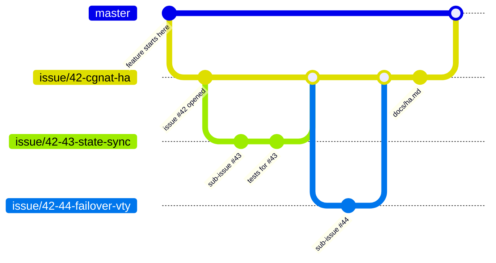

# HexaRouting — Project Rules

## TL;DR

Every feature gets an issue. Every issue gets a branch. Every branch gets
documentation, and everything this project writes down — documentation, CLI
syntax, generated files, source comments and anything posted on GitHub — is in
English, opens with a
TL;DR, uses RFC 2119 keywords for anything normative, answers 5W2H, and draws
its diagrams in Mermaid. A feature too large for one issue is split into
sub-issues, and their branches are cut from the parent issue's branch — not
from `master`. Merges happen when the maintainer asks — except fixes that
change no behaviour, which merge on sight and ride in the next release — and
every merge is a release: a version bump, an annotated tag, a changelog entry
and a published GitHub Release. The project stays on `0.x.x` until the
maintainer declares it production-ready.

The key words **MUST**, **MUST NOT**, **REQUIRED**, **SHALL**, **SHALL NOT**,
**SHOULD**, **SHOULD NOT**, **RECOMMENDED**, **MAY** and **OPTIONAL** in this
document are to be interpreted as described in [RFC 2119][rfc2119].

[rfc2119]: https://www.rfc-editor.org/rfc/rfc2119

## 5W2H

| | |
|---|---|
| **What** | The rules that govern documentation, issues and branches in this repository. |
| **Why** | HexaRouting is shipped to several providers as an appliance. Work that is not written down cannot be reviewed, audited or handed over, and a change with no issue behind it has no recorded reason for existing. |
| **Who** | Everyone who commits to this repository, human or agent. |
| **Where** | This repository and its GitHub issue tracker. The repository is **private** and MUST remain so. |
| **When** | Before the first commit of any change, not after it. |
| **How** | One issue per feature, one branch per issue, sub-issue branches cut from the parent branch, and documentation merged in the same branch as the code it describes. |
| **How much** | The overhead is one issue and one branch per feature. Documentation is proportional to the change: a new subsystem earns a page under `docs/`, a bug fix earns a commit message that explains the failure. |

## 1. Documentation

These rules apply to every document under `docs/`, every `README.md`, every
`*.md` added to this repository, **and to everything the project writes on
GitHub**: issue bodies, issue comments, pull request descriptions, release
notes and tag messages.

**Three things are written in Brazilian Portuguese on purpose, and rule 1 does
not bind them.** `wiki/` is a mirror of the operator wiki, which is published
for the people who run this box and is written in their language;
`PADRAO-DOCUMENTACAO.md` and `PROMPT-DOCUMENTAR-WIKI.md` are the standard and
the brief for writing it, and they are read by the same people. That is 35
files, and the exception was written down only inside
`test/test_english_only.py` until
[#323](https://github.com/andrediashexa/hexarouting/issues/323): a rule that
says MUST and is broken thirty-five times on purpose teaches a reader that the
MUST is decorative. The check enforces exactly this list and a test compares
the two, so neither can quietly grow.

GitHub text is documentation that happens to live outside the tree. An issue
is where the reason for a change is recorded, and it is read by the same
people, under the same conditions, as a file in `docs/` — often years later,
often by someone deciding whether a behaviour was deliberate. An issue that
says "it should probably reject overlapping prefixes" leaves the next reader
guessing whether that was a requirement or a musing; **MUST** and **SHOULD**
settle it.

The proportionality rule still applies: a two-line comment on an issue does
not need a TL;DR or a 5W2H table. What is not negotiable in GitHub text is
**English** and **RFC 2119 keywords for anything normative** — an acceptance
criterion, a constraint, a decision about what the software has to do.

| # | Rule | Notes |
|---|------|-------|
| 1 | Documentation MUST be written in **English** | This includes user-facing strings, CLI syntax, VTY output, generated configuration files **and source comments**. Everything the project writes down is in English. |
| 2 | Every document MUST open with a **TL;DR** | Three to six lines. A reader who stops there MUST still know what the document is about and what it decided. |
| 3 | Every document MUST answer **5W2H** | What, Why, Who, Where, When, How, How much. A table is RECOMMENDED. Short documents MAY fold 5W2H into prose, but no question may go unanswered. |
| 4 | Normative statements MUST use **RFC 2119** keywords | Write "the pool MUST reject overlapping prefixes", not "the pool should probably reject". Every document that uses the keywords MUST cite RFC 2119, as this one does. |
| 5 | Diagrams, when needed, MUST be **Mermaid** | Inline in the Markdown. No binary images, no external diagram services — a diagram that cannot be diffed cannot be reviewed. GitHub renders Mermaid in issues and comments, so this rule holds there too. Diagrams are OPTIONAL; a diagram that only restates the prose SHOULD be dropped. |

Where each rule binds:

| | `docs/`, `README`, `*.md` | Issues, comments, PRs, tag messages |
|---|---|---|
| English | MUST | MUST |
| RFC 2119 for normative statements | MUST | MUST |
| TL;DR | MUST | SHOULD, for anything longer than a screen |
| 5W2H | MUST | SHOULD, on the issue body; not on comments |
| Mermaid for diagrams | MUST | MUST |

A document that describes a decision SHOULD state what was rejected and why.
The reason a knob exists is worth more than the knob's name.

### What GitHub shows is documentation too

`README.md` is the landing page: for most people it is the **only** page they
read, and it is read by people deciding whether this product is worth their
time. Every task **MUST** end by asking whether it made the README wrong, and
the answer goes on the issue like any other.

A README goes stale in a particular way — not by saying something false on the
day it was written, but by describing a smaller product than the one that now
exists. `sh tools/lab.sh # list the 17 executable labs` was true once; it
counted 41 files and 35 suite labs by the time anybody noticed.

The repository's **About** carries three things, and they are documentation:

| | |
|---|---|
| description | one line, what the product is |
| website | <https://hexarouting.hexanetworks.com.br> — the wiki, as the external documentation |
| topics | what somebody would search for to find this |

They **MUST** stay true. A topic that is not a claim this project makes does not
belong there.

Release notes are covered by section 5 and are not optional: a tag is a
pointer, and a release is where an operator who does not clone the repository
reads what changed.

### The wiki is part of the work

Every task **MUST** end by asking whether the wiki needs a page changed or a
page written, and the answer **MUST** be recorded on the issue — including when
it is *no*, and why.

* `PADRAO-DOCUMENTACAO.md` governs how a wiki page is written. Read it before
  writing one; it is not the same standard as this file.
* `wiki/` is a mirror of the live wiki, refreshed with
  `WIKI_TOKEN=... sh tools/wiki-pull.sh`. Read it to see what is already
  documented. An edit drafted there **reaches nobody until it is published** -
  `sh tools/wiki-status.sh` lists what is drafted and still unpublished, and
  `sh tools/wiki-push.sh <file>` publishes one page.
* **Publish before you pull, never after.** `tools/wiki-push.sh` refuses to
  overwrite a page that changed after the last pull, and that guard is per
  document: it does not need a fresh pull to work. Other people write the wiki
  at the same time, and a page built from a snapshot of unknown age discards
  whoever made the change in between.
* **Pulling first destroys unpublished work.** The pull deletes `wiki/` and
  rewrites it from the live wiki. The mirror once stood 28 pages ahead for five
  days, and the advice to pull first would have lost all 28 (#277). The pull
  now refuses while drafts are outstanding.

  That guard exists because of a near miss. Four pages were updated, the mirror
  was never refreshed, and a later edit was built from the stale copy — while
  the maintainer was renaming a category and removing pages. Nothing was lost,
  and only because the stale text failed to match, not because anything
  noticed.
* **The wiki is written for whoever USES the platform**, not for whoever
  develops it — `PADRAO-DOCUMENTACAO.md` section 0, and it is enforced: two
  pages have already been deleted for breaking it. It is also **public on the
  internet**, so a page is written for somebody outside the company.

  These **MUST NOT** appear on a wiki page:

  | Out | Where it lives instead |
  |---|---|
  | building the plugin, `make`, the build container | `README.md`, `TESTING.md` |
  | the labs, `tools/lab.sh`, `LAB_JOBS` | `TESTING.md` |
  | source file names (`bpa_audit.c`, `bpa.api`) | the code |
  | the binary API and its messages | `docs/architecture.md` |
  | **issue numbers and GitHub links** | the issue |
  | lab interface or machine names | nowhere public |
  | `vppctl` and dataplane commands | the product exists so the operator never needs them |

  What *does* belong is the **consequence** of those things when it serves the
  operator. "This is verified against the captured packet, not a counter" is an
  argument about trust and belongs on the wiki; naming the script that does the
  verifying does not.

  I broke this rule the first time I used it: the installation page was given a
  warning citing two issue numbers and linking GitHub. The warning was correct
  and the citations were not, and a reader outside the company cannot open
  either link.

* **Never invent the output of a command.** `lab/*.sh` holds the strings the
  product actually prints, inside its assertions. That is the safe source to
  quote from.

* **Read what a category is FOR before adding to it.** A page can be
  well-written, accurate, and still the wrong page. `make release-gate` was
  added to a wiki page about builds and testing, which was removed days later
  as the wiki narrowed to what an operator does — that content belongs in
  `TESTING.md`, which a customer never reads. Filling a gap a grep found is not
  the same as answering a question a reader has.

**The wiki is a draft and is known to be wrong in places** — including about
the purpose of the project and about deterministic mode's relationship to BPA.
It is not a source. A claim about the product is checked against `docs/`, never
against a wiki page, and a page that disagrees with `docs/` is a defect in the
page.

**The repository is authoritative about the product; the wiki is a usage layer
on top of it.** `docs/`, `README.md` and `TESTING.md` say what the software
does and why. A wiki page says how somebody uses it. Where they disagree the
repository is right and the page is stale, which is a defect in the page.

That is also why a change here often needs a page there and never the reverse:
a behaviour this repository changes can leave a wiki page describing a machine
that no longer exists. `show route`, the disk menu, the records volume — each
of those made a documented procedure wrong the moment it merged.

**The wiki is public on the internet.** Credentials, keys, tokens, SNMP
communities, management addresses and internal machine names **MUST NOT** go
into it, marked or not — and **MUST NOT** go into this repository either, which
is why `tools/wiki-pull.sh` takes its host from the environment and keeps none.

## 2. Issues

Every feature MUST have an issue, opened **before** the work starts.

An issue MUST contain:

* **What** the feature does, in one paragraph.
* **Why** it is needed — the operational problem, not the implementation.
* **Acceptance criteria**, written so that someone else can check them
  without asking the author.
* **How it will be tested.** "Tested manually" is not acceptable; name the
  suite, lab or script that will assert the behaviour.

An issue MUST be kept current. When the design changes mid-flight, the issue
is edited or a comment is added; the divergence MUST NOT live only in the
branch. An issue MUST NOT be closed until its documentation is merged.

### The issue is the record of the work

The issue — not the commit message, not the pull request, not this
conversation — is where someone looks a year later to find out what was
decided and why. So the work MUST be written back to it as it happens:

* **A design decision that the issue did not anticipate** MUST be added as a
  comment, with the reasoning and what was rejected. "The public address is
  not a parameter" and "auto is the minimum, not the egress MTU" are answers
  somebody will need again.
* **A measurement** MUST be recorded on the issue, with its conditions. A
  number in a terminal that scrolled away was not measured.
* **A refusal or a limit** MUST be stated on the issue: what the change
  deliberately does not do, and what would be needed to do it. A limit
  discovered later, by a reader who assumed otherwise, costs far more than
  the sentence that would have prevented it.
* **Anything found on the way that is not this issue** MUST become its own
  issue, linked from this one, rather than a paragraph nobody will find.
* **Closing** MUST carry the acceptance criteria, ticked, with what the
  evidence was — and the release it shipped in.

An issue closed with "done" is an issue whose reasoning was thrown away.

Bug fixes, refactors and chores SHOULD also get an issue. They MAY be
committed directly to a branch named for the fix when the change is smaller
than the issue describing it would be — a typo, a missing dependency — but
anything that changes behaviour MUST go through an issue.

### Sub-issues

A feature that does not fit in one reviewable change MUST be split into
sub-issues. Each sub-issue is a real issue by the rules above and MUST link
back to its parent. The parent issue MUST list its children and MUST NOT be
closed while any child is open.

## 3. Branches

| Kind | Branch name | Cut from | Merges into |
|---|---|---|---|
| Issue | `issue/<number>-<short-slug>` | `master` | `master` |
| Sub-issue | `issue/<parent>-<child>-<short-slug>` | the **parent issue branch** | the parent issue branch |
| Trivial fix | `fix/<short-slug>` | `master` | `master` |

Rules:

* Every issue MUST have its own branch. Two issues MUST NOT share one.
* A sub-issue branch MUST be cut from its parent's branch, and MUST merge
  back into that same parent branch. It MUST NOT merge into `master`
  directly — `master` sees the parent feature whole, or not at all.
* A branch MUST NOT be merged while its tests fail or its documentation is
  missing.
* `master` MUST always build and MUST always pass `make test`.
* Branches SHOULD be deleted once merged.

## 4. Definition of done

A branch is ready to merge when **all** of the following hold:

1. The issue's acceptance criteria are met.
2. The change carries a test that **fails without it**. This project has been
   bitten repeatedly by artifacts that declare success without verifying
   effect — a lab that printed observations and left a human as the oracle,
   a tuning file written where nothing reads it, a self-test that grepped for
   a string nobody emitted any more. A test that cannot fail is not a test.
3. `make test` passes, and any lab or appliance suite touched by the change
   passes.
4. The documentation required by section 1 is merged in the same branch.
5. The commit message explains the failure or the decision, not the diff. The
   diff is already in the commit.

## 5. Versioning and releases

### Before 1.0.0

The project is on `0.x.x` and **MUST** stay there until the maintainer
declares it ready for production. `1.0.0` is a decision, not a milestone
reached by counting features: it is the statement "this may carry a
provider's subscribers", and only the maintainer makes it.

Until then:

| Change merged into `master` | Bump |
|---|---|
| A feature issue, or a parent issue with its sub-issues | `0.MINOR.0` |
| A fix, a chore, a documentation-only change | `0.x.PATCH` |
| Anything at all | never `1.0.0` on its own |

Breaking changes are permitted before 1.0.0 — that is what `0.x` means — but
they **MUST** be called out in the changelog entry, under their own heading.
An operator who takes a new version in the field has no way to read the
diff.

### Every merge is a release

A merge into `master` happens only when the maintainer asks for it — with one
standing exception, below.

When it happens it **MUST** produce all six of:

1. **A version bump** in `VERSION`, which is the single source of truth. No
   version string is hardcoded anywhere else.
2. **An annotated tag** `vX.Y.Z`, whose message is the release note — what
   changed and why, not the diff.
3. **A `CHANGELOG.md` entry** listing the issues the merge closes, in the
   order a reader cares about: behaviour changes first, then fixes, then
   internal work.
4. **A published GitHub Release** on that tag, carrying the same note, the
   medium as an asset, and **the medium's `sha256`**. A tag is a pointer; a
   release is where an operator who does not clone the repository actually
   reads what changed and downloads the artifact. The release notes **MUST
   NOT** be generated from the commit list: a list of commits describes the
   work, and what a reader needs is what changed for them.

   The checksum is written down here because every release so far has carried
   one and nothing said to. `tools/release-gate.sh` prints it in the same
   breath as "ready to publish", so it has always been to hand and has always
   been pasted in by whoever was cutting the release - which is the definition
   of a step that goes missing the first time somebody else does it. It is the
   only thing an operator who downloaded a 300 MB file over a link they do not
   control can check it with, and this product asks them to install it on a box
   that will carry subscribers.
5. **An installation medium, built, booted, INSTALLED and booted again.**
   `make test-iso` builds the ISO from the tagged tree and boots it, demanding
   the self-test report ready. `make test-install` then installs it to a disk
   and boots **that**, with the medium detached. The release note **MUST**
   record that both happened.

   The second boot is not a formality. A live image booting proves the medium
   is bootable; it does not prove the medium produces a working appliance, and
   those are different claims. Two defects lived in that gap for the life of
   the project and were found the first time this ran: the ISO had never
   carried the vat2 plugin, so an installed box had no binary API and could
   not be configured to do CGNAT at all
   ([#119](https://github.com/andrediashexa/hexarouting/issues/119)); and
   behind it, `hexarouting.service` failed on the first boot of every install
   ([#121](https://github.com/andrediashexa/hexarouting/issues/121)). Neither
   was visible from a live boot. They were also hiding each other — the second
   could not be seen until the first was fixed.

   Building it is not enough on its own, and the distinction is the whole
   point: an ISO that builds and does not boot is an artifact reporting
   success without verifying effect, which is the defect class this project
   is organised against. `make iso` produces a file; only `make test-iso`
   produces evidence.

   This exists because the product **is** the appliance. Every release before
   this rule was verified as source — 35 labs and the unit suite — and
   verified as a bootable medium only when somebody thought to check. A
   release nobody can install is not a release; it is a tag.

   A release whose ISO does not boot **MUST NOT** be published. Fix it, or
   say in the note that this version ships as source only and why.

   **The image's filename MUST carry the version**: `hexarouting-0.23.0.iso`,
   never `hexarouting.iso`. A file keeps its name and loses its context the
   moment it is downloaded, copied to a USB stick or handed to somebody at a
   site, and two images with the same name are indistinguishable at exactly
   the moment it matters — when an operator is deciding which one to install.

6. **The roadmap compared against the tracker**, with
   `sh tools/roadmap-state.sh`. It prints every issue `docs/roadmap.md` names
   with its state, flags the ones a section still discusses as work that
   remains while they are closed, and flags open issues the file never
   mentions. The argument for it, and the reason it is neither in `make test`
   nor in `make release-gate`, is rule 5 of that file's own working rules and
   is not restated here.

   It is in this list rather than only in the roadmap because cutting a
   release is the moment somebody reads the roadmap to write a release note,
   and a checklist that does not say so is a second copy of this procedure
   that disagrees with the first by leaving something out. What the tool finds
   is either a sentence to move into the past tense or an issue that needs a
   home in the file; neither blocks the release.

   `make release-gate` is the whole procedure — clone at the tag, build the
   plugin, build the medium, boot it, install it to a disk and boot the disk —
   and it **MUST** be what cuts a release.
   Done by hand it goes wrong: three times in one evening, each caught by a
   rule rather than by attention. See `TESTING.md`.

   `tools/version-stamp.sh --filename` produces the name, and is the only
   place that calculation lives. The bare `hexarouting-<version>.iso` is
   reserved for the tree that **is** the release: clean, and standing exactly
   on the tag for the version it claims. Any other tree adds its commit, and a
   dirty one says so — because the image nobody must mistake for a release is
   the one somebody built from uncommitted changes.

```mermaid
flowchart LR
    A["maintainer asks<br/>for a merge"] --> B["bump VERSION"]
    B --> C["CHANGELOG entry<br/>issues closed"]
    C --> D["merge into master"]
    D --> E["annotated tag vX.Y.Z<br/>message = release note"]
    E --> F["GitHub Release<br/>same note, plus artifacts"]
    F --> H["make test-iso<br/>built AND booted"]
    H --> H2["make test-install<br/>installed AND booted again"]
    H2 --> G["close the issues"]
```

### The standing exception: small fixes

A change that **does not alter behaviour** MAY be merged without asking:

* a wrong or misleading string — an error message, a hint, a usage line;
* a typo, in code comments, documentation or output;
* a missing dependency, path or file in a build or install script;
* documentation that contradicts the code it describes.

Everything else needs the maintainer. In particular a change **MUST NOT** be
merged under this exception if it alters what the software does, changes a
default, touches the datapath, or adds anything an operator could configure.
"It is only a few lines" is not the test — the test is whether a running box
behaves differently afterwards.

This exception exists because the alternative is worse. The fix that prompted
it was a hint in `tools/vty.sh` naming a command that does not do what the hint
says, and holding that behind a round trip means the next reader hits the same
dead end for no reason.

**A fix merged this way does not cut a release.** It rides in the next tagged
one, listed in the changelog under *Fixed*. Otherwise a corrected typo would
produce a version, and a version number that moves for a typo tells an operator
nothing about whether they should upgrade.

Builds from `master` between releases are still identifiable: the version stamp
carries the commit, so `0.4.0 (70cc707)` is visibly not the `0.4.0` tag.

The tag is created **after** the merge commit exists, and points at it. A tag
that predates its own content is worse than no tag. The release is published
from the tag, never the other way round.

A release **SHOULD** carry the artifact a reader would otherwise have to build:
for this project, the ISO. A release note that describes an appliance without
offering it makes the reader do the ten-minute build to find out whether the
change was worth it.

### The version has to be visible on the box

A version that lives only in git identifies the release to whoever has the
repository open, which is not the person reporting a fault. Therefore:

* The boot self-test **MUST** print the version.
* `hexash` **MUST** report it under `show version`, alongside the VPP and FRR
  versions it drives.
* An artifact built from a tree with uncommitted changes **MUST** say so, and
  **MUST NOT** claim to be a released version. An ISO that reports `v0.4.1`
  when it was built from something else sends every later investigation in
  the wrong direction.

## 6. What this does not cover

* **Code review sign-off** — the repository has a single maintainer today, so
  no approval rule is stated. When that changes, this section is where it
  goes.
* **Spoken language** — this document governs what the project *writes*.
  Nobody is required to discuss the work in English.
