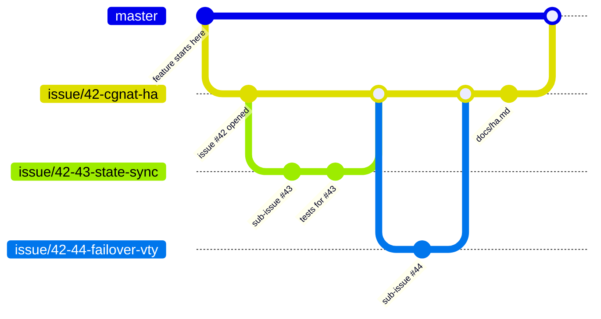
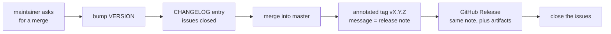

# HexaRouting — Project Rules

## TL;DR

Every feature gets an issue. Every issue gets a branch. Every branch gets
documentation, and everything this project writes down — documentation, CLI
syntax, generated files, source comments and anything posted on GitHub — is in
English, opens with a
TL;DR, uses RFC 2119 keywords for anything normative, answers 5W2H, and draws
its diagrams in Mermaid. A feature too large for one issue is split into
sub-issues, and their branches are cut from the parent issue's branch — not
from `master`. Merges happen when the maintainer asks — except fixes that
change no behaviour, which merge on sight and ride in the next release — and
every merge is a release: a version bump, an annotated tag, a changelog entry
and a published GitHub Release. The project stays on `0.x.x` until the
maintainer declares it production-ready.

The key words **MUST**, **MUST NOT**, **REQUIRED**, **SHALL**, **SHALL NOT**,
**SHOULD**, **SHOULD NOT**, **RECOMMENDED**, **MAY** and **OPTIONAL** in this
document are to be interpreted as described in [RFC 2119][rfc2119].

[rfc2119]: https://www.rfc-editor.org/rfc/rfc2119

## 5W2H

| | |
|---|---|
| **What** | The rules that govern documentation, issues and branches in this repository. |
| **Why** | HexaRouting is shipped to several providers as an appliance. Work that is not written down cannot be reviewed, audited or handed over, and a change with no issue behind it has no recorded reason for existing. |
| **Who** | Everyone who commits to this repository, human or agent. |
| **Where** | This repository and its GitHub issue tracker. The repository is **private** and MUST remain so. |
| **When** | Before the first commit of any change, not after it. |
| **How** | One issue per feature, one branch per issue, sub-issue branches cut from the parent branch, and documentation merged in the same branch as the code it describes. |
| **How much** | The overhead is one issue and one branch per feature. Documentation is proportional to the change: a new subsystem earns a page under `docs/`, a bug fix earns a commit message that explains the failure. |

## 1. Documentation

These rules apply to every document under `docs/`, every `README.md`, every
`*.md` added to this repository, **and to everything the project writes on
GitHub**: issue bodies, issue comments, pull request descriptions, release
notes and tag messages.

GitHub text is documentation that happens to live outside the tree. An issue
is where the reason for a change is recorded, and it is read by the same
people, under the same conditions, as a file in `docs/` — often years later,
often by someone deciding whether a behaviour was deliberate. An issue that
says "it should probably reject overlapping prefixes" leaves the next reader
guessing whether that was a requirement or a musing; **MUST** and **SHOULD**
settle it.

The proportionality rule still applies: a two-line comment on an issue does
not need a TL;DR or a 5W2H table. What is not negotiable in GitHub text is
**English** and **RFC 2119 keywords for anything normative** — an acceptance
criterion, a constraint, a decision about what the software has to do.

| # | Rule | Notes |
|---|------|-------|
| 1 | Documentation MUST be written in **English** | This includes user-facing strings, CLI syntax, VTY output, generated configuration files **and source comments**. Everything the project writes down is in English. |
| 2 | Every document MUST open with a **TL;DR** | Three to six lines. A reader who stops there MUST still know what the document is about and what it decided. |
| 3 | Every document MUST answer **5W2H** | What, Why, Who, Where, When, How, How much. A table is RECOMMENDED. Short documents MAY fold 5W2H into prose, but no question may go unanswered. |
| 4 | Normative statements MUST use **RFC 2119** keywords | Write "the pool MUST reject overlapping prefixes", not "the pool should probably reject". Every document that uses the keywords MUST cite RFC 2119, as this one does. |
| 5 | Diagrams, when needed, MUST be **Mermaid** | Inline in the Markdown. No binary images, no external diagram services — a diagram that cannot be diffed cannot be reviewed. GitHub renders Mermaid in issues and comments, so this rule holds there too. Diagrams are OPTIONAL; a diagram that only restates the prose SHOULD be dropped. |

Where each rule binds:

| | `docs/`, `README`, `*.md` | Issues, comments, PRs, tag messages |
|---|---|---|
| English | MUST | MUST |
| RFC 2119 for normative statements | MUST | MUST |
| TL;DR | MUST | SHOULD, for anything longer than a screen |
| 5W2H | MUST | SHOULD, on the issue body; not on comments |
| Mermaid for diagrams | MUST | MUST |

A document that describes a decision SHOULD state what was rejected and why.
The reason a knob exists is worth more than the knob's name.

## 2. Issues

Every feature MUST have an issue, opened **before** the work starts.

An issue MUST contain:

* **What** the feature does, in one paragraph.
* **Why** it is needed — the operational problem, not the implementation.
* **Acceptance criteria**, written so that someone else can check them
  without asking the author.
* **How it will be tested.** "Tested manually" is not acceptable; name the
  suite, lab or script that will assert the behaviour.

An issue MUST be kept current. When the design changes mid-flight, the issue
is edited or a comment is added; the divergence MUST NOT live only in the
branch. An issue MUST NOT be closed until its documentation is merged.

Bug fixes, refactors and chores SHOULD also get an issue. They MAY be
committed directly to a branch named for the fix when the change is smaller
than the issue describing it would be — a typo, a missing dependency — but
anything that changes behaviour MUST go through an issue.

### Sub-issues

A feature that does not fit in one reviewable change MUST be split into
sub-issues. Each sub-issue is a real issue by the rules above and MUST link
back to its parent. The parent issue MUST list its children and MUST NOT be
closed while any child is open.

## 3. Branches

| Kind | Branch name | Cut from | Merges into |
|---|---|---|---|
| Issue | `issue/<number>-<short-slug>` | `master` | `master` |
| Sub-issue | `issue/<parent>-<child>-<short-slug>` | the **parent issue branch** | the parent issue branch |
| Trivial fix | `fix/<short-slug>` | `master` | `master` |

Rules:

* Every issue MUST have its own branch. Two issues MUST NOT share one.
* A sub-issue branch MUST be cut from its parent's branch, and MUST merge
  back into that same parent branch. It MUST NOT merge into `master`
  directly — `master` sees the parent feature whole, or not at all.
* A branch MUST NOT be merged while its tests fail or its documentation is
  missing.
* `master` MUST always build and MUST always pass `make test`.
* Branches SHOULD be deleted once merged.

## 4. Definition of done

A branch is ready to merge when **all** of the following hold:

1. The issue's acceptance criteria are met.
2. The change carries a test that **fails without it**. This project has been
   bitten repeatedly by artifacts that declare success without verifying
   effect — a lab that printed observations and left a human as the oracle,
   a tuning file written where nothing reads it, a self-test that grepped for
   a string nobody emitted any more. A test that cannot fail is not a test.
3. `make test` passes, and any lab or appliance suite touched by the change
   passes.
4. The documentation required by section 1 is merged in the same branch.
5. The commit message explains the failure or the decision, not the diff. The
   diff is already in the commit.

## 5. Versioning and releases

### Before 1.0.0

The project is on `0.x.x` and **MUST** stay there until the maintainer
declares it ready for production. `1.0.0` is a decision, not a milestone
reached by counting features: it is the statement "this may carry a
provider's subscribers", and only the maintainer makes it.

Until then:

| Change merged into `master` | Bump |
|---|---|
| A feature issue, or a parent issue with its sub-issues | `0.MINOR.0` |
| A fix, a chore, a documentation-only change | `0.x.PATCH` |
| Anything at all | never `1.0.0` on its own |

Breaking changes are permitted before 1.0.0 — that is what `0.x` means — but
they **MUST** be called out in the changelog entry, under their own heading.
An operator who upgrades an appliance in the field has no way to read the
diff.

### Every merge is a release

A merge into `master` happens only when the maintainer asks for it — with one
standing exception, below.

When it happens it **MUST** produce all four of:

1. **A version bump** in `VERSION`, which is the single source of truth. No
   version string is hardcoded anywhere else.
2. **An annotated tag** `vX.Y.Z`, whose message is the release note — what
   changed and why, not the diff.
3. **A `CHANGELOG.md` entry** listing the issues the merge closes, in the
   order a reader cares about: behaviour changes first, then fixes, then
   internal work.
4. **A published GitHub Release** on that tag, carrying the same note. A tag
   is a pointer; a release is where an operator who does not clone the
   repository actually reads what changed and downloads the artifact. The
   release notes **MUST NOT** be generated from the commit list: a list of
   commits describes the work, and what a reader needs is what changed for
   them.

### The standing exception: small fixes

A change that **does not alter behaviour** MAY be merged without asking:

* a wrong or misleading string — an error message, a hint, a usage line;
* a typo, in code comments, documentation or output;
* a missing dependency, path or file in a build or install script;
* documentation that contradicts the code it describes.

Everything else needs the maintainer. In particular a change **MUST NOT** be
merged under this exception if it alters what the software does, changes a
default, touches the datapath, or adds anything an operator could configure.
"It is only a few lines" is not the test — the test is whether a running box
behaves differently afterwards.

This exception exists because the alternative is worse. The fix that prompted
it was a hint in `tools/vty.sh` naming a command that does not do what the hint
says, and holding that behind a round trip means the next reader hits the same
dead end for no reason.

**A fix merged this way does not cut a release.** It rides in the next tagged
one, listed in the changelog under *Fixed*. Otherwise a corrected typo would
produce a version, and a version number that moves for a typo tells an operator
nothing about whether they should upgrade.

Builds from `master` between releases are still identifiable: the version stamp
carries the commit, so `0.4.0 (70cc707)` is visibly not the `0.4.0` tag.

The tag is created **after** the merge commit exists, and points at it. A tag
that predates its own content is worse than no tag. The release is published
from the tag, never the other way round.

A release **SHOULD** carry the artifact a reader would otherwise have to build:
for this project, the ISO. A release note that describes an appliance without
offering it makes the reader do the ten-minute build to find out whether the
change was worth it.

### The version has to be visible on the box

A version that lives only in git identifies the release to whoever has the
repository open, which is not the person reporting a fault. Therefore:

* The boot self-test **MUST** print the version.
* `hexash` **MUST** report it under `show version`, alongside the VPP and FRR
  versions it drives.
* An artifact built from a tree with uncommitted changes **MUST** say so, and
  **MUST NOT** claim to be a released version. An ISO that reports `v0.4.1`
  when it was built from something else sends every later investigation in
  the wrong direction.

## 6. What this does not cover

* **Code review sign-off** — the repository has a single maintainer today, so
  no approval rule is stated. When that changes, this section is where it
  goes.
* **Spoken language** — this document governs what the project *writes*.
  Nobody is required to discuss the work in English.
