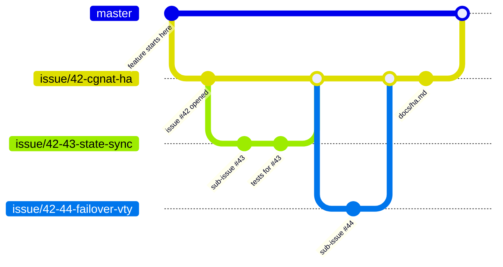

# HexaRouting — Project Rules

## TL;DR

Every feature gets an issue. Every issue gets a branch. Every branch gets
documentation, and that documentation is written in English, opens with a
TL;DR, uses RFC 2119 keywords for anything normative, answers 5W2H, and draws
its diagrams in Mermaid. A feature too large for one issue is split into
sub-issues, and their branches are cut from the parent issue's branch — not
from `master`.

The key words **MUST**, **MUST NOT**, **REQUIRED**, **SHALL**, **SHALL NOT**,
**SHOULD**, **SHOULD NOT**, **RECOMMENDED**, **MAY** and **OPTIONAL** in this
document are to be interpreted as described in [RFC 2119][rfc2119].

[rfc2119]: https://www.rfc-editor.org/rfc/rfc2119

## 5W2H

| | |
|---|---|
| **What** | The rules that govern documentation, issues and branches in this repository. |
| **Why** | HexaRouting is shipped to several providers as an appliance. Work that is not written down cannot be reviewed, audited or handed over, and a change with no issue behind it has no recorded reason for existing. |
| **Who** | Everyone who commits to this repository, human or agent. |
| **Where** | This repository and its GitHub issue tracker. The repository is **private** and MUST remain so. |
| **When** | Before the first commit of any change, not after it. |
| **How** | One issue per feature, one branch per issue, sub-issue branches cut from the parent branch, and documentation merged in the same branch as the code it describes. |
| **How much** | The overhead is one issue and one branch per feature. Documentation is proportional to the change: a new subsystem earns a page under `docs/`, a bug fix earns a commit message that explains the failure. |

## 1. Documentation

Every document under `docs/`, every `README.md` and every `*.md` added to this
repository MUST follow all five rules below.

| # | Rule | Notes |
|---|------|-------|
| 1 | Documentation MUST be written in **English** | This includes user-facing strings, CLI syntax, VTY output, generated configuration files **and source comments**. Everything the project writes down is in English. |
| 2 | Every document MUST open with a **TL;DR** | Three to six lines. A reader who stops there MUST still know what the document is about and what it decided. |
| 3 | Every document MUST answer **5W2H** | What, Why, Who, Where, When, How, How much. A table is RECOMMENDED. Short documents MAY fold 5W2H into prose, but no question may go unanswered. |
| 4 | Normative statements MUST use **RFC 2119** keywords | Write "the pool MUST reject overlapping prefixes", not "the pool should probably reject". Every document that uses the keywords MUST cite RFC 2119, as this one does. |
| 5 | Diagrams, when needed, MUST be **Mermaid** | Inline in the Markdown. No binary images, no external diagram services — a diagram that cannot be diffed cannot be reviewed. Diagrams are OPTIONAL; a diagram that only restates the prose SHOULD be dropped. |

A document that describes a decision SHOULD state what was rejected and why.
The reason a knob exists is worth more than the knob's name.

## 2. Issues

Every feature MUST have an issue, opened **before** the work starts.

An issue MUST contain:

* **What** the feature does, in one paragraph.
* **Why** it is needed — the operational problem, not the implementation.
* **Acceptance criteria**, written so that someone else can check them
  without asking the author.
* **How it will be tested.** "Tested manually" is not acceptable; name the
  suite, lab or script that will assert the behaviour.

An issue MUST be kept current. When the design changes mid-flight, the issue
is edited or a comment is added; the divergence MUST NOT live only in the
branch. An issue MUST NOT be closed until its documentation is merged.

Bug fixes, refactors and chores SHOULD also get an issue. They MAY be
committed directly to a branch named for the fix when the change is smaller
than the issue describing it would be — a typo, a missing dependency — but
anything that changes behaviour MUST go through an issue.

### Sub-issues

A feature that does not fit in one reviewable change MUST be split into
sub-issues. Each sub-issue is a real issue by the rules above and MUST link
back to its parent. The parent issue MUST list its children and MUST NOT be
closed while any child is open.

## 3. Branches

| Kind | Branch name | Cut from | Merges into |
|---|---|---|---|
| Issue | `issue/<number>-<short-slug>` | `master` | `master` |
| Sub-issue | `issue/<parent>-<child>-<short-slug>` | the **parent issue branch** | the parent issue branch |
| Trivial fix | `fix/<short-slug>` | `master` | `master` |

Rules:

* Every issue MUST have its own branch. Two issues MUST NOT share one.
* A sub-issue branch MUST be cut from its parent's branch, and MUST merge
  back into that same parent branch. It MUST NOT merge into `master`
  directly — `master` sees the parent feature whole, or not at all.
* A branch MUST NOT be merged while its tests fail or its documentation is
  missing.
* `master` MUST always build and MUST always pass `make test`.
* Branches SHOULD be deleted once merged.

## 4. Definition of done

A branch is ready to merge when **all** of the following hold:

1. The issue's acceptance criteria are met.
2. The change carries a test that **fails without it**. This project has been
   bitten repeatedly by artifacts that declare success without verifying
   effect — a lab that printed observations and left a human as the oracle,
   a tuning file written where nothing reads it, a self-test that grepped for
   a string nobody emitted any more. A test that cannot fail is not a test.
3. `make test` passes, and any lab or appliance suite touched by the change
   passes.
4. The documentation required by section 1 is merged in the same branch.
5. The commit message explains the failure or the decision, not the diff. The
   diff is already in the commit.

## 5. What this does not cover

* **Release versioning and tagging** — not defined yet.
* **Code review sign-off** — the repository has a single maintainer today, so
  no approval rule is stated. When that changes, this section is where it
  goes.
* **Spoken language** — this document governs what the project *writes*.
  Nobody is required to discuss the work in English.
