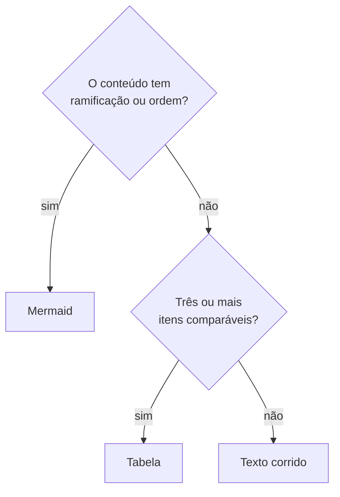

# Padrão de documentação — wiki Prisma Routing

Como as páginas da wiki são escritas. Existe para que qualquer pessoa possa
acrescentar conteúdo sem que a wiki vire quinze estilos diferentes.

A wiki fica em <https://hexarouting.hexanetworks.com.br> (Outline). A raiz do
domínio abre a leitura pública; quem vai editar entra por `/entrar`.

> **A wiki é pública na internet.** Escreva sempre para alguém de fora — um
> cliente, um parceiro, um integrador. Conteúdo que só faz sentido para quem tem
> acesso ao laboratório ou à infraestrutura da Hexanetworks vai marcado, e nunca
> inclui credencial, endereço de gerência ou nome de máquina interna.

Este arquivo governa a **wiki**, não os documentos deste repositório. Os
documentos do repo (`README.md`, `docs/`, `TESTING.md`) seguem as regras do
[CONTRIBUTING.md](CONTRIBUTING.md) e continuam sendo a fonte autoritativa sobre
o produto — a wiki é uma camada de uso por cima deles, não uma segunda cópia do
design.

## 0. Para quem a wiki é escrita

**A wiki é para quem USA a plataforma — o operador, o NOC, quem avalia o produto.
Não é para quem o desenvolve.**

Quem desenvolve lê `README.md`, `docs/` e `TESTING.md`, que são autoritativos e
não envelhecem em duas cópias. Uma página de wiki que ensina a compilar é uma
segunda cópia daquilo, e diverge.

Não entram na wiki:

| Fora | Onde isso vive |
|---|---|
| compilar o plugin, `make`, container de build | `README.md`, `TESTING.md` |
| os laboratórios, `tools/lab.sh`, `LAB_JOBS` | `TESTING.md` |
| nomes de arquivo de código-fonte (`bpa_audit.c`, `bpa.api`) | o próprio código |
| a API binária e suas mensagens | `docs/architecture.md` |
| números de issue e links do GitHub | o issue |
| nomes de interface ou de máquina do laboratório | lugar nenhum público |

O que **entra**, quando serve ao operador, é a *consequência* daquilo. "Isto é
verificado sobre o pacote capturado, não sobre um contador" é argumento de
confiança para quem avalia o produto e pertence à wiki; nomear o script que faz
essa verificação, não.

Comandos de diagnóstico profundo (`vppctl`) também ficam de fora: o produto
existe para que o operador não precise sair da VTY, e uma wiki que ensina a
descer ao dataplane contradiz isso.

## 1. Estrutura obrigatória de cada página

Toda página tem três partes, nesta ordem.

### Abertura

Uma a três frases dizendo **o que a página resolve** e **para quem**. Sem
título, logo abaixo do nome da página.

Não abra com definição de dicionário nem com história do produto. O leitor
chegou com uma pergunta; a abertura confirma que ele está na página certa.

### Corpo

O formato depende do tipo de página:

| Tipo | Como o corpo é organizado |
|---|---|
| **Tarefa** (como fazer algo) | Passos numerados. Cada passo traz o comando e o que ele muda. |
| **Referência** (o que existe) | Tabelas por assunto, uma linha por item, com argumento e efeito. |
| **Conceito** (por que é assim) | O problema, a ideia, a consequência prática. Nessa ordem. |

Uma página não mistura os três. Se a referência de um comando precisar de um
tutorial, o tutorial é outra página e as duas se linkam.

### Fecho

| Tipo de página | Fecha com |
|---|---|
| Tarefa | **Como conferir** — o comando que prova que deu certo e o que esperar dele |
| Referência | **Ver também** — as páginas vizinhas |
| Conceito | **Ver também** — onde isso vira ação |

Uma tarefa sem verificação está incompleta. Quem executou precisa saber se
funcionou sem esperar o cliente reclamar.

## 2. Quando usar callout, tabela e diagrama

### Callouts

O Outline tem quatro tipos, cada um com uma função. Um callout que não se
encaixa em nenhuma delas não deve existir — o excesso de destaque faz o leitor
parar de enxergar todos.

| Tipo | Usar quando | Nunca usar para |
|---|---|---|
| `:::warning` | ignorar custa **serviço, dado ou prova**: derruba sessão, apaga disco, quebra guarda legal | chamar atenção para algo meramente importante |
| `:::info` | contexto que **muda a decisão** do leitor, mas não é perigo | repetir o que o parágrafo anterior já disse |
| `:::success` | confirmar que algo **deu certo**, no fecho de uma tarefa | comemorar |
| `:::tip` | **não usar** | — |

O `:::tip` fica de fora de propósito: dica decorativa é ruído, e o que é
realmente útil pertence ao corpo do texto.

A sintaxe é uma cerca de três dois-pontos:

```
:::warning
Mudar `inside`, `outside`, `block-size`, `ports`, `policy`, `mode` ou `vrf`
derruba todas as sessões do pool.
:::
```

Esse é o peso de um `warning`. Se o aviso não tem essa gravidade, ele não é um
warning.

### Tabelas

Use tabela quando houver **três ou mais itens comparáveis** — campo e efeito,
comando e resultado, opção e consequência.

Não use tabela para texto corrido: duas colunas de parágrafos são mais difíceis
de ler do que os mesmos parágrafos soltos.

Toda tabela de referência tem uma coluna que responde *"o que isso faz por
mim?"*, não só o nome do campo.

### Diagramas

Diagrama é **Mermaid**, sempre. Nada de arte ASCII: ela quebra no celular e não
dá para copiar. O Outline renderiza blocos ```` ```mermaid ```` nativamente.

Use diagrama quando existir:

* uma **decisão** — o leitor precisa escolher entre caminhos (`flowchart` com
  losango);
* uma **ordem ou dependência** — o que acontece antes do quê;
* uma **topologia** — quem fala com quem.

Não use diagrama para ilustrar uma lista. Se as caixas não têm setas com
significado, a lista já era o formato certo.



## 3. Comandos e conteúdo interno

Todo comando vai em bloco de código. **Nunca invente a saída de um comando** —
descreva o que esperar, ou cite apenas trechos que você viu de fato.

Conteúdo que só serve para quem tem acesso interno vai marcado:

```
:::info
**Interno.** Detalhe de laboratório ou de infraestrutura da Hexanetworks.
Quem lê de fora pode ignorar.
:::
```

Nunca vão para a wiki, marcados ou não: senhas, chaves, tokens, comunidades
SNMP, endereços de gerência e nomes de máquinas internas.

## 4. Organização

A wiki é **uma coleção só**, porque o compartilhamento público do Outline é por
coleção e a raiz do domínio aponta para esse link único. As categorias são
páginas-mãe, cada uma com ícone e cor:

| Categoria | Para quem chega com… |
|---|---|
| Começar aqui | uma máquina para pôr no ar |
| Operar | uma máquina já em produção |
| Referência | um comando específico para consultar |
| Entender e desenvolver | a pergunta *por que é assim* |

Uma categoria é uma página de verdade, não uma pasta vazia: abre dizendo o que
cobre e para quem, com uma tabela do que responde cada filha.

Ícones são os nomeados do próprio Outline, com cor por categoria. Sem emoji.
