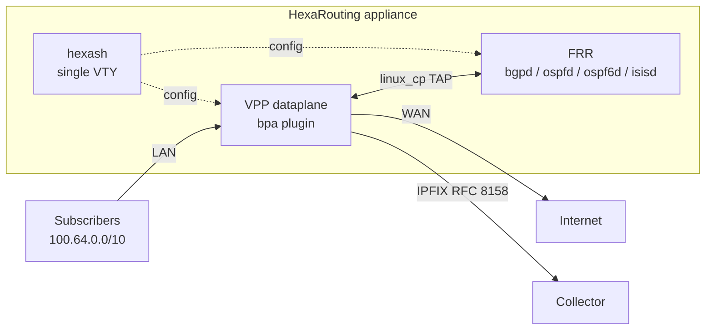

# HexaRouting

## TL;DR

Software router with built-in CGNAT using **BPA** (*Bloco de Portas Alocadas* —
allocated port blocks). VPP/DPDK dataplane, FRR control plane, IPFIX logging
per RFC 8158, single VTY. Targets 100 Gbps+ and 200k+ subscribers, shipped as
an installable Debian appliance.

Verified on real hardware with real Internet traffic: subscribers translated
to the exact public addresses the reference model predicts, ICMP and HTTPS
flowing, BGP/OSPF/IS-IS routes reaching the VPP FIB.

```sh
make test              # the core suites: no root, no VPP required
sh tools/lab.sh        # list the labs
sh tools/run-all-labs.sh   # the whole dataplane suite, several at a time
sh tools/vty.sh        # open the VTY
make release-gate      # build the installation medium from a tag and boot it
```

## 5W2H

| | |
|---|---|
| **What** | An IPv4 software router whose CGNAT allocates a contiguous **port block** per subscriber instead of logging every flow. |
| **Why** | Brazilian regulation (Marco Civil, Law 12.965/2014) requires one year of connection records. Per-flow NAT logging produces terabytes; BPA reduces this to one record per block — or to **zero** in deterministic mode, where the proof is the algorithm and the dated configuration instead. |
| **Who** | ISPs deploying CGNAT. The product is installed per provider, not multi-tenant. |
| **When** | Deployed when public IPv4 runs out and subscribers must share addresses. |
| **Where** | On the provider's border, between the subscriber network (RFC 6598) and the upstream. |
| **How** | VPP plugin (`bpa`) performs translation; FRR handles routing via `linux_cp`; `hexash` provides one CLI for both. |
| **How much** | 200k subscribers in deterministic mode with 512-port blocks require a `/21` of public IPv4. Dynamic mode with oversubscription needs far less — see [docs/logging.md](docs/logging.md). |

## Architecture at a glance



## Layout

```
CONTRIBUTING.md        project rules: documentation, issues, branches, releases
CHANGELOG.md           what changed in each released version
VERSION                single source of truth for the version
docs/context.md        start here: the invariants, the map, the reading order
docs/architecture.md   design decisions, sharding, mapping algorithm
docs/routing.md        FRR integration, VTY, punt pitfalls
docs/logging.md        BPA log export over IPFIX (RFC 8158)
docs/appliance.md      boot tuning, systemd, install, ISO
docs/roadmap.md        what a CGNAT still needs, and why each item matters
docs/ha.md             high-availability analysis (NOT implemented)
docs/bng.md            BNG analysis: what VPP gives and what it would cost (NOT implemented)
docs/wiki-audit.md     the brief for auditing the wiki against this repository
PADRAO-DOCUMENTACAO.md how a wiki page is written (not the same as CONTRIBUTING)
wiki/                  read-only mirror of the wiki, refreshed by tools/wiki-pull.sh
ref/                   executable reference model of BPA, in Python
src/plugins/bpa/       the VPP CGNAT plugin
src/hexash/            the VTY
test/                  core tests: no VPP, no root
lab/                   executable labs, from packet injection to real traffic
appliance/             boot tuning, systemd units, installer, ISO builder
tools/                 build and lab helpers
```

## Documentation

| Where | What it is |
|---|---|
| [docs/context.md](docs/context.md) | **Start here.** The invariants, a map of what question each part answers, and a reading order per task. |
| `docs/`, `README.md`, `TESTING.md` | **Authoritative about the product.** What it does and why. |
| <https://hexarouting.hexanetworks.com.br> | The wiki: how somebody *uses* it. A usage layer, and currently a **draft** — see below. |

The wiki is public and still being written. It is **not** a source: where a page
disagrees with `docs/`, the page is a defect. `wiki/` here is a read-only mirror
so its pages can be read and diffed without leaving the repository;
[docs/wiki-audit.md](docs/wiki-audit.md) is the brief for correcting it.

## Getting started

**Start with [docs/context.md](docs/context.md)** — the eleven facts that make
the rest of the repository legible, a map of what question each part answers,
and a reading order per task. It does not repeat the design; it says which file
is authoritative for each decision.

Then **[TESTING.md](TESTING.md)** for the four testing levels and what class of
defect each one catches.

```sh
sh tools/build.sh image     # build container, VPP pinned to 26.06
sh tools/build.sh plugin    # compile the plugin
make test                   # core tests
sh tools/lab.sh datapath    # packet-level translation
make iso                    # the installation medium
```

The ISO is an installation medium, not an appliance: it boots with no
credentials, and `install` in the VTY asks for the disk, hostname, timezone and
root password before it writes anything. See
[docs/appliance.md](docs/appliance.md#installing-to-disk).

## Status

The current version is in [`VERSION`](VERSION) — deliberately not repeated
here, since a number written in two places becomes two numbers. The project
stays on `0.x.x` until it is declared ready for production; see
[CONTRIBUTING.md](CONTRIBUTING.md) section 5 and [CHANGELOG.md](CHANGELOG.md).

| Component | State |
|---|---|
| BPA mapping core | Verified against the Python reference model, every mapping in the pool one by one; `make test` prints the counts |
| Dataplane (translation, handoff, dynamic mode, fragments, ICMP errors, TCP state) | Verified with injected and real traffic |
| Routing (BGP, OSPF, IS-IS) | Verified — routes reach the VPP FIB |
| IPFIX logging (UDP and TCP) | Verified with a decoding collector |
| VTY (`hexash`) | Candidate/`commit`/`rollback`, roles, `show route` against the FIB, `show this`, and completion of live values — interfaces from the dataplane, pools from the candidate |
| Configuration trail | Attributable and tamper-evident: every entry names the operator and is chained by SHA-256 |
| Appliance (ISO, tuning, systemd) | ISO boots clean, self-test reports ready; every release is built from its tag and booted before publishing |
| Connection records | On their own filesystem, so a full log cannot stop the box working |
| **HA / failover** | **NOT implemented** — see [docs/ha.md](docs/ha.md) |
| **Throughput** | **NOT measured** — every performance figure is untested; see [#28](https://github.com/andrediashexa/hexarouting/issues/28) |

What is planned, in which release, and why in that order:
[docs/roadmap.md](docs/roadmap.md) section 5.
