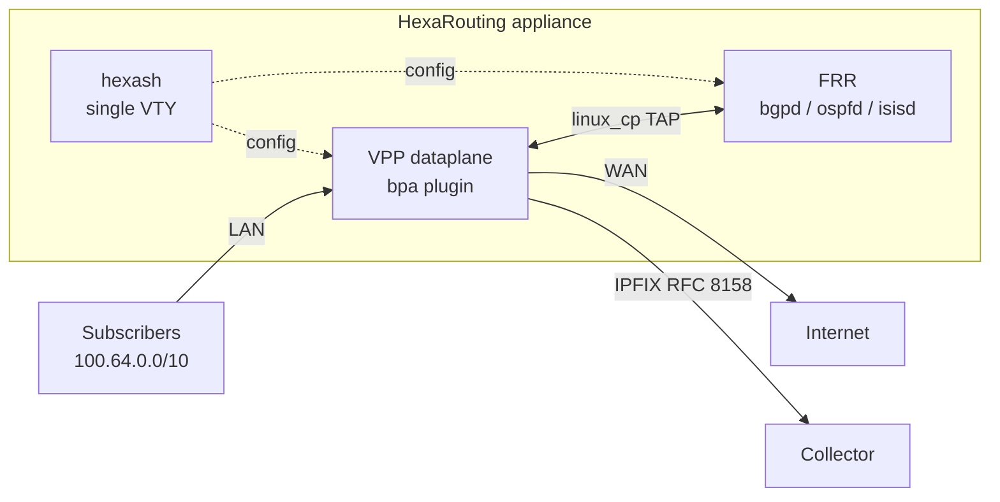

# HexaRouting

## TL;DR

Software router with built-in CGNAT using **BPA** (*Bloco de Portas Alocadas* —
allocated port blocks). VPP/DPDK dataplane, FRR control plane, IPFIX logging
per RFC 8158, single VTY. Targets 100 Gbps+ and 200k+ subscribers, shipped as
an installable Debian appliance.

Verified on real hardware with real Internet traffic: subscribers translated
to the exact public addresses the reference model predicts, ICMP and HTTPS
flowing, BGP/OSPF/IS-IS routes reaching the VPP FIB.

```sh
make test              # 3 seconds, no root, no VPP required
sh tools/lab.sh        # list the 17 executable labs
sh tools/vty.sh        # open the VTY
```

## 5W2H

| | |
|---|---|
| **What** | An IPv4 software router whose CGNAT allocates a contiguous **port block** per subscriber instead of logging every flow. |
| **Why** | Brazilian regulation (Marco Civil, Law 12.965/2014) requires one year of connection records. Per-flow NAT logging produces terabytes; BPA reduces this to one record per block — or to **zero** in deterministic mode. |
| **Who** | ISPs deploying CGNAT. The product is installed per provider, not multi-tenant. |
| **When** | Deployed when public IPv4 runs out and subscribers must share addresses. |
| **Where** | On the provider's border, between the subscriber network (RFC 6598) and the upstream. |
| **How** | VPP plugin (`bpa`) performs translation; FRR handles routing via `linux_cp`; `hexash` provides one CLI for both. |
| **How much** | 200k subscribers in deterministic mode with 512-port blocks require a `/21` of public IPv4. Dynamic mode with oversubscription needs far less — see [docs/logging.md](docs/logging.md). |

## Architecture at a glance



## Layout

```
CONTRIBUTING.md        project rules: documentation, issues, branches, releases
CHANGELOG.md           what changed in each released version
VERSION                single source of truth for the version
docs/architecture.md   design decisions, sharding, mapping algorithm
docs/routing.md        FRR integration, VTY, punt pitfalls
docs/logging.md        BPA log export over IPFIX (RFC 8158)
docs/appliance.md      boot tuning, systemd, install, ISO
docs/ha.md             high-availability analysis (NOT implemented)
ref/                   executable reference model of BPA, in Python
src/plugins/bpa/       the VPP CGNAT plugin
src/hexash/            the VTY
test/                  core tests: no VPP, no root
lab/                   executable labs, from packet injection to real traffic
appliance/             boot tuning, systemd units, installer, ISO builder
tools/                 build and lab helpers
```

## Getting started

See **[TESTING.md](TESTING.md)** for the four testing levels and what class of
defect each one catches.

```sh
sh tools/build.sh image     # build container, VPP pinned to 26.06
sh tools/build.sh plugin    # compile the plugin
make test                   # core tests
sh tools/lab.sh datapath    # packet-level translation
```

## Status

The current version is in [`VERSION`](VERSION) — deliberately not repeated
here, since a number written in two places becomes two numbers. The project
stays on `0.x.x` until it is declared ready for production; see
[CONTRIBUTING.md](CONTRIBUTING.md) section 5 and [CHANGELOG.md](CHANGELOG.md).

| Component | State |
|---|---|
| BPA mapping core | Verified — 35,335 checks against the Python reference model |
| Dataplane (translation, handoff, dynamic mode, fragments, ICMP errors, TCP state) | Verified with injected and real traffic |
| Routing (BGP, OSPF, IS-IS) | Verified — routes reach the VPP FIB |
| IPFIX logging (UDP and TCP) | Verified with a decoding collector |
| VTY (`hexash`) | Working, with tab completion and contextual `?` |
| Appliance (ISO, tuning, systemd) | ISO boots clean, self-test reports ready |
| **HA / failover** | **NOT implemented** — see [docs/ha.md](docs/ha.md) |
