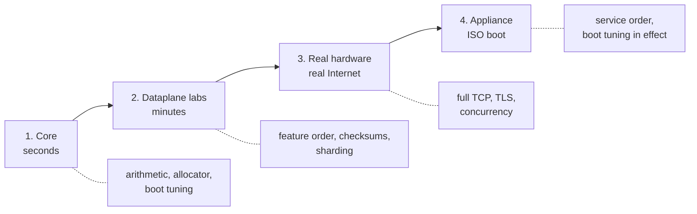

# HexaRouting — Testing

## TL;DR

Four levels, cheapest first. Each catches a different class of defect and none
replaces the next.

```sh
make test                 # 3 s   — core, no root, no VPP
sh tools/lab.sh <name>    # min   — dataplane labs with injected packets
sh tools/lab.sh hw-lab    # min   — two VMs, real Internet traffic
sh tools/lab.sh boot-iso  # s/min — the appliance actually booting
```

> The key words **MUST**, **SHOULD** and **MAY** in this document are to be
> interpreted as described in
> [RFC 2119](https://www.rfc-editor.org/rfc/rfc2119).

## 5W2H

| | |
|---|---|
| **What** | A test suite spanning pure arithmetic to a booted appliance carrying real traffic. |
| **Why** | Each level catches defects the others structurally cannot; several bugs in this project were visible only at one specific level. |
| **Who** | Anyone changing the code; CI runs level 1 on every commit. |
| **When** | Level 1 before every commit; levels 2–4 before a release. |
| **Where** | Levels 1–2 need only the build container; level 3 needs two machines; level 4 needs KVM or patience. |
| **How** | Every lab prints the **expected** value before the **observed** one, and several verify the captured packet rather than trusting a counter. |
| **How much** | Level 1 is seconds. A full ISO rebuild plus boot is roughly fifteen minutes. |



## 1. Core — seconds, nothing installed

```sh
make test      # BPA mapping, port allocator, MSS clamp, FTP sequence shift,
               # boot tuning, VTY, candidate model, installer answers
make model     # validates the reference model itself
```

`make test` MUST pass on an ordinary developer account. It reads no system
state — a test that needed the invoking account to be root, or in the
HexaRouting groups, is a test that is red on every machine but one, and a
suite nobody can run green is a suite whose next real failure is
indistinguishable from the noise it already prints.

Requires no root, no VPP and no network. The C implementation is checked
against `ref/bpa_model.py`, which is the executable specification: any
divergence **MUST** break the build.

Catches: mapping arithmetic, block collisions, port allocator behaviour,
consecutive even-aligned media port pairs, the RTSP and SIP parsers'
refusals and the SIP multi-edit arithmetic,
`isolcpus` and hugepage computation, command-tree completion, and every answer
the installer must refuse — each of those is a disk that has to stay untouched,
and reaching one in a virtual machine costs a whole boot cycle.

Also at this level, and for the same reason — the failure is **silent**, so no
lab is going to notice it:

| Test | What it pins |
|---|---|
| `test_bpa_mss.c` | The MSS clamp: that it only ever **lowers**, that it declines a malformed option list, a length byte pointing outside the header and a data offset that lies — and that the incremental checksum equals a full recomputation. Getting that wrong makes the peer drop the segment, so the connection hangs exactly as it did before clamping while a counter reports the fix was applied. |
| `test_bpa_ftp.c` | The FTP sequence shift: `bpa_seq_after` across the 2^32 boundary, a retransmission of data sent **before** a rewrite, and a control connection rewritten twice. No lab is going to send four gigabytes to reach the wrap. |
| `test_context_map.py` | That every repository path named in `docs/context.md` exists, and that `README.md` still reaches it. A map naming files that are no longer there is worse than no map — it is confidently wrong, and this is the half of it that rots without anyone noticing. |
| `test_hexash_config.py` | Which changes rebuild a pool and which apply in place. Classified as a table, with an assertion that the table **covers every field a pool has** — so a field added later is a failure rather than a silent default. |

Each assertion in those three was run against deliberately broken code and
required to fail before being kept. An assertion that has never failed has not
been shown to test anything, which is the defect class this project keeps
hitting — see `CONTRIBUTING.md`.

## Cutting a release

```sh
make release-gate TAG=v0.26.0     # or with HEAD on the tag, just: make release-gate
```

`CONTRIBUTING.md` section 5 requires every release to ship an installation
medium that has been **built and booted**. This is that procedure as one
command, and it exists because as a sequence somebody retypes, it gets retyped
wrong. In one evening the same person got it wrong three times, and **every one
was caught by a rule rather than by attention**:

| What went wrong | What caught it |
|---|---|
| built from the working tree, carrying uncommitted work from the next issue | the filename rule — stamped `-dirty` |
| built with no plugin, because a clean tree has no `.build-vpp` | `build-iso.sh` refused |
| built from a git **worktree**, whose `.git` is a pointer to a repository the build container does not have mounted | the filename rule — stamped `-unverified` |

The gate **clones** the repository at the tag, so uncommitted work cannot
contaminate the image at all — the first mistake is now structurally
impossible rather than merely detected. It then refuses:

* a tag that does not exist;
* a tag on a tree whose `VERSION` disagrees with it — a `v0.27.0` tag on a
  `0.26.0` tree produces an image called `0.26.0` published under `0.27.0`;
* any image whose name carries `-dirty` or `-unverified`;
* a medium that builds and does not boot, or boots and does not report ready.

`RELEASE_GATE_CHECK_ONLY=1` runs the checks and builds nothing, so they can be
exercised without a 321 MB image — a check that can only be reached by building
one is a check nobody reaches.

## 2. Dataplane labs — minutes, inside the container

The whole suite runs several labs at a time:

```sh
sh tools/run-all-labs.sh          # 4 at a time
LAB_JOBS=5 sh tools/run-all-labs.sh
```

Measured on 8 cores and 32 GB: **~35 minutes in series, 12m45s at
`LAB_JOBS=5`**, and the two parallel runs produced identical verdicts. That
last part is the condition, not a bonus — a parallel suite that is not
reproducible has replaced a slow answer with an unreliable one, and 35 honest
minutes beat 13 that sometimes lie.

The suite is not compute-bound and never was: each lab starts VPP, sleeps for
packets to cross, and waits on timeouts. Measured before this existed, the
series run sat at load 1.18 across 8 cores **with an ISO build running
alongside it**. It was a queue, not a workload.

What makes it safe is that `tools/lab.sh` gives each lab its own container
**without** `--network=host`, so the fixed `veth` and `netns` names in
`routing`, `lcp`, `ipfix`, `ipfix-tcp` and `vty` cannot collide. The one piece
of shared writable state is `/src/.build-vpp`, where 36 labs each run `ninja` —
so the plugin is built **once, before any lab starts**, and no lab is the one
that happens to build it.

Output is captured per lab and printed whole, in list order. Interleaved output
from five labs at once is not a report.

```sh
sh tools/lab.sh                # list every lab with a one-line description
sh tools/lab.sh datapath       # translation with real packets, 1 worker
sh tools/lab.sh handoff        # sharding across 2 workers
sh tools/lab.sh dynamic        # dynamic mode and block hold-down
sh tools/lab.sh frag           # IP fragments
sh tools/lab.sh icmp-tcp       # ICMP errors (PMTUD) and TCP state
sh tools/lab.sh ftp-alg        # FTP ALG: payload rewrite and sequence shift
sh tools/lab.sh ftp-alg off    # the same lab with the ALG off: MUST fail
sh tools/lab.sh rtsp           # the RTSP ALG, asserted on the captured packet
sh tools/lab.sh sip            # the SIP ALG over UDP: Via, Contact, SDP, RTP pair
sh tools/lab.sh sip off        # the same lab with the ALG off: MUST fail
sh tools/lab.sh hairpin        # one subscriber reaching another (RFC 4787 REQ-9)
sh tools/lab.sh nat-behaviour  # RFC 4787 mapping and filtering
sh tools/lab.sh extblocks      # a second block for a subscriber that fills one
sh tools/lab.sh pptp           # PPTP call IDs and GRE (also: pptp off)
sh tools/lab.sh esp            # IPsec ESP passthrough (also: esp off)
sh tools/lab.sh routing        # BGP, OSPF and IS-IS into the VPP FIB
sh tools/lab.sh ipfix          # RFC 8158 export with a decoding collector
sh tools/lab.sh ipfix-tcp      # TCP transport, collector killed mid-run
sh tools/lab.sh vty            # the VTY configuring routing and CGNAT
sh tools/lab.sh vty-pool       # per-pool settings from the VTY to the dataplane
sh tools/lab.sh two-pools      # two pools, a subscriber at the same index in each
sh tools/lab.sh troubleshoot   # the show commands, checked against the model
sh tools/lab.sh vty-ssh        # the SSH daemon and accounts, and the lockout
sh tools/lab.sh snmp           # a real snmpget against a real snmpd
sh tools/lab.sh throughput     # CPU clocks per packet, from VPP's own accounting
sh tools/lab.sh api            # binary API
sh tools/lab.sh commit         # candidate, commit, rollback
sh tools/lab.sh audit          # dated configuration trail
```

These use VPP's packet generator: no NIC and no external traffic required. Each
prints the **expected** result before the **observed** one, and several inspect
the captured packet instead of trusting a counter.

Catches: dataplane behaviour, feature ordering, checksums, sharding.

The most instructive to run:

| Lab | What it demonstrates |
|-----|----------------------|
| `handoff` | Predicts which thread each subscriber lands on, then proves it |
| `frag` | The byte-order bug that created phantom sessions |
| `ipfix-tcp` | Kills the collector mid-run and proves nothing is lost |
| `icmp-tcp` | Validates all three ICMP checksums on the captured packet |
| `ftp-alg` | Reads the rewritten payload, its checksums and its renumbered sequence off the wire — and can be run with the feature off to watch twelve assertions drop |
| `rtsp` | Reads the rewritten `Transport:` header out of the wire, and `BPA_RTSP_OFF=1 sh tools/lab.sh rtsp` drops 11 of its 18 assertions |
| `sip` | Reads every rewritten field off the wire, and every field that must **not** have moved byte for byte against the payload as it was injected. `sh tools/lab.sh sip off` drops exactly 7 of its 18 assertions, and the lab header names which |
| `pptp` | Two subscribers choose the same Call ID and both tunnels work |
| `esp` | Two subscribers share one public address and each keeps its own IPsec tunnel — and the SPI is asserted **unchanged**, because rewriting it is the failure. `sh tools/lab.sh esp off` drops 21 of its 27 assertions |
| `vty-pool` | Sets a pool setting with `vppctl`, commits something unrelated through the VTY, and proves the first one survived |
| `two-pools` | The only lab that configures more than one pool — which is why nothing caught subscribers of two pools sharing one set of port bitmaps |
| `troubleshoot` | Uses `ref/bpa_model.py` as the oracle, so the show commands cannot agree with the plugin by sharing its arithmetic |
| `vty-ssh` | Produces the lockout — a change leaving nobody able to log in — and watches the commit refuse it |
| `snmp` | Kills the dataplane mid-run and asserts the agent serves *nothing* rather than the numbers it last saw |
| `throughput` | Prints the conditions above the numbers, and asserts the packets were **translated** rather than dropped — its first version measured a drop path and reported it as the cost of translating |

Several labs take an argument that runs them with the feature switched off, so
the assertions can be seen to fail without it — `sh tools/lab.sh pptp off`. An
assertion that passes with the feature removed was never testing the feature.

## 3. Real hardware — two VMs, real Internet

```sh
make hw-up      # a privileged host-network container, holds ~4 GB
make hw-lab     # addresses and routes on BOTH machines
make hw-vpp     # starts VPP and PROVES the path, end to end
make hw-down    # when you are finished
```

Topology in `lab/hw-lab.sh`. Requires both VMs and key-based root access to the
peer, which `make hw-up` mounts into the container.

`make hw-vpp` used to end by printing what to type. It now runs the test and
says pass or fail: a ping and a TLS fetch from a subscriber address through to
the real Internet, with the public address and port block checked against
`ref/bpa_model.py` rather than against the plugin.

**A green ping is not enough, and the lab says so.** Session counts are read
before and after the traffic and the difference is asserted — because with the
peer's route to the test destination missing, the traffic leaves through its
*default* gateway instead, gets translated by something upstream, and comes
back. The ping is green and this CGNAT never saw a packet. That is measured,
not hypothetical: it is what the lab did for a long time.

Catches: everything the container labs cannot — a real driver, a real MAC
layer, real TCP with TLS, and the routing on both sides of the box.

## Accessing the VTY

```sh
sh tools/vty.sh                       # interactive session
sh tools/vty.sh -c "show cgnat pool"  # one command and exit
```

Tab completes; `?` lists the valid options with descriptions:

```
hexarouting# show cgnat ?
  blocks   blocks allocated in dynamic mode
  logging  IPFIX export state
  pool     configured CGNAT pools
  session  active sessions per thread
```

CGNAT commands go to the VPP plugin; anything else is forwarded to FRR's
`vtysh`. `show running-config` reads the configuration from the **dataplane**,
not from shell memory.

Configuration follows the Juniper model — edits build a candidate and reach the
device only on `commit`:

```
hexarouting> configure
hexarouting# [edit] nat cgnat pool alpha
hexarouting# [edit cgnat pool alpha] inside 100.64.0.0/22
hexarouting# [edit cgnat pool alpha] exit
hexarouting# [edit] show configuration compare
hexarouting# [edit] commit check
hexarouting# [edit] commit comment "first pool"
hexarouting# [edit] rollback 1
hexarouting# [edit] commit
```

`commit confirmed <minutes>` applies the change and rolls it back
automatically unless confirmed — for the change that might cut your own
access.

## 4. Appliance — the ISO

```sh
make iso                       # ~10 min, installs the image tools it needs
make test-iso                  # builds, then boots and demands "HexaRouting ready"
make test-appliance            # generates startup.conf and starts VPP with it
make test-install              # installs onto a blank disk, boots that disk
```

`make test-install` - and `sh tools/lab.sh install-iso`, which is the same lab -
does more than boot the disk it just installed: it **drives that box's serial
console**. It logs in as root, creates two accounts through the VTY - one with
`role administrator`, one with no role at all - commits, and then holds each of
them to what its role says, reading every answer off the box rather than off
what the VTY printed. It is the only place in this repository where a role is
proved on a box somebody receives; every other roles assertion runs in a
container against a VPP the lab started itself. It is also the only place
systemd runs at all, so it is the only place the drop-in that lets a non-root
account reach the binary API is exercised.

```sh
sh tools/lab.sh install-iso                 # the lab
sh tools/lab.sh install-iso wrong-password  # the driver typing a password
                                            # the box refuses: MUST fail
```

The second is how the driver is kept honest. It must fail **at the login**,
naming the wait that timed out and saying that the box answered and refused the
credentials - a console driver whose failure mode is a hang proves nothing, and
a login that fails silently would run the whole session against a login prompt
and report a pass.

`make test-iso` exits non-zero when the self-test does not report
`HexaRouting ready`, and dumps the console to `boot-console.log` on failure.
It refuses to boot an ISO older than the sources — a build that dies halfway
used to be followed by a green boot of the *previous* image.

`make test-appliance` runs two profiles, because they share no code path:

| Script | Profile | Why it matters |
|---|---|---|
| `test_startup_conf.sh` | first boot: no pinning, 4k pages, DPDK off | The profile every freshly installed box uses |
| `test_tuned_conf.sh` | tuned: `corelist-workers`, `dpdk { dev … num-rx-queues }`, `page-size default-hugepage` | Reserves real 2 MB hugepages so the production stanzas actually meet a parser; skips with a message if the host cannot spare them |

Verified requirements: **4 GB RAM** and a CPU with **SSE4.2**. Below either,
VPP is killed by the OOM killer or by SIGILL, and the self-test says so first.

Catches: service ordering, boot tuning, everything that exists only after
installation.

## What is not tested

* **HA / failover** — analysed in [docs/ha.md](docs/ha.md), not implemented.
* **Bits per second** — still. A throughput number taken on virtio measures the
  hypervisor, and reaching 100 Gbps needs an E810 or CX6 driven natively
  ([#28](https://github.com/andrediashexa/hexarouting/issues/28) stays open for
  it).

  What **is** measured now is the part that does not depend on the NIC:
  `sh tools/lab.sh throughput` reports how many CPU clocks a packet spends
  inside the translation nodes, taken from VPP's own per-node accounting. On a
  Xeon E5-2680 v4 at 2400 MHz, `bpa-in2out` costs **456 clocks per packet**
  against 21–26 for `ip4-input` — 5.26 Mpps per core in that node alone, which
  is about **29 cores** for 100 Gbps of 64-byte frames before the driver or the
  IP stack. That is
  [#63](https://github.com/andrediashexa/hexarouting/issues/63).
