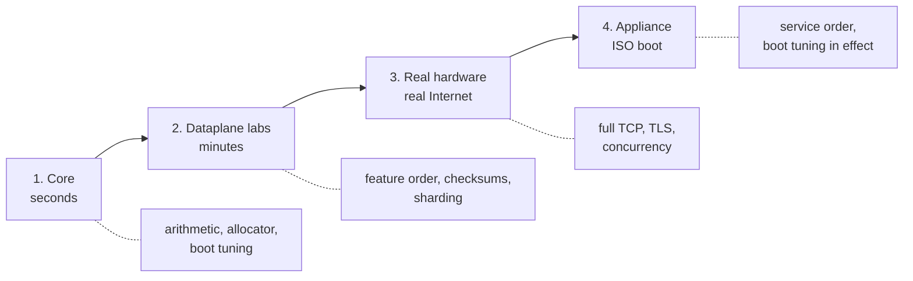
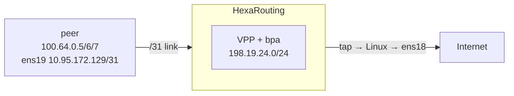

# HexaRouting — Testing

## TL;DR

Four levels, cheapest first. Each catches a different class of defect and none
replaces the next.

```sh
make test                 # 3 s   — core, no root, no VPP
sh tools/lab.sh <name>    # min   — dataplane labs with injected packets
sh tools/lab.sh hw-lab    # min   — two VMs, real Internet traffic
sh tools/lab.sh boot-iso  # s/min — the appliance actually booting
```

> The key words **MUST**, **SHOULD** and **MAY** in this document are to be
> interpreted as described in
> [RFC 2119](https://www.rfc-editor.org/rfc/rfc2119).

## 5W2H

| | |
|---|---|
| **What** | A test suite spanning pure arithmetic to a booted appliance carrying real traffic. |
| **Why** | Each level catches defects the others structurally cannot; several bugs in this project were visible only at one specific level. |
| **Who** | Anyone changing the code; CI runs level 1 on every commit. |
| **When** | Level 1 before every commit; levels 2–4 before a release. |
| **Where** | Levels 1–2 need only the build container; level 3 needs two machines; level 4 needs KVM or patience. |
| **How** | Every lab prints the **expected** value before the **observed** one, and several verify the captured packet rather than trusting a counter. |
| **How much** | Level 1 is seconds. A full ISO rebuild plus boot is roughly fifteen minutes. |



## 1. Core — seconds, nothing installed

```sh
make test      # BPA mapping, port allocator, boot tuning, VTY command tree
make model     # validates the reference model itself
```

Requires no root, no VPP and no network. The C implementation is checked
against `ref/bpa_model.py`, which is the executable specification: any
divergence **MUST** break the build.

Catches: mapping arithmetic, block collisions, port allocator behaviour,
consecutive even-aligned media port pairs, the RTSP parser's refusals,
`isolcpus` and hugepage computation, command-tree completion.

## 2. Dataplane labs — minutes, inside the container

```sh
sh tools/lab.sh                # list every lab with a one-line description
sh tools/lab.sh datapath       # translation with real packets, 1 worker
sh tools/lab.sh handoff        # sharding across 2 workers
sh tools/lab.sh dynamic        # dynamic mode and block hold-down
sh tools/lab.sh frag           # IP fragments
sh tools/lab.sh icmp-tcp       # ICMP errors (PMTUD) and TCP state
sh tools/lab.sh rtsp           # the RTSP ALG, asserted on the captured packet
sh tools/lab.sh routing        # BGP, OSPF and IS-IS into the VPP FIB
sh tools/lab.sh ipfix          # RFC 8158 export with a decoding collector
sh tools/lab.sh ipfix-tcp      # TCP transport, collector killed mid-run
sh tools/lab.sh vty            # the VTY configuring routing and CGNAT
sh tools/lab.sh api            # binary API
sh tools/lab.sh commit         # candidate, commit, rollback
sh tools/lab.sh audit          # dated configuration trail
```

These use VPP's packet generator: no NIC and no external traffic required. Each
prints the **expected** result before the **observed** one, and several inspect
the captured packet instead of trusting a counter.

Catches: dataplane behaviour, feature ordering, checksums, sharding.

The most instructive to run:

| Lab | What it demonstrates |
|-----|----------------------|
| `handoff` | Predicts which thread each subscriber lands on, then proves it |
| `frag` | The byte-order bug that created phantom sessions |
| `ipfix-tcp` | Kills the collector mid-run and proves nothing is lost |
| `icmp-tcp` | Validates all three ICMP checksums on the captured packet |
| `rtsp` | Reads the rewritten `Transport:` header out of the wire, and `BPA_RTSP_OFF=1 sh tools/lab.sh rtsp` drops 11 of its 18 assertions |

## 3. Real hardware — two VMs, real Internet

Topology in `lab/hw-lab.sh`. Requires both VMs and key-based root access to the
peer.



```sh
sh tools/lab.sh hw-lab          # host side: addresses, routes, forwarding
make hw-up                      # starts the long-lived hexa-vpp container
make hw-vpp                     # brings VPP up inside it
```

The `hexa-vpp` container **outlives the command that started it** — that is the
point, since `hexash` and `vppctl` talk to a VPP running inside it. It is also
why it **MUST** be removed when the session is over:

```sh
make hw-down                    # stops it and frees its memory
```

One of these was left running for thirteen hours holding roughly 4 GB, and got
an unrelated `make test-install` killed by the OOM killer — a failure that
looked like the test needing more memory and was not. Until this section
existed, nothing in the repository created the container and nothing removed
it.

Then, on the peer:

```sh
ip route replace 1.1.1.1/32 via 10.95.172.128 dev ens19
ping -c4 -I 100.64.0.5 1.1.1.1
curl --interface 100.64.0.5 https://1.1.1.1/
```

Expected, checked against `ref/bpa_model.py`:

```
100.64.0.5 -> 198.19.24.5    ports 1024-1535
100.64.0.6 -> 198.19.24.6
100.64.0.7 -> 198.19.24.7
```

Catches: what only appears with real traffic — full TCP, TLS, concurrency, and
limits imposed by the other end of the Internet.

> **Note.** A load test against a public endpoint can hit that endpoint's
> per-IP connection limit rather than any CGNAT limit. Separate the two by
> repeating with a load that fits inside one block.

## Accessing the VTY

```sh
sh tools/vty.sh                       # interactive session
sh tools/vty.sh -c "show cgnat pool"  # one command and exit
```

Tab completes; `?` lists the valid options with descriptions:

```
hexarouting# show cgnat ?
  blocks   blocks allocated in dynamic mode
  logging  IPFIX export state
  pool     configured CGNAT pools
  session  active sessions per thread
```

CGNAT commands go to the VPP plugin; anything else is forwarded to FRR's
`vtysh`. `show running-config` reads the configuration from the **dataplane**,
not from shell memory.

Configuration follows the Juniper model — edits build a candidate and reach the
device only on `commit`:

```
hexarouting> configure
hexarouting# [edit] cgnat pool alpha
hexarouting# [edit cgnat pool] inside 100.64.0.0/22
hexarouting# [edit cgnat pool] exit
hexarouting# [edit] show configuration compare
hexarouting# [edit] commit check
hexarouting# [edit] commit comment "first pool"
hexarouting# [edit] rollback 1
hexarouting# [edit] commit
```

`commit confirmed <minutes>` applies the change and rolls it back
automatically unless confirmed — for the change that might cut your own
access.

## 4. Appliance — the ISO

```sh
make iso                       # ~10 min, installs the image tools it needs
make test-iso                  # builds, then boots and demands "HexaRouting ready"
make test-appliance            # generates startup.conf and starts VPP with it
make test-install              # installs onto a blank disk, boots that disk
```

`make test-iso` exits non-zero when the self-test does not report
`HexaRouting ready`, and dumps the console to `boot-console.log` on failure.
It refuses to boot an ISO older than the sources — a build that dies halfway
used to be followed by a green boot of the *previous* image.

`make test-appliance` runs two profiles, because they share no code path:

| Script | Profile | Why it matters |
|---|---|---|
| `test_startup_conf.sh` | first boot: no pinning, 4k pages, DPDK off | The profile every freshly installed box uses |
| `test_tuned_conf.sh` | tuned: `corelist-workers`, `dpdk { dev … num-rx-queues }`, `page-size default-hugepage` | Reserves real 2 MB hugepages so the production stanzas actually meet a parser; skips with a message if the host cannot spare them |

Verified requirements: **4 GB RAM** and a CPU with **SSE4.2**. Below either,
VPP is killed by the OOM killer or by SIGILL, and the self-test says so first.

Catches: service ordering, boot tuning, everything that exists only after
installation.

## What is not tested

* **HA / failover** — analysed in [docs/ha.md](docs/ha.md), not implemented.
* **Throughput** — the labs measure correctness, not performance. A throughput
  number on virtio says nothing about 100 Gbps; that requires an E810 or CX6 on
  real hardware.
