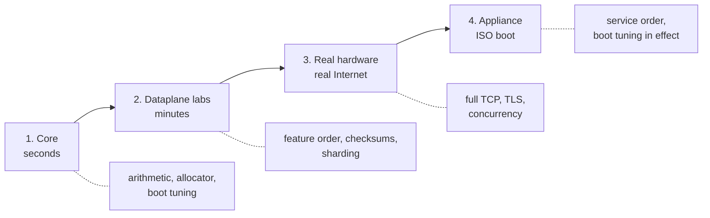

# Prisma Routing - Testing

## TL;DR

Four levels, cheapest first. Each catches a different class of defect and none
replaces the next.

```sh
make test                 # core suites, no root, no VPP
sh tools/lab.sh <name>    # min   — dataplane labs with injected packets
make hw-up && make hw-lab # min   — two VMs, real Internet traffic
sh tools/lab.sh boot-iso  # s/min — the appliance actually booting
```

> The key words **MUST**, **SHOULD** and **MAY** in this document are to be
> interpreted as described in
> [RFC 2119](https://www.rfc-editor.org/rfc/rfc2119).

## 5W2H

| | |
|---|---|
| **What** | A test suite spanning pure arithmetic to a booted appliance carrying real traffic. |
| **Why** | Each level catches defects the others structurally cannot; several bugs in this project were visible only at one specific level. |
| **Who** | Anyone changing the code. **There is no CI**: nothing runs any of this on a push, so every level is run by whoever made the change. |
| **When** | Level 1 before every commit; levels 2-4 before a release. Nothing enforces either, which is why `tools/release-gate.sh` exists. |
| **Where** | Levels 1–2 need only the build container; level 3 needs two machines; level 4 needs KVM or patience. |
| **How** | Every lab prints the **expected** value before the **observed** one, and several verify the captured packet rather than trusting a counter. |
| **How much** | Level 1 is seconds. A full ISO rebuild plus boot is roughly fifteen minutes. |



## 1. Core — seconds, nothing installed

```sh
make test      # BPA mapping, port allocator, MSS clamp, FTP sequence shift,
               # boot tuning, VTY, candidate model, installer answers
make model     # validates the reference model itself
```

`make test` MUST pass on an ordinary developer account. It reads no system
state — a test that needed the invoking account to be root, or in the
product's role groups, is a test that is red on every machine but one, and a
suite nobody can run green is a suite whose next real failure is
indistinguishable from the noise it already prints.

Requires no root, no VPP and no network. The C implementation is checked
against `ref/bpa_model.py`, which is the executable specification: any
divergence **MUST** break the build.

Catches: mapping arithmetic, block collisions, port allocator behaviour,
consecutive even-aligned media port pairs, the RTSP and SIP parsers'
refusals and the SIP multi-edit arithmetic,
`isolcpus` and hugepage computation, command-tree completion, and every answer
the installer must refuse — each of those is a disk that has to stay untouched,
and reaching one in a virtual machine costs a whole boot cycle.

Also at this level, and for the same reason — the failure is **silent**, so no
lab is going to notice it:

| Test | What it pins |
|---|---|
| `test_bpa_mss.c` | The MSS clamp: that it only ever **lowers**, that it declines a malformed option list, a length byte pointing outside the header and a data offset that lies — and that the incremental checksum equals a full recomputation. Getting that wrong makes the peer drop the segment, so the connection hangs exactly as it did before clamping while a counter reports the fix was applied. |
| `test_bpa_rewrite.c` | The outbound rewrite's checksum corrections, which are carried on the session and added per packet. That the correction is ADDED, because VPP's `ip_csum_add_even()` subtracts and applying a delta with it is the bug [#63](https://github.com/andrediashexa/hexarouting/issues/63) shipped and reverted; that the IPv4 header, TCP/UDP and ICMP each take a DIFFERENT correction; that a UDP datagram which arrived with no checksum leaves with none, and that a computed zero leaves as `0xffff`. Every checksum is compared against a full recomputation and verified the way a receiver does, on 20000 random packets as well as the named cases. |
| `test_bpa_ftp.c` | The FTP sequence shift: `bpa_seq_after` across the 2^32 boundary, a retransmission of data sent **before** a rewrite, and a control connection rewritten twice. No lab is going to send four gigabytes to reach the wrap. |
| `test_context_map.py` | That every repository path named in `docs/context.md` exists, and that `README.md` still reaches it. A map naming files that are no longer there is worse than no map — it is confidently wrong, and this is the half of it that rots without anyone noticing. |
| `test_run_all_labs.sh` | That the lab suite tells a defect apart from a machine that could not run it, **and that the verdict says why**. A VPP that never started, or a capture in which every `vppctl` call was refused and not one check went green, is reported `NO VPP` and counted apart - reporting it as `FAIL` sends whoever reads it to the product when the answer is the machine's load. Since [#253](https://github.com/andrediashexa/hexarouting/issues/253) it also pins what that verdict carries: which of "the wait expired" and "the dataplane went" it was, and VPP's own log under it. Driven with stub labs, because arranging a real VPP that fails to start is not something `make test` can do. |
| `test_run_tests.sh` | That `make test` tells a failed assertion apart from a suite that never reached one. A killed suite, and one that could not start at all, are reported `NO VERDICT` with how far they got; a suite that prints a pass and then exits non-zero is not a pass. Driven with stub suites written to end in each of those ways. Also that the run names the harness files it did **not** read: a harness the list does not name is named, one it does name is not accused, the source of a binary the list names is not accused, and the discovery finds at least the harnesses `suites.list` itself names. |
| `test_boot_wait.sh` | The three outcomes of the boot wait, and - since #218 - the difference between the quiet period being too short and the machine being unable to time it. The check stimulates a two-second wait against a three-second quiet period and measures when the fake dataplane actually answered: on time and announced anyway is a defect, a margin late is `NOT MEASURED`. |
| `test_stop_is_not_a_teardown.py` | What this appliance is allowed to do to itself on the way down. A stop-time command MAY ask a running process to flush state it is already holding and MUST NOT reach the configuration surface - so `vppctl bpa stop-drain` on `vpp.service` is allowed and an `ExecStop` that deletes a pool is not, wherever it is typed, including in the drop-in that already has one. The line is drawn on the command and not on the file name, because the file-name rule is silent on the mutation that matters most. Silent in the worst way: an `ExecStop` fires on every RESTART, so it would arrive during an ordinary upgrade on a box that had been working [#238](https://github.com/andrediashexa/hexarouting/issues/238). |
| `test_prismash_config.py` | Which changes rebuild a pool and which apply in place. Classified as a table, with an assertion that the table **covers every field a pool has** — so a field added later is a failure rather than a silent default. |
| `test_lab_workers.sh` | The lab machinery in `lab/lib.sh` that no container is needed to check, and both halves of it are the same defect twice: a lab that asked for something, did not read the answer, and measured whatever it got. That `LAB_WORKERS` is a **count** and not a flag, so `LAB_WORKERS=4` does not quietly give a single-threaded box; and that every `vpp -c` in `lab/` is followed by something that prints `VPP did not start`, because that line is what `tools/run-all-labs.sh` classifies `NO VPP` on. Ten labs carried the wait loop and not the line that reads its result, so a machine that never brought a dataplane up was reported as a defect in the product ([#261](https://github.com/andrediashexa/hexarouting/issues/261)). |
| `test_feature_order.py` | That every BPA feature node on the `ip4-unicast` arc declares `runs_after` on `ip4-sv-reassembly-feature`. A node ahead of reassembly reads ports that have not been recovered yet and burns one port of the subscriber's block per fragment. It is checked over the source because the box cannot see it: with all four declarations deleted VPP still computes the same arc — the order is right by accident, and `lab/frag.sh` stays green. What the deletion removes is the guarantee that a VPP upgrade or another plugin's constraints cannot reorder them ([#239](https://github.com/andrediashexa/hexarouting/issues/239)). |
| `test_plugin_cli_says.py` | Which of the plugin CLI's messages anything in this repository names. Every `vlib_cli_output` site of `src/plugins/bpa/bpa_cli.c` is read out of the source, its needle is the longest literal run with no value in it, and the tree is searched for the run whole: a lab, a suite, a wiki page or a document. The count named by nothing is a ceiling that may only go down, measured with its date, and the way down is a lab asserting the sentence on a screen it prints - not quoting it. Pointed at a corpus kept with `LAB_OUTPUT=<dir> sh tools/run-all-labs.sh` (`PLUGIN_CLI_CORPUS=<dir>`), it also says which of those some lab printed all the same and which no box has ever printed, through `tools/plugin-says.sh` ([#366](https://github.com/andrediashexa/hexarouting/issues/366)). |
| `test_lab_crlf.py` | That no lab takes a value out of `vppctl` in a shape that keeps the carriage return. `vppctl` ends its lines with CR+LF and neither `awk`'s fields nor `sh`'s IFS count `\r` as whitespace, so the CR stays on the **last field of every line**. Under `dash` every arithmetic comparison survives it and every string comparison does not, which is the direction that hides: a needle that can never match is red on a correct box for `expect_in` and **green on a broken one** for `expect_not_in`. The check is on the source because the defect is invisible on a running box by construction. |
| `test_both_doors.py` | That the prompt and a saved file give the SAME answer to the same value. Every finding in [#411](https://github.com/andrediashexa/hexarouting/issues/411) was a validator on one door and not the other, and five statements meant two different things depending on how they arrived - a file being what `prisma-routing.service` replays at every boot, so the unguarded door is the one nobody is watching. It is a reader rather than a list: it walks the VTY's own grammar, builds hostile values out of each statement's hint, drives both doors and compares. A statement added tomorrow is compared by nobody's decision. The one class that is MEANT to differ is declared in the product as `config.DOORS_DIFFER` with its reason - #357, where a range in the file parser refused a running box's own `block-size 4` - and there is no allowlist here to add to. What it cannot see is stated in its own header: statements handed to FRR unread, the `cgnat` globals (whose file door is applied rather than parsed), and whether either answer is the RIGHT one. |
| `test_every_function.py` | That every function in the product is named by a unit test, or says at its definition why it cannot be (`# not a unit: <reason>`, `/* not a unit: <reason> */`), with the ones that are neither printed by name on every run and their count per language a ceiling that may only go down ([#390](https://github.com/andrediashexa/hexarouting/issues/390)). Python is read by `ast`, C by the plugin's definition shape, shell by `name() {`; a test names a function only by calling it outside a comment, so a name in a comment or a quoted string counts for nothing. The reason is the whole comment block, not the rest of that one line, so a wrapped excuse reads as a sentence rather than as a fragment. |

Each assertion in that table was run against deliberately broken code and
required to fail before being kept. An assertion that has never failed has not
been shown to test anything, which is the defect class this project keeps
hitting — see `CONTRIBUTING.md`.

### What a `make test` result means

`tools/run-tests.sh` runs the list in `test/suites.list` and reports every
suite, in the four states `tools/run-all-labs.sh` reports a lab in:

| State | What it means | Where to look |
|---|---|---|
| `pass` | Ran to its end, every check green. | - |
| `FAIL` | Ran to its end, named checks red. | The product, or the check. |
| `NOT MEASURED` | Ran to its end and said the machine could not keep the timing it needed. **Not a pass** - nothing was learned about the product - and not a defect. | The machine's load. Run it again on a box that is not doing something else. |
| `NO VERDICT` | Never reached its end: killed, crashed, or could not start. | Whatever killed it. The report gives the exit status, how many lines it printed and the last of them. |

`NO VERDICT` is the state that did not exist, and its absence cost two
`make test` failures nobody could name: a suite that dies half way through and
a suite whose last assertion failed are the same thing to anything reading an
exit status. Every suite therefore MUST end by printing one of three lines -
`ALL TESTS PASSED`, `<n> FAILURES` or `<n> NOT MEASURED` - and a suite that
exits without one is reported as interrupted rather than judged.

A run is green only when all four counts but `passed` are zero. `NOT MEASURED`
and `NO VERDICT` each fail the run on their own, for the reason `NO VPP` fails
the lab suite on its own: a suite that was not run has cleared nothing.

### The harnesses the run did NOT read

The count in `N suites: N passed` is the count of what `test/suites.list`
names, and a reader takes it for the count of what this repository measures.
Those were different: `appliance/test_startup_conf.sh` and
`appliance/test_tuned_conf.sh` run only from `make test-appliance`, so
everything they assert sat outside the number with nothing saying so
([#338](https://github.com/andrediashexa/hexarouting/issues/338)).

Every run therefore ends by saying how many harness files are in the tree, how
many of them it read, and naming the ones it did not:

```
  59 suites: 59 passed, 0 failed, 0 not measured, 0 with no verdict
  61 harness file(s) in the tree, and this run read 59. NOT read:
    appliance/test_startup_conf.sh
    appliance/test_tuned_conf.sh
```

That is a statement, not a failure: both of those need a real VPP and cannot
join the list. It is **discovered, not listed** - a harness is a file whose
name begins with `test_`, which is the convention this repository already
follows - so a third one added tomorrow is named on the next run by nobody's
decision. There is no allowlist to keep true, because an allowlist is what the
next person does not update.

### Showing a check fail: four ways the mutation lies

Nothing here is trusted until it has been seen red. Breaking the product on
purpose and watching a check notice is the only evidence that check is worth
its line. The break itself can be the thing that fails, though, and then the
red proves nothing and the green proves less. All four of these were measured
in this repository, each after a stretch of work built on the wrong reading.

**A mutation that does not reach the interpreter.** CPython keys
`__pycache__` on the source's size and its mtime **in whole seconds**. A
campaign that applies one three-character change, runs, restores, and applies
the next one inside the same second leaves a file of the same size with the
same mtime, and the second run silently executes the FIRST mutation's
bytecode. Measured over 101 automated mutations of `src/prismash/*.py`: 40 sites
reported blind, and re-run under `PYTHONDONTWRITEBYTECODE=1` the count fell to
13 - every one of the 27 was the cache, not the test. Export it for any
mutation run over Python.

**A mutation that does not compile.** `tries < 0` on an unsigned counter is
rejected by `-Werror=type-limits`, and a build that fails is not a check that
noticed. The red has to come from the assertion, so read what the run actually
said and not only its exit status.

**A mutation of the working tree, measured against a clone.** Anything that
clones the repository or checks out a tag measures the COMMITTED state.
`tools/release-gate.sh`'s own suite did this: every mutation of the working
tree came back green, because the gate under test was the one in the clone.
Copy the mutated file into the fixture, or commit the mutation.

**A mutation of the message the needle is cut from.** When the check greps for
a phrase and the mutation edits that phrase, both sides move together and the
check stays green no matter what the product does. The same shape in
arithmetic: an assertion whose expected value is computed by the function
under test. `bpa_stride_block()` was asserted against its own return value and
survived `nth * p->block_stride` cut to `nth * 1`. Mutate the shared branch,
or assert against what the operator's number is supposed to mean.

## Cutting a release

```sh
make release-gate TAG=v0.26.0     # or with HEAD on the tag, just: make release-gate
```

`CONTRIBUTING.md` section 5 requires every release to ship an installation
medium that has been **built and booted**. This is that procedure as one
command, and it exists because as a sequence somebody retypes, it gets retyped
wrong. In one evening the same person got it wrong three times, and **every one
was caught by a rule rather than by attention**:

| What went wrong | What caught it |
|---|---|
| built from the working tree, carrying uncommitted work from the next issue | the filename rule — stamped `-dirty` |
| built with no plugin, because a clean tree has no `.build-vpp` | `build-iso.sh` refused |
| built from a git **worktree**, whose `.git` is a pointer to a repository the build container does not have mounted | the filename rule — stamped `-unverified` |

The gate **clones** the repository at the tag, so uncommitted work cannot
contaminate the image at all — the first mistake is now structurally
impossible rather than merely detected. It then refuses:

* a tag that does not exist;
* a tag on a tree whose `VERSION` disagrees with it — a `v0.27.0` tag on a
  `0.26.0` tree produces an image called `0.26.0` published under `0.27.0`;
* any image whose name carries `-dirty` or `-unverified`;
* a medium that builds and does not boot, or boots and does not report ready;
* **a box running the previous release that cannot be upgraded to this one**
  ([#398](https://github.com/andrediashexa/hexarouting/issues/398)), and a run that
  could not measure the attempt at all - NOT MEASURED refuses the release
  here, because a gate that shrugs is a gate that publishes an upgrade nobody
  read.

The previous tag is derived, not written down. `lab/upgrade.sh` keeps its own
fixed old side, which is what makes its readings comparable between releases;
the gate runs the same lab a second time against whatever the last published
release happens to be, which is the upgrade an operator actually performs. It
costs about three minutes on top of a gate that takes twenty-five, and it
names the pair it measured, because a green gate that does not say which two
versions it compared is a claim nobody can check.

`RELEASE_GATE_CHECK_ONLY=1` runs the checks and builds nothing, so they can be
exercised without a 321 MB image — a check that can only be reached by building
one is a check nobody reaches.

## 2. Dataplane labs — minutes, inside the container

**One of these needs the network.** The three levels here read as no network,
then a container, then real Internet - and level 3 is the one whose heading
says so, which makes this level read as not needing it. `lab/bng.sh` does: it
installs five `-dev` packages with `apt-get` and clones `accel-ppp-ng` from
GitHub, on **every** run, because the container is `--rm` and nothing caches.
On a box with no route out that lab goes red and takes the suite with it, and
a release is then refused over a file
[#170](https://github.com/andrediashexa/hexarouting/issues/170) calls a spike.
The suite says so before it starts, from a list beside the one that names the
labs it is not running at all:

```
this run needs the network, for these and nothing else:
  bng: apt-get for five -dev packages, and a git clone of accel-ppp-ng from GitHub, on every run
```


The whole suite runs several labs at a time:

```sh
sh tools/run-all-labs.sh          # as many at a time as the memory holds
LAB_JOBS=5 sh tools/run-all-labs.sh
```

Measured on 8 cores and 32 GB: **~35 minutes in series, 12m45s at
`LAB_JOBS=5`**, and the two parallel runs produced identical verdicts. That
last part is the condition, not a bonus — a parallel suite that is not
reproducible has replaced a slow answer with an unreliable one, and 35 honest
minutes beat 13 that sometimes lie.

The suite is not compute-bound and never was: each lab starts VPP, sleeps for
packets to cross, and waits on timeouts. Measured before this existed, the
series run sat at load 1.18 across 8 cores **with an ISO build running
alongside it**. It was a queue, not a workload.

What makes it safe is that `tools/lab.sh` gives each lab its own container
**without** `--network=host`, so the fixed `veth` and `netns` names in
`routing`, `lcp`, `ipfix`, `ipfix-tcp` and `vty` cannot collide. The one piece
of shared writable state is `/src/.build-vpp`, where every lab would otherwise run `ninja` -
so the plugin is built **once, before any lab starts**, and no lab is the one
that happens to build it.

Output is captured per lab and printed whole, in list order. Interleaved output
from five labs at once is not a report.

```sh
sh tools/lab.sh                # list every lab with a one-line description
sh tools/lab.sh datapath       # translation with real packets, 1 worker
sh tools/lab.sh handoff        # sharding across 2 workers
sh tools/lab.sh dynamic        # dynamic mode and block hold-down
sh tools/lab.sh frag           # IP fragments
sh tools/lab.sh icmp-tcp       # ICMP errors (PMTUD) and TCP state
sh tools/lab.sh ftp-alg        # FTP ALG: payload rewrite and sequence shift
sh tools/lab.sh ftp-alg off    # the same lab with the ALG off: MUST fail
sh tools/lab.sh rtsp           # the RTSP ALG, asserted on the captured packet
sh tools/lab.sh sip            # the SIP ALG over UDP: Via, Contact, SDP, RTP pair
sh tools/lab.sh sip off        # the same lab with the ALG off: MUST fail
sh tools/lab.sh hairpin        # one subscriber reaching another (RFC 4787 REQ-9)
sh tools/lab.sh nat-behaviour  # RFC 4787 mapping and filtering
sh tools/lab.sh extblocks      # a second block for a subscriber that fills one
sh tools/lab.sh pptp           # PPTP call IDs and GRE (also: pptp off)
sh tools/lab.sh esp            # IPsec ESP passthrough (also: esp off)
sh tools/lab.sh routing        # BGP, OSPF and IS-IS into the VPP FIB
sh tools/lab.sh ipfix          # RFC 8158 export over UDP (also: ipfix no-exporter)
sh tools/lab.sh ipfix-tcp      # TCP transport, collector killed mid-run
sh tools/lab.sh ipfix-stop     # the box stopped and the box killed, holding blocks
sh tools/lab.sh vty            # the VTY configuring routing and CGNAT
sh tools/lab.sh vty-pool       # per-pool settings from the VTY to the dataplane
sh tools/lab.sh two-pools      # two pools, a subscriber at the same index in each
sh tools/lab.sh troubleshoot   # the show commands, checked against the model
sh tools/lab.sh vty-ssh        # the SSH daemon and accounts, and the lockout
sh tools/lab.sh snmp           # a real snmpget against a real snmpd
sh tools/lab.sh throughput     # CPU clocks per packet, from VPP's own accounting
sh tools/lab.sh api            # binary API
sh tools/lab.sh control-plane-dies  # FRR killed, and the box still translates
sh tools/lab.sh commit         # candidate, commit, rollback
sh tools/lab.sh audit          # dated configuration trail
sh tools/lab.sh upgrade        # install v0.68.0, configure it, put this tree over it
sh tools/lab.sh upgrade v0.70.0  # the same, from another released tag
```

These use VPP's packet generator: no NIC and no external traffic required. Each
prints the **expected** result before the **observed** one, and several inspect
the captured packet instead of trusting a counter.

Catches: dataplane behaviour, feature ordering, checksums, sharding.

The most instructive to run:

| Lab | What it demonstrates |
|-----|----------------------|
| `handoff` | Predicts which thread each subscriber lands on, then proves it |
| `frag` | The byte-order bug that created phantom sessions |
| `ipfix` | Configures the UDP exporter **through the VTY** and decodes a record off the wire — the exporter used to be set here with `vppctl`, so the lab performed the product's missing step and UDP export had never once run on a box the product configured. `sh tools/lab.sh ipfix no-exporter` leaves the statement out and turns at least 20 of its assertions red |
| `ipfix-tcp` | Kills the collector mid-run and proves nothing is lost |
| `ipfix-stop` | Stops the box, kills the box and leaves the box running, each holding a block, with one collector listening across all three. The killed box and the running box are byte for byte the same shape in the log - allocation, no release - and the lab asserts the collector separates them by the boot marker. The drain itself is never typed here: the command is read out of the shipped `vpp.service` drop-in, so a drop-in that loses its `ExecStop` takes the lab red. `sh tools/lab.sh ipfix-stop no-marker` blinds the collector to IE 160 and drops the assertions that tell the two apart |
| `icmp-tcp` | Validates all three ICMP checksums on the captured packet |
| `ftp-alg` | Reads the rewritten payload, its checksums and its renumbered sequence off the wire — and can be run with the feature off to watch 13 assertions drop |
| `rtsp` | Reads the rewritten `Transport:` header out of the wire, and `BPA_RTSP_OFF=1 sh tools/lab.sh rtsp` drops 11 of its 18 assertions |
| `sip` | Reads every rewritten field off the wire, and every field that must **not** have moved byte for byte against the payload as it was injected. `sh tools/lab.sh sip off` drops exactly 7 of its 18 assertions, and the lab header names which |
| `pptp` | Two subscribers choose the same Call ID and both tunnels work |
| `esp` | Two subscribers share one public address and each keeps its own IPsec tunnel — and the SPI is asserted **unchanged**, because rewriting it is the failure. `sh tools/lab.sh esp off` drops 25 of its assertions |
| `vty-pool` | Sets a pool setting with `vppctl`, commits something unrelated through the VTY, and proves the first one survived |
| `control-plane-dies` | Kills FRR and sends another packet. The property *"a management failure MUST NOT stop forwarding"* was supported by the MECHANISM - independent units, `OOMScoreAdjust=-1000`, `MemoryMax=512M` - and by no measurement: nothing killed the control plane and then sent a packet (#421). The second packet uses a DIFFERENT source port, so it cannot be the first one's session answering. `sh tools/lab.sh control-plane-dies kill-vpp` kills the **dataplane** instead and drops 4 of its 5 assertions - the first stays green in both runs, because the translation before the kill happens either way |
| `two-pools` | The only lab that configures more than one pool — which is why nothing caught subscribers of two pools sharing one set of port bitmaps |
| `troubleshoot` | Uses `ref/bpa_model.py` as the oracle, so the show commands cannot agree with the plugin by sharing its arithmetic |
| `vty-ssh` | Produces the lockout — a change leaving nobody able to log in — and watches the commit refuse it |
| `snmp` | Kills the dataplane mid-run and asserts the agent serves *nothing* rather than the numbers it last saw |
| `throughput` | Prints the conditions above the numbers, and asserts the packets were **translated** rather than dropped — its first version measured a drop path and reported it as the cost of translating |
| `upgrade` | The only lab that puts one version of the product on top of another. It compiles `v0.68.0`'s plugin, runs **that tag's** `appliance/install.sh`, configures the box through the VTY the install put there — pool, attachments, a static forward, addresses, a static route, `save`, three rollback revisions — then runs this tree's `install.sh` over it and asserts the box is still configured: the file the old version saved is accepted **whole** by `prismash --load`, the pool is in the dataplane, the forward still forwards a real packet, the old version's revisions still load, and the configuration trail was appended to rather than restarted. Removing one statement's spelling from the new grammar turns 17 of its 35 checks red, which is the blast radius [#291](https://github.com/andrediashexa/hexarouting/issues/291) is about. It also measures what an upgrade does **not** do: the installer replaces `bpa_plugin.so` under a running VPP — `/proc/<pid>/maps` shows it `(deleted)` — restarts nothing, and in that window the new VTY can change a setting on an existing pool and **cannot create one**, because the API message grew fields the running plugin does not have |

Several labs take an argument that runs them with the feature switched off, so
the assertions can be seen to fail without it — `sh tools/lab.sh pptp off`. An
assertion that passes with the feature removed was never testing the feature.

**`tools/run-all-labs.sh` runs all twenty of those, with the verdict
inverted.** They are listed in `OFF_MODES` and reported as `<lab>+off`: a run
that goes red is a pass, and one that comes back `LAB PASSED` is a failure of
the suite rather than of the box. This sentence said **seventeen** until the
list was counted rather than remembered: `detreserve:off`, `ipfix-outbuf:no-stall`
and `ipfix-stop:no-marker` all joined `OFF_MODES` after the number was written
on 2026-09-12, and `test/test_doc_copies.py` has been reading twenty labs that
declare a floor for their off run. Until that list existed,
nothing automatic ever performed an off run, so sixteen headers claimed the
checks below them MUST fail and nobody was checking. Measured on this machine
when there were seventeen of them: they took 56 s to 125 s each, and at
`LAB_JOBS=16` they added one batch to the four the suite already had - 1524 s
to 1907 s on the same tree, about 25%, not the doubling that counting runs
rather than batches suggests. That timing has not been re-taken at twenty.

**Some lab files are deliberately not in the suite**, and `NOT_LABS` in
`tools/run-all-labs.sh` holds each one's reason as data rather than as a
comment, so the run prints what it skipped before its first result. One of them
is red on purpose: `ha-failover` is the acceptance test for high
availability ([#9](https://github.com/andrediashexa/hexarouting/issues/9)),
written before the feature exists, so it is red because the feature is
**missing**.

`crossaddr` used to be the second, and what happened to it is the argument for
holding these reasons as data. It pinned what the allocator did **today**, so
it went red the day
[#226](https://github.com/andrediashexa/hexarouting/issues/226) fixed the
behaviour it pinned - which is what such a lab is for - and it then sat outside
the suite asserting the opposite of the box until somebody with a container
rewrote it against a running one. A lab that pins a defect buys a red on the
day of the fix and owes a rewrite on the same day; the reason in `NOT_LABS` is
what stopped that debt from being invisible. Run it with `sh tools/lab.sh ha-failover` - it stands up two
dataplanes, breaks the active one three ways, and its six `FIXTURE` checks are
green so that a broken topology can be told apart from a missing feature.

`soak` is excluded for a third reason: **its length**. Every other lab here
finishes in seconds or in a couple of minutes, and this one is worth running
for hours — a suite that waited on it would stop being run, which loses the
whole suite rather than the one lab
([#30](https://github.com/andrediashexa/hexarouting/issues/30)).

```sh
sh tools/lab.sh soak            # 210 s of churn, about four minutes in all
sh tools/lab.sh soak 28800      # eight hours of it
```

**Every cycle fills the session table and every cycle empties it.** Fifteen
seconds of traffic — 32 subscribers, 199 source ports each, at a rate that
fills the whole burst so sessions are created while others time out — then
twenty seconds of nothing, which is longer than the UDP timeout and the block
hold-down together. The ports rotate every cycle so each cycle's five-tuples
are new, and the subscribers rotate over four groups. The box is read at the
end of each half: a **peak** with the table full and a **trough** with it
empty.

Every trough is the same state of the box — no session, no block held, nothing
arriving — so two troughs are directly comparable and anything a later one
holds that an earlier one did not is memory the box did not give back. There
is no working set to subtract, no settling to wait out and no allocator wobble
to make room for. It asserts the table back at its baseline **at every
trough**, every session created also expired, every block back in the pool,
the box's own allocation and release counters equal, the heap and the resident
size unmoved between two empty tables, and a real IPFIX collector's count of
`natEvent` 17 equal to its count of 16 with no allocation left open and
nothing dropped.

**The argument is seconds, and the argument is the whole point.** The default
run is six cycles and 38208 sessions; it proves the mechanism — that each
assertion is wired to something that can move — and proves nothing about a
week. A leak is a rate, so what the memory assertion can see is its 1.00 MB
margin divided by the sessions the run churned: about 27 bytes per session
over 210 s, 0.2 bytes over eight hours, one byte in 3000 over a week. That
factor is bought with wall time and with nothing else, and the lab's header
states it in those terms.

It is not in `make test` either, and could not be: `make test` installs
nothing and starts no dataplane.

**It has no off mode and its control is eight broken runs**, listed in its
header with the red each one produced. There is no feature here to switch off,
so `OFF_MODES` has nothing to give it; instead each assertion was shown red
against an edited plugin and against mis-set-up runs that turn the lab's own
preconditions red. One of those controls found a defect in the **lab**: with
the heap parser broken on purpose, the check written to catch a missing
reading passed, because `awk` collapses an empty field and every column after
it shifted left.

A lab under which the dataplane never came up is reported as `NO VPP` and
counted apart from both, because "the box never answered" and "the box
answered and refused" need opposite work. `test/test_run_all_labs.sh` pins
that classifier with stub labs.

**The verdict carries VPP's own log**, because the container it ran in is
gone. `tools/lab.sh` throws each lab's container away, so `/tmp/vpp.log` dies
with it and stdout is the only channel out - `lab/verdict.sh` prints the tail
of that log whenever a lab ends without passing and `vppctl` can no longer
reach a dataplane, and the suite prints it under the verdict:

```
  extblocks+workers  NO VPP - the dataplane never came up
     the dataplane was gone by the verdict. VPP's log:
       NO DATAPLANE at the verdict: vppctl cannot reach VPP. Last of /tmp/vpp.log:
         | vpp[20]: received signal SIGSEGV, PC 0x7f2a1c0b4e21
```

The first line is the answer a `NO VPP` used to leave open, and the two halves
need opposite work: *the wait for the dataplane expired* is a box that could
not start one, *the dataplane was gone by the verdict* is one that died. A
capture carrying neither says so, which points at the 900 s cap instead. The
log tail is evidence and not a verdict: a lab that measured something and then
lost VPP is still a `FAIL`, because calling that a machine problem would hide a
real crash ([#253](https://github.com/andrediashexa/hexarouting/issues/253)).

## 3. Real hardware — two VMs, real Internet

```sh
make hw-up      # a privileged host-network container, holds ~4 GB
make hw-lab     # addresses and routes on BOTH machines
make hw-vpp     # starts VPP and PROVES the path, end to end
make hw-down    # when you are finished
```

Topology in `lab/hw-lab.sh`. Requires both VMs and key-based root access to the
peer, which `make hw-up` mounts into the container.

`make hw-vpp` used to end by printing what to type. It now runs the test and
says pass or fail: a ping and a TLS fetch from a subscriber address through to
the real Internet, with the public address and port block checked against
`ref/bpa_model.py` rather than against the plugin.

**A green ping is not enough, and the lab says so.** Session counts are read
before and after the traffic and the difference is asserted — because with the
peer's route to the test destination missing, the traffic leaves through its
*default* gateway instead, gets translated by something upstream, and comes
back. The ping is green and this CGNAT never saw a packet. That is measured,
not hypothetical: it is what the lab did for a long time.

Catches: everything the container labs cannot — a real driver, a real MAC
layer, real TCP with TLS, and the routing on both sides of the box.

## Accessing the VTY

```sh
sh tools/vty.sh                       # interactive session
sh tools/vty.sh -c "show cgnat pool"  # one command and exit
```

Tab completes; `?` lists the valid options with descriptions:

```
prisma# show cgnat ?
  blocks   blocks allocated in dynamic mode
  logging  IPFIX export state
  pool     configured CGNAT pools
  session  active sessions per thread
```

CGNAT commands go to the VPP plugin; anything else is forwarded to FRR's
`vtysh`. `show running-config` reads the configuration from the **dataplane**,
not from shell memory.

Configuration follows the Juniper model — edits build a candidate and reach the
device only on `commit`:

```
prisma> configure
prisma# [edit] nat cgnat pool alpha
prisma# [edit cgnat pool alpha] inside 100.64.0.0/22
prisma# [edit cgnat pool alpha] exit
prisma# [edit] show configuration compare
prisma# [edit] commit check
prisma# [edit] commit comment "first pool"
prisma# [edit] rollback 1
prisma# [edit] commit
```

`commit confirmed <minutes>` applies the change and rolls it back
automatically unless confirmed — for the change that might cut your own
access.

## 4. Appliance — the ISO

```sh
make iso                       # ~10 min, installs the image tools it needs
make test-iso                  # builds, then boots and demands "Prisma Routing ready"
make test-appliance            # generates startup.conf and starts VPP with it
make test-install              # installs onto a blank disk, boots that disk
make upgrade-artifact          # seconds, no root and no container
```

**The gate takes two paths**, by the digit that moved. A **Z** runs the
document checks, refuses a note that claims a boot and a change the artifact
cannot carry, runs `make test`, builds the plugin and the artifact, and stops —
no medium, and it says out loud that no box was installed. An **X** or **Y**
takes every step: the medium, the boot, the install, the second boot and the
upgrade from the previous release.

**Build caches go in `/var/cache/prisma`**, which one command creates on a
build host and nothing creates by itself:

```sh
sudo install -d -o $(id -u) -g $(id -g) -m 0755 /var/cache/prisma
```

Outside the repository on purpose: the release gate clones the tag into a fresh
directory and deletes it first, so a cache inside the tree is one the procedure
destroys before it can be hit. A host without that directory builds from the
network and says so — a cache that is a dependency is not a cache
([#409](https://github.com/andrediashexa/hexarouting/issues/409)).

**Where the 59 minutes of a release go** is measured in
[docs/build-timing.md](docs/build-timing.md), with the per-step table, what is
rebuilt that did not change, and the rule that follows from it: a **Z** release
publishes the upgrade artifact and no medium, and proves itself with `make
test`. `CONTRIBUTING.md` section 5 carries that rule; the gate does not know it
yet ([#410](https://github.com/andrediashexa/hexarouting/issues/410)).

`make upgrade-artifact` is the other half of what a release publishes: the
medium is the route for an empty disk, and the artifact is the route for a box
already carrying subscribers, which installing the medium would erase along
with its configuration trail and whatever its exporter had not yet delivered
(#295). It needs the plugin built and nothing
else, and it proves itself by unpacking what it has just packed and installing
it into a throwaway directory. `test/test_upgrade_artifact.sh` runs in `make
test` and drives the whole path - the build, the install onto a box that is a
directory, and the refusals - in about a second.

`make test-install` - and `sh tools/lab.sh install-iso`, which is the same lab -
does more than boot the disk it just installed: it **drives that box's serial
console**. It logs in as root, creates two accounts through the VTY - one with
`role administrator`, one with no role at all - commits, and then holds each of
them to what its role says, reading every answer off the box rather than off
what the VTY printed. It is the only place in this repository where a role is
proved on a box somebody receives; every other roles assertion runs in a
container against a VPP the lab started itself. It is also the only place
systemd runs at all, so it is the only place the drop-in that lets a non-root
account reach the binary API is exercised.

It also **reaches that box from outside, over the network**, which is the one
thing it could not do until
[#303](https://github.com/andrediashexa/hexarouting/issues/303). Everything
above is the box talking about itself down a serial cable, and a box with no
address behaves identically down a serial line to a box with one - so a
management network that was never configured was invisible here for the life
of the product. Every boot now gets one NIC at a fixed PCI address with a
forwarded port, and the lab opens a TCP connection to the box's `sshd` and
reads the banner it sends back. Then it **switches the machine off and starts
it again** and does it a second time, because the question is not whether the
box is reachable once.

```sh
sh tools/lab.sh install-iso                 # the lab
sh tools/lab.sh install-iso wrong-password  # the driver typing a password
                                            # the box refuses: MUST fail
```

The second is how the driver is kept honest. It must fail **at the login**,
naming the wait that timed out and saying that the box answered and refused the
credentials - a console driver whose failure mode is a hang proves nothing, and
a login that fails silently would run the whole session against a login prompt
and report a pass.

`make test-iso` exits non-zero when the self-test does not report
`Prisma Routing ready`, and dumps the console to `boot-console.log` on failure.
It refuses to boot an ISO older than the sources — a build that dies halfway
used to be followed by a green boot of the *previous* image.

`make test-appliance` runs three profiles, because they share no code path:

| Script | Profile | Why it matters |
|---|---|---|
| `test_startup_conf.sh` | first boot: no pinning, 4k pages, DPDK off | The profile every freshly installed box uses |
| `test_tuned_conf.sh` | tuned: `corelist-workers`, `dpdk { dev … num-rx-queues }`, `page-size default-hugepage` | Reserves real 2 MB hugepages so the production stanzas actually meet a parser; skips with a message if the host cannot spare them |
| `test_startup_conf_shapes.sh` | **every** shape the tuner can write, nine of them, each handed to the real `vpp` binary | The two above start VPP on ONE generated file each. The tuner branches on hugepages, on whether a card was named, on how many workers and queues there are, on the card's maximum MTU and on who sized the statistics segment, and a check that renders one branch is a check the next branch walks past |

**The third exists because 0.75.0 shipped a `startup.conf` VPP refuses to
read.** [#330](https://github.com/andrediashexa/hexarouting/issues/330) added a
per-device `mtu` line for a card whose maximum is below VPP's default of 9000.
There is no `mtu` keyword in this VPP's `dpdk` configuration: it answers
``dpdk_device_config: unknown input `mtu 1500'`` and exits, `vpp.service`
carries `Restart=always`, and the box spends its boot in a restart loop
forwarding nothing
([#377](https://github.com/andrediashexa/hexarouting/issues/377)). Every
`virtio` guest whose card reports a maximum below 9000 is in that class.

Nothing caught it because **every box this repository boots comes up in first
boot mode**, where there is no `dpdk` stanza at all - the medium, the installed
disk and the release gate alike. The tuned profile reached a real VPP only in
`test_tuned_conf.sh`, which renders one shape and *skips itself* when the
machine cannot spare the pages.

The shapes are given to `vpp -c` and the answer is VPP's, because **the only
authority on what VPP accepts is VPP**. A list of legal keywords kept here
would be a second copy of VPP's grammar, written by the same people who have
just been shown inventing a keyword that reads exactly like a DPDK option and
is not one. It needs hugepages to be worth running: measured, with
`main-heap-page-size default-hugepage` and none reserved, VPP dies in *early*
config before the `dpdk` config function runs and the parse error is never
printed - so a run that cannot reserve them reports `NOT MEASURED` rather than
a pass, and `tools/release-gate.sh` refuses a release on that as it does on a
failure.

Verified requirements: **4 GB RAM** and a CPU with **SSE4.2**. Below either,
VPP is killed by the OOM killer or by SIGILL, and the self-test says so first.

Catches: service ordering, boot tuning, everything that exists only after
installation.

## What is not tested

* **HA / failover** — analysed in [docs/ha.md](docs/ha.md), not implemented.
* **Bits per second** — still. A throughput number taken on virtio measures the
  hypervisor, and reaching 100 Gbps needs an E810 or CX6 driven natively
  ([#28](https://github.com/andrediashexa/hexarouting/issues/28) stays open for
  it).

  What **is** measured now is the part that does not depend on the NIC:
  `sh tools/lab.sh throughput` reports how many CPU clocks a packet spends
  inside the translation nodes, taken from VPP's own per-node accounting. On a
  Xeon E5-2680 v4 at 2400 MHz, `bpa-in2out` costs **456 clocks per packet**
  against 21–26 for `ip4-input` — 5.26 Mpps per core in that node alone, which
  is about **29 cores** for 100 Gbps of 64-byte frames before the driver or the
  IP stack. That is
  [#63](https://github.com/andrediashexa/hexarouting/issues/63).
