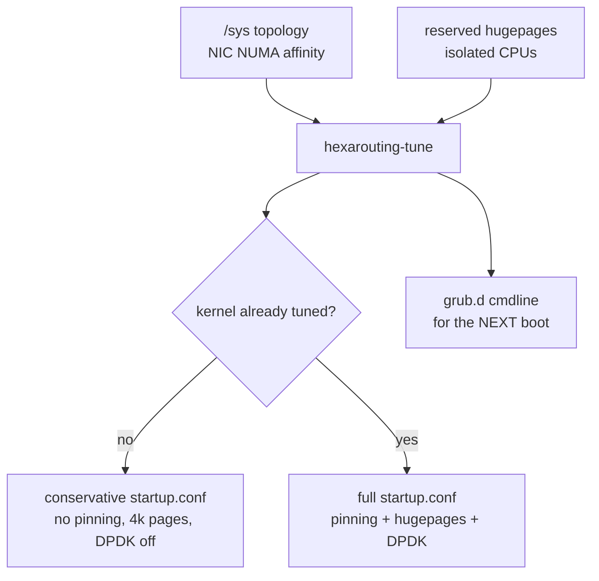
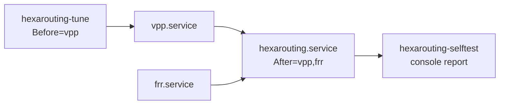
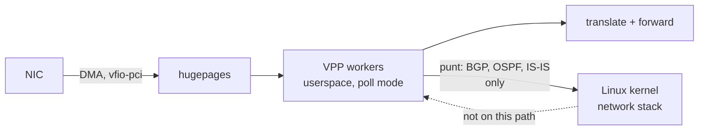

# HexaRouting — Appliance

## TL;DR

Installing VPP and FRR is the easy part. What decides whether the box delivers
100 Gbps or half of it is **boot tuning**, and it fails invisibly: the box
comes up, forwards, and underperforms. `hexarouting-tune` computes CPU
isolation, hugepages and pinning from the actual hardware instead of copied
values.

Minimum requirements: **4 GB RAM** and a CPU with **SSE4.2**. Below either, VPP
dies — by OOM or by SIGILL — and the boot self-test says so on the console
before the operator has to guess.

> The key words **MUST**, **MUST NOT**, **SHOULD**, **SHOULD NOT**, **MAY** and
> **RECOMMENDED** in this document are to be interpreted as described in
> [RFC 2119](https://www.rfc-editor.org/rfc/rfc2119).

## 5W2H

| | |
|---|---|
| **What** | A bootable Debian appliance carrying VPP, FRR and HexaRouting, with boot tuning computed at first start. |
| **Why** | Hand-tuned `isolcpus` and hugepages are the difference between full and half throughput, and getting them wrong produces no error. |
| **Who** | Whoever racks the box; the self-test speaks to them over serial console or IPMI. |
| **When** | Tuning is computed on every boot; kernel-level changes take effect on the **next** one. |
| **Where** | `/etc/vpp/startup.conf` and `/etc/default/grub.d/hexarouting.cfg`, both generated. |
| **How** | Reads `/sys` topology, NIC NUMA affinity, reserved hugepages and isolated CPUs. |
| **How much** | 512-port blocks and 200k subscribers ⇒ roughly 6 × 1 GB hugepages, computed rather than guessed. |

## Boot tuning



Rules applied, each with its reason:

| Rule | Why |
|------|-----|
| CPU 0 and its SMT sibling stay with the OS and VPP's main thread | Isolating everything leaves the kernel nowhere to run |
| Workers only on the NIC's NUMA node | Crossing NUMA on the packet path costs more than the extra worker earns |
| One worker per physical core, sibling isolated with it | Otherwise system load competes for the same physical core |
| `nohz_full` and `rcu_nocbs` follow `isolcpus` | Isolating without removing the tick and RCU callbacks leaves jitter, which shows up as burst loss |
| 1 GB hugepages sized from the subscriber target | Session and bitmap budget comes from [architecture.md](architecture.md) |
| Deep C-states off (`processor.max_cstate=1`, `intel_idle.max_cstate=0`) | A poll-mode worker never sleeps, but the OS core does, and waking it costs tens of microseconds in the middle of a burst |
| `transparent_hugepage=never` | `khugepaged` compacts memory in the background, and compaction stalls whichever CPU holds the page |
| `cpufreq` governor forced to `performance` on every boot | The governor is runtime state, not a kernel parameter: it does not survive a reboot on its own, and on `schedutil` the first burst arrives before the core has ramped up |
| One RX queue per worker on the dataplane NIC | Left unsaid, DPDK opens the default and all traffic enters through a single worker — invisible on a CPU graph, because poll mode reads 100% either way |
| Interrupts banned from the isolated cores (`IRQBALANCE_BANNED_CPULIST`) | Isolating from the scheduler while still taking interrupts on that core isolates nothing |
| `kernel.numa_balancing = 0` | Automatic NUMA balancing migrates pages behind a pinned worker's back; the memory is already on the right node |

The latency knobs cost power, so they are a switch, not a law:
`HEXA_LOW_LATENCY=0` in `/etc/hexarouting/tune.env` drops the C-state and THP
parameters from the kernel command line and leaves the governor alone. The
default is `1`, because this is a router.

Tested against synthetic topologies in `appliance/test_tune.py`, because the
development machine has neither SMT nor multiple NUMA nodes — and that is
exactly where the decisions matter. One case builds 2 sockets × 8 cores ×
2 threads with the NIC on node 1 and asserts that no worker landed on node 0
and no SMT sibling escaped isolation.

## First boot: the tuning is not in effect yet

`isolcpus` and hugepages come from the kernel command line, so they take effect
only on the **next** boot. The first implementation generated a
`startup.conf` demanding `default-hugepage` that did not yet exist, and VPP
entered a restart loop — which would break every first start after installation.

`hexarouting-tune` now reads the kernel's actual state:

```
/sys/kernel/mm/hugepages/hugepages-1048576kB/nr_hugepages
/sys/devices/system/cpu/isolated
```

* While either is missing, the generated `startup.conf` **MUST** be
  conservative: no pinning, 4k pages, smaller heap, **DPDK disabled**. Without
  hugepages the DPDK EAL fails to initialise and VPP exits; with
  `Restart=always` on `vpp.service` that becomes a restart loop pointing at
  nothing.
* Half-configured also counts as untuned: hugepages reserved without
  `isolcpus` still yields the conservative file, because pinning workers
  without isolation makes VPP compete with the system.
* The GRUB line **MUST** still request the full tuning for the next boot.

## The VPP startup file has no include directive

Found while investigating why VPP restarted on the ISO: the packaged
`/etc/vpp/startup.conf` has no include directive, and VPP supports none. The
first implementation wrote tuning to `/etc/vpp/startup.conf.d/tuning.conf`,
which **was never read**.

The effect is the worst kind for a product: no error, no warning, the box comes
up and forwards. It merely delivers half the throughput, with no way for the
operator to know why.

`hexarouting-tune` therefore generates the file VPP actually reads,
concatenating `/etc/hexarouting/vpp-base.conf` — operator-editable, holding
`unix`, `linux-cp` and so on — with the computed `plugins`, `cpu`, `buffers`
and `memory` stanzas.

* The base file **MUST NOT** contain those four stanzas; they are generated.
* `appliance/test_startup_conf.sh` closes the testing gap that allowed this: it
  generates the configuration, **starts VPP with it**, and checks that the
  plugins loaded, the process is still alive after five seconds, and a pool can
  be created. Run with `make test-appliance`.

## Tuning must not block boot

`hexarouting-tune.service` once sat for **five minutes** with systemd waiting
`no limit`, holding the rest of the boot behind it. The immediate cause was
`update-grub`: on a live system GRUB is not even installed to disk, and
`os-prober` scans every block device looking for other operating systems.

Three fixes, because one would not be enough:

| Fix | Why |
|-----|-----|
| `GRUB_DISABLE_OS_PROBER=true` in the generated `grub.d` file | An appliance has no other OS to find, and the scan is most of the time |
| `apply-tuning` skips `update-grub` on a live system | There it changes nothing |
| `TimeoutStartSec=90` on the unit | Safety belt, valid even if the other two fail |

The third matters most. The tuning only takes effect on the next boot anyway,
so blocking the current one for it is a bad trade in every scenario. **No
HexaRouting service SHOULD be able to block boot without a limit** — that was a
design defect, not merely an effect of `update-grub`.

## Memory requirement

**Minimum 4 GB.** A live system keeps its writable root entirely in RAM as an
overlay on the squashfs; together with VPP, 2 GB is not enough and the OOM
killer takes VPP — and the rest of the boot with it.

Measured while booting the ISO with 2 GB: `Out of memory: Killed process (vpp)`,
with VPP holding only **19 MB resident**. It was not the glutton; it was the
chosen victim. Installed to disk the requirement drops, since there is no RAM
overlay, but 4 GB remains the sensible floor for a dataplane.

Session tables are sized with `bpa session-table buckets <n> memory <MB>`,
defaulting to 16k buckets and 16 MB per table. The size is a virtual
reservation, but the OOM killer counts virtual memory — hence the modest
default. A 200k-subscriber deployment **SHOULD** raise it; a small box **MUST
NOT** pay for it.

## CPU requirement

VPP's binary assumes **SSE4.2** and uses AVX where available. On a CPU without
it, VPP dies with `SIGILL` in milliseconds; with `Restart=always`, the symptom
is a restart loop that says nothing about the cause.

That is exactly what happened in testing: QEMU without `-cpu` uses the `qemu64`
model, which lacks SSE4.2. Chasing that loop cost two wrong hypotheses before
the journal showed `code=killed, signal=ILL`.

* The self-test **MUST** check instruction sets **before** looking at VPP.
* `lab/boot-iso.sh` passes an adequate CPU model, and uses KVM when available —
  boots drop from minutes to seconds.

## Services



Two decisions worth explaining:

* **FRR is `Wants`, not `Requires`.** Without routing the box still forwards
  whatever static routes exist; taking CGNAT down with it would only widen the
  damage.
* **No `ExecStop`.** The configuration lives in VPP. Stopping the service
  **MUST NOT** delete production pools; removing a pool is the operator's
  action, through the VTY.

`hexarouting.service` waits for VPP to accept commands before applying
configuration: systemd considers `vpp.service` started once the process is up,
but the CLI socket and plugins take a moment longer, and applying before that
fails intermittently.

Tuning runs on **every** boot, with no sentinel, so a change in `tune.env` or a
NIC swap is honoured. `apply-tuning` avoids the cost of `update-grub` by
comparing before regenerating.

## Boot self-test

A racked appliance is seen over serial console or IPMI, not `journalctl`. If
something essential did not come up, it **MUST** be on screen with the reason
attached — not merely `failed`.

The self-test checks RAM, CPU instruction sets, VPP, restart counters, the
tuning state, FRR and configured pools. On failure it dumps the tail of
`/var/log/vpp/vpp.log` and the unit status. It distinguishes warning from
failure — running in first-boot mode is expected and reported as a warning —
and always exits zero: **the diagnostic MUST NOT bring down the boot**.

The restart counter matters more than it looks. A service flapping in a loop
can be "active" at the instant one looks, and `systemctl status` will say so.
Only `NRestarts` tells the story.

## Installation

```sh
sh appliance/install.sh              # onto an existing Debian 12
DESTDIR=/mnt sh appliance/install.sh # into a chroot, for the ISO
sh appliance/build-iso.sh            # hybrid BIOS/UEFI ISO
sh tools/lab.sh boot-iso             # boot it and check the self-test
```

After installing, adjust `/etc/hexarouting/tune.env` (dataplane NIC and
subscriber target) and reboot: `isolcpus` and hugepages only apply on the next
boot.

## What the console shows on a first boot

The order is fixed and is part of the design: the **self-test finishes, then
the VTY prompt is drawn**. Both write to `/dev/console`, and when nothing
ordered them the prompt was drawn first and the report printed on top of it —
what the operator saw was a wall of text ending in `=====` and no prompt, on a
box that was working and waiting for input
([#93](https://github.com/andrediashexa/hexarouting/issues/93)).

`getty@tty1` and `serial-getty@ttyS0` are therefore ordered after
`hexarouting-selftest.service` **and** after `hexarouting-installer.service`,
so that an unattended install owns the console rather than running behind a
login prompt. None of the three may be ordered after `multi-user.target`:
`getty.target` is pulled in by it, and that closes a cycle — which systemd
breaks by dropping an edge, making the console come out right on some boots and
wrong on others. Right sometimes is worse than wrong always: it cannot be
reproduced, and it gets blamed on the hardware.

The self-test **MUST** check `hexarouting.service`, the unit that applies the
configuration. It did not, and a box whose configuration was never applied
reported itself ready to the one person standing at the console
([#94](https://github.com/andrediashexa/hexarouting/issues/94)).

## Installing to disk

The ISO is an **installation medium**, not an appliance you log into. It boots
with no credentials at all, runs the product so you can look at it, and offers
one command that turns it into a box somebody owns.

```
HexaRouting VTY 0.5.0

This is the installation medium: nothing here survives a reboot.
Type 'install' to install HexaRouting onto a disk.

hexarouting> install
```

`install` exists in the VTY **only when the box is running from the medium**.
On an installed appliance it is not in the command tree and the installer
refuses to run: a command that overwrites the disk should not be one TAB
away from `interface` on a router carrying traffic.

### Choosing the disk

Disks are offered as a lettered list, largest first, with size and model. The
default — taken by pressing Enter — is the **largest**, because that is the
disk somebody put in the machine to hold the system; the 32 GB stick they
booted from is not it.

```
Disks on this machine:
  a) /dev/sdb         932G  WD Black 1TB   <- default, the largest
  b) /dev/sda          32G  KINGSTON SA400

Install onto which disk (letter, or a device path) [a]:
```

* The medium the system booted from **MUST NOT** appear in the list. It is
  exactly the disk somebody in a hurry picks, because it is the one they just
  plugged in, and overwriting it fails halfway through and leaves neither
  system usable.
* A device path is still accepted. Scripts have them and people have habits,
  and refusing one to enforce a menu would be a menu getting in the way.

The confirmation repeats the disk back **with its size and model**, and is
answered with the word `yes`:

```
  About to ERASE /dev/sdb  932G WD Black 1TB
  Everything on it is lost. This cannot be undone.
  Type 'yes' to install:
```

It used to require re-typing the device path. That reasoning was sound as far
as it went — a yes/no prompt is answered reflexively and typing a device name
is not — but it bought that by making the operator transcribe the same string
twice, at the one prompt where a typo is destructive, and a second
transcription is no more likely to be right than the first.

What that prompt was really protecting is kept: **a disk cannot be destroyed by
holding down the return key.** A bare Enter is not an answer here, and neither
is `y`. Showing the size and the model does the other half, which re-typing a
path never did — `/dev/sdb` typed twice is still the wrong disk if it was the
wrong disk.

### Where the connection records live

The disk is laid out in **three** partitions, not two:

| | |
|---|---|
| ESP | 512 MB |
| root | the rest, minus the records |
| `/var/log/hexarouting` | what the operator asked for |

In dynamic mode the allocation log **is** the connection record the Marco Civil
requires this box to keep for a year. On the root filesystem it shares space
with everything the box needs to keep working — so a log that fills stops the
box writing its configuration, its trail and anything else, because it was busy
recording who connected to what
([#83](https://github.com/andrediashexa/hexarouting/issues/83)).

Given its own filesystem, a full log volume is a full log volume.

The default size is arithmetic rather than a guess, and the arithmetic is on
the screen: [logging.md](logging.md#volume) measures ~80 MB/day for 200k
subscribers in dynamic mode, so a year is about 29 GB. **Deterministic mode
logs no allocations at all** and needs almost none — which is why this is a
question and not a constant.

```
  Connection records go on their own filesystem, so that a full log
  cannot stop the box working. One year at 200k subscribers in dynamic
  mode is about 29 GB (see docs/logging.md); deterministic mode logs
  no allocations and needs almost none.
  This disk is 240 GB; at most 231 GB can go to records.
Gigabytes for connection records [30]:
```

The root filesystem is never left less than 8 GB, and a size that would do so
is refused with the arithmetic rather than accepted and discovered later.

* The volume is mounted **`nofail`**. A box that will not boot because the
  records volume is missing is a box nobody can log into to find out why — it
  **MUST** come up and complain instead.
* Which means the boot self-test **MUST** report where the records are. Without
  that, a box whose volume failed to mount comes up quietly writing records
  onto the root filesystem, which is the arrangement this replaced.
* The size is read from `/sys/block/<disk>/size`, which is world-readable, so
  the fit is checked in `HEXA_INSTALL_CHECK` mode too. A check that skipped it
  for want of privileges would be more permissive than the real run.

### Everything is asked before anything is written

| Question | Refused when |
|---|---|
| Target disk | not a block device, or the medium this system booted from |
| Hostname | it contains characters a hostname may not have |
| Timezone | there is no such zone in `/usr/share/zoneinfo` |
| Root password | it is empty, or the two entries do not match |

Then a summary, then the disk path typed back — a yes/no is answered
reflexively, and an installer that guesses its target destroys a machine that
was already doing something. Then it installs and **reboots**, after saying to
remove the medium.

Asking first is not cosmetic. It used to ask for the password **last**, after
GRUB was already written, so an install that was abandoned at the prompt left a
bootable disk carrying whatever password the image had.

### The medium carries no credentials

The live image's root account is **locked** and `ssh.service` is **masked** on
it. Console autologin does not authenticate, so nothing is lost.

This replaced a real exposure. The image used to ship `root:hexarouting` with
`PermitRootLogin yes`, and `openssh-server` is installed — so a booted ISO on a
network was remotely rootable with a password printed in the release notes.
Worse, it did not stay on the medium: the installer unpacks the live squashfs
onto the target **including `/etc/shadow`**, so an install that was aborted,
that failed late, or that ran unattended left a bootable disk with that
password on it.

The failure direction is now the safe one. An install that dies halfway leaves
a disk whose root account is locked — a box that has to be reinstalled, rather
than a box anyone on the network can log into. `PermitRootLogin yes` and the
enabled `ssh.service` are written by the installer **onto the target**, where
they are a decision about the box being built rather than a property of the
medium.

### Unattended installs

For labs, for the boot test and for PXE, the answers come from the kernel
command line:

| Parameter | Effect |
|---|---|
| `hexarouting.install` | prompt for everything on the console |
| `hexarouting.install=/dev/vda` | that disk, still asking for the rest |
| `hexarouting.hostname=<name>` | answer the hostname question |
| `hexarouting.timezone=<zone>` | answer the timezone question |
| `hexarouting.password=<pw>` | answer the root password question |
| `hexarouting.yes` | skip the confirmations, then **power off** |

`hexarouting.password` has a real cost: the kernel command line is
world-readable in `/proc/cmdline` for the life of the booted system. It does
not survive onto the installed box — that system has its own command line — but
anyone logged into the medium while it installs can read it. For a hands-on
install, leave it out and answer the prompt.

The power-off is not a convenience. Without it the machine sits at a login
prompt until the harness kills it and the completion message is truncated
mid-line — which is how the first version reported a finished install as a
failure.

`HEXA_INSTALL_CHECK=1` collects and validates the answers and writes nothing,
which is how `test/test_installer.sh` covers every refusal above in
milliseconds instead of a boot cycle each.

### What it took to make this work

Four defects, each producing a system that looked broken in a way pointing
somewhere other than its cause:

| Symptom | Actual cause |
|---|---|
| The installer never ran | `After=hexarouting-selftest.service` together with `WantedBy=multi-user.target` is an ordering cycle; systemd broke it by dropping the job |
| GRUB reached a `grub>` prompt | The squashfs was built with `-e boot`, so the installed system had no kernel, no initrd and no GRUB modules. The bootloader installed correctly and had nothing to boot |
| The installed system booted silently | The live ISO is handed `console=ttyS0` by the boot loader; an installed system configures its own. It was booting fine and saying nothing, which is indistinguishable from not booting |
| VPP segfaulted in a restart loop | The tuner sized hugepages from the subscriber target alone, and the main heap was a fixed 2G. A pool smaller than the heap starts VPP on memory that is not there |

The last one is the one to remember. `hexarouting-tune` exists to prevent quiet
half-throughput failures, and it was producing a dataplane that did not run at
all. Three changes, all of which **MUST** hold:

* Hugepages are bounded by physical RAM, and a shortfall against the subscriber
  target is stated in capitals — the operator's problem is an undersized box,
  not an adjusted number.
* The main heap is sized from the pages the kernel **actually reserved**, not
  from a constant. Reserved pages are ground truth; the request is an intention.
* The tuned profile is **not** emitted when the tuner decided this machine
  should have no pool. Pages can be reserved for reasons a given run knows
  nothing about — including VPP pre-allocating them during its own crash loop —
  and a tuner that argues with itself across boots is worse than one that is
  merely conservative.

`apply-tuning` writes its reasoning to the journal: the report, the
`hugepages=` on the kernel command line, and the pages actually reserved.
Diagnosing a box whose profile did not match its hardware meant guessing across
whole build cycles, because the one component that knew why discarded it.

## Is a newer kernel worth it?

Asked, analysed, and the answer is **no — not yet, and not for throughput**.
Recorded here because "we should upgrade the kernel for performance" is the
kind of proposal that returns every six months.

### Where the kernel is, and is not, on the packet path

Once VPP owns the NIC through `vfio-pci`, packets never enter the kernel
network stack. They move from the NIC to hugepages by DMA and are processed by
poll-mode workers in userspace. The kernel schedules nothing on that path,
copies nothing, and routes nothing.



So the kernel version affects CGNAT throughput **only** indirectly:

| Kernel area | Effect on this product |
|---|---|
| `vfio-pci`, IOMMU | Decides whether a NIC works at all, not how fast. Mature since long before 6.1. |
| Scheduler isolation | `isolcpus`, `nohz_full`, `rcu_nocbs` are what the tuner uses, and all three are mature in 6.1. |
| Hugepages, NUMA | Allocation policy, already handled by the tuner. |
| `linux_cp` TAP path | Carries routing protocols only — a few packets per second. |
| **In-tree NIC drivers** | The one real dependency. Mellanox `mlx5` uses a *bifurcated* driver: the DPDK PMD works through the kernel driver and `rdma-core`, so kernel age matters there. Intel `ice` bound to `vfio-pci` does not care. |

### Why the answer is "not yet"

The honest reason is not technical, it is evidential. **This project has no
throughput measurement at all** ([#28](https://github.com/andrediashexa/hexarouting/issues/28)).
Upgrading the kernel for performance and then declaring a gain would be
asserting an improvement nobody measured — the exact failure this repository
has been bitten by repeatedly, and the one `CONTRIBUTING.md` names.

A kernel upgrade also costs something real: it moves the appliance off the
distribution kernel, which is where the security updates arrive on their own.

### What would change the answer

* A deployment on **Mellanox CX5/CX6**. There the `mlx5` PMD depends on the
  kernel driver and `rdma-core`, and 6.1 is genuinely old for that hardware.
  That is a *works or does not work* argument, not a throughput one.
* [#28](https://github.com/andrediashexa/hexarouting/issues/28) existing. With
  a harness, the question stops being an opinion: measure on 6.1, measure on
  the newer kernel, and let the numbers decide.

Debian 13 would bring kernel 6.12 LTS at no extra cost — which is a lifecycle
argument for
[#36](https://github.com/andrediashexa/hexarouting/issues/36), not a
performance one. That upgrade is currently blocked upstream; the issue records
why, with evidence.

## Logging into the appliance

The ISO boots straight into the VTY: the console is autologged in — the root
account is locked, so there is nothing to authenticate against — and root's
login shell is `/usr/bin/hexash-login`, which starts `hexash`. On an
**installed** box there is no autologin and the password is the one given
during the install.

| Situation | What happens |
|---|---|
| Console or SSH login | Lands in `hexash` |
| `start shell` inside the VTY | Opens a shell as a child; `exit` returns to the VTY |
| `scp`, `rsync`, `git` over SSH | Reach a real shell — a login shell invoked with `-c` passes through |
| `hexash` fails to start | Falls back to a shell **with the reason printed** |
| Boot with `hexash=off` | Skips the VTY entirely; the ISO offers it as a menu entry |

`start shell` appears in neither tab completion nor `?`. It is hidden, not
restricted: anyone who can log in can run it. **It is not a security
boundary** — that is
[#35](https://github.com/andrediashexa/hexarouting/issues/35), roles in the
VTY. Hiding it only keeps it from being the obvious next thing after `?`.

The fallback and the `hexash=off` escape exist because pointing a login shell
at an application creates a lockout risk: a `hexash` that fails to start would
otherwise leave nobody able to reach the box, over console or SSH. That is a
worse failure than the one landing in the VTY solves, so there are two
independent ways out, and the second does not depend on `hexash` working at
all.

`install.sh` does **not** change any login shell unless `HEXA_VTY_LOGIN=1` is
set. On an existing Debian the machine may have other jobs, and silently
replacing root's shell is the kind of surprise an operator discovers at the
worst moment.

Console autologin is set by the **ISO only**, and the installer removes it from
the target. On an installed box it would mean physical or IPMI access equals
full access with no password, which is the operator's decision rather than our
default.

## What is still missing

* **HA**: no failover today. Two boxes with the same deterministic pool
  translate identically, which helps, but the session table is not
  synchronised. See [ha.md](ha.md).
