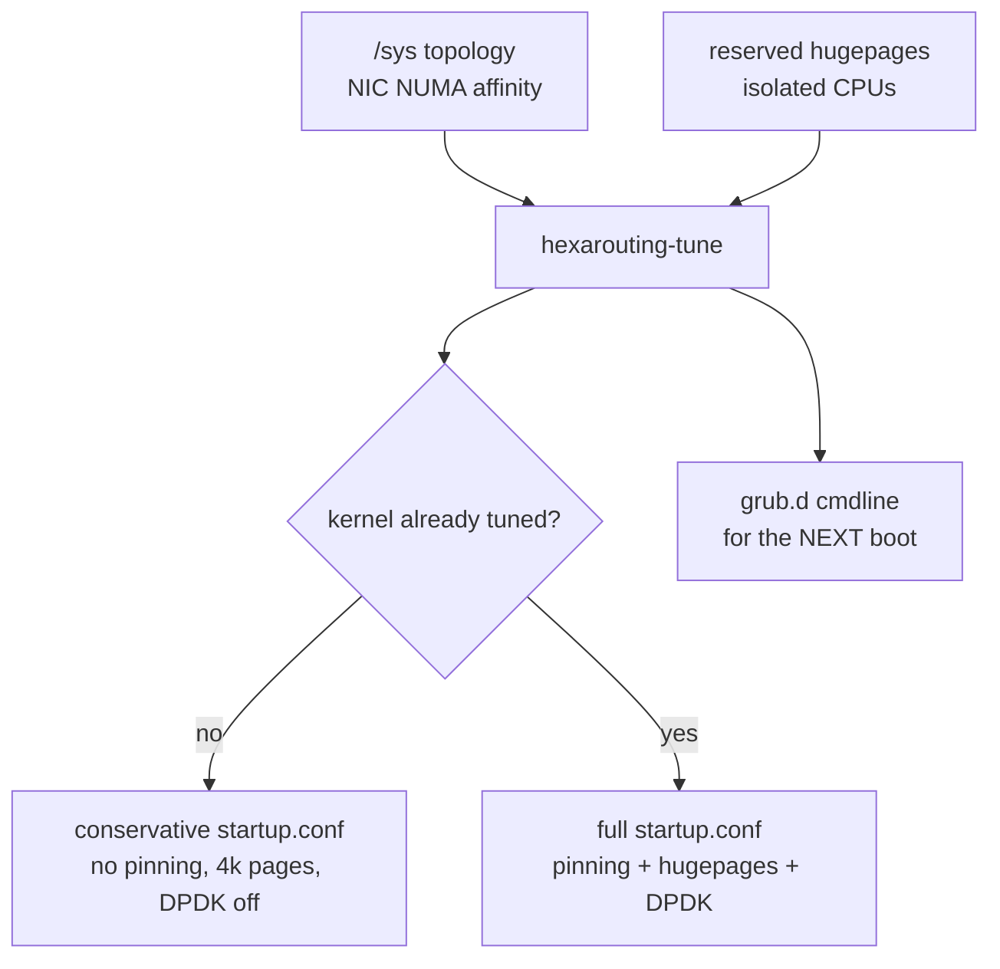
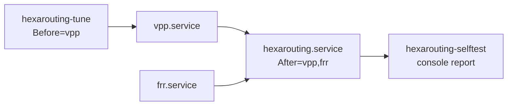
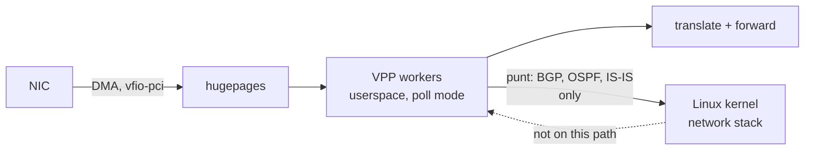

# HexaRouting — Appliance

## TL;DR

Installing VPP and FRR is the easy part. What decides whether the box delivers
100 Gbps or half of it is **boot tuning**, and it fails invisibly: the box
comes up, forwards, and underperforms. `hexarouting-tune` computes CPU
isolation, hugepages and pinning from the actual hardware instead of copied
values.

Minimum requirements: **4 GB RAM** and a CPU with **SSE4.2**. Below either, VPP
dies — by OOM or by SIGILL — and the boot self-test says so on the console
before the operator has to guess.

Two standing answers about the kernel live here as well, so that neither is
re-derived every six months: a **custom-built kernel MUST NOT be introduced**
without a defect proven to be the distribution kernel's and unfixable by
configuration, because the appliance would stop receiving security updates; and
the boot tuning **not** yet applied is listed as hypotheses with costs, to be
measured by [#28](https://github.com/andrediashexa/hexarouting/issues/28) one
knob at a time rather than switched on and declared an improvement.

> The key words **MUST**, **MUST NOT**, **SHOULD**, **SHOULD NOT**, **MAY** and
> **RECOMMENDED** in this document are to be interpreted as described in
> [RFC 2119](https://www.rfc-editor.org/rfc/rfc2119).

## 5W2H

| | |
|---|---|
| **What** | A bootable Debian appliance carrying VPP, FRR and HexaRouting, with boot tuning computed at first start. |
| **Why** | Hand-tuned `isolcpus` and hugepages are the difference between full and half throughput, and getting them wrong produces no error. |
| **Who** | Whoever racks the box; the self-test speaks to them over serial console or IPMI. |
| **When** | Tuning is computed on every boot; kernel-level changes take effect on the **next** one. |
| **Where** | `/etc/vpp/startup.conf` and `/etc/default/grub.d/hexarouting.cfg`, both generated. |
| **How** | Reads `/sys` topology, NIC NUMA affinity, reserved hugepages and isolated CPUs. |
| **How much** | 200k subscribers on an eight-core box ⇒ roughly 6 × 1 GB hugepages, computed from the subscriber count and the worker count rather than guessed. |

## Boot tuning



Rules applied, each with its reason:

| Rule | Why |
|------|-----|
| CPU 0 and its SMT sibling stay with the OS and VPP's main thread | Isolating everything leaves the kernel nowhere to run |
| Workers only on the NIC's NUMA node | Crossing NUMA on the packet path costs more than the extra worker earns |
| One worker per physical core, sibling isolated with it | Otherwise system load competes for the same physical core |
| `nohz_full` and `rcu_nocbs` follow `isolcpus` | Isolating without removing the tick and RCU callbacks leaves jitter, which shows up as burst loss |
| 1 GB hugepages sized from the subscriber target | Session and bitmap budget comes from [architecture.md](architecture.md) |
| Deep C-states off (`processor.max_cstate=1`, `intel_idle.max_cstate=0`) | A poll-mode worker never sleeps, but the OS core does, and waking it costs tens of microseconds in the middle of a burst |
| `transparent_hugepage=never` | `khugepaged` compacts memory in the background, and compaction stalls whichever CPU holds the page |
| `cpufreq` governor forced to `performance` on every boot | The governor is runtime state, not a kernel parameter: it does not survive a reboot on its own, and on `schedutil` the first burst arrives before the core has ramped up |
| One RX queue per worker on the dataplane NIC | Left unsaid, DPDK opens the default and all traffic enters through a single worker — invisible on a CPU graph, because poll mode reads 100% either way |
| Interrupts banned from the isolated cores (`IRQBALANCE_BANNED_CPULIST`) | Isolating from the scheduler while still taking interrupts on that core isolates nothing |
| `kernel.numa_balancing = 0` | Automatic NUMA balancing migrates pages behind a pinned worker's back; the memory is already on the right node |
| `net.ipv6.conf.{all,default}.accept_ra = 0` | A neighbour's Router Advertisement reaches the kernel over a `linux_cp` pair since [#213](https://github.com/andrediashexa/hexarouting/issues/213), because FRR needs it for BGP unnumbered. With the kernel's default the box takes the default route in it, and `linux_nl` syncs that into the VPP FIB: measured. FRR reads advertisements on a socket of its own, so unnumbered is unaffected |

The latency knobs cost power, so they are a switch, not a law:
`HEXA_LOW_LATENCY=0` in `/etc/hexarouting/tune.env` drops the C-state and THP
parameters from the kernel command line and leaves the governor alone. The
default is `1`, because this is a router.

### What `tune.env` accepts, and what happens to anything else

`tune.env` is a file an operator edits by hand and `apply-tuning` reads on
every boot. Every value in it used to be **believed**, and two of the ways that
went wrong were measured by running the script:

| Written | What the box did | What it does now |
|---|---|---|
| `HEXA_LOW_LATENCY=true` | Took the "not `1`" branch: the C-state and THP parameters were **removed** from the kernel command line and the governor left alone — the opposite of what it says — while the journal reported `HEXA_LOW_LATENCY=0`, naming a value nobody wrote | Refused by name, and read as `1` |
| `HEXA_SUBSCRIBERS=200k` | The tuner's argument parser refused it with a usage dump naming neither the variable nor the file; `apply-tuning` exited non-zero and the unit failed, so **no tuning was written at all** and the kernel command line stayed at whatever the previous boot put there, disagreeing with the `startup.conf` beside it | Refused by name, and read as `200000` |

So each value is checked before it is used, and one this box does not accept is
**refused out loud and replaced by the shipped default** — never by the
opposite of what it says, and never by failing the unit. A typo **MUST NOT**
cost the box its tuning: an ignored setting is recoverable by editing one line,
while a failed tuning unit leaves `isolcpus` and `startup.conf` describing
different machines. That is the same reasoning `HEXA_MAX_WORKERS` already
carried, applied to the other two.

| Variable | Accepted | Shipped | Used when refused |
|---|---|---|---|
| `HEXA_DATAPLANE_IF` | an interface name, or empty | empty | — any name is possible, and the one carrying the default route is refused by the tuner itself |
| `HEXA_SUBSCRIBERS` | digits only | `200000` | `200000` |
| `HEXA_LOW_LATENCY` | `1` or `0`, nothing else | `1` | `1`, because this is a router |
| `HEXA_MAX_WORKERS` | digits only, or empty for no cap | empty | no cap |

**A refusal says what the box does accept**, with what each value would do, not
only that this one was wrong: it is read on a serial console by somebody who
then has to guess the spelling. Every line of it is wrapped by hand to 79
columns and the refused value is quoted and printed whole, so it can be grepped
for and typed back.

`test/test_apply_tuning.sh` drives `apply-tuning` against fake `/etc`, `/proc`
and `/sys` trees through its `HEXA_ROOT` seam, with the tuner, `update-grub`
and the NIC binder stubbed on `PATH`. Before it existed **nothing ran this
script at all**: `test/test_kernel_tuning.py` reads it as text looking for
candidate knobs, and `appliance/test_tune.py` tests the tuner it calls, so the
one component that turns an operator's file into a kernel command line had
never been executed by a test. It asserts the arguments each value produces,
that the governor is written only where the kernel offers `performance`, that
the tuner runs before the NIC binder and that a failing binder does not fail
the tuning, that `update-grub` runs on a change and not on a repeat, and that a
tuner which really fails still fails the unit — so the refusals above did not
turn every error into a shrug.

### The kernel command line, parameter by parameter

The rules above are the reasons. This is the line the tuner actually writes
into `/etc/default/grub.d/hexarouting.cfg`, parameter by parameter, because a
reader diagnosing a box has the line in front of them and not the reasons.

It is deliberately a **second copy** of something `render_grub()` already says,
so `test/test_kernel_tuning.py` renders the line and compares the two. A
parameter added to the tuner and not to this table, a value changed on one
side, or a knob quietly promoted out of the `HEXA_LOW_LATENCY` half is a test
failure rather than a document that stopped being true without telling anyone.

| Parameter | Value | Only with `HEXA_LOW_LATENCY=1` | What it is for |
|---|---|---|---|
| `isolcpus` | computed | no | The worker cores and their SMT siblings, from the topology |
| `nohz_full` | computed | no | The same list: an isolated core still taking the timer tick is not isolated |
| `rcu_nocbs` | computed | no | The same list again: otherwise RCU callbacks run on the worker |
| `default_hugepagesz` | `1G` | no | So that `hugepages=` below is counted in 1 GB units and not 2 MB ones |
| `hugepagesz` | `1G` | no | Reserves the 1 GB pool |
| `hugepages` | computed | no | Sized from `HEXA_SUBSCRIBERS`, then capped by the RAM the box actually has |
| `intel_iommu` | `on` | no | `vfio-pci` hands the NIC to userspace, and it needs an IOMMU to do that safely |
| `iommu` | `pt` | no | Pass-through: the IOMMU is here for the device assignment, and full translation on the DMA path costs throughput for a protection a single-purpose appliance does not buy |
| `intel_idle.max_cstate` | `0` | **yes** | Deep C-states off, for the `intel_idle` driver |
| `processor.max_cstate` | `1` | **yes** | The same, for the ACPI driver that takes over when `intel_idle` is not in play |
| `transparent_hugepage` | `never` | **yes** | `khugepaged` compacts memory in the background and the compaction stalls whichever CPU holds the page |

`GRUB_DISABLE_OS_PROBER=true` goes on the same file and is not a kernel
parameter: `os-prober` scans every block device looking for other operating
systems, finds nothing on an appliance, and can spend minutes doing it inside
the tuning service.

**Everything in the right-hand column is the switch, and it is the pattern any
future knob follows.** A parameter that costs power or costs a diagnostic
belongs in `LOW_LATENCY_CMDLINE`, never in the unconditional line — see
*Boot tuning still on the table* below, where every candidate is classified
that way before it is measured, let alone shipped.

`HEXA_MAX_WORKERS` in the same file caps how many physical cores become
forwarding workers. It ships **empty**, which means no cap and is exactly the
behaviour above: every core on the dataplane node except the first. The cap
exists because "all but the first" scales the wrong way — on a 32-core socket
it leaves **one** physical core carrying FRR, `frr-reload`, `vtysh`, `hexash`,
`sshd` and VPP's main thread together, and the main thread takes the worker
barrier once a second for `bpa-expire-process`. Setting it hands cores back to
the control plane, and the cores it frees leave `isolcpus` so the scheduler can
use them. A cap larger than the machine has invents nothing. Each worker
removed is that share of forwarding capacity, so no default is shipped: the
trade depends on how much control-plane work the box actually carries. The box
says which side of it it is on: the boot self-test reports how many cpus are
left for the control plane and warns when that is one while more than one core
is isolated. See *The CPU half* below.

Tested against synthetic topologies in `appliance/test_tune.py`, because the
development machine has neither SMT nor multiple NUMA nodes — and that is
exactly where the decisions matter. One case builds 2 sockets × 8 cores ×
2 threads with the NIC on node 1 and asserts that no worker landed on node 0
and no SMT sibling escaped isolation.

## First boot: the tuning is not in effect yet

`isolcpus` and hugepages come from the kernel command line, so they take effect
only on the **next** boot. The first implementation generated a
`startup.conf` demanding `default-hugepage` that did not yet exist, and VPP
entered a restart loop — which would break every first start after installation.

`hexarouting-tune` now reads the kernel's actual state:

```
/sys/kernel/mm/hugepages/hugepages-1048576kB/nr_hugepages
/sys/devices/system/cpu/isolated
```

* While either is missing, the generated `startup.conf` **MUST** be
  conservative: no pinning, 4k pages, smaller heap, **DPDK disabled**. Without
  hugepages the DPDK EAL fails to initialise and VPP exits; with
  `Restart=always` on `vpp.service` that becomes a restart loop pointing at
  nothing.
* Half-configured also counts as untuned: hugepages reserved without
  `isolcpus` still yields the conservative file, because pinning workers
  without isolation makes VPP compete with the system.
* The GRUB line **MUST** still request the full tuning for the next boot.

## The VPP startup file has no include directive

Found while investigating why VPP restarted on the ISO: the packaged
`/etc/vpp/startup.conf` has no include directive, and VPP supports none. The
first implementation wrote tuning to `/etc/vpp/startup.conf.d/tuning.conf`,
which **was never read**.

The effect is the worst kind for a product: no error, no warning, the box comes
up and forwards. It merely delivers half the throughput, with no way for the
operator to know why.

`hexarouting-tune` therefore generates the file VPP actually reads,
concatenating `/etc/hexarouting/vpp-base.conf` — operator-editable, holding
`unix`, `linux-cp` and so on — with the computed `plugins`, `cpu`, `buffers`
and `memory` stanzas.

* The base file **MUST NOT** contain those four stanzas; they are generated.
* `appliance/test_startup_conf.sh` closes the testing gap that allowed this: it
  generates the configuration, **starts VPP with it**, and checks that the
  plugins loaded, the process is still alive after five seconds, and a pool can
  be created. Run with `make test-appliance`.

## Tuning must not block boot

`hexarouting-tune.service` once sat for **five minutes** with systemd waiting
`no limit`, holding the rest of the boot behind it. The immediate cause was
`update-grub`: on a live system GRUB is not even installed to disk, and
`os-prober` scans every block device looking for other operating systems.

Three fixes, because one would not be enough:

| Fix | Why |
|-----|-----|
| `GRUB_DISABLE_OS_PROBER=true` in the generated `grub.d` file | An appliance has no other OS to find, and the scan is most of the time |
| `apply-tuning` skips `update-grub` on a live system | There it changes nothing |
| `TimeoutStartSec=90` on the unit | Safety belt, valid even if the other two fail |

The third matters most. The tuning only takes effect on the next boot anyway,
so blocking the current one for it is a bad trade in every scenario. **No
HexaRouting service SHOULD be able to block boot without a limit** — that was a
design defect, not merely an effect of `update-grub`.

## Memory requirement

**Minimum 4 GB.** A live system keeps its writable root entirely in RAM as an
overlay on the squashfs; together with VPP, 2 GB is not enough and the OOM
killer takes VPP — and the rest of the boot with it.

Measured while booting the ISO with 2 GB: `Out of memory: Killed process (vpp)`,
with VPP holding only **19 MB resident**. It was not the glutton; it was the
chosen victim. Installed to disk the requirement drops, since there is no RAM
overlay, but 4 GB remains the sensible floor for a dataplane.

Session tables are sized with `bpa session-table buckets <n> memory <MB>`,
defaulting to 16k buckets and 16 MB per table. The size is a virtual
reservation, and the OOM killer does **not** count it: the kernel scores a
process by what it holds **resident** (RSS, swap and page tables), not by what
it maps. Measured in `lab/oom.sh`: VPP with 17 GB mapped and 354 MB resident,
inside a 502 MB cgroup, has `oom_score` 670 out of 1000, which is its resident
share and not its mapped one, and the kernel's own kill line for it reads
`total-vm:17476328kB, anon-rss:247984kB`. Raising the table therefore raises
VPP's badness only as the table is used. A 200k-subscriber deployment
**SHOULD** raise it; a small box **MUST NOT** pay for it, because the memory is
eventually touched and a small box does not have it.

Raising the floor to 4 GB did nothing for the victim. `vpp.service` therefore
carries `OOMScoreAdjust=-1000`, shipped as the drop-in
`/etc/systemd/system/vpp.service.d/hexarouting-oom-protect.conf`, which takes
the dataplane out of the kernel's selection instead of merely lowering its
score: a box that has lost `bgpd` still forwards on what it learned, and a box
that has lost VPP forwards nothing. It does **not** protect VPP from its own
allocations — if VPP is genuinely the process consuming the machine, the kernel
still kills it.

`hexarouting.service` carries `MemoryMax=512M` for the other side of the same
event: the control plane must not be what empties a box sized to the floor. On
4 GB the tuner leaves a quarter of RAM outside the hugepage pool, and 512M is a
quarter of that — against a measured 13 MB peak for loading a configuration,
which does not grow with the routing table or the session count.

The behaviour itself is asserted, in three states, by `lab/oom.sh`: real VPP
and one growing control-plane process in a cgroup of their own, with the
adjustment taken from the shipped drop-in rather than typed into the lab. With
it the kernel kills the control-plane process and VPP goes on answering; with
it removed and **nothing else changed** the kernel kills VPP, although the
balloon is the smaller of the two; restored, it kills the balloon again. What
that lab cannot show is that *systemd* applies the drop-in, because there is no
systemd in a lab container: the boot self-test reads
`/proc/<vpp pid>/oom_score_adj` on the running box and says so on the console,
and `lab/install-iso.sh` reads that line back off a box it installed and
booted.

### What a full BGP table costs, and why `frr.service` has no bound

`frr.service` carries **no** `MemoryMax=`, and that is now a measured decision.
One full IPv4 table was fed to `bgpd` on this build over a single eBGP session:
1,000,000 prefixes, ~60k distinct origin AS paths and three communities per
route, which is the attribute diversity that stops FRR interning one attribute
set for the whole table. Convergence took 40 s, and 998,034 routes reached the
kernel FIB.

| Daemon | RSS, no table | RSS, one full IPv4 table |
|---|---|---|
| `bgpd` | 13 MB | **837 MB** |
| `zebra` | 10 MB | **553 MB** |
| `mgmtd` + `staticd` | 14 MB | 14 MB |
| **all of FRR** | **37 MB** | **1.37 GB** |

Three things follow.

**The number belongs to the operator, not to the product.** A box taking
default routes only stays at 37 MB. A second full-table session adds another
path per prefix; IPv6 adds again; `soft-reconfiguration inbound` would add a
whole Adj-RIB-In. One number in a shipped unit file has to serve all of them.

**And the boxes differ as much as the deployments.** The tuner leaves
`max(2, RAM/4)` GB outside the hugepage pool for everything that is not VPP, so
the same 1.37 GB is 69% of what a 4 GB box has and 9% of what a 64 GB box has.
A bound safe on the large box bounds nothing on the small one, and a bound that
bites on the small one kills the large one.

**A bound guessed low does not slow BGP down, it kills it.** Measured with
`bgpd` in a cgroup at `memory.max=512M` while that same table converged: killed
after ten seconds holding 428 MB, with `pgscan 100` and `pgsteal 4` beside it,
so the kernel found nothing reclaimable and went straight from the limit to the
kill. `frr.service` carries `Restart=always` and `RestartSec=5`, which makes
that a five-second restart loop on the box with the most to lose.

`MemoryHigh=` is not the softer answer it looks like, and was measured too.
Under `memory.high=512M` the same convergence had not finished after **nine
minutes**: 189,578 throttling events, `pgscan 2880 / pgsteal 12` (anonymous
memory, no swap, so there is nothing to reclaim and the throttle never lifts),
PSI `full avg10=75%`, `bgpd` parked in `D` state having used 6 s of CPU in
9 minutes of wall clock, and `vtysh show bgp summary` returning nothing within
30 s. No kill, and no working router either: an operator would find a box that
neither converges nor answers its own CLI.

So the protection against a control plane that grows is the one already in
place, from the other end: the dataplane is out of the kernel's selection, and
the largest resident process on a box in trouble is `bgpd` itself, which is
what the kernel will choose without being told to.

**Sizing, then, rather than bounding.** 4 GB is the floor for a box that does
not carry a full table. A box that does needs the 1.37 GB above to sit inside
`max(2, RAM/4)` GB with the kernel and the page cache beside it, so **16 GB**
is the sensible floor for a full-table deployment and 8 GB is already tight.

### The CPU half: what the box reads back, and what it will not cap

The same question was asked of the CPUs, and the answer came out the same
shape: this product **reports** what the control plane is left with and does
not add a cap of its own. Not because a number could not be derived, but
because the derivable one is **already in force** - the kernel confines every
process to the cores outside `isolcpus`, measured below - and the caps that
would be left cannot be measured on anything this repository can boot.

**What the box now reads back.** Since the tuner existed the console has said
`full tuning active: corelist-workers 1-7`, which is what
`/etc/vpp/startup.conf` **asks for**. Nothing ever read what the dataplane
**got**. The boot self-test now compares three places, none of which is the
component that made the decision:

| | Read from | Says |
|---|---|---|
| TOLD | `/etc/vpp/startup.conf` | which cores the tuner asked for |
| HAS | `/proc/<vpp pid>/task/*/status` | where the kernel actually pinned VPP's threads |
| HAS | `/sys/devices/system/cpu/isolated` | which cores the kernel is isolating |

and prints three lines:

```
  [ ok ] dataplane workers hold the cores the profile names: 1
  [ ok ] and the kernel is isolating every one of them
  [ ok ] control plane has 1 cpu(s): 0, with VPP's main thread
```

Deliberately **not** `vppctl show threads`, which also carries the lcore: that
is VPP reporting on itself, and the question is whether the kernel agrees with
VPP. Nothing in the check writes anything.

Two of those are failures when they do not hold, because both are silent:

* **A worker on a core the kernel is not isolating.** The worker runs, every
  counter is clean, and the core is shared with everything the scheduler has to
  place - while a poll-mode thread never yields. The loss appears as burst
  drops with no counter behind them. Reachable whenever the kernel command line
  and `startup.conf` come apart: `hexarouting-tune.service` failing, a
  hand-edited `/etc/default/grub.d/hexarouting.cfg`, an `update-grub` that was
  never run.
* **A dataplane older than the profile it is judged against.** VPP is pinned to
  whatever it read when it started, so a restart-less configuration change
  leaves the box running the previous tuning while the console reports the new
  file. In the worst case `startup.conf` names workers and the running VPP has
  **no** worker thread at all, which is the whole of the box's capacity
  missing.

The third is a **report**, not a failure, and it is where the CPU story meets
the memory one.

**One cpu for everything that is not a worker.** The tuner gives the OS the
dataplane node's first physical core and isolates the rest, so on a 32-core
socket FRR, `frr-reload`, `vtysh`, `hexash`, `sshd` **and** VPP's main thread
share one core - and the main thread is the one that takes the worker barrier
once a second for `bpa-expire-process`. The self-test warns when the control
plane has exactly one cpu **and more than one core is isolated**, which is the
arithmetic statement that cores could have been handed back and were not. A box
with one isolated core has nothing to give back and is not warned. The remedy
is `HEXA_MAX_WORKERS`, and each core handed back is that share of forwarding
capacity - so the box states the number and the trade stays the operator's.

**Changing the cap is not symmetric, and the expensive direction is the one an
operator would not expect.** Measured against a synthetic 8-core-x-2-thread
topology already booted with `isolcpus=1-3,9-11`:

| Change | Next boot | The boot after |
|---|---|---|
| Cap lowered (3 to 2 workers) | tuned profile, `corelist-workers 1-2` | `isolcpus=1-2,9-10`: the freed cores return to the scheduler |
| Cap raised or removed | **FIRST BOOT MODE**: no workers, no hugepages, DPDK disabled | tuned profile, `isolcpus=1-7,9-15` |

`tuned_now` requires the cores the profile pins to be cores the kernel is
**already** isolating, and raising the cap asks for cores that are not isolated
until the command line changes on the next boot. So lifting a cap costs one
boot with no dataplane NIC. That is the tuner refusing to pin a worker to a
core the kernel has not isolated - correct, and worth a maintenance window.

**Why no `CPUQuota=`.** On this box the control plane does not compete with the
workers: they are on isolated cores the scheduler will not place other work on.
Throttling the control plane therefore frees nothing for forwarding and costs
BGP convergence and `frr-reload`. The one place the two genuinely contend is
VPP's **main** thread, which shares the OS core by design - and the measurement
that would size a quota there is the held-barrier interval under control-plane
load, which **cannot** be taken on a virtio VM, because the host scheduler
preempts vCPUs whatever the guest isolates. A quota shipped without it would be
a number nobody could defend, which is the mistake `frr.service` already
avoided once.

**Why no `AllowedCPUs=` or `CPUAffinity=` for the control plane: the bound is
already applied, by the kernel, and it is inherited rather than enforced.**
This was the one worth measuring, because the number would not have been
invented - it is the complement of the `isolcpus` list the tuner itself wrote
on the same run. `lab/install-iso.sh` takes the reading on the installed box
(`isolcpus=1`, two cpus) and records it:

```
  [meas] cpu-iso: 1 online=0-1
  [meas] cpu-bgpd: Cpus_allowed_list:0
  [meas] cpu-escape: Cpus_allowed_list:1
  [meas] cpu-init: Cpus_allowed_list:0
  [meas] bgpd-from: pid:381 ppid:1 starttime:898
  [meas] isolspell: isolcpus=1
```

`bgpd`'s own mask is **`0`**, not `0-1`, and the line above it says where that
came from: **pid 1** is itself confined to `0`. `isolcpus` spelled as a bare
list is not only a hint to the load balancer - the kernel sets `init`'s
affinity to the non-isolated set at boot, and `bgpd` has `ppid 1`, so it is
wearing systemd's mask rather than one anybody configured. That is the CPU
bound this issue asked for, applied from the same list the tuner computed, and
until now nothing read it back.

**Inherited is not the same as enforced, and both halves are measured.**
`cpu-escape` is `taskset` onto the isolated core, and it was **accepted**: a
process that calls `sched_setaffinity` leaves the set, and so does anything it
starts. An `AllowedCPUs=` cpuset would close exactly that, and nothing else.

**One reading disagreed and has not been explained.** An earlier run of this
same lab, on the same image, read `cpu-bgpd: Cpus_allowed_list:0-1` on a box
that reported `isolcpus=1` - a `bgpd` outside the mask its parent should have
given it. That run was taken with a lab that did not record `cpu-init` or
`bgpd-from`, so which `bgpd` it was cannot be recovered. Two runs since, with
those lines in place, both read `0` with `ppid 1`. The reading is kept in the
lab rather than argued about: the next run that comes back `0-1` will also say
who started that `bgpd` and what pid 1's mask was at the time, which is the
pair of numbers that would settle it.

So: **not shipped**, and the reason is the size of the residue rather than a
claim that there is none. A cpuset would add a second per-box generated
artefact whose failure mode is a control plane stranded on cores that do not
exist, on the box class where the control plane already has one core. What it
would buy is confinement against a process that re-affinitises itself - which
nothing this product ships does, and which an operator in `start shell` typing
`taskset` has asked for on purpose. If the `0-1` reading reproduces with a
parent that explains it, that trade changes, and the measurement that would
change it is already being taken on every run of this lab.

## The statistics segment, and why the tuner does not size it

Every other memory figure on this page is computed. This one is not, and that
is a decision rather than an omission — but it is the only resource on the box
whose limit is an **abort** instead of a refusal, so the decision is written
down here and the box says where it stands at every boot.

VPP exports its counters through a shared memory segment of **fixed** size,
named by a `statseg` stanza in `startup.conf`. `hexarouting-tune` emits no such
stanza, so a shipped box runs on VPP's built-in default of **32 MB**
(`STAT_SEGMENT_DEFAULT_SIZE`, 32 << 20, in the VPP release this image pins).

Each interface VPP holds costs the segment, and the cost was measured while
sizing a BNG (`docs/bng.md` section 2.1):

| Segment | Interfaces reached | What happened at the end |
|---|---|---|
| 32 MB, the default | between 7,000 and 8,000 | `vlib_stats_create_counter` → `os_panic` → `SIGABRT`. Reproduced twice, at the same step |
| 1 GB, set by hand | 40,000, using 114.7 MB | nothing; that is where the measurement stopped, not a wall it found |

**The failure is the whole dataplane, and it is silent.** VPP does not refuse
the interface that would not fit and carry on. `vnet_register_interface` tries
to grow the counter directory, the allocation fails inside the segment, and the
process aborts. What the operator gets is a dead box and a signal.

### What one interface actually costs, read from VPP's sources

Per software interface, registered by `statseg_sw_interface_add_del`:

* **17 directory entries** — nine simple counters and eight combined ones, one
  symlink each, at 144 bytes per entry (`vlib_stats_entry_t`, static-asserted
  to that size). That is **2,448 bytes**, and it is the dominant term.
* **200 bytes per thread** — 9 × 8 for the simple counters and 8 × 16 for the
  combined ones, grown per thread by `vlib_stats_validate`. So this half grows
  with the worker count as well as with the interface count.
* the interface's name in the `/if/names` string vector, a small vector each.

On a single-threaded box that is about 2.6 kB. The measured figure is
(114.7 − 4.2) MB over 40,000 interfaces, or **about 2.9 kB each**, which is the
same number with the allocator's own rounding on top.

**What could not be determined without running VPP, and is therefore not
claimed anywhere:** the interface count a given segment size supports. Dividing
the size by 2.9 kB predicts about 12,000 interfaces on the 32 MB default, and
the box aborted below 8,000. The reason is visible in the source and its size
is not: the directory is **one contiguous vector**, grown by
`clib_mem_heap_realloc_aligned` to 1.5× whenever it overflows, so a growth may
need the old copy and the new one inside the segment at the same time. Whether
dlmalloc extends it in place depends on the state of that heap, which is a
question about a running dataplane. No formula is offered here, and the two
measured points above are the only numbers stated.

The `+395 MB` quoted for `statseg { size 1G }` in
[#288](https://github.com/andrediashexa/hexarouting/issues/288) is worth one
correction, since it is the cost side of the decision below: in the table it
came from it is the RSS difference between **0 and 40,000 sessions** on the
1 GB box, not the cost of the segment at rest. Nothing measured so far isolates
what a larger `statseg` costs an idle box.

### Why the tuner does not size it

Every other figure the tuner writes comes from ground truth or from a number
the operator set: hugepages from `HEXA_SUBSCRIBERS` and then from the RAM the
machine has, `buffers-per-numa` from the worker count, `main-heap-size` from
the pages the kernel **actually reserved**. The statistics segment has no such
input, and the candidates were each rejected on their own arithmetic:

| Option | Cost |
|---|---|
| Size it from `HEXA_SUBSCRIBERS` | Wrong units. A CGNAT subscriber is a translation, not an interface: 200,000 of them share a handful of ports. The shipped default would ask for roughly 540 MB of segment for interfaces that never appear, on a box whose RAM floor is 4 GB |
| Size it from a constant — 256 MB, 1 GB | A number nobody can justify, which is exactly what `main-heap-size` stopped being when it started reading the reserved pages. It is also not free: the segment is what the operator's RAM is not |
| Add a `HEXA_INTERFACES` to `tune.env` | A knob whose correct value the operator cannot know before the box is configured, on a product that today creates interfaces from a configuration the tuner never reads. A refusal path, a document and a wiki page for a number that would be guessed |
| Leave it to VPP and say nothing | The status quo, and the reason the report was filed: the box meets the limit as a `SIGABRT` |
| **Leave the number to the operator, in the file that already takes it, and make the box say where it stands** | One line in the tuner's report, one check in the self-test. No RAM reserved for a box that does not need it, and no number invented |

The last one is what ships. `statseg` belongs in
`/etc/hexarouting/vpp-base.conf`, which is the operator-editable base the tuner
concatenates ahead of the stanzas it generates — the same seam that already
carries `unix`, `linux-cp` and `socksvr`. The tuner generates **no** `statseg`
stanza precisely so that an operator's own is never overridden on the next
boot, and `appliance/test_tune.py` asserts that in both the tuned and the
first-boot configuration.

This closes only the silence. **A box that needs more than the default still
has to be told**, and the number it is told is the operator's. Anything that
creates an interface per subscriber — a BNG, or QinQ sub-interfaces per
customer — reaches the wall at a few thousand and **MUST** set it.

### What the box says

`hexarouting-tune` names the segment in its report, beside the figures it does
compute, so the one resource it does not size is not the one resource it is
silent about:

```
# 1G hugepages: 6 requested (sized for 200000 subscribers), 6 reserved right now
# statistics segment: NOT sized here, so VPP's built-in 32 MB applies.
#          Measured: a box on that default aborted between 7,000 and 8,000
#          interfaces. It is per INTERFACE, not per subscriber, which is why
#          nothing here sizes it. To raise it, put a statseg stanza in the
#          base file (/etc/hexarouting/vpp-base.conf):
#          it is concatenated ahead of these stanzas.
```

The boot self-test reads the **dataplane's own heap**, not the configuration
file, and reports how much of it is spent over how many interfaces:

```
  [ ok ] statistics segment: 4.20M of 31.99M used, 3 interface(s)
        size: VPP's own default, which this product does not set
```

At half the segment that becomes a warning, and at three quarters a failed
check naming `os_panic` and `SIGABRT` and the stanza that raises it. Three
quarters rather than nine tenths because of the contiguous directory above: the
last part of a segment cannot be spent on a growth that has to hold two copies.
Where the size came from is read off the box too, so a box somebody has already
sized is not reported as running on a default.

Driven in `test/test_selftest.sh` against a stubbed `vppctl`, over a
comfortable box, a box at 60%, a box at 90%, a box whose `startup.conf` carries
a stanza, and a dataplane that does not answer the question at all — because
filling a real statistics segment means creating several thousand interfaces on
the machine running the tests.

## CPU requirement

VPP's binary assumes **SSE4.2** and uses AVX where available. On a CPU without
it, VPP dies with `SIGILL` in milliseconds; with `Restart=always`, the symptom
is a restart loop that says nothing about the cause.

That is exactly what happened in testing: QEMU without `-cpu` uses the `qemu64`
model, which lacks SSE4.2. Chasing that loop cost two wrong hypotheses before
the journal showed `code=killed, signal=ILL`.

* The self-test **MUST** check instruction sets **before** looking at VPP.
* `lab/boot-iso.sh` passes an adequate CPU model, and uses KVM when available —
  boots drop from minutes to seconds.

## Services



Two decisions worth explaining:

* **FRR is `Wants`, not `Requires`.** Without routing the box still forwards
  whatever static routes exist; taking CGNAT down with it would only widen the
  damage.
* **No `ExecStop` on `hexarouting.service`.** The configuration lives in VPP.
  Stopping the service **MUST NOT** delete production pools; removing a pool is
  the operator's action, through the VTY. A stop-time command also runs on every
  **restart**, so it would fire during an ordinary upgrade rather than only when
  somebody meant to take CGNAT down.
* **There is one on `vpp.service`**, shipped as the drop-in
  `/etc/systemd/system/vpp.service.d/hexarouting-stop-drain.conf`. It runs
  `vppctl bpa stop-drain` before the signal, so every block the dataplane is
  holding is released in the retention log while the graph is still running to
  carry the records. That is a different unit for a measured reason: the blocks
  are in the VPP process, and VPP's UDP IPFIX export is a packet the dataplane
  sends rather than a kernel socket, so it stops working the moment the graph
  does. See [logging.md](logging.md#stopping-the-box-closes-them-too-and-a-crash-cannot).

Both of those are enforced, and by the same rule rather than by a list of which
file may carry which line. `test/test_stop_is_not_a_teardown.py` reads every
stop-time directive shipped under `appliance/` and requires that it only asks a
running process to **flush state it is already holding**; anything that reaches
the configuration surface is refused, including on the drop-in that is allowed
to have one. It also fails when the drain goes missing, because a box that stops
without it reopens the open-allocation defect above.

`hexarouting.service` waits for VPP to accept commands before applying
configuration: systemd considers `vpp.service` started once the process is up,
but the CLI socket and plugins take a moment longer, and applying before that
fails intermittently.

Tuning runs on **every** boot, with no sentinel, so a change in `tune.env` or a
NIC swap is honoured. `apply-tuning` avoids the cost of `update-grub` by
comparing before regenerating.

## Which NIC the dataplane is allowed to claim

The appliance shipped `HEXA_DATAPLANE_IF=eth0`. On Debian 12 with predictable
interface names that interface does not exist, so `hexarouting-tune` could not
resolve a PCI address and generated

```
dpdk {
  dev default { num-rx-queues 1 }
}
```

No allowlist and no `no-pci`. VPP's DPDK plugin then probes and claims what it
can bind — on a single-NIC box, the management interface. The operator learned
about it by losing the session
([#123](https://github.com/andrediashexa/hexarouting/issues/123)). Nothing
asked, and the installer never asks which interface carries subscriber
traffic, so this was the ordinary case rather than the exception.

**Unknown MUST mean claim nothing.** The two outcomes are not symmetric:

| | recoverable by |
|---|---|
| no dataplane interface | logging in over the network and setting one |
| the dataplane ate the management interface | walking to the console |

So the tuner now emits `dpdk { no-pci }` when it cannot resolve a device, the
setting ships **empty**, and the boot self-test says the box has no dataplane
interface and names the statement that gives it one. A box that forwards
nothing looks like a box that is working, so it has to be said out loud.

### Naming the card from the VTY

The empty default is the right answer to #123 and it left the other half
missing: **there was no way to name the card that was not an editor in Linux.**
Every fresh install came up forwarding nothing, and the remedy the box printed
was `vi /etc/hexarouting/tune.env`. `docs/context.md` argues that an operator
who has to drop to `vppctl` is one for whom this VTY is decoration; the same
holds for one who has to drop to an editor
([#283](https://github.com/andrediashexa/hexarouting/issues/283)).

It is now a statement like any other — in the candidate, committed, saved by
`save`, rendered by `show running-config`:

```
hexarouting> configure
hexarouting# [edit] dataplane interface enp2s0
hexarouting# [edit] commit
dataplane interface: enp2s0
    stored, and the boot tuning was recomputed for it
    NOT IN EFFECT YET: the dataplane claims its card when it starts, and this
    commit does not restart it
    restarting it hands the card over and ends every session on this box,
    including this one, so it is not done for you
    reboot the box in a window you have chosen, and it comes up forwarding on
    that card
commit complete
```

`commit` writes `HEXA_DATAPLANE_IF` into `tune.env` and restarts
`hexarouting-tune`, which regenerates `startup.conf` and binds the NIC. **It
does not restart VPP.** Handing a card to the dataplane takes it away from
Linux and ends every session on the box, the operator's included — the same
class of consequence as `commit remap`, which this VTY refuses until it is
asked for by name. No verb has been invented for it here, because nothing in
this repository has measured what that restart costs on a box carrying
traffic, and a dangerous verb offered on no measurement is one somebody uses
because they were told it was safe. The commit stops at the boundary and says
where the boundary is.

Every other line of `tune.env` survives byte for byte. The file is
hand-editable by design and most of it is prose — the paragraph on why the
field ships empty, the worker cap and the argument for leaving it uncapped —
and a commit that regenerated it from the four settings the VTY models would
delete all of that on the first use.

The running configuration is **read back** from `tune.env`, not remembered, so
a box set up the old way shows its own card in `show running-config` and a
second commit of the same value is `no changes to commit`.

Two refusals fire at the prompt, before anything is stored:

| typed | refused because |
|---|---|
| the card carrying the default route | it is how the box is reached; the refusal says what it would cost |
| a name this box has not got | with the list of names it does have |

The first already existed in `hexarouting-tune` and in `bind-dataplane-nic`.
It is said here as well because *where* it is said is the difference: a
refusal in a journal at the next boot is one the operator reads hours later,
and this mistake costs a site visit. The default route is read from
`/proc/net/route` — the same source the tuner and the bind script read, so the
three cannot come to disagree about which card the box is reached over.

### Naming it was never enough

For the life of the product nothing bound the NIC. DPDK cannot take a device
through `ixgbe`, `i40e`, `bnxt_en` or any other kernel driver: the device has
to be on `vfio-pci`, or on `uio_pci_generic` where there is no IOMMU. Nothing
in `appliance/` loaded either, and nothing bound anything to them.

So an operator who did exactly what the self-test told them - name the
interface - got a `startup.conf` with the right PCI address and a dataplane
with no interfaces, and no screen said why
([#283](https://github.com/andrediashexa/hexarouting/issues/283)). Mellanox
was the exception: `mlx5` is a bifurcated driver and works while kernel-bound,
which is what made this look like a hardware-dependent quirk rather than a
missing step.

`appliance/bind-dataplane-nic` runs from `apply-tuning`, after the tuner has
chosen the device and before VPP starts. That window already exists and is
already ordered correctly, and a unit of its own would be a second thing to
order.

**It binds what `startup.conf` names**, and that is the design rather than a
convenience. The tuner has already applied every rule about which NIC the
dataplane may have, including the default-route refusal above, so reading its
output inherits those rules instead of restating them. A second copy of "which
NIC may the dataplane have" is a second copy that can disagree, and the way
this one would disagree is by taking the box off the network.

It reads the default route again anyway, immediately before unbinding. Not as
a second opinion but as a last one: `startup.conf` is a file and a person can
edit it, and this is the one mistake here that cannot be undone from another
city.

| | why |
|---|---|
| `driver_override`, not `new_id` | `new_id` matches by vendor and device, so it claims every card of that model - including the management port of a two-port card, which is the ordinary case |
| `vfio-pci` with an IOMMU | the device is taken through the IOMMU, so a dataplane bug cannot write to memory the device was never given |
| `uio_pci_generic` without one | `vfio-pci` on a box with no IOMMU loads and then refuses every device, which reads on the console as the bind failing for no reason. The fallback and what it gives up are both printed |
| the bind is verified | a bind that did not take names the driver the device is on now. A device left on none at all is the worst outcome to be quiet about: the kernel no longer has the NIC and neither does the dataplane |
| a failure here does not fail the tuning | a box that could not bind its NIC still wants its hugepages, its `isolcpus` and its governor, and above all wants to come up far enough for somebody to log in and read why |

**The default route is refused even when named.** An interface can carry
subscriber traffic *and* the default route only on a box with one NIC, and
such a box cannot run this product anyway — so this overrides the setting
rather than warning about it. The refusal is printed:

```
REFUSED to give 'eth0' to the dataplane: it carries the default route,
and the box would lose management. No device is claimed; using node 0
```

The test that had to change is the finding worth keeping. `test_tune.py`
asserted:

```python
check("dev default" in out, "should still size the queue on the default")
```

It read as a harmless fallback and it was the defect, written down and
guarded. **A test can hold a bug in place**, and this one did — passing on
every run while the behaviour it protected removed boxes from the network.

## Boot self-test

A racked appliance is seen over serial console or IPMI, not `journalctl`. If
something essential did not come up, it **MUST** be on screen with the reason
attached — not merely `failed`.

The self-test checks RAM, CPU instruction sets, VPP, restart counters, the
tuning state, FRR and configured pools. On failure it dumps the tail of
`/var/log/vpp/vpp.log` and the unit status. It distinguishes warning from
failure — running in first-boot mode is expected and reported as a warning —
and always exits zero: **the diagnostic MUST NOT bring down the boot**.

That rule has two halves, and both are asserted by `test/test_selftest.sh`.
The script's last line is one; what systemd is told to do with the status is
the other. `hexarouting-selftest.service` **MUST** carry
`ExecStart=-/usr/lib/hexarouting/selftest`, and nothing **MAY** declare
`Requires=`, `Requisite=`, `BindsTo=` or `PartOf=` on it. Measured on systemd
252 with transient units of that exact shape: without the leading `-`, a
command exiting 3 gives `Result=exit-code` and `ActiveState=failed`, a command
killed by `SIGSEGV` gives `Result=signal` and `ActiveState=failed`, and a
consumer carrying `Requires=` on either never starts ("A dependency job for
... failed"). With the `-` both give `Result=success` and `ActiveState=active`,
while `ExecMainStatus` still records 3 and 11, so nothing about the diagnosis
is lost by ignoring the status. The console getty is such a consumer: it is
ordered after this unit (#93) and asks for it with `Wants=`, which is the
difference between a box that reports a failed check and a box nobody can log
in to.

`Type=oneshot` with `RemainAfterExit=yes` is the third part of the same
statement: it is what makes "the self-test has run" an orderable fact, and a
type that expects more of the process than exiting would fail the unit on a
script that exited zero.

The restart counter matters more than it looks. A service flapping in a loop
can be "active" at the instant one looks, and `systemctl status` will say so.
Only `NRestarts` tells the story.

### It also checks that the dataplane port reaches FRR

FRR only ever sees a `linux_cp` pair. VPP owns the NIC outright, so a port
with no pair has no netdev at all: `ip` does not have it, zebra does not have
it, and BGP, OSPF and IS-IS are configurable and completely **inert**
([#182](https://github.com/andrediashexa/hexarouting/issues/182)).

The pair is the operator's to ask for, by name — `linux-name <name>` under
`interface` — which is a decision and not an omission. The Linux-side name is
what FRR, `ip` and the operator's own scripts act on, so a name this product
invented would be one nobody could predict. The cost of that decision is that
a box can be installed, tuned, given a NIC and left with no pair at all, and
from outside that looks exactly like a box that is working. The self-test is
what pays it:

* every interface the dataplane has, minus `local0`, the packet generator and
  the Linux end of a pair, is checked against `show lcp`;
* unpaired interfaces are **named**, with the statement that fixes them;
* and it is a **failed** check, not a warning, when routing is configured and
  **no** interface is paired — that box cannot do what it has been told to do.

A box running CGNAT and no routing needs no pair, and is not failed for not
having one. Read from the box and never arranged: a check that creates the
pair it is checking for cannot report its absence, which is
[#184](https://github.com/andrediashexa/hexarouting/issues/184) in one
sentence.

### It also checks that a pool could be created

Not by creating one — this runs at every boot on a production box — but by
asking whether the binary API is registered.

`hexash` creates and changes pools over the binary API, carried by a vat2
plugin. `appliance/build-iso.sh` copied the VPP plugin into the image and
**never the vat2 one**, so `install.sh` found neither of the two paths it
looks in, printed

```
warning: no vat2 plugin; the binary API will not be reachable
```

and carried on. That line was in the build log of **every release**
([#119](https://github.com/andrediashexa/hexarouting/issues/119)). The
appliance booted, answered, routed, ran its self-test — and could not be
configured to do CGNAT at all.

Three rules come out of it:

* A medium that cannot produce a working box **MUST NOT** build. `build-iso.sh`
  now resolves the vat2 plugin up front and refuses without it, and asserts
  afterwards on the file `install.sh` was supposed to place — not on the copy
  it staged, which would pass whether the install step still worked or not.
* A warning in a build log **MUST NOT** stand in for a check. This one was
  printed on every release for months and read by nobody.
* A lab that arranges the product's environment by hand **MUST** say which
  real step it is standing in for, and that claim **MUST** be true.
  `lab/lib.sh` said it was doing "what install.sh does on a real box". It was
  not, and the sentence was the only place the assumption was written down.

### And behind it, a second one

Fixing that let the box get far enough to fail differently
([#121](https://github.com/andrediashexa/hexarouting/issues/121)):

```
[FAIL] hexarouting.service FAILED: the CGNAT configuration was not applied
        error: this change locks everybody out
            no account could log in over SSH afterwards
        error: /etc/hexarouting/hexarouting.conf: refusing to load
```

`install.sh` writes the default configuration as three comment lines. Read as
a complete configuration that says "no SSH access" — and the box **does** have
SSH access, from the root password the installer just took — so the lockout
check saw a change that would take it away, and refused. Correctly. The error
was upstream: **an empty file is not a configuration that removes everything,
it is a configuration nobody has written yet.**

`Config` now counts the statements it parsed, and `hexash --load` returns when
there were none. Counted rather than inferred from the fields: `ssh` and
`snmp` start as copies of their defaults, so a file setting one of them to its
default value would look identical to a file that said nothing — and a file
that states something **MUST** be checked like any other, even when what it
states is the default.

Two things worth keeping from this:

* **Defects hide behind each other.** #121 was unreachable while #119 stopped
  the box earlier, in the same unit, with a different message. A test that
  stops at the first failure reports one defect and implies there is one.
* This is the **second** time this unit failed on the first boot of every
  install. The first was #94, where `!` was not read as a comment. The comment
  recording it sits eight lines above the code that mis-read the same file
  again. A comment is a record, not a guard rail.

## Installation

```sh
sh appliance/install.sh              # onto an existing Debian 12
DESTDIR=/mnt sh appliance/install.sh # into a chroot, for the ISO
sh appliance/build-iso.sh            # hybrid BIOS/UEFI ISO
sh tools/lab.sh boot-iso             # boot it and check the self-test
```

After installing, name the dataplane NIC from the VTY (`configure`, then
`dataplane interface <name>`, then `commit`), adjust the subscriber target in
`/etc/hexarouting/tune.env`, and reboot: `isolcpus` and hugepages only apply
on the next boot, and so does the handover of the card.

## What the console shows on a first boot

The order is fixed and is part of the design: the **self-test finishes, then
the VTY prompt is drawn**. Both write to `/dev/console`, and when nothing
ordered them the prompt was drawn first and the report printed on top of it —
what the operator saw was a wall of text ending in `=====` and no prompt, on a
box that was working and waiting for input
([#93](https://github.com/andrediashexa/hexarouting/issues/93)).

`getty@tty1` and `serial-getty@ttyS0` are therefore ordered after
`hexarouting-selftest.service` **and** after `hexarouting-installer.service`,
so that an unattended install owns the console rather than running behind a
login prompt. None of the three may be ordered after `multi-user.target`:
`getty.target` is pulled in by it, and that closes a cycle — which systemd
breaks by dropping an edge, making the console come out right on some boots and
wrong on others. Right sometimes is worse than wrong always: it cannot be
reproduced, and it gets blamed on the hardware.

The self-test **MUST** check `hexarouting.service`, the unit that applies the
configuration. It did not, and a box whose configuration was never applied
reported itself ready to the one person standing at the console
([#94](https://github.com/andrediashexa/hexarouting/issues/94)).

## The wait before the configuration is applied

`hexarouting.service` waits for VPP to accept commands before applying the
configuration: systemd considers `vpp.service` started as soon as the process
exists, while the CLI socket and the plugins take longer, and applying
configuration before that fails intermittently.

The wait is legitimate. What was not is the screen — systemd prints

```
[  **] Job hexarouting.service/start running (22s / no limit)
```

and *"no limit"* is its phrasing for a unit with no timeout. On a box somebody
is watching for the first time that reads as **"this is not going to finish"**,
with nothing to say what is being waited for
([#97](https://github.com/andrediashexa/hexarouting/issues/97)).

Three outcomes, and they **MUST** be told apart:

```
  waiting for the dataplane to accept commands
  (VPP is up; its CLI socket and plugins take a moment longer)
  still waiting: 5s of at most 60s
  the dataplane answered after 5s
```

* **A wait short enough that nobody noticed says nothing at all.** A message
  about a wait that did not happen teaches the reader that these messages are
  noise, and then the one that matters is noise too. Nothing is printed for the
  first three seconds.
* **A wait that ends normally leaves no warning behind.** An expected wait
  reported as a problem is how operators learn to ignore a console.
* **A wait that reaches the timeout says so, and says what it cost:** *"the
  CGNAT configuration has NOT been applied"*. The event alone leaves the
  operator to work out the consequence.

A wait that announces itself and then goes quiet is, on a console,
indistinguishable from having hung — so `lab/boot-iso.sh` fails a boot where
the wait was announced and never concluded.

**The 60-second bound is deliberate.** VPP answers in about 5–21 seconds on the
lab VM, which has no hugepage pool to reserve and one worker to start. A box
with 32 GB of hugepages and sixteen workers takes longer, and a bound fitted to
the lab would fail the appliance. Raising it costs a slow boot; lowering it
costs a box that gives up on a dataplane that was coming.

## Installing to disk

The ISO is an **installation medium**, not an appliance you log into. It boots
with no credentials at all, runs the product so you can look at it, and offers
one command that turns it into a box somebody owns.

```
<the HexaRouting banner>
HexaRouting VTY <version>
'?' for help, TAB to complete, 'configure' to edit, 'exit' to leave.

This is the installation medium: nothing here survives a reboot.
Type 'install' to install HexaRouting onto a disk.

hexarouting> install
```

`install` exists in the VTY **only when the box is running from the medium**.
On an installed appliance it is not in the command tree and the installer
refuses to run: a command that overwrites the disk should not be one TAB
away from `interface` on a router carrying traffic.

### Choosing the disk

Disks are offered as a lettered list, largest first, with size and model. The
default — taken by pressing Enter — is the **largest**, because that is the
disk somebody put in the machine to hold the system; the 32 GB stick they
booted from is not it.

```
Disks on this machine:
  a) /dev/sdb         932G  WD Black 1TB   <- default, the largest
  b) /dev/sda          32G  KINGSTON SA400

Install onto which disk (letter, or a device path) [a]:
```

* The medium the system booted from **MUST NOT** appear in the list. It is
  exactly the disk somebody in a hurry picks, because it is the one they just
  plugged in, and overwriting it fails halfway through and leaves neither
  system usable.
* A device path is still accepted. Scripts have them and people have habits,
  and refusing one to enforce a menu would be a menu getting in the way.

The confirmation repeats the disk back **with its size and model**, and is
answered with the word `yes`:

```
  About to ERASE /dev/sdb  932G WD Black 1TB
  Everything on it is lost. This cannot be undone.
  Type 'yes' to install:
```

It used to require re-typing the device path. That reasoning was sound as far
as it went — a yes/no prompt is answered reflexively and typing a device name
is not — but it bought that by making the operator transcribe the same string
twice, at the one prompt where a typo is destructive, and a second
transcription is no more likely to be right than the first.

What that prompt was really protecting is kept: **a disk cannot be destroyed by
holding down the return key.** A bare Enter is not an answer here, and neither
is `y`. Showing the size and the model does the other half, which re-typing a
path never did — `/dev/sdb` typed twice is still the wrong disk if it was the
wrong disk.

### Where the connection records live

The disk is laid out in **three** partitions, not two:

| | |
|---|---|
| ESP | 512 MB |
| root | the rest, minus the records |
| `/var/log/hexarouting` | what the operator asked for |

In dynamic mode the allocation log **is** the connection record the Marco Civil
requires this box to keep for a year. On the root filesystem it shares space
with everything the box needs to keep working — so a log that fills stops the
box writing its configuration, its trail and anything else, because it was busy
recording who connected to what
([#83](https://github.com/andrediashexa/hexarouting/issues/83)).

Given its own filesystem, a full log volume is a full log volume.

The default size is arithmetic rather than a guess, and the arithmetic is on
the screen: [logging.md](logging.md#volume) measures ~80 MB/day for 200k
subscribers in dynamic mode, so a year is about 29 GB. **Deterministic mode
logs no allocations at all** and needs almost none — which is why this is a
question and not a constant.

```
  Connection records go on their own filesystem, so that a full log
  cannot stop the box working. One year at 200k subscribers in dynamic
  mode is about 29 GB (see docs/logging.md); deterministic mode logs
  no allocations and needs almost none.
  This disk is 240 GB; at most 231 GB can go to records.
Gigabytes for connection records [30]:
```

The root filesystem is never left less than 8 GB, and a size that would do so
is refused with the arithmetic rather than accepted and discovered later.

* The volume is mounted **`nofail`**. A box that will not boot because the
  records volume is missing is a box nobody can log into to find out why — it
  **MUST** come up and complain instead.
* Which means the boot self-test **MUST** report where the records are. Without
  that, a box whose volume failed to mount comes up quietly writing records
  onto the root filesystem, which is the arrangement this replaced.
* The size is read from `/sys/block/<disk>/size`, which is world-readable, so
  the fit is checked in `HEXA_INSTALL_CHECK` mode too. A check that skipped it
  for want of privileges would be more permissive than the real run.

### The records on two disks, and the system on one

With one disk, a single failure on a box under a one-year retention obligation
loses **the records themselves**. That is a different class of loss from
downtime: downtime ends with a reinstall, and this does not end at all - the
box is still answerable for records no procedure puts back
([#83](https://github.com/andrediashexa/hexarouting/issues/83)).

So the installer offers a second disk and mirrors **the records onto it, and
not the system**. The argument for the asymmetry is the one above, and both
halves of what it costs are measured in `lab/install-iso.sh mirror` rather than
argued:

| Which disk dies | What was measured, on a box that was installed and then booted with that disk detached |
|---|---|
| the mirror disk | the box boots, `/proc/mdstat` reads `md0 : active raid1 vda3[0] ... [2/1] [U_]`, `/var/log/hexarouting` is still mounted from `/dev/md0`, a record written before the disk died reads back, and the boot self-test says `[FAIL] the records mirror is DEGRADED: 1 of 2 disks (vda3)` with nobody logged in |
| the system disk | no bootloader, no kernel and no prompt: the machine sat at the firmware until the lab stopped it. **And the records on the survivor were read back on another machine**, out of the leg alone, with that box switched off |

The second row is the whole of the trade: what mirroring the system would have
bought is a box that boots, and what it would have cost is the ESP that
firmware writes to on one leg only, root on `md` in the initramfs, and a
bootloader on both disks. What is not lost either way is the records.

| | |
|---|---|
| Question | asked only when the machine HAS a second disk |
| Default | `none`, taken by a bare Enter |
| Answer, unattended | `hexarouting.mirror=<disk>`, or `mirror = <disk>` in the answers file |
| Refused when | it is the target disk, the boot medium, not a whole disk, or smaller than the records answer |
| Layout on the second disk | one partition, whole disk, type Linux RAID |
| The array | `raid1`, metadata 1.2, named `<hostname>:records` |

* **A box with one disk is not asked and is not changed.** No question, no
  array, and a self-test that says nothing about mirrors. An alarm about
  hardware a box does not have is an alarm whoever reads that console learns to
  skip, and `lab/install-iso.sh` asserts the absence on an installed box.
* **The confirmation names both disks.** They are destroyed by the same `yes`,
  and a confirmation that repeats one disk back while a second goes with it is
  not the confirmation this installer claims to have.
* **`mdadm --create` exits zero having built a DEGRADED array**, so its status
  answers "did mdadm run" and not "are the records on two disks". The install
  reads `/proc/mdstat` back before it reports success: a mirror born with one
  leg is the exact failure the second disk was bought to prevent, arriving at
  the moment the operator is told the install worked.
* **No `--assume-clean`.** It would mark two legs holding different bytes as in
  sync, which is a lie told to the one subsystem whose whole job is to know
  which copy is good. The resync runs in the background and the box is usable
  while it does.
* The `fstab` line does not change: it mounts by the filesystem's UUID, and
  what changed underneath is which device carries the filesystem. `nofail`
  matters more with a mirror, not less - a degraded array the kernel starts
  late must not be why a box with working records refuses to boot.

And the boot self-test **MUST** state the mirror on every boot. A mirror nobody
is told about is a mirror that silently becomes one disk, and then zero: the
volume stays mounted, the records keep being written, the box keeps forwarding,
and the second failure is the one that loses the year.

| What `/proc/mdstat` says | What the self-test says |
|---|---|
| both legs, in sync | `[ ok ] records mirrored on 2 disks (vda3 vdb1)` |
| both legs, still copying | the same, with `synchronising 20.0%` |
| one leg, a rebuild running | `[warn] the records mirror is REBUILDING` |
| one leg, no rebuild | `[FAIL] the records mirror is DEGRADED` |
| an array in `mdadm.conf` and none carrying the records | `[FAIL] this box was installed with a records mirror and is not using it` |

Degraded is a **failed** check and a rebuild is a **warning**: the first is a
box one failure from losing what it is required to keep, and the second is the
repair already running. Reporting a repair as a failure teaches whoever reads
that console to skip the line that matters.

### Everything is asked before anything is written

| Question | Refused when |
|---|---|
| Target disk | not a block device, or the medium this system booted from |
| Hostname | it contains characters a hostname may not have |
| Timezone | there is no such zone in `/usr/share/zoneinfo` |
| Gigabytes for connection records | not a whole number, below 1 GB, or it would leave the system less than 8 GB |
| Records mirror | it is the target, the medium, a partition, or too small for the records |
| Root password | it is empty, or the two entries do not match |

Then a summary, then the disk repeated back with its size and model, and the
word `yes` typed in full — a bare Enter is not an answer here, and neither is
`y`, because an installer that guesses its target destroys a machine that was
already doing something. Then it installs and **reboots**, after saying to
remove the medium.

Asking first is not cosmetic. It used to ask for the password **last**, after
GRUB was already written, so an install that was abandoned at the prompt left a
bootable disk carrying whatever password the image had.

### The medium carries no credentials

The live image's root account is **locked** and `ssh.service` is **masked** on
it. Console autologin does not authenticate, so nothing is lost.

This replaced a real exposure. The image used to ship `root:hexarouting` with
`PermitRootLogin yes`, and `openssh-server` is installed — so a booted ISO on a
network was remotely rootable with a password printed in the release notes.
Worse, it did not stay on the medium: the installer unpacks the live squashfs
onto the target **including `/etc/shadow`**, so an install that was aborted,
that failed late, or that ran unattended left a bootable disk with that
password on it.

The failure direction is now the safe one. An install that dies halfway leaves
a disk whose root account is locked — a box that has to be reinstalled, rather
than a box anyone on the network can log into. `PermitRootLogin yes` and the
enabled `ssh.service` are written by the installer **onto the target**, where
they are a decision about the box being built rather than a property of the
medium.

#### And the build refuses to ship one

The rule above was written down and enforced nowhere. Writing an answer file
into the root `appliance/build-iso.sh` was about to squash left every suite
green, which is a root password published to whoever downloads the release
([#245](https://github.com/andrediashexa/hexarouting/issues/245)).

`appliance/no-credentials-in-image` is the refusal. The build **MUST** run it
on the root before `mksquashfs` and on the ISO tree before `grub-mkrescue`, and
it refuses:

| What | Why it is refused |
|---|---|
| a file whose name contains `answers` | `hexarouting.answers` with no argument reads `/run/live/medium/hexarouting.answers`, so such a file needs nobody to name it. An empty one still proves the build put one there |
| a file whose every line parses as an install answer | That is the file `HEXA_ANSWERS=<path>` installs from, whatever it is called |
| a private key | See below |
| a non-empty `authorized_keys` | A login on every box installed from the image, for whoever holds the matching key |
| an `/etc/shadow` entry that is not locked | The hash the locked live root account exists to keep out of the image |

A file that merely *mentions* an answer key is not an answer file: every line
has to parse, which is what keeps the rule off `hexarouting-install`, off
`install-from-cmdline` and off this document, all three of which describe the
format at length.

The refusal is driven against fake roots by `test/test_no_credentials.sh` in
`make test`, because reading a real ISO means building one. That suite also
asserts that `build-iso.sh` **calls** it, and calls it **before** the two
commands after which the result can no longer be read as a directory: a fast
check that never looks at an image cannot tell a build that runs the refusal
from one that quietly stopped calling it. `lab/install-iso.sh` runs the same
script over the squashfs it unpacks out of the image that was actually built,
which is the assertion on the artefact.

#### The SSH host keys are generated per box, not shipped

Every ISO this project published carried
`/etc/ssh/ssh_host_{rsa,ecdsa,ed25519}_key`. `openssh-server`'s postinst
generates them inside the build container and they were squashed into the image
with everything else; the installer unpacks that squashfs onto the disk and then
enables `sshd` with `PermitRootLogin yes`. Every appliance installed from one
release therefore answered with the **same** host key, whose private half was in
the download — so anybody holding the ISO could impersonate any of those boxes
on the management channel, and the operator's client would not object, because
the key it pinned is the key it was handed.

Two changes, and both **MUST** hold, because either one alone is a defect:

* `build-iso.sh` removes the host keys before squashing. Nothing is lost on the
  live image, where `sshd` is masked.
* `hexarouting-install` runs `ssh-keygen -A` on the target before it enables
  `ssh.service`, and **fails the install** if it cannot. `sshd` does not start
  without a host key, and that `sshd` is how a racked appliance is reached: an
  install that finished with no management path is found by somebody who drove
  to the site.

`lab/install-iso.sh` asserts both halves on the artefact — no host key in the
image, at least one on the installed disk.

### The disk is verified before the install reports success

`hexarouting-selftest.service` runs on the **live medium**, before the
installer, so until
[#83](https://github.com/andrediashexa/hexarouting/issues/83) nothing had ever
looked at the result of an install. The failure mode is a box that reports
success, has its medium taken out, and then boots to a `grub>` prompt in front
of whoever is standing there — by which time the person who could have run the
install again has left the cage.

The installer now checks the system it just wrote, while it is still mounted,
**before** the success line:

```
==> verifying the disk that was just written
  [ ok ] GRUB boots /boot/vmlinuz-6.1.0-40-amd64, which is on the disk
  [ ok ] fstab: 3 UUID(s), every one of them resolves
  [ ok ] root has a password, so somebody can log into this box
```

| Check | The failure it catches |
|---|---|
| GRUB has an entry whose kernel is on the disk | A squashfs built without `/boot`: the bootloader installs correctly and has nothing to boot |
| Every `UUID=` in `/etc/fstab` resolves to a device that exists | A stale or mistyped UUID, which drops the boot into an initramfs prompt |
| `root` has a password hash | A late failure leaving the **locked** account the live image carries — a disk nobody can log into |

* Each failure **MUST** name its check. *"Verification failed"* tells the
  operator to reinstall and hope; naming it tells them what to look at.
* A failure is **not** reported as an install. The installer exits non-zero, so
  the unattended path prints no completion marker, and the operator is told to
  leave the medium in place.
* An `fstab` with no `UUID=` in it at all is a **failure**, not an empty pass. A
  loop over the UUIDs of an fstab that names none succeeds — a check agreeing
  with itself, on the one fstab that is certainly wrong.
* It reads only. A verification that repairs what it finds is a verification
  whose result is about itself.

The broken cases are driven by `test/test_installer.sh` against fabricated
installed trees, because an install that succeeds cannot demonstrate what a
failed verification does — and that is the only assertion proving the check can
fail at all. `lab/install-iso.sh` asserts the other half: that a real install
verified the real disk before it said it was finished.

### Unattended installs

For labs, for the boot test and for PXE, the answers come from the kernel
command line:

| Parameter | Effect |
|---|---|
| `hexarouting.install` | prompt for everything on the console |
| `hexarouting.install=/dev/vda` | that disk, still asking for the rest |
| `hexarouting.hostname=<name>` | answer the hostname question |
| `hexarouting.timezone=<zone>` | answer the timezone question |
| `hexarouting.password=<pw>` | answer the root password question |
| `hexarouting.log-gb=<n>` | gigabytes for the connection records |
| `hexarouting.mirror=<disk>` | the second disk the records are mirrored onto |
| `hexarouting.answers[=<file>]` | read the answers from a file instead |
| `hexarouting.yes` | skip the confirmations, then **power off** |

`hexarouting.password` has a real cost: the kernel command line is
world-readable in `/proc/cmdline` for the life of the booted system. It does
not survive onto the installed box — that system has its own command line — but
anyone logged into the medium while it installs can read it. For a hands-on
install, leave it out and answer the prompt. For an unattended one, use the
answer file below.

### Answers from a file

The **RECOMMENDED** unattended path. The same answers, the password among them,
read from a file instead of published to every process on the running medium.

```
# /run/live/medium/hexarouting.answers
disk     = /dev/sda
hostname = cgnat01
timezone = America/Sao_Paulo
log-gb   = 30
password = <the root password for this box>
yes      = yes
```

Point the installer at it with `hexarouting.answers=<path>` on the kernel
command line, or with `HEXA_ANSWERS=<path>` in the environment.
`hexarouting.answers` with no value means
`/run/live/medium/hexarouting.answers`, so that whoever writes the medium and
whoever boots it do not have to agree on a path from memory.

| Key | Answers |
|---|---|
| `disk` | which disk to install onto |
| `hostname` | the hostname |
| `timezone` | the timezone |
| `log-gb` | gigabytes for the connection records |
| `mirror` | the second disk the records are mirrored onto |
| `password` | the root password |
| `yes` | skip the confirmations, then power off |

What each answer costs to get wrong is the same as at the prompt — `disk` is
the one that destroys something, `log-gb` is the one whose wrong answer is
permanent and silent until the volume fills — with one addition: **nobody is
standing there**. So:

* An **unknown key is refused**, never ignored. A misspelt `password` is an
  install that arrives at the password question with no answer and no console
  to answer from: the typo would present as a machine that hung, hours later,
  rather than as a typo.
* An **answer file that is not there is refused.** Falling through to the
  prompts is the same hang by another route.
* **An answer already given wins.** What somebody typed on the command line for
  this one boot beats what travels with the medium for every install it does —
  which is what lets one medium install a second box without being rewritten.
* `#` starts a comment only at the **beginning of a line**. A password may
  contain one, and a parser that truncated it there would install a box whose
  password is a *prefix* of the one in the file. Nobody would find that out
  before the first login.
* Spaces around the `=` are stripped, so a password whose first or last
  character is a space cannot be given this way.

**The file is a credential.** This moves the secret rather than removing it:
`/proc/cmdline` stops carrying the password and the medium starts. A medium is
a thing that can be locked in a drawer and `/proc/cmdline` is not, which is the
whole of the improvement — anyone who can read the medium can read the file.
The installer says so when the file answers the password:

```
==> answers from /run/live/medium/hexarouting.answers
==>   it carries the root password, so the medium is itself a credential
```

* The password is **never printed** — not in the summary, not in an error. A
  line that failed to parse is reported by its line number and not quoted back,
  because the line that failed may be the password line.
* **No answer file is shipped in the ISO**, and the build **MUST NOT** put one
  there. A credential in a published image is the defect the locked live root
  account exists to prevent. Write the file onto the medium you install from,
  or give a path to one on another device. `appliance/no-credentials-in-image`
  is what refuses it, and *[And the build refuses to ship
  one](#and-the-build-refuses-to-ship-one)* says how that is held.
* The file is not copied onto the installed system. Nothing but `/etc/shadow`
  carries the password once the install is finished.

The power-off is not a convenience. Without it the machine sits at a login
prompt until the harness kills it and the completion message is truncated
mid-line — which is how the first version reported a finished install as a
failure.

`HEXA_INSTALL_CHECK=1` collects and validates the answers and writes nothing,
which is how `test/test_installer.sh` covers every refusal above in
milliseconds instead of a boot cycle each.

### What it took to make this work

Four defects, each producing a system that looked broken in a way pointing
somewhere other than its cause:

| Symptom | Actual cause |
|---|---|
| The installer never ran | `After=hexarouting-selftest.service` together with `WantedBy=multi-user.target` is an ordering cycle; systemd broke it by dropping the job |
| GRUB reached a `grub>` prompt | The squashfs was built with `-e boot`, so the installed system had no kernel, no initrd and no GRUB modules. The bootloader installed correctly and had nothing to boot |
| The installed system booted silently | The live ISO is handed `console=ttyS0` by the boot loader; an installed system configures its own. It was booting fine and saying nothing, which is indistinguishable from not booting |
| VPP segfaulted in a restart loop | The tuner sized hugepages from the subscriber target alone, and the main heap was a fixed 2G. A pool smaller than the heap starts VPP on memory that is not there |

The last one is the one to remember. `hexarouting-tune` exists to prevent quiet
half-throughput failures, and it was producing a dataplane that did not run at
all. Three changes, all of which **MUST** hold:

* Hugepages are bounded by physical RAM, and a shortfall against the subscriber
  target is stated in capitals — the operator's problem is an undersized box,
  not an adjusted number.
* The main heap is sized from the pages the kernel **actually reserved**, not
  from a constant. Reserved pages are ground truth; the request is an intention.
* The tuned profile is **not** emitted when the tuner decided this machine
  should have no pool. Pages can be reserved for reasons a given run knows
  nothing about — including VPP pre-allocating them during its own crash loop —
  and a tuner that argues with itself across boots is worse than one that is
  merely conservative.

`apply-tuning` writes its reasoning to the journal: the report, the
`hugepages=` on the kernel command line, and the pages actually reserved.
Diagnosing a box whose profile did not match its hardware meant guessing across
whole build cycles, because the one component that knew why discarded it.

## The kernel question: upgrade it, or build our own?

"We should upgrade or rebuild the kernel for performance" is the kind of
proposal that returns every six months, and it is two questions wearing one
coat. Both are answered here, in one place, so that neither has to be
re-derived by whoever is asked next:

| Question | Answer | Where |
|---|---|---|
| Should the appliance move to a **newer distribution kernel**? | **Not yet, and not for throughput** — it is an evidential answer, and [#28](https://github.com/andrediashexa/hexarouting/issues/28) can change it | below |
| Should this project **build its own kernel**? | **No**, and that answer does not expire with a benchmark | *And building our own?* below |

### Is a newer kernel worth it?

Asked, analysed, and the answer is **no — not yet, and not for throughput**.

### Where the kernel is, and is not, on the packet path

Once VPP owns the NIC through `vfio-pci`, packets never enter the kernel
network stack. They move from the NIC to hugepages by DMA and are processed by
poll-mode workers in userspace. The kernel schedules nothing on that path,
copies nothing, and routes nothing.



So the kernel version affects CGNAT throughput **only** indirectly:

| Kernel area | Effect on this product |
|---|---|
| `vfio-pci`, IOMMU | Decides whether a NIC works at all, not how fast. Mature since long before 6.1. |
| Scheduler isolation | `isolcpus`, `nohz_full`, `rcu_nocbs` are what the tuner uses, and all three are mature in 6.1. |
| Hugepages, NUMA | Allocation policy, already handled by the tuner. |
| `linux_cp` TAP path | Carries routing protocols only — a few packets per second. |
| **In-tree NIC drivers** | The one real dependency. Mellanox `mlx5` uses a *bifurcated* driver: the DPDK PMD works through the kernel driver and `rdma-core`, so kernel age matters there. Intel `ice` bound to `vfio-pci` does not care. |

### Why the answer is "not yet"

The honest reason is not technical, it is evidential. **This project has no
throughput measurement at all** ([#28](https://github.com/andrediashexa/hexarouting/issues/28)).
Upgrading the kernel for performance and then declaring a gain would be
asserting an improvement nobody measured — the exact failure this repository
has been bitten by repeatedly, and the one `CONTRIBUTING.md` names.

A kernel upgrade also costs something real: it moves the appliance off the
distribution kernel, which is where the security updates arrive on their own.

### What would change the answer

* A deployment on **Mellanox CX5/CX6**. There the `mlx5` PMD depends on the
  kernel driver and `rdma-core`, and 6.1 is genuinely old for that hardware.
  That is a *works or does not work* argument, not a throughput one.
* [#28](https://github.com/andrediashexa/hexarouting/issues/28) existing. With
  a harness, the question stops being an opinion: measure on 6.1, measure on
  the newer kernel, and let the numbers decide.

Debian 13 would bring kernel 6.12 LTS at no extra cost — which is a lifecycle
argument for
[#36](https://github.com/andrediashexa/hexarouting/issues/36), not a
performance one. That upgrade is currently blocked upstream; the issue records
why, with evidence.

### And building our own? No, and for a reason that does not expire

The question above is *not yet*. This one is **no**, and it is a different
answer resting on a different kind of argument, which is why it gets its own
section instead of a line in the one above.

> A custom-built kernel **MUST NOT** be introduced unless a measured,
> reproducible defect is shown to be **caused by the distribution kernel** and
> to be **unfixable by configuration**. That bar is high on purpose.

The analysis is recorded and not just the verdict, because a verdict alone gets
re-litigated. Every argument normally made for a rebuild, and what happens to
it here:

| Argument usually made | Why it does not apply to this product |
|---|---|
| `PREEMPT_RT` for latency | Poll-mode workers never sleep and take no kernel path. RT preemption bounds the latency of **kernel** threads, and the packet path has none — that is the whole point of `vfio-pci`. Debian's kernel is already built `PREEMPT_DYNAMIC`, so even the preemption model is a boot parameter rather than a rebuild |
| Strip drivers and subsystems | Reduces attack surface and boot time. Neither is a problem this project has stated, and neither is on the datapath. It also cuts the other way: a stripped kernel is a kernel that does not have the driver for the NIC in the next box |
| Newer in-tree NIC drivers (`mlx5`) | Real, and it is an argument for a newer **distribution** kernel — [#36](https://github.com/andrediashexa/hexarouting/issues/36) — not for rebuilding the same source. A rebuild of 6.1 buys no driver that 6.1 does not have |
| Tickless operation, a custom `CONFIG_HZ` | Already obtained on the stock kernel through `nohz_full`, which the tuner puts on every isolated core. The stock `CONFIG_HZ=250` then governs only the housekeeping cores, where nobody is forwarding |
| Hugepages, IOMMU, `vfio-pci` configuration | Already on. Read off the shipped configuration of the kernel this tree develops against: `CONFIG_NO_HZ_FULL=y`, `CONFIG_RCU_NOCB_CPU=y`, `CONFIG_HARDLOCKUP_DETECTOR=y`, `CONFIG_AUDIT=y`, `CONFIG_HZ=250`, and `pdpe1gb` in `/proc/cpuinfo` for the 1 GB pages. There is nothing here to turn on |

Against all of that stands one cost, and it is the one that matters:

**The appliance stops receiving kernel security updates.** Debian publishes
them for its own kernel and this product inherits them by doing nothing. A
custom build inherits nothing: this project becomes the thing that tracks
kernel CVEs by hand, on a box sitting in a provider's rack carrying
subscribers, and the failure mode is silence — nobody notices a security update
that did not happen. `make release-gate` would also have to build a kernel on
every release, which turns the one procedure that has ever caught a release
mistake into a much longer and much more fragile one.

**That is why this answer is not the same shape as the one above.** The
performance arguments are all answerable by measurement, and a measurement can
arrive tomorrow; the maintenance cost is structural and arrives with the first
build. So a proposal that returns carrying a benchmark has still not addressed
this section. What would address it is the bar quoted at the top: a defect, in
the distribution kernel, that configuration cannot fix.

If that day comes, the cheaper answers **MUST** be exhausted first, in this
order, because each of them keeps the security updates:

1. A kernel parameter or a sysctl — see *Boot tuning still on the table*.
2. A newer **Debian** kernel: backports today, Debian 13's 6.12 LTS with
   [#36](https://github.com/andrediashexa/hexarouting/issues/36).
3. A DPDK or VPP change, since the datapath is userspace and that is where a
   datapath defect most likely lives.

Only when all three have failed against a reproducible defect is a rebuild on
the table, and then it is a decision about who carries the CVE tracking, not a
decision about throughput.

## Boot tuning still on the table

Every line in this section is a **hypothesis with a named cost**, and **none of
it is applied**. It is written down so that the list is a list rather than a
memory, and so the next person to propose one of these starts from what it
costs instead of from whether it sounds fast.

> **Nothing here MUST be applied before
> [#28](https://github.com/andrediashexa/hexarouting/issues/28) can measure
> it**, on real NICs, **one knob at a time**. Applying jitter knobs and
> declaring an improvement is asserting a gain nobody measured — the failure
> `CONTRIBUTING.md` names and the one this repository has been bitten by
> repeatedly. Measuring them as a batch answers nothing about any of them,
> because a batch that helps does not say which member helped and a batch that
> does not help does not say which member hurt.

Two rules bind whatever eventually ships, and they are not new — both already
have a worked example in the tuning that is live:

* **Anything that costs power or costs a diagnostic MUST go behind
  `HEXA_LOW_LATENCY`**, alongside the C-state and THP parameters, and **MUST
  NOT** go into the unconditional command line. The right-hand column of *The
  kernel command line, parameter by parameter* is that switch, and
  `test/test_kernel_tuning.py` asserts the split is where this document says it
  is.
* **Anything that is runtime state rather than a kernel parameter MUST be
  re-applied on every boot.** The `cpufreq` governor is the worked example of
  why: asking for it in GRUB does nothing, and it does not survive a reboot on
  its own, so `apply-tuning` sets it at every start. A runtime knob written
  once by hand is a tuning that is true until the next power cut.

### The candidates, and what each would cost

`test/test_kernel_tuning.py` reads this table and asserts that **none** of it
is set — in the generated kernel command line, and in **every file the
appliance ships**. Applying one without measuring it and without moving it out
of this table is a test failure, which is the point: the list cannot rot into
"we probably do that already".

It used to read three files: the generated line, `apply-tuning` and
`sysctl.conf`, while the sysfs-path half of the same table was already swept
across the whole of `appliance/`. The asymmetry was the hole, and it is now
closed both ways. A candidate parameter can reach a box from a systemd unit's
`ExecStartPre`, from the installer, from `build-iso.sh` writing a boot line
into the medium, or from a branch of `hexarouting-tune` that the one synthetic
topology the suite renders never takes — and none of those was being read. The
tuner's own source is swept for exactly that last reason: rendering one
topology proves what **that topology** emits, not what the tuner can emit.

| Candidate | Hypothesis | Cost if wrong | Status, from the readings below |
|---|---|---|---|
| `nmi_watchdog=0` | The NMI watchdog fires on every core, isolated ones included; removing it removes a periodic interruption of a worker | Loses hard-lockup detection, which is a real diagnostic on a box nobody can walk to | **Not measurable here**: already `0` on this KVM guest, so there is nothing to remove and no effect to see. `CONFIG_HARDLOCKUP_DETECTOR=y`, so on hardware with a real PMU it is on and the knob does have something to do |
| `skew_tick=1` | Staggers the residual timer tick so that cores do not all take it in the same instant | Slightly more total tick work | **Not measurable here**: the parameter exists in this kernel, but no core is isolated on this machine and the residual tick is far below the vCPU preemption this guest already takes |
| `tsc=reliable` | Stops the kernel demoting the TSC and falling back to a clocksource whose reads are expensive | Wrong on hardware with an unstable TSC, and then time itself goes bad, which is much worse than slow | **The premise is absent here and the reading argues against it**: the clocksource in use is `kvm-clock`, HPET is not even offered, and `/proc/cpuinfo` does not carry `nonstop_tsc`. Forcing it on this machine would be a guess dressed as a tuning |
| `clocksource=tsc` | The same, stated as a choice rather than as a quality claim | The same, and it also overrides a hypervisor's paravirtualised clock | **Same reading**: `kvm-clock tsc acpi_pm` are the three offered and the kernel picked the first on purpose |
| `nosoftlockup` | Removes off-path kernel bookkeeping from every core | Loses the soft-lockup diagnostic | **Not measurable here**: `soft_watchdog` is `1`, but what it costs a poll-mode worker cannot be separated from host preemption on a guest |
| `audit=0` | The same, for the audit subsystem | Loses a diagnostic, and **may conflict with a provider's own compliance policy**, which is not this project's decision to make for them | **The gain is probably zero, and that is a reading rather than an opinion**: `CONFIG_AUDIT=y`, but the appliance installs no `auditd` and nothing sets `audit=` on the command line, so the subsystem is compiled in and idle |
| `/sys/bus/workqueue/devices/writeback/cpumask` | Kernel writeback threads can still land on an isolated core; the mask moves them onto the housekeeping set | None known. It is **runtime state**, so it needs the "re-applied every boot" treatment the governor already has | **Confirmed present, and the strongest candidate of the list**: the mask reads `ffffffff` on a 32-cpu machine, so writeback is permitted on every core the tuner would isolate. What it is worth is still unmeasured |
| `kthread_cpus` | Confines kernel threads to the housekeeping set | Interacts with `isolcpus`, so it needs checking rather than assuming | **Rejected on evidence, not on judgement**: the string does not occur anywhere in the Debian 6.1 kernel image. It is a downstream patch carried by other distributions, not a mainline parameter, so there is nothing on this kernel to set. It returns to the table only if the appliance ever moves to a kernel that has it |
| `/sys/devices/system/cpu/intel_uncore_frequency` | Pinning the uncore stops it dropping frequency while workers poll and the cores look idle to the package | Power, and it is vendor-specific and model-specific | **Not measurable here**: this guest exposes no `cpufreq` policy at all, no `intel_pstate` and no `intel_uncore_frequency` |

### What could be measured on this hardware, and what could not

The readings below were taken on the development machine, which is a **KVM
guest**, and that is the reason most of the column above says *not measurable*
rather than *no effect*. The distinction matters: these knobs all claim to
remove a periodic interruption of a worker, and on a guest the host scheduler
preempts vCPUs whatever the guest isolates — so the interruption they target is
underneath a larger one they cannot touch. This machine has taken **1 708
seconds of stolen vCPU time in three days of uptime**; a knob that saves a
timer tick cannot be seen through that. It is the same reason `CHANGELOG.md`
gives for not shipping a `CPUQuota=` on the control plane.

What could be read is **whether the knob applies to this kernel at all**, and
that is worth taking here because it does not depend on the machine being fast.
Two candidates were settled that way and did not need a NIC.

| Reading | How | Result |
|---|---|---|
| the machine | `systemd-detect-virt` | `kvm` |
| the kernel | `uname -v` | `#1 SMP PREEMPT_DYNAMIC Debian 6.1.180-1` |
| CPUs | `lscpu` | 32 vCPUs, 1 thread per core, 2 sockets, **1 NUMA node** |
| what is isolated now | `/sys/devices/system/cpu/isolated` | empty: this box runs untuned |
| NMI watchdog | `/proc/sys/kernel/nmi_watchdog` | `0` — already off |
| soft-lockup watchdog | `/proc/sys/kernel/soft_watchdog` | `1` |
| clocksource in use | `.../clocksource0/current_clocksource` | `kvm-clock` |
| clocksources offered | `.../clocksource0/available_clocksource` | `kvm-clock tsc acpi_pm` — **no HPET** |
| TSC quality | `grep -o 'nonstop_tsc\|constant_tsc' /proc/cpuinfo` | `constant_tsc` only; **`nonstop_tsc` absent** |
| writeback workqueue mask | `/sys/bus/workqueue/devices/writeback/cpumask` | `ffffffff` — all 32 cpus |
| cpufreq | `ls /sys/devices/system/cpu/cpufreq/` | empty |
| uncore frequency | `/sys/devices/system/cpu/intel_uncore_frequency` | does not exist |
| idle states | `/sys/devices/system/cpu/cpu0/cpuidle` | does not exist |
| `kthread_cpus` in this kernel | decompress `/boot/vmlinuz-6.1.0-52-amd64` and count the string | **0** — against `nohz_full` 17, `isolcpus` 7, `nmi_watchdog` 5, `skew_tick` 2, `nosoftlockup` 2 |
| stolen vCPU time | field 8 of `cpu` in `/proc/stat` | 170 862 ticks = **1 708 s** over 3 d 8 h of uptime |

Not read, and why: the kernel ring buffer. `dmesg` is restricted on this
machine and there is no root on it, so the kernel's own statements about TSC
demotion and watchdog setup could not be quoted. The `/proc` and `/sys` values
above are the same facts after the fact, which is why they were used instead of
being guessed at.

### What the box already reports, and what it would have to report

The acceptance criterion that the appliance **MUST** report the tuning *in
effect* rather than the tuning *requested* is met for the CPU half — that is
*The CPU half* above, where the boot self-test reads
`/sys/devices/system/cpu/isolated` and `/proc/<vpp pid>/task/*/status` rather
than believing `startup.conf`.

**It was not met for the latency half, and saying it was is what this section
got wrong.** The C-state line read `/proc/cmdline` and nothing else, and
`/proc/cmdline` is a **request**: it is what the bootloader asked for. Two
consequences, both measured by driving the self-test:

* A box with `HEXA_LOW_LATENCY=0` — deep C-states left on, deliberately — was
  warned that deep C-states were still enabled and advised to *"set
  `HEXA_LOW_LATENCY=0`"*. The console was telling the operator to do the thing
  they had already done, about a state they had chosen.
* The case worth the most had **no line at all**: `tune.env` saying one thing
  while this boot's command line says the other. That is a box running a
  command line older than the file that generates it, and it is precisely
  "the tuning in effect is not the tuning requested".

So the line now reads **two** sources and says which is which: `/proc/cmdline`
for what this boot got, `/etc/hexarouting/tune.env` for what was asked. The
four combinations are four different sentences, and the two that disagree are
reported as a disagreement with the reason, not as a tuned or an untuned box.
`tune.env` is read, never sourced — sourcing a file an operator edits would run
its contents as root inside the boot self-test. A value the box does not accept
is named on the console and read as `1`, which is what `apply-tuning` does with
it: two components disagreeing about one file is worse than either being wrong.

Next to that sits the one **readback** that can be taken without a reboot:
`/sys/devices/system/cpu/cpuidle/current_driver`. Where the kernel exposes no
idle-state driver at all — which is what the development machine reads, and is
usual on a virtual machine — nothing on the box enters a C-state and those
parameters have nothing to act on either way, so a green line about them is a
green line about nothing. The self-test says so.

**What still cannot be read from here.** Whether `intel_idle.max_cstate=0` and
`processor.max_cstate=1` were *taken* by a kernel that does have idle states.
`/sys/module/intel_idle/parameters/max_cstate` exists on this machine and reads
`9`, with no `intel_idle.max_cstate` on its command line — but confirming that
it follows the boot parameter needs a reboot of a machine with a real idle
driver, and neither is available here. So the self-test does not claim it. That
reading is part of the bar below, not something already met.

It is the acceptance criterion for the knobs in this section too, and it is not
free for any of them. A kernel parameter the kernel **ignored** leaves
`/proc/cmdline` saying it was asked for and the kernel behaving as though it
was not. So any candidate that ships **MUST** arrive with the reading that
proves it took, not with the parameter that requested it.

## Logging into the appliance

The ISO boots straight into the VTY: the console is autologged in — the root
account is locked, so there is nothing to authenticate against — and root's
login shell is `/usr/bin/hexash-login`, which starts `hexash`. On an
**installed** box there is no autologin and the password is the one given
during the install.

| Situation | What happens |
|---|---|
| Console or SSH login | Lands in `hexash` |
| `start shell` inside the VTY | Opens a shell as a child; `exit` returns to the VTY |
| `scp`, `rsync`, `git` over SSH | Reach a real shell — a login shell invoked with `-c` passes through |
| `hexash` fails to start | Falls back to a shell **with the reason printed** |
| Boot with `hexash=off` | Skips the VTY entirely; the ISO offers it as a menu entry |

`start shell` is **in** the command tree: completion and `?` offer it, and it is
**restricted to administrators** — a read-only or CGNAT account that types it is
refused by name. Hiding it was never the boundary; the role check is
([#35](https://github.com/andrediashexa/hexarouting/issues/35)), and a command an
administrator cannot find is a command they ask for, which is why it stopped
being hidden ([#194](https://github.com/andrediashexa/hexarouting/issues/194)).

The fallback and the `hexash=off` escape exist because pointing a login shell
at an application creates a lockout risk: a `hexash` that fails to start would
otherwise leave nobody able to reach the box, over console or SSH. That is a
worse failure than the one landing in the VTY solves, so there are two
independent ways out, and the second does not depend on `hexash` working at
all.

`install.sh` does **not** change any login shell unless `HEXA_VTY_LOGIN=1` is
set. On an existing Debian the machine may have other jobs, and silently
replacing root's shell is the kind of surprise an operator discovers at the
worst moment.

Console autologin is set by the **ISO only**, and the installer removes it from
the target. On an installed box it would mean physical or IPMI access equals
full access with no password, which is the operator's decision rather than our
default.

## What is still missing

* **HA**: no failover today. Two boxes with the same deterministic pool
  translate identically, which helps, but the session table is not
  synchronised. See [ha.md](ha.md).
