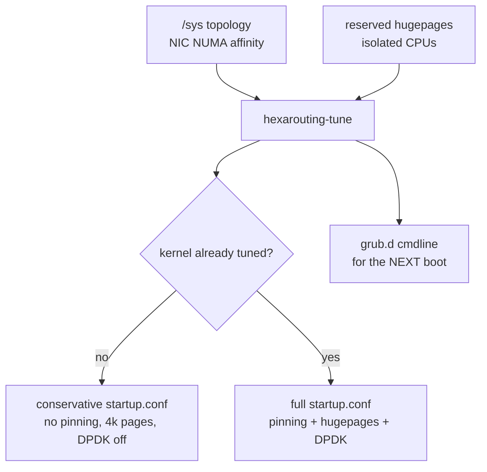
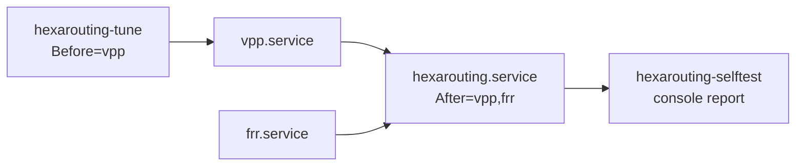

# HexaRouting — Appliance

## TL;DR

Installing VPP and FRR is the easy part. What decides whether the box delivers
100 Gbps or half of it is **boot tuning**, and it fails invisibly: the box
comes up, forwards, and underperforms. `hexarouting-tune` computes CPU
isolation, hugepages and pinning from the actual hardware instead of copied
values.

Minimum requirements: **4 GB RAM** and a CPU with **SSE4.2**. Below either, VPP
dies — by OOM or by SIGILL — and the boot self-test says so on the console
before the operator has to guess.

> The key words **MUST**, **MUST NOT**, **SHOULD**, **SHOULD NOT**, **MAY** and
> **RECOMMENDED** in this document are to be interpreted as described in
> [RFC 2119](https://www.rfc-editor.org/rfc/rfc2119).

## 5W2H

| | |
|---|---|
| **What** | A bootable Debian appliance carrying VPP, FRR and HexaRouting, with boot tuning computed at first start. |
| **Why** | Hand-tuned `isolcpus` and hugepages are the difference between full and half throughput, and getting them wrong produces no error. |
| **Who** | Whoever racks the box; the self-test speaks to them over serial console or IPMI. |
| **When** | Tuning is computed on every boot; kernel-level changes take effect on the **next** one. |
| **Where** | `/etc/vpp/startup.conf` and `/etc/default/grub.d/hexarouting.cfg`, both generated. |
| **How** | Reads `/sys` topology, NIC NUMA affinity, reserved hugepages and isolated CPUs. |
| **How much** | 512-port blocks and 200k subscribers ⇒ roughly 6 × 1 GB hugepages, computed rather than guessed. |

## Boot tuning



Rules applied, each with its reason:

| Rule | Why |
|------|-----|
| CPU 0 and its SMT sibling stay with the OS and VPP's main thread | Isolating everything leaves the kernel nowhere to run |
| Workers only on the NIC's NUMA node | Crossing NUMA on the packet path costs more than the extra worker earns |
| One worker per physical core, sibling isolated with it | Otherwise system load competes for the same physical core |
| `nohz_full` and `rcu_nocbs` follow `isolcpus` | Isolating without removing the tick and RCU callbacks leaves jitter, which shows up as burst loss |
| 1 GB hugepages sized from the subscriber target | Session and bitmap budget comes from [architecture.md](architecture.md) |

Tested against synthetic topologies in `appliance/test_tune.py`, because the
development machine has neither SMT nor multiple NUMA nodes — and that is
exactly where the decisions matter. One case builds 2 sockets × 8 cores ×
2 threads with the NIC on node 1 and asserts that no worker landed on node 0
and no SMT sibling escaped isolation.

## First boot: the tuning is not in effect yet

`isolcpus` and hugepages come from the kernel command line, so they take effect
only on the **next** boot. The first implementation generated a
`startup.conf` demanding `default-hugepage` that did not yet exist, and VPP
entered a restart loop — which would break every first start after installation.

`hexarouting-tune` now reads the kernel's actual state:

```
/sys/kernel/mm/hugepages/hugepages-1048576kB/nr_hugepages
/sys/devices/system/cpu/isolated
```

* While either is missing, the generated `startup.conf` **MUST** be
  conservative: no pinning, 4k pages, smaller heap, **DPDK disabled**. Without
  hugepages the DPDK EAL fails to initialise and VPP exits; with
  `Restart=always` on `vpp.service` that becomes a restart loop pointing at
  nothing.
* Half-configured also counts as untuned: hugepages reserved without
  `isolcpus` still yields the conservative file, because pinning workers
  without isolation makes VPP compete with the system.
* The GRUB line **MUST** still request the full tuning for the next boot.

## The VPP startup file has no include directive

Found while investigating why VPP restarted on the ISO: the packaged
`/etc/vpp/startup.conf` has no include directive, and VPP supports none. The
first implementation wrote tuning to `/etc/vpp/startup.conf.d/tuning.conf`,
which **was never read**.

The effect is the worst kind for a product: no error, no warning, the box comes
up and forwards. It merely delivers half the throughput, with no way for the
operator to know why.

`hexarouting-tune` therefore generates the file VPP actually reads,
concatenating `/etc/hexarouting/vpp-base.conf` — operator-editable, holding
`unix`, `linux-cp` and so on — with the computed `plugins`, `cpu`, `buffers`
and `memory` stanzas.

* The base file **MUST NOT** contain those four stanzas; they are generated.
* `appliance/test_startup_conf.sh` closes the testing gap that allowed this: it
  generates the configuration, **starts VPP with it**, and checks that the
  plugins loaded, the process is still alive after five seconds, and a pool can
  be created. Run with `make test-appliance`.

## Tuning must not block boot

`hexarouting-tune.service` once sat for **five minutes** with systemd waiting
`no limit`, holding the rest of the boot behind it. The immediate cause was
`update-grub`: on a live system GRUB is not even installed to disk, and
`os-prober` scans every block device looking for other operating systems.

Three fixes, because one would not be enough:

| Fix | Why |
|-----|-----|
| `GRUB_DISABLE_OS_PROBER=true` in the generated `grub.d` file | An appliance has no other OS to find, and the scan is most of the time |
| `apply-tuning` skips `update-grub` on a live system | There it changes nothing |
| `TimeoutStartSec=90` on the unit | Safety belt, valid even if the other two fail |

The third matters most. The tuning only takes effect on the next boot anyway,
so blocking the current one for it is a bad trade in every scenario. **No
HexaRouting service SHOULD be able to block boot without a limit** — that was a
design defect, not merely an effect of `update-grub`.

## Memory requirement

**Minimum 4 GB.** A live system keeps its writable root entirely in RAM as an
overlay on the squashfs; together with VPP, 2 GB is not enough and the OOM
killer takes VPP — and the rest of the boot with it.

Measured while booting the ISO with 2 GB: `Out of memory: Killed process (vpp)`,
with VPP holding only **19 MB resident**. It was not the glutton; it was the
chosen victim. Installed to disk the requirement drops, since there is no RAM
overlay, but 4 GB remains the sensible floor for a dataplane.

Session tables are sized with `bpa session-table buckets <n> memory <MB>`,
defaulting to 16k buckets and 16 MB per table. The size is a virtual
reservation, but the OOM killer counts virtual memory — hence the modest
default. A 200k-subscriber deployment **SHOULD** raise it; a small box **MUST
NOT** pay for it.

## CPU requirement

VPP's binary assumes **SSE4.2** and uses AVX where available. On a CPU without
it, VPP dies with `SIGILL` in milliseconds; with `Restart=always`, the symptom
is a restart loop that says nothing about the cause.

That is exactly what happened in testing: QEMU without `-cpu` uses the `qemu64`
model, which lacks SSE4.2. Chasing that loop cost two wrong hypotheses before
the journal showed `code=killed, signal=ILL`.

* The self-test **MUST** check instruction sets **before** looking at VPP.
* `lab/boot-iso.sh` passes an adequate CPU model, and uses KVM when available —
  boots drop from minutes to seconds.

## Services



Two decisions worth explaining:

* **FRR is `Wants`, not `Requires`.** Without routing the box still forwards
  whatever static routes exist; taking CGNAT down with it would only widen the
  damage.
* **No `ExecStop`.** The configuration lives in VPP. Stopping the service
  **MUST NOT** delete production pools; removing a pool is the operator's
  action, through the VTY.

`hexarouting.service` waits for VPP to accept commands before applying
configuration: systemd considers `vpp.service` started once the process is up,
but the CLI socket and plugins take a moment longer, and applying before that
fails intermittently.

Tuning runs on **every** boot, with no sentinel, so a change in `tune.env` or a
NIC swap is honoured. `apply-tuning` avoids the cost of `update-grub` by
comparing before regenerating.

## Boot self-test

A racked appliance is seen over serial console or IPMI, not `journalctl`. If
something essential did not come up, it **MUST** be on screen with the reason
attached — not merely `failed`.

The self-test checks RAM, CPU instruction sets, VPP, restart counters, the
tuning state, FRR and configured pools. On failure it dumps the tail of
`/var/log/vpp/vpp.log` and the unit status. It distinguishes warning from
failure — running in first-boot mode is expected and reported as a warning —
and always exits zero: **the diagnostic MUST NOT bring down the boot**.

The restart counter matters more than it looks. A service flapping in a loop
can be "active" at the instant one looks, and `systemctl status` will say so.
Only `NRestarts` tells the story.

## Installation

```sh
sh appliance/install.sh              # onto an existing Debian 12
DESTDIR=/mnt sh appliance/install.sh # into a chroot, for the ISO
sh appliance/build-iso.sh            # hybrid BIOS/UEFI ISO
sh tools/lab.sh boot-iso             # boot it and check the self-test
```

After installing, adjust `/etc/hexarouting/tune.env` (dataplane NIC and
subscriber target) and reboot: `isolcpus` and hugepages only apply on the next
boot.

## What is still missing

* **HA**: no failover today. Two boxes with the same deterministic pool
  translate identically, which helps, but the session table is not
  synchronised. See [ha.md](ha.md).
