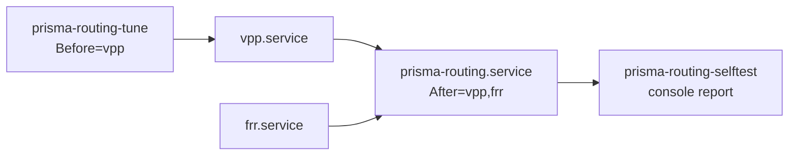
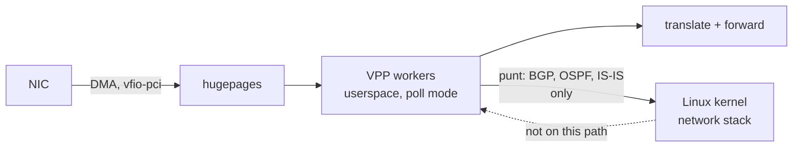

# Prisma Routing - Appliance

## TL;DR

Installing VPP and FRR is the easy part. What decides whether the box delivers
100 Gbps or half of it is **boot tuning**, and it fails invisibly: the box
comes up, forwards, and underperforms. `prisma-routing-tune` computes CPU
isolation, hugepages and pinning from the actual hardware instead of copied
values.

Minimum requirements: **6 GB RAM** and a CPU with **SSE4.2**. Below 6 GB the
box comes up and forwards nothing (below); without SSE4.2 VPP dies by
SIGILL - and the boot self-test says so on the console before the operator
has to guess.

Two standing answers about the kernel live here as well, so that neither is
re-derived every six months: a **custom-built kernel MUST NOT be introduced**
without a defect proven to be the distribution kernel's and unfixable by
configuration, because the appliance would stop receiving security updates; and
the boot tuning **not** yet applied is listed as hypotheses with costs, to be
measured by [#28](https://github.com/andrediashexa/hexarouting/issues/28) one
knob at a time rather than switched on and declared an improvement.

> The key words **MUST**, **MUST NOT**, **SHOULD**, **SHOULD NOT**, **MAY** and
> **RECOMMENDED** in this document are to be interpreted as described in
> [RFC 2119](https://www.rfc-editor.org/rfc/rfc2119).

## 5W2H

| | |
|---|---|
| **What** | A bootable Debian appliance carrying VPP, FRR and Prisma Routing, with boot tuning computed at first start. |
| **Why** | Hand-tuned `isolcpus` and hugepages are the difference between full and half throughput, and getting them wrong produces no error. |
| **Who** | Whoever racks the box; the self-test speaks to them over serial console or IPMI. |
| **When** | Tuning is computed on every boot; kernel-level changes take effect on the **next** one. |
| **Where** | `/etc/vpp/startup.conf` and `/etc/default/grub.d/prisma-routing.cfg`, both generated. |
| **How** | Reads `/sys` topology, NIC NUMA affinity, reserved hugepages and isolated CPUs. |
| **How much** | 200k subscribers on an eight-core box ⇒ roughly 6 × 1 GB hugepages, computed from the subscriber count and the worker count rather than guessed. |

## Boot tuning


Rules applied, each with its reason:

| Rule | Why |
|------|-----|
| CPU 0 and its SMT sibling stay with the OS and VPP's main thread | Isolating everything leaves the kernel nowhere to run |
| Workers only on the NIC's NUMA node | Crossing NUMA on the packet path costs more than the extra worker earns |
| The node comes from the card's **PCI function**, walked up to | `device` points at whatever owns the netdev, and on a virtio guest that is the bus device, which declares no node at all. Reading it there made every guest look like a card with no affinity, and put the workers on node 0 whatever the card said (#422) |
| Hugepages counted on **that node**, not on the box | The kernel spreads a boot-time `hugepages=N` across the nodes, and VPP's heap comes from the node its main thread is pinned to. The box-wide total can be twice what the dataplane can reach (#422) |
| One worker per physical core, sibling isolated with it | Otherwise system load competes for the same physical core |
| `nohz_full` and `rcu_nocbs` follow `isolcpus` | Isolating without removing the tick and RCU callbacks leaves jitter, which shows up as burst loss |
| 1 GB hugepages sized from the memory given to the CGNAT, or from the subscriber target | `PRISMA_CGNAT_MEMORY_GB` (`nat cgnat memory <GB>` in the VTY) is the main heap, where every session lives at ~300 bytes; without it the estimate is 13.5 KB a subscriber. The heap is the reserved pool less the buffers less one GB, **no longer capped at 2 GB**: that cap held every box to about ten million sessions whatever its RAM (#454, #460) |
| Deep C-states off (`processor.max_cstate=1`, `intel_idle.max_cstate=0`) | A poll-mode worker never sleeps, but the OS core does, and waking it costs tens of microseconds in the middle of a burst |
| `transparent_hugepage=never` | `khugepaged` compacts memory in the background, and compaction stalls whichever CPU holds the page |
| `cpufreq` governor forced to `performance` on every boot | The governor is runtime state, not a kernel parameter: it does not survive a reboot on its own, and on `schedutil` the first burst arrives before the core has ramped up |
| One RX queue per worker on the dataplane NIC | Left unsaid, DPDK opens the default and all traffic enters through a single worker — invisible on a CPU graph, because poll mode reads 100% either way |
| Interrupts banned from the isolated cores (`IRQBALANCE_BANNED_CPULIST`) | Isolating from the scheduler while still taking interrupts on that core isolates nothing |
| `kernel.numa_balancing = 0` | Automatic NUMA balancing migrates pages behind a pinned worker's back; the memory is already on the right node |
| `net.ipv6.conf.{all,default}.accept_ra = 0` | A neighbour's Router Advertisement reaches the kernel over a `linux_cp` pair since [#213](https://github.com/andrediashexa/hexarouting/issues/213), because FRR needs it for BGP unnumbered. With the kernel's default the box takes the default route in it, and `linux_nl` syncs that into the VPP FIB: measured. FRR reads advertisements on a socket of its own, so unnumbered is unaffected |

The latency knobs cost power, so they are a switch, not a law:
`PRISMA_LOW_LATENCY=0` in `/etc/prisma-routing/tune.env` drops the C-state and THP
parameters from the kernel command line and leaves the governor alone. The
default is `1`, because this is a router.

### What `tune.env` accepts, and what happens to anything else

`tune.env` is a file an operator edits by hand and `apply-tuning` reads on
every boot. Every value in it used to be **believed**, and two of the ways that
went wrong were measured by running the script:

| Written | What the box did | What it does now |
|---|---|---|
| `PRISMA_LOW_LATENCY=true` | Took the "not `1`" branch: the C-state and THP parameters were **removed** from the kernel command line and the governor left alone — the opposite of what it says — while the journal reported `PRISMA_LOW_LATENCY=0`, naming a value nobody wrote | Refused by name, and read as `1` |
| `PRISMA_SUBSCRIBERS=200k` | The tuner's argument parser refused it with a usage dump naming neither the variable nor the file; `apply-tuning` exited non-zero and the unit failed, so **no tuning was written at all** and the kernel command line stayed at whatever the previous boot put there, disagreeing with the `startup.conf` beside it | Refused by name, and read as `200000` |

So each value is checked before it is used, and one this box does not accept is
**refused out loud and replaced by the shipped default** — never by the
opposite of what it says, and never by failing the unit. A typo **MUST NOT**
cost the box its tuning: an ignored setting is recoverable by editing one line,
while a failed tuning unit leaves `isolcpus` and `startup.conf` describing
different machines. That is the same reasoning `PRISMA_MAX_WORKERS` already
carried, applied to the other two.

| Variable | Accepted | Shipped | Used when refused |
|---|---|---|---|
| `PRISMA_DATAPLANE_IF` | an interface name, or empty | empty | any name is accepted; one this box has not got resolves to no device, and `no-pci` is written so nothing is claimed |
| `PRISMA_SUBSCRIBERS` | digits only | `200000` | `200000` |
| `PRISMA_LOW_LATENCY` | `1` or `0`, nothing else | `1` | `1`, because this is a router |
| `PRISMA_MAX_WORKERS` | digits only, or empty for no cap | empty | no cap |
| `PRISMA_CGNAT_MEMORY_GB` | whole GB, or empty for the estimate from `PRISMA_SUBSCRIBERS` | empty | the estimate |
| `PRISMA_CONTROL_PLANE_CORES` | digits, 1 or more, or empty for one | empty | one core |
| `PRISMA_MAIN_THREAD` | `shared` or `dedicated`, or empty for shared | empty | shared |
| `PRISMA_CONTROL_PLANE_MEMORY_GB` | whole GB, 1 or more, or empty for a quarter of the RAM | empty | a quarter of the RAM, at least 2 |
| `PRISMA_BUFFERS_PER_NUMA` | digits, or empty for 16384 per worker | empty | 16384 per worker |
| `PRISMA_CGNAT_WORKERS` | digits, 1 or more, or empty for every worker | empty | every worker receives and translates |

**A refusal says what the box does accept**, with what each value would do, not
only that this one was wrong: it is read on a serial console by somebody who
then has to guess the spelling. Every line of it is wrapped by hand to 79
columns and the refused value is quoted and printed whole, so it can be grepped
for and typed back.

`test/test_apply_tuning.sh` drives `apply-tuning` against fake `/etc`, `/proc`
and `/sys` trees through its `PRISMA_ROOT` seam, with the tuner, `update-grub`
and the NIC binder stubbed on `PATH`. Before it existed **nothing ran this
script at all**: `test/test_kernel_tuning.py` reads it as text looking for
candidate knobs, and `appliance/test_tune.py` tests the tuner it calls, so the
one component that turns an operator's file into a kernel command line had
never been executed by a test. It asserts the arguments each value produces,
that the governor is written only where the kernel offers `performance`, that
the tuner runs before the NIC binder and that a failing binder does not fail
the tuning, that `update-grub` runs on a change and not on a repeat, and that a
tuner which really fails still fails the unit — so the refusals above did not
turn every error into a shrug.

### The kernel command line, parameter by parameter

The rules above are the reasons. This is the line the tuner actually writes
into `/etc/default/grub.d/prisma-routing.cfg`, parameter by parameter, because a
reader diagnosing a box has the line in front of them and not the reasons.

It is deliberately a **second copy** of something `render_grub()` already says,
so `test/test_kernel_tuning.py` renders the line and compares the two. A
parameter added to the tuner and not to this table, a value changed on one
side, or a knob quietly promoted out of the `PRISMA_LOW_LATENCY` half is a test
failure rather than a document that stopped being true without telling anyone.

| Parameter | Value | Only with `PRISMA_LOW_LATENCY=1` | What it is for |
|---|---|---|---|
| `isolcpus` | computed | no | The worker cores and their SMT siblings, from the topology |
| `nohz_full` | computed | no | The same list: an isolated core still taking the timer tick is not isolated |
| `rcu_nocbs` | computed | no | The same list again: otherwise RCU callbacks run on the worker |
| `default_hugepagesz` | `1G` or `2M` | no | So that `hugepages=` below is counted in units of the size this box can have. A CPU with no `pdpe1gb` has no 1G pool at all, and asking for one is silently ignored (#290) |
| `hugepagesz` | the same | no | Reserves that pool |
| `hugepages` | computed | no | Sized from `PRISMA_SUBSCRIBERS`, then capped by the RAM the box actually has |
| `intel_iommu` | `on` | no | `vfio-pci` hands the NIC to userspace, and it needs an IOMMU to do that safely |
| `iommu` | `pt` | no | Pass-through: the IOMMU is here for the device assignment, and full translation on the DMA path costs throughput for a protection a single-purpose appliance does not buy |
| `intel_idle.max_cstate` | `0` | **yes** | Deep C-states off, for the `intel_idle` driver |
| `processor.max_cstate` | `1` | **yes** | The same, for the ACPI driver that takes over when `intel_idle` is not in play |
| `transparent_hugepage` | `never` | **yes** | `khugepaged` compacts memory in the background and the compaction stalls whichever CPU holds the page |

### And the count is restated as a sysctl, because a packaged file undoes it

`/etc/sysctl.d/99-prisma-routing-hugepages.conf` is written on every boot
beside the kernel command line above, carrying the same count from the same
plan. It exists because of a file this project does not own.

`/etc/sysctl.d/80-vpp.conf`, shipped by the VPP package, sets
`vm.nr_hugepages=1024`. That knob addresses whichever page size is the
**default**, whatever that is:

* On a box tuned for **1G** pages it asks for 1024 GB. The kernel cannot give
  it, the pool stands, and the line has been invisible for the life of this
  product.
* On a box tuned for **2M** pages it asks for exactly 1024 pages — 2 GB — and
  the kernel **obeys**. The pool the kernel command line reserved at boot is
  shrunk after the fact, and the dataplane then dies with
  `dpdk_config: rte_eal_init failed: Cannot allocate memory (12)`.

`99-` sorts after `80-`, so the generated file is the last word
`systemd-sysctl` reads. It is written from the same plan as the grub line
rather than computed again, because the two numbers are one decision and a
copy that can drift from its original is a defect waiting for a page size to
change.

This was found in the field, not here
([#428](https://github.com/andrediashexa/hexarouting/issues/428)). Every box
this repository had ever booted had `pdpe1gb` — `lab/install-iso.sh` runs its
guest with `-cpu host` — so the 2M path had a unit test and no box. It has one
now: `BOOT_NO_1G=1 sh tools/lab.sh install-iso`.

### And on a 2M box the card is addressed by physical address

The `dpdk` stanza the tuner writes carries `iova-mode pa` when, and only when,
this box's hugepages are 2M.

DPDK chooses IOVA-as-VA when the card sits behind an IOMMU and IOVA-as-PA
otherwise. On 1G pages VA works; on 2M pages it does not, and the failure is
not a degradation — `rte_eal_init` returns `Cannot allocate memory (12)` and
the dataplane never starts. Measured on an installed box with 2560 × 2M
reserved and free:

| the stanza | what the box did |
|---|---|
| no `iova-mode` | `rte_eal_init failed: Cannot allocate memory (12)` |
| `iova-mode va` | the same |
| `iova-mode pa` | the dataplane answered after 45 s |

Same pool, same heap, same buffers, same seven workers, one line different.
`dpdk { no-pci }` also started it, which is what says the memory was never the
problem and the card was.

**Only on the 2M box.** PA is not better than VA; it is what works there. The
1G path is the one every lab and every release has booted, and changing the
mode under it would be an unmeasured change to the half that is not broken.

### And two capabilities the container has to be given

`vpp.service` runs as root, so nothing on the unit path ever had to name a
capability. The container names five, and two of them are here because of
[#428](https://github.com/andrediashexa/hexarouting/issues/428):

| capability | what it is for |
|---|---|
| `SYS_ADMIN` | reading a physical address out of `/proc/self/pagemap`, which `iova-mode pa` needs. Since Linux 4.0 the kernel zeroes the PFN for a reader without it, DPDK cannot tell that from *no physical addresses available*, and `rte_eal_init` returns `EINVAL` |
| `SYS_RAWIO` | `iopl()`, which is how DPDK reaches the I/O BAR of a **legacy** virtio card (`1af4:1000`) bound to `uio_pci_generic` — that driver creates no `/sys/class/uio/uioX/portio` for DPDK to use instead |

`PERFMON` is narrower than `SYS_ADMIN` and was tried first. It does not do it
on this kernel.

Without `SYS_RAWIO` the dataplane **starts** and takes no port, which is worse
than a refusal: `show version` answers, `show interface` has only `local0`, and
nothing says a card was turned away. `test/test_two_dataplanes_one_shape.sh`
holds both rows, because what root has for free is exactly what nobody thinks
to compare.

`GRUB_DISABLE_OS_PROBER=true` goes on the same file and is not a kernel
parameter: `os-prober` scans every block device looking for other operating
systems, finds nothing on an appliance, and can spend minutes doing it inside
the tuning service.

**Everything in the right-hand column is the switch, and it is the pattern any
future knob follows.** A parameter that costs power or costs a diagnostic
belongs in `LOW_LATENCY_CMDLINE`, never in the unconditional line — see
*Boot tuning still on the table* below, where every candidate is classified
that way before it is measured, let alone shipped.

**RX and CGNAT workers** (#466, fourth part). By default every worker polls
the cards and translates. `PRISMA_CGNAT_WORKERS=<n>` makes the last `n`
workers the only ones that own subscribers: the tuner writes
`bpa { cgnat-workers <ids> }` into startup.conf and gives each card's `dev`
stanza `workers <ids>` for the rest, with as many RX queues as there are
receivers. The plugin reads the stanza before any pool exists
(`bpa_config()`, `bpa_set_owners()`): `n_workers` becomes the translating
count, `owner_wid[]` maps a BPA worker to a VPP worker id, and `thread_w[]`
maps a thread back, `~0` for one that only receives. The handoff node, which
already sent every packet to the worker owning its subscriber, now reaches
the owner through that table, and it is put on the feature arc on any box
with workers, not only when every worker translates. `show bpa workers`
says which is which - `worker 0 (thread 1): receives and hands over`
beside the ones that translate - and on a box with no workers at all it says
`no workers: the main thread translates`. Measured in `lab/cgnat-workers.sh`: three workers, 0
receiving and 1-2 translating, every packet injected on worker 0 - thread 1
translated nothing, threads 2 and 3 translated everything, all 24
subscribers got sessions, and the dynamic pool was cut into two slices. The
off run, with no stanza, reddens three checks.

**Memory by role** (#466, third part). The RAM splits in two: the hugepage
pool is the dataplane's (the CGNAT's heap, the packet buffers, slack), and
the rest is the control plane's. A hugepage is never reclaimed, so the only
floor the control plane has is the RAM that is not turned into one - which
is what `PRISMA_CONTROL_PLANE_MEMORY_GB` sets, replacing the quarter of the
RAM (at least 2 GB) the tuner used to keep. `PRISMA_BUFFERS_PER_NUMA`
replaces 16384 per worker in `buffers-per-numa`. The VTY writes both from
`system` > `memory` and reads them back, and `show system memory` puts them
beside this boot's RAM, hugepages, main heap, buffers, statistics segment and
what `system.slice` is using now.

**Cores by role** (#466). The node's physical cores are taken in order: the
control plane's (`PRISMA_CONTROL_PLANE_CORES`, one by default), then - with
`PRISMA_MAIN_THREAD=dedicated` - one for VPP's main thread alone, isolated like
a worker's, then the workers. The default is the layout every box has had. A
box too small for what was asked keeps one worker, gives up the dedicated main
thread first and control-plane cores after that, and the tuner's report says
so on a `WARNING` row. The VTY writes both keys from `system` > `cpu`, reads
them back into the running configuration, and `show system cpu` puts them
beside what this boot runs - startup.conf's `main-core` and
`corelist-workers`, and `/sys/devices/system/cpu/isolated`. What is not done
yet is holding the control plane to its cores by cgroup, and splitting
workers into RX and CGNAT sets; both are on #466, to be measured.

`PRISMA_MAX_WORKERS` in the same file caps how many physical cores become
forwarding workers. It ships **empty**, which means no cap and is exactly the
behaviour above: every core on the dataplane node except the first. The cap
exists because "all but the first" scales the wrong way — on a 32-core socket
it leaves **one** physical core carrying FRR, `frr-reload`, `vtysh`, `prismash`,
`sshd` and VPP's main thread together, and the main thread takes the worker
barrier once a second for `bpa-expire-process`. Setting it hands cores back to
the control plane, and the cores it frees leave `isolcpus` so the scheduler can
use them. A cap larger than the machine has invents nothing. Each worker
removed is that share of forwarding capacity, so no default is shipped: the
trade depends on how much control-plane work the box actually carries. The box
says which side of it it is on: the boot self-test reports how many cpus are
left for the control plane and warns when that is one while more than one core
is isolated. See *The CPU half* below.

Tested against synthetic topologies in `appliance/test_tune.py`, because the
development machine has neither SMT nor multiple NUMA nodes — and that is
exactly where the decisions matter. One case builds 2 sockets × 8 cores ×
2 threads with the NIC on node 1 and asserts that no worker landed on node 0
and no SMT sibling escaped isolation.

## First boot: the tuning is not in effect yet

`isolcpus` and hugepages come from the kernel command line, so they take effect
only on the **next** boot. The first implementation generated a
`startup.conf` demanding `default-hugepage` that did not yet exist, and VPP
entered a restart loop — which would break every first start after installation.

`prisma-routing-tune` now reads the kernel's actual state:

```
/sys/kernel/mm/hugepages/hugepages-1048576kB/nr_hugepages
/sys/devices/system/cpu/isolated
```

* While either is missing, the generated `startup.conf` **MUST** be
  conservative: no pinning, 4k pages, smaller heap, **DPDK disabled**. Without
  hugepages the DPDK EAL fails to initialise and VPP exits; with
  `Restart=always` on `vpp.service` that becomes a restart loop pointing at
  nothing.
* Half-configured also counts as untuned: hugepages reserved without
  `isolcpus` still yields the conservative file, because pinning workers
  without isolation makes VPP compete with the system.
* The GRUB line **MUST** still request the full tuning for the next boot.

## The VPP startup file has no include directive

Found while investigating why VPP restarted on the ISO: the packaged
`/etc/vpp/startup.conf` has no include directive, and VPP supports none. The
first implementation wrote tuning to `/etc/vpp/startup.conf.d/tuning.conf`,
which **was never read**.

The effect is the worst kind for a product: no error, no warning, the box comes
up and forwards. It merely delivers half the throughput, with no way for the
operator to know why.

`prisma-routing-tune` therefore generates the file VPP actually reads,
concatenating `/etc/prisma-routing/vpp-base.conf` — operator-editable, holding
`unix`, `linux-cp` and so on — with the computed `plugins`, `cpu`, `buffers`
and `memory` stanzas.

* The base file **MUST NOT** contain those four stanzas; they are generated.
* `appliance/test_startup_conf.sh` closes the testing gap that allowed this: it
  generates the configuration, **starts VPP with it**, and checks that the
  plugins loaded, the process is still alive after five seconds, and a pool can
  be created. Run with `make test-appliance`.

## Tuning must not block boot

`prisma-routing-tune.service` once sat for **five minutes** with systemd waiting
`no limit`, holding the rest of the boot behind it. The immediate cause was
`update-grub`: on a live system GRUB is not even installed to disk, and
`os-prober` scans every block device looking for other operating systems.

Three fixes, because one would not be enough:

| Fix | Why |
|-----|-----|
| `GRUB_DISABLE_OS_PROBER=true` in the generated `grub.d` file | An appliance has no other OS to find, and the scan is most of the time |
| `apply-tuning` skips `update-grub` on a live system | There it changes nothing |
| `TimeoutStartSec=90` on the unit | Safety belt, valid even if the other two fail |

The third matters most. The tuning only takes effect on the next boot anyway,
so blocking the current one for it is a bad trade in every scenario. **No
Prisma Routing service SHOULD be able to block boot without a limit** - that was a
design defect, not merely an effect of `update-grub`.

## Memory requirement

**Minimum 6 GB to forward, 8 GB advised** (#452, measured on 0.130.0 in a KVM
guest, eight vCPUs, two boots each so the tuner's hugepages took effect):

| RAM | hugepages | main heap | what the box does |
|---|---|---|---|
| 4 GB | none | 256 MB | comes up on the conservative profile, which hands the dataplane **no card**: `show interface` holds only local0, and it forwards nothing |
| 6 GB | 3 | 1 GB | forwards; about 2.7 million sessions fit |
| 8 GB | 5 | 2 GB | forwards |

4 GB was the documented floor, set when the question was whether VPP
survived the OOM killer; it does, and forwards nothing. 6 GB failed on
0.126.0 (`rte_eal_init failed`), because the heap took the whole pool, and works
since 0.129.0 keeps a GB of it out of the heap. A live system also keeps its
writable root in RAM as an overlay on the squashfs; with 2 GB the OOM killer
takes VPP and the rest of the boot with it.

Measured while booting the ISO with 2 GB: `Out of memory: Killed process (vpp)`,
with VPP holding only **19 MB resident**. It was not the glutton; it was the
chosen victim. Installed to disk the requirement drops, since there is no RAM
overlay, but 4 GB remains the sensible floor for a dataplane.

Session tables are shaped with `bpa session-table buckets <n> memory <MB>`,
defaulting to 16k buckets. The **memory figure sizes nothing**: VPP builds the
session hash with `BIHASH_USE_HEAP`, so the tables, like every session, live in
the main heap, and the heap is what runs out (#460, `docs/architecture.md`).
What was said here about the size being virtual was measured on a mapping this
VPP does not make. The OOM killer does **not** count mapped memory: the kernel scores a
process by what it holds **resident** (RSS, swap and page tables), not by what
it maps. Measured in `lab/oom.sh`: VPP with 17 GB mapped and 354 MB resident,
inside a 502 MB cgroup, has `oom_score` 670 out of 1000, which is its resident
share and not its mapped one, and the kernel's own kill line for it reads
`total-vm:17476328kB, anon-rss:247984kB`. Raising the table therefore raises
VPP's badness only as the table is used. A 200k-subscriber deployment
**SHOULD** raise it; a small box **MUST NOT** pay for it, because the memory is
eventually touched and a small box does not have it.

Raising the floor to 4 GB did nothing for the victim. `vpp.service` therefore
carries `OOMScoreAdjust=-1000`, shipped as the drop-in
`/etc/systemd/system/vpp.service.d/prisma-routing-oom-protect.conf`, which takes
the dataplane out of the kernel's selection instead of merely lowering its
score: a box that has lost `bgpd` still forwards on what it learned, and a box
that has lost VPP forwards nothing. It does **not** protect VPP from its own
allocations — if VPP is genuinely the process consuming the machine, the kernel
still kills it.

`prisma-routing.service` carries `MemoryMax=512M` for the other side of the same
event: the control plane must not be what empties a box sized to the floor. On
4 GB the tuner leaves a quarter of RAM outside the hugepage pool, and 512M is a
quarter of that — against a measured 13 MB peak for loading a configuration,
which does not grow with the routing table or the session count.

The behaviour itself is asserted, in three states, by `lab/oom.sh`: real VPP
and one growing control-plane process in a cgroup of their own, with the
adjustment taken from the shipped drop-in rather than typed into the lab. With
it the kernel kills the control-plane process and VPP goes on answering; with
it removed and **nothing else changed** the kernel kills VPP, although the
balloon is the smaller of the two; restored, it kills the balloon again. What
that lab cannot show is that *systemd* applies the drop-in, because there is no
systemd in a lab container: the boot self-test reads
`/proc/<vpp pid>/oom_score_adj` on the running box and says so on the console,
and `lab/install-iso.sh` reads that line back off a box it installed and
booted.

### What a full BGP table costs, and why `frr.service` has no bound

`frr.service` carries **no** `MemoryMax=`, and that is now a measured decision.
One full IPv4 table was fed to `bgpd` on this build over a single eBGP session:
1,000,000 prefixes, ~60k distinct origin AS paths and three communities per
route, which is the attribute diversity that stops FRR interning one attribute
set for the whole table. Convergence took 40 s, and 998,034 routes reached the
kernel FIB.

| Daemon | RSS, no table | RSS, one full IPv4 table |
|---|---|---|
| `bgpd` | 13 MB | **837 MB** |
| `zebra` | 10 MB | **553 MB** |
| `mgmtd` + `staticd` | 14 MB | 14 MB |
| **all of FRR** | **37 MB** | **1.37 GB** |

Three things follow.

**The number belongs to the operator, not to the product.** A box taking
default routes only stays at 37 MB. A second full-table session adds another
path per prefix; IPv6 adds again; `soft-reconfiguration inbound` would add a
whole Adj-RIB-In. One number in a shipped unit file has to serve all of them.

**And the boxes differ as much as the deployments.** The tuner leaves
`max(2, RAM/4)` GB outside the hugepage pool for everything that is not VPP, so
the same 1.37 GB is 69% of what a 4 GB box has and 9% of what a 64 GB box has.
A bound safe on the large box bounds nothing on the small one, and a bound that
bites on the small one kills the large one.

**A bound guessed low does not slow BGP down, it kills it.** Measured with
`bgpd` in a cgroup at `memory.max=512M` while that same table converged: killed
after ten seconds holding 428 MB, with `pgscan 100` and `pgsteal 4` beside it,
so the kernel found nothing reclaimable and went straight from the limit to the
kill. `frr.service` carries `Restart=always` and `RestartSec=5`, which makes
that a five-second restart loop on the box with the most to lose.

`MemoryHigh=` is not the softer answer it looks like, and was measured too.
Under `memory.high=512M` the same convergence had not finished after **nine
minutes**: 189,578 throttling events, `pgscan 2880 / pgsteal 12` (anonymous
memory, no swap, so there is nothing to reclaim and the throttle never lifts),
PSI `full avg10=75%`, `bgpd` parked in `D` state having used 6 s of CPU in
9 minutes of wall clock, and `vtysh show bgp summary` returning nothing within
30 s. No kill, and no working router either: an operator would find a box that
neither converges nor answers its own CLI.

So the protection against a control plane that grows is the one already in
place, from the other end: the dataplane is out of the kernel's selection, and
the largest resident process on a box in trouble is `bgpd` itself, which is
what the kernel will choose without being told to.

**Sizing, then, rather than bounding.** 4 GB is the floor for a box that does
not carry a full table. A box that does needs the 1.37 GB above to sit inside
`max(2, RAM/4)` GB with the kernel and the page cache beside it, so **16 GB**
is the sensible floor for a full-table deployment and 8 GB is already tight.

### The CPU half: what the box reads back, and what it will not cap

The same question was asked of the CPUs, and the answer came out the same
shape: this product **reports** what the control plane is left with and does
not add a cap of its own. Not because a number could not be derived, but
because the derivable one is **already in force** - the kernel confines every
process to the cores outside `isolcpus`, measured below - and the caps that
would be left cannot be measured on anything this repository can boot.

**What the box now reads back.** Since the tuner existed the console has said
`full tuning active: corelist-workers 1-7`, which is what
`/etc/vpp/startup.conf` **asks for**. Nothing ever read what the dataplane
**got**. The boot self-test now compares three places, none of which is the
component that made the decision:

| | Read from | Says |
|---|---|---|
| TOLD | `/etc/vpp/startup.conf` | which cores the tuner asked for |
| HAS | `/proc/<vpp pid>/task/*/status` | where the kernel actually pinned VPP's threads |
| HAS | `/sys/devices/system/cpu/isolated` | which cores the kernel is isolating |

and prints three lines:

```
  [ ok ] dataplane workers hold the cores the profile names: 1
  [ ok ] and the kernel is isolating every one of them
  [ ok ] control plane has 1 cpu(s): 0, with VPP's main thread
```

Deliberately **not** `vppctl show threads`, which also carries the lcore: that
is VPP reporting on itself, and the question is whether the kernel agrees with
VPP. Nothing in the check writes anything.

Two of those are failures when they do not hold, because both are silent:

* **A worker on a core the kernel is not isolating.** The worker runs, every
  counter is clean, and the core is shared with everything the scheduler has to
  place - while a poll-mode thread never yields. The loss appears as burst
  drops with no counter behind them. Reachable whenever the kernel command line
  and `startup.conf` come apart: `prisma-routing-tune.service` failing, a
  hand-edited `/etc/default/grub.d/prisma-routing.cfg`, an `update-grub` that was
  never run.
* **A dataplane older than the profile it is judged against.** VPP is pinned to
  whatever it read when it started, so a restart-less configuration change
  leaves the box running the previous tuning while the console reports the new
  file. In the worst case `startup.conf` names workers and the running VPP has
  **no** worker thread at all, which is the whole of the box's capacity
  missing.

The third is a **report**, not a failure, and it is where the CPU story meets
the memory one.

**One cpu for everything that is not a worker.** The tuner gives the OS the
dataplane node's first physical core and isolates the rest, so on a 32-core
socket FRR, `frr-reload`, `vtysh`, `prismash`, `sshd` **and** VPP's main thread
share one core - and the main thread is the one that takes the worker barrier
once a second for `bpa-expire-process`. The self-test warns when the control
plane has exactly one cpu **and more than one core is isolated**, which is the
arithmetic statement that cores could have been handed back and were not. A box
with one isolated core has nothing to give back and is not warned. The remedy
is `PRISMA_MAX_WORKERS`, and each core handed back is that share of forwarding
capacity - so the box states the number and the trade stays the operator's.

**Changing the cap is not symmetric, and the expensive direction is the one an
operator would not expect.** Measured against a synthetic 8-core-x-2-thread
topology already booted with `isolcpus=1-3,9-11`:

| Change | Next boot | The boot after |
|---|---|---|
| Cap lowered (3 to 2 workers) | tuned profile, `corelist-workers 1-2` | `isolcpus=1-2,9-10`: the freed cores return to the scheduler |
| Cap raised or removed | **FIRST BOOT MODE**: no workers, no hugepages, DPDK disabled | tuned profile, `isolcpus=1-7,9-15` |

`tuned_now` requires the cores the profile pins to be cores the kernel is
**already** isolating, and raising the cap asks for cores that are not isolated
until the command line changes on the next boot. So lifting a cap costs one
boot with no dataplane NIC. That is the tuner refusing to pin a worker to a
core the kernel has not isolated - correct, and worth a maintenance window.

**Why no `CPUQuota=`.** On this box the control plane does not compete with the
workers: they are on isolated cores the scheduler will not place other work on.
Throttling the control plane therefore frees nothing for forwarding and costs
BGP convergence and `frr-reload`. The one place the two genuinely contend is
VPP's **main** thread, which shares the OS core by design - and the measurement
that would size a quota there is the held-barrier interval under control-plane
load, which **cannot** be taken on a virtio VM, because the host scheduler
preempts vCPUs whatever the guest isolates. A quota shipped without it would be
a number nobody could defend, which is the mistake `frr.service` already
avoided once.

**What that measurement will have to vary is settled from the source, and is
not the session table.** The comment above `bpa_expire_process` in
`src/plugins/bpa/bpa_session.c` names what runs inside that one barrier
acquisition and which cap bounds each part. The short of it: `BPA_EXPIRE_BUDGET`
bounds the session walk and nothing else in there, and on a dynamic-mode box
with logging on the rest of the interval scales with the logging load and the
pool count. The list is kept in that comment and not copied here, because it is
a property of that function and a second copy of it is a second thing to keep
true.

**The control plane was bounded by inheritance, and since #466 it is fenced.**
What follows is the measurement that first decided against a fence, kept because
it is also the measurement that reversed that decision.
This was the one worth measuring, because the number would not have been
invented - it is the complement of the `isolcpus` list the tuner itself wrote
on the same run. `lab/install-iso.sh` takes the reading on the installed box
(`isolcpus=1`, two cpus) and records it:

```
  [meas] cpu-iso: 1 online=0-1
  [meas] cpu-bgpd: Cpus_allowed_list:0
  [meas] cpu-escape: Cpus_allowed_list:1
  [meas] cpu-init: Cpus_allowed_list:0
  [meas] bgpd-from: pid:381 ppid:1 starttime:898
  [meas] isolspell: isolcpus=1
```

`bgpd`'s own mask is **`0`**, not `0-1`, and the line above it says where that
came from: **pid 1** is itself confined to `0`. `isolcpus` spelled as a bare
list is not only a hint to the load balancer - the kernel sets `init`'s
affinity to the non-isolated set at boot, and `bgpd` has `ppid 1`, so it is
wearing systemd's mask rather than one anybody configured. That is the CPU
bound this issue asked for, applied from the same list the tuner computed, and
until now nothing read it back.

**Inherited is not the same as enforced, and both halves are measured.**
`cpu-escape` is `taskset` onto the isolated core, and it was **accepted**: a
process that calls `sched_setaffinity` leaves the set, and so does anything it
starts. An `AllowedCPUs=` cpuset would close exactly that, and nothing else.

**One reading disagreed and has not been explained.** An earlier run of this
same lab, on the same image, read `cpu-bgpd: Cpus_allowed_list:0-1` on a box
that reported `isolcpus=1` - a `bgpd` outside the mask its parent should have
given it. That run was taken with a lab that did not record `cpu-init` or
`bgpd-from`, so which `bgpd` it was cannot be recovered. Two runs since, with
those lines in place, both read `0` with `ppid 1`. The reading is kept in the
lab rather than argued about: the next run that comes back `0-1` will also say
who started that `bgpd` and what pid 1's mask was at the time, which is the
pair of numbers that would settle it.

So it was first **not shipped**: the bound existed by inheritance, and a
cpuset would add a per-box artefact whose failure mode is a control plane
stranded on cores that do not exist. Two things changed that, both measured
(#466):

- **The inheritance stopped holding.** Since the control plane moved into
  containers, FRR is started by dockerd's children and not by pid 1: on a
  4-CPU guest with 1-3 isolated, zebra, bgpd, sshd and dockerd were allowed
  **0-3**, and a shell asking for CPU 3 got it. That is the `0-1` reading
  above, explained.
- **The stranding risk has an answer.** The fence is computed at every boot
  from the kernel's own isolation (`prisma-routing-tune --fence`: online CPUs
  minus `/sys/devices/system/cpu/isolated`) and set `--runtime`, so it can
  never name a CPU this boot does not have or describe a boot that is gone.

What ships: `apply-tuning` sets `AllowedCPUs=` on `system.slice`,
`user.slice` and `init.scope` to that set, and the dataplane leaves
`system.slice` first - compose puts VPP's container in
`prisma-dataplane.slice` (`cgroup_parent`), and a `vpp.service` drop-in does
the same for the unit path. Without that move the fence would hold VPP's
workers to the control plane's CPUs, so `apply-tuning` refuses to set it when
either is missing, and says so. Measured on an installed box upgraded to it:
the three units held to `0`, zebra, bgpd, sshd and dockerd allowed `0`, the
VPP container in `prisma.slice/prisma-dataplane.slice` with its workers on
1, 2 and 3, `taskset -c 3` refused, `systemctl is-system-running` answering
`running`, and `show system cpu` reading `control plane held to 0`.

## The statistics segment, and what the tuner sizes it from

It is the only resource on the box whose limit is an **abort** instead of a
refusal, so both the arithmetic and the box's own report about it are written
down here.

VPP exports its counters through a shared memory segment of **fixed** size,
named by a `statseg` stanza in `startup.conf`. Left unnamed, a box runs on
VPP's built-in default of **32 MB** (`STAT_SEGMENT_DEFAULT_SIZE`, 32 << 20, in
the VPP release this image pins), and that is what every box built by this
product ran on until the tuner started sizing it.

Each interface VPP holds costs the segment, and the cost was measured while
sizing a BNG (`docs/bng.md` section 2.1):

| Segment | Interfaces reached | What happened at the end |
|---|---|---|
| 32 MB, the default | between 7,000 and 8,000 | `vlib_stats_create_counter` → `os_panic` → `SIGABRT`. Reproduced twice, at the same step |
| 1 GB, set by hand | 40,000, using 114.7 MB | nothing; that is where the measurement stopped, not a wall it found |

**The failure is the whole dataplane, and it is silent.** VPP does not refuse
the interface that would not fit and carry on. `vnet_register_interface` tries
to grow the counter directory, the allocation fails inside the segment, and the
process aborts. What the operator gets is a dead box and a signal.

### What one interface actually costs, read from VPP's sources

Per software interface, registered by `statseg_sw_interface_add_del`:

* **17 directory entries** — nine simple counters and eight combined ones, one
  symlink each, at 144 bytes per entry (`vlib_stats_entry_t`, static-asserted
  to that size). That is **2,448 bytes**, and it is the dominant term.
* **200 bytes per thread** — 9 × 8 for the simple counters and 8 × 16 for the
  combined ones, grown per thread by `vlib_stats_validate`. So this half grows
  with the worker count as well as with the interface count.
* the interface's name in the `/if/names` string vector, a small vector each.

On a single-threaded box that is about 2.6 kB. The measured figure is
(114.7 − 4.2) MB over 40,000 interfaces, or **about 2.9 kB each**, which is the
same number with the allocator's own rounding on top.

**What could not be determined without running VPP, and is therefore not
claimed anywhere:** the interface count a given segment size supports. Dividing
the size by 2.9 kB predicts about 12,000 interfaces on the 32 MB default, and
the box aborted below 8,000. The reason is visible in the source and its size
is not: the directory is **one contiguous vector**, grown by
`clib_mem_heap_realloc_aligned` to 1.5× whenever it overflows, so a growth may
need the old copy and the new one inside the segment at the same time. Whether
dlmalloc extends it in place depends on the state of that heap, which is a
question about a running dataplane. No formula is offered here, and the two
measured points above are the only numbers stated.

The `+395 MB` quoted for `statseg { size 1G }` in
[#288](https://github.com/andrediashexa/hexarouting/issues/288) is worth one
correction, since it is the cost side of the decision below: in the table it
came from it is the RSS difference between **0 and 40,000 sessions** on the
1 GB box, not the cost of the segment at rest. Nothing measured so far isolates
what a larger `statseg` costs an idle box.

### The budget the tuner uses, and why it is not 2.9 kB

`prisma-routing-tune` sizes the segment at **4,793 bytes per interface**, which is
the measurement divided rather than a figure anybody chose: the run above
printed `after 7000: 7000 live` and then died creating the next batch, so
**7,000** interfaces is the density that 32 MiB segment was measured surviving,
and 33,554,432 / 7,000 is 4,793.

It is deliberately **not** the 2.9 kB above. That number is what the entries
weigh; this one is what they cost, and the 1.65x between them is the contiguous
directory that has to hold two copies while it grows. A segment sized at 2.9 kB
each promises about 12,000 interfaces on 32 MB, and the box aborted below 8,000
- it would fail at two thirds of what it offered.

Two things fall out of dividing the measurement rather than adding up the
content:

* the 4.2 MB the segment holds with nothing configured on it is **inside** the
  figure, amortised over the 7,000, so nothing has to be added on top for the
  box's own interfaces;
* at 40,000 interfaces it asks for 183 MB where the measurement used 114.7 MB.
  Conservative, which is the direction to be wrong in when the alternative is
  `SIGABRT`.

What no per-interface figure covers is an interface created **while the box
runs** - a PPPoE session, a linux_cp pair made from the VTY - because those are
in no configuration file. A box that makes them **MUST** set the size itself.

### What the tuner sizes it from

Every other figure the tuner writes comes from ground truth or from a number
the operator set: hugepages from `PRISMA_SUBSCRIBERS` and then from the RAM the
machine has, `buffers-per-numa` from the worker count, `main-heap-size` from
the pages the kernel **actually reserved**, the NIC's queue count and maximum
MTU from the card itself. The statistics segment now has such an input too -
the interfaces the box is **configured** for - and the candidates that are not
that were each rejected on their own arithmetic:

| Option | Cost |
|---|---|
| Size it from `PRISMA_SUBSCRIBERS` | Wrong units. A CGNAT subscriber is a translation, not an interface: 200,000 of them share a handful of ports. The shipped default would ask for roughly 540 MB of segment for interfaces that never appear, on a box whose RAM floor is 4 GB |
| Size it from a constant — 256 MB, 1 GB | A number nobody can justify, which is exactly what `main-heap-size` stopped being when it started reading the reserved pages. It is also not free: the segment is what the operator's RAM is not |
| Add a `PRISMA_INTERFACES` to `tune.env` | A knob whose correct value the operator cannot know before the box is configured, on a product that today creates interfaces from a configuration the tuner never reads. A refusal path, a document and a wiki page for a number that would be guessed |
| Leave it to VPP and say nothing | The status quo, and the reason the report was filed: the box meets the limit as a `SIGABRT` |
| **Count the interfaces the box is configured for, and write a stanza only when they need more than 32 MB** | The count is read from `/etc/prisma-routing/prisma-routing.conf`, which is the file `prisma-routing.service` hands to `prismash --load` at every boot, so the interfaces in it are the interfaces the box will create. Nothing is reserved on a box that does not need it, and no number is invented |

The last one is what ships, and the count is taken with **prismash's own parser**
rather than a grep for `^interface `: a second reader of that grammar answers
the same until the VTY learns another way to name an interface, and the box
that would find out is the one with twenty thousand of them. The routing half
of the file names interfaces too, in FRR's own blocks, and `interface_names()`
already returns the union by name.

Three things the tuner will not do with that number:

* **write a stanza smaller than VPP's own default.** Below 7,000 interfaces the
  arithmetic asks for less than 32 MB, and a box already has 32 MB;
* **override an operator's own stanza.** `statseg` belongs in
  `/etc/prisma-routing/vpp-base.conf`, the operator-editable base the tuner
  concatenates **ahead** of the stanzas it generates - the same seam that
  already carries `unix`, `linux-cp` and `socksvr` - so a generated one would
  be the last word on every boot. A stanza there means nothing is generated;
* **say anything about a size to a box with no interfaces to size for.** A box
  with no saved configuration, one whose configuration could not be read, and
  one this program could not reach prismash's parser from are three different
  sentences, and none of them is a number.

The stanza is written in the conservative first-boot profile as well as the
tuned one. The hugepages and the pinning wait for a reboot because the kernel
has to grant them; the statistics segment does not, and `prismash --load` creates
the configured interfaces on that first boot too.

**A box that creates an interface per subscriber still has to be told**, and the
number it is told is the operator's: a BNG session or a pair made at runtime is
in no file the tuner reads.

**The size takes effect when VPP next starts, not when the configuration is
saved.** `statseg` is read at startup and the segment never grows, so an
operator who adds several thousand sub-interfaces to a running box is spending
the segment that box booted with. The tuner writes the new size into
`startup.conf` at the next run of `prisma-routing-tune.service`; the dataplane
takes it at the next `vpp.service` start. Until then the boot self-test's
reading is the only thing between that box and the abort, which is why it warns
at half.

### What the box says

`prisma-routing-tune` says what it found and what it did about it, beside the
figures it computes from the hardware. A box configured for 20,000
sub-interfaces, on **one socket, eight cores and 64 GB**:

```
# 1G hugepages: 6 GB requested (sized for 200000 subscribers), 6 reserved right now
# statistics segment: 92M, for the 20000 interface(s) configured in
#          /etc/prisma-routing/prisma-routing.conf, at 4793 bytes each.
#          That is the density a box on VPP's 32 MB default was measured
#          surviving: 7,000 interfaces live, aborting before 8,000.
#          Interfaces created while the box runs - a PPPoE session, a pair
#          made from the VTY - are not in that file nor in this number.
#          Put your own statseg in /etc/prisma-routing/vpp-base.conf
#          to choose the size instead.
```

On a box with **two sockets**, the hugepage line says which node it counted,
because there the count is a choice and not a total:

```
# 1G hugepages: 6 GB requested (sized for 200000 subscribers), 6 reserved right now
#          counted on node 1, of this box's 2: the heap comes from the
#          node VPP's main thread is pinned to, not from the box's total.
```

Twelve pages can be reserved on that box and six of them be unreachable: the
kernel splits a boot-time `hugepages=N` evenly, and VPP allocates its heap on
the node the tuner pinned its main thread to. **Asking the kernel for the
pages per node is not done** - the command line has a syntax for it, whether
this product's kernel honours it has not been measured, and a wrong guess
reserves nothing and leaves an installed box on the first-boot profile. What
the box does instead is count the node it will actually allocate from and
print which one that was, so a short node reads differently from a short box.

**The box matters, and only one of those two numbers follows from the 20,000.**
The segment is 20,000 x 4,793 bytes, so it moves with the interface count and
with nothing else. The hugepage figure does not: it is the session table for
the subscriber target plus **one gigabyte per four workers**, and the worker
count is the box. The same 200,000 subscribers ask for 6 GB here and 12 GB on
a 32-core machine, and an operator who runs the tuner on their own hardware
and reads a different number has this paragraph to reconcile it with rather
than nothing. `appliance/test_tune.py` builds this box and requires every line
quoted above to be a line it printed.

and the stanza that reaches `/etc/vpp/startup.conf`:

```
statseg {
  # sized for the 20000 interface(s) in /etc/prisma-routing/prisma-routing.conf, at
  # 4793 bytes each. Put your own statseg in /etc/prisma-routing/vpp-base.conf
  # to choose the size yourself: this one steps aside for it.
  size 92M
}
```

The CGNAT box this product mostly ships to gets no stanza at all, and is told
why:

```
# statistics segment: VPP's built-in 32 MB, which was measured holding
#          7,000 interfaces. This box is configured for 3, in
#          /etc/prisma-routing/prisma-routing.conf: nothing is written, because a
#          stanza smaller than what VPP gives away would buy the box
#          nothing and cost it the counters.
```

The boot self-test reads the **dataplane's own heap**, not the configuration
file, and reports how much of it is spent over how many interfaces:

```
  [ ok ] statistics segment: 4.20M of 31.99M used, 3 interface(s)
        size: VPP's own default, which this product does not set
```

At half the segment that becomes a warning, and at three quarters a failed
check naming `os_panic` and `SIGABRT` and the stanza that raises it. Three
quarters rather than nine tenths because of the contiguous directory above: the
last part of a segment cannot be spent on a growth that has to hold two copies.

Where the size came from is read off the box too, and there are **three**
answers since the tuner started writing stanzas of its own: a `statseg` in
`/etc/prisma-routing/vpp-base.conf` is the operator's (`set in
/etc/prisma-routing/vpp-base.conf`), one that reached `startup.conf` without being
in the base is the tuner's (`chosen by prisma-routing-tune from this box's
configuration`), and neither is VPP's default. Reading only `startup.conf`
would tell a box the tuner sized that its operator had sized it.

Driven in `test/test_selftest.sh` against a stubbed `vppctl`, over a
comfortable box, a box at 60%, a box at 90%, a box whose `startup.conf` carries
a stanza, a box whose `vpp-base.conf` carries one, and a dataplane that does
not answer the question at all - because filling a real statistics segment
means creating several thousand interfaces on the machine running the tests.

## CPU requirement

VPP's binary assumes **SSE4.2** and uses AVX where available. On a CPU without
it, VPP dies with `SIGILL` in milliseconds; with `Restart=always`, the symptom
is a restart loop that says nothing about the cause.

That is exactly what happened in testing: QEMU without `-cpu` uses the `qemu64`
model, which lacks SSE4.2. Chasing that loop cost two wrong hypotheses before
the journal showed `code=killed, signal=ILL`.

* The self-test **MUST** check instruction sets **before** looking at VPP.
* `lab/boot-iso.sh` passes an adequate CPU model, and uses KVM when available —
  boots drop from minutes to seconds.

## Services



Two decisions worth explaining:

* **FRR is `Wants`, not `Requires`.** Without routing the box still forwards
  whatever static routes exist; taking CGNAT down with it would only widen the
  damage.
* **No `ExecStop` on `prisma-routing.service`.** The configuration lives in VPP.
  Stopping the service **MUST NOT** delete production pools; removing a pool is
  the operator's action, through the VTY. A stop-time command also runs on every
  **restart**, so it would fire on any of them rather than only when somebody
  meant to take CGNAT down - and `PartOf=vpp.service` means `systemctl restart
  vpp` is one, which is the command `show version` tells an operator to run to
  pick up a new dataplane build.
* **There is one on `vpp.service`**, shipped as the drop-in
  `/etc/systemd/system/vpp.service.d/prisma-routing-stop-drain.conf`. It runs
  `vppctl bpa stop-drain` before the signal, so every block the dataplane is
  holding is released in the retention log while the graph is still running to
  carry the records. That is a different unit for a measured reason: the blocks
  are in the VPP process, and VPP's UDP IPFIX export is a packet the dataplane
  sends rather than a kernel socket, so it stops working the moment the graph
  does. See [logging.md](logging.md#stopping-the-box-closes-them-too-and-a-crash-cannot).

Both of those are enforced, and by the same rule rather than by a list of which
file may carry which line. `test/test_stop_is_not_a_teardown.py` reads every
stop-time directive shipped under `appliance/` and requires that it only asks a
running process to **flush state it is already holding**; anything that reaches
the configuration surface is refused, including on the drop-in that is allowed
to have one. It also fails when the drain goes missing, because a box that stops
without it reopens the open-allocation defect above.

`prisma-routing.service` waits for VPP to accept commands before applying
configuration: systemd considers `vpp.service` started once the process is up,
but the CLI socket and plugins take a moment longer, and applying before that
fails intermittently.

Tuning runs on **every** boot, with no sentinel, so a change in `tune.env` or a
NIC swap is honoured. `apply-tuning` avoids the cost of `update-grub` by
comparing before regenerating.

## Which NIC the dataplane is allowed to claim

The appliance shipped `PRISMA_DATAPLANE_IF=eth0`. On Debian 12 with predictable
interface names that interface does not exist, so `prisma-routing-tune` could not
resolve a PCI address and generated

```
dpdk {
  dev default { num-rx-queues 1 }
}
```

No allowlist and no `no-pci`. VPP's DPDK plugin then probes and claims what it
can bind — on a single-NIC box, the management interface. The operator learned
about it by losing the session
([#123](https://github.com/andrediashexa/hexarouting/issues/123)). Nothing
asked, and the installer never asks which interface carries subscriber
traffic, so this was the ordinary case rather than the exception.

**Unknown MUST mean claim nothing**, and it still does: `prisma-routing-tune`
emits `dpdk { no-pci }` when it cannot resolve a device. What changed is
**when** that happens, not whether. The two outcomes are still not symmetric:

| | recoverable by |
|---|---|
| no dataplane interface | logging in over the network and setting one |
| the dataplane ate the management interface | walking to the console |

The table is a statement about costs and it is as true as it ever was. The
conclusion drawn from it — that a box must therefore claim nothing until
somebody names a card — is not, and two things changed it
([#378](https://github.com/andrediashexa/hexarouting/issues/378)).

**A box is set up from its console when it is new**, so the left column is not
the only way back. The maintainer's argument is that the machinery built to
keep a box reachable over the network during its first configuration is
protecting a step nobody takes over the network, and it is what stands between
a fresh install and a box that forwards.

**And a dataplane that will not start hands the card back.**
`appliance/give-the-card-back`, armed with `OnFailure` on `vpp.service`, puts
the card on its kernel driver again when the dataplane reaches `failed`
([#379](https://github.com/andrediashexa/hexarouting/issues/379)). The right
column's cost is what it was; the chance of paying it for a dataplane that
never came up is not.

So the box claims every PCI card it has, except one reserved for Linux, and
never the last one — and it reads the address, MAC and gateway off the card it
is about to take, on that boot, so the way back is computed rather than
remembered. `no-pci` is now what an unresolvable device gets, or a box with no
card at all, or one whose way back could not be read. The boot self-test still
says so out loud, because a box that forwards nothing looks like a box that is
working.

### The card carries its Linux name

Without a name, VPP calls a claimed port after its PCI address:
`0000:00:13.0` becomes `GigabitEthernet0/13/0`, whatever the card is, and
`0000:00:08.0` on a 10G card becomes `TenGigabitEthernet0/8/0`. Those are 21
and 23 characters. FRR 10.7.1 refuses any interface name over 16 - every
daemon answers *"Maximum interface name length is 16 characters"* - and every
`interface` block typed at the VTY is staged as an FRR stanza, so on an
installed box no interface could leave `shutdown`: the commit handed FRR the
stanza, the routing reload failed and the commit rolled back. Measured on the
maintainer's box running 0.76.1, from a commit with one statement in it, and
never in a lab, whose interfaces are `pg0` and `host-veth-vpp`
([#389](https://github.com/andrediashexa/hexarouting/issues/389)).

The tuner therefore MUST write `name <linux name>` inside the `dev` block of
every card it claims, and the name MUST be the one Linux gave the card, read
in the same pass that decided to claim it:

```
dpdk {
  dev 0000:00:13.0 {
    name ens19
    num-rx-queues 1
    num-tx-queues 1
  }
  dev default {
    num-rx-queues 1
  }
}
```

`name` is the keyword this VPP takes for it, measured against the real binary
in the keyword-by-keyword run recorded above the stanza renderer; a Linux
netdev name is at most 15 characters by construction, so it always fits FRR.
`show interface` then says `ens19`, the VTY says `interface ens19`, and the
operator never meets a bus-derived name. The reserved card has no stanza and
so no name: it is Linux's, under that same name.

**The Linux end of the pair gets the same name.** The card's netdev is gone
once the card is bound to `vfio-pci`, so the name is free, and a card with an
`interface` block MUST be paired into Linux as itself - `ip link` and FRR see
`ens19` where the dataplane does - unless `linux-name` names the pair
otherwise. That default is put into the model at apply time, on every path
that reaches the box, so the running configuration read back from `show lcp`
agrees with the target; a default that lived only in a rule would be removed
by the next commit. It is **not written** in the text when it is the
interface's own name
([#461](https://github.com/andrediashexa/hexarouting/issues/461)):
`show configuration`, the rollback revision and `save` carry ` linux-name`
only when it names something else. And since #461 the default is not only a
card's: a loopback, a sub-interface, a hot card and a host interface with a
block are paired under their own names too, unless Linux already holds the
name for something that is not this box's pair.

`no linux-name` on a card takes an override back and nothing more: the
default returns at the next commit, and the prompt says so as the statement
is typed - `warning: no linux-name: the default returns at commit`. There is
no statement that leaves a card with an `interface` block unpaired, and
`no interface <card>` is refused because a physical port is not something a
configuration removes; a card with no block is not paired. On a loopback,
whose pair is the operator's to ask for, `no linux-name` does unpair it and
nothing is said.

**One reader of which end of a pair is Linux's.** Five places found it by
"the name that is not the interface's own", which on `ens19 tap0 ens19` is
the TAP: the OSPF MTU-stall warning was silent for every claimed card with a
block, `show ospf interface` printed `-` in its Dataplane column, and the
`ip link set` that mirrors an MTU, an admin state or a description onto the
Linux end ran against `tap0`, which Linux has no netdev by. The rule is
written once now - the name a pair lists twice, else the member that is
neither the dataplane's nor the TAP's - and every reader asks it, the
`passive-interface` warning included, which printed an empty name on that
pair.

**A name FRR cannot take is refused before anything is applied.** A device
nobody named - a `startup.conf` edited by hand, a VPP that ignored `name` -
still gets VPP's own spelling, and an `interface` block under it is refused
by the commit check with the limit in the sentence:

```
error: interface GigabitEthernet0/13/0: a name FRR cannot take
    FRR takes an interface name of at most 16 characters and this one is 21;
    the routing daemons refuse the block, the reload fails and the whole commit
    rolls back
```

The 15 and the 16 each have one owner in `src/prismash/config.py`:
`LINUX_IFNAME_MAX` is IFNAMSIZ less the terminator and bounds `linux-name`
and the default above; `FRR_IFNAME_MAX` is FRR's own check and bounds the
refusal.

**The upgraded box.** A configuration saved by 0.76.1 says `interface
GigabitEthernet0/13/0`, and after the upgrade the box holds that card as
`ens19`. `prismash --load` MUST NOT refuse that file: the old name encodes the
address and `show hardware-interfaces` prints the address of every card the
box holds, so the file is loaded under the new name wherever it used the old
one - the block, the CGNAT attachment, a sub-interface keeping its tag - with
`note: GigabitEthernet0/13/0 is ens19 on this box` in the boot log,
and the next `save` writes the new name. The bus in that name is
hexadecimal and MUST be read whole when it starts with a letter:
`TenGigabitEthernetd8/0/0` is the card at `0000:d8:00.0`, a second-socket
slot in a dual-socket server, and a reader that took the `d` for the last
letter of the class word matched such a file to the card at bus 8 where the
box had one - the wrong card, silently - and refused it where the box had
not. Two cards at one bus, slot and
function in two PCI domains are not told apart, and then nothing is guessed:
the file is refused naming what the box has, as before. Where the box still
holds the old name, the FRR stanza under it - which FRR never held on any
version - is dropped with a note and the dataplane half loads, the trim
`--load` already makes for a `block-stride` nothing read.

### Naming the card from the VTY

The empty default is the right answer to #123 and it left the other half
missing: **there was no way to name the card that was not an editor in Linux.**
Every fresh install came up forwarding nothing, and the remedy the box printed
was `vi /etc/prisma-routing/tune.env`. `docs/context.md` argues that an operator
who has to drop to `vppctl` is one for whom this VTY is decoration; the same
holds for one who has to drop to an editor
([#283](https://github.com/andrediashexa/hexarouting/issues/283)).

It is now a statement like any other — in the candidate, committed, saved by
`save`, rendered by `show running-config`:

```
prisma> configure
prisma# [edit] system
prisma# [edit system] dataplane
prisma# [edit system / dataplane] interface enp2s0
prisma# [edit] commit
dataplane interface: enp2s0
    stored, and the boot tuning was recomputed for it
    NOT IN EFFECT YET: the dataplane claims its card when it starts, and this
    commit does not restart it
    restarting it hands the card over and ends whatever is reaching this box
    through enp2s0. The path this box is routed out of is 'enp1s0', which Linux
    keeps, so this session is not what it costs
    it is not done for you all the same: nothing here has measured what
    stopping the dataplane costs a box carrying traffic
    reboot the box in a window you have chosen, and it comes up forwarding on
    that card
commit complete
```

That last paragraph is the box this transcript was taken on and not a constant.
This screen used to say "ends every session on this box, including this one"
on every box that reached it, which is true of the single-card box below -
where the card being handed over carries the management address - and false
here, where the session arrives on `enp1s0` and a dataplane restart never
touches it. It now reads `/proc/net/route` and the card list, the same pair
`show hardware` marks the management card from, and answers four ways: this
card is the path the box is reached on; the path is another card Linux keeps;
the path is on something that is not one of this box's cards at all, which on
a box that has already handed one over is the `linux_cp` pair the dataplane
itself holds; and nothing carries a default route, so it cannot be read. The
last two take the loud side, for the reason #123 gives: a box warned about a
session it was never going to lose spends a maintenance window it did not
need, and a box told the session was safe and losing it is a box nobody can
reach.

`commit` writes `PRISMA_DATAPLANE_IF` into `tune.env` and restarts
`prisma-routing-tune`, which regenerates `startup.conf`. **It does not bind the
NIC and it does not restart VPP.** The bind used to happen there, and that was
the defect in #336: `apply-tuning` performs it, `commit` restarts the unit that
runs `apply-tuning`, and nothing restarts VPP afterwards - so the card came off
its kernel driver with neither stack owning it, while this same commit printed
that the card had not moved yet. It is taken at the next start of the
dataplane, which is what the VTY has always said. Handing a card to the dataplane takes it away from
Linux and ends everything reaching the box through that card - on a box whose
only card carries the management address, the operator's own session - the same
class of consequence as `commit remap`, which this VTY refuses until it is
asked for by name. No verb has been invented for it here, because nothing in
this repository has measured what that restart costs on a box carrying
traffic, and a dangerous verb offered on no measurement is one somebody uses
because they were told it was safe. The commit stops at the boundary and says
where the boundary is.

Every other line of `tune.env` survives byte for byte. The file is
hand-editable by design and most of it is prose — the paragraph on why the
field ships empty, the worker cap and the argument for leaving it uncapped —
and a commit that regenerated it from the four settings the VTY models would
delete all of that on the first use.

The running configuration is **read back** from `tune.env`, not remembered, so
a box set up the old way shows its own card in `show running-config` and a
second commit of the same value is `no changes to commit`.

One refusal fires at the prompt, before anything is stored: **a name this box
has not got**, with the list of names it does have. The card carrying the
default route was refused here too, while the box had another card to name
instead, and on a one-card box when its address, gateway or MAC could not be
read - three rows in this table until
[#385](https://github.com/andrediashexa/hexarouting/issues/385), which took
two of them out on the maintainer's decision. A box is configured at its
console when it is new, so a refusal guarding the card it is reached over
guards a step nobody takes over the network; and whether a way back can be
read is the tuner's question, answered off the live card on the boot that
claims it, not the prompt's to answer from a reading taken on another day.

So a card is accepted whichever route it carries, on every box.
`docs/routing.md` carries what happens next: the tuner reads the address, MAC
and gateway off the card before the bind, declines the card when one of them
is missing, and the VTY puts them back on the `linux_cp` pair at the boot
that hands the card over.

### Naming it was never enough

For the life of the product nothing bound the NIC. DPDK cannot take a device
through `ixgbe`, `i40e`, `bnxt_en` or any other kernel driver: the device has
to be on `vfio-pci`, or on `uio_pci_generic` where there is no IOMMU. Nothing
in `appliance/` loaded either, and nothing bound anything to them.

So an operator who did exactly what the self-test told them - name the
interface - got a `startup.conf` with the right PCI address and a dataplane
with no interfaces, and no screen said why
([#283](https://github.com/andrediashexa/hexarouting/issues/283)). Mellanox
was the exception: `mlx5` is a bifurcated driver and works while kernel-bound,
which is what made this look like a hardware-dependent quirk rather than a
missing step.

`appliance/bind-dataplane-nic` runs from `apply-tuning`, after the tuner has
chosen the device and before VPP starts. That window already exists and is
already ordered correctly, and a unit of its own would be a second thing to
order.

**It binds what `startup.conf` names**, and that is the design rather than a
convenience. The tuner has already applied every rule about which NIC the
dataplane may have - every card but a reserve, or the one that was named, and
never a card whose way back it could not read - so reading its output inherits
those rules instead of restating them. A second copy of "which NIC may the
dataplane have" is a second copy that can disagree.

It used to read the default route again immediately before unbinding, as a
last line of defence for a `startup.conf` somebody edited by hand, and refuse
the card carrying it unless it was the last card and a way back sat beside it.
That went with [#385](https://github.com/andrediashexa/hexarouting/issues/385)
for the reason the tuner's refusal went: the guard was on a step nobody takes
over the network, and the one fact it needed - is there a way back - is
decided before the file it reads is written. The binder now reads nothing to
decide which card; it binds every device the file names, whichever route the
card carries, and leaves the rest alone.

| | why |
|---|---|
| `driver_override`, not `new_id` | `new_id` matches by vendor and device, so it claims every card of that model - including the management port of a two-port card, which is the ordinary case |
| `vfio-pci` with an IOMMU | the device is taken through the IOMMU, so a dataplane bug cannot write to memory the device was never given |
| `uio_pci_generic` without one | `vfio-pci` on a box with no IOMMU loads and then refuses every device, which reads on the console as the bind failing for no reason. The fallback and what it gives up are both printed |
| the bind is verified | a bind that did not take names the driver the device is on now. A device left on none at all is the worst outcome to be quiet about: the kernel no longer has the NIC and neither does the dataplane |
| a failure here does not fail the tuning | a box that could not bind its NIC still wants its hugepages, its `isolcpus` and its governor, and above all wants to come up far enough for somebody to log in and read why |

**The default route is no longer refused when it is named**
([#385](https://github.com/andrediashexa/hexarouting/issues/385)). Until
0.76.1 the tuner overrode the setting with `no-pci` and wrote `REFUSED to
give 'eth0' to the dataplane` into the journal, and let a one-card box
through only when `apply-tuning` passed `--keep-management` for a record the
VTY had written beforehand. Both went, on the maintainer's decision: a box is
configured at its console when it is new, so a refusal guarding the card it
is reached over guards a step nobody takes over the network - and it stood
between an operator and the card they had just named. A named card is claimed
whichever route it carries, and the override is exclusive on a box with
several. What keeps the box reachable is the way back, read off that card on
the boot that claims it, the same reading an automatic claim gets; a card
whose way back cannot be read is not claimed, named or not, and the journal
says which of the address, MAC and gateway was missing.

The test that had to change is the finding worth keeping. `test_tune.py`
asserted:

```python
check("dev default" in out, "should still size the queue on the default")
```

It read as a harmless fallback and it was the defect, written down and
guarded. **A test can hold a bug in place**, and this one did — passing on
every run while the behaviour it protected removed boxes from the network.

### A card added to the running box

VPP's DPDK driver takes cards only when it starts. A card added in the
hypervisor while the box runs used to wait for the next boot, and restarting
the dataplane to take it throws away the CGNAT's state: every subscriber's
port block and open sessions. The maintainer chose (2026-09-25) to have the
card forward **at once**, through AF_XDP, and move to DPDK when the operator
decides ([#453](https://github.com/andrediashexa/hexarouting/issues/453)).

**What happens.**
- udev announces the card, and `90-prisma-hot-card.rules` starts
  `prisma-routing-hot-card@<card>.service`, which runs
  `/usr/lib/prisma-routing/prisma-hot-card add <card>`.
- **It takes the card only if the boot's rule would.** It asks
  `prisma-routing-tune --would-claim`, so the reserve and
  `PRISMA_DATAPLANE_IF` hold at a click exactly as at boot. It leaves:
  - a card carrying an IPv4 address or the default route;
  - a card the running `startup.conf` already names, because udev announces
    every card at boot too;
  - every card while the dataplane is not answering. The next start takes
    those through DPDK.
- **To take a card, it:**
  - renames the kernel's card (`ens20` becomes `xdp-ens20`);
  - drops the altnames udev gave it;
  - attaches it with `create interface af_xdp ... name ens20`;
  - gives the dataplane the card's own MAC;
  - records it in `/run/prisma-routing/hot-cards`.
- **The card is then configured in the VTY like any other**:
  `interface ens20`, `linux-name ens20`, an address, `no shutdown`.
  `show interface` says under its count that it forwards through AF_XDP until
  the dataplane restarts, and what moves it.
- **`system dataplane restart`** says what it costs, including anything
  committed and not saved, because the saved file is what is replayed. Then
  `prisma-hot-card restart-dataplane`, in this order:
  1. **stops** the containers. A `restart` of that unit is refused by systemd
     on every container box (#459).
  2. gives **every** claimed card back to its kernel driver with
     `give-the-card-back restart`. The tuner sees only cards Linux holds:
     measured, a restart that skipped this came back claiming the hot card
     alone, and ens19 was gone from the dataplane.
  3. renames each hot card back to its own name, now that VPP has let go of it.
  4. restarts the tuner, which claims and binds them all.
  5. starts the containers, then `prisma-routing.service`, which the stop
     took down and which replays the saved configuration.

  The card then comes back through DPDK under the same name. Measured end to
  end on a KVM guest: forwarding stopped for 18 seconds and then ran without
  loss, both dataplane cards on DPDK. A reboot does the same.

**Each of these was measured**, on 0.126.0 in a KVM guest with a virtio-net card
added by `device_add` while VPP ran in its container:
- The **rename** exists because the dataplane's interface and its Linux end
  must carry the name the operator knows.
- The **altnames** go because udev gives a card `enp0s20` and `ens20`, a
  rename keeps them, and `lcp create ... host-if ens20` then failed with `-13`
  while an address typed for `ens20` quietly landed on the kernel's card. A
  veth has none, which is why a lab did not show it.
- The **MAC** is the card's own because VPP invents one for an af_xdp
  interface, and a virtio card filters unicast to any MAC but its own. ARP,
  a broadcast, was answered, and every ping after it was dropped by the card.
  With the card's MAC, 70 of 70 echo replies.

**The cost of AF_XDP** is speed, not correctness: the card is read through the
kernel's driver. On a one-queue virtio card the kernel said so itself: `XDP
request 9 queues but max is 1. XDP_TX and XDP_REDIRECT will operate in a slower
locked tx mode`. How much slower than DPDK is still to be measured (#453).

`lab/hot-card.sh` attaches a card that appears after the dataplane is up,
configures it in the VTY and pings through it. Its off mode, the script not
run, turns 7 checks red. `test/test_prisma_hot_card.sh` holds what the script
takes and leaves, and `appliance/test_tune.py` the `--would-claim` rule.

### The MTU the card can carry

**A card whose maximum MTU is below 9000 - which is every virtual machine -
had to be told to VPP before VPP configured the device, or the port never
started at all.** VPP registers an ethernet interface at its own default of
**9000**; a driver asked for more than the card can carry refuses the device,
and the box comes up assembled correctly and forwarding nothing
([#382](https://github.com/andrediashexa/hexarouting/issues/382)).

What that looks like on the box, measured on an installed disk after a
handover that worked:

```
GigabitEthernet0/9/0       error  9000   10.0.2.15/24        tap4096 ens9
```

and in its journal:

```
dpdk: [0] rte_eth_dev_set_mtu failed (mtu 8996, Unknown error -22 (-22))
dpdk: Interface GigabitEthernet0/9/0 error -22: Unknown error -22
dpdk: [0] setup failed Errors:
    rte_eth_tx_queue_setup[port:0, errno:-22]: Unknown error -22
  rte_eth_rx_queue_setup[port:0, errno:-22]: Unknown error -22
```

The card is bound to `uio_pci_generic`, the `linux_cp` pair exists, the
management address is on it and the dataplane lists the interface. Every
structural check passes.

So the tuner writes the card's own maximum into `startup.conf`:

```
ethernet {
  default-mtu 1500
}
```

| | |
|---|---|
| Where the number comes from | `ip -d link show <card>`, field `maxmtu`, read by the tuner **before** `bind-dataplane-nic` hands the card to DPDK. After the handover the card is not under `/sys/class/net` at all, and VPP does not report it either: `show hardware-interfaces` on a virtio port carries `max rx packet len: 9728`, which is the PMD's own ceiling and not the 1500 the card negotiated |
| When nothing is written | The card can do 9000 or more, or its maximum could not be read. A jumbo-capable card gets exactly what every physical box has always had |
| What it is | A **default**, not an override: it is the value interfaces *start* at. `mtu <n>` under `interface` in the VTY is applied after VPP is up and wins |
| Why the pair agrees | The stanza is VPP-wide, so the `linux_cp` TAP registers at the same value as the card. Measured against the real binary: with no stanza a TAP and a host-interface both register at 9000, and with `default-mtu 1500` both register at 1500 |

**It is not in the `dpdk` stanza, and that is the whole of
[#380](https://github.com/andrediashexa/hexarouting/issues/380).**
[#330](https://github.com/andrediashexa/hexarouting/issues/330) put `mtu 1500`
inside `dev { }`; the keyword does not exist there, VPP answers
``dpdk_device_config: unknown input `mtu 1500'`` and exits, and `vpp.service`
carries `Restart=always`. Asked one keyword at a time, the binary says:

| written | VPP's answer |
|---|---|
| `dpdk { dev X { mtu 1500 } }` | `dpdk_device_config: unknown input` |
| `dpdk { dev X { max-frame-size 1518 } }` | `dpdk_device_config: unknown input` |
| `dpdk { dev default { max-frame-size 1518 } }` | `dpdk_device_config: unknown input` |
| `dpdk { max-frame-size 1518 }` | `dpdk_config: unknown input` |
| `ethernet { default-mtu 1500 }` | accepted, VPP runs |
| `ethernet { default-mtu 99999 }` | `ethernet_config: default MTU must be >=64, <=9000` |
| `ethernet { frobnicate 1500 }` | `ethernet_config: unknown input` |
| `frobnicate { default-mtu 1500 }` | `vlib_call_all_config_functions: unknown input` |

The last two are the controls. Without them "VPP did not complain" is what an
ignored section looks like as well as what an accepted one does.

**And it could not have been done at runtime**, which is what the first
attempt at #382 assumed. `prismash` sets an MTU over the binary API with
`sw_interface_set_mtu`, and that is the right tool for the L3 MTU of a port
that **is** running. It cannot start a port that never started. Measured on
the booted box above, through both of VPP's runtime doors:

| typed | what happened |
|---|---|
| `set interface mtu packet 1500 Gig…` | the L3 MTU became 1500, on the port and its TAP; the state stayed `error` |
| `set interface mtu 1500 Gig…` | `set interface mtu: Invalid value (invalid MTU)`, with `rte_eth_dev_set_mtu failed (mtu 1496, -22)` behind it |
| `set interface state … down` then `up` | the state stayed `error` |

`show hardware-interfaces` kept reporting `flags: pmd-init-fail` throughout. A
device whose PMD init failed does not come back, so the value has to be right
before VPP configures it, and that means a file.

The two are therefore not two ways of doing one thing. One chooses the value
VPP **starts** the port with; the other changes the L3 MTU of a port that is
already carrying traffic. Neither replaces the other.

## Boot self-test

A racked appliance is seen over serial console or IPMI, not `journalctl`. If
something essential did not come up, it **MUST** be on screen with the reason
attached — not merely `failed`.

The self-test checks RAM, CPU instruction sets, VPP, restart counters, the
tuning state, FRR, configured pools and - on a box that is in one - the
virtual routers that make it half of a pair. On failure it dumps the tail of
`/var/log/vpp/vpp.log` and the unit status. It distinguishes warning from
failure — running in first-boot mode is expected and reported as a warning —
and always exits zero: **the diagnostic MUST NOT bring down the boot**.

That rule has two halves, and both are asserted by `test/test_selftest.sh`.
The script's last line is one; what systemd is told to do with the status is
the other. `prisma-routing-selftest.service` **MUST** carry
`ExecStart=-/usr/lib/prisma-routing/selftest`, and nothing **MAY** declare
`Requires=`, `Requisite=`, `BindsTo=` or `PartOf=` on it. Measured on systemd
252 with transient units of that exact shape: without the leading `-`, a
command exiting 3 gives `Result=exit-code` and `ActiveState=failed`, a command
killed by `SIGSEGV` gives `Result=signal` and `ActiveState=failed`, and a
consumer carrying `Requires=` on either never starts ("A dependency job for
... failed"). With the `-` both give `Result=success` and `ActiveState=active`,
while `ExecMainStatus` still records 3 and 11, so nothing about the diagnosis
is lost by ignoring the status. The console getty is such a consumer: it is
ordered after this unit (#93) and asks for it with `Wants=`, which is the
difference between a box that reports a failed check and a box nobody can log
in to.

`Type=oneshot` with `RemainAfterExit=yes` is the third part of the same
statement: it is what makes "the self-test has run" an orderable fact, and a
type that expects more of the process than exiting would fail the unit on a
script that exited zero.

The restart counter matters more than it looks. A service flapping in a loop
can be "active" at the instant one looks, and `systemctl status` will say so.
Only `NRestarts` tells the story.

### It also reports the tuning **in effect**, not the tuning requested

An appliance that says it is tuned when the kernel did not take the parameter
is worse than one that says nothing
([#163](https://github.com/andrediashexa/hexarouting/issues/163)). Everything
this product does about tuning until the reboot is a **request**, written into
`/etc/default/grub.d/prisma-routing.cfg`, `/etc/default/irqbalance` and
`/etc/sysctl.d/99-prisma-routing.conf`, and a file is not a machine. Four things
stand between them:

* `update-grub` was never run, so the bootloader never saw the request;
* the box has not rebooted since, so **this** kernel never saw it;
* the kernel saw it and **refused** it, because the hardware cannot do it;
* the knob is runtime state and something set it back.

The third is not a hypothesis. It is the customer VM of
[#290](https://github.com/andrediashexa/hexarouting/issues/290): the command
line carried `hugepagesz=1G hugepages=5`, the CPU does not advertise
`pdpe1gb`, `/sys/kernel/mm/hugepages/` held only the 2048kB pool - and
`/proc/cmdline` went on carrying that parameter for the life of the box, with
every reader of it reporting a tuned machine.

So `prisma-routing-tune --report-effective` reads each rule back off the running
box, and the self-test prints the answer. **The reading is the tuner's**: it
writes those parameters, so it is the one component that knows what they are,
and a second list of them in the self-test would be the same truth in two
places with nothing comparing them.

| Rule | Requested in | Read back from |
|---|---|---|
| `isolcpus` | `grub.d/prisma-routing.cfg` | `/sys/devices/system/cpu/isolated` |
| `nohz_full` | `grub.d/prisma-routing.cfg` | `/sys/devices/system/cpu/nohz_full` |
| `rcu_nocbs` | `grub.d/prisma-routing.cfg` | the `rcuop/<cpu>` offload threads in `/proc` - nothing in `/sys` answers for it |
| `default_hugepagesz` | `grub.d/prisma-routing.cfg` | `Hugepagesize:` in `/proc/meminfo` |
| `hugepagesz`, `hugepages` | `grub.d/prisma-routing.cfg` | `/sys/kernel/mm/hugepages/hugepages-<size>/nr_hugepages`, and whether that directory exists at all |
| `intel_iommu` | `grub.d/prisma-routing.cfg` | `/sys/class/iommu` |
| `iommu=pt` | `grub.d/prisma-routing.cfg` | `type` of every group in `/sys/kernel/iommu_groups` |
| `intel_idle.max_cstate` | `grub.d/prisma-routing.cfg` | `/sys/devices/system/cpu/cpuidle/current_driver` |
| `processor.max_cstate` | `grub.d/prisma-routing.cfg` | how many `state*` cpu0 exposes under `cpuidle` |
| `transparent_hugepage` | `grub.d/prisma-routing.cfg` | `/sys/kernel/mm/transparent_hugepage/enabled` |
| the sysctls | `/etc/sysctl.d/99-prisma-routing.conf` | `/proc/sys/...` |
| `IRQBALANCE_BANNED_CPULIST` | `/etc/default/irqbalance` | the environment of the **running** `irqbalance` |

**Four answers, and not two.** "Requested and **not** in effect" is a state of
its own, and losing it into either of its neighbours is the defect repeating
itself: reported as *in effect* it is the appliance claiming tuning it has
not got, reported as *not requested* it is a broken box that reads as a
deliberately plain one, and the operator's next move differs in each case.

| What the console says | What it means |
|---|---|
| `[ ok ] every tuning rule this box can read back is in effect (n)` | the request reached the kernel and the kernel is doing it |
| `[warn] requested and NOT in effect: <rule>` | the box asked and the machine is not doing it, with what to do about it on the next line |
| `[info] cannot be read on this box: <rule>` | nothing here can answer either way |
| `[info] not requested on this box: <rule>` | never asked for, so there is nothing to have taken |

The third line is the fourth state, and it is deliberate. `rcu_nocbs` on a
kernel that names no offload thread, C-states on a virtual machine with no
idle driver, `iommu=pt` where there are no IOMMU groups to carry a type - a
parameter whose effect cannot be read is neither taken nor refused, and
printing either is a guess. A guess on a console is indistinguishable from a
measurement.

The `cpufreq` governor and the worker pinning are **not** in that list,
because they are already read back: the governor out of `scaling_governor` and
the workers out of `/proc/<vpp pid>/task/*/status` against
`/sys/devices/system/cpu/isolated`, both above. A second answer to a question
that already has one is two components disagreeing about one box.

Driven in `appliance/test_tune.py` - the reader, against synthetic boxes whose
kernel took the tuning and boxes whose kernel refused it, including the #290
shape - and in `test/test_selftest.sh` for what reaches the console, over a
box in each of the four states plus a box with no tuner on it and a tuner that
answers nothing.

### It also checks that the dataplane port reaches FRR

FRR only ever sees a `linux_cp` pair. VPP owns the NIC outright, so a port
with no pair has no netdev at all: `ip` does not have it, zebra does not have
it, and BGP, OSPF and IS-IS are configurable and completely **inert**
([#182](https://github.com/andrediashexa/hexarouting/issues/182)).

The pair is the operator's to ask for, by name — `linux-name <name>` under
`interface` — which is a decision and not an omission. The Linux-side name is
what FRR, `ip` and the operator's own scripts act on, so a name this product
invented would be one nobody could predict. The cost of that decision is that
a box can be installed, tuned, given a NIC and left with no pair at all, and
from outside that looks exactly like a box that is working. The self-test is
what pays it:

* every interface the dataplane has, minus `local0`, the packet generator and
  the Linux end of a pair, is checked against `show lcp`;
* unpaired interfaces are **named**, with the statement that fixes them;
* and it is a **failed** check, not a warning, when routing is configured and
  **no** interface is paired — that box cannot do what it has been told to do.

A box running CGNAT and no routing needs no pair, and is not failed for not
having one. Read from the box and never arranged: a check that creates the
pair it is checking for cannot report its absence, which is
[#184](https://github.com/andrediashexa/hexarouting/issues/184) in one
sentence.

### It also says whether this box is in a pair, and whether it really is

A box that stands for a service address with a peer is configured to do so by
`vrrp` statements in the saved file. The dataplane took those statements or
refused them, and **until this check nothing on the box said which**:
`show running-config` reads the dataplane, so a router that is not there is a
router the screen does not mention. An operator comparing their file against
that screen sees the statement they wrote and a screen that does not argue
with it - while the peer holds the service address alone and this box is a
standby that will never stand up. The day that is discovered is the day the
peer dies.

So the self-test makes the comparison it already makes for pools, addresses
and the MTU, against the one thing whose absence has no counter behind it:
the `vrrp` statements in the file, against `show vrrp vr` on the dataplane.
The interface is matched by the index the dataplane reports, taken from
`show interface`, because the dataplane's listing carries an index and the
file carries a name.

A box with every router in place is told the thing somebody at the console
wants first - how many are holding an address and how many are standing by:

```
  [ ok ] every virtual router the saved configuration names is on the
         dataplane: 1 holding an address, 1 standing by
```

A box whose file names one the dataplane has not got gets a FAILED check that
says what it costs, and a box with no `vrrp` statement at all is told nothing:
most boxes are not in a pair, and an alarm that is always on is one nobody
reads ([#7](https://github.com/andrediashexa/hexarouting/issues/7)).

### It also checks that a pool could be created

Not by creating one — this runs at every boot on a production box — but by
asking whether the binary API is registered.

`prismash` creates and changes pools over the binary API, carried by a vat2
plugin. `appliance/build-iso.sh` copied the VPP plugin into the image and
**never the vat2 one**, so `install.sh` found neither of the two paths it
looks in, printed *warning: no vat2 plugin; the binary API will not be
reachable* and carried on. That line was in the build log of **every release**
([#119](https://github.com/andrediashexa/hexarouting/issues/119)). The
appliance booted, answered, routed, ran its self-test — and could not be
configured to do CGNAT at all.

Three rules come out of it:

* A medium that cannot produce a working box **MUST NOT** build. `build-iso.sh`
  now resolves the vat2 plugin up front and refuses without it, and asserts
  afterwards on the file `install.sh` was supposed to place — not on the copy
  it staged, which would pass whether the install step still worked or not.
* A warning in a build log **MUST NOT** stand in for a check. This one was
  printed on every release for months and read by nobody.
* A lab that arranges the product's environment by hand **MUST** say which
  real step it is standing in for, and that claim **MUST** be true.
  `lab/lib.sh` said it was doing "what install.sh does on a real box". It was
  not, and the sentence was the only place the assumption was written down.

### And behind it, a second one

Fixing that let the box get far enough to fail differently
([#121](https://github.com/andrediashexa/hexarouting/issues/121)):

```
  [FAIL] prisma-routing.service FAILED: the CGNAT configuration was not applied
        the last thing it said:
          error: this change leaves nobody able to configure the box
              afterwards no account that can log in over SSH holds the administrator role
              give another account 'role administrator' first, or allow root to log in
              over SSH
          error: refusing to load this file, the check above says why
              /etc/prisma-routing/prisma-routing.conf
```

That is the shape the box prints it in today, on a file that does say
something and says it takes SSH away: the self-test quotes the service's last
six journal lines under its verdict, the loader puts the path on a row of its
own since #276, and the lockout check has a second refusal behind the first,
so the headline it opens with, `error: this change locks everybody out`, and
the advice under it have already scrolled out of that window. The refusal
itself read `error: /etc/prisma-routing/prisma-routing.conf: refusing to load` when
#121 was filed.

`install.sh` writes the default configuration as three comment lines. Read as
a complete configuration that says "no SSH access" — and the box **does** have
SSH access, from the root password the installer just took — so the lockout
check saw a change that would take it away, and refused. Correctly. The error
was upstream: **an empty file is not a configuration that removes everything,
it is a configuration nobody has written yet.**

`Config` now counts the statements it parsed, and `prismash --load` returns when
there were none. Counted rather than inferred from the fields: `ssh` and
`snmp` start as copies of their defaults, so a file setting one of them to its
default value would look identical to a file that said nothing — and a file
that states something **MUST** be checked like any other, even when what it
states is the default.

Two things worth keeping from this:

* **Defects hide behind each other.** #121 was unreachable while #119 stopped
  the box earlier, in the same unit, with a different message. A test that
  stops at the first failure reports one defect and implies there is one.
* This is the **second** time this unit failed on the first boot of every
  install. The first was #94, where `!` was not read as a comment. The comment
  recording it sits eight lines above the code that mis-read the same file
  again. A comment is a record, not a guard rail.

## Installation

```sh
sh appliance/install.sh              # onto an existing Debian 12
DESTDIR=/mnt sh appliance/install.sh # into a chroot, for the ISO
sh appliance/build-iso.sh            # hybrid BIOS/UEFI ISO
sh tools/lab.sh boot-iso             # boot it and check the self-test
```

After installing, adjust the subscriber target in
`/etc/prisma-routing/tune.env` and reboot: `isolcpus` and hugepages only apply on
the next boot, and so does the handover of the card. **Nobody has to name the
dataplane NIC** — the box claims every card it has but the one it was
installed with a management network on, and never the last one
([#378](https://github.com/andrediashexa/hexarouting/issues/378)).
`show hardware` says which cards it took and why.

`interface <name>` under `system` > `dataplane` (#457; a top-level `dataplane interface` until then, which a saved file may still say) remains, and it is an **override**: the box then
claims that card and no other. It is worth typing on a machine with several
cards where only one carries subscriber traffic and the rest are wanted
elsewhere; `no interface` at the same level gives the choice back to the box.

**On a box whose only card is the one being named, naming it changes nothing
the box was not going to do anyway.** A reserve never takes the last card, so
that box claims it either way; the statement only makes the choice explicit.
Nothing is armed and nothing has to be confirmed.

Earlier releases applied that commit as a confirmed one, armed without being
asked, so that a handover nobody came back to confirm undid itself and
restarted the box. It was removed in
[#378](https://github.com/andrediashexa/hexarouting/issues/378) because it
stopped undoing anything: the state its revert produced - the setting empty,
on a box with one card - is the state that claims the card. An operator who
confirmed and one who did nothing ended in the same place, and the second paid
a reboot to get there.

What it was for is done earlier and without a reboot. The box reads
the address, MAC and gateway off the card on the boot that claims it and puts
them back; a card whose way back cannot be read is not claimed at all; and a
dataplane that will not start hands the card to Linux
([#379](https://github.com/andrediashexa/hexarouting/issues/379)).

## What the console shows on a first boot

The order is fixed and is part of the design: the **self-test finishes, then
the VTY prompt is drawn**. Both write to `/dev/console`, and when nothing
ordered them the prompt was drawn first and the report printed on top of it —
what the operator saw was a wall of text ending in `=====` and no prompt, on a
box that was working and waiting for input
([#93](https://github.com/andrediashexa/hexarouting/issues/93)).

`getty@tty1` and `serial-getty@ttyS0` are therefore ordered after
`prisma-routing-selftest.service` **and** after `prisma-routing-installer.service`,
so that an unattended install owns the console rather than running behind a
login prompt. None of the three may be ordered after `multi-user.target`:
`getty.target` is pulled in by it, and that closes a cycle — which systemd
breaks by dropping an edge, making the console come out right on some boots and
wrong on others. Right sometimes is worse than wrong always: it cannot be
reproduced, and it gets blamed on the hardware.

The self-test **MUST** check `prisma-routing.service`, the unit that applies the
configuration. It did not, and a box whose configuration was never applied
reported itself ready to the one person standing at the console
([#94](https://github.com/andrediashexa/hexarouting/issues/94)).

## The wait before the configuration is applied

`prisma-routing.service` waits for VPP to accept commands before applying the
configuration: systemd considers `vpp.service` started as soon as the process
exists, while the CLI socket and the plugins take longer, and applying
configuration before that fails intermittently.

The wait is legitimate. What was not is the screen — systemd prints

```
[  **] Job prisma-routing.service/start running (22s / no limit)
```

and *"no limit"* is its phrasing for a unit with no timeout. On a box somebody
is watching for the first time that reads as **"this is not going to finish"**,
with nothing to say what is being waited for
([#97](https://github.com/andrediashexa/hexarouting/issues/97)).

Three outcomes, and they **MUST** be told apart:

```
  waiting for the dataplane to accept commands
  (VPP is up; its CLI socket and plugins take a moment longer)
  still waiting: 5s of at most 60s
  the dataplane answered after 5s
```

* **A wait short enough that nobody noticed says nothing at all.** A message
  about a wait that did not happen teaches the reader that these messages are
  noise, and then the one that matters is noise too. Nothing is printed for the
  first three seconds.
* **A wait that ends normally leaves no warning behind.** An expected wait
  reported as a problem is how operators learn to ignore a console.
* **A wait that reaches the timeout says so, and says what it cost:** *"the
  CGNAT configuration has NOT been applied"*. The event alone leaves the
  operator to work out the consequence.

A wait that announces itself and then goes quiet is, on a console,
indistinguishable from having hung — so `lab/boot-iso.sh` fails a boot where
the wait was announced and never concluded.

**The 60-second bound is deliberate.** VPP answers in about 5–21 seconds on the
lab VM, which has no hugepage pool to reserve and one worker to start. A box
with 32 GB of hugepages and sixteen workers takes longer, and a bound fitted to
the lab would fail the appliance. Raising it costs a slow boot; lowering it
costs a box that gives up on a dataplane that was coming.

## Installing to disk

The ISO is an **installation medium**, not an appliance you log into. It boots
with no credentials at all, runs the product so you can look at it, and offers
one command that turns it into a box somebody owns.

```
<the Prisma Routing banner>
Prisma Routing VTY <version>
'?' for help, TAB to complete, 'configure' to edit, 'exit' to leave.

This is the installation medium: nothing here survives a reboot.
Type 'install' to install Prisma Routing onto a disk.

prisma> install
```

`install` exists in the VTY **only when the box is running from the medium**.
On an installed appliance it is not in the command tree and the installer
refuses to run: a command that overwrites the disk should not be one TAB
away from `interface` on a router carrying traffic.

### Choosing the disk

Disks are offered as a lettered list, largest first, with size and model. The
default — taken by pressing Enter — is the **largest**, because that is the
disk somebody put in the machine to hold the system; the 32 GB stick they
booted from is not it.

```
Disks on this machine:
  a) /dev/sdb         932G  WD Black 1TB   <- default, the largest
  b) /dev/sda          32G  KINGSTON SA400

Install onto which disk (letter, or a device path) [a]:
```

* The medium the system booted from **MUST NOT** appear in the list. It is
  exactly the disk somebody in a hurry picks, because it is the one they just
  plugged in, and overwriting it fails halfway through and leaves neither
  system usable.
* A device path is still accepted. Scripts have them and people have habits,
  and refusing one to enforce a menu would be a menu getting in the way.

The confirmation repeats the disk back **with its size and model**, and is
answered with the word `yes`:

```
  About to ERASE /dev/sdb  932G WD Black 1TB
  Everything on it is lost. This cannot be undone.
  Type 'yes' to install:
```

It used to require re-typing the device path. That reasoning was sound as far
as it went — a yes/no prompt is answered reflexively and typing a device name
is not — but it bought that by making the operator transcribe the same string
twice, at the one prompt where a typo is destructive, and a second
transcription is no more likely to be right than the first.

What that prompt was really protecting is kept: **a disk cannot be destroyed by
holding down the return key.** A bare Enter is not an answer here, and neither
is `y`. Showing the size and the model does the other half, which re-typing a
path never did — `/dev/sdb` typed twice is still the wrong disk if it was the
wrong disk.

### Where the trail and the export spill live

The disk is laid out in **three** partitions, not two:

| | |
|---|---|
| ESP | 512 MB |
| root | the rest, minus the records |
| `/var/log/prisma-routing` | what the operator asked for |

**This box does not keep connection records.** It exports them — IPFIX over
UDP or TCP, or syslog — and whoever keeps them for the year the Marco Civil
asks for is the collector
([#401](https://github.com/andrediashexa/hexarouting/issues/401)). What lands
on this volume is the **configuration trail**, which is small and is the dated
evidence of what the box was configured to do, and the **spill** the exporter
writes while a collector cannot be reached.

On the root filesystem either of those shares space with everything the box
needs to keep working — so a collector that has been unreachable for a week
stops the box writing its configuration
([#83](https://github.com/andrediashexa/hexarouting/issues/83)). Given its own
filesystem, a full log volume is a full log volume.

The default size is arithmetic rather than a guess:
[logging.md](logging.md#volume) measures ~80 MB/day of records for 200k
subscribers in dynamic mode, so 30 GB is over a year of **spilling** at that
rate — far more than any outage anybody plans for, which is why the number did
not have to change when what it means did. **Deterministic mode exports almost
nothing** and needs almost none of this — which is why this is a question and
not a constant.

```
  The configuration trail and the export spill go on their own
  filesystem, so that a full log cannot stop the box working. This box
  does not keep connection records: it exports them, and whoever keeps
  them for the year the law asks for is the collector. What this size
  buys is how long the box can spill while a collector is unreachable.
  The arithmetic is in
  /usr/share/doc/prisma-routing/logging.md once this box is installed.
  This disk is 240 GB; at most 231 GB can go to this volume.
Gigabytes for the trail and the export spill [30]:
```

The root filesystem is never left less than 8 GB, and a size that would do so
is refused with the arithmetic rather than accepted and discovered later.

* The volume is mounted **`nofail`**. A box that will not boot because that
  volume is missing is a box nobody can log into to find out why — it **MUST**
  come up and complain instead.
* Which means the boot self-test **MUST** report where the volume is. Without
  that, a box whose volume failed to mount comes up quietly writing onto the
  root filesystem, which is the arrangement this replaced.
* The size is read from `/sys/block/<disk>/size`, which is world-readable, so
  the fit is checked in `PRISMA_INSTALL_CHECK` mode too. A check that skipped it
  for want of privileges would be more permissive than the real run.

### The log volume on two disks, and the system on one

With one disk, a single failure loses **what is on that volume**, and that is a
different class of loss from downtime: downtime ends with a reinstall, and this
does not end at all. The configuration trail is the dated evidence of what this
box was configured to do — in deterministic mode, half of the answer to a court
order, the algorithm being the other half — and the spill is the records the
collector has **not received yet**, so a disk that takes it leaves a gap in
somebody else's year of retention that nothing on this box can refill
([#83](https://github.com/andrediashexa/hexarouting/issues/83),
[#401](https://github.com/andrediashexa/hexarouting/issues/401)).

So the installer offers a second disk and mirrors **that volume onto it, and
not the system**. The argument for the asymmetry is the one above, and both
halves of what it costs are measured in `lab/install-iso.sh mirror` rather than
argued:

| Which disk dies | What was measured, on a box that was installed and then booted with that disk detached |
|---|---|
| the mirror disk | the box boots, `/proc/mdstat` reads `md0 : active raid1 vda3[0] ... [2/1] [U_]`, `/var/log/prisma-routing` is still mounted from `/dev/md0`, a line written before the disk died reads back, and the boot self-test says `[FAIL] the records mirror is DEGRADED: 1 of 2 disks (vda3)` with nobody logged in |
| the system disk | no bootloader, no kernel and no prompt: the machine sat at the firmware until the lab stopped it. **And what was on the survivor was read back on another machine**, out of the leg alone, with that box switched off |

The second row is the whole of the trade: what mirroring the system would have
bought is a box that boots, and what it would have cost is the ESP that
firmware writes to on one leg only, root on `md` in the initramfs, and a
bootloader on both disks. What is not lost either way is that volume.

| | |
|---|---|
| Question | asked only when the machine HAS a second disk |
| Default | `none`, taken by a bare Enter |
| Answer, unattended | `prisma-routing.mirror=<disk>`, or `mirror = <disk>` in the answers file |
| Refused when | it is the target disk, the boot medium, not a whole disk, or smaller than the size answered for the log volume |
| Layout on the second disk | one partition, whole disk, type Linux RAID |
| The array | `raid1`, metadata 1.2, named `<hostname>:records` |

* **A box with one disk is not asked and is not changed.** No question, no
  array, and a self-test that says nothing about mirrors. An alarm about
  hardware a box does not have is an alarm whoever reads that console learns to
  skip, and `lab/install-iso.sh` asserts the absence on an installed box.
* **The confirmation names both disks.** They are destroyed by the same `yes`,
  and a confirmation that repeats one disk back while a second goes with it is
  not the confirmation this installer claims to have.
* **`mdadm --create` exits zero having built a DEGRADED array**, so its status
  answers "did mdadm run" and not "are the records on two disks". The install
  reads `/proc/mdstat` back before it reports success: a mirror born with one
  leg is the exact failure the second disk was bought to prevent, arriving at
  the moment the operator is told the install worked.
* **No `--assume-clean`.** It would mark two legs holding different bytes as in
  sync, which is a lie told to the one subsystem whose whole job is to know
  which copy is good. The resync runs in the background and the box is usable
  while it does.
* The `fstab` line does not change: it mounts by the filesystem's UUID, and
  what changed underneath is which device carries the filesystem. `nofail`
  matters more with a mirror, not less - a degraded array the kernel starts
  late must not be why a box with working records refuses to boot.

And the boot self-test **MUST** state the mirror on every boot. A mirror nobody
is told about is a mirror that silently becomes one disk, and then zero: the
volume stays mounted, the records keep being written, the box keeps forwarding,
and the second failure is the one that loses the year.

| What `/proc/mdstat` says | What the self-test says |
|---|---|
| both legs, in sync | `[ ok ] records mirrored on 2 disks (vda3 vdb1)` |
| both legs, still copying | the same, with `synchronising 20.0%` |
| one leg, a rebuild running | `[warn] the records mirror is REBUILDING` |
| one leg, no rebuild | `[FAIL] the records mirror is DEGRADED` |
| an array in `mdadm.conf` and none carrying the records | `[FAIL] this box was installed with a records mirror and is not using it` |

Degraded is a **failed** check and a rebuild is a **warning**: the first is a
box one failure from losing what it is required to keep, and the second is the
repair already running. Reporting a repair as a failure teaches whoever reads
that console to skip the line that matters.

### Everything is asked before anything is written

| Question | Refused when |
|---|---|
| Target disk | not a block device, or the medium this system booted from |
| Hostname | it contains characters a hostname may not have |
| Timezone | there is no such zone in `/usr/share/zoneinfo` |
| Gigabytes for the trail and the export spill | not a whole number, below 1 GB, or it would leave the system less than 8 GB |
| Records mirror | it is the target, the medium, a partition, or too small for the records |
| Management card | this machine has no card by that name |
| Management address | it is neither `dhcp` nor `none` nor an address with a prefix in 1..32 |
| Default gateway | it is not an address, it is not on the address's own subnet, or it was given together with `dhcp` |
| Root password | it is empty, or the two entries do not match |

Then a summary, then the disk repeated back with its size and model, and the
word `yes` typed in full — a bare Enter is not an answer here, and neither is
`y`, because an installer that guesses its target destroys a machine that was
already doing something. Then it installs and **reboots**, after saying to
remove the medium.

Asking first is not cosmetic. It used to ask for the password **last**, after
GRUB was already written, so an install that was abandoned at the prompt left a
bootable disk carrying whatever password the image had.

### The management network

An appliance that cannot be reached after a reboot is not an appliance. Up to
and including 0.72.0 this installer wrote **nothing whatever** under
`/etc/network`, measured on a real box:

```
# ls -la /etc/network/interfaces.d/      (empty)
# cat /etc/network/interfaces
source /etc/network/interfaces.d/*
# systemctl is-enabled networking
enabled
```

So `networking.service` came up with nothing to do, the card booted `DOWN`
with no address, and the box was reachable at its console and nowhere else.
What an operator typed there - `ip link set up`, `ip addr add`, `ip route
add` - did not survive the next reboot, because nothing wrote it down. It was
escalated three times
([#303](https://github.com/andrediashexa/hexarouting/issues/303)).

**The default answer is `none` since
[#394](https://github.com/andrediashexa/hexarouting/issues/394)**, and that is
not a retreat from the paragraph above: the file is still written, and the
self-test still reports on every boot what became of it. What changed is which
arrangement an operator gets by pressing Enter. This box claims every card it
has for the dataplane since 0.76.0 and is configured at its console when it is
new, so naming a management card is a decision - that card is the one card the
dataplane will not claim - and a decision is not something a default should
make for somebody who said nothing. The card the medium is itself reaching the
network through is still named on the list, because it is the card an operator
who wants one wants; it is a row and not the default. An unattended install
takes `none` too, unless it asks for an address, which is an install saying it
wants a management network.

| Question | Answer |
|---|---|
| Which card | a menu of the machine's cards with what each one IS - up or down, its driver, the address it is carrying now. The default is the card the medium is reaching the network through, or `none` |
| How it is addressed | `dhcp`, an address with a prefix (`10.0.0.2/24`), or `none` |
| Default gateway | static only, empty accepted, refused when it is not on the address's own subnet |
| DNS servers | static only, written to `/etc/resolv.conf` |
| Unattended | `prisma-routing.mgmt-interface=`, `.mgmt-address=`, `.mgmt-gateway=`, `.mgmt-dns=`, or the same keys in the answers file |

**It is written to `/etc/network/interfaces.d/prisma-routing`, and `ifupdown` is
the mechanism because it is the one the box already has.** The image
installs `iproute2` and `ifupdown` and nothing else that touches an interface:
no NetworkManager, no `systemd-networkd` configuration, no netplan, all three
read out of the built squashfs rather than assumed. `networking.service` is
enabled, `/etc/network/interfaces` already sources `interfaces.d`, and the one
thing missing was the file. A second mechanism brought onto the box to
configure one card would leave two things answering for the same interface and
disagreeing at the worst possible moment.

The file has **no dot in its name**. `source /etc/network/interfaces.d/*`
takes any name, but `source-directory` - which an operator may move to and
which other Debian images ship - applies run-parts naming rules and silently
skips a file with a dot in it.

**The default is DHCP, and the argument is the box this product is first met
on.** A virtual machine on a lab network has a DHCP server and no reserved
address; a racked appliance has a reserved address and often no DHCP server at
all. Only one of those can be the default, and it is the first: an operator
who presses Enter has to get a box that works, and the operator racking an
appliance is typing an address they already have written down. The cost is
stated rather than hidden - a box answering `dhcp` where nothing replies waits
for the client to give up before the boot finishes, and then says on its
console that it has no address.

#### The medium carried no DHCP client

`ifupdown` only **Recommends** one and `debootstrap` installs no Recommends.
Measured on a bookworm root built the way this one is, and again on the 0.73.0
squashfs: `dhclient`, `udhcpc` and `dhcpcd` all absent. `iface ens18 inet
dhcp` on that disk is a file that reads perfectly and does nothing.

Two changes, and both **MUST** hold:

* `build-iso.sh` installs `isc-dhcp-client`, named in the `--include` list
  where nobody would think to look for it;
* the install **refuses the disk** when the answer was DHCP and no client is
  on it, before it reports success.

For the same reason the DNS answer is written to `/etc/resolv.conf` and
**not** as `dns-nameservers` in the stanza: that option is implemented by
`resolvconf`'s `if-up` hook, and this image has no `resolvconf`, so the line
would be read by nothing. The DHCP answer writes no resolver at all, because
`dhclient` writes that file itself and two writers of it is one of them
losing.

#### `none` is an answer and is written down

A box managed out of band, or one whose only card is going to the dataplane,
is a real arrangement. Answering `none` writes the file with no stanza in it -
and that is the point: without the file, a box whose operator chose this and a
box installed by a medium that never asked are the same box on disk. One of
them has to be shouted about on every boot and the other must not be.

#### What the box says about it afterwards

The boot self-test reads the same file back on every boot. It is the only
reader, the installer is the only writer, and neither keeps a second opinion.

| What the box is | What the self-test says |
|---|---|
| card up, address, default route | `[ ok ] managed on ens18 (dhcp)`, **with the address and the route printed under it** |
| address, no default route, none was asked for | `[warn] ens18 is up with no default route` |
| address, no default route, a gateway WAS asked for | `[FAIL] ... has an address and no default route`, naming the gateway that did not take |
| the card has no address | `[FAIL] ... has no address`, and whether it was DHCP or static |
| the card is not in the box | `[FAIL] this box has no card called ens18`, and the cards it does have |
| no file at all | `[FAIL] no management network: nothing was ever written for one`, with the commands to fix it from that console |
| answered `none` | `[info] no management network was asked for at install time` |

**The address is printed on every boot, and that is half of why DHCP can be
the default.** A box whose address nobody chose still tells whoever is
standing at the serial console where to `ssh` to.

The `[FAIL]` for an address with no default route is the wrong answer rather
than a missing one. `ifup` refuses a gateway outside the interface's own
subnet - `Error: Nexthop has invalid gateway` - and carries on, so the box
comes up with an address and is reachable from its own subnet and nowhere
else; from a floor away that is indistinguishable from a box that did not
boot. The installer refuses that pair at the one moment somebody can act on
it, by arithmetic, and the self-test says so at every boot if it ever happens
anyway.

#### How the lab proves it, and why it could not before

Every assertion `lab/install-iso.sh` makes is driven down the **serial
console**, and a box with no address behaves identically down a serial line to
a box with one. The release gate's box has a single NIC and qemu's default
user-mode networking, so it was the same shape as the box in
[#303](https://github.com/andrediashexa/hexarouting/issues/303) the whole
time: the missing network was invisible here by construction, and an assertion
that read the box's own words about its address would pass on a box nobody can
reach.

So the lab now gives every boot **one** NIC, explicitly, at a fixed PCI
address - the same card at the install and at each boot, or its predictable
name would change under the box - with `hostfwd` forwarding a host port to
port 22 at the address qemu's DHCP server hands out. After the install, and
again after the machine has been switched off and started, the lab opens a TCP
connection to that port from **outside** and reads the SSH banner the box
sends back. The banner and not the connection: libslirp accepts the host side
before it knows whether anything inside will answer, so bytes from the box are
the evidence.

That second boot is the acceptance. The question is not whether the box is
reachable once, it is whether it is reachable tomorrow.

### DNS resolvers from the VTY

```
prisma# [edit] dns server 1.1.1.1
prisma# [edit] dns server 2606:4700::1111
prisma# [edit] commit
```

Before [#437](https://github.com/andrediashexa/hexarouting/issues/437) the only
way to change the box's resolvers was to edit `/etc/resolv.conf`. Measured, on
the image as it is built: ifupdown and isc-dhcp-client 4.4.3-P1-2, with no
resolvconf, no systemd-resolved and no NetworkManager. A static management
answer has the installer write the file once. A dhcp one has `dhclient-script`
rewrite it on **every lease and every renewal**, through `make_resolv_conf()`.

* **`dns server <address>`**, IPv4 or IPv6, **up to three**, asked in the order
  typed. glibc reads three `nameserver` lines (MAXNS) and ignores the rest, so
  a fourth would be shown and never asked, and it is refused. A scoped IPv6
  address is refused as well: the scope names an interface of this box's
  kernel. `no dns server <address>` removes one.
* **The file says who owns it.** `commit` writes `/etc/resolv.conf` with a
  first line saying the VTY owns it, and keeps what was there before in
  `/etc/prisma-routing/resolv.conf.before`. When the last server is removed,
  that file goes back in place.
* **A DHCP lease does not undo it.** `dhclient-script` sources
  `/etc/dhcp/dhclient-enter-hooks.d/prisma-routing-dns` before it calls
  `make_resolv_conf()`, and the hook replaces that function with nothing
  **only while the first line is there**. Once the VTY gives the file back,
  DHCP writes it again. `lab/dns.sh` drives a renewal through the real
  `dhclient-script` both ways, and its off run leaves the hook out and goes red.
* **Read back from the box.** `running_config()` reads the servers out of the
  file, and only when the first line says the VTY owns it. A box whose
  resolvers came from DHCP or the installer has no `dns server` statement, so
  the next `save` does not pin a lease's answer. The read gives what glibc
  asks, meaning the first three lines it can parse, because a hand-edited file
  reported whole would be saved and then refused at boot.

Out of scope: `search` and `domain`, and a resolver per VRF.

### The medium carries no credentials

The live image's root account is **locked** and `ssh.service` is **masked** on
it. Console autologin does not authenticate, so nothing is lost.

This replaced a real exposure. The image used to ship `root:prisma-routing` with
`PermitRootLogin yes`, and `openssh-server` is installed — so a booted ISO on a
network was remotely rootable with a password printed in the release notes.
Worse, it did not stay on the medium: the installer unpacks the live squashfs
onto the target **including `/etc/shadow`**, so an install that was aborted,
that failed late, or that ran unattended left a bootable disk with that
password on it.

The failure direction is now the safe one. An install that dies halfway leaves
a disk whose root account is locked — a box that has to be reinstalled, rather
than a box anyone on the network can log into. `PermitRootLogin yes` and the
enabled `ssh.service` are written by the installer **onto the target**, where
they are a decision about the box being built rather than a property of the
medium.

#### And the build refuses to ship one

The rule above was written down and enforced nowhere. Writing an answer file
into the root `appliance/build-iso.sh` was about to squash left every suite
green, which is a root password published to whoever downloads the release
([#245](https://github.com/andrediashexa/hexarouting/issues/245)).

`appliance/no-credentials-in-image` is the refusal. The build **MUST** run it
on the root before `mksquashfs` and on the ISO tree before `grub-mkrescue`, and
it refuses:

| What | Why it is refused |
|---|---|
| a file whose name contains `answers` | `prisma-routing.answers` with no argument reads `/run/live/medium/prisma-routing.answers`, so such a file needs nobody to name it. An empty one still proves the build put one there |
| a file whose every line parses as an install answer | That is the file `PRISMA_ANSWERS=<path>` installs from, whatever it is called |
| a private key | See below |
| a non-empty `authorized_keys` | A login on every box installed from the image, for whoever holds the matching key |
| an `/etc/shadow` entry that is not locked | The hash the locked live root account exists to keep out of the image |

A file that merely *mentions* an answer key is not an answer file: every line
has to parse, which is what keeps the rule off `prisma-routing-install`, off
`install-from-cmdline` and off this document, all three of which describe the
format at length.

The refusal is driven against fake roots by `test/test_no_credentials.sh` in
`make test`, because reading a real ISO means building one. That suite also
asserts that `build-iso.sh` **calls** it, and calls it **before** the two
commands after which the result can no longer be read as a directory: a fast
check that never looks at an image cannot tell a build that runs the refusal
from one that quietly stopped calling it. `lab/install-iso.sh` runs the same
script over the squashfs it unpacks out of the image that was actually built,
which is the assertion on the artefact.

#### The SSH host keys are generated per box, not shipped

Every ISO this project published carried
`/etc/ssh/ssh_host_{rsa,ecdsa,ed25519}_key`. `openssh-server`'s postinst
generates them inside the build container and they were squashed into the image
with everything else; the installer unpacks that squashfs onto the disk and then
enables `sshd` with `PermitRootLogin yes`. Every appliance installed from one
release therefore answered with the **same** host key, whose private half was in
the download — so anybody holding the ISO could impersonate any of those boxes
on the management channel, and the operator's client would not object, because
the key it pinned is the key it was handed.

Three changes, and all three **MUST** hold, because any one alone is a defect:

* `build-iso.sh` removes the host keys before squashing. Nothing is lost on the
  live image, where `sshd` is masked.
* `prisma-routing-install` removes whatever `/etc/ssh/ssh_host_*` the medium
  handed over, on the target, before it generates anything. `ssh-keygen -A`
  generates only the key types that are **missing**, so on a tree that already
  has a set it is a no-op that exits 0 and prints nothing. Measured on the
  published `prisma-routing-0.37.0-ab23bd7-dirty.iso`: unpacking its squashfs with
  the installer's own `unsquashfs -f -d` line and then running `ssh-keygen -A`
  over the result left all three fingerprints exactly as the medium had them,
  ed25519 `SHA256:hwhc4Nfxh3lzwZNoIlON9ehRISKN1BBeo1wcEQi/DJg`, comment
  `root@a3bcac8dc76e`. Without this removal the generation step has no opinion
  of its own: it cannot fail, and the guarantee is a property of the medium
  rather than of the install.
* `prisma-routing-install` then runs `ssh-keygen -A` on the target before it
  enables `ssh.service`, and **fails the install** if it cannot. `sshd` does not
  start without a host key, and that `sshd` is how a racked appliance is
  reached: an install that finished with no management path is found by somebody
  who drove to the site.

The public halves are removed with the private ones. `ssh-keygen -A` rewrites
the `.pub` of every key it generates, so the ones it can leave behind are the
types it does **not** generate: measured here, `ssh-keygen -A` on
OpenSSH_9.2p1 Debian-2+deb12u10 writes RSA, ECDSA and ED25519 and nothing else,
so a `ssh_host_dsa_key.pub` from a build container would otherwise sit on the
disk for the life of the box, naming a fingerprint the box does not have.

`lab/install-iso.sh` asserts the first and third on the artefact - no host key
in the image, at least one on the installed disk. It cannot reach the second,
because the only medium it can install from is the one it just built, and that
one carries no host keys. `test/test_installer.sh` drives
`install_ssh_host_keys` at the installer's library seam against a target that
carries the medium's keys, which is the case the lab has no way to set up.

An appliance already installed from a medium that carried them keeps that key
until somebody regenerates it, and nothing above reaches it: the installer on
such a medium is the one that shipped on it. So the box recognises the
condition itself. `appliance/ssh-host-key-origin` compares each key's mtime
with the moment its file was created on the filesystem, because `unsquashfs`
restores the build container's mtime onto an inode made at install time and a
key generated here cannot be older than its own file. Driving it against a root
unpacked from `prisma-routing-0.37.0-ab23bd7-dirty.iso` names
`ssh_host_ecdsa_key ssh_host_ed25519_key ssh_host_rsa_key`. The reasoning for
using the timestamp rather than the key comment or a list of published
fingerprints is recorded in that file, with the three commands that regenerate
a set and the warning that every client pinning the old fingerprint will refuse
to connect afterwards.

It has two readers, and the second one is the point. The boot self-test renders
it into the report it writes to `/dev/console`, which reaches whoever is at the
console of a box that is booting. A racked appliance is reached over `ssh`, and
that report is not in the journal either: the self-test's `say()` falls back to
stdout only when the write to the console fails, so on a box whose console
write succeeds `journalctl -u prisma-routing-selftest` has nothing to show. The
operator whose session can be sat in the middle of is the one logged in over
it, so the VTY banner renders the same answer at every login, on a box that is
affected and on no other. The commands are in neither reader: a repair printed
on two screens from two files is a repair that can be corrected in one of them,
and `test/test_ssh_host_key_origin.py` refuses a reader that spells it.

### The disk is verified before the install reports success

`prisma-routing-selftest.service` runs on the **live medium**, before the
installer, so until
[#83](https://github.com/andrediashexa/hexarouting/issues/83) nothing had ever
looked at the result of an install. The failure mode is a box that reports
success, has its medium taken out, and then boots to a `grub>` prompt in front
of whoever is standing there — by which time the person who could have run the
install again has left the cage.

The installer now checks the system it just wrote, while it is still mounted,
**before** the success line:

```
==> verifying the disk that was just written
  [ ok ] GRUB boots /boot/vmlinuz-6.1.0-40-amd64, which is on the disk
  [ ok ] fstab: 3 UUID(s), every one of them resolves
  [ ok ] root has a password, so somebody can log into this box
```

| Check | The failure it catches |
|---|---|
| GRUB has an entry whose kernel is on the disk | A squashfs built without `/boot`: the bootloader installs correctly and has nothing to boot |
| Every `UUID=` in `/etc/fstab` resolves to a device that exists | A stale or mistyped UUID, which drops the boot into an initramfs prompt |
| `root` has a password hash | A late failure leaving the **locked** account the live image carries — a disk nobody can log into |

* Each failure **MUST** name its check. *"Verification failed"* tells the
  operator to reinstall and hope; naming it tells them what to look at.
* A failure is **not** reported as an install. The installer exits non-zero, so
  the unattended path prints no completion marker, and the operator is told to
  leave the medium in place.
* An `fstab` with no `UUID=` in it at all is a **failure**, not an empty pass. A
  loop over the UUIDs of an fstab that names none succeeds — a check agreeing
  with itself, on the one fstab that is certainly wrong.
* It reads only. A verification that repairs what it finds is a verification
  whose result is about itself.

The broken cases are driven by `test/test_installer.sh` against fabricated
installed trees, because an install that succeeds cannot demonstrate what a
failed verification does — and that is the only assertion proving the check can
fail at all. `lab/install-iso.sh` asserts the other half: that a real install
verified the real disk before it said it was finished.

### Unattended installs

For labs, for the boot test and for PXE, the answers come from the kernel
command line:

| Parameter | Effect |
|---|---|
| `prisma-routing.install` | prompt for everything on the console |
| `prisma-routing.install=/dev/vda` | that disk, still asking for the rest |
| `prisma-routing.hostname=<name>` | answer the hostname question |
| `prisma-routing.timezone=<zone>` | answer the timezone question |
| `prisma-routing.password=<pw>` | answer the root password question |
| `prisma-routing.log-gb=<n>` | gigabytes for the trail and the export spill |
| `prisma-routing.mirror=<disk>` | the second disk the records are mirrored onto |
| `prisma-routing.mgmt-interface=<card>` | the card this box is managed on |
| `prisma-routing.mgmt-address=<a>` | `dhcp`, `a.b.c.d/nn`, or `none` |
| `prisma-routing.mgmt-gateway=<ip>` | with a static address only |
| `prisma-routing.mgmt-dns=<ip>[,<ip>]` | with a static address only |
| `prisma-routing.answers[=<file>]` | read the answers from a file instead |
| `prisma-routing.yes` | skip the confirmations, then **power off** |

`prisma-routing.password` has a real cost: the kernel command line is
world-readable in `/proc/cmdline` for the life of the booted system. It does
not survive onto the installed box — that system has its own command line — but
anyone logged into the medium while it installs can read it. For a hands-on
install, leave it out and answer the prompt. For an unattended one, use the
answer file below.

### Answers from a file

The **RECOMMENDED** unattended path. The same answers, the password among them,
read from a file instead of published to every process on the running medium.

```
# /run/live/medium/prisma-routing.answers
disk     = /dev/sda
hostname = cgnat01
timezone = America/Sao_Paulo
log-gb   = 30
password = <the root password for this box>
yes      = yes
```

Point the installer at it with `prisma-routing.answers=<path>` on the kernel
command line, or with `PRISMA_ANSWERS=<path>` in the environment.
`prisma-routing.answers` with no value means
`/run/live/medium/prisma-routing.answers`, so that whoever writes the medium and
whoever boots it do not have to agree on a path from memory.

| Key | Answers |
|---|---|
| `disk` | which disk to install onto |
| `hostname` | the hostname |
| `timezone` | the timezone |
| `log-gb` | gigabytes for the trail and the export spill |
| `mirror` | the second disk the records are mirrored onto |
| `password` | the root password |
| `mgmt-interface` | the card this box is managed on |
| `mgmt-address` | `dhcp`, `a.b.c.d/nn`, or `none` |
| `mgmt-gateway` | with a static address only |
| `mgmt-dns` | with a static address only |
| `yes` | skip the confirmations, then power off |

What each answer costs to get wrong is the same as at the prompt — `disk` is
the one that destroys something, `log-gb` is the one whose wrong answer is
permanent and silent until the volume fills — with one addition: **nobody is
standing there**. So:

* An **unknown key is refused**, never ignored. A misspelt `password` is an
  install that arrives at the password question with no answer and no console
  to answer from: the typo would present as a machine that hung, hours later,
  rather than as a typo.
* An **answer file that is not there is refused.** Falling through to the
  prompts is the same hang by another route.
* **An answer already given wins.** What somebody typed on the command line for
  this one boot beats what travels with the medium for every install it does —
  which is what lets one medium install a second box without being rewritten.
* `#` starts a comment only at the **beginning of a line**. A password may
  contain one, and a parser that truncated it there would install a box whose
  password is a *prefix* of the one in the file. Nobody would find that out
  before the first login.
* Spaces around the `=` are stripped, so a password whose first or last
  character is a space cannot be given this way.

**The file is a credential.** This moves the secret rather than removing it:
`/proc/cmdline` stops carrying the password and the medium starts. A medium is
a thing that can be locked in a drawer and `/proc/cmdline` is not, which is the
whole of the improvement — anyone who can read the medium can read the file.
The installer says so when the file answers the password:

```
==> answers from /run/live/medium/prisma-routing.answers
==>   it carries the root password, so the medium is itself a credential
```

* The password is **never printed** — not in the summary, not in an error. A
  line that failed to parse is reported by its line number and not quoted back,
  because the line that failed may be the password line.
* **No answer file is shipped in the ISO**, and the build **MUST NOT** put one
  there. A credential in a published image is the defect the locked live root
  account exists to prevent. Write the file onto the medium you install from,
  or give a path to one on another device. `appliance/no-credentials-in-image`
  is what refuses it, and *[And the build refuses to ship
  one](#and-the-build-refuses-to-ship-one)* says how that is held.
* The file is not copied onto the installed system. Nothing but `/etc/shadow`
  carries the password once the install is finished.

The power-off is not a convenience. Without it the machine sits at a login
prompt until the harness kills it and the completion message is truncated
mid-line — which is how the first version reported a finished install as a
failure.

`PRISMA_INSTALL_CHECK=1` collects and validates the answers and writes nothing,
which is how `test/test_installer.sh` covers every refusal above in
milliseconds instead of a boot cycle each.

### What it took to make this work

Four defects, each producing a system that looked broken in a way pointing
somewhere other than its cause:

| Symptom | Actual cause |
|---|---|
| The installer never ran | `After=prisma-routing-selftest.service` together with `WantedBy=multi-user.target` is an ordering cycle; systemd broke it by dropping the job |
| GRUB reached a `grub>` prompt | The squashfs was built with `-e boot`, so the installed system had no kernel, no initrd and no GRUB modules. The bootloader installed correctly and had nothing to boot |
| The installed system booted silently | The live ISO is handed `console=ttyS0` by the boot loader; an installed system configures its own. It was booting fine and saying nothing, which is indistinguishable from not booting |
| VPP segfaulted in a restart loop | The tuner sized hugepages from the subscriber target alone, and the main heap was a fixed 2G. A pool smaller than the heap starts VPP on memory that is not there |

The last one is the one to remember. `prisma-routing-tune` exists to prevent quiet
half-throughput failures, and it was producing a dataplane that did not run at
all. Three changes, all of which **MUST** hold:

* Hugepages are bounded by physical RAM, and a shortfall against the subscriber
  target is stated in capitals — the operator's problem is an undersized box,
  not an adjusted number.
* The main heap is sized from the pages the kernel **actually reserved**, not
  from a constant. Reserved pages are ground truth; the request is an intention.
* The tuned profile is **not** emitted when the tuner decided this machine
  should have no pool. Pages can be reserved for reasons a given run knows
  nothing about — including VPP pre-allocating them during its own crash loop —
  and a tuner that argues with itself across boots is worse than one that is
  merely conservative.

`apply-tuning` writes its reasoning to the journal: the report, the
`hugepages=` on the kernel command line, and the pages actually reserved.
Diagnosing a box whose profile did not match its hardware meant guessing across
whole build cycles, because the one component that knew why discarded it.

## Upgrading from the VTY: `system upgrade`

```
prisma> system upgrade
prisma> system upgrade 0.123.0
```

Added in [#440](https://github.com/andrediashexa/hexarouting/issues/440), on
the public releases directory #439 publishes. With no version it prints which
release this box runs and which is the newest published, read off
`releases/latest/`, where the package's own name carries its version. It
changes nothing. With a version it:

1. downloads the package and its `sha256` from `PRISMA_RELEASES_URL`, which
   defaults to the public directory and can point a box at a mirror. The
   package is about 120 MB since 0.125.0, because it carries the container
   images (#427), so it is written to disk as it arrives rather than held in
   the VTY's memory;
2. computes the sum as it downloads and **refuses a mismatch before anything
   is unpacked**;
3. unpacks into a directory of its own under `/var/tmp`, refusing any member
   that would land, or link, outside it;
4. runs the package's own `upgrade`, the one an operator runs by hand, and
   shows every row it prints. Its refusals (a platform the package cannot
   carry, a box still carrying the pre-rename name) are unchanged, and a
   refusal keeps the package for whoever reads it next;
5. says that `save` comes before any reboot, because the running
   configuration is what a reboot replays.

The version the box runs, and any older one, are refused. Going back has costs
of its own (#436 changed a spelling an older release does not read), and it
stays the hand-run path. The gate is `system reboot`'s: an administrator, and
in practice root, because the upgrade writes the product's files. Ctrl-C does
nothing while `upgrade` runs, for the reason it does nothing during a commit
(#441).

## What the system calls itself

The box is a Debian 12 underneath, and until
[#438](https://github.com/andrediashexa/hexarouting/issues/438) it said so
everywhere an operator or a scanner looks. `appliance/prisma-identity`, run by
`appliance/install.sh` on every install and upgrade (and so by
`appliance/build-iso.sh` too, which runs install.sh into the image), renames
it:

| Where | Before | After |
|---|---|---|
| `/usr/lib/os-release` (`hostnamectl`, `lsb_release`, anything asking which OS) | `PRETTY_NAME="Debian GNU/Linux 12 (bookworm)"`, `ID=debian` | `PRETTY_NAME="Prisma Routing 0.124.0"`, `ID=prisma-routing`, `ID_LIKE=debian` |
| `/etc/issue`, the console login banner | `Debian GNU/Linux 12 \n \l` | `Prisma Routing 0.124.0 \n \l` |
| `/etc/issue.net`, `/etc/motd` | Debian's name and licence paragraph | the product's name, version and site |
| `/etc/update-motd.d/10-uname`, run at every login | prints `uname -snrvm` | no longer executable |
| the boot menu of an installed disk | `Debian GNU/Linux` | `Prisma Routing GNU/Linux` |
| the banner sshd sends before any login | `SSH-2.0-OpenSSH_9.2p1 Debian-2+deb12u10` | `SSH-2.0-OpenSSH_9.2p1` |

`ID_LIKE=debian` stays on purpose: apt, and every script that asks whether it
is on a Debian-like system, keep working. `os-release` is not a conffile, so an
apt upgrade of `base-files` would put Debian's back; it is **diverted**
(`dpkg-divert --local --no-rename`), and base-files writes its copy to
`/usr/lib/os-release.debian` instead. `/etc/issue`, `/etc/issue.net` and
`10-uname` are conffiles of base-files, which dpkg keeps when they are edited;
`/etc/motd` is copied in by base-files' postinst on the first install only, and
never again. `10-uname` is made non-executable rather than deleted, because
dpkg restores a conffile that is missing. On a box that is
upgraded, the script runs `update-grub` itself, since nothing else would
rewrite the menu until the next kernel package.

`test/test_prisma_identity.sh` runs it against a copy of debian:12's own files
and checks each row above, and that a second run changes nothing.

**What still says Debian: `uname`.** The kernel's release and version strings
(`6.1.0-52-amd64`, `#1 SMP PREEMPT_DYNAMIC Debian 6.1.180-1`) are compiled
into the image. Changing them means building the kernel, which the next section
refuses for a reason that has nothing to do with names: a custom kernel ends
the security updates Debian ships. The hostname in `uname -n` is the box's own.

## The kernel question: upgrade it, or build our own?

"We should upgrade or rebuild the kernel for performance" is the kind of
proposal that returns every six months, and it is two questions wearing one
coat. Both are answered here, in one place, so that neither has to be
re-derived by whoever is asked next:

| Question | Answer | Where |
|---|---|---|
| Should the appliance move to a **newer distribution kernel**? | **Not yet, and not for throughput** — it is an evidential answer, and [#28](https://github.com/andrediashexa/hexarouting/issues/28) can change it | below |
| Should this project **build its own kernel**? | **No**, and that answer does not expire with a benchmark | *And building our own?* below |

### Is a newer kernel worth it?

Asked, analysed, and the answer is **no — not yet, and not for throughput**.

### Where the kernel is, and is not, on the packet path

Once VPP owns the NIC through `vfio-pci`, packets never enter the kernel
network stack. They move from the NIC to hugepages by DMA and are processed by
poll-mode workers in userspace. The kernel schedules nothing on that path,
copies nothing, and routes nothing.



So the kernel version affects CGNAT throughput **only** indirectly:

| Kernel area | Effect on this product |
|---|---|
| `vfio-pci`, IOMMU | Decides whether a NIC works at all, not how fast. Mature since long before 6.1. |
| Scheduler isolation | `isolcpus`, `nohz_full`, `rcu_nocbs` are what the tuner uses, and all three are mature in 6.1. |
| Hugepages, NUMA | Allocation policy, already handled by the tuner. |
| `linux_cp` TAP path | Carries routing protocols only — a few packets per second. |
| **In-tree NIC drivers** | The one real dependency. Mellanox `mlx5` uses a *bifurcated* driver: the DPDK PMD works through the kernel driver and `rdma-core`, so kernel age matters there. Intel `ice` bound to `vfio-pci` does not care. |

### Why the answer is "not yet"

The honest reason is not technical, it is evidential. **This project has no
throughput measurement at all** ([#28](https://github.com/andrediashexa/hexarouting/issues/28)).
Upgrading the kernel for performance and then declaring a gain would be
asserting an improvement nobody measured — the exact failure this repository
has been bitten by repeatedly, and the one `CONTRIBUTING.md` names.

A kernel upgrade also costs something real: it moves the appliance off the
distribution kernel, which is where the security updates arrive on their own.

### What would change the answer

* A deployment on **Mellanox CX5/CX6**. There the `mlx5` PMD depends on the
  kernel driver and `rdma-core`, and 6.1 is genuinely old for that hardware.
  That is a *works or does not work* argument, not a throughput one.
* [#28](https://github.com/andrediashexa/hexarouting/issues/28) existing. With
  a harness, the question stops being an opinion: measure on 6.1, measure on
  the newer kernel, and let the numbers decide.

Debian 13 would bring kernel 6.12 LTS at no extra cost — which is a lifecycle
argument for
[#36](https://github.com/andrediashexa/hexarouting/issues/36), not a
performance one. That upgrade is currently blocked upstream; the issue records
why, with evidence.

### And building our own? No, and for a reason that does not expire

The question above is *not yet*. This one is **no**, and it is a different
answer resting on a different kind of argument, which is why it gets its own
section instead of a line in the one above.

> A custom-built kernel **MUST NOT** be introduced unless a measured,
> reproducible defect is shown to be **caused by the distribution kernel** and
> to be **unfixable by configuration**. That bar is high on purpose.

The analysis is recorded and not just the verdict, because a verdict alone gets
re-litigated. Every argument normally made for a rebuild, and what happens to
it here:

| Argument usually made | Why it does not apply to this product |
|---|---|
| `PREEMPT_RT` for latency | Poll-mode workers never sleep and take no kernel path. RT preemption bounds the latency of **kernel** threads, and the packet path has none — that is the whole point of `vfio-pci`. Debian's kernel is already built `PREEMPT_DYNAMIC`, so even the preemption model is a boot parameter rather than a rebuild |
| Strip drivers and subsystems | Reduces attack surface and boot time. Neither is a problem this project has stated, and neither is on the datapath. It also cuts the other way: a stripped kernel is a kernel that does not have the driver for the NIC in the next box |
| Newer in-tree NIC drivers (`mlx5`) | Real, and it is an argument for a newer **distribution** kernel — [#36](https://github.com/andrediashexa/hexarouting/issues/36) — not for rebuilding the same source. A rebuild of 6.1 buys no driver that 6.1 does not have |
| Tickless operation, a custom `CONFIG_HZ` | Already obtained on the stock kernel through `nohz_full`, which the tuner puts on every isolated core. The stock `CONFIG_HZ=250` then governs only the housekeeping cores, where nobody is forwarding |
| Hugepages, IOMMU, `vfio-pci` configuration | Already on. Read off the shipped configuration of the kernel this tree develops against: `CONFIG_NO_HZ_FULL=y`, `CONFIG_RCU_NOCB_CPU=y`, `CONFIG_HARDLOCKUP_DETECTOR=y`, `CONFIG_AUDIT=y`, `CONFIG_HZ=250`, and `pdpe1gb` in `/proc/cpuinfo` for the 1 GB pages. There is nothing here to turn on |

Against all of that stands one cost, and it is the one that matters:

**The appliance stops receiving kernel security updates.** Debian publishes
them for its own kernel and this product inherits them by doing nothing. A
custom build inherits nothing: this project becomes the thing that tracks
kernel CVEs by hand, on a box sitting in a provider's rack carrying
subscribers, and the failure mode is silence — nobody notices a security update
that did not happen. `make release-gate` would also have to build a kernel on
every release, which turns the one procedure that has ever caught a release
mistake into a much longer and much more fragile one.

**"Inherits them by doing nothing" is a mechanism, and it is the one a rebuild
removes.** It is named here rather than assumed, because it is the load-bearing
half of the cost above. The medium installs a *metapackage*, not a version, so
the kernel is whatever Debian's stable kernel is on the day the ISO is built,
and whatever `apt` moves it to afterwards. From `appliance/build-iso.sh`:

```
debootstrap --arch=amd64 --variant=minbase \
  --include=systemd-sysv,linux-image-amd64,live-boot,...
```

`linux-image-amd64` carries no version and no pin, which is precisely what lets
a security update arrive without anyone here deciding anything. Two readings
show the kernel moving with nobody in this repository choosing it:

| Reading | Where | Result |
|---|---|---|
| the kernel a built medium actually booted | `Linux version`, in the boot lab's console log | `6.1.0-50-amd64`, `Debian 6.1.176-1 (2026-07-02)` |
| the kernel this tree develops against today | `uname -r`, `uname -v` | `6.1.0-52-amd64`, `Debian 6.1.180-1 (2026-08-03)` |

Two ABI revisions, a month apart, and no commit in this repository selected
either one. That is the whole of the kernel security maintenance this project
performs today, and a custom build replaces it with a person who has to
remember. The bar at the top of this section is high because that is what sits
on the other side of it.

`test/test_kernel_tuning.py` asserts that the medium still installs an unpinned
Debian metapackage and that this section still names it, so a pin or a private
`linux-image` cannot arrive quietly and leave the argument above describing a
box that no longer exists.

**That is why this answer is not the same shape as the one above.** The
performance arguments are all answerable by measurement, and a measurement can
arrive tomorrow; the maintenance cost is structural and arrives with the first
build. So a proposal that returns carrying a benchmark has still not addressed
this section. What would address it is the bar quoted at the top: a defect, in
the distribution kernel, that configuration cannot fix.

If that day comes, the cheaper answers **MUST** be exhausted first, in this
order, because each of them keeps the security updates:

1. A kernel parameter or a sysctl — see *Boot tuning still on the table*.
2. A newer **Debian** kernel: backports today, Debian 13's 6.12 LTS with
   [#36](https://github.com/andrediashexa/hexarouting/issues/36).
3. A DPDK or VPP change, since the datapath is userspace and that is where a
   datapath defect most likely lives.

Only when all three have failed against a reproducible defect is a rebuild on
the table, and then it is a decision about who carries the CVE tracking, not a
decision about throughput.

## Boot tuning still on the table

Every line in this section is a **hypothesis with a named cost**, and **none of
it is applied**. It is written down so that the list is a list rather than a
memory, and so the next person to propose one of these starts from what it
costs instead of from whether it sounds fast.

> **Nothing here MUST be applied before
> [#28](https://github.com/andrediashexa/hexarouting/issues/28) can measure
> it**, on real NICs, **one knob at a time**. Applying jitter knobs and
> declaring an improvement is asserting a gain nobody measured — the failure
> `CONTRIBUTING.md` names and the one this repository has been bitten by
> repeatedly. Measuring them as a batch answers nothing about any of them,
> because a batch that helps does not say which member helped and a batch that
> does not help does not say which member hurt.

Two rules bind whatever eventually ships, and they are not new — both already
have a worked example in the tuning that is live:

* **Anything that costs power or costs a diagnostic MUST go behind
  `PRISMA_LOW_LATENCY`**, alongside the C-state and THP parameters, and **MUST
  NOT** go into the unconditional command line. The right-hand column of *The
  kernel command line, parameter by parameter* is that switch, and
  `test/test_kernel_tuning.py` asserts the split is where this document says it
  is.
* **Anything that is runtime state rather than a kernel parameter MUST be
  re-applied on every boot.** The `cpufreq` governor is the worked example of
  why: asking for it in GRUB does nothing, and it does not survive a reboot on
  its own, so `apply-tuning` sets it at every start. A runtime knob written
  once by hand is a tuning that is true until the next power cut.

### The candidates, and what each would cost

`test/test_kernel_tuning.py` reads this table and asserts that **none** of it
is set — in the generated kernel command line, and in **every file the
appliance ships**. Applying one without measuring it and without moving it out
of this table is a test failure, which is the point: the list cannot rot into
"we probably do that already".

It used to read three files: the generated line, `apply-tuning` and
`sysctl.conf`, while the sysfs-path half of the same table was already swept
across the whole of `appliance/`. The asymmetry was the hole, and it is now
closed both ways. A candidate parameter can reach a box from a systemd unit's
`ExecStartPre`, from the installer, from `build-iso.sh` writing a boot line
into the medium, or from a branch of `prisma-routing-tune` that the one synthetic
topology the suite renders never takes — and none of those was being read. The
tuner's own source is swept for exactly that last reason: rendering one
topology proves what **that topology** emits, not what the tuner can emit.

It looks for the parameter where a parameter lives, not for the word. The
generated line is parsed rather than searched, a valued candidate has to
appear as `name=` or as a `sysctl.conf` assignment, a bare flag has to appear
as a whole token, and `#` comments are dropped before any of that. The check
used to match the bare name anywhere in a swept file, which sent it red on an
ordinary English sentence containing the word "audit" in a comment that set
nothing
([#333](https://github.com/andrediashexa/hexarouting/issues/333)). There is no
list of excused words and there is not meant to be one.

| Candidate | Hypothesis | Cost if wrong | Status, from the readings below |
|---|---|---|---|
| `nmi_watchdog=0` | The NMI watchdog fires on every core, isolated ones included; removing it removes a periodic interruption of a worker | Loses hard-lockup detection, which is a real diagnostic on a box nobody can walk to | **Not measurable here**: already `0` on this KVM guest, so there is nothing to remove and no effect to see. `CONFIG_HARDLOCKUP_DETECTOR=y`, so on hardware with a real PMU it is on and the knob does have something to do |
| `skew_tick=1` | Staggers the residual timer tick so that cores do not all take it in the same instant | Slightly more total tick work | **Not measurable here**: the parameter exists in this kernel, but no core is isolated on this machine and the residual tick is far below the vCPU preemption this guest already takes |
| `tsc=reliable` | Stops the kernel demoting the TSC and falling back to a clocksource whose reads are expensive | Wrong on hardware with an unstable TSC, and then time itself goes bad, which is much worse than slow | **The premise is absent here and the reading argues against it**: the clocksource in use is `kvm-clock`, HPET is not even offered, and `/proc/cpuinfo` does not carry `nonstop_tsc`. Forcing it on this machine would be a guess dressed as a tuning |
| `clocksource=tsc` | The same, stated as a choice rather than as a quality claim | The same, and it also overrides a hypervisor's paravirtualised clock | **Same reading**: `kvm-clock tsc acpi_pm` are the three offered and the kernel picked the first on purpose |
| `nosoftlockup` | Removes off-path kernel bookkeeping from every core | Loses the soft-lockup diagnostic | **Not measurable here**: `soft_watchdog` is `1`, but what it costs a poll-mode worker cannot be separated from host preemption on a guest |
| `audit=0` | The same, for the audit subsystem | Loses a diagnostic, and **may conflict with a provider's own compliance policy**, which is not this project's decision to make for them | **The gain is probably zero, and that is a reading rather than an opinion**: `CONFIG_AUDIT=y`, but the appliance installs no `auditd` and nothing sets `audit=` on the command line, so the subsystem is compiled in and idle |
| `/sys/bus/workqueue/devices/writeback/cpumask` | Kernel writeback threads can still land on an isolated core; the mask moves them onto the housekeeping set | None known. It is **runtime state**, so it needs the "re-applied every boot" treatment the governor already has | **Confirmed present, and the strongest candidate of the list**: the mask reads `ffffffff` on a 32-cpu machine, so writeback is permitted on every core the tuner would isolate. What it is worth is still unmeasured |
| `kthread_cpus` | Confines kernel threads to the housekeeping set | Interacts with `isolcpus`, so it needs checking rather than assuming | **Rejected on evidence, not on judgement**: the string does not occur anywhere in the Debian 6.1 kernel image. It is a downstream patch carried by other distributions, not a mainline parameter, so there is nothing on this kernel to set. It returns to the table only if the appliance ever moves to a kernel that has it |
| `/sys/devices/system/cpu/intel_uncore_frequency` | Pinning the uncore stops it dropping frequency while workers poll and the cores look idle to the package | Power, and it is vendor-specific and model-specific | **Not measurable here**: this guest exposes no `cpufreq` policy at all, no `intel_pstate` and no `intel_uncore_frequency` |

### What could be measured on this hardware, and what could not

The readings below were taken on the development machine, which is a **KVM
guest**, and that is the reason most of the column above says *not measurable*
rather than *no effect*. The distinction matters: these knobs all claim to
remove a periodic interruption of a worker, and on a guest the host scheduler
preempts vCPUs whatever the guest isolates — so the interruption they target is
underneath a larger one they cannot touch. This machine has taken **1 708
seconds of stolen vCPU time in three days of uptime**; a knob that saves a
timer tick cannot be seen through that. It is the same reason `CHANGELOG.md`
gives for not shipping a `CPUQuota=` on the control plane.

What could be read is **whether the knob applies to this kernel at all**, and
that is worth taking here because it does not depend on the machine being fast.
Two candidates were settled that way and did not need a NIC.

| Reading | How | Result |
|---|---|---|
| the machine | `systemd-detect-virt` | `kvm` |
| the kernel | `uname -v` | `#1 SMP PREEMPT_DYNAMIC Debian 6.1.180-1` |
| CPUs | `lscpu` | 32 vCPUs, 1 thread per core, 2 sockets, **1 NUMA node** |
| what is isolated now | `/sys/devices/system/cpu/isolated` | empty: this box runs untuned |
| NMI watchdog | `/proc/sys/kernel/nmi_watchdog` | `0` — already off |
| soft-lockup watchdog | `/proc/sys/kernel/soft_watchdog` | `1` |
| clocksource in use | `.../clocksource0/current_clocksource` | `kvm-clock` |
| clocksources offered | `.../clocksource0/available_clocksource` | `kvm-clock tsc acpi_pm` — **no HPET** |
| TSC quality | `grep -o 'nonstop_tsc\|constant_tsc' /proc/cpuinfo` | `constant_tsc` only; **`nonstop_tsc` absent** |
| writeback workqueue mask | `/sys/bus/workqueue/devices/writeback/cpumask` | `ffffffff` — all 32 cpus |
| cpufreq | `ls /sys/devices/system/cpu/cpufreq/` | empty |
| uncore frequency | `/sys/devices/system/cpu/intel_uncore_frequency` | does not exist |
| idle states | `/sys/devices/system/cpu/cpu0/cpuidle` | does not exist |
| `kthread_cpus` in this kernel | decompress `/boot/vmlinuz-6.1.0-52-amd64` and count the string | **0** — against `nohz_full` 17, `isolcpus` 7, `nmi_watchdog` 5, `skew_tick` 2, `nosoftlockup` 2 |
| stolen vCPU time | field 8 of `cpu` in `/proc/stat` | 170 862 ticks = **1 708 s** over 3 d 8 h of uptime |

Not read, and why: the kernel ring buffer. `dmesg` is restricted on this
machine and there is no root on it, so the kernel's own statements about TSC
demotion and watchdog setup could not be quoted. The `/proc` and `/sys` values
above are the same facts after the fact, which is why they were used instead of
being guessed at.

### What the box already reports, and what it would have to report

The acceptance criterion that the appliance **MUST** report the tuning *in
effect* rather than the tuning *requested* is met for the CPU half — that is
*The CPU half* above, where the boot self-test reads
`/sys/devices/system/cpu/isolated` and `/proc/<vpp pid>/task/*/status` rather
than believing `startup.conf`.

**It was not met for the latency half, and saying it was is what this section
got wrong.** The C-state line read `/proc/cmdline` and nothing else, and
`/proc/cmdline` is a **request**: it is what the bootloader asked for. Two
consequences, both measured by driving the self-test:

* A box with `PRISMA_LOW_LATENCY=0` — deep C-states left on, deliberately — was
  warned that deep C-states were still enabled and advised to *"set
  `PRISMA_LOW_LATENCY=0`"*. The console was telling the operator to do the thing
  they had already done, about a state they had chosen.
* The case worth the most had **no line at all**: `tune.env` saying one thing
  while this boot's command line says the other. That is a box running a
  command line older than the file that generates it, and it is precisely
  "the tuning in effect is not the tuning requested".

So the line now reads **two** sources and says which is which: `/proc/cmdline`
for what this boot got, `/etc/prisma-routing/tune.env` for what was asked. The
four combinations are four different sentences, and the two that disagree are
reported as a disagreement with the reason, not as a tuned or an untuned box.
`tune.env` is read, never sourced — sourcing a file an operator edits would run
its contents as root inside the boot self-test. A value the box does not accept
is named on the console and read as `1`, which is what `apply-tuning` does with
it: two components disagreeing about one file is worse than either being wrong.

Next to that sits the one **readback** that can be taken without a reboot:
`/sys/devices/system/cpu/cpuidle/current_driver`. Where the kernel exposes no
idle-state driver at all — which is what the development machine reads, and is
usual on a virtual machine — nothing on the box enters a C-state and those
parameters have nothing to act on either way, so a green line about them is a
green line about nothing. The self-test says so.

**What still cannot be read from here.** Whether `intel_idle.max_cstate=0` and
`processor.max_cstate=1` were *taken* by a kernel that does have idle states.
`/sys/module/intel_idle/parameters/max_cstate` exists on this machine and reads
`9`, with no `intel_idle.max_cstate` on its command line — but confirming that
it follows the boot parameter needs a reboot of a machine with a real idle
driver, and neither is available here. So the self-test does not claim it. That
reading is part of the bar below, not something already met.

It is the acceptance criterion for the knobs in this section too, and it is not
free for any of them. A kernel parameter the kernel **ignored** leaves
`/proc/cmdline` saying it was asked for and the kernel behaving as though it
was not. So any candidate that ships **MUST** arrive with the reading that
proves it took, not with the parameter that requested it.

## Logging into the appliance

The ISO boots straight into the VTY: the console is autologged in — the root
account is locked, so there is nothing to authenticate against — and root's
login shell is `/usr/bin/prismash-login`, which starts `prismash`. On an
**installed** box there is no autologin and the password is the one given
during the install.

| Situation | What happens |
|---|---|
| Console or SSH login | Lands in `prismash` |
| `start shell` inside the VTY | Opens a shell **on the host**, run by the login broker; `exit` returns to the VTY |
| `scp`, `rsync`, `git`, any `ssh <box> <command>` | **root or `prisma-admin`**: reach a real shell, since a login shell invoked with `-c` passes through. **Any other account**: the command is run by the VTY as one `prismash -c`, with its role ([#442](https://github.com/andrediashexa/hexarouting/issues/442)) |
| `prismash` fails to start | **root or `prisma-admin`**: falls back to a shell, **with the reason printed**. **Any other account**: the reason is printed and the session ends |
| Boot with `prismash=off` | Skips the VTY entirely, for root or `prisma-admin`; the ISO offers it as a menu entry |

`start shell` is **in** the command tree: completion and `?` offer it, and it is
**restricted to administrators** — a read-only or CGNAT account that types it is
refused by name. Hiding it was never the boundary; the role check is
([#35](https://github.com/andrediashexa/hexarouting/issues/35)), and a command an
administrator cannot find is a command they ask for, which is why it stopped
being hidden ([#194](https://github.com/andrediashexa/hexarouting/issues/194)).

The fallback and the `prismash=off` escape exist because pointing a login shell
at an application creates a lockout risk: a `prismash` that fails to start would
otherwise leave nobody able to reach the box, over console or SSH. That is a
worse failure than the one landing in the VTY solves, so there are two
independent ways out, and the second does not depend on `prismash` working at
all. Both are an administrator's. Every account the VTY owns is in the groups
that open the dataplane's CLI and FRR's, so a shell for any other account is
every capability its role withholds (#442).

### The login broker: who owns the terminal

An interactive login does not run `prismash` directly. `prismash-login` runs
`/usr/lib/prisma-routing/prisma-vty-broker`, which keeps the terminal and
starts the VTY with none: the VTY connects to a unix socket in the session's
runtime directory, mode 0600, and receives the terminal's three descriptors
over it (`SCM_RIGHTS`). From then on the VTY reads and writes the terminal
itself; nothing relays the bytes
([#448](https://github.com/andrediashexa/hexarouting/issues/448)).

This is the first step of moving the VTY into a container of its own. A
process in a container cannot open a shell on the host, and must not be able
to, so `start shell` is no longer the VTY's to run. The VTY checks the role as
before, then **asks** the broker; the broker decides again from the host's own
groups — root or `prisma-admin`, the rule `prismash-login` states — forks the
shell in a process group of its own, makes it the terminal's foreground, and
puts the terminal's settings back when it exits. A VTY that asks for an
account the host refuses gets a refusal and nothing else.

The broker owns the controlling terminal, so Ctrl-C and a resize arrive at it
and are passed to the VTY as lines on the socket, where the VTY raises them in
itself (#441 holds: Ctrl-C clears a line and never ends the session). The VTY
runs in a session of its own. Measured in `test/test_vty_broker.py`: started
in the login's process group it took every Ctrl-C twice, and the second,
arriving late, threw away the next line typed.

If the broker is missing or not executable, `prismash-login` runs `prismash`
as it always did, and `start shell` opens a shell as the VTY's child.

### The host's doors: what the VTY asks the host to do

The second step (#448, phase B). What the VTY does to the host — creating,
changing and removing accounts, their groups and passwords, checking and
reloading sshd, starting and stopping snmpd — it now **asks** of
`prisma-routing-doors.service`, a root daemon on
`/run/prisma-routing/doors.sock`, instead of running the command itself. From
inside a container it could not run them, and a container that could would
hold the host's root.

A door is not a way to run a command. `src/prismash/doors.py` accepts a closed
list of commands, and checks every argument against what the VTY actually puts
there. An account name can never be read as an option or a path, and `root`
is refused where the VTY never sends it. The shell is only the VTY's login
shell, and the groups are only the ones the VTY manages. `chpasswd` takes one
`name:hash` line. Anything else is refused, whoever asks. `test/test_doors.py`
reads every command `system.py` runs off its source and requires each to be a
door, so a new one fails there and not on a box.

**Who may use a door has not changed.** The daemon reads the caller's uid from
the socket (`SO_PEERCRED`), which the caller cannot forge, and runs a door
only for uid 0 — the same rule the box had when the VTY ran the commands
itself, where only root's were permitted and #212 declined granting more.
This step changes where the command runs, not who may run it.

Every request is one line in the journal (`journalctl -u
prisma-routing-doors`): the command, the caller's uid and the exit status.
The input is never logged, because a password hash travels there. With no
daemon listening, the VTY runs the command itself, so a box keeps working
while the daemon restarts.

Measured in `lab/doors.sh`, with the daemon running as root:
- three accounts, a role, a password and a removal were made by the daemon,
  as its log shows, and reached `id` and the shadow file;
- the log carried no hash;
- an unprivileged account asking the same socket for `useradd` was refused,
  and no account was made.

With no daemon, the three checks that say the daemon did it go red.

`install.sh` does **not** change any login shell unless `PRISMA_VTY_LOGIN=1` is
set. On an existing Debian the machine may have other jobs, and silently
replacing root's shell is the kind of surprise an operator discovers at the
worst moment.

Console autologin is set by the **ISO only**, and the installer removes it from
the target. On an installed box it would mean physical or IPMI access equals
full access with no password, which is the operator's decision rather than our
default.

## The containers, which are what the box runs

Since **0.117.0** an installed box runs the dataplane and the control plane
as containers. `appliance/install.sh` enables
`prisma-routing-containers.service` and disables `vpp.service` and
`frr.service`, which that unit `Conflicts` with - the socket paths, the
hugepages and the card are the same ones, so the three cannot run together
and nothing is left to whoever reads the file.

**The way back is two commands**, and `lab/install-iso.sh` drives them on the
same box it just installed:

```sh
systemctl disable --now prisma-routing-containers.service
systemctl enable --now vpp.service frr.service
```

A box put back that way still answers over the card its dataplane holds, the
saved configuration is still applied at boot, and the self-test stops naming
a container - which is the point of reading the box rather than the release.

[#396](https://github.com/andrediashexa/hexarouting/issues/396) asked whether
the control plane, the agent and the dataplane should be containers on one
host, and [#426](https://github.com/andrediashexa/hexarouting/issues/426) is
what moved the default. The order mattered: the images first, then the
medium carrying them, then each protection `vpp.service` had, and the
default only after a box had booted on the stack and been watched forwarding.

### How the images reach a box

One line of `appliance/install.sh` installs them, from
`prisma-routing-images.tar.gz` at the top of the tree it runs out of, to
`/usr/lib/prisma-routing/images.tar.gz`. Three trees have that file:

| Tree | Who puts the file there |
|---|---|
| the ISO build's chroot | `appliance/build-iso.sh`, from the one `make images` saved |
| an upgrade artifact | `appliance/build-upgrade.sh`, which **refuses** to cut one without them unless `PRISMA_SKIP_IMAGES=1` says so on purpose |
| a source tree | `sh tools/build-images.sh save` |

A tree without the file installs nothing, and the default then follows what is
already on the box.

**Until 0.125.0 the upgrade artifact carried no images**
([#427](https://github.com/andrediashexa/hexarouting/issues/427)). A box that
had been upgraded rather than installed could never move to the containers,
and a box already on them kept starting the previous release's dataplane
image, with the previous release's plugin in it, under the new release's VTY.
The only warning was `load-the-images` saying that the images and the code
came from different builds. The maintainer decided on 2026-09-24 that the
artifact carries them. It costs about 115 MB more on every release, against
about 5 MB before.

**The manifest names them**, because they go through `install`. So the boot
self-test says so when a box's images are not the build its version stamp
claims. That costs the self-test one `sha256` over about 118 MB at every boot,
measured at 0.8 s on the build host (a Xeon E5-2680 v4, warm or cold). Before
this the whole manifest check took 34 ms.

### What the unit does before compose sees the file

Three things, in this order, and each of them exists because a box that
skipped it came up wrong:

1. **`load-the-images`** loads `/usr/lib/prisma-routing/images.tar.gz` and
   writes the tag it finds into `/run/prisma-routing/compose.env`, because
   `compose.yaml` asks for `prisma-vpp:${PRISMA_VERSION}` and the images are
   saved tagged with the box's version. Without it a box asked a registry for
   `prisma-vpp:latest` - and an appliance has no route to one. It writes the
   box's **`vpp` group id** beside it, for the reason in the next section.
2. **`bind-dataplane-nic --compose-devices`** writes the card's device node
   into `/run/prisma-routing/compose-devices.yaml`, which is handed to
   `docker-compose` beside the base file. The driver a box can use decides
   which node that is, and that script is the one holder of the rule. **A
   claimed card with no node is left out and said, not fatal**
   ([#451](https://github.com/andrediashexa/hexarouting/issues/451)): it
   used to fail the unit, and one unbound card took the whole dataplane down
   with it — the cards that did bind included. The dataplane starts on the
   cards it has, and the boot journal names the one it has not.
3. **`share-the-api-segment`**, after `up`, gives `/dev/shm/global_vm` and
   `/dev/shm/vpe-api` to group `vpp`. The same script runs from
   `vpp.service`'s own drop-in: two dataplanes, one rule.

### The numbers that do not cross a container boundary by themselves

Both defects the flip found were the same shape, and an operator will meet
neither - they are written here because the shape recurs:

**`/etc/frr` and `/var/run/frr`** carry the `frr` user's uid and gid. The
user inside the control-plane image is not the user on the box, so `zebra`
could not write its pid file, `watchfrr` stayed up with nothing under it, the
container read as `running`, and `prismash --load` refused the box's whole
saved configuration at every boot - the refusal it prints for a `router bgp`
statement when bgpd is not running, on a box whose `/etc/frr/daemons` enables
it.

**`/run/vpp`** carries the `vpp` group's gid. `startup.conf` says
`unix { ... gid vpp }` and VPP resolves that name inside the container, so
the CLI socket came out group-owned on the box by a number that is nobody's
group there. Root worked throughout, which is what kept it invisible until an
account with a role typed `configure` and was told the dataplane was not
answering - by a dataplane that was answering root in the same second.

A bind mount carries numeric ids, and the same package installed in two
places does not produce the same ones. `frr-entrypoint` reads the ids off
`/etc/frr` - the box's own statement about which id owns its routing
configuration - and `vpp-entrypoint` is handed the `vpp` gid by the unit,
because the host is the only place that number exists.

### When the dataplane gives up

`vpp.service` reaches `failed` after its restart limit and systemd raises
`OnFailure=`, which hands the card back to the kernel driver
([#379](https://github.com/andrediashexa/hexarouting/issues/379)). A
container reaches no such state, so the compose file says
`restart: "on-failure:5"` - Docker gives up - and
`prisma-routing-card-watch.timer` looks every 30 seconds for a dataplane
container that stopped, undoes the bind and brings the interface back up,
once per boot. It restarts nothing: Docker has already tried five times.

**Before it undoes the bind it writes down why**, into
`/var/log/prisma-routing/why-the-dataplane-stopped`: the container's state,
its exit code, and the last eighty lines the dataplane printed. That file is
the reason [#428](https://github.com/andrediashexa/hexarouting/issues/428)
exists. A box was installed, its dataplane never came up, and the one command
that would have named the cause - `docker logs prisma-routing_vpp_1` -
answered nothing by the time anybody ran it: the operator had rebooted, which
is what anybody does to a box with no interfaces, and a reboot takes the
container's log with it. The copy is taken at the only moment it can still be
taken, and it is under `/var/log` and not `/run` for exactly the same reason.

When that file is there, `prismash` names it instead of the two commands: on
the box that has it, both of them are empty.

```sh
sh tools/build-images.sh          # prisma-vpp:<version>, prisma-frr:<version>
sh tools/build-images.sh check    # start them, and ask what they hold
sh tools/build-images.sh save     # the file a medium would carry
```

Two images, and the split is the one the product already has: `prisma-vpp`
carries VPP, DPDK and the **bpa plugin this repository compiled**, and
`prisma-frr` carries FRR's daemons. Neither carries a compiler - that is
`build/Dockerfile.dev`, which exists to build the plugin and has no business
on a customer's box.

**The plugin is copied in, never built there.** A plugin compiled against one
VPP and loaded by another does not load, which is why this product pins a VPP
version at all; building it inside the image would be a second compile against
a second apt resolution, on a different day.

### What they cost, measured

| | |
|---|---|
| `prisma-vpp` | 202 MB |
| `prisma-frr` | 205 MB |
| both, saved and gzipped - what a medium would carry | **118 MB** |
| the medium today | 325 MB |

So shipping them inside the ISO makes it **36% bigger to carry a second copy
of packages it already installs into its own root**, and an installed disk
holds both copies. That duplication is still there and is now the box's
steady state: the root installs VPP and FRR because the way back to the
units has to exist, and the images are what actually runs. Removing either
copy is a decision with an operator on the other end of it, not a tidy-up.

### What the started images say

`check` starts them rather than reading their Dockerfiles, because only a
running container can say what apt resolved and what VPP loaded:

```
==> the dataplane image, started
  [ ok ] the bpa plugin is loaded
  [ ok ] and it is this tree's plugin: 0.111.2, commit 595354b
  [ ok ] VPP is the pinned 26.06-release
  [ ok ] and no compiler came with it
  [ ok ] PID 1 in the dataplane image is the wrapper
  [ ok ] and the drain it reads is in the image
==> the control-plane image, asked its version
  [ ok ] FRR is the pinned 10.7.1
IMAGES PASSED
```

`make test` cannot run that - it has no docker and no network - so
`test/test_image_pins.py` reads what a file can answer: that both Dockerfiles
pin the versions **the medium installs**, that the tool takes those pins out
of `appliance/build-iso.sh` rather than repeating them, and that no runtime
image installs a compiler.

### The stack, started and stopped by Compose

`appliance/compose.yaml` is the two containers and the one thing Compose
cannot do for them. **`prisma-routing-containers.service` starts it on every
boot**, and `sh tools/build-images.sh compose-check` drives the same file on
a build machine, which is where a failure costs two minutes instead of the
twenty-three a lab run costs:

```
==> the stack, started by compose
  [ ok ] the dataplane came up under compose, with the plugin, in 1s
  [ ok ] and DPDK initialised with no privileged flag, on cap_add alone
  [ ok ] and linux_cp's door is open: created tap0
  [ ok ] the API segments are on the host's /dev/shm, where the VTY maps them
  [ ok ] and bgpd is running in the control plane, as /etc/frr/daemons asks
  [ ok ] and the dataplane's CLI socket is group 1000, the one it was given
  [ ok ] and the dataplane runs confined by docker-default, enforcing
  [ ok ] and the kernel has the dataplane out of the OOM killer's choice
  [ ok ] and both workers are on the cores startup.conf named: 2 3
  [ ok ] logging enabled, so the drain below takes a box's own branch
==> and stopped, which is the question
  [ ok ] the drain ran before the signal, releasing 0 block(s)
  [ ok ] and it exited on its own, code 0, inside the grace period
COMPOSE PASSED
```

**Five of those lines exist because a box did not work.** The first version
of this check asked whether the dataplane started and whether the drain ran,
and a box booted on the stack was still missing its binary API, its `bgpd`,
a CLI socket its operator accounts could open, and a dataplane the kernel
would not choose as an OOM victim. Each line was added with the fix, and each
one is red without it.

That is the real supervisor sending the real signal to the real image, and
the line in the middle is the whole of decision 4: `docker compose stop` ran
the drain **through our PID 1** and VPP was still answering when it did. With
no cards there are no blocks to release, so what this proves is the **path**,
not a record on a collector - `lab/ipfix-stop.sh` is where a real allocation
is drained and read off one.

**The dataplane is not `privileged`**, and the set that replaced it was
measured by removing each entry and reading what broke:

| removed | what the box said | result |
|---|---|---|
| everything | `set_mempolicy: Operation not permitted`, then `rte_eal_init failed: Cannot allocate memory (12)` | the dataplane does not start |
| `SYS_NICE` | the same two lines | the same |
| `NET_ADMIN` | `create tap: ioctl(TUNSETIFF): Operation not permitted` | starts, and `linux_cp` can pair no card into Linux |
| `/dev/net/tun` | `create tap: open '/dev/net/tun': No such file or directory` | the same, one step earlier |
| `IPC_LOCK` | nothing, **on this box** | see below |

So the file grants `SYS_NICE`, `NET_ADMIN` and `IPC_LOCK`, and passes
`/dev/net/tun` and `/dev/vhost-net`. With all of them, `create tap` answers
`tap0`.

`IPC_LOCK` is the one entry that is **not** a measurement: it is the locked
memory VFIO needs to map DMA, and this machine has no IOMMU and no card DPDK
can bind - the same hardware gap [#28](https://github.com/andrediashexa/hexarouting/issues/28)
records. Dropping it on the strength of a box that cannot exercise it would
be measuring the wrong thing.

**`/dev/vfio` is deliberately not in the file**, and the box says which node
it needs instead. Compose refuses to start a service whose device is missing,
and a box with no IOMMU has no `/dev/vfio` at all - `bind-dataplane-nic` falls
back to `uio_pci_generic` on exactly those boxes. Which node the dataplane is
handed follows from the driver that script chose, and **that script is the one
holder of the rule**, so it is the one that prints the fragment:

```sh
sh appliance/bind-dataplane-nic --compose-devices
```

On a box with an IOMMU:

```
services:
  vpp:
    devices:
      - /dev/vfio/vfio
      - /dev/vfio/7
```

The container device **and** the card's group: a container given only the
groups cannot open the VFIO container at all, and the EAL fails with the
cards in front of it. On a box without one it is `/dev/uio0`, and a card that
is not bound yet gets a sentence rather than a guess - the node does not exist
until the bind has happened, so this mode runs **after** it. A box the tuner
named no card on is handed nothing, quietly: the `no-pci` case already has
two voices explaining it.

Writing those paths into `compose.yaml` instead would be a second copy of the
driver rule, and a compose file promising `/dev/vfio` on a box that binds
`uio_pci_generic` is [#328](https://github.com/andrediashexa/hexarouting/issues/328)
wearing a container.

| what the file says | why |
|---|---|
| `network_mode: host`, both services | `linux_cp` pairs every dataplane card into Linux, FRR routes over those TAPs and `prismash` reads them. Docker's network isolation is not available to this product, for the control path as much as for the packet path |
| `stop_grace_period: 30s` | `docker stop` kills at the end of it. The drain is **504 ms** for one block and its slope is unmeasured, so this is sixty times the measured figure - a bound, not a guess. `test/test_image_pins.py` refuses anything under 10 s and names that measurement |
| `restart: unless-stopped` | not `always`, which restarts a clean exit too. A dataplane that exited cleanly did so because somebody asked it to |
| `/var/log/prisma-routing` bind-mounted | the retention log is on its own filesystem under a one-year obligation, and the audit trail's chain must not break because a container was replaced |
| no `entrypoint:` | overriding it would put the drain back outside the stop path, and every other check here would stay green |

### What phase 1 does NOT do

* **Nothing on an installed box changes.** No unit, no install step, no boot.
* **The images are not in the medium.** They are built on demand by the tool
  above. Putting 118 MB into every ISO before anything starts them is a
  bigger medium for no behaviour, and the release that starts them is the
  release that should carry them.
* **Nothing on an installed box starts any of it.** There is an entrypoint
  and a compose file, and `compose-check` drives them, but no unit and no
  install step runs either: the box boots the systemd units exactly as
  before.

### The PID 1 that waits for the drain

`docker stop` sends `SIGTERM` and waits `stop_grace_period`. **Compose has no
pre-stop hook**: there is no "run this, wait for it, then signal", which is
precisely what an `ExecStop` is. Kubernetes has `preStop`; Compose does not.

That matters here more than it would in most products. In dynamic mode the
block allocation log **is** the connection record the Marco Civil requires to
be kept for a year, and VPP's UDP IPFIX export is not a kernel socket - it is
a packet the dataplane sends, handed to `ip4-lookup` as a frame. Once the
graph stops, the release record is written and swallowed. So the drain has to
finish **while VPP is still forwarding**.

`appliance/vpp-entrypoint` is that ordering, moved from systemd into our own
code: it starts VPP in the background, traps `SIGTERM` and `SIGINT`, runs the
drain, **waits for it**, and only then signals VPP.

**It reads the drain out of the shipped drop-in**,
`appliance/systemd/vpp-stop-drain.conf`, which the image carries for that
purpose alone - one statement of what stopping this dataplane means, for both
supervisors. A drop-in that loses its `ExecStop` takes the wrapper and
`lab/ipfix-stop.sh` with it.

What a wrapper that forwards the signal **without** waiting costs is measured,
not argued: `sh tools/lab.sh ipfix-stop no-wait` starts the drain and does not
wait for it, and two of that lab's checks go red - the release count is zero,
and the stopped box's block is read as *ended at the restart* rather than
released on the way out. The stopped box becomes indistinguishable from one
that fell over, which is
[#217](https://github.com/andrediashexa/hexarouting/issues/217) returning. The
rows themselves are in that lab's header, where they can be compared against
what it prints.

`test/test_vpp_entrypoint.sh` drives the wrapper with a VPP and a `vppctl`
that are stubs and requires the drain's line to come **first**, which no lab
can check: a lab supplies the ordering itself. Four mutations were watched
red, including the one-word version of the defect - the drain backgrounded.

**How long the drain takes, and why a grace period needs the number.**
`docker stop` gives the wrapper `stop_grace_period` and then kills it, so a
period shorter than the drain cuts the release records off mid-flight -
which is the swallowed record again, arriving only on the boxes with the most
blocks to give back. Measured by `lab/ipfix-stop.sh`, one block held:

| | |
|---|---|
| the drain | **504 ms** |
| a bare `vppctl` round trip on the same box | 2 ms |

It is not the socket and it is not the work. `bpa stop-drain` ends in
`vlib_process_suspend (vm, 0.5)`, and its own comment says why: the UDP
records are on a frame `ip4-lookup` has not run yet, so returning early would
hand the supervisor back control to send `SIGTERM` through them. **The
half-second is the drain**; everything else, for one block, was 4 ms.

The **slope** is measured too, by `lab/drain-slope.sh`, which fills a pool
with small blocks and times the drain at four counts:

| blocks held | the drain |
|---|---|
| 1 | 503 ms |
| 50 | 503 ms |
| 200 | 503 ms |
| 800 | 505 ms |

**Under 0.005 ms a block** on top of the fixed half-second - two runs give
0.003 and 0.001, which is this lab's resolution rather than a difference - so
a box holding 200,000 of them spends about a second more than a box holding
one, and the 30-second grace period in `compose.yaml` has room by a factor of
about twenty-five. Eight hundred is not two hundred thousand; what makes the
extrapolation worth anything is that a per-block cost anywhere near a
millisecond would have shown as +800 ms at that count, and it showed +1.

## The containers' backplane: 128.0.0.0/8, in a table of its own

The containers talk to each other on 128.0.0.0/8 - the maintainer's choice,
after the prefix Juniper uses between its routing engine and its line cards
([#447](https://github.com/andrediashexa/hexarouting/issues/447)). The
dataplane and the control plane keep sharing the host's network namespace,
because FRR has to see the TAPs VPP creates; the backplane is for what is
added beside them, the management plane first
([#448](https://github.com/andrediashexa/hexarouting/issues/448)).

**It lives in a VRF, `prisma-bp` (table 128), and never in the main table.**
128.0.0.0/8 is real public space. Juniper gets away with it because that
network sits in a private routing instance; here the same, and the reason is
measured rather than argued. `lab/backplane.sh off` builds the same bridge in
the main table, and the box itself loses a server at 128.66.0.10:
`ip route get` answers `dev bp0` and a ping from the box gets nothing back.
Subscribers still reach it in that run, because linux_nl copies nothing
through an interface that is not the dataplane's. That is luck of the
implementation, not a design to rely on.

| | |
|---|---|
| the VRF | `prisma-bp`, table 128 |
| the bridge | `bp0`, inside it |
| this host | 128.0.0.1/8 |
| the management container | 128.0.0.2 (#448) |
| the unit | `prisma-routing-backplane.service`, before the containers |
| the script | `/usr/lib/prisma-routing/prisma-backplane up\|down\|check` |

**The unreachable default in table 128 is the half that is easy to forget.**
A lookup the VRF cannot answer falls through to the main table. Measured with
the route removed: a ping from the management namespace to 128.66.0.10 still
failed, because nothing routes back to 128.0.0.2, but a capture on the
upstream counted 2 packets from 128.0.0.2 that had left the box. With the
route, it counted 0. So the lab counts packets on the far side instead of
trusting a failed ping.

The boot self-test asks `prisma-backplane check` and prints either
`backplane: 128.0.0.0/8 in VRF prisma-bp, out of the main table` or a FAIL
naming what leaked: a route through `bp0` in the main table, the bridge
outside the VRF, or the table with no fence. `test/test_prisma_backplane.sh`
drives the script against a stand-in `ip`; `lab/backplane.sh` drives it
against a real VRF, a real VPP and a subscriber reaching 128.66.0.10 through
the CGNAT.

## What is still missing

* **HA**: no failover today. Two boxes with the same deterministic pool
  translate identically, which helps, but the session table is not
  synchronised. See [ha.md](ha.md).
