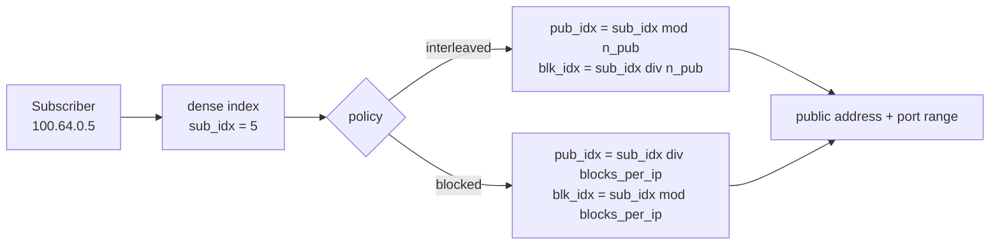
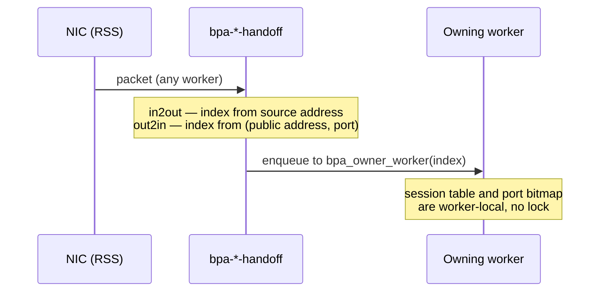
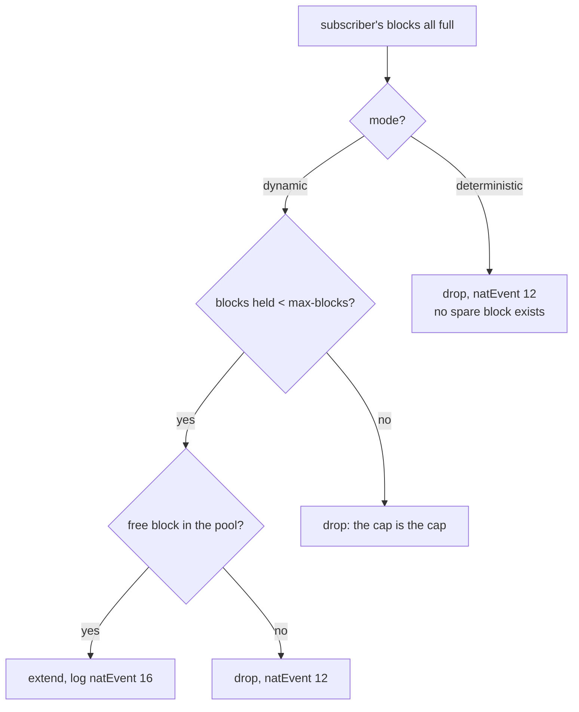
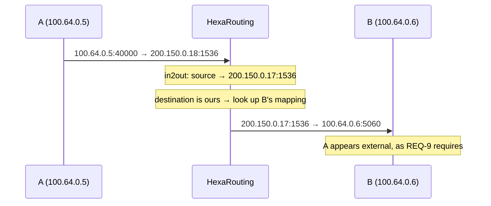
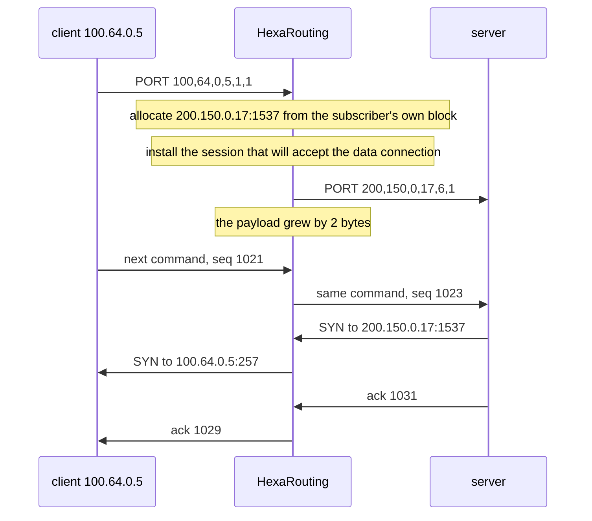

# HexaRouting — Architecture

## TL;DR

CGNAT that maps each subscriber to a **contiguous port block** on a public
address. In **deterministic** mode that mapping is a formula, so it needs no
allocation log and no shared state — which is also what lets both traffic
directions shard across workers without a lock. In **dynamic** mode blocks are
allocated on demand and every allocation is logged, trading log volume for
IPv4 savings.

Protocols that carry a transport address in their payload get an
**application-level gateway**, switchable per pool, which rewrites the payload
and never guesses: anything it does not fully parse is passed through and
counted.

The Python model in `ref/` is the specification; the C implementation is
checked against it on every build.

> The key words **MUST**, **MUST NOT**, **REQUIRED**, **SHALL**, **SHALL NOT**,
> **SHOULD**, **SHOULD NOT**, **RECOMMENDED**, **MAY**, and **OPTIONAL** in
> this document are to be interpreted as described in
> [RFC 2119](https://www.rfc-editor.org/rfc/rfc2119).

## 5W2H

| | |
|---|---|
| **What** | A VPP plugin translating RFC 6598 subscriber addresses to public addresses using per-subscriber port blocks. |
| **Why** | To make CGNAT auditable without per-flow logging, and to keep the return path free of shared lookup state. |
| **Who** | Written for ISP operators; the algorithm is auditable by whoever answers a court order. |
| **When** | Translation happens in the dataplane per packet; block assignment happens once per subscriber (deterministic) or per session burst (dynamic). |
| **Where** | On the `ip4-unicast` feature arc, after shallow virtual reassembly and before `ip4-lookup`. |
| **How** | Address sets are indexed densely; a reciprocal multiply replaces integer division on the datapath. |
| **How much** | 512-port block ⇒ 126 subscribers per public IP. 200k subscribers ⇒ a `/21` in deterministic mode. |

## Design decisions

| # | Decision | Choice | Rationale |
|---|----------|--------|-----------|
| D1 | Dataplane base | In-tree-style VPP plugin | Inherits FIB, ARP/ND, fragmentation, ICMP, tracing, API and BGP via `linux_cp` |
| D2 | BPA modes | Deterministic **and** dynamic, per pool | Deterministic gives zero logging; dynamic saves IPv4 |
| D3 | Default mapping policy | `interleaved` | Smaller blast radius when a public IP is blacklisted |
| D4 | Worker sharding | VPP handoff, keyed on subscriber index | Guarantees both directions land on the same worker |
| D5 | Pool addressing | Sets of non-contiguous prefixes | Real provider IPv4 is fragmented; a single aligned prefix would rule out most deployments |
| D6 | Control plane | FRR over `linux_cp`/`linux_nl` | Both plugins ship with VPP 26.06; FRR needs no modification |
| D7 | Configuration | Single VTY (`hexash`) | Operators expect `configure terminal` and `write memory` covering routing and CGNAT together |

## The mapping

A pool defines two **address sets** and a block size. Each set is a list of
possibly non-contiguous prefixes presented as a dense index space `[0, count)`.



Requirements:

* Prefixes within a set **MUST NOT** overlap. Overlap breaks the
  address↔index bijection, and a broken bijection means one subscriber is
  logged as another — a compliance failure, not merely a bug. Overlapping
  prefixes **MUST** be rejected at configuration time.
* Adjacent prefixes **SHOULD** be merged, which shortens the datapath search.
* `block_size` **MUST** be a power of two.
* Pool capacity **MUST NOT** exceed 2^28 subscribers, which bounds the
  reciprocal multiplication below 2^61 and keeps it inside `u64`.

### Why `interleaved` is the default

With `interleaved`, consecutive subscribers land on **different** public
addresses. If one public address is blacklisted, the damage spreads thinly
instead of taking down an entire neighbourhood behind one OLT.

### Division on the datapath

`outside.count` is arbitrary once pools accept fragmented prefixes, so the
split cannot rely on shifts alone. A reciprocal multiply is precomputed per
pool; when the divisor happens to be a power of two, a shift is used instead.
`ref/check_magic.py` proves the reciprocal exact for 1074 arbitrary divisors
up to 266 million, with the worst intermediate product at 61 bits.

## Sharding

Session state and the per-subscriber port bitmap are per-worker and lock-free.
That is only safe if **both directions of a subscriber reach the same worker**,
and NIC RSS gives no such guarantee: outbound hashes on the private address,
inbound on the public one.



* Both handoff nodes **MUST** compute the same owner for a given subscriber.
* The worker count **MAY** be any value; the same reciprocal used for the pool
  split removes the power-of-two requirement.
* With no workers configured, the CLI **MUST** install the translation node
  directly on the arc — a handoff would be a frame-queue round trip for
  nothing.

The out2in direction resolves the owner by arithmetic alone. This is why the
deterministic mapping matters beyond logging: without it the return path could
not find its owner without consulting a structure shared across workers, and
the lock this design avoids would come back through the side door.

## Dynamic mode (PBA)

Blocks are allocated on first flow and returned after a hold-down period.

Block allocation would be shared state across workers. Instead the block space
is **partitioned**: worker `w` allocates only blocks where
`block_idx mod n_workers == w`. Because a worker only ever hands a subscriber a
block from its own slice, the two handoff formulas agree — and in deterministic
mode `block_idx == sub_idx`, so one line of code serves both modes.

* Hold-down **MUST** be non-zero in production. Without it a subscriber who
  pauses for a second churns a release and an allocation, and **each of those
  is a log record**. Hold-down is the primary lever on log volume.
* Oversubscription is measured **per worker**, not globally. One slice **MAY**
  exhaust while another still has free blocks.

## Extended blocks

A subscriber that fills its block is dropped, and `natEvent 12` says so. That is
correct and terrible: one customer's internet stops while the box is healthy and
the neighbours are unaffected.

With `max-blocks` above 1, a subscriber whose blocks are all full is given
another. The cap matters as much as the extension: without one, an infected host
consumes the pool every other subscriber needs, and the operator has traded a
customer complaint for an outage.

Every extension **MUST** be logged as `natEvent 16`, and its release as
`natEvent 17`. An extension is not derivable from anything — not from the
formula, not from the first block — so a block the log does not record cannot be
attributed to anyone, which is the entire reason blocks are logged.

### Only in dynamic mode, and why

Dynamic pools have spare blocks by construction: `bpa_dyn_acquire()` draws from
a free list, so handing out a second block is the same operation as the first.

Deterministic pools have none. `capacity = outside.count * blocks_per_ip` and
`bpa_forward()` assigns **every** block to some subscriber. A block handed out
as an extension is a block the formula gives to somebody else, and giving it
away breaks their mapping with no error anywhere — the exact failure the
deterministic proof exists to prevent.

Making it work there needs a reserve held out of the formula, which reduces
capacity, which re-maps every existing subscriber. That is
[#39](https://github.com/andrediashexa/hexarouting/issues/39), and it depends on
the documented procedure for a capacity change
([#23](https://github.com/andrediashexa/hexarouting/issues/23)) — not something
to arrive as a side effect of a feature about something else.



### Releasing them

An extension is owned by the subscriber like any other block, but it does not
live in the allocator's `by_sub` map, which names the first one. It is tracked
in a separate list so that going idle marks **all** of a subscriber's blocks,
not just the first.

Missing that is a leak with no symptom until it matters: the extension stays
owned forever, is never reaped, and shows up only as a pool that slowly stops
having free blocks.

## Memory

| Structure | Sizing | Notes |
|---|---|---|
| Port bitmap | `block_size` bits per active subscriber | 64 bytes at 512 ports; ~13 MB for 200k |
| Session tables | Two bihash tables per worker | Default 16 MB each, configurable via `bpa session-table` |
| Block ownership (dynamic) | 4 bytes per block per worker slice | |

Session table size is a **virtual** reservation, but the OOM killer counts
virtual memory. The default is therefore modest: a deployment with 200k
subscribers **SHOULD** raise it, and a small box **MUST NOT** pay for capacity
it will never use.

## TCP and ICMP handling

Two gaps that produce subscriber complaints rather than ugly graphs:

**TCP state.** Marking a session established on any ACK and ignoring RST and
FIN makes a closed connection hold its port for the established timeout — two
hours. On a 512-port block that exhausts a subscriber quickly, and reaches
support as "the Internet stopped" with nothing obvious in the dataplane. The
implementation **MUST** release on RST and **MUST** leave the long timeout on
FIN.

**Half-open sessions.** A session that sent SYN and never established gets its
own lifetime, twenty seconds by default against the transitory timeout's four
minutes. A host scanning the internet produces one of these per probe; held for
the transitory timeout they exhaust the subscriber's own block, and the
complaint reaches support as "the internet stopped" from a dataplane that looks
healthy. The implementation **MUST** keep the two states apart.

**Port hold-down.** A released port **SHOULD NOT** be handed out again
immediately: a delayed segment from the connection that just ended can land on
the new one, which the subscriber sees as a connection reset nobody can
reproduce. Four seconds by default, and zero disables it entirely.

The obvious implementation — a release timestamp per port — costs 32x the
memory: the bitmap is 64 bytes for a 512-port block and timestamps would be
2 KB, some 400 MB across 200k subscribers, to solve something that lasts
seconds. Instead the released port goes on a per-worker queue whose cost is
proportional to session **churn**, which is what the hold-down window is
actually about. The queue is bounded, and on overflow ports are released early
and **counted**: withholding ports until the drain catches up would exhaust the
block, which is a worse failure than the collision being avoided.

**Timeouts are per pool.** The pool is the unit an operator sells, so it is the
unit of policy; a provider serving business and residential customers from one
box needs different lifetimes. Zero in any field means inherit the global, and
the running configuration emits only the overrides — emitting inherited values
would turn every global change into a diff against every pool.

**ICMP errors.** ICMP errors carry the original packet embedded, and it is the
embedded packet that identifies the session. Without translating it, PMTUD's
*fragmentation needed* never reaches the subscriber: the TCP connection hangs
and the symptom is "some sites do not load". Traceroute stops working too.

The ICMP checksum covers the whole embedded packet, so every change inside it —
**including the embedded IP header's own checksum** — **MUST** be reflected in
it. Translating with a wrong checksum is worse than not translating: the
subscriber's stack discards the packet, PMTUD stays broken, and the counter
claims success.

## Hairpinning

Two subscribers behind the same CGNAT reaching each other through a public
address (RFC 4787 REQ-9).

Without it the packet is translated correctly on the way out and then routed to
an address this box itself owns, with nothing to send it back in. The symptom is
specific and hard to attribute: a camera that answers from the street and not
from next door, a self-hosted service that works for everyone except the
neighbours, a game that hosts a match for everyone but the players on the same
ISP.



Both translations happen in one pass through `in2out`: the source on the way
out, and then the destination straight back in. The source is already A's
**public** address by then, which is what REQ-9 requires — B **MUST** see A as
external. Presenting A's private address would leak the inside topology and
break B's reply path, because B would answer to an address it cannot route to.

A packet aimed at one of our public addresses with **no** session on that port
is **dropped**, not forwarded. Forwarding it would put a packet addressed to
our own public range back on the wire, and it is counted separately from a
successful hairpin so the two are distinguishable.

## Filtering: who may reply

A mapping accepts inbound packets under one of two rules (RFC 4787 REQ-8), set
per pool with `bpa filter <pool> <mode>`:

| Mode | Who may reach an open mapping | Cost |
|---|---|---|
| `endpoint-independent` (default) | anyone | unsolicited traffic reaches the subscriber |
| `address-dependent` | only the remote the subscriber contacted | some peer-to-peer applications stop working |

The default is what this implementation has always done, and not by intent
expressed anywhere: the `out2in` key is `(public ip, public port, protocol)`
and carries no remote address, so any host may reach an open mapping. That is a
full-cone NAT. Which of the two an operator wants is their trade, not ours.

The check is **not** in the key, deliberately. Putting the remote address in
the lookup key would give one subscriber a different external port per
destination — endpoint-*dependent* mapping — and break exactly the peer-to-peer
applications this product exists to keep working. Filtering and mapping are
separate decisions and only the first changes here.

The session remembers **one** remote address, refreshed on every outbound
packet. A source port reused toward two remotes will therefore only accept
replies from the more recent one. That is an approximation, stated because a
reader deserves to know where it stops: tracking the set would mean per-remote
state on a datapath whose whole point is not having any, and the drops are
counted so an operator can see whether it ever bites.

Changing the mode **MUST NOT** drop sessions — `bpa filter` changes it in
place, because the point of offering the choice is that an operator can make it
on a box carrying traffic.

## Application-level gateways

A protocol that puts an address or a port **inside its payload** breaks behind
any NAT unless the NAT rewrites the payload too. The failures do not look like
NAT failures to the subscriber, which is why they become long support calls.

Each ALG **MUST** be switchable per pool, and each **MUST** count what it
rewrote, so that "the ALG is off" and "the ALG saw nothing" are
distinguishable from the outside. A malformed or unexpected payload **MUST**
leave the packet untouched and increment a counter: an ALG that rewrites what
it misparsed corrupts traffic that would otherwise merely fail to connect,
which is a worse outcome than the one it exists to prevent.

| ALG | Default | State |
|---|---|---|
| FTP (RFC 959 `PORT`/`227`, RFC 2428 `EPRT`/`229`) | on | built |
| RTSP (RFC 2326 `Transport:`) | on | built |
| PPTP/GRE (RFC 2637) | on | built |
| IPsec ESP passthrough | on | not built |
| SIP | **off** | not built |

One registry drives all of them: adding an ALG is one line in
`foreach_bpa_alg`, and the CLI, the running configuration and `show bpa alg`
follow from it.

```
bpa pool <name> ... [alg <ftp|rtsp|pptp> on|off]
bpa alg <pool> <ftp|rtsp|pptp> <on|off>       # in place, keeps sessions
show bpa alg
```

The pool stores two masks: what is enabled, and which of those the operator has
actually stated an opinion about. A pool built from a zeroed structure — by the
CLI or by the binary API — therefore gets the documented defaults without every
creation path restating them, and an ALG that ships **off** stays expressible
rather than becoming a special case.

The reasoning behind that list — including why SIP is built off, and which
conventional ALGs are deliberately not built at all — is recorded on
[issue #14](https://github.com/andrediashexa/hexarouting/issues/14).

### FTP

`bpa alg <pool> ftp <on|off>`, on by default, changeable on a box carrying
traffic.

Active FTP does not work through a NAT without it. The client tells the server
"connect back to me at this address and port", in ASCII, and the address is a
private one. The control connection stays perfectly healthy while the data
connection is attempted against something nobody can route to: the subscriber
sees a directory listing that hangs forever, and nothing in the CGNAT looks
wrong. Passive FTP survives without an ALG; active FTP is still how a lot of
industrial and legacy equipment moves files.



**Only the `in2out` direction is ever rewritten.** Only there does the payload
carry an address that belongs to the inside. A `227` arriving from a server on
the internet announces *that server's* address, which the subscriber can
already reach; rewriting it would break a session that works. The direction
therefore decides which keyword is looked for: a segment towards port 21 is a
client's, so `PORT` and `EPRT`; a segment from port 21 is that subscriber's own
FTP server replying, so `227` and `229`.

**The announced address MUST match the session's own private address.** A
client announcing somebody else's address is either behind a second NAT — where
rewriting would point the data connection at the wrong host on our inside — or
is attempting an FTP bounce. Both leave the packet exactly as it arrived.

**The data connection is expected, not guessed.** Rewriting the payload
installs a session for `(public address, allocated port)` so that the inbound
connection is accepted, using a port from the subscriber's **own block** — so
the mapping stays derivable and nobody else's block is touched. The session is
created half-open, so an announcement the server never answers expires on the
half-open timer (twenty seconds by default) and costs exactly what a scan probe
costs. Its remembered remote stays empty, and address-dependent filtering skips
the check when it is: the subscriber asked to be connected *to*, so the
connection is solicited even though nothing outbound preceded it, and the
filtering mode **MUST NOT** silently defeat the ALG.

#### Sequence numbers are the part that bites

Rewriting an ASCII address changes the **length** of the payload. Every byte
the subscriber sends after that point therefore sits at a different offset in
the stream than the subscriber believes, and every acknowledgement the server
returns is in the lengthened numbering.

The implementation **MUST** shift the sequence number of every later segment in
the subscriber's direction, and **MUST** shift the acknowledgement of every
segment coming back. Without it the control connection stalls a few commands
after the rewrite — long enough after the `PORT` that the failure does not look
like FTP, and does not look like NAT either.

The session remembers where the last rewrite happened and the drift on each
side of it, so a retransmission of data sent *before* the rewrite still gets the
offset that was in force when it was first sent. Only the two most recent
offsets are kept; a retransmission older than the last-but-one rewrite would get
the wrong one, which on a control connection whose rewrites are seconds apart is
data the sender has already given up on. TCP **SACK** blocks are **not**
adjusted — stated because a reader deserves to know where this stops rather
than assume it was handled.

The correction survives the switch: `bpa alg <pool> ftp off` stops new rewrites
but the datapath keeps renumbering sessions it already lengthened, because
otherwise turning the knob off would break exactly the connections the operator
was trying to stop interfering with.

That state costs **eight bytes on every session**, FTP or not — `sizeof
(bpa_session_t)` goes from 40 to 48. A side table keyed on the session index
would have avoided it and would have needed its own lifecycle hanging off
`bpa_session_free()`; this project has already learned that a second thing to
keep in step is a second thing to get wrong.

#### What it refuses to do

* It rewrites **at most the first line** of a segment. FTP is strictly
  request/response, so a command is a segment, and searching further into a
  payload is how an ALG ends up rewriting a byte sequence that happened to
  appear inside a file name. A keyword found on a **later** line leaves the
  packet untouched and increments the counter, so the case is visible rather
  than silent.
* It demands the exact grammar and a **CRLF** terminator. RFC 959 defines the
  control connection as Telnet NVT, where a line ends in CRLF; accepting a bare
  LF would mean guessing about a payload that is already not what the protocol
  says it should be.
* `EPRT` with address family 2 (IPv6) is left alone and counted. A v4 CGNAT has
  nothing to put there.
* A segment split across buffers is left alone.

#### Checksums, and why the lab reads the packet

Both checksums are recomputed from scratch on a rewritten segment rather than
updated incrementally. The payload changed length, so an incremental update
would have to fold in every moved byte, and the ICMP work already proved what a
wrong checksum costs here: the receiver drops the packet in silence while every
counter reports success. One short command is not worth the risk of getting
that arithmetic wrong.

`lab/ftp-alg.sh` therefore asserts on the **captured packet** — both checksums,
the IP total length against the bytes actually on the wire, the rewritten
payload byte for byte, the shifted sequence and acknowledgement numbers, and the
data connection arriving at the subscriber. `sh tools/lab.sh ftp-alg off` runs
the same lab with the ALG switched off and **MUST** fail; twelve of its
assertions drop, which is what makes the other run mean something.

### RTSP (RFC 2326)

**On by default.** [#43](https://github.com/andrediashexa/hexarouting/issues/43)

The `Transport:` header of a `SETUP` names the ports the client wants its media
on. Behind the CGNAT those are private ports: the server sends RTP to the
subscriber's public address on a port that belongs to nobody, the control
connection reports success, and the video never arrives. This is the IP camera
or streaming box that works on the LAN and shows a black frame from outside —
a support call that is never attributed to the CGNAT.

```mermaid
sequenceDiagram
    participant C as client 100.64.0.5
    participant N as HexaRouting
    participant S as server (internet)
    C->>N: SETUP ... client_port=6970-6971
    Note over N: reserve 10514-10515 in the subscriber's block<br/>open two UDP mappings, RTP even
    N->>S: SETUP ... client_port=10514-10515
    S->>N: 200 OK ... client_port=10514-10515;server_port=9000-9001
    Note over N: restore the client's own pair<br/>server_port is the server's, untouched
    N->>C: 200 OK ... client_port=6970-6971;server_port=9000-9001
    S->>N: RTP to 200.150.0.17:10514
    N->>C: RTP to 100.64.0.5:6970
```

What it does:

| | |
|---|---|
| Matches | TCP with port **554** on the server side, in either direction |
| Rewrites | `client_port` in the `SETUP` request, and the echo of it in the `200` reply |
| Reserves | two **consecutive** public ports with the **RTP port even** |
| Opens | two UDP mappings, so the announced media is accepted when it arrives |
| Corrects | TCP sequence and acknowledgement numbers, because the rewrite changes the payload length |

Constraints worth stating, because each one is a decision:

* The allocated ports **MUST** be consecutive with the RTP port even
  (RFC 3550 §11). Clients that assume the convention — and much camera
  firmware does — fail when it is broken, and they fail as "no video".
* The pair **MUST** come from a block on the **same public address** as the
  control connection. The header carries only ports; the peer takes the address
  from the connection it is answering, so a pair taken from another block of
  the same subscriber would be announced and never reachable.
* Only port **554** is matched. Cameras are also found on 8554 and other ad-hoc
  ports, and those are deliberately not matched: the only thing that says "this
  stream is RTSP" without guessing is the well-known port. An operator who
  needs another one needs a knob, not a heuristic.
* `server_port` is **NOT** rewritten. It names the server's own ports, which
  are on the public side and already reachable. See the note below on the
  direction this ALG can and cannot help.
* A folded `Transport:` header, a single `client_port` with no range, a range
  that is not two consecutive ports, a message whose header block does not end
  in this segment — every one of them leaves the packet untouched and
  increments its own counter.

**Which direction this helps.** The subscriber has to be the RTSP *client*.
That covers the common deployments: a viewer or streaming box behind the CGNAT,
and a camera that publishes to a cloud recorder, because a publishing camera is
still the party that opens the connection and still sends `client_port`. It
does **NOT** make a camera behind the CGNAT reachable from the internet: that
connection is inbound and unsolicited, so it is dropped before any RTSP is
seen. Reaching an inbound camera needs a port forward
([#3.1](roadmap.md), static port forwarding), not an ALG.

### Sequence numbers, and why the failure arrives late

Rewriting `client_port=6970-6971` as `client_port=10514-10515` makes the
payload two bytes longer. Every byte the client sends afterwards is therefore
two further along the stream than the client believes, and every acknowledgement
coming back counts two bytes the client never sent.

Uncorrected, this does not fail at the rewrite. The control connection carries
on for a message or two and then stalls, and what reaches support is "the
camera stops after a few seconds", with nothing pointing at the header that was
edited.

Each session therefore carries a correction per direction, holding the offset,
the previous offset, and the sequence number of the segment that was rewritten:

* A segment **after** that point is moved by the new offset.
* The rewritten segment itself, and any **retransmission** of it, is moved by
  the previous one. A single running total gets that case wrong by exactly the
  length of the rewrite, and a retransmitted `SETUP` is not a rare event on a
  camera with a poor uplink.
* A retransmitted `SETUP` is also rewritten to the **same** public pair it got
  the first time. Refusing it would put the subscriber's private ports on the
  wire, and the server believes the last thing it read.

Only the most recent correction is remembered. A stream rewritten twice and
then retransmitting from before the *first* rewrite is still wrong; the
alternative is a per-session list of correction points on a datapath whose
whole point is not having any, and RTSP is request/response with a small
window, so the exposure is one message.

### Announced ports that are never used

A `SETUP` opens two mappings before anything has used them. If the media never
arrives — the client gave up, the server refused, the `SETUP` was retried with
different ports — those two ports would otherwise sit out the full UDP timeout.
A camera reconnecting in a loop turns that into exhaustion of its own
subscriber's block, which reaches support as "the internet stopped" with a
healthy dataplane.

An unused expectation therefore expires on `alg-expect` (60 s by default,
per-pool or global, `bpa timeouts alg-expect <s>`). The first packet in either
direction puts the mapping back on the protocol's own lifetime.

### Counters

`show errors` names them per node, and `show bpa pool` prints whether the ALG
is on — both are needed, because a zero counter means nothing on its own.

| Node | Counter | Meaning |
|---|---|---|
| `bpa-in2out` | RTSP Transport headers rewritten | a `SETUP` was rewritten |
| `bpa-in2out` | RTSP Transport not understood | the header exists and was refused |
| `bpa-in2out` | RTSP message spans segments | the header block does not end here |
| `bpa-in2out` | RTSP rewrite would not fit | the longer payload exceeds the buffer |
| `bpa-in2out` | RTSP media port pair unavailable | no even-aligned free pair in the block |
| `bpa-out2in` | RTSP Transport replies rewritten | a `200` reply was restored |
| `bpa-out2in` | RTSP reply not understood | the echoed ports match no mapping |
| `bpa-out2in` | RTSP reply spans segments | as above, inbound |
| `bpa-out2in` | RTSP reply rewrite would not fit | as above, inbound |

Reason strings are kept under **35 characters**: `show errors` truncates there,
and a counter whose name cannot be read whole is a counter no script can match.

Evidence: `lab/rtsp.sh`, which asserts on the captured packet — the rewritten
pair, its parity, both checksums, the IP length, the delivered media, and the
sequence numbers of the segments that follow. `BPA_RTSP_OFF=1 sh tools/lab.sh
rtsp` runs it against a pool with the ALG disabled, where 11 of its 18
assertions fail. The parser's refusals are unit-tested without VPP in
`test/test_bpa_rtsp.c`, and the port-pair allocator in `test/test_bpa_ports.c`.

## Fragments

A non-first fragment carries no L4 header and therefore no port to match a
session. Without handling, it is dropped, and large DNS, VPN and gaming break
**intermittently** — the hardest symptom to diagnose.

VPP's shallow virtual reassembly caches the first fragment's ports and attaches
them to the following ones.

* The BPA nodes **MUST** declare `runs_after` on `ip4-sv-reassembly-feature`.
  Otherwise they may run first and read buffer fields that do not yet exist.
* The reassembly stores ports in **network byte order**. Read as host order,
  12345 (`0x3039`) becomes 14640 (`0x3930`), the node misses the session and
  opens another — **burning one port per fragment**. A subscriber that
  fragments heavily exhausts its block on its own.

That second one was found only because the test checked the *port* of the
translated fragment, not merely that a packet came out translated. It did come
out: with the right address and the wrong session.

## Project state

- [x] BPA reference model (`ref/bpa_model.py`, `ref/validate.py`)
- [x] C mapping core, checked against the model (`make test`)
- [x] Per-subscriber port allocator
- [x] Plugin loads in VPP 26.06 with pool CLI
- [x] Pools of non-contiguous prefixes
- [x] `in2out` / `out2in` nodes, verified by packet injection
- [x] Per-worker session table with configurable timeouts
- [x] Worker handoff, verified with two workers
- [x] Routing: BGP, OSPF and IS-IS reaching the VPP FIB
- [x] Pool validated against local addresses
- [x] Dynamic block allocator with hold-down and per-worker partitioning
- [x] Fragment handling via shallow virtual reassembly
- [x] TCP state and ICMP error translation
- [x] FTP ALG, switchable per pool ([#42](https://github.com/andrediashexa/hexarouting/issues/42))
- [x] IPFIX export over UDP and TCP ([logging.md](logging.md))
- [x] Dated configuration trail
- [x] Single VTY (`hexash`) with completion and contextual help
- [x] Binary API with real return codes
- [x] Appliance: boot tuning, systemd units, installer, ISO ([appliance.md](appliance.md))
- [ ] **HA / failover** — analysed in [ha.md](ha.md), not implemented
- [ ] Migrate `hexash` from the CLI to the binary API

What is still missing, and why each item matters, is in
[roadmap.md](roadmap.md) — including the items that turn out to be already
satisfied by this design rather than needing to be built.
