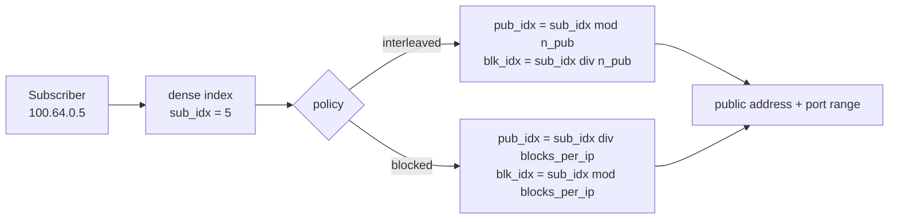
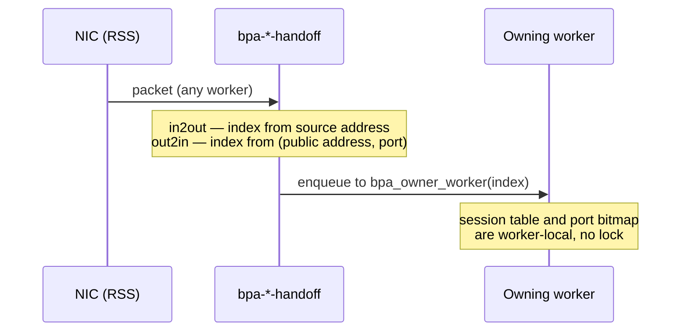
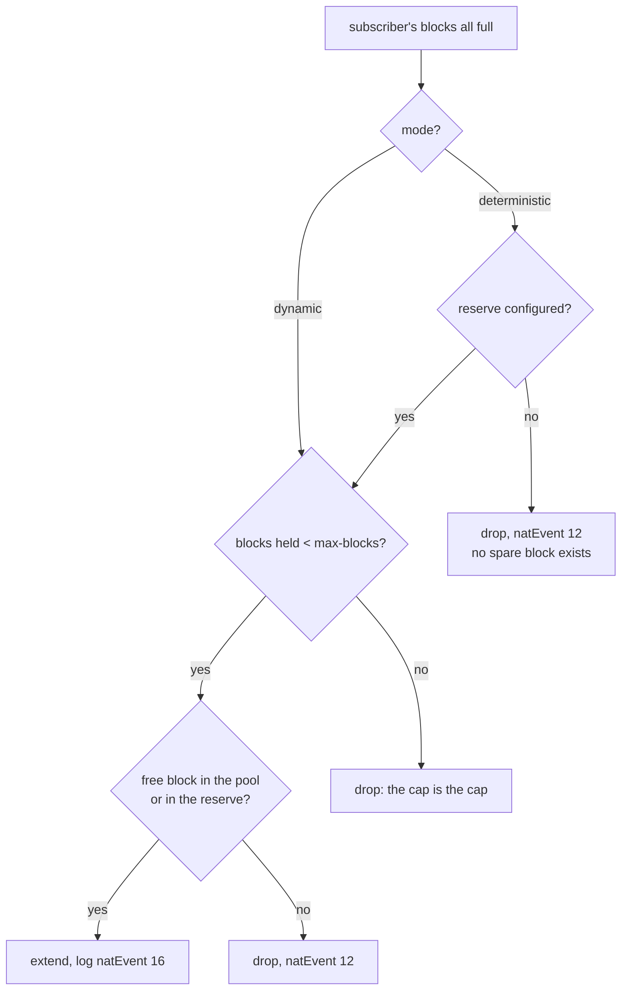
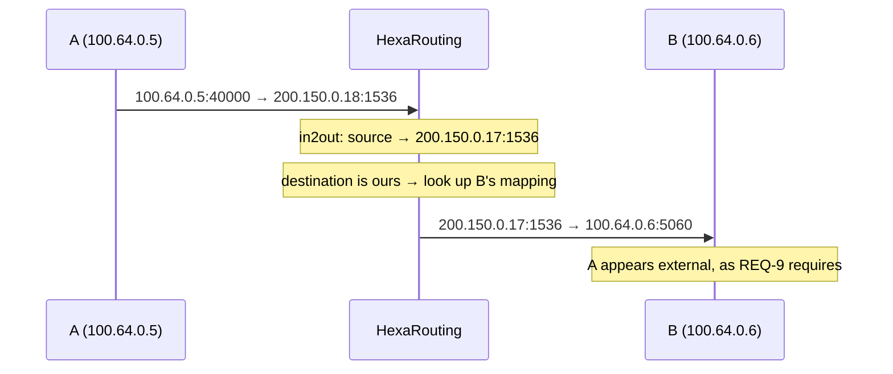
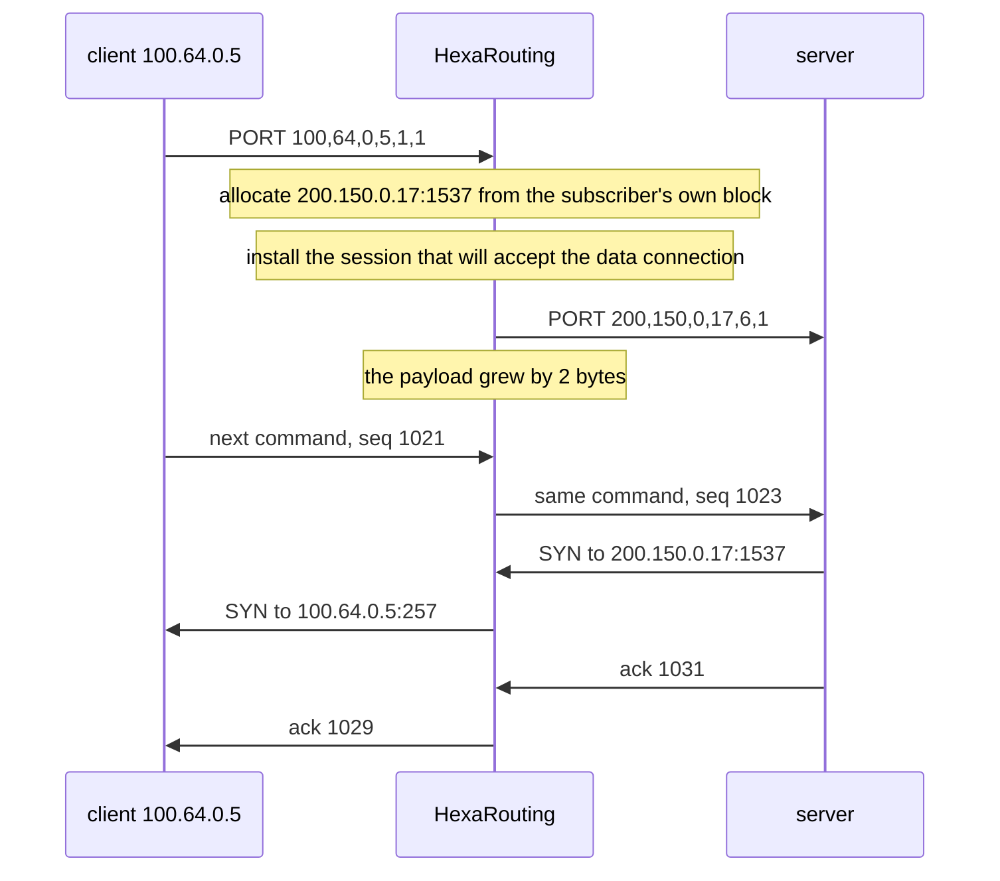

# HexaRouting — Architecture

## TL;DR

CGNAT that maps each subscriber to a **contiguous port block** on a public
address. In **deterministic** mode that mapping is a formula, so it needs no
allocation log and no shared state — which is also what lets both traffic
directions shard across workers without a lock. In **dynamic** mode blocks are
allocated on demand and every allocation is logged, trading log volume for
IPv4 savings.

Protocols that carry a transport address in their payload get an
**application-level gateway**, switchable per pool, which rewrites the payload
and never guesses: anything it does not fully parse is passed through and
counted.

A subscriber who needs to be reached from outside gets a **static port
forward**: one inbound port pinned to one of its sockets, on its own public
address and inside its own block, reserved so the allocator can never hand it
to anything else.

**uRPF**, off by default, refuses a source that does not route back the way it
came — the difference between a log that is answerable and one that is
confidently wrong.

**Bypass lists** let named sources and destinations through untranslated,
taking no port and creating no session.

**Utilisation observability** shows the pool filling as a distribution, and
raises one alarm per subscriber that crosses a threshold — ahead of the
exhaustion event, which only reports that a customer has already lost traffic.

**Per-subscriber bounds** cap how many sessions one subscriber may hold and how
fast it may open them, so an infected host is bounded and its neighbours are
not — and so the operator has a counter to point at.

**MSS clamping**, also off by default, lowers the handshake so that segments
fit the narrowest link on the path, which removes the "some sites do not load"
ticket that broken PMTUD produces.

The Python model in `ref/` is the specification; the C implementation is
checked against it on every build.

> The key words **MUST**, **MUST NOT**, **REQUIRED**, **SHALL**, **SHALL NOT**,
> **SHOULD**, **SHOULD NOT**, **RECOMMENDED**, **MAY**, and **OPTIONAL** in
> this document are to be interpreted as described in
> [RFC 2119](https://www.rfc-editor.org/rfc/rfc2119).

## 5W2H

| | |
|---|---|
| **What** | A VPP plugin translating RFC 6598 subscriber addresses to public addresses using per-subscriber port blocks. |
| **Why** | To make CGNAT auditable without per-flow logging, and to keep the return path free of shared lookup state. |
| **Who** | Written for ISP operators; the algorithm is auditable by whoever answers a court order. |
| **When** | Translation happens in the dataplane per packet; block assignment happens once per subscriber (deterministic) or per session burst (dynamic). |
| **Where** | On the `ip4-unicast` feature arc, after shallow virtual reassembly and before `ip4-lookup`. |
| **How** | Address sets are indexed densely; a reciprocal multiply replaces integer division on the datapath. |
| **How much** | 512-port block ⇒ 126 subscribers per public IP. 200k subscribers ⇒ a `/21` in deterministic mode. |

## Design decisions

| # | Decision | Choice | Rationale |
|---|----------|--------|-----------|
| D1 | Dataplane base | In-tree-style VPP plugin | Inherits FIB, ARP/ND, fragmentation, ICMP, tracing, API and BGP via `linux_cp` |
| D2 | BPA modes | Deterministic **and** dynamic, per pool | Deterministic gives zero logging; dynamic saves IPv4 |
| D3 | Default mapping policy | `interleaved` | Smaller blast radius when a public IP is blacklisted |
| D4 | Worker sharding | VPP handoff, keyed on subscriber index | Guarantees both directions land on the same worker |
| D5 | Pool addressing | Sets of non-contiguous prefixes | Real provider IPv4 is fragmented; a single aligned prefix would rule out most deployments |
| D6 | Control plane | FRR over `linux_cp`/`linux_nl` | Both plugins ship with VPP 26.06; FRR needs no modification |
| D7 | Configuration | Single VTY (`hexash`) | Operators expect `configure terminal` and `write memory` covering routing and CGNAT together |

## The mapping

A pool defines two **address sets** and a block size. Each set is a list of
possibly non-contiguous prefixes presented as a dense index space `[0, count)`.



Requirements:

* Prefixes within a set **MUST NOT** overlap. Overlap breaks the
  address↔index bijection, and a broken bijection means one subscriber is
  logged as another — a compliance failure, not merely a bug. Overlapping
  prefixes **MUST** be rejected at configuration time.
* Adjacent prefixes **SHOULD** be merged, which shortens the datapath search.
* `block_size` **MUST** be a power of two.
* Pool capacity **MUST NOT** exceed 2^28 subscribers, which bounds the
  reciprocal multiplication below 2^61 and keeps it inside `u64`.

### Why `interleaved` is the default

With `interleaved`, consecutive subscribers land on **different** public
addresses. If one public address is blacklisted, the damage spreads thinly
instead of taking down an entire neighbourhood behind one OLT.

### Division on the datapath

`outside.count` is arbitrary once pools accept fragmented prefixes, so the
split cannot rely on shifts alone. A reciprocal multiply is precomputed per
pool; when the divisor happens to be a power of two, a shift is used instead.
`ref/check_magic.py` proves the reciprocal exact for 1074 arbitrary divisors
up to 266 million, with the worst intermediate product at 61 bits.

## Sharding

Session state and the per-subscriber port bitmap are per-worker and lock-free.
That is only safe if **both directions of a subscriber reach the same worker**,
and NIC RSS gives no such guarantee: outbound hashes on the private address,
inbound on the public one.



* Both handoff nodes **MUST** compute the same owner for a given subscriber.
* The worker count **MAY** be any value; the same reciprocal used for the pool
  split removes the power-of-two requirement.
* With no workers configured, the CLI **MUST** install the translation node
  directly on the arc — a handoff would be a frame-queue round trip for
  nothing.

The out2in direction resolves the owner by arithmetic alone. This is why the
deterministic mapping matters beyond logging: without it the return path could
not find its owner without consulting a structure shared across workers, and
the lock this design avoids would come back through the side door.

## Dynamic mode (PBA)

Blocks are allocated on first flow and returned after a hold-down period.

Block allocation would be shared state across workers. Instead the block space
is **partitioned**: worker `w` allocates only blocks where
`block_idx mod n_workers == w`. Because a worker only ever hands a subscriber a
block from its own slice, the two handoff formulas agree — and in deterministic
mode `block_idx == sub_idx`, so one line of code serves both modes.

* Hold-down **MUST** be non-zero in production. Without it a subscriber who
  pauses for a second churns a release and an allocation, and **each of those
  is a log record**. Hold-down is the primary lever on log volume.
* Oversubscription is measured **per worker**, not globally. One slice **MAY**
  exhaust while another still has free blocks.
* A block carrying a [static port forward](#static-port-forwarding) is
  **pinned**: no hold-down releases it and no other subscriber is given it,
  for as long as the forward exists. `show bpa blocks` counts pinned blocks
  apart from blocks in use, because an operator reading a pool that looks full
  needs to know how much of it no hold-down will ever give back.

### The capacity such a pool can promise

`capacity = outside.count × blocks_mapped` counts blocks, and with workers
those blocks are in slices a subscriber cannot cross. A subscriber's slice is
fixed by `bpa_owner_worker()`, which is arithmetic on the offset of its own
address within the inside set - not a counter - so nothing balances the two,
and a subscriber can be refused with blocks standing free next door
([#210](https://github.com/andrediashexa/hexarouting/issues/210)).

`bpa_pool_guaranteed()` in `src/plugins/bpa/bpa_pool.h` is the number an
operator sizes against: the largest *n* for which **every** set of *n*
subscribers is served. A worker refuses only when more inside addresses map to
it than it has blocks, so that is the smallest slice among the workers that can
be crowded, and the whole usable set when none of them can be - a pool of 12
blocks in front of 8 inside addresses serves all 8 at any worker count, and
`capacity / n_workers` would understate it by half. It is one holder with three
readers: `show bpa pool` prints it below the ceiling, `bpa_pool_details`
reports it beside `capacity`, and `test/test_bpa_pool.c` asserts it against a
simulation of the slices rather than against the formula written twice.

* Reporting it is **not** a fix for the refusal, and does not pretend to be.
  The two that are - assign a subscriber to the worker holding a free block,
  or let a worker borrow from its neighbour's slice - both need state shared
  across workers, which is what this partition exists to avoid, and remain
  open on #210.
* Re-partitioning is not a third option. Measured over 2800 combinations of
  blocks, inside addresses and worker count, **no** split of the blocks among
  the workers guarantees more than the even split already does: with a
  subscriber's worker fixed by arithmetic, the adversary crowds whichever
  slice is thinnest.
* The loss is **zero** when inside addresses are handed out contiguously from
  the bottom of the range, which is a DHCP pool filling upward, because
  `sub_idx mod n_workers` then cycles perfectly. It is severe only for small
  pools on many workers - which is dynamic mode's own deployment, since
  dynamic mode is chosen to save IPv4.

## Extended blocks

A subscriber that fills its block is dropped, and `natEvent 12` says so. That is
correct and terrible: one customer's internet stops while the box is healthy and
the neighbours are unaffected.

With `max-blocks` above 1, a subscriber whose blocks are all full is given
another. The cap matters as much as the extension: without one, an infected host
consumes the pool every other subscriber needs, and the operator has traded a
customer complaint for an outage.

Every extension **MUST** be logged as `natEvent 16`, and its release as
`natEvent 17`. An extension is not derivable from anything — not from the
formula, not from the first block — so a block the log does not record cannot be
attributed to anyone, which is the entire reason blocks are logged.

### Where the spare block comes from, in each mode

Dynamic pools have spare blocks by construction: `bpa_dyn_acquire()` draws from
a free list, so handing out a second block is the same operation as the first.

Deterministic pools have none, unless they are given one.
`bpa_forward()` assigns **every** mapped block to some subscriber, so a block
handed out as an extension is a block the formula gives to somebody else, and
giving it away breaks their mapping with no error anywhere — the exact failure
the deterministic proof exists to prevent.

`reserve` is the answer, and it is the subject of the next section. Without
one, a deterministic pool still drops the packet, which is what every
configuration written before `reserve` existed means and what it keeps meaning
after an upgrade.



### The deterministic reserve: `reserve`

`reserve <n>` holds **n blocks of every public address** out of the formula.
What is left is what the mapping may use:

```
blocks_per_ip  = ports per address / block-size      what an address HOLDS
blocks_mapped  = blocks_per_ip - reserve             what the FORMULA may use
capacity       = outside.count × blocks_mapped
reserve_count  = outside.count × reserve
```

The reserve is counted **per public address** and not as a pool-wide total, for
three reasons that all point the same way. The allocator **prefers** the
subscriber's own public address for its reserve block (RFC 4787 REQ-2, paired
address pooling), so a total that did not divide evenly would leave some
addresses with no reserve at all and the preference could never be honoured for
the subscribers on them.

A preference and not a rule. The reserve is sharded by index, so the blocks on
a subscriber's own address are not all in its worker's slice and the ones that
are may be held by somebody else; refusing the extension rather than taking a
block elsewhere would turn a property about layout into a customer losing
traffic. The same preference, and the same reason for it being one, applies to a
dynamic pool's extensions - see [the public address is not a
choice](#the-public-address-is-not-a-choice). This paragraph said "has to
land" until
[#226](https://github.com/andrediashexa/hexarouting/issues/226) was read
against the code, which states the opposite in as many words where the choice
is made. The reverse direction
tests one comparison — is this block above the mapped ones — and an uneven total
would make that test depend on which address the packet arrived on. And
`blocks_per_ip` is uniform across the pool, which is the property the whole
formula rests on.

**Enabling or resizing a reserve is a capacity change**, with everything
[pool-resize.md](pool-resize.md) says about one: the pool is rebuilt, every
session on it ends, and `commit` refuses it until it is asked for by name with
`commit remap`. How much it moves depends on the policy, and the two answers are
not close — measured in `ref/validate.py` and again in `test/test_bpa_pool.c`,
on a pair of definitions that differ only in the reserve:

| policy | what a reserve of 1 does |
|---|---|
| `interleaved` | the divisor is `outside.count`, which a reserve does not touch, so **no retained subscriber moves**. The pool is truncated: the subscribers above the new capacity lose their block, and there are `outside.count × reserve` of them |
| `blocked` | the divisor **is** `blocks_mapped`, so it re-divides: 750 of 882 subscribers moved in the model's own fragmented pool, plus the 7 the truncation dropped |

The reserve blocks live in **an index space of their own**, `[0, reserve_count)`,
and not at the end of the subscriber index. Under the blocked policy a block
index above `blocks_mapped` is another subscriber's block — `bpa_join()`
multiplies by `blocks_mapped`, so *(address 0, block `blocks_mapped`)* and
*(address 1, block 0)* are the same number — and giving the reserve its own
index is what keeps the two apart under either policy.

That index is also what the **return path** resolves a reserve port to.
`bpa_reverse_sub()` refuses a reserve port on purpose: the arithmetic there
would name whichever subscriber the formula produces, which under the blocked
policy is a real and different customer, and that customer would receive
somebody else's traffic. So a reserve port is resolved through the allocator,
exactly as a dynamic block is — and the handoff steers on the reserve index,
because worker `w` hands out only the indices congruent to `w`, which is the
same partition that puts a subscriber on `sub_idx % n_workers`.

Consequences worth stating, because each one is a limit somebody will otherwise
discover:

* **A reserve too small for the worker count is a warning, not a refusal.** With
  four workers and a reserve of two, two workers hold none and their
  subscribers can never be given a second block. Refusing at configuration time
  would stop a pool accepted on a single-threaded box from coming up after the
  same box is given workers, which is every subscriber on it losing traffic to
  enforce a property about extensions — the same argument `block-stride` makes.
* **The subscriber's own address is a preference, not a guarantee.** The
  allocator takes a reserve block on the subscriber's own public address when
  its worker's slice has one free, and falls back otherwise. Refusing instead
  would turn a property about layout into a customer losing traffic.
* **`block-stride` does not apply to the reserve.** A stride steps along the
  *mapped* blocks of an address, and a reserve index is a different space; a
  stride applied there would name somebody else's reserve block or none at all.
* **A reserve on a dynamic pool is refused.** That pool's extension already
  comes off the free list, so a reserve would take blocks out of the very list
  it is drawn from.
* **Every reserve block is its own `natEvent 16`**, and its release its own
  `natEvent 17`, exactly like a dynamic one. This is the one thing a
  deterministic pool logs per subscriber, and it has to be: the reserve block is
  the only block in that mode the formula does **not** produce, so the
  configuration trail cannot answer for it.
* **Running out of reserve is counted apart** from a subscriber reaching
  `max-blocks`. They need different operator actions — a larger reserve against
  one, a larger cap against the other — and one counter for both would say
  neither. `show bpa blocks` prints the reserve pools with their own heading.

### Where the extra blocks land: `block-stride`

An extension used to be whatever came off the free list next, which is a
function of what the pool had already handed out rather than of the pool's
definition. `block-stride` names the distance instead: the nth block a
subscriber holds starts

```
port_lo(first) + n × stride × block-size
```

**on the same public address**. A stride of one puts a subscriber's blocks side
by side, which is one range for an investigation to read rather than several; a
larger one spreads it across the address's port range, which is what makes a
subscriber harder to profile by watching a single range. Neither is obviously
right, so it is a setting, and **zero - the historical behaviour - is the
default**.

It is deliberately **not part of the mapping**. `bpa_forward()` does not read
it, so changing it moves nobody and it is an in-place setting rather than a
capacity change ([pool-resize.md](pool-resize.md)). `ref/validate.py` and
`test/test_bpa_pool.c` assert exactly that, across every pool and stride in the
vectors, because the day somebody threads the stride into the mapping is the day
a layout preference starts disconnecting a subscriber base.

Every block still produces its **own** `natEvent 16` wherever the stride puts
it. Contiguity therefore does not make the log smaller - it makes the ranges in
it adjacent, which is a different and smaller claim than the one the feature was
first asked for under.

**A stride is a preference, never a refusal.** The block it names may be held by
another subscriber, or the stride may step off the end of the subscriber's own
public address; the allocator then falls back to the free list and counts it.
`show bpa blocks` prints both numbers, because a stride that is configured and
never honoured looks from outside exactly like no stride at all.

**A stride the sharding cannot honour still leaves the pool paired.** Where no
stride is configured, or where the one that is cannot be placed, the allocator
still looks for a free block on the subscriber's **own public address** before
falling back - which is paired address pooling and is the RFC 6888 REQ-2
default, not a layout. The two are separate questions and the arithmetic says
so: a stride has to honour the one number the operator typed, so
`stride × unit` must be a multiple of the worker count, while pairing may take
**any** multiple of `unit` and needs only the smallest one that lands in the
slice - `n_workers / gcd(unit, n_workers)`, which always exists. A pool where
no stride is reachable is therefore still paired, and
[#55](https://github.com/andrediashexa/hexarouting/issues/55)'s table of
unreachable strides is not a table of unpaired pools.

**Worker sharding bounds which strides exist.** Blocks are partitioned by
`block_idx % n_workers` and a subscriber may only draw from its own worker's
slice, so the nth block under a stride is reachable only when
`n × stride × unit` is a multiple of the worker count - `unit` being the
distance in block indices between two blocks of one public address, which the
policy decides: `outside.count` under interleaved, one under blocked. Since
that is a multiple relation, `n = 1` settles it for every n, and the failure is
total rather than partial. The box **warns** at pool creation and names the
nearest stride that works. It does not refuse: the worker count is a startup
setting, and a refusal would leave a pool that came up yesterday failing to come
up after a restart - every subscriber on it losing traffic, for a preference
about layout.

### The range of ports one subscriber can reach

`block-size` and `max-blocks` together already **are** a per-pool range, and
this is how one pool serves a smart meter and a heavy household at once:
`block-size 64` with `max-blocks 8` starts every subscriber at 64 ports and
grows only the ones that fill them, one block at a time, as far as 512. The
meter never asks for its second block. `show bpa pool` prints that range in
ports, because ports are the unit an operator sells in and nothing said so.

The price of a small block is **log volume**, not datapath cost: a household
that reaches eight blocks produces eight `natEvent 16` records where one large
block produces one. The datapath cost of holding many blocks was measured and is
not the reason to avoid them - see `ref/bpa_model.py`'s planning section, which
keeps the arithmetic so the next person measures rather than argues.

### Releasing them

An extension is owned by the subscriber like any other block, but it does not
live in the allocator's `by_sub` map, which names the first one. It is tracked
in a separate list so that going idle marks **all** of a subscriber's blocks,
not just the first.

Missing that is a leak with no symptom until it matters: the extension stays
owned forever, is never reaped, and shows up only as a pool that slowly stops
having free blocks.

### One subscriber record per pool, not per index

A subscriber's port bitmaps live in a per-worker table keyed by
`bpa_sub_key (pool_index, sub_idx)`. **Both halves**, because `sub_idx` is an
index within one pool's inside set and is therefore unique per pool and not
globally.

Keyed on `sub_idx` alone — which is how it was until v0.6.0 — subscriber 5 of
pool A and subscriber 5 of pool B hashed to the same record and shared one set
of bitmaps and one list of blocks. `bpa_session_create()` then allocated from
whichever block had a free port, which could be the other pool's. Measured:

```
BPA in2out 100.64.0.5:40000 -> 200.150.0.17:1536 proto tcp (new session)
BPA in2out 10.0.0.5:40000 -> 200.150.0.17:1537 proto tcp (new session)
```

The first line is pool A doing its job. The second is a subscriber of pool B on
pool A's public address.

The address is the visible half. The serious half is the log: a `natEvent 16`
naming pool A's block for a subscriber of pool B is the record an operator
hands to a court, and nothing about it looks wrong.

Every user of the key had to change together — session create and free, the
extended-block helpers, and the port hold-down queue, which stores a subscriber
to give a port back to **later** and would otherwise have returned it to the
wrong bitmap.

It went unseen because every lab configured exactly one pool, where the key is
unique by accident. `lab/two-pools.sh` is the one that does not.

## Memory

| Structure | Sizing | Notes |
|---|---|---|
| Port bitmap | `block_size` bits per active subscriber | 64 bytes at 512 ports; ~13 MB for 200k |
| Session tables | Two bihash tables per worker | Default 16 MB each, configurable via `bpa session-table` |
| Block ownership (dynamic) | 21 bytes per block per worker slice | owner, idle-since, pinned flag, free-list slot and its position in that list, one array each |

Session table size is a **virtual** reservation, but the OOM killer counts
virtual memory. The default is therefore modest: a deployment with 200k
subscribers **SHOULD** raise it, and a small box **MUST NOT** pay for capacity
it will never use.

## TCP and ICMP handling

Two gaps that produce subscriber complaints rather than ugly graphs:

**TCP state.** Marking a session established on any ACK and ignoring RST and
FIN makes a closed connection hold its port for the established timeout — two
hours. On a 512-port block that exhausts a subscriber quickly, and reaches
support as "the Internet stopped" with nothing obvious in the dataplane. The
implementation **MUST** release on RST and **MUST** leave the long timeout on
FIN.

**Half-open sessions.** A session that sent SYN and never established gets its
own lifetime, twenty seconds by default against the transitory timeout's four
minutes. A host scanning the internet produces one of these per probe; held for
the transitory timeout they exhaust the subscriber's own block, and the
complaint reaches support as "the internet stopped" from a dataplane that looks
healthy. The implementation **MUST** keep the two states apart.

**Port hold-down.** A released port **SHOULD NOT** be handed out again
immediately: a delayed segment from the connection that just ended can land on
the new one, which the subscriber sees as a connection reset nobody can
reproduce. Four seconds by default, and zero disables it entirely.

The obvious implementation — a release timestamp per port — costs 32x the
memory: the bitmap is 64 bytes for a 512-port block and timestamps would be
2 KB, some 400 MB across 200k subscribers, to solve something that lasts
seconds. Instead the released port goes on a per-worker queue whose cost is
proportional to session **churn**, which is what the hold-down window is
actually about. The queue is bounded, and on overflow ports are released early
and **counted**: withholding ports until the drain catches up would exhaust the
block, which is a worse failure than the collision being avoided.

**Timeouts are per pool.** The pool is the unit an operator sells, so it is the
unit of policy; a provider serving business and residential customers from one
box needs different lifetimes. Zero in any field means inherit the global, and
the running configuration emits only the overrides — emitting inherited values
would turn every global change into a diff against every pool.

**ICMP errors.** ICMP errors carry the original packet embedded, and it is the
embedded packet that identifies the session. Without translating it, PMTUD's
*fragmentation needed* never reaches the subscriber: the TCP connection hangs
and the symptom is "some sites do not load". Traceroute stops working too.

The ICMP checksum covers the whole embedded packet, so every change inside it —
**including the embedded IP header's own checksum** — **MUST** be reflected in
it. Translating with a wrong checksum is worse than not translating: the
subscriber's stack discards the packet, PMTUD stays broken, and the counter
claims success.

**The tunnels are the hard half, and they are the half that needs it most.** An
ESP or GRE packet carries no MSS to clamp, so the ICMP error is not one signal
among several — it is the *only* one. A CGNAT that drops it gives the
subscriber a tunnel that authenticates, carries small packets, and hangs on the
first large transfer, with nothing anywhere saying why.

Neither is keyed the way TCP and UDP are, and they are keyed differently from
each other:

| | what identifies the flow | where the error's key comes from |
|---|---|---|
| TCP, UDP | (public address, public port) | the embedded L4 header |
| ICMP echo | (public address, echo identifier) | four bytes into the embedded ICMP header |
| **ESP** | (public address, peer address) | the embedded **IP header alone** |
| **GRE (PPTP)** | (public address, the *server's* Call ID, server address) | the embedded IP header plus the Call ID at offset 6 |

ESP is the easy one, and that is the opposite of how it looks: it has no
identifier this box may key on, which is what makes its binding global — and
being global is what makes it reachable from an error that landed on whatever
worker the internet happened to send it to.

GRE is the one that looks easy and is not. An **outbound** GRE packet carries
the Call ID the *server* assigned, and no per-worker table is keyed on it: the
outbound table is keyed on the subscriber's private address, the inbound one on
the Call ID this box handed out. So a second shared binding is written when the
call establishes, on (public address, server's Call ID, server address). Unlike
ESP's key it is unambiguous — a server hands out one Call ID per call from its
own table (RFC 2637 §2.1), so two subscribers sharing a public address and
talking to the same server have different ones.

Nothing inside an embedded GRE header is rewritten. The Call ID in there is the
server's, which this box never translated; the one it did translate is the
subscriber's own, and that one does not appear in an outbound packet at all.

Both shared bindings live in the same table, and the reason it is shared has
nothing to do with either protocol in particular: it is that the arithmetic
which steers every other reply to the worker holding the subscriber cannot run
on these packets. ESP has no port; GRE's Call ID is not drawn from the
subscriber's port block, so it cannot be turned back into an owner.

## Hairpinning

Two subscribers behind the same CGNAT reaching each other through a public
address (RFC 4787 REQ-9).

Without it the packet is translated correctly on the way out and then routed to
an address this box itself owns, with nothing to send it back in. The symptom is
specific and hard to attribute: a camera that answers from the street and not
from next door, a self-hosted service that works for everyone except the
neighbours, a game that hosts a match for everyone but the players on the same
ISP.



Both translations happen in one pass through `in2out`: the source on the way
out, and then the destination straight back in. The source is already A's
**public** address by then, which is what REQ-9 requires — B **MUST** see A as
external. Presenting A's private address would leak the inside topology and
break B's reply path, because B would answer to an address it cannot route to.

A packet aimed at one of our public addresses with **no** session on that port
is **dropped**, not forwarded. Forwarding it would put a packet addressed to
our own public range back on the wire, and it is counted separately from a
successful hairpin so the two are distinguishable.

## Full cone, and the other option

**This box is a full-cone NAT out of the box.** That is three properties
together, and all three are present:

| Property | RFC 4787 | Where it comes from |
|---|---|---|
| Endpoint-independent **mapping** — one internal socket keeps one external port whoever it talks to | REQ-1 | the `in2out` key is `(private address, private port, protocol)` and carries no remote |
| Endpoint-independent **filtering** — any host may reach an open mapping | REQ-8 | the default mode below; the `out2in` key carries no remote either |
| **Hairpinning** — one subscriber reaching another through its public address | REQ-9 | its own section above |

None of that is a claim to be taken on trust. `lab/nat-behaviour.sh` asserts
each of them on packets, and asserts the third by delivering a packet from a
host the subscriber has never spoken to and reading the subscriber's own
address and port off the wire. Running it as
`sh tools/lab.sh nat-behaviour address-dependent` selects the restricted cone
instead, and those assertions **MUST** fail there — an assertion that passes
under both modes is not testing filtering.

## Filtering: who may reply

A mapping accepts inbound packets under one of two rules (RFC 4787 REQ-8), set
per pool with `bpa filter <pool> <mode>`:

| Mode | Who may reach an open mapping | Cost |
|---|---|---|
| `endpoint-independent` (default) | anyone | unsolicited traffic reaches the subscriber |
| `address-dependent` | only the remote the subscriber contacted | some peer-to-peer applications stop working |

The default is what this implementation has always done, and not by intent
expressed anywhere: the `out2in` key is `(public ip, public port, protocol)`
and carries no remote address, so any host may reach an open mapping. Which of
the two an operator wants is their trade, not ours.

The check is **not** in the key, deliberately. Putting the remote address in
the lookup key would give one subscriber a different external port per
destination — endpoint-*dependent* mapping — and break exactly the peer-to-peer
applications this product exists to keep working. Filtering and mapping are
separate decisions and only the first changes here.

The session remembers **one** remote address, refreshed on every outbound
packet. A source port reused toward two remotes will therefore only accept
replies from the more recent one. That is an approximation, stated because a
reader deserves to know where it stops: tracking the set would mean per-remote
state on a datapath whose whole point is not having any, and the drops are
counted so an operator can see whether it ever bites.

Changing the mode **MUST NOT** drop sessions — `bpa filter` changes it in
place, because the point of offering the choice is that an operator can make it
on a box carrying traffic.

## What can change without rebuilding the pool

A pool has two kinds of setting, and the difference is not cosmetic.

**The mapping** — the inside and outside prefixes, the block size, the port
range, the policy and the mode. Change any of these and every session on the
pool is invalid at that instant: the arithmetic that produced its public
address and port no longer produces the same answer. So the pool is deleted and
built again, and its sessions go with it. `bpa_pool_del()` frees them
explicitly; left behind, they would outlive the definition that produced them,
and since VPP reuses the pool index a pool created afterwards would inherit
sessions carrying the **old** arithmetic — a subscriber still translated onto a
public port the new mapping assigns to somebody else.

**Everything else** — the filtering mode, the ALG switches, `max-blocks`, the
per-pool timeouts, the MSS clamp, the per-subscriber bounds, the static
forwards and the bypass lists. None of these change what a port means, so none
of them needs the pool rebuilt, and rebuilding it to apply one would disconnect
every subscriber on it.

That distinction lives in one place: `bpa_pool_settings_set()` takes exactly
the settings that are safe to change in place, under a single worker barrier,
and the VTY sends them as one message. What is absent from that function is
absent on purpose.

### Why it matters more than it sounds

The settings in the second list are the ones an operator changes **during an
incident**: an ALG that is mangling a customer's transfer, a clamp turned on
because some sites do not load, a cap on a subscriber that is scanning. Every
one of those is a change made with somebody on the phone, and a change that
disconnects the pool to take effect is a change nobody can afford to make.

Sessions already open keep what was done to them. Turning an ALG off does not
close the mappings it opened, and shortening a timeout does not expire anything
early: the change applies to what happens next, which is what an operator
asking for it means.

`lab/in-place.sh` measures both directions on a pool carrying traffic — five
settings changed in one commit with every session kept, and then a block-size
change with the sessions dropped and the pool rebuilt. The second half is what
makes the first mean anything: without it, "kept every session" would also pass
on a box that never drops a session for any reason.

## Traffic that is not translated

Some destinations have to see the real source address: the operator's own
management network, an internal server, a CDN cache that accounts by client
address, a government portal that refuses shared addresses. And some sources
must not be translated at all — a customer with their own public address on the
same access VLAN as everybody else.

Without a way to say so, the only way to exempt traffic is to keep it out of
the pool entirely, which is not always possible.

```
nat cgnat pool residential
 bypass destination 10.0.0.0/8
 bypass source 100.64.1.0/24
 exit
```

### It allocates nothing

A bypassed packet takes **no port, creates no session and writes no log
record**. That is the whole requirement: a bypass implemented after the
allocation would look identical on the wire and consume a port per flow for
traffic the operator asked not to translate.

`lab/bypass.sh` asserts both halves — the source on the **captured** packet and
the session count before and after — because the first half alone passes on a
bypass that allocates first.

### Where the check runs, and what it costs

After the session lookup has missed and the pool is known. Bypassed traffic has
no session, so a packet that matched one cannot be bypassed, and putting the
check earlier would mean a pool lookup on every packet — paid by traffic that
is not bypassed, which is nearly all of it.

The cost is stated rather than hidden: **a bypassed flow reaches that point on
every packet** and pays the pool lookup each time, because there is nothing
cached for it. That is the price of allocating nothing, and it is the trade the
feature exists to make.

The lists themselves are `bpa_addr_set_t`, the same structure the pool's own
prefixes use: inline in the pool, so a lookup is a binary search over a small
array and never an allocation. Adjacent prefixes merge exactly as they do for
the pool's own ranges, so the search sees one range where an operator typed
four.

### Replaced entire, not edited

`bpa bypass <pool> <destination|source> <prefix> …` sets a list; `none` empties
it. Not one prefix at a time, because merging means the stored set no longer
remembers which prefixes were typed, and *remove one of them* from a merged
range has no honest answer. Setting the list entire has one, and it is what a
candidate configuration produces anyway.

The change is applied in place, so exempting a destination does not disconnect
the pool.

### The one hole, and why it is small

The check runs where the CGNAT decides to translate, which is the path for TCP,
UDP and ICMP. Plain GRE has no per-flow identifier and is never translated
anyway; enhanced GRE for PPTP is handled — a subscriber whose PPTP server sits
on a bypassed destination has a control channel that was never translated, so
the data channel is bypassed rather than dropped as a call that went missing.

## Changing a pool that is carrying traffic

A subscriber's public address and port block are a **function of the pool
definition**, so changing the definition changes the function: adding one
public prefix moves every subscriber at that instant and ends every session on
the pool. Nothing is corrupted and past answers stay resolvable — the
configuration trail records which definition was in force — but every customer
is disconnected at once, and the box reports nothing unusual because nothing
unusual happened.

`commit` refuses such a change until it is asked for by name, and says in
numbers what it would do:

```
error: this change re-maps subscribers that already have mappings
    248 of 256 subscribers change public address or port block; 0 hold live state right now
    100.64.64.8 moves from 203.0.113.0:1536-2047 to 203.0.113.0:2048-3071
    100.64.64.9 moves from 203.0.113.1:1536-2047 to 203.0.113.1:2048-3071
    every session on this pool ends when it is applied. Past answers stay resolvable - the configuration trail records which definition was in force - but the subscribers do not.
    if that is what you mean, type: commit remap
```

Every line after the first is printed whole rather than wrapped, because the
counts and addresses in them are what the operator compares against what they
expected, and a wrapped address cannot be grepped for.

The count comes from the **dataplane**, which holds both definitions and runs
the same arithmetic it would run afterwards — not from a second implementation
of the mapping in the VTY. A **rollback of a re-mapping change is itself one**
and needs the same acknowledgement; otherwise `rollback` would be the way round
it.

The whole procedure — what moves, what does not, and the migration that costs
no outage at all — is [pool-resize.md](pool-resize.md).

## Two tenants, one private range

A provider does not choose what private addresses its customers' CPE hands
out. Two tenants on one box will use `100.64.0.0/22`, and before a pool could
name a VRF there was nothing to say which of them a packet belonged to:
`bpa_pool_by_inside()` returned the **first** pool that claimed the address, so
one tenant was translated by the other's pool and the second pool translated
nothing.

```
nat cgnat pool tenant-a
 inside 100.64.0.0/22
 outside 200.150.0.16/30
 vrf 1
 exit
nat cgnat pool tenant-b
 inside 100.64.0.0/22
 outside 200.150.0.32/30
 vrf 2
 exit
```

Absent, a pool serves every VRF — which is what every configuration written
before this existed means, and is a different answer from VRF 0.

### The session key had to change, and why that was not free

`bpa_key()` built `(private address, private port, protocol)` and left the
second word of the 16-byte key at zero. The comment there said it was reserved
for a VRF id. It was — and the PPTP ALG had already spent it on the remote
address, which is what separates two servers that chose the same Call ID.

So the two are **packed**, not chosen between: the remote in the low half of
the second word, the FIB index in the high half.

The key also split in two, because the private side and the public side never
identified the same thing and only looked alike while the second word was
unused:

| | Key | Needs the VRF |
|---|---|---|
| `bpa_key_in` | private address, private port, protocol, **VRF** | yes — two tenants may use one address |
| `bpa_key_out` | public address, public port, protocol | no — a public address belongs to exactly one pool |

The qualifier is the **packet's** VRF, not the pool's. It has to be: the
session lookup happens before the pool is known, so the key must be buildable
from the packet alone. `vlib_buffer_get_ip4_fib_index()` is one vector element
on a buffer the node already holds, and it is read on the same path that was
already going to look the pool up.

### Which way the reply goes

A session carries the VRF its subscriber's traffic arrived in, and the reply is
forwarded in it. Without that the reply is looked up in the FIB of the
interface it arrived on — the outside one — and on a box where inside and
outside are different VRFs it is dropped for having no route, which reads as
the CGNAT failing to translate rather than a lookup in the wrong table.

`outside-vrf` names the VRF translated traffic leaves by, when it differs from
the subscriber's. It is stored on the session rather than read from the pool
per packet: the answer cannot change for the life of a session.

### Overlapping selectors are refused, not resolved

Two pools claiming one inside address is not something the datapath can
resolve, so it is refused when the pool is created — naming the pool it
collides with. A **VRF is what makes an overlap legitimate**, so the refusal
applies only when both pools could answer for the same packet: when at least
one serves every VRF, or both name the same one.

Public addresses are compared regardless of VRF. The return path finds a pool
by public address and has no VRF to separate two answers, so two pools sharing
one is refused outright.

That is also
[#73](https://github.com/andrediashexa/hexarouting/issues/73): before this,
a second pool claiming a served range was accepted, appeared in `show`, and
translated nothing.

## Seeing a pool fill, before it has filled

RFC 8158 `natEvent 12` reports port exhaustion — which is to say it reports the
moment a customer **started losing traffic**. By the time it fires, the support
call is already in the queue.

Two things are needed instead, and they answer different questions.

### The histogram, because a mean hides the answer

`show bpa pool` reports the distribution of block utilisation:

```
utilisation  2 subscriber(s) holding a block
   75-89%  1
      100%  1
alarm at     75% of a subscriber's block
```

With 200k subscribers a pool reads as half empty while a thousand customers sit
at their limit, and an average says nothing about either. What an operator
needs is the **shape**: how many subscribers are near the end of their block,
and whether that number is moving.

It is walked in the show command, over the per-subscriber port bitmaps the
allocator maintains anyway. Nothing is counted per packet and the session table
is never touched.

`show bpa top` remains the other half of the answer — the histogram says *how
many*, and `show bpa top` says *which*.

### The alarm, once per crossing

```
nat cgnat pool residential
 utilisation-alarm 75
 exit
```

Off by default. When a subscriber's blocks reach the threshold, one line is
logged naming the subscriber, how full it is and what it is ahead of. Then
nothing more, however much further it fills.

That last part is the design, not an optimisation. A line per allocation past
the threshold is a log nobody can keep and an alarm nobody reads — and the
subscriber that trips it is, by definition, the one allocating fastest.
Ten points of hysteresis clear the flag, so a subscriber sitting exactly on the
threshold does not produce a line every time a port is freed and taken again.

**Evaluated where a port is taken, and nowhere else.** Utilisation only rises
there; it falls on the release path, and the flag is cleared on the next
allocation rather than by touching that path at all. The cost is that a
subscriber which empties and never allocates again keeps its flag — a bit of
state and no wrong answer, because the alarm is about a subscriber filling up
and one that has stopped asking is not filling up.

`lab/utilisation.sh` asserts both halves: the alarm fires once and only once,
and the histogram **moves when a second subscriber fills** — which is what
catches a counter that is only ever read for one of them.

## Timeouts, and the floors the RFCs set

Shortening a timeout is the first thing anybody reaches for when a pool fills,
and it works: ports recycle faster and more subscribers fit on one public
address. What it also does is cut connections that are **idle rather than
finished** — an SSH session left open over lunch, a database pool, a sensor
that speaks once an hour — and those come back weeks later as *"it disconnects
at random"*, which nobody attributes to a number changed in another month.

| Timeout | Floor | Reference | What goes wrong below it |
|---|---|---|---|
| `udp` | 120 s | RFC 4787 REQ-5 | a mapping closing while an application still believes it is there |
| `icmp` | 60 s | RFC 5508 REQ-2 | an echo reply arriving after its mapping closed — reads as packet loss on every path test |
| `tcp-transitory` | 240 s | RFC 5382 REQ-5 | a half-closed connection dropped before its peer finishes closing it |
| `tcp-established` | 7440 s | RFC 5382 REQ-5 | an idle but live connection cut |

These are **SHOULD**s, and this box treats them as such: a value below a floor
is **accepted**. An operator may have a reason, and one that refuses is less
useful than the box they are replacing. What it will not do is accept one
silently.

The warning names the RFC, the floor and what breaks, and it goes to **both**
the operator who set it and the log — because the person who shortens a timeout
when a pool fills and the person diagnosing the random disconnections six weeks
later are not the same person. It fires **once per change**, never per packet
or per session.

`show bpa timeouts` marks every value under its floor, globally and per pool
with the overrides resolved, so the state is visible to somebody who did not
know to ask. And a value **at** the floor says nothing at all: a warning that
always fires is one an operator learns to skip.

The floors, their references and their consequences are one list in
`bpa_pool.h`, so the command that sets a timeout, the warning it prints and
`show bpa timeouts` cannot disagree about what the floor is or why it exists.

## Per-subscriber bounds

One infected host opens thousands of sessions and exhausts **its own** block.
The neighbours sharing its public address are unaffected, which is the whole
point of allocating a block per subscriber — and it is also why the operator
has nothing to point at when that customer calls. The CGNAT gets blamed for an
infection on the far side of the access network.

Two bounds, per pool, **zero meaning unlimited** so a configuration written
before they existed refuses nothing that worked yesterday. That holds whichever
way the new version reached the box: the upgrade artifact published beside the
medium, which runs `appliance/install.sh` over a running box and does not touch
the configuration at all, or the reinstall that a change of platform still
forces, after which the same file is typed back and loaded again.

```
nat cgnat pool residential
 max-sessions 512
 max-session-rate 50
 exit
```

| Bound | What it stops |
|---|---|
| `max-sessions` | one subscriber holding more mappings than it was sold |
| `max-session-rate` | a scan, which stays under any concurrent cap while consuming the block as fast as the timers release it |

### Where the check runs

In `bpa_session_create()`, immediately after the subscriber record is resolved
and **before a port is taken**. That costs nothing on the fast path: a packet
that matches an existing session never reaches this function, and the record
holding `n_sessions` was already looked up to allocate from.

### The rate is a token bucket

Not a one-second window. A window lets a scanner spend two windows' worth of
budget across the boundary, which is exactly the burst the bound exists to
stop. The bucket holds one second's worth, so the allowed burst is a number the
operator agreed to rather than an artefact of when the clock ticked. It is
refilled by elapsed time when the subscriber asks, so a quiet subscriber costs
nothing to keep.

### Three refusals, three answers

`show bpa subscriber <address>` — the command an operator reaches for with one
customer's address and the question *is it the box or is it them*:

```
  sessions 4   refusals: ports 0, session cap 6, rate cap 0
  session-cap refusals: the cap is doing its job, or it is too low for this customer
```

The second line appears only when that counter is not zero; there is one like
it for each of the three.

| Counter | Means | What to do |
|---|---|---|
| ports | the subscriber's block is full | sell it more ports, or raise `max-blocks` |
| session cap | it is at the configured cap | the cap is working, or is too low for this customer |
| rate cap | it is opening sessions faster than allowed | usually an infection, not a customer |

One counter for all three would answer none of them. The datapath counts them
apart too, so `show errors` distinguishes a bounded subscriber from an
exhausted block.

### What the bounds do not refuse

A mapping opened by an **ALG** on behalf of a control connection — an FTP data
connection, an announced media port, a PPTP call — is never refused by either
bound. An announced port that does not work is the failure an ALG exists to
prevent, and a subscriber cannot reach thousands of them without first opening
thousands of control connections, which the bounds *do* see. They still count
toward the concurrent total, because they occupy a port like anything else:
exempt from being refused, not from being counted.

A cap also never closes a session that already exists. It bounds what may be
created; tearing down mappings that predate it would make setting a cap an
outage of its own.

## MSS clamping

A subscriber on a PPPoE access network has 1492 bytes of usable MTU, less once
a tunnel is in the way. Nothing tells the far end that. The remote announces an
MSS derived from **its** link, sends full-sized segments, and they are dropped
where the path narrows. Path MTU discovery exists to fix exactly this and is
routinely broken by somebody filtering ICMP along the way.

What the subscriber reports is that **some sites do not load** — not slowly,
they hang. It looks nothing like an MTU problem to anyone taking the call, and
it is one of the longest tickets an ISP has.

Clamping the MSS option of the handshake removes the category:

```
nat cgnat pool residential
 tcp-mss 1400
 exit
```

or `tcp-mss auto`, and off by default — a clamp rewrites somebody else's
handshake, so an operator asks for it.

### Both directions, and why

The MSS option announces what the **sender is willing to receive**. So the two
directions clamp different things, and only doing one leaves half the path
unprotected:

| Clamped | Limits | Which link it protects |
|---|---|---|
| the subscriber's `SYN` | what the internet sends **to** the subscriber | the inbound path |
| the server's `SYN/ACK` | what the subscriber sends **out** | the outbound path |

A `SYN` arriving from the internet rather than a `SYN/ACK` is an inbound
connection to a [static port forward](#static-port-forwarding), and wants
clamping for the same reason.

### What `auto` resolves to

The **smallest** IPv4 MTU among the interfaces this CGNAT runs on, less 40 for
an IP and a TCP header.

The smallest, not the egress one, because the node that clamps runs **before**
the forwarding lookup: which interface the packet will leave by is not yet
known there. A segment governed by a clamped MSS crosses both an inside and an
outside interface of this box anyway, so the minimum is the honest answer — and
the error it can make is the safe one. A clamp smaller than necessary costs
some throughput; a clamp larger than necessary protects nothing.

It is updated when an interface joins or leaves the CGNAT, and reconciled once
a second by the process node that already walks the session table, because an
MTU can change under a running box and a clamp derived from a stale one is a
clamp that quietly does nothing.

**Updated, not recomputed**, and the difference is a defect this product
shipped. Attaching an interface used to recompute the minimum by walking every
interface on the box and asking the feature arc four times per interface
whether the CGNAT was on it, so attaching N interfaces cost N walks: 4.3 ms per
call on a box holding 5,000 interfaces, 8.3 ms at 10,000, 83 seconds to attach
ten thousand, against 42 µs for `policer input` on the same arc
([#287](https://github.com/andrediashexa/hexarouting/issues/287), measured
while answering [#170](https://github.com/andrediashexa/hexarouting/issues/170)
and written up in [bng.md](bng.md) section 3.4). The minimum is now carried
across changes instead: an attach compares one MTU against it, which is all a
new interface can do to a minimum. Only the departure of the last interface
holding the smallest MTU on the box has to look at anything else, and what it
looks at is the plugin's own array of per-interface MTUs rather than VPP's
interface pool. The once-a-second pass is over the CGNAT interfaces alone,
which is also where an interface deleted underneath the plugin is noticed. `show bpa pool` prints the **resolved** number beside the
word — `tcp-mss      auto -> 1460` — for the same reason.

### What it deliberately does not do

* **It never raises.** An MSS already below the clamp is left alone; raising it
  would announce a segment size the sender never agreed to receive, which is
  not clamping.
* **It never inserts an option.** A `SYN` with no MSS option means the sender
  accepts the 536-byte default, which is already smaller than any clamp worth
  setting. There is nothing to fix.
* **It touches only the handshake.** An `ACK` carrying an MSS-shaped option is
  left alone; rewriting mid-connection changes bytes the peer already has a
  checksum for.
* **Below `536` and above `9000` are refused.** 536 is the MSS every IPv4 host
  must accept (RFC 1122 §4.2.2.6); below it the clamp is legal and useless, and
  a typo such as `tcp-mss 14` would quietly break every connection through the
  box.

Turning the clamp on with `bpa tcp-mss` changes it **in place** and keeps every
session, and so does a commit: `hexash` compares only the mapping half of a
pool's text (`Pool.lines(in_place=False)`), so a clamp change leaves as
`bpa_pool_settings_set` and the pool is not rebuilt
([#69](https://github.com/andrediashexa/hexarouting/issues/69), asserted on a
pool carrying traffic by `lab/in-place.sh`).

The TCP checksum is updated incrementally against the two bytes that changed.
It has to be exact: a wrong checksum fails **silently** — the peer drops the
segment and the connection hangs exactly as it did before clamping, while a
counter here says the problem was fixed. `lab/mss.sh` therefore reads every
value off a **captured packet** and asserts both checksums on the same bytes,
never off the trace.

## Spoofed sources, and what the record can promise

Every other correctness property here exists to make the log answerable. This
one protects it from being confidently **wrong**.

A packet arriving on an inside interface with a source address the sender does
not own is translated like any other, allocated a port out of that address's
block, and — in deterministic mode — attributed to that subscriber by
arithmetic for as long as anyone cares to ask. The record is indistinguishable
from a true one, because nothing in the system knows the difference.

**Unicast RPF** is the check: the source address **MUST** route back the way the
packet came. It is VPP's own feature, not reimplemented here, enabled per
interface and **off by default**:

```
interface ens19
 urpf strict
 exit
```

| Mode | Accepts | Use |
|---|---|---|
| `strict` | the source's route points out the interface the packet arrived on | the inside interface of a CGNAT |
| `loose` | the source has a route anywhere | asymmetric topologies, where strict would drop traffic that is being forwarded correctly |
| absent (default) | anything | |

Off by default deliberately: turning it on in a topology where return paths are
asymmetric drops traffic that was working a moment earlier, and it does so
silently — there is no symptom except that some things stop. That decision
belongs to whoever knows the topology.

It runs **before** `bpa-in2out` on the `ip4-unicast` arc, so a refused packet
never reaches the translator: no port is taken from the block it was aimed at,
and no session exists to be attributed to anyone. Its drops are counted by
`ip4-rx-urpf-strict`, which is a different counter from
`bpa-in2out: no pool for source address` — one is an attack or a
misconfiguration, the other is an address this box does not translate.

### Where it stops, and why that matters

**A subscriber spoofing its neighbour is not caught.** In the ordinary
topology every subscriber of a pool is reachable out the same inside
interface, so the FIB answers "yes, that way" for the victim's address exactly
as it does for the attacker's. Strict uRPF passes it, and the mapping is
attributed to the neighbour.

That is the boundary of what a **route** check can see, and it is not a gap
that a better uRPF closes. Catching it needs the address bound to the
subscriber it was issued to — RADIUS or DHCP correlation
([#21](https://github.com/andrediashexa/hexarouting/issues/21)) — or the access
network refusing the spoof before the packet reaches this box, which is where
it is cheapest to do.

What uRPF does catch is everything from outside the subscriber space injected
on an inside link, and traffic from one access link claiming addresses that
belong to another. On a box with more than one inside interface that is most
of it.

`lab/urpf.sh` measures the harm first, with nothing enabled, and then the
protection. The limit above is **asserted** rather than described: the lab
sends a neighbour's address on the right interface and requires it to be
translated, so the boundary is a test that would fail if someone ever claimed
otherwise.

## Static port forwarding

A subscriber behind CGNAT cannot be reached from outside, and some of them need
to be: a camera, a small server, a game console the customer set up themselves.
The operator's answer used to be "buy a public address", which is a lost sale
precisely when the provider has none — which is why the CGNAT is there.

A **forward** pins one inbound port to one subscriber's socket:

```
bpa forward <pool> <tcp|udp> <public-port> to <private-ip> <private-port>
```

and in a candidate configuration, inside the pool block:

```
nat cgnat pool residential
 forward tcp 6200 to 100.64.0.5 80
 exit
```

### The public address is not a choice

The operator states the public **port** and never the public **address**: the
address is the subscriber's own, the one `bpa_forward()` assigns it.

Two reasons, and both are properties the rest of the box already guarantees:

* **Paired address pooling** (RFC 4787 REQ-2). A subscriber that received
  traffic on one address and sent from another is not paired, and applications
  that check where a reply came from would see two different peers.

  Said exactly: this box has that property unconditionally in **deterministic**
  mode, where the formula gives it, and as a **preference** in dynamic mode,
  where the allocator looks for a free block on the subscriber's own public
  address before it takes one from the free stack. A preference and not a
  rule - refusing the extension rather than taking a block elsewhere would
  turn a property about layout into a customer losing traffic - so the honest
  statement is a rate and not a guarantee, and `show bpa blocks` prints the
  pool's own:

  ```
  RFC 4787 REQ-2 paired: 412 of 419 extension(s) on the holder's own address
  ```

  Measured over three arrival patterns, 1 to 256 public addresses and 1 to 8
  workers: **100%, 99.6% and 99.2%** of extensions paired at the worst cell of
  each pattern, asserted by `test/test_bpa_dyn.c`. Until
  [#226](https://github.com/andrediashexa/hexarouting/issues/226) the same
  three read **0.0%, 0.0% and 0.2%** - an extension was whatever came off the
  free stack, and under `policy interleaved` the next block index is the next
  public address, so a subscriber that filled its block normally ended up
  sending from two addresses at once, more often the larger the pool.
* **The reverse arithmetic**. `bpa_reverse()` recovers the subscriber from
  `(public address, port)` without a lookup, and that is what makes the return
  path shard cleanly and the deterministic mode auditable. A forward on some
  other address would be a mapping the formula cannot produce, and every
  reader of the trail would compute the wrong answer for exactly those ports.

So the public port **MUST** fall inside the block that the pool assigns to that
subscriber, and a forward is refused when it does not — naming the subscriber
whose block it would have taken:

```
public port 2048 belongs to 100.64.0.9's block, not to 100.64.0.5's.
100.64.0.5 holds 200.150.0.17:1536-2047
```

The operator finds the block with `show bpa subscriber <address>`.

### One port per public address, not per pool

A pool has as many public addresses as the operator gave it, and it hands the
**same port offset to one subscriber per address**. So a forward is keyed on
the public **socket**, `(address, protocol, port)`, and not on the port
alone:

```
203.0.113.16:1100 -> 10.0.0.4:8080
203.0.113.17:1100 -> 10.0.0.5:80
```

Those are two sockets, and the pool's own arithmetic had already given them to
two different customers. Keyed on the port alone, the first forward sold made
that offset unsellable to the other **N-1** subscribers who share it, and the
next customer was refused by a message naming one they had never heard of. The
address costs neither path anything: on the way in it is the address the
packet was addressed to, which the node has already used to find the block, and
on the way out it is the subscriber's own.

The **agreement check on the return path stays**. A forward is trusted only
when its subscriber is the one the reverse arithmetic resolved independently
from `(address, port)`; the two can disagree only if the pool was redefined
under a forward that survived it, and translating on the older of two answers
is how a customer receives another customer's traffic.

Two forwards on the **same** public socket are still refused, naming the
subscriber socket that holds it, and so are two public ports pointing at one
subscriber socket - that second one is endpoint-independent mapping (RFC 4787
REQ-1), which the rest of the box guarantees.

Removal is where this is visible to an operator. The public address is derived
and never typed, so a public port used to **be** the name of a forward and now
names up to one per address:

```
bpa forward <pool> <tcp|udp> <public-port> [to <private-ip> <private-port>] del
```

Naming the subscriber names the forward exactly, because the address follows
from the arithmetic. The port on its own is accepted while it is unambiguous
and refused when it is not, naming the subscribers it could have meant -
removing the first match would take an inbound port from a customer nobody
mentioned. The VTY sends the private address with every removal, so a commit
is never the ambiguous case.

### On a dynamic pool, the block is what gets pinned

A dynamic pool hands blocks out on the first flow and takes them back after the
hold-down, so a port pinned inside one would follow its block to the next
subscriber: the forward would keep working and start reaching a **different
customer**, which is worse than not working, because nothing looks broken.

The forward is not the unit to pin; the **block** is. Configuring a forward on
a dynamic pool pins the block that carries it, and a pinned block is never
handed to anybody else and never reaped, however long its subscriber has been
idle.

Which block? The one the pool's arithmetic gives that subscriber — the same
block a deterministic pool would have given it, `block_idx == sub_idx`. Nothing
about the forward's shape changes between the modes, and that is the point:

* `bpa_reverse_sub()` still recovers the block from `(public address, port)`,
  so the return path still shards with no shared table.
* The handoff still lands both directions of the subscriber on one worker,
  because `block_idx == sub_idx` takes the same remainder. An operator-chosen
  block would have made most `(address, port)` pairs unpinnable for a given
  subscriber on a box with workers, for a reason no operator can be expected
  to hear.
* `bpa_session_static_open()` still finds the block by asking `bpa_forward()`.

A dynamic pool is oversubscribed on purpose, so a subscriber whose index is
beyond the pool's block count has no block to pin, and the forward is refused
saying so in the pool's own numbers.

### The pin is derived, never stored

There is no pin table. The subscriber's index comes from its address, the
block index **is** that index, and the worker comes from the index too — so
the set of pinned blocks is a function of the forwards, and of nothing else.

That is also the whole of "the pin survives a restart". A box that reboots
replays its configuration; the replay creates the pool with the forwards it
carries; and creating a forward is what pins. Nothing else is persisted, so
nothing else can come back disagreeing with the configuration — the same
reason `p->statics` has one ordering and no second index.

### A block somebody else is holding is refused

Pinning a block that another subscriber currently holds would end that
customer's live sessions so a different one can have an inbound port. That is
not a trade the box makes on its own, so it is refused at `commit check`,
naming them:

```
public port 1030 is in block 203.0.113.17:1024-1087, which 10.0.0.21 is
holding now. Pinning it would end that subscriber's sessions to give this one
an inbound port; the block is free again once they go idle
```

The check reads running state, so it is asked only where there is a pool index
to ask it of. A candidate **pool definition** needs no such check: committing
one frees the old pool's blocks with the pool, so at the instant it is applied
nobody holds anything.

A pin can also land on a subscriber that is already translating out of a
different block, because the allocator gave it whichever was free. The pinned
block becomes its primary and the old one becomes an extension, keeping its
sessions and leaving by the hold-down like any other. Without that the
subscriber's own outbound traffic would leave from a block that does not
contain the operator's forward.

### Reservation, and why it is not a check

A forwarded port is marked **used in the subscriber's bitmap when the block is
created**, before anything is allocated from it. The allocator is therefore
never told the port exists, and there is no path — port preservation, an ALG's
media pair, an ordinary new flow — by which it can be handed out. The
alternative was a test on each allocation path, which is three places to
remember instead of one.

The bitmap has no protocol dimension, so a port forwarded for TCP is reserved
for UDP as well. That is deliberate: two mappings on one public port would be
two different subscribers reachable at the same address and port.

For the same reason a forwarded session does **not** release its port when it
expires. The port belongs to the configuration, not to the session, and giving
it back would let the next flow take it while the customer is between two
connections.

Adding a forward to a pool that is already carrying traffic takes the port from
whatever holds it: one session, dropped at the moment an operator configures a
forward for that customer. The alternative — accepting the forward and waiting
for the port to fall free — is a forward that is configured, reported by
`show`, and silently does nothing.

### Both directions

The forward table is consulted on a session **miss**, in both directions:

* **Inbound** because that is what a forward is for: with no session, an
  unsolicited packet on a forwarded port opens the mapping instead of being
  dropped.
* **Outbound** because the subscriber may speak first from the forwarded
  socket. Without that, its own traffic would be given an ordinary dynamic
  port and the customer would be reachable on one port while sending from
  another — which is also what endpoint-independent mapping forbids.

A forwarded mapping is exempt from `address-dependent` filtering. That mode
asks "did this subscriber contact you first", and for a configured forward the
answer is no by design; left in the filter, a forwarded port would work for
whoever the subscriber last replied to and silently for nobody else.

### What it costs the datapath

Nothing measurable on a pool with no forwards: one `vec_len` test, on the
session-creation path only. On a pool that has them, one binary search over a
vector sorted by public port — also only when the session lookup missed. The
forwards of one block are a contiguous run in that ordering, which is what lets
the same search serve the inbound lookup, the outbound lookup and the bitmap
reservation from one vector instead of three indexes.

### In the record

Every add and every removal is written to the configuration trail with the
complete pool definition, forwards included. A forward is the one part of a
pool that the formula **cannot** reproduce: everything else in deterministic
mode can be recomputed from the pool definition, and a forwarded port cannot.
A trail that omitted them would answer a court order confidently and wrongly
for exactly those ports. See [logging.md](logging.md).

Pinning and unpinning a block are logged as `natEvent` 16 and 17 like every
other block event, because in dynamic mode the log is the only record of who
held a block. Turning the export on also re-announces every block that is
pinned at that moment, because a configuration is applied pools first and
export afterwards — so without it a rebooted box would hold every one of its
pinned blocks with no record at all. See [logging.md](logging.md).

`lab/forward.sh` asserts the behaviour on packets, and
`sh tools/lab.sh forward off` runs the same lab with no forward configured,
where twenty-six of its checks **MUST** fail. Its dynamic-pool section leaves the
subscriber idle for **six times the hold-down**, with two unpinned blocks as
the control: if those are still held, the hold-down never ran and the section
would have been asserting something the hold-down gives it anyway.

## Application-level gateways

A protocol that puts an address or a port **inside its payload** breaks behind
any NAT unless the NAT rewrites the payload too. The failures do not look like
NAT failures to the subscriber, which is why they become long support calls.

Each ALG **MUST** be switchable per pool, and each **MUST** count what it
rewrote, so that "the ALG is off" and "the ALG saw nothing" are
distinguishable from the outside. A malformed or unexpected payload **MUST**
leave the packet untouched and increment a counter: an ALG that rewrites what
it misparsed corrupts traffic that would otherwise merely fail to connect,
which is a worse outcome than the one it exists to prevent.

| ALG | Default | State |
|---|---|---|
| FTP (RFC 959 `PORT`/`227`, RFC 2428 `EPRT`/`229`) | on | built |
| RTSP (RFC 2326 `Transport:`) | on | built |
| PPTP/GRE (RFC 2637) | on | built |
| IPsec ESP passthrough (RFC 4303) | on | built |
| SIP over UDP (RFC 3261, RFC 4566) | on | built |
| SIP over TCP | — | **deliberately not built**, see below |

One registry drives all of them: adding an ALG is one line in
`foreach_bpa_alg`, and the CLI, the running configuration and `show bpa alg`
follow from it.

```
bpa pool <name> ... [alg <ftp|rtsp|pptp|esp|sip> on|off]
bpa alg <pool> <ftp|rtsp|pptp|esp|sip> <on|off>   # in place, keeps sessions
show bpa alg
```

The pool stores two masks: what is enabled, and which of those the operator has
actually stated an opinion about. A pool built from a zeroed structure — by the
CLI or by the binary API — therefore gets the documented defaults without every
creation path restating them, and an ALG that ships **off** stays expressible
rather than becoming a special case.

The reasoning behind that list — including which conventional ALGs are
deliberately not built at all — is recorded on
[issue #14](https://github.com/andrediashexa/hexarouting/issues/14).

### FTP

`bpa alg <pool> ftp <on|off>`, on by default, changeable on a box carrying
traffic.

Active FTP does not work through a NAT without it. The client tells the server
"connect back to me at this address and port", in ASCII, and the address is a
private one. The control connection stays perfectly healthy while the data
connection is attempted against something nobody can route to: the subscriber
sees a directory listing that hangs forever, and nothing in the CGNAT looks
wrong. Passive FTP survives without an ALG; active FTP is still how a lot of
industrial and legacy equipment moves files.



**Only the `in2out` direction is ever rewritten.** Only there does the payload
carry an address that belongs to the inside. A `227` arriving from a server on
the internet announces *that server's* address, which the subscriber can
already reach; rewriting it would break a session that works. The direction
therefore decides which keyword is looked for: a segment towards port 21 is a
client's, so `PORT` and `EPRT`; a segment from port 21 is that subscriber's own
FTP server replying, so `227` and `229`.

**The announced address MUST match the session's own private address.** A
client announcing somebody else's address is either behind a second NAT — where
rewriting would point the data connection at the wrong host on our inside — or
is attempting an FTP bounce. Both leave the packet exactly as it arrived.

**The data connection is expected, not guessed.** Rewriting the payload
installs a session for `(public address, allocated port)` so that the inbound
connection is accepted, using a port from the subscriber's **own block** — so
the mapping stays derivable and nobody else's block is touched. The session is
created half-open, so an announcement the server never answers expires on the
half-open timer (twenty seconds by default) and costs exactly what a scan probe
costs. Its remembered remote stays empty, and address-dependent filtering skips
the check when it is: the subscriber asked to be connected *to*, so the
connection is solicited even though nothing outbound preceded it, and the
filtering mode **MUST NOT** silently defeat the ALG.

#### Sequence numbers are the part that bites

Rewriting an ASCII address changes the **length** of the payload. Every byte
the subscriber sends after that point therefore sits at a different offset in
the stream than the subscriber believes, and every acknowledgement the server
returns is in the lengthened numbering.

The implementation **MUST** shift the sequence number of every later segment in
the subscriber's direction, and **MUST** shift the acknowledgement of every
segment coming back. Without it the control connection stalls a few commands
after the rewrite — long enough after the `PORT` that the failure does not look
like FTP, and does not look like NAT either.

The session remembers where the last rewrite happened and the drift on each
side of it, so a retransmission of data sent *before* the rewrite still gets the
offset that was in force when it was first sent. Only the two most recent
offsets are kept; a retransmission older than the last-but-one rewrite would get
the wrong one, which on a control connection whose rewrites are seconds apart is
data the sender has already given up on. TCP **SACK** blocks are **not**
adjusted — stated because a reader deserves to know where this stops rather
than assume it was handled.

The correction survives the switch: `bpa alg <pool> ftp off` stops new rewrites
but the datapath keeps renumbering sessions it already lengthened, because
otherwise turning the knob off would break exactly the connections the operator
was trying to stop interfering with.

That state costs **twenty-four bytes on every session**, FTP or not: `adj[]` in
`bpa_session_t` is one `bpa_seq_adj_t` per direction, and each is three
four-byte fields. A side table keyed on the session index
would have avoided it and would have needed its own lifecycle hanging off
`bpa_session_free()`; this project has already learned that a second thing to
keep in step is a second thing to get wrong.

#### What it refuses to do

* It rewrites **at most the first line** of a segment. FTP is strictly
  request/response, so a command is a segment, and searching further into a
  payload is how an ALG ends up rewriting a byte sequence that happened to
  appear inside a file name. A keyword found on a **later** line leaves the
  packet untouched and increments the counter, so the case is visible rather
  than silent.
* It demands the exact grammar and a **CRLF** terminator. RFC 959 defines the
  control connection as Telnet NVT, where a line ends in CRLF; accepting a bare
  LF would mean guessing about a payload that is already not what the protocol
  says it should be.
* `EPRT` with address family 2 (IPv6) is left alone and counted. A v4 CGNAT has
  nothing to put there.
* A segment split across buffers is left alone.

#### Checksums, and why the lab reads the packet

Both checksums are recomputed from scratch on a rewritten segment rather than
updated incrementally. The payload changed length, so an incremental update
would have to fold in every moved byte, and the ICMP work already proved what a
wrong checksum costs here: the receiver drops the packet in silence while every
counter reports success. One short command is not worth the risk of getting
that arithmetic wrong.

`lab/ftp-alg.sh` therefore asserts on the **captured packet** — both checksums,
the IP total length against the bytes actually on the wire, the rewritten
payload byte for byte, the shifted sequence and acknowledgement numbers, and the
data connection arriving at the subscriber. `sh tools/lab.sh ftp-alg off` runs
the same lab with the ALG switched off and **MUST** fail; thirteen of its
assertions drop, which is what makes the other run mean something.

### RTSP (RFC 2326)

**On by default.** [#43](https://github.com/andrediashexa/hexarouting/issues/43)

The `Transport:` header of a `SETUP` names the ports the client wants its media
on. Behind the CGNAT those are private ports: the server sends RTP to the
subscriber's public address on a port that belongs to nobody, the control
connection reports success, and the video never arrives. This is the IP camera
or streaming box that works on the LAN and shows a black frame from outside —
a support call that is never attributed to the CGNAT.

```mermaid
sequenceDiagram
    participant C as client 100.64.0.5
    participant N as HexaRouting
    participant S as server (internet)
    C->>N: SETUP ... client_port=6970-6971
    Note over N: reserve 10514-10515 in the subscriber's block<br/>open two UDP mappings, RTP even
    N->>S: SETUP ... client_port=10514-10515
    S->>N: 200 OK ... client_port=10514-10515;server_port=9000-9001
    Note over N: restore the client's own pair<br/>server_port is the server's, untouched
    N->>C: 200 OK ... client_port=6970-6971;server_port=9000-9001
    S->>N: RTP to 200.150.0.17:10514
    N->>C: RTP to 100.64.0.5:6970
```

What it does:

| | |
|---|---|
| Matches | TCP with port **554** on the server side, in either direction |
| Rewrites | `client_port` in the `SETUP` request, and the echo of it in the `200` reply |
| Reserves | two **consecutive** public ports with the **RTP port even** |
| Opens | two UDP mappings, so the announced media is accepted when it arrives |
| Corrects | TCP sequence and acknowledgement numbers, because the rewrite changes the payload length |

Constraints worth stating, because each one is a decision:

* The allocated ports **MUST** be consecutive with the RTP port even
  (RFC 3550 §11). Clients that assume the convention — and much camera
  firmware does — fail when it is broken, and they fail as "no video".
* The pair **MUST** come from a block on the **same public address** as the
  control connection. The header carries only ports; the peer takes the address
  from the connection it is answering, so a pair taken from another block of
  the same subscriber would be announced and never reachable.
* Only port **554** is matched. Cameras are also found on 8554 and other ad-hoc
  ports, and those are deliberately not matched: the only thing that says "this
  stream is RTSP" without guessing is the well-known port. An operator who
  needs another one needs a knob, not a heuristic.
* `server_port` is **NOT** rewritten. It names the server's own ports, which
  are on the public side and already reachable. See the note below on the
  direction this ALG can and cannot help.
* A folded `Transport:` header, a single `client_port` with no range, a range
  that is not two consecutive ports, a message whose header block does not end
  in this segment — every one of them leaves the packet untouched and
  increments its own counter.

**Which direction this helps.** The subscriber has to be the RTSP *client*.
That covers the common deployments: a viewer or streaming box behind the CGNAT,
and a camera that publishes to a cloud recorder, because a publishing camera is
still the party that opens the connection and still sends `client_port`. It
does **NOT** make a camera behind the CGNAT reachable from the internet: that
connection is inbound and unsolicited, so it is dropped before any RTSP is
seen. Reaching an inbound camera needs a port forward
([#3.1](roadmap.md), static port forwarding), not an ALG.

### Sequence numbers, and why the failure arrives late

Rewriting `client_port=6970-6971` as `client_port=10514-10515` makes the
payload two bytes longer. Every byte the client sends afterwards is therefore
two further along the stream than the client believes, and every acknowledgement
coming back counts two bytes the client never sent.

Uncorrected, this does not fail at the rewrite. The control connection carries
on for a message or two and then stalls, and what reaches support is "the
camera stops after a few seconds", with nothing pointing at the header that was
edited.

Each session therefore carries a correction per direction, holding the offset,
the previous offset, and the sequence number of the segment that was rewritten:

* A segment **after** that point is moved by the new offset.
* The rewritten segment itself, and any **retransmission** of it, is moved by
  the previous one. A single running total gets that case wrong by exactly the
  length of the rewrite, and a retransmitted `SETUP` is not a rare event on a
  camera with a poor uplink.
* A retransmitted `SETUP` is also rewritten to the **same** public pair it got
  the first time. Refusing it would put the subscriber's private ports on the
  wire, and the server believes the last thing it read.

Only the most recent correction is remembered. A stream rewritten twice and
then retransmitting from before the *first* rewrite is still wrong; the
alternative is a per-session list of correction points on a datapath whose
whole point is not having any, and RTSP is request/response with a small
window, so the exposure is one message.

### Announced ports that are never used

A `SETUP` opens two mappings before anything has used them. If the media never
arrives — the client gave up, the server refused, the `SETUP` was retried with
different ports — those two ports would otherwise sit out the full UDP timeout.
A camera reconnecting in a loop turns that into exhaustion of its own
subscriber's block, which reaches support as "the internet stopped" with a
healthy dataplane.

An unused expectation therefore expires on `alg-expect` (60 s by default,
per-pool or global, `bpa timeouts alg-expect <s>`). The first packet in either
direction puts the mapping back on the protocol's own lifetime.

### Counters

`show errors` names them per node, and `show bpa pool` prints whether the ALG
is on — both are needed, because a zero counter means nothing on its own.

| Node | Counter | Meaning |
|---|---|---|
| `bpa-in2out` | RTSP Transport headers rewritten | a `SETUP` was rewritten |
| `bpa-in2out` | RTSP Transport not understood | the header exists and was refused |
| `bpa-in2out` | RTSP message spans segments | the header block does not end here |
| `bpa-in2out` | RTSP rewrite would not fit | the longer payload exceeds the buffer |
| `bpa-in2out` | RTSP media port pair unavailable | no even-aligned free pair in the block |
| `bpa-out2in` | RTSP Transport replies rewritten | a `200` reply was restored |
| `bpa-out2in` | RTSP reply not understood | the echoed ports match no mapping |
| `bpa-out2in` | RTSP reply spans segments | as above, inbound |
| `bpa-out2in` | RTSP reply rewrite would not fit | as above, inbound |

These nine reason strings are kept under **35 characters**, because `show
errors` truncates there and a counter whose name cannot be read whole is a
counter no script can match. It is a local rule, not a codebase-wide one: a
third of the counters in `bpa_errors.h` are longer, the longest at 78.

Evidence: `lab/rtsp.sh`, which asserts on the captured packet — the rewritten
pair, its parity, both checksums, the IP length, the delivered media, and the
sequence numbers of the segments that follow. `BPA_RTSP_OFF=1 sh tools/lab.sh
rtsp` runs it against a pool with the ALG disabled, where 11 of its 18
assertions fail. The parser's refusals are unit-tested without VPP in
`test/test_bpa_rtsp.c`, and the port-pair allocator in `test/test_bpa_ports.c`.

### SIP

`bpa alg <pool> sip <on|off>`, on by default, **UDP port 5060 only**.

Two failures, and an ISP pays for both. The phone registers a `Contact` nobody
can route to, so every inbound call rings nowhere — "I can call out but nobody
can call me". Or the call connects and there is no audio, because the SDP
announced a private address and a port on it. The second is the most expensive
support call an ISP takes, because it does not look like a network fault to
anybody: the signalling worked.

#### One rule, and everything follows from it

The parser locates spans; it decides nothing. A span is rewritten **only when
the literal IPv4 address in it is the address the session belongs to**. That
single rule settles three things that otherwise need special cases:

* **A response the subscriber sends carries the caller's `Via`.** Rewriting it
  would send the caller's own responses into this box. The address does not
  match, so it is not touched — and no request/response flag was needed to work
  that out.
* **A CPE that already knows its public address**, from STUN or from a previous
  `rport`, puts the public address in `Via`, `Contact` and SDP. None of it
  matches the private address, nothing is rewritten, and the two NAT traversals
  do not fight. This is the failure operators know as "the ALG broke my phone",
  and it is designed out rather than documented.
* **A message that does not come apart cleanly is refused whole**, counted, and
  passed through untouched. Half a rewritten SIP message is the one outcome
  worse than none.

#### What is rewritten

| | Outbound | Inbound |
|---|---|---|
| topmost `Via` sent-by | → public address**:**public port | restored on a **response** whose `Via` names this session's public address and port |
| `Contact` URI host | → public address**:**public port | — |
| SDP `c=IN IP4` | → public address | — |
| SDP `m=` port | → a reserved **RTP/RTCP pair**, RTP even | — |
| `Content-Length` | recomputed when the body changed length | — |

The port is always written, even where the header carried none. A `Via` naming
the public address without a port names 5060 on it, and this box maps no such
thing. The cost is that a UA which wrote no port gets one back; RFC 3261 §17.1.3
matches responses on the `branch` parameter, which is untouched, and every
in-kernel SIP ALG makes the same trade.

`Content-Length` is not optional. It is a third length over the same bytes,
invisible to IP and to UDP: a body that grew by two bytes under a header that
did not is a `400 Bad Request` from a proxy, or silence from a phone.

#### What is deliberately not rewritten

| | Why |
|---|---|
| `From`, `To` | Identities, not places. They are covered by the digest a registrar computes and are what a dialog is matched by. Nobody sends a packet to a `From` header. |
| `Call-ID` | Often contains the host part. An opaque identifier both ends compare byte for byte. |
| `Route`, `Record-Route` | Proxy addresses. Never the subscriber's. |
| Request-URI | Outbound it names the callee. Inbound it names this box's public address, because that is what the published `Contact` said; most user agents route on the dialog instead. Written down as not done. |
| SDP `o=` | RFC 4566 §5.2 makes it part of the session *identifier*; some stacks compare it across re-INVITEs. Rewriting it can turn a re-INVITE into a new session. It is not a destination. |
| `a=rtcp:` | Would put RTCP somewhere other than port+1. Reading it without being able to reserve that exact port is worse than not reading it. |
| `received=`, `rport=` | The far end stating what it actually saw — true, and how a CPE discovers it is behind NAT. Rewriting them replaces a fact with a lie. |
| `Contact` in a response | The remote's. In a `200` to a `REGISTER` it is the registrar echoing the binding it really holds, which is the public one. |

#### The media expectation

An SDP offer announces where the far end is to send RTP. Rewriting the address
and the port and opening no mapping delivers signalling and no audio, which is
the failure the ALG was deployed to remove. So each `m=` line whose governing
`c=` names the subscriber reserves a **consecutive pair** — RTP on the even
port, RTCP above it (RFC 3550 §11) — through the same `bpa_alg_reserve_pair`
the RTSP `SETUP` uses, and each pair lives on `alg-expect` until something uses
it.

Up to four media streams per body. Each costs a pair out of a 512-port block,
so that number is also the bound on what one offer can take from a subscriber;
an offer with more is refused rather than half-mapped. A stream offered at port
`0` is one being *refused* (RFC 3264 §6) and is not mapped, and neither is a
`port/count` range or a multicast `c=` with a TTL.

#### Where it must not fire, and what a hostile payload can do

Port 5060 is scanned continuously, so the inbound path is reachable by anyone.
Every read is bounded, and two bounds are structural rather than incidental:

* **A UDP datagram carries its own length as well as the IP header's**, and the
  two disagreeing is a truncated or crafted packet. Both are checked before a
  payload byte is read.
* **`Content-Length` must equal the body that actually arrived.** Otherwise the
  body this box would walk is not the body the endpoints will read.

Port pairs are reserved on the **outbound** path only, so nothing an attacker
sends can consume a subscriber's ports; the subscriber's own phone can, bounded
by its block and by `alg-expect`.

#### Why UDP only

SIP over TCP is legal and is what a message larger than the path MTU falls back
to (RFC 3261 §18.1.1). It is not handled, and the reason is not effort:

* A TCP SIP message is a **stream**. A parser that sees one segment cannot see
  the end of a message, and an INVITE with SDP and a few `Route` headers is
  regularly larger than one segment — so the honest TCP answer is reassembly,
  which is a different piece of work with a different memory story. RTSP gets
  away with one segment because its requests are small; SIP would refuse the
  very messages it exists for.
* SIP over TLS (`sips:`, 5061) cannot be touched by anything, and a UA
  configured for TCP is usually one configured for TLS.

A TCP connection to port 5060 is therefore never inspected. It is translated
like any other connection, which is what happens today — and because the ALG is
UDP-only it carries none of TCP's sequence-correction apparatus: what a UDP
payload rewrite invalidates is the IP total length, the UDP length and the UDP
checksum, and that is the whole list.

#### Counters

| Node | Counter | Meaning |
|---|---|---|
| `bpa-in2out` | SIP messages rewritten | a message left with this box's addresses in it |
| `bpa-in2out` | SIP message not understood, left untouched | refused whole and passed through |
| `bpa-in2out` | SIP datagram spans buffers | the message is not in one buffer |
| `bpa-in2out` | SIP rewrite would not fit | the longer message exceeds the buffer |
| `bpa-in2out` | SIP media port pair unavailable | no even-aligned free pair in the block |
| `bpa-out2in` | SIP responses rewritten | a response `Via` was restored |
| `bpa-out2in` | SIP response not understood, left untouched | as above, inbound |
| `bpa-out2in` | SIP response spans buffers | as above, inbound |
| `bpa-out2in` | SIP response rewrite would not fit | as above, inbound |

Evidence: `lab/sip.sh`, which asserts on the captured packet — every rewritten
field, every field that must *not* have moved (byte for byte, against the
payload as it was injected), the IP and UDP lengths, the UDP checksum,
`Content-Length` against the body that arrived, and the media actually reaching
the phone on the announced ports. `sh tools/lab.sh sip off` runs it against a
pool with the ALG disabled, where exactly 7 of its 18 assertions fail — the
header names which. It also runs under `LAB_WORKERS=1`. The parser's refusals
and the multi-edit arithmetic are unit-tested without VPP in
`test/test_bpa_sip.c`.

### PPTP, and the Call ID problem

PPTP splits itself in two: a TCP control connection on port 1723, and the
payload in GRE packets. GRE has no ports. What tells one tunnel from another is
a 16-bit **Call ID** that each end picks for itself and announces over the
control connection.

That is exactly what a CGNAT cannot allow. Windows and most routers pick Call
IDs from the bottom of the range, so two subscribers behind one public address
both choosing `1` is not a corner case - it is the normal case. Without an ALG
the inbound GRE for the two tunnels is indistinguishable, and in fact worse:
the Call ID falls outside every port block, so the arithmetic pre-check rejects
it and **no** PPTP tunnel works at all, collision or not.

So the Call ID is rewritten the way a source port is rewritten, and allocated
**from the same port block**. That is not tidiness. It means the inbound
arithmetic pre-check, the worker handoff and the RFC 8158 log all handle a PPTP
call without knowing that PPTP exists.

```mermaid
sequenceDiagram
    participant S as Subscriber 100.64.0.5
    participant B as HexaRouting
    participant P as PPTP server
    S->>B: TCP 1723, Outgoing-Call-Request, Call ID 1
    Note over B: allocate 3585 from the subscriber's block
    B->>P: Outgoing-Call-Request, Call ID 3585
    P->>B: Outgoing-Call-Reply, Call ID 36865, Peer's Call ID 3585
    Note over B: learn 36865; now both directions are keyed
    B->>S: Outgoing-Call-Reply, Peer's Call ID 1
    S->>B: GRE, Call ID 36865
    B->>P: GRE, Call ID 36865 (unchanged: it is the server's)
    P->>B: GRE, Call ID 3585
    B->>S: GRE, Call ID 1
```

The rewrite never changes a length, so no TCP sequence number has to be
adjusted - which removes the hardest part of writing an ALG, and the part most
implementations get wrong.

### Two keys that are not each other's mirror

Inbound is ordinary. The packet carries the Call ID this box handed out, so
`(public address, Call ID)` finds the call, and the ordinary session key
already builds that.

Outbound is not. The packet carries the Call ID the **server** assigned, which
this box did not choose and cannot make unique: a subscriber with two PPTP
tunnels up - an ordinary home worker - can perfectly well meet two servers that
both picked the same value. So the outbound key carries the remote address in
the second key word.

That word was reserved for a VRF id, and GRE spends it. When VRF lands
([#26](https://github.com/andrediashexa/hexarouting/issues/26)) this key needs
a wider hash or a packed encoding. It is written down here rather than
discovered then.

A third key exists purely for the ALG, found by the subscriber's *own* Call ID,
so that a retransmitted call request maps to the Call ID already allocated
instead of burning a second one.

### Where it stops, deliberately

* **Plain GRE (RFC 2784) is not translated.** It has no per-flow identifier at
  all, so several subscribers behind one address cannot be told apart. It is
  dropped under its own counter, not under "truncated packet": the two are
  different problems and pointing at the wrong one costs an afternoon.
* **Incoming calls are not handled.** `Incoming-Call-Request` only appears when
  the subscriber is acting as a dial-in concentrator, which nothing behind a
  CGNAT can be - the call would have to reach it first, and there is no mapping
  until it does.
* **A control message split across TCP segments is counted, not parsed.**
  Reassembling would mean holding subscriber payload in the dataplane, and
  every PPTP implementation in use sends one small message per segment.
* **Fragmented GRE is dropped.** Shallow virtual reassembly recovers TCP and
  UDP ports from the first fragment; it does not parse GRE, and reading the
  fields it left behind would look up a key built from another protocol's data.
* **`Call-Disconnect-Notify` is read against the RFC.** RFC 2637 says its Call
  ID is the one the *server* assigned; deployed servers put the subscriber's
  there, and Linux's `nf_nat_pptp` has treated it as a peer Call ID for twenty
  years. Following the text would break against the servers that exist.

## IPsec ESP passthrough

ESP is in the ALG registry and is not an ALG. The other four exist because a
protocol writes an address or a port into a payload; ESP writes nothing this
box could correct, and the one field that looks like a port **MUST NOT** be
touched — RFC 4303 §3.3.2 puts the SPI inside the integrity check, so a
rewritten SPI arrives with an ICV that no longer verifies and the subscriber's
own stack discards the packet in silence. That is the stale-checksum failure
this project has already paid for once, except that this one is not repairable:
the key belongs to the subscriber.

So the addresses are translated and nothing else is. The only thing to invent
is the answer to *which subscriber does an inbound ESP packet belong to*, and
the answer is the **peer**:

```
inbound   (our public address, the peer's address)      -> subscriber
outbound  (private address, the peer's address, VRF)    -> session
```

Both directions know both halves without learning anything, so the first
inbound packet of an SA is delivered rather than lost. A subscriber holds as
many tunnels as it has peers, and each costs a session but **no port** — there
is nowhere in an ESP packet to put one.

### The one shared table

Every other mapping in this plugin is per worker, which is safe because both
directions of a subscriber are steered to the same worker: outbound by the
source address, inbound by the arithmetic that turns (public address, port)
back into a subscriber index. An inbound ESP packet has no port, so that second
step cannot run, and no rule computable from the packet alone puts the two
directions of a tunnel on one worker.

The alternative — steering ESP by the peer address — would put the session on a
worker that does not hold the subscriber's port block, and in dynamic mode that
worker cannot learn the subscriber's public address at all. So the binding table
is global (`bpa_main_t.shared`, which also holds the PPTP Call-ID binding). A
`clib_bihash` is multi-writer, so the price is a bucket lock paid by ESP packets
and by PPTP call setup and teardown — not by PPTP data — and the table has no
lifetime of its own:
entries are written by the outbound datapath and removed by
`bpa_session_free()`, which runs under the worker barrier.

### Where it stops, deliberately

* **Two subscribers sharing one public address whose tunnels go to the same
  peer gateway cannot be separated.** Every field of both flows is identical on
  the wire. The first to send keeps the binding; the second is refused under
  `ESP peer is another subscriber's` and is not bound. Delivering its inbound
  packets to its neighbour would be a guess, and the guess puts one customer's
  ciphertext into another customer's IPsec stack. This is the case NAT-T (RFC
  3948) exists for — and a CPE that does NAT-T never reaches this code, because
  it sends UDP 4500, which is an ordinary UDP session.
* **A binding's liveness comes from the outbound direction only.** An inbound
  ESP packet does not refresh `last_heard`, because the session may belong to
  another worker and a cross-worker write is the one thing this datapath does
  not do. A tunnel carrying anything at all sends in both directions; one that
  is idle for the tunnel timeout is rebuilt by the next outbound packet.
* **The tunnel timeout is shared with GRE.** Both are portless tunnels judged
  live by the same kind of signal — PPP sends LCP echoes, IPsec sends DPD — so
  half an hour of silence means the same thing for both. A second knob nobody
  would set differently is a second thing to keep in step.
* **Fragmented ESP is translated**, unlike fragmented GRE: nothing below the IP
  header is read, so there is no first-fragment field to recover.

Evidence: `lab/esp.sh`, which reads the SPI, the sequence number, the
ciphertext and the IP checksum off the captured packet — the SPI assertion is
that it did **not** change. `sh tools/lab.sh esp off` runs the same lab with
passthrough disabled, where 25 of its 31 assertions drop.

## Fragments

A non-first fragment carries no L4 header and therefore no port to match a
session. Without handling, it is dropped, and large DNS, VPN and gaming break
**intermittently** — the hardest symptom to diagnose.

VPP's shallow virtual reassembly caches the first fragment's ports and attaches
them to the following ones.

* The BPA nodes **MUST** declare `runs_after` on `ip4-sv-reassembly-feature`.
  Otherwise they may run first and read buffer fields that do not yet exist.
  This is checked in two places, because neither can see what the other sees
  ([#239](https://github.com/andrediashexa/hexarouting/issues/239)):

  | Check | What it reads | What it catches |
  |---|---|---|
  | `test/test_feature_order.py` (`make test`) | the four `VNET_FEATURE_INIT` blocks in the source | a declaration deleted, and a **new** feature node added without one |
  | `lab/frag.sh` | `show interface features`, the arc VPP actually computed | the order being wrong on the box, whatever the source declares |

  The source check is not the weaker one here, and that was measured. With all
  four declarations deleted VPP 26.06 still computes
  `ip4-sv-reassembly-feature` ahead of `bpa-in2out`: its sort falls back to
  registration order when nothing constrains the pair, and registration order
  agrees today. Every dataplane assertion in `lab/frag.sh` stays green. So
  what the declaration buys is not today's order but the guarantee that a VPP
  upgrade, a link order change or another plugin's constraints cannot take it
  away, and only the source records whether that guarantee is still being
  asked for.
* The reassembly stores ports in **network byte order**. Read as host order,
  12345 (`0x3039`) becomes 14640 (`0x3930`), the node misses the session and
  opens another — **burning one port per fragment**. A subscriber that
  fragments heavily exhausts its block on its own.

That second one was found only because the test checked the *port* of the
translated fragment, not merely that a packet came out translated. It did come
out: with the right address and the wrong session.

## Project state

- [x] BPA reference model (`ref/bpa_model.py`, `ref/validate.py`)
- [x] C mapping core, checked against the model (`make test`)
- [x] Per-subscriber port allocator
- [x] Plugin loads in VPP 26.06 with pool CLI
- [x] Pools of non-contiguous prefixes
- [x] `in2out` / `out2in` nodes, verified by packet injection
- [x] Per-worker session table with configurable timeouts
- [x] Worker handoff, verified with two workers
- [x] Routing: BGP, OSPF and IS-IS reaching the VPP FIB
- [x] Pool validated against local addresses
- [x] Dynamic block allocator with hold-down and per-worker partitioning
- [x] Fragment handling via shallow virtual reassembly
- [x] TCP state and ICMP error translation
- [x] Per-pool timeouts, half-open TCP state and port hold-down ([#12](https://github.com/andrediashexa/hexarouting/issues/12))
- [x] Extended blocks per subscriber, with a cap ([#13](https://github.com/andrediashexa/hexarouting/issues/13))
- [x] Hairpinning, subscriber to subscriber ([#16](https://github.com/andrediashexa/hexarouting/issues/16))
- [x] Full cone by default, with the restricted cone as a per-pool choice ([#15](https://github.com/andrediashexa/hexarouting/issues/15), [#50](https://github.com/andrediashexa/hexarouting/issues/50))
- [x] FTP, RTSP and PPTP/GRE ALGs, switchable per pool ([#42](https://github.com/andrediashexa/hexarouting/issues/42), [#43](https://github.com/andrediashexa/hexarouting/issues/43), [#44](https://github.com/andrediashexa/hexarouting/issues/44))
- [x] IPFIX export over UDP and TCP ([logging.md](logging.md))
- [x] Dated configuration trail
- [x] Single VTY (`hexash`) with completion and contextual help
- [x] Binary API with real return codes
- [x] Appliance: boot tuning, systemd units, ISO ([appliance.md](appliance.md))
- [x] The ISO is an installation medium: no credentials, guided `install` ([#52](https://github.com/andrediashexa/hexarouting/issues/52))
- [ ] **HA / failover** — analysed in [ha.md](ha.md), not implemented
- [ ] Migrate `hexash` from the CLI to the binary API

What is still missing, and why each item matters, is in
[roadmap.md](roadmap.md) — including the items that turn out to be already
satisfied by this design rather than needing to be built.
