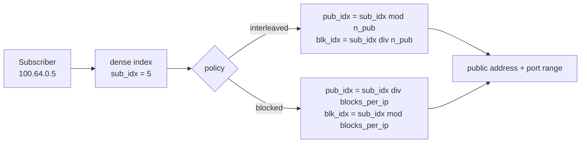
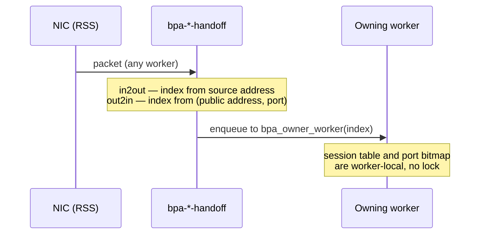

# HexaRouting — Architecture

## TL;DR

CGNAT that maps each subscriber to a **contiguous port block** on a public
address. In **deterministic** mode that mapping is a formula, so it needs no
allocation log and no shared state — which is also what lets both traffic
directions shard across workers without a lock. In **dynamic** mode blocks are
allocated on demand and every allocation is logged, trading log volume for
IPv4 savings.

The Python model in `ref/` is the specification; the C implementation is
checked against it on every build.

> The key words **MUST**, **MUST NOT**, **REQUIRED**, **SHALL**, **SHALL NOT**,
> **SHOULD**, **SHOULD NOT**, **RECOMMENDED**, **MAY**, and **OPTIONAL** in
> this document are to be interpreted as described in
> [RFC 2119](https://www.rfc-editor.org/rfc/rfc2119).

## 5W2H

| | |
|---|---|
| **What** | A VPP plugin translating RFC 6598 subscriber addresses to public addresses using per-subscriber port blocks. |
| **Why** | To make CGNAT auditable without per-flow logging, and to keep the return path free of shared lookup state. |
| **Who** | Written for ISP operators; the algorithm is auditable by whoever answers a court order. |
| **When** | Translation happens in the dataplane per packet; block assignment happens once per subscriber (deterministic) or per session burst (dynamic). |
| **Where** | On the `ip4-unicast` feature arc, after shallow virtual reassembly and before `ip4-lookup`. |
| **How** | Address sets are indexed densely; a reciprocal multiply replaces integer division on the datapath. |
| **How much** | 512-port block ⇒ 126 subscribers per public IP. 200k subscribers ⇒ a `/21` in deterministic mode. |

## Design decisions

| # | Decision | Choice | Rationale |
|---|----------|--------|-----------|
| D1 | Dataplane base | In-tree-style VPP plugin | Inherits FIB, ARP/ND, fragmentation, ICMP, tracing, API and BGP via `linux_cp` |
| D2 | BPA modes | Deterministic **and** dynamic, per pool | Deterministic gives zero logging; dynamic saves IPv4 |
| D3 | Default mapping policy | `interleaved` | Smaller blast radius when a public IP is blacklisted |
| D4 | Worker sharding | VPP handoff, keyed on subscriber index | Guarantees both directions land on the same worker |
| D5 | Pool addressing | Sets of non-contiguous prefixes | Real provider IPv4 is fragmented; a single aligned prefix would rule out most deployments |
| D6 | Control plane | FRR over `linux_cp`/`linux_nl` | Both plugins ship with VPP 26.06; FRR needs no modification |
| D7 | Configuration | Single VTY (`hexash`) | Operators expect `configure terminal` and `write memory` covering routing and CGNAT together |

## The mapping

A pool defines two **address sets** and a block size. Each set is a list of
possibly non-contiguous prefixes presented as a dense index space `[0, count)`.

Requirements:

* Prefixes within a set **MUST NOT** overlap. Overlap breaks the
  address↔index bijection, and a broken bijection means one subscriber is
  logged as another — a compliance failure, not merely a bug. Overlapping
  prefixes **MUST** be rejected at configuration time.
* Adjacent prefixes **SHOULD** be merged, which shortens the datapath search.
* `block_size` **MUST** be a power of two.
* Pool capacity **MUST NOT** exceed 2^28 subscribers, which bounds the
  reciprocal multiplication below 2^61 and keeps it inside `u64`.

### Why `interleaved` is the default

With `interleaved`, consecutive subscribers land on **different** public
addresses. If one public address is blacklisted, the damage spreads thinly
instead of taking down an entire neighbourhood behind one OLT.

### Division on the datapath

`outside.count` is arbitrary once pools accept fragmented prefixes, so the
split cannot rely on shifts alone. A reciprocal multiply is precomputed per
pool; when the divisor happens to be a power of two, a shift is used instead.
`ref/check_magic.py` proves the reciprocal exact for 1074 arbitrary divisors
up to 266 million, with the worst intermediate product at 61 bits.

## Sharding

Session state and the per-subscriber port bitmap are per-worker and lock-free.
That is only safe if **both directions of a subscriber reach the same worker**,
and NIC RSS gives no such guarantee: outbound hashes on the private address,
inbound on the public one.

* Both handoff nodes **MUST** compute the same owner for a given subscriber.
* The worker count **MAY** be any value; the same reciprocal used for the pool
  split removes the power-of-two requirement.
* With no workers configured, the CLI **MUST** install the translation node
  directly on the arc — a handoff would be a frame-queue round trip for
  nothing.

The out2in direction resolves the owner by arithmetic alone. This is why the
deterministic mapping matters beyond logging: without it the return path could
not find its owner without consulting a structure shared across workers, and
the lock this design avoids would come back through the side door.

## Dynamic mode (PBA)

Blocks are allocated on first flow and returned after a hold-down period.

Block allocation would be shared state across workers. Instead the block space
is **partitioned**: worker `w` allocates only blocks where
`block_idx mod n_workers == w`. Because a worker only ever hands a subscriber a
block from its own slice, the two handoff formulas agree — and in deterministic
mode `block_idx == sub_idx`, so one line of code serves both modes.

* Hold-down **MUST** be non-zero in production. Without it a subscriber who
  pauses for a second churns a release and an allocation, and **each of those
  is a log record**. Hold-down is the primary lever on log volume.
* Oversubscription is measured **per worker**, not globally. One slice **MAY**
  exhaust while another still has free blocks.

## Memory

| Structure | Sizing | Notes |
|---|---|---|
| Port bitmap | `block_size` bits per active subscriber | 64 bytes at 512 ports; ~13 MB for 200k |
| Session tables | Two bihash tables per worker | Default 16 MB each, configurable via `bpa session-table` |
| Block ownership (dynamic) | 4 bytes per block per worker slice | |

Session table size is a **virtual** reservation, but the OOM killer counts
virtual memory. The default is therefore modest: a deployment with 200k
subscribers **SHOULD** raise it, and a small box **MUST NOT** pay for capacity
it will never use.

## TCP and ICMP handling

Two gaps that produce subscriber complaints rather than ugly graphs:

**TCP state.** Marking a session established on any ACK and ignoring RST and
FIN makes a closed connection hold its port for the established timeout — two
hours. On a 512-port block that exhausts a subscriber quickly, and reaches
support as "the Internet stopped" with nothing obvious in the dataplane. The
implementation **MUST** release on RST and **MUST** leave the long timeout on
FIN.

**ICMP errors.** ICMP errors carry the original packet embedded, and it is the
embedded packet that identifies the session. Without translating it, PMTUD's
*fragmentation needed* never reaches the subscriber: the TCP connection hangs
and the symptom is "some sites do not load". Traceroute stops working too.

The ICMP checksum covers the whole embedded packet, so every change inside it —
**including the embedded IP header's own checksum** — **MUST** be reflected in
it. Translating with a wrong checksum is worse than not translating: the
subscriber's stack discards the packet, PMTUD stays broken, and the counter
claims success.

## Fragments

A non-first fragment carries no L4 header and therefore no port to match a
session. Without handling, it is dropped, and large DNS, VPN and gaming break
**intermittently** — the hardest symptom to diagnose.

VPP's shallow virtual reassembly caches the first fragment's ports and attaches
them to the following ones.

* The BPA nodes **MUST** declare `runs_after` on `ip4-sv-reassembly-feature`.
  Otherwise they may run first and read buffer fields that do not yet exist.
* The reassembly stores ports in **network byte order**. Read as host order,
  12345 (`0x3039`) becomes 14640 (`0x3930`), the node misses the session and
  opens another — **burning one port per fragment**. A subscriber that
  fragments heavily exhausts its block on its own.

That second one was found only because the test checked the *port* of the
translated fragment, not merely that a packet came out translated. It did come
out: with the right address and the wrong session.

## Project state

- [x] BPA reference model (`ref/bpa_model.py`, `ref/validate.py`)
- [x] C mapping core, checked against the model (`make test`)
- [x] Per-subscriber port allocator
- [x] Plugin loads in VPP 26.06 with pool CLI
- [x] Pools of non-contiguous prefixes
- [x] `in2out` / `out2in` nodes, verified by packet injection
- [x] Per-worker session table with configurable timeouts
- [x] Worker handoff, verified with two workers
- [x] Routing: BGP, OSPF and IS-IS reaching the VPP FIB
- [x] Pool validated against local addresses
- [x] Dynamic block allocator with hold-down and per-worker partitioning
- [x] Fragment handling via shallow virtual reassembly
- [x] TCP state and ICMP error translation
- [x] IPFIX export over UDP and TCP ([logging.md](logging.md))
- [x] Dated configuration trail
- [x] Single VTY (`hexash`) with completion and contextual help
- [x] Binary API with real return codes
- [x] Appliance: boot tuning, systemd units, installer, ISO ([appliance.md](appliance.md))
- [ ] **HA / failover** — analysed in [ha.md](ha.md), not implemented
- [ ] Migrate `hexash` from the CLI to the binary API

What is still missing, and why each item matters, is in
[roadmap.md](roadmap.md) — including the items that turn out to be already
satisfied by this design rather than needing to be built.
