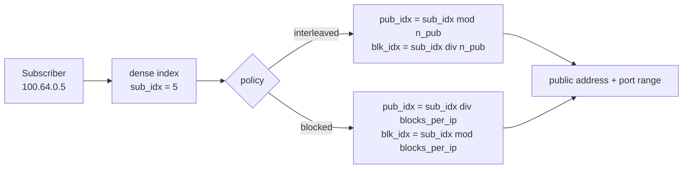
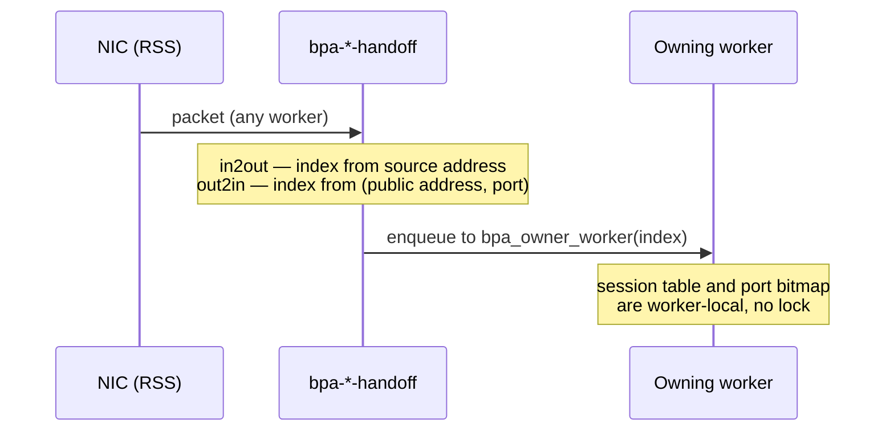
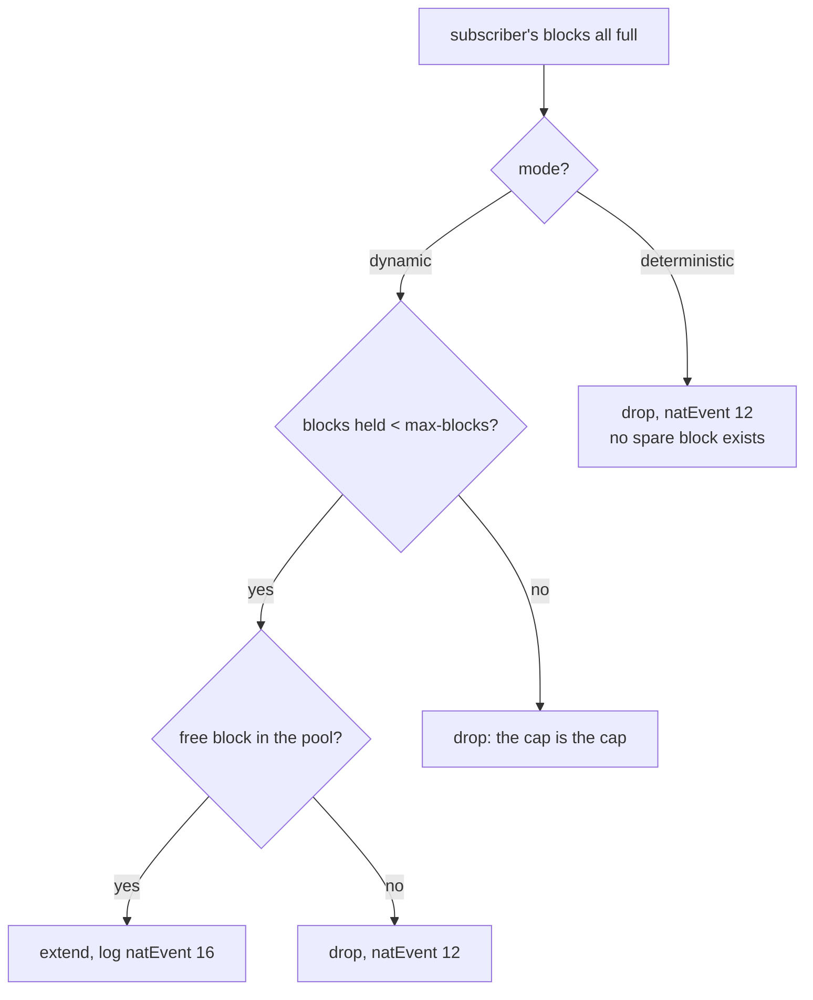
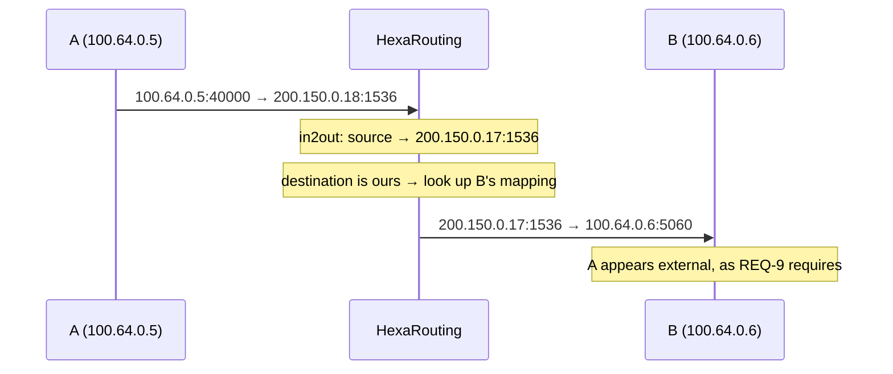

# HexaRouting — Architecture

## TL;DR

CGNAT that maps each subscriber to a **contiguous port block** on a public
address. In **deterministic** mode that mapping is a formula, so it needs no
allocation log and no shared state — which is also what lets both traffic
directions shard across workers without a lock. In **dynamic** mode blocks are
allocated on demand and every allocation is logged, trading log volume for
IPv4 savings.

The Python model in `ref/` is the specification; the C implementation is
checked against it on every build.

> The key words **MUST**, **MUST NOT**, **REQUIRED**, **SHALL**, **SHALL NOT**,
> **SHOULD**, **SHOULD NOT**, **RECOMMENDED**, **MAY**, and **OPTIONAL** in
> this document are to be interpreted as described in
> [RFC 2119](https://www.rfc-editor.org/rfc/rfc2119).

## 5W2H

| | |
|---|---|
| **What** | A VPP plugin translating RFC 6598 subscriber addresses to public addresses using per-subscriber port blocks. |
| **Why** | To make CGNAT auditable without per-flow logging, and to keep the return path free of shared lookup state. |
| **Who** | Written for ISP operators; the algorithm is auditable by whoever answers a court order. |
| **When** | Translation happens in the dataplane per packet; block assignment happens once per subscriber (deterministic) or per session burst (dynamic). |
| **Where** | On the `ip4-unicast` feature arc, after shallow virtual reassembly and before `ip4-lookup`. |
| **How** | Address sets are indexed densely; a reciprocal multiply replaces integer division on the datapath. |
| **How much** | 512-port block ⇒ 126 subscribers per public IP. 200k subscribers ⇒ a `/21` in deterministic mode. |

## Design decisions

| # | Decision | Choice | Rationale |
|---|----------|--------|-----------|
| D1 | Dataplane base | In-tree-style VPP plugin | Inherits FIB, ARP/ND, fragmentation, ICMP, tracing, API and BGP via `linux_cp` |
| D2 | BPA modes | Deterministic **and** dynamic, per pool | Deterministic gives zero logging; dynamic saves IPv4 |
| D3 | Default mapping policy | `interleaved` | Smaller blast radius when a public IP is blacklisted |
| D4 | Worker sharding | VPP handoff, keyed on subscriber index | Guarantees both directions land on the same worker |
| D5 | Pool addressing | Sets of non-contiguous prefixes | Real provider IPv4 is fragmented; a single aligned prefix would rule out most deployments |
| D6 | Control plane | FRR over `linux_cp`/`linux_nl` | Both plugins ship with VPP 26.06; FRR needs no modification |
| D7 | Configuration | Single VTY (`hexash`) | Operators expect `configure terminal` and `write memory` covering routing and CGNAT together |

## The mapping

A pool defines two **address sets** and a block size. Each set is a list of
possibly non-contiguous prefixes presented as a dense index space `[0, count)`.



Requirements:

* Prefixes within a set **MUST NOT** overlap. Overlap breaks the
  address↔index bijection, and a broken bijection means one subscriber is
  logged as another — a compliance failure, not merely a bug. Overlapping
  prefixes **MUST** be rejected at configuration time.
* Adjacent prefixes **SHOULD** be merged, which shortens the datapath search.
* `block_size` **MUST** be a power of two.
* Pool capacity **MUST NOT** exceed 2^28 subscribers, which bounds the
  reciprocal multiplication below 2^61 and keeps it inside `u64`.

### Why `interleaved` is the default

With `interleaved`, consecutive subscribers land on **different** public
addresses. If one public address is blacklisted, the damage spreads thinly
instead of taking down an entire neighbourhood behind one OLT.

### Division on the datapath

`outside.count` is arbitrary once pools accept fragmented prefixes, so the
split cannot rely on shifts alone. A reciprocal multiply is precomputed per
pool; when the divisor happens to be a power of two, a shift is used instead.
`ref/check_magic.py` proves the reciprocal exact for 1074 arbitrary divisors
up to 266 million, with the worst intermediate product at 61 bits.

## Sharding

Session state and the per-subscriber port bitmap are per-worker and lock-free.
That is only safe if **both directions of a subscriber reach the same worker**,
and NIC RSS gives no such guarantee: outbound hashes on the private address,
inbound on the public one.



* Both handoff nodes **MUST** compute the same owner for a given subscriber.
* The worker count **MAY** be any value; the same reciprocal used for the pool
  split removes the power-of-two requirement.
* With no workers configured, the CLI **MUST** install the translation node
  directly on the arc — a handoff would be a frame-queue round trip for
  nothing.

The out2in direction resolves the owner by arithmetic alone. This is why the
deterministic mapping matters beyond logging: without it the return path could
not find its owner without consulting a structure shared across workers, and
the lock this design avoids would come back through the side door.

## Dynamic mode (PBA)

Blocks are allocated on first flow and returned after a hold-down period.

Block allocation would be shared state across workers. Instead the block space
is **partitioned**: worker `w` allocates only blocks where
`block_idx mod n_workers == w`. Because a worker only ever hands a subscriber a
block from its own slice, the two handoff formulas agree — and in deterministic
mode `block_idx == sub_idx`, so one line of code serves both modes.

* Hold-down **MUST** be non-zero in production. Without it a subscriber who
  pauses for a second churns a release and an allocation, and **each of those
  is a log record**. Hold-down is the primary lever on log volume.
* Oversubscription is measured **per worker**, not globally. One slice **MAY**
  exhaust while another still has free blocks.

## Extended blocks

A subscriber that fills its block is dropped, and `natEvent 12` says so. That is
correct and terrible: one customer's internet stops while the box is healthy and
the neighbours are unaffected.

With `max-blocks` above 1, a subscriber whose blocks are all full is given
another. The cap matters as much as the extension: without one, an infected host
consumes the pool every other subscriber needs, and the operator has traded a
customer complaint for an outage.

Every extension **MUST** be logged as `natEvent 16`, and its release as
`natEvent 17`. An extension is not derivable from anything — not from the
formula, not from the first block — so a block the log does not record cannot be
attributed to anyone, which is the entire reason blocks are logged.

### Only in dynamic mode, and why

Dynamic pools have spare blocks by construction: `bpa_dyn_acquire()` draws from
a free list, so handing out a second block is the same operation as the first.

Deterministic pools have none. `capacity = outside.count * blocks_per_ip` and
`bpa_forward()` assigns **every** block to some subscriber. A block handed out
as an extension is a block the formula gives to somebody else, and giving it
away breaks their mapping with no error anywhere — the exact failure the
deterministic proof exists to prevent.

Making it work there needs a reserve held out of the formula, which reduces
capacity, which re-maps every existing subscriber. That is
[#39](https://github.com/andrediashexa/hexarouting/issues/39), and it depends on
the documented procedure for a capacity change
([#23](https://github.com/andrediashexa/hexarouting/issues/23)) — not something
to arrive as a side effect of a feature about something else.



### Releasing them

An extension is owned by the subscriber like any other block, but it does not
live in the allocator's `by_sub` map, which names the first one. It is tracked
in a separate list so that going idle marks **all** of a subscriber's blocks,
not just the first.

Missing that is a leak with no symptom until it matters: the extension stays
owned forever, is never reaped, and shows up only as a pool that slowly stops
having free blocks.

## Memory

| Structure | Sizing | Notes |
|---|---|---|
| Port bitmap | `block_size` bits per active subscriber | 64 bytes at 512 ports; ~13 MB for 200k |
| Session tables | Two bihash tables per worker | Default 16 MB each, configurable via `bpa session-table` |
| Block ownership (dynamic) | 4 bytes per block per worker slice | |

Session table size is a **virtual** reservation, but the OOM killer counts
virtual memory. The default is therefore modest: a deployment with 200k
subscribers **SHOULD** raise it, and a small box **MUST NOT** pay for capacity
it will never use.

## TCP and ICMP handling

Two gaps that produce subscriber complaints rather than ugly graphs:

**TCP state.** Marking a session established on any ACK and ignoring RST and
FIN makes a closed connection hold its port for the established timeout — two
hours. On a 512-port block that exhausts a subscriber quickly, and reaches
support as "the Internet stopped" with nothing obvious in the dataplane. The
implementation **MUST** release on RST and **MUST** leave the long timeout on
FIN.

**Half-open sessions.** A session that sent SYN and never established gets its
own lifetime, twenty seconds by default against the transitory timeout's four
minutes. A host scanning the internet produces one of these per probe; held for
the transitory timeout they exhaust the subscriber's own block, and the
complaint reaches support as "the internet stopped" from a dataplane that looks
healthy. The implementation **MUST** keep the two states apart.

**Port hold-down.** A released port **SHOULD NOT** be handed out again
immediately: a delayed segment from the connection that just ended can land on
the new one, which the subscriber sees as a connection reset nobody can
reproduce. Four seconds by default, and zero disables it entirely.

The obvious implementation — a release timestamp per port — costs 32x the
memory: the bitmap is 64 bytes for a 512-port block and timestamps would be
2 KB, some 400 MB across 200k subscribers, to solve something that lasts
seconds. Instead the released port goes on a per-worker queue whose cost is
proportional to session **churn**, which is what the hold-down window is
actually about. The queue is bounded, and on overflow ports are released early
and **counted**: withholding ports until the drain catches up would exhaust the
block, which is a worse failure than the collision being avoided.

**Timeouts are per pool.** The pool is the unit an operator sells, so it is the
unit of policy; a provider serving business and residential customers from one
box needs different lifetimes. Zero in any field means inherit the global, and
the running configuration emits only the overrides — emitting inherited values
would turn every global change into a diff against every pool.

**ICMP errors.** ICMP errors carry the original packet embedded, and it is the
embedded packet that identifies the session. Without translating it, PMTUD's
*fragmentation needed* never reaches the subscriber: the TCP connection hangs
and the symptom is "some sites do not load". Traceroute stops working too.

The ICMP checksum covers the whole embedded packet, so every change inside it —
**including the embedded IP header's own checksum** — **MUST** be reflected in
it. Translating with a wrong checksum is worse than not translating: the
subscriber's stack discards the packet, PMTUD stays broken, and the counter
claims success.

## Hairpinning

Two subscribers behind the same CGNAT reaching each other through a public
address (RFC 4787 REQ-9).

Without it the packet is translated correctly on the way out and then routed to
an address this box itself owns, with nothing to send it back in. The symptom is
specific and hard to attribute: a camera that answers from the street and not
from next door, a self-hosted service that works for everyone except the
neighbours, a game that hosts a match for everyone but the players on the same
ISP.



Both translations happen in one pass through `in2out`: the source on the way
out, and then the destination straight back in. The source is already A's
**public** address by then, which is what REQ-9 requires — B **MUST** see A as
external. Presenting A's private address would leak the inside topology and
break B's reply path, because B would answer to an address it cannot route to.

A packet aimed at one of our public addresses with **no** session on that port
is **dropped**, not forwarded. Forwarding it would put a packet addressed to
our own public range back on the wire, and it is counted separately from a
successful hairpin so the two are distinguishable.

## Filtering: who may reply

A mapping accepts inbound packets under one of two rules (RFC 4787 REQ-8), set
per pool with `bpa filter <pool> <mode>`:

| Mode | Who may reach an open mapping | Cost |
|---|---|---|
| `endpoint-independent` (default) | anyone | unsolicited traffic reaches the subscriber |
| `address-dependent` | only the remote the subscriber contacted | some peer-to-peer applications stop working |

The default is what this implementation has always done, and not by intent
expressed anywhere: the `out2in` key is `(public ip, public port, protocol)`
and carries no remote address, so any host may reach an open mapping. That is a
full-cone NAT. Which of the two an operator wants is their trade, not ours.

The check is **not** in the key, deliberately. Putting the remote address in
the lookup key would give one subscriber a different external port per
destination — endpoint-*dependent* mapping — and break exactly the peer-to-peer
applications this product exists to keep working. Filtering and mapping are
separate decisions and only the first changes here.

The session remembers **one** remote address, refreshed on every outbound
packet. A source port reused toward two remotes will therefore only accept
replies from the more recent one. That is an approximation, stated because a
reader deserves to know where it stops: tracking the set would mean per-remote
state on a datapath whose whole point is not having any, and the drops are
counted so an operator can see whether it ever bites.

Changing the mode **MUST NOT** drop sessions — `bpa filter` changes it in
place, because the point of offering the choice is that an operator can make it
on a box carrying traffic.

## Application-level gateways

Most of this datapath never looks past the L4 header. An ALG is the deliberate
exception: some protocols put an address or an identifier **inside the
payload** and then expect the peer to use it, and no amount of correct header
rewriting makes those work.

They are switched per pool, because the pool is the unit an operator sells: a
residential pool and a business pool are not the same customer and need not
want the same rewriting. Every one of them can be turned off on a running box,
because an ALG that misparses is worse than no ALG - it corrupts traffic that
would otherwise merely fail to connect, and the operator needs a way to prove
which of the two is happening.

### PPTP, and the Call ID problem

PPTP splits itself in two: a TCP control connection on port 1723, and the
payload in GRE packets. GRE has no ports. What tells one tunnel from another is
a 16-bit **Call ID** that each end picks for itself and announces over the
control connection.

That is exactly what a CGNAT cannot allow. Windows and most routers pick Call
IDs from the bottom of the range, so two subscribers behind one public address
both choosing `1` is not a corner case - it is the normal case. Without an ALG
the inbound GRE for the two tunnels is indistinguishable, and in fact worse:
the Call ID falls outside every port block, so the arithmetic pre-check rejects
it and **no** PPTP tunnel works at all, collision or not.

So the Call ID is rewritten the way a source port is rewritten, and allocated
**from the same port block**. That is not tidiness. It means the inbound
arithmetic pre-check, the worker handoff and the RFC 8158 log all handle a PPTP
call without knowing that PPTP exists.

```mermaid
sequenceDiagram
    participant S as Subscriber 100.64.0.5
    participant B as HexaRouting
    participant P as PPTP server
    S->>B: TCP 1723, Outgoing-Call-Request, Call ID 1
    Note over B: allocate 3585 from the subscriber's block
    B->>P: Outgoing-Call-Request, Call ID 3585
    P->>B: Outgoing-Call-Reply, Call ID 36865, Peer's Call ID 3585
    Note over B: learn 36865; now both directions are keyed
    B->>S: Outgoing-Call-Reply, Peer's Call ID 1
    S->>B: GRE, Call ID 36865
    B->>P: GRE, Call ID 36865 (unchanged: it is the server's)
    P->>B: GRE, Call ID 3585
    B->>S: GRE, Call ID 1
```

The rewrite never changes a length, so no TCP sequence number has to be
adjusted - which removes the hardest part of writing an ALG, and the part most
implementations get wrong.

### Two keys that are not each other's mirror

Inbound is ordinary. The packet carries the Call ID this box handed out, so
`(public address, Call ID)` finds the call, and the ordinary session key
already builds that.

Outbound is not. The packet carries the Call ID the **server** assigned, which
this box did not choose and cannot make unique: a subscriber with two PPTP
tunnels up - an ordinary home worker - can perfectly well meet two servers that
both picked the same value. So the outbound key carries the remote address in
the second key word.

That word was reserved for a VRF id, and GRE spends it. When VRF lands
([#26](https://github.com/andrediashexa/hexarouting/issues/26)) this key needs
a wider hash or a packed encoding. It is written down here rather than
discovered then.

A third key exists purely for the ALG, found by the subscriber's *own* Call ID,
so that a retransmitted call request maps to the Call ID already allocated
instead of burning a second one.

### Where it stops, deliberately

* **Plain GRE (RFC 2784) is not translated.** It has no per-flow identifier at
  all, so several subscribers behind one address cannot be told apart. It is
  dropped under its own counter, not under "truncated packet": the two are
  different problems and pointing at the wrong one costs an afternoon.
* **Incoming calls are not handled.** `Incoming-Call-Request` only appears when
  the subscriber is acting as a dial-in concentrator, which nothing behind a
  CGNAT can be - the call would have to reach it first, and there is no mapping
  until it does.
* **A control message split across TCP segments is counted, not parsed.**
  Reassembling would mean holding subscriber payload in the dataplane, and
  every PPTP implementation in use sends one small message per segment.
* **Fragmented GRE is dropped.** Shallow virtual reassembly recovers TCP and
  UDP ports from the first fragment; it does not parse GRE, and reading the
  fields it left behind would look up a key built from another protocol's data.
* **`Call-Disconnect-Notify` is read against the RFC.** RFC 2637 says its Call
  ID is the one the *server* assigned; deployed servers put the subscriber's
  there, and Linux's `nf_nat_pptp` has treated it as a peer Call ID for twenty
  years. Following the text would break against the servers that exist.

## Fragments

A non-first fragment carries no L4 header and therefore no port to match a
session. Without handling, it is dropped, and large DNS, VPN and gaming break
**intermittently** — the hardest symptom to diagnose.

VPP's shallow virtual reassembly caches the first fragment's ports and attaches
them to the following ones.

* The BPA nodes **MUST** declare `runs_after` on `ip4-sv-reassembly-feature`.
  Otherwise they may run first and read buffer fields that do not yet exist.
* The reassembly stores ports in **network byte order**. Read as host order,
  12345 (`0x3039`) becomes 14640 (`0x3930`), the node misses the session and
  opens another — **burning one port per fragment**. A subscriber that
  fragments heavily exhausts its block on its own.

That second one was found only because the test checked the *port* of the
translated fragment, not merely that a packet came out translated. It did come
out: with the right address and the wrong session.

## Project state

- [x] BPA reference model (`ref/bpa_model.py`, `ref/validate.py`)
- [x] C mapping core, checked against the model (`make test`)
- [x] Per-subscriber port allocator
- [x] Plugin loads in VPP 26.06 with pool CLI
- [x] Pools of non-contiguous prefixes
- [x] `in2out` / `out2in` nodes, verified by packet injection
- [x] Per-worker session table with configurable timeouts
- [x] Worker handoff, verified with two workers
- [x] Routing: BGP, OSPF and IS-IS reaching the VPP FIB
- [x] Pool validated against local addresses
- [x] Dynamic block allocator with hold-down and per-worker partitioning
- [x] Fragment handling via shallow virtual reassembly
- [x] TCP state and ICMP error translation
- [x] IPFIX export over UDP and TCP ([logging.md](logging.md))
- [x] Dated configuration trail
- [x] Single VTY (`hexash`) with completion and contextual help
- [x] Binary API with real return codes
- [x] Appliance: boot tuning, systemd units, installer, ISO ([appliance.md](appliance.md))
- [ ] **HA / failover** — analysed in [ha.md](ha.md), not implemented
- [ ] Migrate `hexash` from the CLI to the binary API

What is still missing, and why each item matters, is in
[roadmap.md](roadmap.md) — including the items that turn out to be already
satisfied by this design rather than needing to be built.
