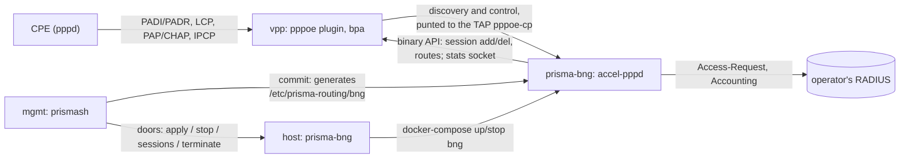

# Prisma Routing - BNG (PPPoE server and IPoE)

## TL;DR

**Phase 1 is being built** ([#597](https://github.com/andrediashexa/hexarouting/issues/597),
started 2026-10-12): PPPoE subscribers terminated on this box, authenticated
against RADIUS and translated by the CGNAT. Its first increment is in section
0 - the `prisma-bng` container (accel-ppp-ng driving VPP's pppoe plugin), the
`pppoe` hierarchy in the VTY with the container's configuration generated
from the candidate, PAP/CHAP/MS-CHAPv2 against RADIUS with accounting, IPv4
by IPCP from RADIUS or a pool, each session attached to a BPA pool,
`show pppoe sessions|summary`, `clear pppoe session`, and `lab/pppoe.sh`
proving it end to end. Section 0.4 is what remains of phase 1.

**Everything from "Where every number here comes from" down is
[#170](https://github.com/andrediashexa/hexarouting/issues/170)'s study, kept
exactly as it was measured** against VPP `26.06-release` in
`prisma-routing-dev:26.06` on 2026-09-14. Where phase 1 has since changed a
conclusion, section 0 says so; the record below is not edited to describe
the repair.

The finding that matters is not the one the issue's title predicts. **The
dataplane half works, today, and it is cheap.** `lab/bng.sh` terminates a real
PPPoE session with `accel-pppd` driving VPP's binary API, gives the subscriber
an address, and BPA translates it onto the block `ref/bpa_model.py` predicts,
on the captured packet, with a one-line delta to the control plane's source.
Building PPPoE termination is **not** where the money goes.

Where the money goes is that a BNG changes **what a subscriber is**. This
product's commercial argument is that in deterministic mode the configuration
**is** the log ([logging.md](logging.md)) and the standby needs **zero** state
([ha.md](ha.md)) — both of which hold only because the subscriber's inside
address is a **configured input**. A BNG hands that address out at session
time. Measured in the lab: three subscribers dialled together and were given
`.10`, `.11` and `.12` **in order of arrival**, not by identity. The instant
the inside address is assigned rather than configured, the configuration stops
being the log, and answering a court order **REQUIRES** a second retained
store joined against the BPA trail.

So the title's conclusion stands, and **two of the issue's stated reasons do
not**:

* The claim that `linux_cp` and the `pppoe` plugin are "mutually exclusive
  box-wide" and that an `accel-ppp`-on-`linux_cp` shape **MUST NOT** be
  attempted is **overstated**. Both plugins were loaded together for the whole
  lab. `lcp_ethertype_enable()` has exactly one caller in `linux-cp` — its own
  API handler — and it *refuses* an ethertype another node already owns.
  Nothing in this product calls it.
* The claim that `show route verbose` "becomes a standing false alarm" is
  **false**. Measured with 3 subscribers and again with 40,000: the command
  lists the session `/32`s and reports **no** fault. It becomes 40,010 lines
  of output, which is a different and smaller problem.

Three things the issue did not know, all measured here and all worse than what
it did claim:

* **Attaching CGNAT to a subscriber costs time proportional to how many
  subscribers are already on the box.** The issue marked this "not verified"
  and said it **MUST** be measured. It is now measured, and it is the hardest
  number in this document: `set interface bpa in2out` costs about **4.3 ms**
  per call on a box holding 5,000 session interfaces and about **8.3 ms** per
  call on one holding 10,000. Enabling it across 10,000 reconnecting
  subscribers took **83 seconds**. The cause is in **this repository**, not in
  VPP: `bpa_auto_mss_update()` walks every interface on the box on every
  attach, so N attaches cost O(N²). The same operation for a policer costs
  42 µs. That defect is worth its own issue and it is not a BNG question.
* **A shipped box aborts between 7,000 and 8,000 PPPoE sessions.** At the time
  this was measured `appliance/prisma-routing-tune` emitted no `statseg` stanza,
  so an installed appliance ran on VPP's default 32 MB stats segment
  (measured). Each session calls `vnet_register_interface`, each interface adds
  stats symlinks, and the stats heap runs out: `os_panic` → `SIGABRT`, the
  whole dataplane, not one subscriber. Reproduced twice at the same step. The
  tuner now sizes the segment from the interfaces a box's configuration makes
  it hold, per thread
  ([#597](https://github.com/andrediashexa/hexarouting/issues/597)), and a
  PPPoE session ceiling is one of them **once the BNG states it**:
  `Config.runtime_interfaces()` in `src/prismash/config.py` is where it goes,
  and until then a session is in no number the tuner reads.
* **Per-subscriber speed, which is what a BNG is sold on, does not exist in
  VPP 26.06.** There is a policer and there is no shaper: `configure policer`
  is the entire rate-control surface, `vppctl help` matches nothing for
  `shap`, and `hqos` appears zero times in `dpdk_plugin.so`.

> The key words **MUST**, **MUST NOT**, **SHOULD**, **SHOULD NOT** and **MAY**
> in this document are to be interpreted as described in
> [RFC 2119](https://www.rfc-editor.org/rfc/rfc2119).

## 5W2H

| | |
|---|---|
| **What** | Terminating subscribers on this box: PPPoE server, or IPoE with DHCP. |
| **Why** | The question was asked, and it **MUST** be answered on evidence rather than on impression. It is not asked again cheaply. |
| **Who** | The provider who today buys a BNG from one vendor and this box from another. |
| **When** | Phase 1 started 2026-10-12 ([#597](https://github.com/andrediashexa/hexarouting/issues/597)); its first increment ships in 0.154.0 (section 0.5). Section 5 is the list #170 asked to be answered first. |
| **Where** | The access side, where the subscriber's inside address comes from. |
| **How** | `accel-ppp-ng` on the `pppoe` plugin's control-plane interface, in a container of its own (`prisma-bng`), configured from the VTY's candidate (section 0). |
| **How much** | The termination is days. What it obliges is a second product: see section 4. |

## 0. Phase 1, as built (#597)

### 0.1 The shape



| Piece | Where | What it does |
|---|---|---|
| `prisma-bng` image | `build/Dockerfile.bng` | The dataplane image plus accel-ppp-ng, built at its pin by `build/accel-ppp-build.sh` with `build/accel-ppp-ng.patch`. 215 MB against the dataplane's 205 (measured 2026-10-12): the upgrade artifact carries about 10 MB more. |
| `bng` service | `appliance/compose.yaml` | `network_mode: host` (the TAP and RADIUS), `/run/vpp` (the API and stats sockets, as `mgmt` has them), the generated configuration read-only. A **profile**, so `up` never starts it: docker-compose 1.29.2 (the medium's) leaves a profiled service out of `up`, starts it when named, and removes it on `down` - measured. Limits: 512 MB, 512 processes, `oom_score_adj` +500 (the dataplane is -1000), `restart: unless-stopped`. |
| host lifecycle | `appliance/prisma-bng` | `apply` (start, or recreate on new files), `stop`, `boot` (from `prisma-routing-containers.service`, only when configured), `status`, `sessions`, `summary`, `terminate`. The only thing that runs docker-compose for the service, so a VTY upgrade (which recreates `mgmt`) touches no session. |
| plumbing | `appliance/prisma-bng-entrypoint` | Waits for VPP, makes `tap1863` (`pppoe-cp` in Linux) with the access card's MAC, one Linux VLAN device per tag, `create pppoe cp`; deletes sessions a dead control plane left; runs accel-pppd; ends the container when accel-pppd dies or VPP loses the TAP, so the restart policy lays it again. |
| per session | `appliance/prisma-bng-session` | accel-ppp's ip-up: the existing CGNAT attach (`set interface bpa in2out`), the PPPoE MTU, the MSS clamp. Idempotent (0.3). |
| configuration | `src/prismash/pppoe.py` | The `pppoe` hierarchy's grammar, one rule for the prompt and the saved file; `accel-ppp.conf`, `chap-secrets` and `access.env` generated at commit into `/etc/prisma-routing/bng` (0660, the configuring group's, as `prisma-routing.conf`); the model read back from `/etc/prisma-routing/pppoe.conf`. |

**How the configuration flows.** An operator types the `pppoe` block in the
candidate; `commit` (and `rollback`, `commit confirmed`, the audit trail -
it is one more statement of the configuration) checks it, generates the
container's files from it, and asks the host through its doors to apply them.
`show running-config` reads the model back from `pppoe.conf`, never from the
generated files, and nobody edits those: the next commit rewrites them.

```
prisma# [edit] pppoe
prisma# [edit pppoe] interface ens19
prisma# [edit pppoe] gateway 100.64.0.1
prisma# [edit pppoe] address-pool 100.64.0.10-100.64.0.200
prisma# [edit pppoe] radius server 192.0.2.10 secret <secret>
prisma# [edit pppoe] exit
prisma# [edit] commit
```

**Secrets.** A RADIUS shared secret and a lab user's password are held like
SNMP's community: in the saved configuration and in `pppoe.conf` (0660, group prisma-cgnat, as `prisma-routing.conf`)
so that rollback can restore them, and blanked on every screen -
`show running-config`, `show configuration`, `show configuration compare`
(per diff line, so a changed secret is a `-` and a `+` line with neither
value). The typed API does not carry the block at all in this increment.

**A session is not configuration.** The plugin makes `pppoe_session<n>` per
subscriber and the hook attaches the CGNAT to it; read back as configuration
they would be saved, refused at the next boot and detached by the next
commit. `Config.drop_pppoe_sessions()` takes them, their CGNAT attachments and
the control-plane TAP out of every reading of the running configuration.

### 0.2 What works end to end

`lab/pppoe.sh` (run 2026-10-12): real CPEs (pppd with rp-pppoe, one netns
each, one on VLAN 100), a real freeradius with accounting, accel-ppp-ng built
by the image's recipe, everything configured through the VTY. It asserts PAP,
CHAP and MS-CHAPv2 sessions against RADIUS, a wrong password refused
(Access-Reject, no session), the address from Framed-IP-Address for one CPE
and from the pool for the others, the DNS servers at the CPE, the subscriber's
traffic on the block `ref/bpa_model.py` predicts on the captured packet and
its reply back through the session, the MSS clamp on the session, accounting
Start / Interim-Update (with the session's real bytes) / Stop at RADIUS, the
secret absent from `show running-config`, `clear pppoe session` ending one
session and the CPE redialling, a container restart (by a commit, and by
killing accel-pppd) dropping every session and all of them redialling while a
subscriber NOT on PPPoE forwards throughout, and `no pppoe` stopping the
container with the dataplane surviving the PADIs that keep arriving.
`lab/pppoe.sh off` commits no `pppoe` block and goes red.

What the lab plays rather than runs: docker. The lab is a container and
cannot start the image, so `lab/pppoe-shim` runs the entrypoint under a loop
that restarts it as `unless-stopped` does. `tools/build-images.sh check`
starts the image (every configured module present and linked), and
`compose-check` creates the service from the shipped `compose.yaml` and reads
its limits back from the engine.

### 0.3 What was found building it, measured

1. **Interim accounting ended every session.** accel-ppp reads a session's
   counters from its kernel interface; a VPP session has none, the read
   failed, and the interim update terminated the session as Lost-Carrier ten
   seconds after it came up (`acct-interim-interval=10`). The patch gives the
   VPP hooks a `read_stats` that reads the session interface's counters from
   VPP's stats segment (`/run/vpp/stats.sock`); accounting now carries the
   session's real octets.
2. **accel-ppp-ng's newest commit crashed at the first session that ended.**
   The pin moved from #170's `cb69ccc` to `dd07b23` (2026-10-07) for its
   RADIUS hardening (Message-Authenticator in Access requests and responses,
   the BlastRADIUS mitigation) and its PADI truncation fix. Its port of
   upstream PR 334 closes the PPP unit fd after cleanup - and for a VPP
   session that fd is the channel's own, so `destroy_ppp_channel()` then hit
   a closed descriptor and accel-pppd died on `md:epoll_ctl: Bad file
   descriptor`. The patch skips the close for a VPP session.
3. **The CGNAT attach is not idempotent, and the plugin recycles its
   interfaces.** A session's interface is hidden, not deleted, when the
   session ends, keeps its features, and is handed to the next session;
   `vnet_feature_enable_disable` adds a feature as often as it is asked.
   Measured: ten `bpa-in2out` stacked on one interface, the second
   translating the first's output and dropping it as "no pool for source
   address". The session hook asks the interface's features first. Whether
   the attach itself should refuse a second enable is a question for
   [#597](https://github.com/andrediashexa/hexarouting/issues/597)'s other
   branch, which is making the attach O(1).
4. **Taking the plugin's control plane away crashes the dataplane.** `create
   pppoe cp ... del` sets the cp to `~0` and the plugin goes on punting every
   PADI to it: VPP 26.06 dies in `vnet_per_buffer_interface_output` (SIGSEGV)
   at the next discovery frame. Deleting the TAP the cp names is the same
   crash. So the TAP and the cp outlive the container; with nothing reading the
   TAP the kernel drops what is punted to it. Before any cp is set the plugin
   punts to index 0, `local0`, and drops - which is why a box with no PPPoE is
   safe today although the plugin loads on every box.
5. **RADIUS's Framed-IP-Address needs `gw-ip-address` in accel-ppp's `[radius]`
   section**, not only in `[ip-pool]`; without it accel-ppp logs "gw-ip-address
   not specified" and takes the address from the pool instead. The generated
   file sets both from `gateway`.
6. **One card per box, as #170 found for one CP interface.** The plugin has
   one control-plane interface and answers from the card the CPE came in on;
   the TAP carries that card's MAC. The VTY refuses access interfaces on two
   cards at commit; any number of VLANs of one card works (one tag each).
7. **PPPoE discovery is punted from every interface**, not only the access
   ones: `pppoe_init()` registers the ethertypes box-wide (1.5). A CPE on the
   upstream side would be answered. Not exercised in the lab; a later step
   (0.4) MUST restrict it.

### 0.4 What remains of phase 1

In the order they are planned, each its own step on #597:

1. **RADIUS accounting retained and joined to the BPA trail** - section 3.1's
   obligation: an append-only, fsynced, hash-chained store of who held which
   inside address when, so a public address and port still name a subscriber.
   The dataplane already reads RADIUS accounting for identity (`cgnat identity
   radius`, #21); accel-ppp can copy its accounting there.
2. **The typed API** for the `pppoe` block and the sessions (a proto change,
   with `lab/api-grpc.sh`).
3. **SNMP counters** (sessions active/starting, authentications refused,
   RADIUS reachability) and **`show log` events** for the container's starts,
   exits and restarts.
4. **Discovery restricted to the access interfaces** (0.3 item 7), and the
   same MAC on two access ports (4, item 8).
5. **The stats segment sized for the configured `session-limit`** (2.1), and
   the multi-worker attach cost measured once #597's other branch lands.
6. A configuration change without a restart of every session (accel-ppp's
   `reload` for what it can reload).

**Out of phase 1**, each a later issue: IPv6 (IPv6CP, DHCPv6-PD), per-
subscriber shaping (VPP has no shaper, 2.2), CoA/DM, QinQ (the plugin parses
one tag), IPoE (VPP has no DHCP server, 1.4), lawful intercept, HA of
sessions (3.3).

### 0.5 Release

**A Y release (0.154.0)**, and not a patch, for two reasons either of which is
enough: `appliance/install.sh` installs a new host script and
`tools/release-gate.sh` refuses a patch that changes it (the artifact runs it,
but the gate's rule admits no "part of this file"); and CONTRIBUTING.md's
table puts a feature issue at `0.MINOR.0`. The upgrade artifact CAN carry
everything else: it carries `prisma-routing-images.tar.gz` (now five images,
`prisma-bng` added by `tools/build-images.sh save`) and `compose.yaml`, and an
upgrade adds the service - `up` creates what the new file names and leaves the
profiled `bng` out until PPPoE is configured.

## Where every number here comes from

| | |
|---|---|
| Image | `prisma-routing-dev:26.06` |
| Dataplane | `vpp v26.06-release built by root on e43f10b19765 at 2026-06-24T09:27:28` |
| Packages | `vpp`, `vpp-dev`, `vpp-plugin-core`, `vpp-plugin-dpdk`, all `26.06-release` |
| Plugin source | `FDio/vpp`, branch `stable/2606`, `src/plugins/pppoe` and `src/plugins/linux-cp` |
| End-to-end evidence | `lab/bng.sh`, run 2026-09-14, 13 of 13 assertions green |
| Scale figures | driven by hand against the same image on 2026-09-14; the commands are quoted where the numbers are |

Every timing figure in this document was taken on a build machine that was
running the release lab suite at the same time. **Read each one as a ceiling,**
the way [ha.md](ha.md) and `lab/pool-del.sh` read the same kind of number.

## 1. What VPP 26.06 actually gives

### 1.1 The PPPoE plugin is the data-plane half, and that half is complete

`pppoe_plugin.so` and `ppp_plugin.so` both ship in `vpp-plugin-core`, and
`prisma-routing-tune` generates `plugin default { enable }`, so both already load
on every installed box.

The whole of `pppoe_plugin.so`, from `nm -D --defined-only`:

```
pppoe_cp_dispatch_node_fn_x86_64_v3   pppoe_cp_dispatch_node_fn_x86_64_v4
pppoe_input_node_fn_x86_64_v3         pppoe_input_node_fn_x86_64_v4
vlib_plugin_registration
```

Two nodes. `pppoe-input` decapsulates PPP-IPv4/IPv6 into `ip4-input`/`ip6-input`;
`pppoe-cp-dispatch` punts everything else to a control-plane interface and
learns client-MAC → access-interface on the way.

The whole of `ppp_plugin.so` is `ppp_register_input_protocol`. It is a header
parser, not a PPP stack.

The whole API is three requests:

| Request | Payload |
|---|---|
| `pppoe_add_del_session` | `is_add`, `session_id`, `client_ip`, `decap_vrf_id`, `client_mac` |
| `pppoe_session_dump` | — |
| `pppoe_add_del_cp` | `sw_if_index`, `is_add` |

`strings pppoe_plugin.so` matches **zero** occurrences of `PADI`, `PADO`,
`PADR`, `PADS`, `PADT`, `LCP`, `IPCP`, `IPv6CP`, `PAP`, `CHAP`, `RADIUS`,
`discovery` or `negotiat`. Across all 94 plugin objects in the image, `radius`
appears in exactly one file, `quic_quicly_plugin.so`, which has nothing to do
with AAA.

### 1.2 What state it keeps, and the limits that follow

Read from `stable/2606` source, not inferred:

| State | Where | What follows |
|---|---|---|
| **link table**: client MAC → access interface | `pppoe_cp_node.c:151`, `pppoe_lookup_1 (&pem->link_table, …, h0->src_address, 0, …)` | The session-id argument is hard-coded `0`, so the key is **the client MAC alone**. No access-interface dimension. |
| **session table**: (client MAC, session id) → session | `pppoe_node.c:151,248,376` | Again no access-interface dimension. |
| Both tables | `pppoe.h:93-94`, `PPPOE_NUM_BUCKETS (64*1024)`, `PPPOE_MEMORY_SIZE (8<<20)` | Fixed at compile time. There is no `startup.conf` knob for either. |
| One `vnet_register_interface` per session | `pppoe.c:383` | One VPP hardware and software interface, named `pppoe_sessionN`, per subscriber. Section 2.1 is the bill for that. |
| A `client_ip/32` FIB entry per session | `pppoe.c:292-295` | Installed straight into the VPP FIB. The kernel never hears of it, measured. |

Two consequences are read from the source and are **not** driven here:

* Because both keys are MAC-based with no port dimension, **two subscribers
  with the same MAC on different access ports collide**. Not measured — the
  lab puts every subscriber on one access port.
* `pppoe_node.c` parses **one** VLAN tag (`if (type0 == ETHERNET_TYPE_VLAN)`,
  once, no loop). **QinQ is not parsed**, which is how much of this market
  builds its access network. Not measured.

### 1.3 A session cannot be created for a subscriber the box has not heard

`vnet_pppoe_add_del_session` looks the client MAC up in the link table and
returns `VNET_API_ERROR_INVALID_SW_IF_INDEX` when it is not there
(`pppoe.c:305-311`). Measured: 1,000 `create pppoe session` commands for MACs
that had sent no discovery frame created **zero** sessions. The link table is
populated only by `pppoe-cp-dispatch`, from real discovery traffic.

This is a good property and it is worth naming: the dataplane will not invent a
subscriber. It also means the plugin is unusable without a control plane that
speaks discovery.

### 1.4 IPoE is worse than PPPoE, not easier

`dhcp.api.json` carries 31 messages and **every one of them is client, proxy or
DHCPv6 client/PD**. The CLI surface is `set dhcp client`, `set dhcp proxy`,
`set dhcpv6 proxy`, `set dhcp option-82 vss`. **There is no DHCP server in VPP
26.06.** For IPoE that is the whole of address assignment, missing.

### 1.5 `linux_cp` and the ethertypes: the collision is real and it is polite

`pppoe_init()` calls `ethernet_register_input_type` for
`ETHERNET_TYPE_PPPOE_SESSION` and `ETHERNET_TYPE_PPPOE_DISCOVERY`
unconditionally at plugin init (`pppoe.c:739,742`). `lcp_ethertype_enable()`
(`lcp_interface.c:1231`) has **exactly one caller in the entire plugin** — the
API handler at `lcp_api.c:310` — and its body refuses:

```c
if (eti->node_index != ~0 && eti->node_index != node->index)
  return VNET_API_ERROR_INVALID_REGISTRATION;
```

So the two cannot both own an ethertype, the `pppoe` plugin wins because it
registers at init, and `linux_cp` returns an error instead of stealing it.
`linux_cp`'s punt-cross-connect is **opt-in over the API** and nothing in this
repository asks for it. `lab/bng.sh` loads both plugins together for its whole
run, deliberately, and every step works.

This matters beyond the BNG question: it is the same mechanism
[#168](https://github.com/andrediashexa/hexarouting/issues/168) needed for
IS-IS, and the answer is that the two uses do not fight unless an operator
makes them.

## 2. What is missing for a real deployment

| Need | Status | Evidence |
|---|---|---|
| PPPoE discovery, LCP, PAP/CHAP, IPCP/IPv6CP | **absent from VPP; available from `accel-ppp`** | Zero protocol strings in the plugin (1.1). `lab/bng.sh` shows `accel-pppd` doing all of it against the plugin's CP interface. |
| RADIUS authentication | **absent from VPP; present in `accel-ppp`, not driven here** | No `radius` in any relevant plugin. `accel-ppp-ng` was built with `-DRADIUS=TRUE`; the lab authenticates from `chap-secrets` and **no RADIUS server was driven**. Not measured. |
| RADIUS accounting, CoA/DM | **absent from VPP; not measured at all** | Same. This is the half that the compliance argument in section 3 turns on, and it is the half nobody has run. |
| Address assignment | **absent from VPP** | No DHCP server (1.4). In the lab it is `accel-ppp`'s `ippool`, and it is **not identity-stable**: `sub3` got `100.64.0.10`, `sub1` got `.11`, `sub2` got `.12`, in arrival order. |
| Subscriber session state at scale | **present, and it breaks the box** | Section 2.1. |
| Per-subscriber QoS / shaping | **absent** | Section 2.2. |
| Lawful intercept | **absent** | No plugin in the image implements it (94 plugins; `flowprobe` and `l2tp` are the closest names and neither is LI). Nothing in this repository does either. |
| Logging obligations | **changed, not merely missing** | Section 3. |
| HA | **absent, and a BNG removes the thing that made it cheap** | Section 3.3. |

### 2.1 Subscriber session state at scale: measured

Driving `pppoe_add_del_session` by hand, one synthetic discovery frame per
subscriber to populate the link table first. This measures the **dataplane
half only** and proves nothing about a BNG; `lab/bng.sh` is the end-to-end
evidence.

**On the stats segment a shipped box actually gets:**

```
after 1000: 1000 live, RSS 377056 kB
after 2000: 2000 live, RSS 385568 kB
…
after 7000: 7000 live, RSS 429916 kB
VPP DIED while creating sessions 7000..8000
os_panic() called, aborting.
vpp[21]: received signal SIGABRT
  #3 os_panic
  #4 clib_mem_heap_realloc_aligned
  #5 _vec_realloc_internal
  #6 vlib_stats_create_counter
  #7 vlib_stats_add_symlink
  #8 vnet_hw_if_update_runtime_data
  #9 vnet_register_interface
```

`appliance/prisma-routing-tune` emitted no `statseg` stanza when this was
measured. It now writes one for the interfaces a box's configuration makes it
hold - the ones it names, the Linux end of each linux_cp pair, and whatever
`Config.runtime_interfaces()` says the box may create while it runs, which is
where a session ceiling belongs ([appliance.md](appliance.md), "The
statistics segment"). The default, measured from a VPP booted on a config
with none, is `total: 32.00M`. Every
`vnet_register_interface` adds per-interface counter symlinks to that heap, and
at somewhere between 7,000 and 8,000 subscriber interfaces it is exhausted and
**the dataplane aborts**. Reproduced twice, at the same step.

**With `statseg { size 1G }`:**

| Sessions | RSS | Stats segment used |
|---|---|---|
| 0 | 293 MB | 4.2 MB |
| 10,000 | 455 MB | 33.5 MB |
| 20,000 | 574 MB | 73.9 MB |
| 40,000 | 689 MB | 114.7 MB |

40,000 sessions created in 3,100 ms once the link table is warm, about 78 µs
each, roughly 10 kB of main heap per subscriber. The 40,000 ceiling is where
the measurement stopped, **not** a limit that was found.

> [#597](https://github.com/andrediashexa/hexarouting/issues/597) measured the
> abort again, by interface kind and thread count, with `lab/statseg-scale.sh`.
> The 7,000 above is a single-threaded box: on the same 32 MB, sub-interfaces
> survived 7,800 on one thread, 5,100 on three and 3,300 on eight, and a box
> the tuner gives workers is a box with more than one thread. The tuner now
> sizes the segment at 3 × (2,448 + 200 × threads) bytes an interface, and
> segments it sized for 10,000 and 50,000 held them on one and three threads
> ([appliance.md](appliance.md), "The statistics segment"). For a BNG the
> number to size for is the session ceiling, which the BNG states through
> `Config.runtime_interfaces()`.

**What it does to the product's own commands**, at 40,000 subscribers:

| Command | Time | Lines |
|---|---|---|
| `show route verbose` (prismash) | 2,089 ms | 40,010 |
| `show interfaces` (prismash) | 1,151 ms | 40,007 |
| `vppctl show interface` | 308 ms | 40,012 |

`show route verbose` still ends with *"every route FRR holds is in the
forwarding table"*. It does **not** raise the subscriber `/32`s as faults. The
alarm is one-way — it reports what FRR holds and the FIB does not — so the
issue's "standing false alarm" does not happen. What happens instead is that
every one of this box's read commands returns forty thousand lines to an
operator who typed it to read it.

### 2.2 Per-subscriber QoS: there is a policer and there is no shaper

The entire rate-control surface of VPP 26.06 is six commands:

```
policer add name <name> [type 1r2c | 1r3c | 2r3c-2698 | 2r3c-4115] [color-aware]
  [cir <cir>] [cb <cb>] [eir <eir>] [eb <eb>] [rate kbps | pps]
  [conform-action drop | transmit | mark-and-transmit <dscp>] [exceed-action …]
policer del | policer reset | policer bind <worker>
policer input  [unapply] [name <name> | index <index>] <interface>
policer output [unapply] [name <name> | index <index>] <interface>
```

Per subscriber that is one `policer add` plus a `policer input` and a `policer
output` on the subscriber's own interface, which is two more per-interface
feature operations on top of the one section 3.4 measures.

`vppctl help` matches nothing for `shap`. `strings dpdk_plugin.so | grep -ci
hqos` returns `0`. A policer meters and drops or marks; it does not queue, and
nothing in the image does. What a BNG sells is "50 Mbps", and a token bucket
that drops on exceed is not the same product as a shaper that queues. **The
subscriber-visible consequence of enforcing a plan by drop rather than by
queue is not measured here.**

## 3. What it does to what this product already is

### 3.1 The deterministic proof

[logging.md](logging.md) states the argument this product is sold on:

> In deterministic mode the configuration **is** the log.

That is true because the subscriber's inside address is a **configured input**:
`inside 100.64.0.0+1024` in a pool definition, plus the formula, plus the
configuration trail that says which formula was in force on the date in the
court order. Nothing about a subscriber is created at runtime, which is why
deterministic mode exports **zero** per-flow records.

A BNG breaks that at the root. The inside address becomes an output of a
session, handed out when the subscriber dials. Measured: arrival order, not
identity. `100.64.0.11` was `sub1` in that run; in the next run it is whoever
dials second.

The consequence is exact, and it is not a degradation of the proof but a
replacement of it. Answering *"who held 200.150.0.19:2048 at 02:51"* would
**REQUIRE**, in order:

1. the BPA formula and the pool configuration in force at that instant — which
   this box has, and which is the current answer;
2. **plus** a record saying which subscriber held `100.64.0.11` at `02:51` —
   which this box does not have and which VPP cannot produce.

Record (2) is RADIUS accounting. Everything [logging.md](logging.md) requires
of the BPA trail then applies to it: it **MUST** be append-only, `fsync`ed,
hash-chained and attributable, because a chain of custody is only as strong as
its weakest retained link. Today that store belongs to the operator's RADIUS,
which this product does not run, does not retain and cannot vouch for.

This is the same question
[#21](https://github.com/andrediashexa/hexarouting/issues/21) turns on —
subscriber identity in the log — approached from the wrong end. #21 **reads**
an identity the operator's existing BNG already established. A BNG here would
**create** the identity, and with it the obligation to retain the proof of it.

### 3.2 One genuine win, and it is real

With a per-subscriber `/32` out of a per-subscriber interface, `urpf strict`
finally catches one subscriber spoofing its neighbour — the case
[architecture.md](architecture.md) documents as uncatchable on a shared inside
VLAN, and the limit `lab/urpf.sh` asserts rather than describes. This is not
hypothetical: the lab's FIB shows `100.64.0.11/32 → pppoe_session1 (p2p)`, one
route, one interface, one subscriber. **Not measured**: `urpf strict` was not
enabled on a session interface in any run.

### 3.3 High availability

[ha.md](ha.md) says the standby needs **zero** state, because the mapping is a
function of the configuration. That is the product's best HA argument and a
BNG deletes it. After a failover the subscriber redials, the new active box's
address pool hands out by its own arrival order, and the subscriber gets a
**different inside address** — so a different BPA block, so a different public
address. The promise "your public IP does not change" would then require either
replicating the address pool's assignment state, or pinning every address to an
identity in RADIUS (`Framed-IP-Address`) so that the pool is not the authority.
The second is the sane one, and it means the ISP's RADIUS becomes load-bearing
for this box's evidentiary and HA behaviour. **Not measured**: no failover of a
PPPoE session was performed.

### 3.4 The control plane's model of the world

`prismash` is a candidate/commit/rollback/audit VTY over configuration text.
`cgnat interface TenGigabitEthernet0/8/0` is a line somebody committed, and
[logging.md](logging.md) requires that attaching it be recorded with who did
it. `pppoe_session4711` is none of those things: it appears at three in the
morning because a CPE rebooted and it is gone twenty minutes later.

Measured, and this is the missing product step the whole question hangs on:
**nothing in this repository enables a feature on an interface that appears at
runtime.** `grep -rin "pppoe\|bng\|radius" src/prismash/` returns two source
*comments* referring to `lab/bng.sh` and no grammar at all. In `lab/bng.sh`
the one thing the lab does by hand is `set interface bpa in2out` on the session
interface, precisely because no product code does it.

What that step costs, measured at 10 subscribers on two workers with the
worker barrier traced (`lab/bng.sh` section 10):

| Who took the barrier | Acquisitions | Total | Worst |
|---|---|---|---|
| `accel-ppp`'s own API calls, bringing 10 sessions up | 20 | 2,508 µs | 1,250 µs |
| `set interface bpa in2out`, same 10 sessions | 21 | 9,330 µs | 2,086 µs |

About **1,183 µs of stopped forwarding per subscriber**, end to end, and no
single acquisition came near VPP's 1-second barrier timeout.

That number is a floor, and the issue was right to mark it "not verified" and
to say it **MUST** be measured. Measured at scale it is much worse, and the
shape of it is the finding. Ten sessions says nothing; five and ten thousand
say this, on a single-threaded VPP where no barrier waiting is involved at all
and the time is the work itself:

| Box holds | `set interface bpa in2out` per call |
|---|---|
| 5,000 session interfaces | ~4,300 µs, flat across all ten 500-interface batches |
| 10,000 session interfaces | ~8,300 µs |

The per-call cost tracks the **total number of interfaces on the box**, not the
number that already carry the feature: at 5,000 interfaces the tenth batch cost
4,278 µs and the first cost 4,231 µs, and the whole sweep reproduced within
10% on a second run. Doubling the interface count roughly
doubled the per-call cost. Attaching CGNAT to 10,000 reconnecting subscribers
therefore took **83 seconds** of main-thread work, and the total is quadratic
in the subscriber count rather than linear.

Three controls on the same box say where the time goes:

| Same 5,000-interface box | Per call |
|---|---|
| `set interface mtu` | 32 µs |
| `policer add`, creating the policer itself | 22 µs |
| `policer input name … pppoe_sessionN`, which is also a `vnet_feature_enable_disable` on the same `ip4-unicast` arc | 42 to 48 µs |
| `set interface bpa in2out` | ~4,300 µs |

**So it is not VPP's feature machinery, and it is not the machine. It is this
repository's own attach path.** `bpa_interface_feature_enable_disable`
(`src/plugins/bpa/bpa.c`) calls `bpa_auto_mss_update()`, which walks
`pool_foreach (si, vnm->interface_main.sw_interfaces)` and asks
`vnet_feature_is_enabled` four times **for every interface on the box**, to
recompute the minimum that `tcp-mss auto` is defined as. Attaching N interfaces
is therefore O(N²), which is exactly what the two measurements show. Fitting
the two points gives roughly 0.3 ms of fixed cost per attach plus 0.8 µs per
interface already present.

That is a defect and not a property of PPPoE. It is invisible today because
CGNAT is attached to a handful of interfaces that an operator typed, and it
**SHOULD** be raised on its own issue rather than inside a BNG decision: it is
worth fixing whether or not a BNG is ever built, and a BNG **MUST NOT** be the
justification offered for fixing it.

> It was raised as
> [#287](https://github.com/andrediashexa/hexarouting/issues/287) and fixed
> there. The walk is gone from the attach path: the minimum is carried across
> changes, so an attach costs one interface's worth of work regardless of how
> many the box holds. **The measurements above are left exactly as they were
> taken** - they are what the defect cost, and a record edited to describe the
> repair would no longer be a record. Nothing below was re-measured after the
> fix, and the numbers in this section **MUST** be read as the ones the box
> produced in that state.

> And it came back, which is why
> [#597](https://github.com/andrediashexa/hexarouting/issues/597) measured it
> again. NAT64
> ([#485](https://github.com/andrediashexa/hexarouting/issues/485)) gave every
> inside interface an IPv6 half, and did it by calling
> `bpa_nat64_interfaces_update()` on every inside attach and detach - a walk of
> every interface on the box, asking the feature arc about each, on every box
> whether it had a NAT64 pool or not. #287's own check
> (`test/test_attach_cost.py`) named the walk it had removed and so stayed
> green. #597 replaced the call with `bpa_nat64_interface_update()` for the one
> interface being changed, and the check now reads every function the attach
> calls. `lab/attach-scale.sh`, single-threaded, dot1q sub-interfaces, 500
> attaches at each size, on a machine running other labs:
>
> | Box holds | Attach, before #597 | Attach, after | Detach, before | Detach, after |
> |---|---|---|---|---|
> | 1,000 interfaces | 1,145 µs | 887 µs | 1,143 µs | 877 µs |
> | 10,000 | 3,883 µs | 1,119 µs | 3,497 µs | 1,034 µs |
> | 50,000 | 15,068 µs | 1,348 µs | 12,865 µs | 1,038 µs |
>
> Attaching all 50,000 one after another took 654 s before and 69 s after.
> What is left is almost all **one thing, and it is not the dataplane**: with
> `/var/log/prisma-routing` on a tmpfs the same lab measured 28 µs an attach
> at 1,000 and 39 µs at 10,000, and 10,000 attached in 217 ms - the policer's
> figure - so about 0.9 ms of every attach is the `fsync` of
> the configuration trail entry the attach writes (`bpa_audit_interface`,
> [logging.md](logging.md)'s MUST). On a box with workers that write runs
> inside the CLI or API handler, under the barrier. A BNG attaching a session
> per subscriber writes and fsyncs one trail entry per session; whether a
> session's attach belongs in the **configuration** trail at all is a decision
> phase 1 has to make, and #597 did not make it.

It also changes what this section concludes. The honest reading is that the
per-subscriber attach *ought* to cost what the policer's does, about 42 µs, and
that the 83 seconds measured is this product's own bug rather than the price of
terminating subscribers. What remains true without the bug is that **something**
has to run per session, on the main thread, under the barrier, every time a CPE
reboots.

On a box with workers every one of those calls takes the barrier, and while the
barrier is held no packet moves. An access network whose OLT reboots brings its
subscribers back within seconds.

**Still not measured:** the same figure on a multi-worker box, where the barrier
wait is added to the work; and whether a different mechanism than one
`vnet_feature_enable_disable` per interface exists for this at all. The
quadratic total above is arithmetic from two measured points. Whether the
growth continued above 10,000 is answered by #597's table above: it did, to
15 ms at 50,000, and after #597 it does not.

## 4. Is it a second product?

**Yes — and not for the reasons the issue gives.**

The issue argues from absence: VPP gives only the data-plane half, therefore
the missing control plane is larger than this repository. The first half is
true and the conclusion does not follow from it, because the missing control
plane **already exists** and was built and run here in one lab. `accel-ppp-ng`
at `cb69ccc` does not compile against stock VPP 26.06 —

```
vpppoe.c:67: error: 'vapi_payload_pppoe_add_del_session' has no member named 'disable_fib'
```

— and dropping that one assignment in two places makes it build, install and
terminate sessions. On the evidence, PPPoE termination on this box is a matter
of days.

The reason it is a second product is that **it changes who the subscriber is
and when they exist**, and every argument this product makes is built on the
subscriber being a configuration object:

* the deterministic proof works because the inside address is configured (3.1);
* the zero-state failover works because the mapping is a function of that
  configuration (3.3);
* the VTY works because what it shows is what somebody committed (3.4);
* the CGNAT log is small because nothing is allocated per subscriber (3.1).

A BNG makes the subscriber a runtime object and every one of those four
inherits the consequences at once. That is not a feature landing next to BPA.
It is a different product that happens to share a dataplane.

### What would have to be built

| | Calibration |
|---|---|
| A control-plane supervisor that owns `accel-ppp`'s lifecycle, its configuration file and its failures, inside `prismash`'s commit/rollback/audit model | `accel-ppp` brings a second configuration file that `prismash` does not model at all |
| Product code that enables per-interface features on an interface that appears at runtime, and removes them when it goes | Does not exist anywhere in this repository today (3.4) |
| A fix for `bpa_auto_mss_update()`'s walk over every interface on every attach | O(N²) attach, measured (3.4). Worth doing regardless of any BNG |
| A statistics segment sized for one interface per subscriber | Without it the box aborts at ~7,500 sessions (2.1). [#288](https://github.com/andrediashexa/hexarouting/issues/288) sized it from the interfaces a box is **configured** for, and [#597](https://github.com/andrediashexa/hexarouting/issues/597) per thread, with the Linux ends of the pairs and with a seam for this: a BNG states its session ceiling in its configuration and returns it from `Config.runtime_interfaces()`, and the tuner sizes for it on the next boot. The ceiling it may state is `statseg_interfaces_for()` of the segment the box can afford, and a session past it is SIGABRT, so the BNG **MUST** refuse one. The boot self-test reports how much of the segment is spent either way |
| A RADIUS client with accounting and CoA/DM, and an append-only retained store for what it records, to `logging.md`'s standard | This is [#21](https://github.com/andrediashexa/hexarouting/issues/21)'s work plus a retention obligation |
| Per-subscriber shaping | VPP 26.06 has no shaper (2.2). This is not integration work; it is a queueing discipline that is not there |
| A VTY model for operational, non-configuration state | `show interfaces` returning 40,007 lines is the symptom (2.1) |
| For IPoE: a DHCP server | VPP has none (1.4) |
| QinQ in the plugin, for any access network that stacks tags | One tag parsed (1.2) |
| Lawful intercept | Nothing in VPP, nothing here |

For calibration in this repository's own units: the `bpa` plugin is 18,936
lines and does one thing; `prismash` is 15,181 lines.

### What would have to be measured

Each of these is unmeasured today and each can invalidate the plan:

1. PPPoE decap cost per packet. Blocked behind
   [#28](https://github.com/andrediashexa/hexarouting/issues/28); nothing about
   throughput **MUST** be claimed until it exists.
2. The per-interface feature cost on a **multi-worker** box, where the barrier
   wait is added to the work measured single-threaded (3.4). Above 10,000 it is
   measured since #597, single-threaded: flat after the fix, at about 1 ms an
   attach of which 0.9 ms is the configuration trail's fsync.
3. The session ceiling with a sized stats segment: 40,000 is where the
   measurement stopped, not a wall that was found (2.1).
4. The `8 MiB` link and session bihashes under a realistic subscriber count.
5. RADIUS authentication, accounting and CoA end to end. None was driven.
6. IPv6: IPv6CP and DHCPv6-PD. The lab ran `ipv6=deny`.
7. Re-authentication and reconnect behaviour under `single-session=replace`.
8. Whether the same MAC on two access ports collides (1.2).

### What could not be refused once shipped

This is the part that makes it a product rather than a feature. A box that
terminates subscribers is asked for, and cannot decline. **These are commercial
judgements, not measurements**, and they are marked as such here so that
section 6's list stays about evidence:

* **per-subscriber speed**, because that is the thing a BNG is bought for, and
  VPP has no shaper to do it with;
* **RADIUS accounting with retention**, because the CGNAT record no longer
  answers a court order on its own (3.1);
* **lawful intercept on a named subscriber**, which is a different obligation
  from logging and has no implementation anywhere in reach;
* **IPv6**, because an IPv4-only BNG is not sellable, and because the product
  whose roadmap section 3.4 declines NAT64 and DS-Lite would be shipping the
  device that hands out IPv6 prefixes;
* **CHAP and MS-CHAP**, because installed CPE bases use them;
* **QinQ**, wherever the access network stacks tags, which the plugin does
  not parse;
* **a session-count SLA**, because "how many subscribers" is the first question
  asked and 7,500-and-abort is the current answer.

## 5. What would have to be true before this could start

A list the maintainer can answer yes or no to. A single **no** ends it.

1. **Is the product's scope being changed?** Section 3.4 of
   [roadmap.md](roadmap.md) records that the maintainer scoped this project to
   **CGNAT only** and that
   [#31](https://github.com/andrediashexa/hexarouting/issues/31) was closed on
   that basis. A BNG is a larger departure than #31 was, and it **MUST** be an
   explicit decision, not an accumulation of spikes.
2. **Is [#21](https://github.com/andrediashexa/hexarouting/issues/21) delivered
   first?** RADIUS/DHCP correlation is a prerequisite for a BNG and is
   independently valuable without one: it gives an operator running somebody
   else's BNG the one thing they want from this box, a name against a log line.
   If #21 is not worth doing, a BNG certainly is not.
3. **Is the compliance consequence in 3.1 accepted?** Specifically: that
   deterministic mode's "the configuration is the log" no longer answers a
   court order unaided for a subscriber whose address this box assigned, and
   that this product would then be responsible for retaining the second half.
4. **Is [#28](https://github.com/andrediashexa/hexarouting/issues/28) done?**
   No throughput claim can be made about a box doing PPPoE decap plus BPA
   until forwarding is measured on a real NIC.
5. **Is there hardware to measure a reconnect storm on?** The barrier number in
   3.4 is ten sessions on a loaded build machine. A commitment made on it is a
   commitment made on nothing.
6. **Is the product prepared to own `accel-ppp`?** Not packaged for Debian 12,
   built from source, and the VPP integration lives in `accel-ppp-ng`, a VyOS
   fork that does not compile against stock VPP 26.06 without a patch. Somebody
   here carries that patch and that fork for the life of the product.
7. **Is the operational-state gap being funded?** A VTY that models only
   committed configuration has nothing to say about forty thousand interfaces
   that nobody committed, and section 2.1 says what its commands do today.
8. **Is per-subscriber shaping being funded as dataplane work?** VPP 26.06 has
   a policer and no shaper. This is not an integration item.

If the answer to 1 is no, nothing below it needs an answer. If the answer to 1
is yes, this document's recommendation is unchanged from
[#170](https://github.com/andrediashexa/hexarouting/issues/170)'s: do #21,
which makes this box better **next to** a BNG rather than competing with one,
and buy the remaining evidence before anything else.

## 6. What is measured here and what is not

Stated plainly, because a document that mixes the two is worth less than one
that measures less and says so.

**Measured** (image `prisma-routing-dev:26.06`, VPP `26.06-release`, 2026-09-14):

* the plugin, API, symbol and string inventory in section 1;
* the link-table and session-table keys, the single-VLAN parse, the fixed
  bihash sizing, and the ethertype registrations, from `stable/2606` source;
* that `lcp_ethertype_enable` has one caller and refuses a taken ethertype;
* that a session cannot be created for a MAC the box has not seen discover;
* that `accel-ppp-ng` does not build against stock 26.06, why, and that one
  deletion fixes it;
* one PPPoE session negotiated end to end by `accel-pppd` over the binary API,
  the address it received, the `/32` in the VPP FIB and its absence from the
  kernel;
* that BPA translates that subscriber onto the block `ref/bpa_model.py`
  predicts, on the captured packet, and does not when the feature is off;
* that address assignment is by arrival order;
* that `show route verbose` lists the session `/32`s and reports no fault;
* the abort between 7,000 and 8,000 sessions on the default stats segment, and
  the default's size;
* RSS, stats-segment use and creation time up to 40,000 sessions;
* the line counts and run times of the product's read commands at 40,000;
* the barrier cost of bringing 10 sessions up and of enabling `bpa-in2out` on
  them, on two workers;
* the cost of `set interface bpa in2out` per call at 5,000 and at 10,000
  session interfaces, single-threaded, against `set interface mtu`, `policer
  add` and `policer input` on the same interfaces as controls, and the walk in
  `bpa_auto_mss_update()` that accounts for the difference;
* that VPP 26.06 offers a policer and no shaper, and no DHCP server.

**Not measured, and asserted nowhere in this document as if it were:**

* PPPoE decapsulation cost per packet, in clocks or in bits per second;
* the per-interface feature cost on a multi-worker box, where the barrier wait
  is added to the work measured. Above 10,000 interfaces the single-threaded
  cost is measured since #597 (3.4), on sub-interfaces rather than sessions;
* any session ceiling above 40,000, and the bihash capacity of either table;
* RADIUS authentication, accounting, CoA or DM, against any server;
* IPv6CP, DHCPv6-PD, or anything IPv6 on a session;
* failover of a PPPoE session, or the address a subscriber receives after one;
* `urpf strict` on a session interface;
* the same MAC arriving on two access ports;
* QinQ;
* what enforcing a speed plan by policer rather than by shaper does to a
  subscriber's throughput;
* lawful intercept, in any form;
* whether `accel-ppp-ng` handles anything beyond one PAP session per
  subscriber: no CHAP, no re-authentication, no reconnect storm, no
  multi-access-port topology was run;
* per-worker behaviour of BPA on session interfaces. `lab/bng.sh` asserts
  translation single-threaded only, for a multi-worker defect unrelated to
  PPPoE.

## Appendix: reproducing the scale figures

`lab/bng.sh` is the committed end-to-end evidence and is run the normal way.
The scale figures in 2.1, 2.2 and 3.4 were taken by hand and no lab was added
for them, because they drive `pppoe_add_del_session` directly and so measure
the dataplane half only. A lab that did that would look like a BNG lab and
prove nothing about a BNG, which is the confusion `lab/bng.sh`'s own header
warns about.

To take them again, in the build image with `--privileged`:

1. Boot VPP with the `pppoe`, `bpa` and `af_packet` plugins, a veth pair for
   the access side, a `tapv2` for the control plane, and `create pppoe cp
   cp-if-index <tap>`.
2. Send one PPPoE **discovery** frame per synthetic subscriber into the access
   veth from a raw `AF_PACKET` socket. Nothing else populates the plugin's link
   table, and without it every `create pppoe session` is refused (1.3).
3. `create pppoe session client-ip <addr> session-id <n> client-mac <mac>` per
   subscriber, fed through `vppctl exec` so the measurement is not dominated by
   process startup.
4. For the abort in 2.1, boot with **no** `statseg` stanza, which is what
   `prisma-routing-tune` generated then and still generates for a box whose
   configuration makes it hold fewer interfaces than the default carries, and
   create sessions in batches of 1,000 until `vppctl show version` stops
   answering. Read the reason from VPP's stdout. `lab/statseg-scale.sh` does
   the same with sub-interfaces in steps of 100, and is the lab to run.
5. For 3.4, create N sessions, then time `set interface bpa in2out` over them
   in batches, and time `set interface mtu`, `policer add` and `policer input`
   over the same interfaces as controls.

Everything is a ceiling on the machine it was taken on: the release lab suite
was running throughout.
