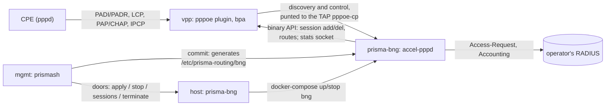

# Prisma Routing - BNG (PPPoE server and IPoE)

## TL;DR

**Phase 1 is being built** ([#597](https://github.com/andrediashexa/hexarouting/issues/597),
started 2026-10-12): PPPoE subscribers terminated on this box, authenticated
against RADIUS and translated by the CGNAT. Its first increment is in section
0 - the `prisma-bng` container (accel-ppp-ng driving VPP's pppoe plugin), the
`pppoe` hierarchy in the VTY with the container's configuration generated
from the candidate, PAP/CHAP/MS-CHAPv2 against RADIUS with accounting, IPv4
by IPCP from RADIUS or a pool, each session attached to a BPA pool,
`show pppoe sessions|summary`, `clear pppoe session`, and `lab/pppoe.sh`
proving it end to end. The box's own session trail - who held which inside
address from when to when, hash-chained, `show pppoe history` - is 0.7.
Section 0.4 is what remains of phase 1. IPv6 on the sessions - IPv6CP, the
WAN /64 by SLAAC, DHCPv6 prefix delegation, with the dataplane's PPPoE guard
taking the CPE's RS and DHCPv6 to the control plane - is 0.8
([#609](https://github.com/andrediashexa/hexarouting/issues/609)).
Per-subscriber SHAPING - a queue per session in the dataplane, the download
shaped by default, the policer still there - is 0.9
([#610](https://github.com/andrediashexa/hexarouting/issues/610)).

**Everything from "Where every number here comes from" down is
[#170](https://github.com/andrediashexa/hexarouting/issues/170)'s study, kept
exactly as it was measured** against VPP `26.06-release` in
`prisma-routing-dev:26.06` on 2026-09-14. Where phase 1 has since changed a
conclusion, section 0 says so; the record below is not edited to describe
the repair.

The finding that matters is not the one the issue's title predicts. **The
dataplane half works, today, and it is cheap.** `lab/bng.sh` terminates a real
PPPoE session with `accel-pppd` driving VPP's binary API, gives the subscriber
an address, and BPA translates it onto the block `ref/bpa_model.py` predicts,
on the captured packet, with a one-line delta to the control plane's source.
Building PPPoE termination is **not** where the money goes.

Where the money goes is that a BNG changes **what a subscriber is**. This
product's commercial argument is that in deterministic mode the configuration
**is** the log ([logging.md](logging.md)) and the standby needs **zero** state
([ha.md](ha.md)) — both of which hold only because the subscriber's inside
address is a **configured input**. A BNG hands that address out at session
time. Measured in the lab: three subscribers dialled together and were given
`.10`, `.11` and `.12` **in order of arrival**, not by identity. The instant
the inside address is assigned rather than configured, the configuration stops
being the log, and answering a court order **REQUIRES** a second retained
store joined against the BPA trail.

So the title's conclusion stands, and **two of the issue's stated reasons do
not**:

* The claim that `linux_cp` and the `pppoe` plugin are "mutually exclusive
  box-wide" and that an `accel-ppp`-on-`linux_cp` shape **MUST NOT** be
  attempted is **overstated**. Both plugins were loaded together for the whole
  lab. `lcp_ethertype_enable()` has exactly one caller in `linux-cp` — its own
  API handler — and it *refuses* an ethertype another node already owns.
  Nothing in this product calls it.
* The claim that `show route verbose` "becomes a standing false alarm" is
  **false**. Measured with 3 subscribers and again with 40,000: the command
  lists the session `/32`s and reports **no** fault. It becomes 40,010 lines
  of output, which is a different and smaller problem.

Three things the issue did not know, all measured here and all worse than what
it did claim:

* **Attaching CGNAT to a subscriber costs time proportional to how many
  subscribers are already on the box.** The issue marked this "not verified"
  and said it **MUST** be measured. It is now measured, and it is the hardest
  number in this document: `set interface bpa in2out` costs about **4.3 ms**
  per call on a box holding 5,000 session interfaces and about **8.3 ms** per
  call on one holding 10,000. Enabling it across 10,000 reconnecting
  subscribers took **83 seconds**. The cause is in **this repository**, not in
  VPP: `bpa_auto_mss_update()` walks every interface on the box on every
  attach, so N attaches cost O(N²). The same operation for a policer costs
  42 µs. That defect is worth its own issue and it is not a BNG question.
* **A shipped box aborts between 7,000 and 8,000 PPPoE sessions.** At the time
  this was measured `appliance/prisma-routing-tune` emitted no `statseg` stanza,
  so an installed appliance ran on VPP's default 32 MB stats segment
  (measured). Each session calls `vnet_register_interface`, each interface adds
  stats symlinks, and the stats heap runs out: `os_panic` → `SIGABRT`, the
  whole dataplane, not one subscriber. Reproduced twice at the same step. The
  tuner now sizes the segment from the interfaces a box's configuration makes
  it hold, per thread
  ([#597](https://github.com/andrediashexa/hexarouting/issues/597)), and the
  PPPoE session ceiling is one of them: `pppoe` > `session-limit`, 16,000 when
  the block has none, which accel-ppp enforces and which is never more than
  the running segment holds (section 0.4 item 5, `lab/pppoe-scale.sh`:
  100,000 sessions held on one, three and four threads).
* **Per-subscriber speed, which is what a BNG is sold on, does not exist in
  VPP 26.06.** There is a policer and there is no shaper: `configure policer`
  is the entire rate-control surface, `vppctl help` matches nothing for
  `shap`, and `hqos` appears zero times in `dpdk_plugin.so`.

> The key words **MUST**, **MUST NOT**, **SHOULD**, **SHOULD NOT** and **MAY**
> in this document are to be interpreted as described in
> [RFC 2119](https://www.rfc-editor.org/rfc/rfc2119).

## 5W2H

| | |
|---|---|
| **What** | Terminating subscribers on this box: PPPoE server, or IPoE with DHCP. |
| **Why** | The question was asked, and it **MUST** be answered on evidence rather than on impression. It is not asked again cheaply. |
| **Who** | The provider who today buys a BNG from one vendor and this box from another. |
| **When** | Phase 1 started 2026-10-12 ([#597](https://github.com/andrediashexa/hexarouting/issues/597)); its first increment ships in 0.154.0 (section 0.5). Section 5 is the list #170 asked to be answered first. |
| **Where** | The access side, where the subscriber's inside address comes from. |
| **How** | `accel-ppp-ng` on the `pppoe` plugin's control-plane interface, in a container of its own (`prisma-bng`), configured from the VTY's candidate (section 0). |
| **How much** | The termination is days. What it obliges is a second product: see section 4. |

## 0. Phase 1, as built (#597)

### 0.1 The shape



| Piece | Where | What it does |
|---|---|---|
| `prisma-bng` image | `build/Dockerfile.bng` | The dataplane image plus accel-ppp-ng, built at its pin by `build/accel-ppp-build.sh` with `build/accel-ppp-ng.patch`. 215 MB against the dataplane's 205 (measured 2026-10-12): the upgrade artifact carries about 10 MB more. |
| `bng` service | `appliance/compose.yaml` | `network_mode: host` (the TAP and RADIUS), `/run/vpp` (the API and stats sockets, as `mgmt` has them), the generated configuration read-only. A **profile**, so `up` never starts it: docker-compose 1.29.2 (the medium's) leaves a profiled service out of `up`, starts it when named, and removes it on `down` - measured. Limits: 512 MB, 512 processes, `oom_score_adj` +500 (the dataplane is -1000), `restart: unless-stopped`. |
| host lifecycle | `appliance/prisma-bng` | `apply` (start, or recreate on new files), `stop`, `boot` (from `prisma-routing-containers.service`, only when configured), `status`, `sessions`, `summary`, `terminate`. The only thing that runs docker-compose for the service, so a VTY upgrade (which recreates `mgmt`) touches no session. |
| plumbing | `appliance/prisma-bng-entrypoint` | Waits for VPP, makes `tap1863` (`pppoe-cp` in Linux) with the access card's MAC, one Linux VLAN device per tag, `create pppoe cp`, and tells the plugin's PPPoE guard the access interfaces (`set bpa pppoe-access`, 0.3 item 9); writes each start and exit in `/run/prisma-routing/bng/runs`, which `show log` is made from; deletes sessions a dead control plane left; runs accel-pppd; ends the container when accel-pppd dies or VPP loses the TAP, so the restart policy lays it again. |
| per session | `appliance/prisma-bng-session` | accel-ppp's ip-up: the existing CGNAT attach (`set interface bpa in2out`), the PPPoE MTU, the MSS clamp. Idempotent (0.3). |
| configuration | `src/prismash/pppoe.py` | The `pppoe` hierarchy's grammar, one rule for the prompt and the saved file; `accel-ppp.conf`, `chap-secrets` and `access.env` generated at commit into `/etc/prisma-routing/bng` (0660, the configuring group's, as `prisma-routing.conf`); the model read back from `/etc/prisma-routing/pppoe.conf`. |

**How the configuration flows.** An operator types the `pppoe` block in the
candidate; `commit` (and `rollback`, `commit confirmed`, the audit trail -
it is one more statement of the configuration) checks it, generates the
container's files from it, and asks the host through its doors to apply them.
`show running-config` reads the model back from `pppoe.conf`, never from the
generated files, and nobody edits those: the next commit rewrites them.

```
prisma# [edit] aaa
prisma# [edit aaa] radius
prisma# [edit aaa / radius] server 192.0.2.10 secret <secret> priority 1
prisma# [edit aaa / radius] exit
prisma# [edit aaa] exit
prisma# [edit] pppoe
prisma# [edit pppoe] interface ens19
prisma# [edit pppoe] gateway 100.64.0.1
prisma# [edit pppoe] address-pool 100.64.0.10-100.64.0.200
prisma# [edit pppoe] exit
prisma# [edit] commit
```

RADIUS has been its own hierarchy, `aaa` > `radius`, since #607 (0.6 below);
0.154.0 held it inside `pppoe`.

**Secrets.** A RADIUS shared secret and a lab user's password are held like
SNMP's community: in the saved configuration and in `pppoe.conf` (0660, group prisma-cgnat, as `prisma-routing.conf`)
so that rollback can restore them, and blanked on every screen -
`show running-config`, `show configuration`, `show configuration compare`
(per diff line, so a changed secret is a `-` and a `+` line with neither
value). The typed API does not carry the block at all in this increment.

**A session is not configuration.** The plugin makes `pppoe_session<n>` per
subscriber and the hook attaches the CGNAT to it; read back as configuration
they would be saved, refused at the next boot and detached by the next
commit. `Config.drop_pppoe_sessions()` takes them, their CGNAT attachments and
the control-plane TAP out of every reading of the running configuration.

### 0.2 What works end to end

`lab/pppoe.sh` (run 2026-10-12): real CPEs (pppd with rp-pppoe, one netns
each, one on VLAN 100), a real freeradius with accounting, accel-ppp-ng built
by the image's recipe, everything configured through the VTY. It asserts PAP,
CHAP and MS-CHAPv2 sessions against RADIUS, a wrong password refused
(Access-Reject, no session), the address from Framed-IP-Address for one CPE
and from the pool for the others, the DNS servers at the CPE, the subscriber's
traffic on the block `ref/bpa_model.py` predicts on the captured packet and
its reply back through the session, the MSS clamp on the session, accounting
Start / Interim-Update (with the session's real bytes) / Stop at RADIUS, the
secret absent from `show running-config`, `clear pppoe session` ending one
session and the CPE redialling, a container restart (by a commit, and by
killing accel-pppd) dropping every session and all of them redialling while a
subscriber NOT on PPPoE forwards throughout, and `no pppoe` stopping the
container with the dataplane surviving the PADIs that keep arriving.
`lab/pppoe.sh off` commits no `pppoe` block and goes red.

What the lab plays rather than runs: docker. The lab is a container and
cannot start the image, so `lab/pppoe-shim` runs the entrypoint under a loop
that restarts it as `unless-stopped` does. `tools/build-images.sh check`
starts the image (every configured module present and linked), and
`compose-check` creates the service from the shipped `compose.yaml` and reads
its limits back from the engine.

### 0.3 What was found building it, measured

1. **Interim accounting ended every session.** accel-ppp reads a session's
   counters from its kernel interface; a VPP session has none, the read
   failed, and the interim update terminated the session as Lost-Carrier ten
   seconds after it came up (`acct-interim-interval=10`). The patch gives the
   VPP hooks a `read_stats` that reads the session interface's counters from
   VPP's stats segment (`/run/vpp/stats.sock`); accounting now carries the
   session's real octets.
2. **accel-ppp-ng's newest commit crashed at the first session that ended.**
   The pin moved from #170's `cb69ccc` to `dd07b23` (2026-10-07) for its
   RADIUS hardening (Message-Authenticator in Access requests and responses,
   the BlastRADIUS mitigation) and its PADI truncation fix. Its port of
   upstream PR 334 closes the PPP unit fd after cleanup - and for a VPP
   session that fd is the channel's own, so `destroy_ppp_channel()` then hit
   a closed descriptor and accel-pppd died on `md:epoll_ctl: Bad file
   descriptor`. The patch skips the close for a VPP session.
3. **The CGNAT attach is not idempotent, and the plugin recycles its
   interfaces.** A session's interface is hidden, not deleted, when the
   session ends, keeps its features, and is handed to the next session;
   `vnet_feature_enable_disable` adds a feature as often as it is asked.
   Measured: ten `bpa-in2out` stacked on one interface, the second
   translating the first's output and dropping it as "no pool for source
   address". The session hook asks the interface's features first. Whether
   the attach itself should refuse a second enable is a question for
   [#597](https://github.com/andrediashexa/hexarouting/issues/597)'s other
   branch, which is making the attach O(1).
4. **Taking the plugin's control plane away crashes the dataplane.** `create
   pppoe cp ... del` sets the cp to `~0` and the plugin goes on punting every
   PADI to it: VPP 26.06 dies in `vnet_per_buffer_interface_output` (SIGSEGV)
   at the next discovery frame. Deleting the TAP the cp names is the same
   crash. So the TAP and the cp outlive the container; with nothing reading the
   TAP the kernel drops what is punted to it. Before any cp is set the plugin
   punts to index 0, `local0`, and drops - which is why a box with no PPPoE is
   safe today although the plugin loads on every box.
5. **RADIUS's Framed-IP-Address needs `gw-ip-address` in accel-ppp's `[radius]`
   section**, not only in `[ip-pool]`; without it accel-ppp logs "gw-ip-address
   not specified" and takes the address from the pool instead. The generated
   file sets both from `gateway`.
6. **One card per box, as #170 found for one CP interface.** The plugin has
   one control-plane interface and answers from the card the CPE came in on;
   the TAP carries that card's MAC. The VTY refuses access interfaces on two
   cards at commit; any number of VLANs of one card works (one tag each).
7. **PPPoE was taken from every interface**, not only the access ones:
   `pppoe_init()` registers both ethertypes box-wide (1.5). Measured in
   `lab/pppoe.sh` on 2026-10-13, before the guard (item 9): 5 PADIs from
   `host-lan0` - a CGNAT inside port, not access - drew 5 PADOs; a CPE on
   the wrong side of the box was a subscriber. With the guard: 0 of 5, and
   the 5 PADIs and 5 session frames with sub1's MAC from there counted as
   refused; a CPE on `host-acc0` still 5 of 5.

8. **Two defects only an installed box showed** (the maintainer's bench,
   0.153.97 built from this branch, 2026-10-12): `prisma-bng apply` ran
   compose without the stack's environment, so it asked for
   `prisma-bng:latest`, which no installed box has ("pull access denied");
   and nothing made `/var/log/prisma-routing/bng`, so accel-pppd exited at
   start ("log:log_error:open: No such file or directory") and the container
   restarted for ever, answering no PADI. `prisma-bng` now reads
   `PRISMA_VERSION` and `PRISMA_VPP_GID` from `/run/prisma-routing/compose.env`
   as the stack's unit does, and the entrypoint (and `apply`) make the log
   directory. The lab now runs with the release's tag only and from a log
   volume without the directory, and is red without either fix. With them the
   bench terminated PAP and CHAP against a real FreeRADIUS and carried 1.26
   Gbit/s through one session and the BPA pool.

9. **One MAC on two access ports**, section 4's item 8, measured in
   `lab/pppoe.sh` on 2026-10-13 with a CPE carrying sub1's MAC on VLAN 100
   (`host-acc0.100`) while sub1 is on `host-acc0` - two access interfaces of
   the one card the BNG allows (item 6). Before the guard:
   * **A subscriber that dials while its MAC is heard on another access
     interface gets its downloads sent there.** The plugin copies a session's
     way down - interface and VLAN tag - from its link table when the session
     is added, and the link table holds the interface the MAC was heard on
     LAST (`pppoe_learn_process`'s "mac move", any discovery or control
     frame). sub1, redialling in 3 s while the other CPE sent PADIs every
     20 ms: its session sent out of `host-acc0.100`, its ping 100% lost, 4 of
     its session's frames caught at the other CPE in 5 s.
   * Both CPEs held a session at once for 40 s, sub1's never changing: the
     plugin keys sessions by (MAC, session id), and accel-ppp sees the two on
     two Linux devices (`pppoe-cp`, `pppoe-cp.100`).
   * The control plane's own frames were NOT crossed: sub1's PADT, sent while
     its MAC was heard on VLAN 100, reached sub1. The plugin hands them to
     `interface-output` as accel-ppp built them, tag included, so the tag
     follows the Linux device and not the link table.

   **Decided: the MAC belongs to the access interface its session is on**,
   the one safe answer that needs no change to VPP. The plugin's guard
   (`src/plugins/bpa/bpa_pppoe_guard.c`, `set bpa pppoe-access`, laid by the
   entrypoint at every start from `access.env`'s `ACCESS`, format 5) sits
   between `ethernet-input` and the plugin - a second
   `ethernet_register_input_type()` for both ethertypes replaces the
   plugin's entry - and drops,
   counted: any PPPoE frame from an interface that is not access; and a
   discovery or control frame whose MAC another access interface holds. A
   MAC is held by the interface its session's control frames last came from,
   for 60 s after the last one (accel-ppp's echo every 20 s, three missed:
   as long as the control plane itself believes in the session), and a PADT
   from that interface lets it go at once. With it, the same run: sub1's
   session out of `host-acc0`, 0% loss, nothing at the other CPE, 666 PADIs
   refused; the other CPE dialling for 40 s got no session and sub1's never
   changed; a PADT from sub1's port freed the MAC and the other CPE had a
   session 2 s later. **pppd killed sends no PADT** (measured: none left its
   interface), so a CPE that vanishes frees its MAC after the hold. Not
   closed: a session's DATA frames are matched on (MAC, session id) with no
   interface (`pppoe_decap.c`), so a frame with a held MAC and the right id
   from another ACCESS interface is still taken - that needs the interface
   in the plugin's key, a change to VPP. Two different subscribers with one
   MAC on two ports are therefore not served at once: the first keeps it.
10. **What the guard costs**: one node more for every PPPoE frame, a bit
   read for the interface, and for a data frame nothing else; a discovery or
   control frame takes a spinlock and a 4-way set of a table bounded at
   65,536 MACs (1 MiB), where a flood of invented MACs evicts the oldest and
   grows nothing. `show runtime` in the lab (af_packet, about 50 packets a
   vector): the session guard 106-181 clocks a packet beside `pppoe-input`'s
   133-199 in the same run. The first cut, a next index per packet, read 143
   against 153; a frame that all passes is now handed on whole.

### 0.4 What remains of phase 1

In the order they are planned, each its own step on #597:

1. **RADIUS accounting retained and joined to the BPA trail** - section 3.1's
   obligation: done (0.7) - not a copy of RADIUS accounting but the box's own
   session trail, written by the control plane whether or not any accounting
   server answers, append-only, fsynced and hash-chained, read by `show pppoe
   history` and joined to a public address and port by `show cgnat
   translation ... at <time>`.
2. **The typed API** for the `pppoe` block and the sessions: done -
   `GetConfig` / `SetConfig` / `DeleteConfig` areas `pppoe` and `aaa`, every
   secret write-only (`password_set` / `secret_set` on a read);
   `ListPppoeSessions`, `GetPppoeSession`, `GetPppoeSummary`,
   `ListPppoeHistory`, `VerifyPppoeHistory`, each the VTY's screen drawn from
   the one reading its fields carry; `Clear` by id, user, inside address or
   all (`clear pppoe session address <A.B.C.D>` is new at the prompt too).
   Additive to `prisma.v1`: a client built from 0.155.6's contract still
   works, which `lab/api-grpc.sh` drives; `lab/pppoe.sh` holds every read to
   the VTY's screen on real sessions (docs/api.md, "PPPoE").
3. **SNMP counters**: done in 0.155.3 - PRISMA-ROUTING-MIB's `prBng`
   (docs/snmp-mib.md): the control plane's state and uptime, sessions up,
   starting, started and stopped, each RADIUS server's Access-Accepts,
   -Rejects and unanswered sends, and the Disconnect/CoA answers, counted
   by the accel-ppp patch in its own `show stat` and read by the agent
   through the doors. **`show log` events**: done - every start of the
   container with its cause (a commit, a format upgrade, the boot, or the
   restart policy after an exit), every exit with accel-pppd's code or
   signal, and each RADIUS server accel-ppp marks failed and uses again,
   read by the host's watcher from the container's own record of its runs
   (docs/logging-events.md, "The PPPoE control plane").
4. **Discovery restricted to the access interfaces** (0.3 item 7), and the
   same MAC on two access ports (4, item 8): done, measured, 0.3 items 9
   and 10.
5. **The stats segment sized for the configured `session-limit`** (2.1):
   done, measured by `lab/pppoe-scale.sh` - see "The session ceiling" below.
   The multi-worker attach cost: measured with it, and it does not grow with
   the sessions on the box.
6. A configuration change without a restart of every session: done for
   RADIUS (#607, 0.6) - a change under `aaa radius` is accel-ppp's `reload`;
   a `pppoe` change still restarts.

**The session ceiling (item 5).** A PPPoE session is an interface in the
dataplane, and its counters live in VPP's statistics segment, which aborts
the whole dataplane when it runs out (2.1). Before this, a `pppoe` block
with no `session-limit` had no ceiling at all - accel-ppp was given none and
the tuner sized nothing - so an installed box ran on VPP's 32 MB default and
`lab/pppoe-scale.sh` drove it to its abort again, sessions made and attached
to the CGNAT in steps of 500:

| Threads | 32 MB default survived | then |
|---|---|---|
| 1 | 7,500 | `Out-of-memory, calling os_panic()`, SIGABRT |
| 3 (2 workers) | 7,000 | the same |
| 4 (3 workers) | 5,000 | the same |

Now:

* **there is always a ceiling.** `session-limit` absent means 16,000
  (`pppoe.SESSION_LIMIT_DEFAULT`), and accel-ppp.conf always carries
  `max-sessions` - accel-ppp answers no PADI and no PADR once active plus
  starting sessions reach it (`pppoe.c`, `conf_max_sessions`);
* **the tuner sizes the segment for it**, at boot, from the saved file
  (`Config.runtime_interfaces()`), by the arithmetic `lab/statseg-scale.sh`
  already checks for sub-interfaces;
* **accel-ppp is never told more than the RUNNING segment holds.** The tuner
  only runs at boot, so a limit raised by a commit, or a box upgraded onto
  the default with the 32 MB it booted on, would otherwise take sessions into
  a segment that aborts. The VTY reads the segment VPP mapped and its
  threads, works out what it holds by the tuner's own function, and writes
  the lower of the two; the commit says so, and `show pppoe summary` shows
  `16000, the default; 3443 until the next reboot`;
* **a commit refuses** a limit above 100,000 (the most measured), or above
  what the largest segment this box's RAM gets from the tuner holds (a
  quarter of what the control plane keeps: 512 MB on a 2 GB control plane,
  about 55,000 sessions on four threads). A saved file holding more is still
  loaded - 0.154.0 took up to a million - and held at what the segment holds.

Measured with `lab/pppoe-scale.sh` in the build image on a host other labs
were running on, so the times are ceilings:

| Limit | Threads | Segment (tuner) | Held | RSS | Segment used | Main heap used |
|---|---|---|---|---|---|---|
| on 32 MB, the VTY's ceiling | 1 / 3 / 4 | 32 MB | 4,223 / 3,669 / 3,443 | | | |
| 16,000 (default) | 1 | 122 MB | 16,000 | 594 MB | 50.5 MB | 310 MB |
| 16,000 (default) | 3 / 4 | 140 / 149 MB | 16,000 | | | |
| 40,000 | 1 | 304 MB | 40,000 | 748 MB | 114.6 MB | 411 MB |
| 40,000 | 3 / 4 | 349 / 372 MB | 40,000 | | | |
| 100,000 | 1 | 758 MB | 100,000 | 1,572 MB | 370.5 MB | 723 MB |
| 100,000 | 3 / 4 | 873 / 930 MB | 100,000 | 1,820 MB (4) | 491 MB (4) | 758 MB (4) |

A session costs about 4.8 kB of the main heap with its CGNAT attachment
(240 MB idle, 723 MB at 100,000). That heap is the one the tuner sizes for
the CGNAT's sessions, and **nothing refuses a limit for it**: at 100,000
sessions half a 1 GB heap is PPPoE's. Sizing the heap for the sessions
moves the hugepage reservation, which is the kernel command line and a
second reboot - not done in a patch.

**The attach** (`set interface bpa in2out` on each session, what
`appliance/prisma-bng-session` does) does not grow with the sessions on the
box. On one thread it cost 0.86 to 1.04 ms a session in every step from 2,000
to 100,000, most of it the configuration trail's fsync: 18 to 38 us without
it, measured first with no log directory, on three workers up to 100,000.
With workers and the trail, on the shared host, it read anywhere from 0.9 to
15 ms a session, rising and falling with the other labs' load and not with
the session count - 15.4 ms at 2,000 and 0.87 ms at 40,000 in one run, 0.89
ms at 2,000 and 6.4 ms at 100,000 in the next - so `lab/pppoe-scale.sh`
prints it and does not assert it. The ratio is `lab/attach-scale.sh`'s,
which now honours `LAB_WORKERS` (it read its startup file directly and ran
one thread whatever it was asked): with three workers, batches back to back
on one dataplane, 854 us an attach at 1,000 interfaces, 857 at 10,000 and
1,066 at 50,000 - 1.2x, against its bound of 3. #287 and #597 removed the walks
that made it O(N); this is the measurement on sessions and on workers that
was waiting for them.

**How an upgraded box gets it.** Nothing restarts the dataplane. The
accel-ppp files carry format 6, so the next load of the configuration - the
boot, or `systemctl restart prisma-routing.service`, or a commit of `pppoe`
- writes them again with the ceiling and restarts the PPPoE control plane
(its sessions redial; nothing else is touched). Until the next reboot that
ceiling is what the running segment holds; the reboot runs the tuner, which
sizes the segment for the saved limit, and the load after it lifts the
ceiling to the limit.

**Out of phase 1**, each a later issue: IPv6 (IPv6CP, DHCPv6-PD; built
since, 0.8), per-
subscriber SHAPING (VPP has no shaper, 2.2; per-subscriber POLICING is built,
0.6; shaping built since, in the bpa plugin, 0.9), QinQ (the plugin parses one tag), IPoE (VPP has no DHCP server, 1.4),
lawful intercept, HA of sessions (3.3). Disconnect and CoA are built (0.6).

### 0.5 Release

**A Y release (0.154.0)**, and not a patch, for two reasons either of which is
enough: `appliance/install.sh` installs a new host script and
`tools/release-gate.sh` refuses a patch that changes it (the artifact runs it,
but the gate's rule admits no "part of this file"); and CONTRIBUTING.md's
table puts a feature issue at `0.MINOR.0`. The upgrade artifact CAN carry
everything else: it carries `prisma-routing-images.tar.gz` (now five images,
`prisma-bng` added by `tools/build-images.sh save`) and `compose.yaml`, and an
upgrade adds the service - `up` creates what the new file names and leaves the
profiled `bng` out until PPPoE is configured.

### 0.6 RADIUS under `aaa`, rate limits, Disconnect and CoA (#607)

Asked by the operator on 2026-10-12, after 0.154.0: RADIUS in a hierarchy of
its own with more than one server, failover or round-robin, timers that fail
over in seconds, the session's plan as a VPP policer, and Disconnect/CoA from
the RADIUS side. All of it built on accel-ppp-ng at the same pin, with the
patch grown by what is listed in `build/accel-ppp-build.sh`.

**The syntax.**

```
aaa
 radius
  server <A.B.C.D> secret <s> [auth-port <n>] [acct-port <n>] [role auth|acct|both] [priority <1-255>]
  mode failover | round-robin                      failover when unset
  timeout <1-60>                                   3
  retries <0-10>                                   1
  dead-time <1-3600>                               30
  nas-identifier <name>                            prisma-routing
  interim-interval <0|60-86400>                    300
  dynamic-authorization listen <A.B.C.D> [port <n>]          3799
  dynamic-authorization client <A.B.C.D> secret <s>          up to 16
  rate-profile <name> down <rate> up <rate>        a Cisco policy name's rates
pppoe
 rate-limit default <download>/<upload>            a session RADIUS gives none
```

A server with no `priority` takes the next after the highest, and `show
configuration` always writes the number: the failover order is read off the
screen, never off the order something was typed in. Up to eight servers.

**How accel-ppp picks a server, read in its source at the pin**
(`radius/serv.c` `__rad_server_get`): among the servers that have the port
the request needs and are not inside their `fail-time`, the lowest `backup`
level, and within a level - upstream - the one with the fewest requests and
sessions per `weight`; since 0.155.1 the patch makes that a rotation. A server is marked down for `fail-time` seconds after `max-fail`
consecutive timeouts; a request moves to the next server after `max-try`
sends (`radius/req.c`). Upstream parses `backup` as a flag, so a third
server shared the load with the second; the patch makes it a level. So:

| `mode` | What accel-ppp is given | What it does |
|---|---|---|
| failover | each server `backup=<rank of its priority>` (none for the first), `fail-time=<dead-time>`, `max-fail=<retries+1>`; `timeout`, `max-try=<retries+1>` | a request goes to the first server alive; one that did not answer `retries+1` sends is skipped for `dead-time` and the next takes the request; two servers with one priority share their rank |
| round-robin | every server on level 0, weight 1 | each request to the next server alive, in turn (the patch's cursor, 0.155.1); upstream's least-outstanding sent six sequential logins 7:1 to the first server on prisma-bench |

Accounting follows the same choice among the servers that take accounting
(`role acct` writes `auth-port=0`, `role auth` writes `acct-port=0`, which
accel-ppp reads as "not for that"): in round-robin the Starts rotate as the
Access-Requests do, on a cursor of their own, so a session's Start need not
go where its Access-Request went; its interims and Stop go to the server its
Start went to until that one is marked down - accounting of one session is
never split between servers. No accounting
server is allowed, and `show pppoe summary` then says accounting is off.
**`acct-timeout=0`**: accel-ppp's default (3) terminated every session whose
interim went unanswered for 3 s (`radius/acct.c` `rad_acct_timeout`), so a
RADIUS outage longer than one interim's retries ended every subscriber; now a
lost interim is lost and the session stays. 0.154.0 wrote `fail-time=0`, which
marks no server down, ever.

**Measured in `lab/pppoe.sh`** with two FreeRADIUS servers, the defaults'
timers and a dead-time of 10 s: while the first lived, the second was asked
nothing; with the first killed, a session cleared and redialled authenticated
- and accounted - on the second 5 s after the clear, and `show pppoe summary`
showed the first `failed`; the next session did not wait for it; restarted,
the first was asked again once its dead-time was over. `mode round-robin`,
committed, was a reload with every session still up, and the sessions that
redialled afterwards authenticated and accounted on both servers; since
0.155.1, six logins of one subscriber one after the other split within one
between the two.

**A RADIUS change is a reload**, not a restart: accel-ppp re-reads [radius]
and [shaper] at `reload` (both register for `EV_CONFIG_RELOAD`), and the patch
makes a reload take a server's new level, weight and secret (a new secret is a
new server, so no request signing with the old one is touched). Not for what
accel-ppp reads at start only - the [modules] list (the first server, which
loads the radius module) and the Disconnect/CoA socket - which restart it.
`prisma-bng reload` runs the entrypoint's `reload` in the container: the file
rebuilt with the CLI password the running daemon already has.

**Migration.** A 0.154.0 file's `pppoe radius server|nas-identifier|interim-
interval` lines are read as the `aaa radius` statements they are - the
secret, the ports, and the file's order as priority 1, 2, ... - each said at
load ("note: line N is now under 'aaa radius'", the secret blanked), and the
file is written again once applied. Typed at the prompt, `radius` under
`pppoe` is refused with where it went. A box upgraded and not committed
since reads its RADIUS from `pppoe.conf` until `aaa.conf` exists. Generated
files carry a format line; files from an older release are written again at
the load and the container restarted on them once.

**Rate limits are a VPP policer on the session interface**, by accel-ppp-ng's
own VPP hooks (`session_hooks/vyos_vpp/vpppolicer.c`): the download one on the
interface's output (`ip4-output`, after the midchain), the upload one on its
input (`ip4-unicast`, before `bpa-in2out` - measured order: sv-reassembly,
policer-input, tcp-mss-clamping, bpa-in2out). One rate, one bucket (1r2c):
up to the rate passes, past it is dropped. It is policing, not shaping (2.2):
nothing queues.

**The bucket** is half a second of the rate, in bytes (since 0.155.2), and
never under 15,000 (ten full-size packets) - for either source: a Cisco-
AVPair's own burst numbers are checked and not used, because the same plan
from Prisma's attributes would otherwise get another bucket.

*Why half a second.* 0.155.1 gave a tenth, and prisma-bench (7 workers)
measured what a speedtest would show: ONE TCP flow got half its plan - 50
Mbit/s at 25.5 (6 s) and 24.9 (20 s), 20/10 at 9.8/4.7, a Cisco 30/15 at
14.2/7.5, four parallel flows 42 - while UDP passed exactly (49.1 through
50). A policer drops what a TCP flow's window overshoots by; the bucket has
to absorb that, and how much is needed grows with the round trip. Changing
the live policer's `cb` on the bench, one flow through 50 Mbit/s: 0.1 s
25.5/24.9 (6 s/20 s), 0.25 s 48.6/47.3, 0.5 s 50.5/47.8, 1.0 s 54.3/47.8,
1.5 s 58.5/47.6; through 10/5 Mbit/s: 0.1 s 4.72/2.27, 0.25 s 9.78/4.72,
0.5 s 10.1/5.07. Half a second gives one flow its plan without a short
test reading well over it.

*Why the lab had passed with a tenth.* Its round trip is a few
milliseconds of veth, and there one flow fits a small bucket. Measured in
`lab/pppoe.sh`, one TCP flow for 15 s through 20/10 Mbit/s: a tenth of a
second gave 19.1/9.7 at the lab's own round trip and 14.8-14.9 down (74%)
with 200 ms added; half a second gave 19.6/10.0 and 17.5-18.1 down
(87-90%, three workers included). The upload over that path does not tell
the two apart (6.5-7.7 with a tenth, 7.9-9.2 with half a second) and is
printed, not asserted.
The lab does not reproduce the bench's conditions (a real NIC, 7 workers);
it measures what a speedtest does - one TCP flow each way, 15 s counted
whole - within 10% under to 5% over the plan, adds the one condition under
which a small bucket shows, a 200 ms longer path, where one flow must still
get 80% down (red with a tenth of a second), and sends one UDP download at twice
the plan for the policer's own exactness.

**Until 0.155.1 every bucket was eight times what it was meant to be**:
accel-ppp-ng's VPP hook multiplied the burst by 8 as if VPP took bits, and
VPP's `cb` is bytes (`rb.kbps.cb_bytes`). prisma-bench measured it - a 20/10
plan at 21.3/10.7 and 50/20 at 53.6/21.7 over a 6 s iperf3, and a Cisco 30
Mbit/s plan, whose 3,000,000-byte burst became 24,000,000, at 57.8. The lab
reads every policer's `cb` back from VPP - a 1 Gbit/s plan's included
(`cir 1000000`, `cb 62500000`), where an int of bytes or bits would have
overflowed.

The rate comes from RADIUS, in **Prisma's own attributes, vendor 67033**
(the product's IANA PEN, the SNMP MIB's too): `Prisma-Rate-Limit-Down` (1)
and `Prisma-Rate-Limit-Up` (2), integers in kbit/s, 0 or absent for none.
The dictionary is `appliance/dictionary.prisma`, carries the number plan
(1-15 rate and QoS, 16-31 addressing, 32-47 CGNAT, 48-63 session control),
is in the image for accel-ppp and on the box for `show aaa radius
dictionary`, which prints it for the RADIUS server. **Cisco-AVPair** is read
too, when no Prisma rate is in the packet: `lcp:interface-config[#n]=rate-
limit input|output <bps> <normal> <max> conform-action transmit exceed-action
drop` (`input` is the subscriber's upload), and `ip:` or `subscriber:sub-qos-
policy-in|out=<name>`, a name looked up in the operator's `rate-profile`s.
Parsed strictly by `build/prisma_rate.c` (tested alone by
`test/test_prisma_rate.c`): a rate key whose value is not exactly one of
those shapes makes NONE of the packet's Cisco rates apply, logged; a policy
with no profile leaves its direction unlimited, logged. MikroTik's
`Mikrotik-Rate-Limit` is not read, by the operator's decision.

Measured in `lab/pppoe.sh`, iperf3 through real CPEs and the CGNAT: a 20/10
Mbit/s plan from Prisma's attributes measured 19.1 down and 9.6 up; a CoA to
50/20 measured 48.9 and 19.3 on the same session, with no redial; a session
with no plan carried 1.4-1.6 Gbit/s; a 30/15 plan in Cisco-AVPair (a
`rate-limit output` and a `sub-qos-policy-in` profile) measured 28.4 and 14.5,
and a CoA's `rate-limit input` changed only the upload; VPP's policer count
went back to 0 when the sessions were gone. `show pppoe sessions` lists each session's limit
(download/upload); `show pppoe session <id>` its MAC, traffic and each
policer's passed and dropped packets.

**Disconnect and CoA (RFC 5176).** accel-ppp's DAE listener takes one
secret and any source; the patch adds a client list, each with its own
secret, and a source not on it gets no answer, as a wrong secret gets none.
A Disconnect-Request by `User-Name` or `Acct-Session-Id` ends the session
(Disconnect-ACK, Stop with `Acct-Terminate-Cause = Admin-Reset`); a CoA with
a rate changes the policers on the live session; `Session-Timeout` ends it
when it says (Stop with `Session-Timeout`). A CoA carrying an attribute
nothing acts on - `Filter-Id`, MikroTik's rate - is refused whole with
`Error-Cause = Unsupported-Attribute` (401) before anything changes, and one
with a rate that is not one, or past 10 Gbit/s, is NAKed and the limit kept:
upstream ACKed both, and a bad rate in a CoA REMOVED the session's limit.
There is no firewall on the box for the listener to be opened in: it listens
only when `dynamic-authorization listen` is configured, on that address, and
the client list is what admits a request. With management in a VRF (#580),
`udp_l3mdev_accept`, which the box already sets, is what lets the listener in
the main table answer a request that arrives there - not measured by a lab.

**0.155.1: a policer counted twice after a crash.** The entrypoint's
`clean_policers` ran vppctl inside a `while read` over the list of a dead
daemon's policers; vppctl passes its stdin to the dataplane, read the rest of
the list, and those policers were deleted while still applied. VPP counts a
feature's enables per interface, so the recycled interface kept one, and the
next session's own enable made two: every packet metered twice - a 30/15
plan measured at half - or, when VPP gave the freed policer's index to
another session's policer, a session with no plan held at that one's rate
(measured with three workers). vppctl now reads `/dev/null` there, and
`unpoison` clears any policer feature still on a session interface while no
control plane runs, through a policer made for it (`policer_input(apply=0)`
disables the feature whatever the interface was bound to).

**Three defects found on the way**, each measured in `lab/pppoe.sh`:

1. **A control plane killed with -9 crossed subscribers' downloads.** The
   entrypoint deleted the sessions the dead daemon left while the /32 routes
   it had added through them were still there, and each session interface's
   midchain adjacency outlived everything that used it (`show adj` listed
   it with no FIB entry left through the interface). VPP's pppoe plugin
   recycles a deleted session's interface for the next session and builds
   an adjacency's rewrite only when the adjacency is created, so the next
   subscriber on that interface was sent the previous one's PPPoE header -
   another CPE's MAC, VLAN and session id. A graceful teardown removes the
   routes first and the adjacency goes with them, measured. In 0.154.0 since
   the first crash. Fixed: the entrypoint no longer deletes a dead daemon's
   sessions; it lists their routes and the sessions (`stale_state`, with
   vppctl), and the next accel-pppd, before its first session, removes the
   routes and then the sessions - the graceful order - through the API. Not
   by dumping them from accel-ppp: a VAPI dump from its VPP module aborted
   the daemon (`vapi_get_swap_to_host_func: Assertion id <
   __vapi_metadata.count`), measured. The entrypoint still
   removes the dead daemon's policers (`clean_policers`). `lab/pppoe.sh`
   asserts, after `kill -9`, that every session's /32 is rewritten with its
   own CPE's MAC and that VPP holds no session the dead daemon left.
2. **The VPP hook enabled policer-input twice** - VPP 26.06's
   `policer_input()` does it itself - and a feature enabled twice runs twice:
   a policed session was metered twice. The patch leaves it to VPP.
3. **accel-ppp's `G` was 10^7 kbit** (10 Gbit/s for "1G"), and its rates
   overflowed an int past 2.1 Gbit/s; both fixed.

**What is not built:** per-subscriber SHAPING (VPP has none; built since in
the bpa plugin, 0.9), a separate
IPv6 rate (the policer is bound on ip6 too, one bucket for both families -
0.8), and the
policer with VPP workers: a policer is bound to the thread that first uses it
and hands the others' packets to it (`policer-input-handoff`), which this lab
(single-threaded) does not exercise.

**Cost at scale**, `lab/policer-scale.sh` (single-threaded, a busy build
host, so ceilings): adding and applying a session's two policers took 46 us
at 1,000 limited sessions and 32 us at 10,000 (0.7x); taking them off, 21
and 22 us (1.0x); the main heap held 263 MB with 20,000 policers and 10,000
interfaces; every policer was gone at the end. A session setup pays four
binary-API calls more than before, none of which walks the box.

### 0.7 The session trail: who held which inside address, from when to when

Section 3.1's obligation, built. A BNG hands the inside address out in order
of arrival, so the CGNAT's record of a block - the BPA log's natEvent 16/17,
or the formula - names an **inside address**, and a court order names a
public address, a port and an instant. The second half of the answer is a
record of which session held that inside address at that instant, and RADIUS
accounting is not it: this product does not run, retain or vouch for the
operator's RADIUS, and accounting is not sent at all while every accounting
server is down. So the box keeps its own.

**Who writes it, and when.** A module of accel-ppp's (`prisma_trail`, in
`build/accel-ppp-ng.patch`; its format, chain and file handling are
`build/prisma_trail.c`, tested alone by `test/test_prisma_trail.c`), loaded
by every generated `accel-ppp.conf`:

| Entry | Written at | Why there |
|---|---|---|
| `start` | `EV_SES_ACCT_START`: the session interface is in the dataplane, the address is the subscriber's, and RADIUS has **not yet** been sent its Accounting-Start | the record does not wait on any RADIUS server: with none answering accounting, accel-ppp ends the session when its Start goes unanswered, and the trail has its start and its stop (`NAS-Error`) |
| `stop` | `EV_SES_PRE_FINISHED`, before `ipdb_put_ipv4()` gives the address back to the pool | at `EV_SES_FINISHED` the address is already free, and the next session could be given it and write its start before this stop: two holders of one address at one instant |
| `stop ... Control-Plane-Lost` | by the next control plane, at start, before its first session | a control plane killed with -9 writes nothing; the sessions it held are closed by the one that replaces it, and the dataplane keeps forwarding them until then (0.6, defect 1), so the time is when they really stopped |
| `restart closed <n>` | each control-plane start | a gap in the trail is visible as one |
| `carry` | at the first entry of a new month | the file is moved aside as `pppoe-sessions.log.<YYYY-MM>` and every session still held is restated at the head of the next one, so a month's file answers for any instant of that month alone |

**The format.** One line per entry, appended, the whole line in one write
under `O_APPEND`, `fsync`ed before the session goes on (a write that fails
part-way is cut back, so a fragment never glues itself to the next entry):

```
2026-10-13T02:48:40.456Z stop session 7f3a0c1e00000002 user joao.silva mac 02:aa:00:00:00:02 interface ens19 address 100.64.0.11 since 2026-10-13T02:10:11.123Z cause Lost-Carrier seq 3 sha256 7a2cff61c2eb12e6409af6114eb5c1c3c86d8ca94ca907d8d1abb29e2512ab2d
```

The time is UTC with milliseconds, the BPA log's own resolution, so a line
of one is compared with a line of the other without converting anything.
`session` is accel-ppp's session id, the `Acct-Session-Id` RADIUS is sent;
`interface` the access interface by the name the VTY gives it (the generated
`[prisma-trail]` maps `pppoe-cp.100` to it); the user name and the MAC are
escaped (`%XX` for a space, a control byte, a byte that is not ASCII or a
`%`), so no name shifts the fields after it, and a name past 192 bytes is
carried in part and ends in `%+`. A stop repeats its start's fields and
`since`, so either line answers alone - the rule the BPA log's release
follows (#397). The cause is accel-ppp's own `Acct-Terminate-Cause` word for
word, so the box's record and RADIUS's say the same thing.

**The chain** is the configuration trail's (`src/plugins/bpa/bpa_audit.c`,
[logging.md](logging.md#tamper-evidence)), byte for byte: each entry's digest
is SHA-256 over the previous entry's digest (zero before the first) and the
line up to and including its `seq`. It continues across files and across
restarts - the module reads its file back at start - and never starts again
over a file it could not read: that would write `seq 1` into the middle of
somebody's year.

**Where, and for how long.** `/var/log/prisma-routing/pppoe-sessions.log`,
beside `config-history.log`: the log volume, mirrored on a second disk when
the box has one ([appliance.md](appliance.md#the-log-volume-on-two-disks-and-the-system-on-one)).
It is retained the way the configuration trail is: **the box never deletes
or rewrites it**. It is moved aside once a month (`.<YYYY-MM>`), so an
operator under a one-year obligation can archive or remove whole months
older than that, and `verify` then says the chain begins at the first entry
still on the box rather than calling it broken. Its size is about 250 bytes a
session - a start and a stop - so 20,000 sessions a day is about 5 MB a day,
under 2 GB a year; nothing on the box bounds it, and a full volume is counted
(below), never a session refused.

**What it costs a session.** One `open`/`write`/`fsync`/`close` at start and
one at stop, under one lock in accel-ppp; the dataplane is not touched.

**Reading it.** The directory is root's 0750, and the VTY runs as the
account that logged in, so the host's door reads the files
(`src/prismash/pppoetrail.py`, `doors.answer_pppoe_history`) - any account,
as any account may `show pppoe sessions`, and each reading is journaled with
its filters: who looked a subscriber up, and for when.

```
prisma> show pppoe history address 100.64.0.11 at 2026-10-13T02:51:00Z
maria.souza held 100.64.0.11
  from 2026-10-13T02:49:02.789Z  to still held
  session 7f3a0c1e00000005  mac 02:aa:00:00:00:05  on ens19.100
prisma> show pppoe history address 100.64.0.11
joao.silva held 100.64.0.11
  from 2026-10-13T02:10:11.123Z  to 2026-10-13T02:48:40.456Z  Lost-Carrier
  session 7f3a0c1e00000002  mac 02:aa:00:00:00:02  on ens19
maria.souza held 100.64.0.11
  from 2026-10-13T02:49:02.789Z  to still held
  session 7f3a0c1e00000005  mac 02:aa:00:00:00:05  on ens19.100
prisma> show pppoe history verify
PPPoE session trail: /var/log/prisma-routing/pppoe-sessions.log
  4 entries checked, chain intact
  head  seq 4
  sha256 b95e36be694b2c847cd30ef2f5bb564108645c3cb9d16457c772d41f29039730
  a chain that verifies proves the files were not edited, not that they
  are the same files: compare the head with the copy sent off the box:
  show log kind trail, as the remote syslog or the API received it
```

`show pppoe history [user <name>] [address <A.B.C.D>] [session <id>] [at
<time> | since <time>] [last <n>]`: `at` is an instant - a session begun at
or before it and not ended before it; an end is exclusive, so the instant one
session ended and the next began names the next. A time is `show log`'s: an
ISO time with `Z` or an offset (the BPA log's own, pasted), or without one in
the box's zone, or `30m`, `2d` back from now. Without `at`, the last 50.

**From a public port to the user.** Two steps, and the box does both where it
can:

* **a deterministic pool**: `show cgnat translation <public> <port> at
  <time>` - the formula gives the inside address for any instant, and the
  trail the session that held it then;
* **a dynamic block**: the BPA log's `BLOCK-ALLOC` whose range holds the port
  gives the inside address and the instant, and `show pppoe history address
  <a> at <time>` the session. `show cgnat translation` answers a dynamic
  block for **now** only, so it refuses `at` there rather than join today's
  holder of the block to a past session.

```
prisma> show cgnat translation 200.150.0.19 2048 at 2026-10-13T02:51:00Z
```

prints the dataplane's answer as before and, below it, `PPPoE, at <instant>:`
and the session; on a box with PPPoE and no session there, `PPPoE: no session
held <address> at <instant>`; on a box without PPPoE, nothing more.

**What is counted.** `show pppoe summary` has a `session trail` row: the
entries written since the control plane started and, in capitals, any it
could NOT write (the volume full, the directory gone) - each one a session
the box cannot answer for. accel-ppp's own log says which and why.

**The head, sent off the box.** A chain that verifies proves the files were
not edited; it does not prove they are the same files - a trail written
again from its first line, chained afresh, verifies too. What tells them
apart is a head kept where the box cannot reach it. So the host's watcher
(`prismash --watch-events`, `src/prismash/eventwatch.py`
`trail_changes()`) writes the head as an event, and the record of events
already leaves the box: to the remote syslog collectors configured under
`system` > `logging`, and to the API's `WatchEvents` stream
([logging-events.md](logging-events.md)). No new transport, and nothing to
configure beyond the collector the box already sends to.

| Kind | Component | Severity | Sentence |
|---|---|---|---|
| `trail` | `bng` | info | `the PPPoE session trail's head: seq 1234, sha256 <64 hex>, in pppoe-sessions.log; 17 entries since the last head said` |
| `trail` | `bng` | info | `the PPPoE session trail's file pppoe-sessions.log.2026-09 closed: seq 1260, sha256 <64 hex>; 26 entries since the last head said` |
| `trail` | `bng` | warning | `... the last head said was seq 1234: the chain went back, and is not the one that head was of` |

* **What is read**: the last entry of each file, from the file's end
  (`pppoetrail.head()`, `last_entry()`) - its `seq` and its digest - every
  60 s, as root on the host (the directory is root's 0750). Never a whole
  `verify`: a month's file at 20,000 sessions a day is about 150 MB.
* **When it is said**: when the head differs from the last one said, and
  `HEAD_EVERY` (3600 s) has passed since that one; and at once at the
  watcher's first reading after it starts - a restart of the watcher, a
  boot - when the head differs from the last one said. The last one said is
  kept in `events-watch.state` with the watcher's other state. No trail
  file, no event.
* **Why hourly**: the head is a digest over every entry before it, so one
  head that reached a collector pins the whole trail up to it, and what
  could be rewritten unseen is the last hour of entries. Said every time it
  moves, a box with 20,000 sessions a day would write an event every few
  seconds into a record that keeps about 1500, pushing out the events an
  operator reads; an hour is 24 a day. The flapping rule (`flap_admit()`)
  does not hold these: they are bounded by construction, and a held head
  would be a head never sent.
* **The month's end**: when a file is moved aside (`.<YYYY-MM>`), its last
  entry - its closing head - is said at the next reading, before the live
  file's, so no stretch of the chain goes unsaid between two hourly heads.
* **A head behind the last one said** - a lower `seq`, or the same `seq`
  again - is said as a warning: that is not the chain the earlier head was
  of.

**Comparing.** At the collector, the newest `trail` event before the instant
in question; on the box, `show pppoe history verify`. The entry with that
`seq` must carry that digest: when the head said is the newest, the screen's
`head seq` and `sha256` are the same two values, and when entries were
written since, the line with that `seq` in the trail (`grep ' seq 1234 '
/var/log/prisma-routing/pppoe-sessions.log*`) ends with it - and `verify`
says the chain from it to today is intact. A digest that differs is a trail
that is not the one the box sent.

**What it proves, and what it does not** - the configuration trail's limits,
and one of its own:

* a chain that verifies proves the files were not edited; it does not prove
  they are the same files. The head sent off the box (above) is what does,
  up to the last head said: entries after it are covered by the next one;
* entries removed from the **end** verify (every remaining link is genuine),
  and nothing on the box remembers the last sequence written except accel-ppp
  while it runs (`show stat`'s `seq`). Off the box, the last head said does:
  a trail cut back past it no longer has its `seq`. Entries written after
  the last head said, and removed before the next, are not seen by anything;
* a session's address is what accel-ppp bound; that the packets came from
  that subscriber is the access network's to prove (uRPF, logging.md "What
  the record cannot know");
* the IPv6 prefixes are recorded since #609 (0.8): the WAN prefix in the
  start, the delegated one in a `delegate` entry of its own.

**Measured in `lab/pppoe.sh`** (section 17, 2026-10-13, single-threaded
and with three workers), against the files accel-ppp wrote:

* `clear pppoe session user sub1`: its stop written within the clear, with
  the user, MAC, access interface, `100.64.0.77` and `NAS-Request` - the
  `Acct-Terminate-Cause` RADIUS received for it, read from FreeRADIUS's
  detail file - and the redial's start after it, the same address;
* accel-pppd killed with -9 holding three sessions: the next one wrote three
  stops `Control-Plane-Lost` and `restart closed 3` before its first
  session, and the first entry of the file and every one after it were still
  there and still chained;
* the formula: the public address and port section 6 caught on the wire,
  asked `at` the instant it was sent, named sub1;
* the block log: with the pool made dynamic (`mode bpa`) and its log sent to
  a syslog collector, the one `BLOCK-ALLOC` whose range held the port sub2's
  packet left on named sub2's inside address, and `show pppoe history
  address <it> at <the log's instant>` named sub2; half a second before that
  session began it named nobody; `show cgnat translation ... at` refused the
  dynamic block;
* `verify`: 59 entries, intact; the third line given another address,
  `BROKEN at entry 3`; put back, intact;
* accounting sent to two servers that do not exist, authentication
  answering: sub3's start written, then its stop `NAS-Error` 12 s later when
  accel-ppp gave up on the Start (3 s, two sends, two servers), and neither
  real server was sent an Accounting-Request for it;
* both RADIUS servers killed: sub2 cleared, its stop written; in the next
  15 s no start for it and no session - nobody could authenticate it, so
  nothing was held, which is the one sense in which a session "started with
  RADIUS down" cannot be recorded: it does not exist.

The lab's 25 trail checks, run against the product without this change
(0.155.3, the same lab): 19 red. The six that pass are about what is not
the trail - the cause RADIUS received, the block log's record, no
Accounting-Request sent - or are what a box without one also does: nobody
named before a session, no start while RADIUS is down, no "NOT written".

### 0.8 IPv6 on the sessions (#609)

[#609](https://github.com/andrediashexa/hexarouting/issues/609), the IPv6
that section 4 counts among what a BNG cannot decline. Each session can
negotiate IPv6CP and is given two prefixes: its **WAN /64**, advertised by
Router Advertisement so the CPE numbers itself by SLAAC, and a **delegated
prefix** for its LAN, by DHCPv6 prefix delegation. Each from RADIUS when it
gives one (`Framed-IPv6-Prefix`, `Delegated-IPv6-Prefix`) and from a pool
otherwise. A patch: nothing in the kernel, VPP or FRR pins moved, and
nothing the installer lays.

```
prisma# [edit pppoe] ipv6 prefix-pool 2001:db8:100::/40
prisma# [edit pppoe] ipv6 delegated-pool 2001:db8:200::/36 length 56
prisma# [edit pppoe] ipv6 dns 2001:4860:4860::8888
```

| Statement | What it is | accel-ppp is given |
|---|---|---|
| `ipv6 prefix-pool <prefix>` | each session's WAN /64 is taken from it; /16 to /64, up to 16 | `[ipv6-pool]` `<prefix>,64`, module `ipv6pool` |
| `ipv6 delegated-pool <prefix> length <n>` | each session is delegated a /n of it; up to 16 | `[ipv6-pool]` `delegate=<prefix>,<n>` |
| `ipv6 dns <address>` | up to 2, in RA (RDNSS) and in DHCPv6 | `[ipv6-dns]` |
| `ipv6 enable` | IPv6CP on with no pool: the prefixes from RADIUS only | - |

Any of them is `ipv6=allow`, `ipv6-intf-id=0:0:0:1` (the box is `fe80::1` on
every session) and `ipv6-accept-peer-intf-id=1` (the CPE keeps the
identifier it proposes; `Framed-Interface-Id` from RADIUS wins), and the
modules `ipv6_nd` and `ipv6_dhcp`. **None of them is `ipv6=deny`, exactly
what every release before wrote** - the file is byte for byte the same, so
FORMAT does not move and an upgraded box restarts nothing for it. A commit
refuses IPv6 with no prefix pool and no RADIUS - accel-ppp's DHCPv6 answers
only a session that has a WAN prefix (`dhcpv6.c` `ev_ses_started`), so a
delegated pool alone would delegate nothing - and two IPv6 pools that
overlap.

`[ipv6-nd]` is written whole and not left to accel-ppp: **with `ipv6_dhcp`
loaded, its defaults are M on and A off** (`nd.c` `load_config`) - an address
by DHCPv6 IA_NA only - and a CPE that does not ask for IA_NA, pppd's Linux
and most routers among them, was given no WAN address at all. The file says
`AdvManagedFlag=0`, `AdvAutonomousFlag=1`, `AdvOtherConfigFlag=1`, and the
lifetimes (`[ipv6-dhcp]` the same: a week preferred, thirty days valid).

**How RA and DHCPv6 reach accel-ppp when VPP terminates the session.** This
is what had to be found first, and what decides the design.

* **accel-ppp-ng is ready for it.** Its VPP hooks declare
  `is_non_socket_dhcpv6_nd` (`session_hooks/vyos_vpp/vpphooks.c`): for such
  a session its `ipv6_nd` and `ipv6_dhcp` open no socket on a kernel PPP
  device - the session has none - and take ICMPv6 and DHCPv6 as PPP-IPv6
  frames on the session's PPP channel, and send their answers the same way
  (`ipv6/ppp_ipv6layer.c`). The channel is the AF_PPPOX socket on the
  control plane's TAP, the one LCP comes and goes on. Its hooks also route
  each prefix through the session interface (`vpp_ip6route_add_del`) and let
  IPv6 in on it (`ip6-not-enabled` off on `ip6-unicast`).
* **Stock VPP 26.06 does not bring them there.** `pppoe-input` sends every
  PPP-IPv6 frame of a session to `ip6-input`, whatever it is; only what is
  not IP goes to the control plane. VyOS ships a patched plugin; this
  product runs VPP as released. Measured with accel-ppp given IPv6 by hand
  on the released product (a probe lab, pppd with `+ipv6`, dhcpcd for the
  delegation, 2026-10-14): IPv6CP came up and the CPE had its link-local
  address, `fe80::1` its peer; its Router Solicitations and its DHCPv6
  Solicits, each traced, went `pppoe-input` -> `ip6-input` ->
  `ip6-not-enabled` -> `error-drop` (a multicast destination takes the
  `ip6-multicast` arc, where the hook had not turned the drop off), and
  dhcpcd sent five Solicits in 30 s to no answer; and accel-ppp's own
  Router Advertisements, sent down the TAP, met `pppoe-input` on the TAP's
  device-input, which took them for a subscriber's data, looked the session
  up by the SOURCE MAC - the access card's - and dropped them, counted "no
  such sessions" (7 in the probe, one of them a CPE frame traced from the
  access side; with the change below, none, and 8 frames taken off the
  TAP). The CPE got no RA, no address and no prefix. The WAN
  prefix's route was in VPP all the same: accel-ppp installs it at its
  first RA, answered or not.
* **The candidates.** (a) Send the CPE's RS and DHCPv6 to the control plane
  and take its answers off the TAP, so accel-ppp's own ND and DHCPv6 answer;
  (b) VPP's own `ip6 nd` RA on each session interface, with a punt for
  DHCPv6 only. (b) needs IPv6 enabled on every session interface (a link-
  local address and an ND instance per subscriber), the prefix pushed into
  VPP's RA configuration per session from the control plane, which accel-ppp
  does not do, and still (a)'s punt for DHCPv6 - two mechanisms where one
  serves both, and a per-session cost in the dataplane for what is a few
  packets per session per day.
* **Chosen: (a), in the PPPoE guard** (`src/plugins/bpa/bpa_pppoe_guard.h`,
  docs/bng.md 0.3 item 9), which already sits in front of the plugin for
  every PPPoE frame:
  * **up:** a session frame carrying PPP-IPv6 whose packet is an ICMPv6 RS,
    or UDP to port 547, to a link-scope destination (`ff02::/16`,
    `fe80::/10`) with no extension header first, goes to
    `pppoe-cp-dispatch` - the node an LCP frame goes to - instead of
    `pppoe-input`. Judged as a control frame: refused from a port another
    holds the MAC on, since `pppoe-cp-dispatch` learns the MAC's port from
    it, as it does from LCP. Three bytes are read of an IPv6 data packet
    and none of an IPv4 one; a DHCPv6 relay behind the CPE talking to a
    global address is the subscriber's traffic and is forwarded;
  * **down:** a feature of the bpa plugin's on the TAP's `device-input`
    arc, in front of `pppoe-input` (`bpa-pppoe-cp-ip6`), takes a PPP-IPv6
    session frame from the control plane - after at most one VLAN tag,
    `pppoe-cp.<vlan>` - to `pppoe-cp-dispatch`, which sends it out of the
    access interface the CPE's MAC is on, as it sends LCP. Laid by `set bpa
    pppoe-access cp <tap>`, which the entrypoint now says at every start; a
    plugin older than the word is said and IPv4 served as before.
  * `show bpa pppoe-access` counts both: `ip6 to the control plane <n> from
    it <n>`.

**Measured after it**, the same probe on this branch: the RS and the
Solicit traced `bpa-pppoe-session-guard` ("IPv6 control, to the control
plane") -> `pppoe-cp-dispatch` -> the TAP; the CPE got RAs from `fe80::1`,
made `2001:db8:100:0:<its id>/64` and a default route `via fe80::1 dev
ppp0 proto ra`; dhcpcd's Solicit had its Advertise 10 ms later and its
Reply after the Request, `delegated prefix 2001:db8:200::/56`; and from the
"internet", pings to an address on the CPE's LAN prefix and to its SLAAC
address were answered, the echo request through `ip6-lookup` ->
`ip6-midchain` on `pppoe_session0` with the session's PPPoE header, and the
reply through the guard ("pass") -> `pppoe-input` -> `ip6-lookup` -> the
uplink.

**The rest is accel-ppp's, as it is:** the pools (`ipv6pool`), RADIUS's
attributes (asked before the pools: the module is loaded after `radius`, as
`ippool` is), accounting - `Framed-IPv6-Prefix` and `Framed-Interface-Id` in
the Start, `Delegated-IPv6-Prefix` in an interim sent the moment the prefix is
routed (`EV_FORCE_INTERIM_UPDATE`; accel-ppp fired it only when its dhcpv6
took a prefix from a pool, so a prefix RADIUS gave - on the session from its
Access-Accept - had no interim and no trail entry until 0.155.13 moved it to
`insert_dp_routes`) - and the session's policer: VPP 26.06
applies `policer input`/`output` to `ip6-unicast` and `ip6-output` as well as
IPv4's (`policer_op.c`), so a plan is one bucket for both families. The MSS
clamp has its IPv6 half now, 20 bytes under `tcp-mss`.

**A hole the hooks would have opened, closed.** accel-ppp's hook turns
`ip6-not-enabled` off on a session with IPv6 and never on again, and VPP's
plugin hands a deleted session's interface to the next one (0.6, defect 1):
an IPv4-only subscriber dialling onto it would have had its IPv6 forwarded.
The session hook (`appliance/prisma-bng-session`) turns the drop back on for
a session accel-ppp gave no `IPV6_PREFIX`, once - a feature enabled twice
runs twice.

**Who held an IPv6 address** - 0.7's trail, extended:

| Entry | Written at | Carries |
|---|---|---|
| `start` | as before | ` prefix <WAN prefix>` after the address, when IPv6CP gave one: it is known before the session is up, and held for its life |
| `delegate` | the moment DHCPv6 routes a prefix for the session, from a pool or from RADIUS (`EV_FORCE_INTERIM_UPDATE`, fired by `insert_dp_routes` since 0.155.13) - which can be hours after the session began, when a router behind the CPE asks | the session restated with ` delegated <prefix> delegated-since <time>` and its `since`; its stop and any carry repeat both |

`show pppoe history address <IPv6 address> [at <time>]` names the sessions
whose WAN prefix holds the address, or whose delegated prefix did - from its
`delegated-since`, not from the session's start: before that the prefix was
the pool's, or the previous holder's. A control plane killed with -9 closes
the session with its prefixes (`prisma_trail.c` reads a `delegate` back as it
reads a `carry`). `show pppoe sessions` lists a session's prefixes on lines
of their own under it (`ipv6`, `delegated`) - a prefix is up to 43
characters and the row has no room; `show pppoe session <id>` and `show
pppoe summary` show them, and so does the API, additively (docs/api.md,
"PPPoE").

**What is not built:** a session is always IPv4 (`ipv4=require`; IPv6-only
is a later step); the WAN prefix is a /64 from a pool or RADIUS, never an
address by IA_NA; one delegated prefix per session; nothing on the box
answers a ping to `fe80::1` or Neighbor Discovery on a session - a PPP link
needs none, and Linux's ppp device sends none (it is NOARP); and Prisma's
own RADIUS attributes carry no IPv6 rate - the plan is one for both
families.

**Found on the way: a control plane killed with -9 crossed downloads
again** - 0.6's defect 1, by IPv6. With the CPEs dual-stack (Debian's pppd
negotiates IPv6CP unasked, measured: sub1 to sub3 of `lab/pppoe.sh`, which
dial with no `+ipv6`, had SLAAC addresses as soon as the box offered IPv6),
the entrypoint's record of what a dead daemon left (`stale_state`) listed
its IPv4 routes and not the IPv6 ones - each session's WAN /64 stayed routed
through its interface after the next accel-pppd removed the rest. Measured
in the lab's first run with everything else of this change in: after
section 10's `kill -9`, sub1's IPv4 adjacency on `pppoe_session0` carried
sub2's MAC (`show adj`: `02aa00000002 ... 8864 1100 00c0`, sub1's session id
with sub2's address) while the session on that interface was sub1's; sub1's
iperf3 measured 0.0 both ways, its ping 100% lost, and the lab's check that
every download goes to its own CPE went red. `stale_state` now lists IPv6's
routes through session interfaces too, and the patch's
`vpp_iproute_flush_stale` deletes them before the sessions; the second run,
the same lab: 0 crossed, sub1 19.6 down and 9.9 up through its 20/10 plan.

**Measured in `lab/pppoe.sh`** (section 23, 2026-10-14; real CPEs, pppd with
`+ipv6`, the kernel's SLAAC, dhcpcd 9.4.1 asking for a prefix):

* sub7 dialled and its kernel made `2001:db8:100:4:<its id>/64` with
  `default via fe80::1 dev ppp0 proto ra`; dhcpcd had `ADV 2001:db8:200::/56
  from fe80::1`, then the Reply: `delegated prefix 2001:db8:200::/56` out of
  the pool;
* sub8, whose RADIUS entry carries `Delegated-IPv6-Prefix =
  2001:db8:280:100::/56`, was delegated exactly that, not the pool's;
* from the "internet", pings to an address on each delegated prefix and to
  sub7's SLAAC address: 0% lost, each the echo through the session's
  midchain (`2001:db8:200::/56 ... via 0.0.0.0 pppoe_session4`, the
  rewrite carrying sub7's MAC and session) and the reply back up the uplink;
  still 0% after section 22's commits and clears;
* the guard: `ip6 to the control plane 48 from it 171` - every CPE's RS and
  DHCPv6 up, every RA and reply down (the lab's other CPEs are dual-stack
  too);
* sub7's 20/10 Mbit/s plan over IPv6, one TCP flow 15 s each way: 19.4 down,
  9.8 up;
* `show pppoe sessions` printed `ipv6 2001:db8:100:4::/64` and `delegated
  2001:db8:200::/56` under sub7; the trail wrote sub7's start with `prefix
  2001:db8:100:4::/64` and, 2.7 s later, its `delegate` entry; `show pppoe
  history address 2001:db8:200::1 at <now>` named sub7, with both prefixes,
  and the same at the session's start instant named nobody;
* RADIUS: the Start carried `Framed-IPv6-Prefix = 2001:db8:100:4::/64` and
  `Framed-Interface-Id`, and an Interim-Update `Delegated-IPv6-Prefix =
  2001:db8:200::/56`;
* sub8 hung up and dialled again with `noipv6` onto the same interface
  (sw_if_index 13 both times), which has `ip6-not-enabled` on its arc again;
  sub7's has none;
* through the API (`lab/api_pppoe_check.py`): `ListPppoeSessions` carried
  sub7's two prefixes as the screen printed them, `GetConfig` and
  `GetPppoeSummary` the pools, `ListPppoeHistory` named sub7 for an address
  of its delegated prefix with its `delegated` time.

The whole lab passed single-threaded and again with three dataplane
workers (`LAB_WORKERS=3`: 230 checks each; over IPv6 sub7's plan measured
19.3 down and 9.8 up, the guard 48 up and 169 down).

**Not measured:** a real CPE router (the lab's are Linux pppd and dhcpcd;
the bench's Debian CPE is the next reading), and how many sessions' IPv6 the
control plane's TAP carries at scale - an RS or a Solicit is a few packets a session per renewal, as LCP's
echoes are, and it takes the path they take.

### 0.9 Per-subscriber shaping: a queue per session (#610)

[#610](https://github.com/andrediashexa/hexarouting/issues/610), asked by
the operator on 2026-10-17: the plan enforced by a **shaper** - what is past
the rate waits instead of being dropped - and not only by #607's policer.
VPP 26.06 has no shaper (2.2) and DPDK's hqos is gone, so it is a queueing
discipline of this product's own, in the bpa plugin. A patch: nothing in the
kernel, VPP or FRR pins moved, nothing the installer lays.

```
prisma# [edit pppoe] rate-limit download policer
prisma# [edit pppoe] no rate-limit download
```

| Statement | What enforces the plan |
|---|---|
| none (the default) | the download by the shaper, the upload by the policer |
| `rate-limit download shaper` / `policer` | the download |
| `rate-limit upload shaper` / `policer` | the upload |

The rate comes from where the policer's came from: Prisma's attributes,
Cisco-AVPair, `aaa radius rate-profile`, `rate-limit default`, and a CoA,
which changes the shaped rate on the live session and keeps its queue and
counters. accel-ppp-ng's VPP hook (`build/accel-ppp-ng.patch`,
`vpppolicer.c`) reads `vpp-down-limiter` / `vpp-up-limiter` from the
generated `[shaper]` and asks the dataplane for a shaper through the binary
API's `cli_inband` (`set bpa pppoe-shaper sw-if-index <n> down <kbit>
queue <ms>`) instead of making a policer. A dataplane that refuses it is
given the policer: a plan is never left unenforced. A change of either
statement is a `pppoe` change, so the control plane restarts and every
session redials on the new choice. The files carry format 7, so an upgraded
box with PPPoE writes them again at its next load and its sessions redial
once, as at every format change.

**Why the download is shaped by default and the upload is not.** The
download is what the operator asked for, and what the measurements below
show the shaper does better. The upload, measured the same way on an input
arc (the #610 probe, 10 Mbit/s): the policer read 9.9, 9.7 and 9.1 Mbit/s
for one TCP flow at 0, +50 and +200 ms against the shaper's 9.6, 9.1 and
8.5, and added no delay (ping under the flow 12.6 ms against 29.9). The
subscriber's upload already waits in a queue - the CPE's own, in front of
its line - and a drop here slows that sender down where its queue is. A
queue for it on the box would hold buffers of the shared pool for traffic
the CGNAT has not translated yet. `rate-limit upload shaper` is there for an
operator who wants it.

**The design, and what each part replaced:**

* **Where it sits.** A feature on the session interface's `ip4-output` and
  `ip6-output`, after the midchain wrote the PPPoE header, where VPP's
  `policer output` sits: IPv4 and IPv6 share one bucket, as they do with
  the policer. The PPPoE and Ethernet headers are not counted, so the plan
  is the subscriber's IP rate. The upload, when it is shaped, is on
  `ip4-unicast` and `ip6-unicast`, after shallow reassembly and before the
  CGNAT. A session with no plan, and every interface that is not a session,
  never meets it.
* **One owner thread a session.** A subscriber's download arrives on the
  worker that owns its CGNAT block (`bpa_handoff.c`), and its IPv6 wherever
  the card's RSS put it. The first worker one of its packets reaches binds
  the session (a compare-and-swap). Every other worker hands its packets
  there through VPP's frame queues, as the policer does. The bucket and the
  queue are then written by one thread and take no lock.
* **A packet's verdict** (`bpa_pppoe_shaper.h`, tested alone by
  `test/test_bpa_pppoe_shaper.c`). It passes at once when the queue is
  empty and the bucket holds its length. Otherwise it waits at the tail. It
  is dropped when the session's queue already holds `queue` ms of the rate
  (100 ms, never under ten packets), or when the box's shapers hold their
  share of the buffers. The bucket is 2 ms of the rate (never under two
  packets): the queue absorbs a TCP flow's overshoot, which the policer
  needed half a second of bucket for.
* **The queue costs no memory but its buffers.** A waiting packet is linked
  through its own buffer's metadata (`vnet_buffer2`'s unused words: the
  next buffer, when it arrived, its length). A shaped session is one 237-byte
  record a direction, whether it ever queues or not.
* **CoDel on the queue** (RFC 8289), target 15 ms, interval 200 ms - not
  the RFC's 5 and 100, measured below. A FIFO in front of the plan fills to
  its cap under one TCP flow, and every other packet of the subscriber then
  waits the whole queue.
* **Who sends what waited.** Each thread keeps a calendar: 2048 slots of
  100 us, each waiting session in the slot of the tick its head is due, and
  a bitmap of the occupied slots. The sender, `bpa-pppoe-shaper-tx`, is an
  input node that is POLLING only while its thread holds a queue and
  DISABLED otherwise. Each turn goes through the slots that came due. A box
  with no queue anywhere runs no node of this at all, and a turn with
  nothing due is a clock read and a compare.
* **The box's share of buffers.** Every queued packet holds a buffer of the
  pool every card's receive ring draws on. The shapers together may hold a
  quarter of it, split over the forwarding threads: 4,096 a worker on
  prisma-bench's 7 x 16,384. Past that, a packet that would wait is dropped
  and counted apart from a session's own full queue.
* **A session's end.** accel-ppp's hook removes the shaper with the session.
  VPP's pppoe plugin also sets a deleted session's interface down before it
  hands the interface to the next session, which the plugin hears
  (`VNET_SW_INTERFACE_ADMIN_UP_DOWN_FUNCTION`), so a control plane killed
  with -9 leaves no shaper behind (lab/pppoe.sh asserts it). What was
  queued is freed under the barrier.

**Two cuts were measured and dropped.**

* **A sender that walked every session with a queue at every turn.** Its
  cost grows with the number of sessions held at their plan at once.
* **A sender of VPP's `SCHED` kind, woken by VPP's own timer wheel when the
  first slot is due, polling nothing.** With the probe's TCP flow through a
  20 Mbit/s plan it delivered 7.8 Mbit/s. A thread whose interfaces are in
  interrupt mode sleeps in `epoll` for as long as VPP's wheel says, and VPP
  reads only the wheel's fast ring for that (`vlib/file.c`,
  `tw_timer_first_expires_in_ticks`). A wake that sits in the slow ring is
  up to 10 ms late.

  The polling sender's turns cost 123 clocks each when nothing is due
  (three workers, 17 million turns in 5 s). A worker spins that much anyway
  on the card it polls; a main thread with no worker spins only while a
  queue waits.

**Measured, the #610 probe** (a routed path through VPP on veths,
single-threaded, one 20 Mbit/s download plan, iperf3, one TCP flow 15 s
unless said; "ping" is a ping across the same path while the load runs):

| | TCP | retransmits | ping under 1 TCP flow | 4 flows, Jain | +50 ms | +200 ms | ping under 2x UDP |
|---|---|---|---|---|---|---|---|
| shaper, CoDel 15/200 (shipped) | 19.3 | 17 | 25 ms | 0.994 | 18.8 | 16.5 | 104 ms |
| shaper, FIFO 100 ms | 19.3 | 12 | 90 ms | 0.956 | 19.0 | 17.7 | 106 ms |
| policer, half a second (0.155.2) | 19.7 | 823 | 12 ms | 0.832 | 19.4 | 17.9 | 12 ms |

The shaper's 19.3 is the plan counted in IP bytes; TCP's payload of
20 Mbit/s of IP is 19.47. The policer's 19.7 over 15 s is the plan plus
what its half second of bucket let through at once. CoDel's target and
interval, the same probe:

| target / interval | ping under 1 flow | 4 flows | +50 ms | +200 ms | retransmits |
|---|---|---|---|---|---|
| 5 / 100 ms (RFC 8289) | 20 ms | 0.993 | 17.9 | 14.1 | 32 |
| 10 / 100 ms | 20 ms | 0.998 | 18.0 | 14.4 | 28 |
| 15 / 200 ms | 26 ms | 0.995 | 18.9 | 16.6 | 20 |
| 20 / 200 ms | 30 ms | 0.999 | 19.0 | 16.8 | 15 |
| 30 / 300 ms | 39 ms | 0.986 | 19.0 | 14.7 | 10 |

The queue's length as a FIFO, for the record: 25, 50, 100 and 200 ms gave
a ping under one flow of 25, 47, 89 and 172 ms. The one flow 200 ms away
got 8.0, 14.2, 17.7 and 17.7.

**What it costs the subscriber:**

* UDP past the plan is held to the plan (19.6 of 40 sent, against the
  policer's 20.3). A burst that fits the queue arrives whole, paced at the
  plan.
* A sustained flood above the plan fills the queue to its cap, so the
  subscriber's own other traffic waits up to the cap: 104 ms here, against
  12 through the policer. CoDel cannot bring a sender that does not slow
  down under its target; that needs a queue per flow inside the session's
  (fair queueing), which is not built.
* The per-flow fairness the table shows is TCP's own under CoDel, not a
  scheduler's.

**Measured, `lab/pppoe.sh` section 24** (2026-10-17; real CPEs, pppd,
RADIUS, the CGNAT; the same numbers single-threaded and with three
workers, 269 checks each). sub7 has a 20/10 plan from Prisma's
attributes, the download shaped and the upload policed:

* one TCP flow down: 19.3 Mbit/s with 16 retransmits; up, policed, 9.9;
* a ping under that download: 28 ms;
* one flow 200 ms further away: 15.2 (76%) - where section 12's policer
  read 18.0, and the one place the shaper measured worse on TCP;
* a burst of 120 datagrams (168,000 bytes) back to back: all 120 arrived,
  over 66 ms, the plan's pace;
* UDP at 40 Mbit/s: 19.6 received, a ping under it 92-93 ms;
* over IPv6, the same plan: 19.0;
* a CoA to 50/20: 48.2, on the same session, the counters kept;
* sub3's 30 Mbit/s plan from Cisco-AVPair: 28.9;
* accel-pppd killed with -9: two sessions shaped after the redial, the two
  that have a plan;
* the policer put back by the API: 19.6.

**Measured, `lab/pppoe-shaper.sh`** (sub-interfaces as the sessions, VPP's
packet generator as the traffic, a build host other labs ran on; one thread
and three workers):

| | 1 thread | 3 workers |
|---|---|---|
| shaping a session at 1,000 / 16,000 shaped (`set`, a batch of 500) | 11 / 13 us | 12-14 / 11-15 us |
| removing one, at 1,000 / 16,000 | 11 / 12 us | 15 / 12-14 us |
| main heap a shaped session | 237 bytes | 237 bytes |
| 16,000 shaped, idle, 5 s: sender runs | 0 | 0 |
| 2,000 sessions at twice their 256 kbit/s plan, 10 s: delivered | 517 of 512 Mbit/s | 515-516 of 512 |
| the same through a policer each | 526 | 526 |
| shaper (feature) clocks a packet, sessions at their plan | 270-279 | 604-834 |
| its handoff to the owner thread | - | 1,043-1,355 |
| the sender's clocks a packet sent | 976 | 1,842 |
| a sender turn with nothing due | | 123 clocks |
| policer-output clocks a packet, the same traffic | 243-275 | 447-558 |
| the pass path (half the plan): shaper / policer | 437-457 / 414-456 | 676-1,005 / 498-668 |

The three-worker figures are higher for both nodes alike. That run's
streams were split over two workers on purpose, so that every session's
packets reached two threads and one handed them to the other: the
handoff's own small frames are in them.

The sender's clocks a packet were taken from the `SCHED` cut above, which
runs only when a slot is due, at 2.4 to 5.8 packets a run in this sparse
test (2,000 sessions of 32 packets a second each). The polling sender does
the same work per packet, plus its turns. In this test the box's buffer
share was the limit: 2,989 a thread with one thread and 996 a worker with
three, against 2,000 sessions each wanting fifteen packets of queue. Most
of the excess was dropped there and counted as the box's, and the plan was
still delivered whole.

**Watched over SNMP** (docs/snmp-mib.md, `prBngShaper`, `.1.22.30`): the
box's totals - what enforces each direction, the sessions shaped, the
queues now, what passed, waited and was dropped and why, the box's
shaper buffers held of their cap - read by the agent from
`show bpa pppoe-shaper totals` and `prisma-bng limiters`. A session's
counters live in its `bpa_shaper_t`, which its end resets, so the sum of
the live shapers would fall at every hangup; the dataplane keeps a running
total per direction (`retired`, added to in `bpa_shaper_apply` under the
barrier before the reset), and the totals are that plus the live ones -
Counter64s that only grow until the dataplane restarts. What a session
still had queued at its end is freed and counted nowhere. Measured
(`lab/pppoe-shaper.sh` section 5, one thread): the totals 153 us a read at
18,000 shaped, off the worker barrier; a row per session not served - the
agent's lookup over 160,000 rows (ten columns, 16,000 sessions) took
1.18 s a GETNEXT. `lab/pppoe.sh` section 24 walks it through snmpd: the
counts of sessions killed with accel-pppd still in the totals after the
redial, and after `no pppoe`.

**Not measured:**

* a real card at line rate and the bench's seven workers - the bench run
  below is what decides it;
* fair queueing inside a session;
* the upload shaped on a real CPE;
* how the box behaves when many subscribers hold the box's buffer share at
  once for minutes.

The bench test to run before release: 20/10 by RADIUS on `lab-rate`. Run
one TCP flow each way, and four flows down, to the iperf3 server, and ping
under the download. Then send UDP at 30 Mbit/s down for 10 s, then a CoA to
50/20, and read `show pppoe session <id>`. Then repeat the TCP flows with
`rate-limit download policer` for the comparison.

## Where every number here comes from

| | |
|---|---|
| Image | `prisma-routing-dev:26.06` |
| Dataplane | `vpp v26.06-release built by root on e43f10b19765 at 2026-06-24T09:27:28` |
| Packages | `vpp`, `vpp-dev`, `vpp-plugin-core`, `vpp-plugin-dpdk`, all `26.06-release` |
| Plugin source | `FDio/vpp`, branch `stable/2606`, `src/plugins/pppoe` and `src/plugins/linux-cp` |
| End-to-end evidence | `lab/bng.sh`, run 2026-09-14, 13 of 13 assertions green |
| Scale figures | driven by hand against the same image on 2026-09-14; the commands are quoted where the numbers are |

Every timing figure in this document was taken on a build machine that was
running the release lab suite at the same time. **Read each one as a ceiling,**
the way [ha.md](ha.md) and `lab/pool-del.sh` read the same kind of number.

## 1. What VPP 26.06 actually gives

### 1.1 The PPPoE plugin is the data-plane half, and that half is complete

`pppoe_plugin.so` and `ppp_plugin.so` both ship in `vpp-plugin-core`, and
`prisma-routing-tune` generates `plugin default { enable }`, so both already load
on every installed box.

The whole of `pppoe_plugin.so`, from `nm -D --defined-only`:

```
pppoe_cp_dispatch_node_fn_x86_64_v3   pppoe_cp_dispatch_node_fn_x86_64_v4
pppoe_input_node_fn_x86_64_v3         pppoe_input_node_fn_x86_64_v4
vlib_plugin_registration
```

Two nodes. `pppoe-input` decapsulates PPP-IPv4/IPv6 into `ip4-input`/`ip6-input`;
`pppoe-cp-dispatch` punts everything else to a control-plane interface and
learns client-MAC → access-interface on the way.

The whole of `ppp_plugin.so` is `ppp_register_input_protocol`. It is a header
parser, not a PPP stack.

The whole API is three requests:

| Request | Payload |
|---|---|
| `pppoe_add_del_session` | `is_add`, `session_id`, `client_ip`, `decap_vrf_id`, `client_mac` |
| `pppoe_session_dump` | — |
| `pppoe_add_del_cp` | `sw_if_index`, `is_add` |

`strings pppoe_plugin.so` matches **zero** occurrences of `PADI`, `PADO`,
`PADR`, `PADS`, `PADT`, `LCP`, `IPCP`, `IPv6CP`, `PAP`, `CHAP`, `RADIUS`,
`discovery` or `negotiat`. Across all 94 plugin objects in the image, `radius`
appears in exactly one file, `quic_quicly_plugin.so`, which has nothing to do
with AAA.

### 1.2 What state it keeps, and the limits that follow

Read from `stable/2606` source, not inferred:

| State | Where | What follows |
|---|---|---|
| **link table**: client MAC → access interface | `pppoe_cp_node.c:151`, `pppoe_lookup_1 (&pem->link_table, …, h0->src_address, 0, …)` | The session-id argument is hard-coded `0`, so the key is **the client MAC alone**. No access-interface dimension. |
| **session table**: (client MAC, session id) → session | `pppoe_node.c:151,248,376` | Again no access-interface dimension. |
| Both tables | `pppoe.h:93-94`, `PPPOE_NUM_BUCKETS (64*1024)`, `PPPOE_MEMORY_SIZE (8<<20)` | Fixed at compile time. There is no `startup.conf` knob for either. |
| One `vnet_register_interface` per session | `pppoe.c:383` | One VPP hardware and software interface, named `pppoe_sessionN`, per subscriber. Section 2.1 is the bill for that. |
| A `client_ip/32` FIB entry per session | `pppoe.c:292-295` | Installed straight into the VPP FIB. The kernel never hears of it, measured. |

Two consequences are read from the source and are **not** driven here:

* Because both keys are MAC-based with no port dimension, **two subscribers
  with the same MAC on different access ports collide**. Not measured — the
  lab puts every subscriber on one access port.
* `pppoe_node.c` parses **one** VLAN tag (`if (type0 == ETHERNET_TYPE_VLAN)`,
  once, no loop). **QinQ is not parsed**, which is how much of this market
  builds its access network. Not measured.

### 1.3 A session cannot be created for a subscriber the box has not heard

`vnet_pppoe_add_del_session` looks the client MAC up in the link table and
returns `VNET_API_ERROR_INVALID_SW_IF_INDEX` when it is not there
(`pppoe.c:305-311`). Measured: 1,000 `create pppoe session` commands for MACs
that had sent no discovery frame created **zero** sessions. The link table is
populated only by `pppoe-cp-dispatch`, from real discovery traffic.

This is a good property and it is worth naming: the dataplane will not invent a
subscriber. It also means the plugin is unusable without a control plane that
speaks discovery.

### 1.4 IPoE is worse than PPPoE, not easier

`dhcp.api.json` carries 31 messages and **every one of them is client, proxy or
DHCPv6 client/PD**. The CLI surface is `set dhcp client`, `set dhcp proxy`,
`set dhcpv6 proxy`, `set dhcp option-82 vss`. **There is no DHCP server in VPP
26.06.** For IPoE that is the whole of address assignment, missing.

### 1.5 `linux_cp` and the ethertypes: the collision is real and it is polite

`pppoe_init()` calls `ethernet_register_input_type` for
`ETHERNET_TYPE_PPPOE_SESSION` and `ETHERNET_TYPE_PPPOE_DISCOVERY`
unconditionally at plugin init (`pppoe.c:739,742`). `lcp_ethertype_enable()`
(`lcp_interface.c:1231`) has **exactly one caller in the entire plugin** — the
API handler at `lcp_api.c:310` — and its body refuses:

```c
if (eti->node_index != ~0 && eti->node_index != node->index)
  return VNET_API_ERROR_INVALID_REGISTRATION;
```

So the two cannot both own an ethertype, the `pppoe` plugin wins because it
registers at init, and `linux_cp` returns an error instead of stealing it.
`linux_cp`'s punt-cross-connect is **opt-in over the API** and nothing in this
repository asks for it. `lab/bng.sh` loads both plugins together for its whole
run, deliberately, and every step works.

This matters beyond the BNG question: it is the same mechanism
[#168](https://github.com/andrediashexa/hexarouting/issues/168) needed for
IS-IS, and the answer is that the two uses do not fight unless an operator
makes them.

## 2. What is missing for a real deployment

| Need | Status | Evidence |
|---|---|---|
| PPPoE discovery, LCP, PAP/CHAP, IPCP/IPv6CP | **absent from VPP; available from `accel-ppp`** | Zero protocol strings in the plugin (1.1). `lab/bng.sh` shows `accel-pppd` doing all of it against the plugin's CP interface. |
| RADIUS authentication | **absent from VPP; present in `accel-ppp`, not driven here** | No `radius` in any relevant plugin. `accel-ppp-ng` was built with `-DRADIUS=TRUE`; the lab authenticates from `chap-secrets` and **no RADIUS server was driven**. Not measured. |
| RADIUS accounting, CoA/DM | **absent from VPP; not measured at all** | Same. This is the half that the compliance argument in section 3 turns on, and it is the half nobody has run. |
| Address assignment | **absent from VPP** | No DHCP server (1.4). In the lab it is `accel-ppp`'s `ippool`, and it is **not identity-stable**: `sub3` got `100.64.0.10`, `sub1` got `.11`, `sub2` got `.12`, in arrival order. |
| Subscriber session state at scale | **present, and it breaks the box** | Section 2.1. |
| Per-subscriber QoS / shaping | **absent** | Section 2.2. |
| Lawful intercept | **absent** | No plugin in the image implements it (94 plugins; `flowprobe` and `l2tp` are the closest names and neither is LI). Nothing in this repository does either. |
| Logging obligations | **changed, not merely missing** | Section 3. |
| HA | **absent, and a BNG removes the thing that made it cheap** | Section 3.3. |

### 2.1 Subscriber session state at scale: measured

Driving `pppoe_add_del_session` by hand, one synthetic discovery frame per
subscriber to populate the link table first. This measures the **dataplane
half only** and proves nothing about a BNG; `lab/bng.sh` is the end-to-end
evidence.

**On the stats segment a shipped box actually gets:**

```
after 1000: 1000 live, RSS 377056 kB
after 2000: 2000 live, RSS 385568 kB
…
after 7000: 7000 live, RSS 429916 kB
VPP DIED while creating sessions 7000..8000
os_panic() called, aborting.
vpp[21]: received signal SIGABRT
  #3 os_panic
  #4 clib_mem_heap_realloc_aligned
  #5 _vec_realloc_internal
  #6 vlib_stats_create_counter
  #7 vlib_stats_add_symlink
  #8 vnet_hw_if_update_runtime_data
  #9 vnet_register_interface
```

`appliance/prisma-routing-tune` emitted no `statseg` stanza when this was
measured. It now writes one for the interfaces a box's configuration makes it
hold - the ones it names, the Linux end of each linux_cp pair, and whatever
`Config.runtime_interfaces()` says the box may create while it runs, which is
where a session ceiling belongs ([appliance.md](appliance.md), "The
statistics segment"). The default, measured from a VPP booted on a config
with none, is `total: 32.00M`. Every
`vnet_register_interface` adds per-interface counter symlinks to that heap, and
at somewhere between 7,000 and 8,000 subscriber interfaces it is exhausted and
**the dataplane aborts**. Reproduced twice, at the same step.

**With `statseg { size 1G }`:**

| Sessions | RSS | Stats segment used |
|---|---|---|
| 0 | 293 MB | 4.2 MB |
| 10,000 | 455 MB | 33.5 MB |
| 20,000 | 574 MB | 73.9 MB |
| 40,000 | 689 MB | 114.7 MB |

40,000 sessions created in 3,100 ms once the link table is warm, about 78 µs
each, roughly 10 kB of main heap per subscriber. The 40,000 ceiling is where
the measurement stopped, **not** a limit that was found.

> [#597](https://github.com/andrediashexa/hexarouting/issues/597) measured the
> abort again, by interface kind and thread count, with `lab/statseg-scale.sh`.
> The 7,000 above is a single-threaded box: on the same 32 MB, sub-interfaces
> survived 7,800 on one thread, 5,100 on three and 3,300 on eight, and a box
> the tuner gives workers is a box with more than one thread. The tuner now
> sizes the segment at 3 × (2,448 + 200 × threads) bytes an interface, and
> segments it sized for 10,000 and 50,000 held them on one and three threads
> ([appliance.md](appliance.md), "The statistics segment"). For a BNG the
> number to size for is the session ceiling, which the BNG states through
> `Config.runtime_interfaces()`.

**What it does to the product's own commands**, at 40,000 subscribers:

| Command | Time | Lines |
|---|---|---|
| `show route verbose` (prismash) | 2,089 ms | 40,010 |
| `show interfaces` (prismash) | 1,151 ms | 40,007 |
| `vppctl show interface` | 308 ms | 40,012 |

`show route verbose` still ends with *"every route FRR holds is in the
forwarding table"*. It does **not** raise the subscriber `/32`s as faults. The
alarm is one-way — it reports what FRR holds and the FIB does not — so the
issue's "standing false alarm" does not happen. What happens instead is that
every one of this box's read commands returns forty thousand lines to an
operator who typed it to read it.

### 2.2 Per-subscriber QoS: there is a policer and there is no shaper

The entire rate-control surface of VPP 26.06 is six commands:

```
policer add name <name> [type 1r2c | 1r3c | 2r3c-2698 | 2r3c-4115] [color-aware]
  [cir <cir>] [cb <cb>] [eir <eir>] [eb <eb>] [rate kbps | pps]
  [conform-action drop | transmit | mark-and-transmit <dscp>] [exceed-action …]
policer del | policer reset | policer bind <worker>
policer input  [unapply] [name <name> | index <index>] <interface>
policer output [unapply] [name <name> | index <index>] <interface>
```

Per subscriber that is one `policer add` plus a `policer input` and a `policer
output` on the subscriber's own interface, which is two more per-interface
feature operations on top of the one section 3.4 measures.

`vppctl help` matches nothing for `shap`. `strings dpdk_plugin.so | grep -ci
hqos` returns `0`. A policer meters and drops or marks; it does not queue, and
nothing in the image does. What a BNG sells is "50 Mbps", and a token bucket
that drops on exceed is not the same product as a shaper that queues. **The
subscriber-visible consequence of enforcing a plan by drop rather than by
queue is not measured here.**

## 3. What it does to what this product already is

### 3.1 The deterministic proof

[logging.md](logging.md) states the argument this product is sold on:

> In deterministic mode the configuration **is** the log.

That is true because the subscriber's inside address is a **configured input**:
`inside 100.64.0.0+1024` in a pool definition, plus the formula, plus the
configuration trail that says which formula was in force on the date in the
court order. Nothing about a subscriber is created at runtime, which is why
deterministic mode exports **zero** per-flow records.

A BNG breaks that at the root. The inside address becomes an output of a
session, handed out when the subscriber dials. Measured: arrival order, not
identity. `100.64.0.11` was `sub1` in that run; in the next run it is whoever
dials second.

The consequence is exact, and it is not a degradation of the proof but a
replacement of it. Answering *"who held 200.150.0.19:2048 at 02:51"* would
**REQUIRE**, in order:

1. the BPA formula and the pool configuration in force at that instant — which
   this box has, and which is the current answer;
2. **plus** a record saying which subscriber held `100.64.0.11` at `02:51` —
   which this box does not have and which VPP cannot produce.

Record (2) is RADIUS accounting. Everything [logging.md](logging.md) requires
of the BPA trail then applies to it: it **MUST** be append-only, `fsync`ed,
hash-chained and attributable, because a chain of custody is only as strong as
its weakest retained link. Today that store belongs to the operator's RADIUS,
which this product does not run, does not retain and cannot vouch for.

This is the same question
[#21](https://github.com/andrediashexa/hexarouting/issues/21) turns on —
subscriber identity in the log — approached from the wrong end. #21 **reads**
an identity the operator's existing BNG already established. A BNG here would
**create** the identity, and with it the obligation to retain the proof of it.

### 3.2 One genuine win, and it is real

With a per-subscriber `/32` out of a per-subscriber interface, `urpf strict`
finally catches one subscriber spoofing its neighbour — the case
[architecture.md](architecture.md) documents as uncatchable on a shared inside
VLAN, and the limit `lab/urpf.sh` asserts rather than describes. This is not
hypothetical: the lab's FIB shows `100.64.0.11/32 → pppoe_session1 (p2p)`, one
route, one interface, one subscriber. **Not measured**: `urpf strict` was not
enabled on a session interface in any run.

### 3.3 High availability

[ha.md](ha.md) says the standby needs **zero** state, because the mapping is a
function of the configuration. That is the product's best HA argument and a
BNG deletes it. After a failover the subscriber redials, the new active box's
address pool hands out by its own arrival order, and the subscriber gets a
**different inside address** — so a different BPA block, so a different public
address. The promise "your public IP does not change" would then require either
replicating the address pool's assignment state, or pinning every address to an
identity in RADIUS (`Framed-IP-Address`) so that the pool is not the authority.
The second is the sane one, and it means the ISP's RADIUS becomes load-bearing
for this box's evidentiary and HA behaviour. **Not measured**: no failover of a
PPPoE session was performed.

### 3.4 The control plane's model of the world

`prismash` is a candidate/commit/rollback/audit VTY over configuration text.
`cgnat interface TenGigabitEthernet0/8/0` is a line somebody committed, and
[logging.md](logging.md) requires that attaching it be recorded with who did
it. `pppoe_session4711` is none of those things: it appears at three in the
morning because a CPE rebooted and it is gone twenty minutes later.

Measured, and this is the missing product step the whole question hangs on:
**nothing in this repository enables a feature on an interface that appears at
runtime.** `grep -rin "pppoe\|bng\|radius" src/prismash/` returns two source
*comments* referring to `lab/bng.sh` and no grammar at all. In `lab/bng.sh`
the one thing the lab does by hand is `set interface bpa in2out` on the session
interface, precisely because no product code does it.

What that step costs, measured at 10 subscribers on two workers with the
worker barrier traced (`lab/bng.sh` section 10):

| Who took the barrier | Acquisitions | Total | Worst |
|---|---|---|---|
| `accel-ppp`'s own API calls, bringing 10 sessions up | 20 | 2,508 µs | 1,250 µs |
| `set interface bpa in2out`, same 10 sessions | 21 | 9,330 µs | 2,086 µs |

About **1,183 µs of stopped forwarding per subscriber**, end to end, and no
single acquisition came near VPP's 1-second barrier timeout.

That number is a floor, and the issue was right to mark it "not verified" and
to say it **MUST** be measured. Measured at scale it is much worse, and the
shape of it is the finding. Ten sessions says nothing; five and ten thousand
say this, on a single-threaded VPP where no barrier waiting is involved at all
and the time is the work itself:

| Box holds | `set interface bpa in2out` per call |
|---|---|
| 5,000 session interfaces | ~4,300 µs, flat across all ten 500-interface batches |
| 10,000 session interfaces | ~8,300 µs |

The per-call cost tracks the **total number of interfaces on the box**, not the
number that already carry the feature: at 5,000 interfaces the tenth batch cost
4,278 µs and the first cost 4,231 µs, and the whole sweep reproduced within
10% on a second run. Doubling the interface count roughly
doubled the per-call cost. Attaching CGNAT to 10,000 reconnecting subscribers
therefore took **83 seconds** of main-thread work, and the total is quadratic
in the subscriber count rather than linear.

Three controls on the same box say where the time goes:

| Same 5,000-interface box | Per call |
|---|---|
| `set interface mtu` | 32 µs |
| `policer add`, creating the policer itself | 22 µs |
| `policer input name … pppoe_sessionN`, which is also a `vnet_feature_enable_disable` on the same `ip4-unicast` arc | 42 to 48 µs |
| `set interface bpa in2out` | ~4,300 µs |

**So it is not VPP's feature machinery, and it is not the machine. It is this
repository's own attach path.** `bpa_interface_feature_enable_disable`
(`src/plugins/bpa/bpa.c`) calls `bpa_auto_mss_update()`, which walks
`pool_foreach (si, vnm->interface_main.sw_interfaces)` and asks
`vnet_feature_is_enabled` four times **for every interface on the box**, to
recompute the minimum that `tcp-mss auto` is defined as. Attaching N interfaces
is therefore O(N²), which is exactly what the two measurements show. Fitting
the two points gives roughly 0.3 ms of fixed cost per attach plus 0.8 µs per
interface already present.

That is a defect and not a property of PPPoE. It is invisible today because
CGNAT is attached to a handful of interfaces that an operator typed, and it
**SHOULD** be raised on its own issue rather than inside a BNG decision: it is
worth fixing whether or not a BNG is ever built, and a BNG **MUST NOT** be the
justification offered for fixing it.

> It was raised as
> [#287](https://github.com/andrediashexa/hexarouting/issues/287) and fixed
> there. The walk is gone from the attach path: the minimum is carried across
> changes, so an attach costs one interface's worth of work regardless of how
> many the box holds. **The measurements above are left exactly as they were
> taken** - they are what the defect cost, and a record edited to describe the
> repair would no longer be a record. Nothing below was re-measured after the
> fix, and the numbers in this section **MUST** be read as the ones the box
> produced in that state.

> And it came back, which is why
> [#597](https://github.com/andrediashexa/hexarouting/issues/597) measured it
> again. NAT64
> ([#485](https://github.com/andrediashexa/hexarouting/issues/485)) gave every
> inside interface an IPv6 half, and did it by calling
> `bpa_nat64_interfaces_update()` on every inside attach and detach - a walk of
> every interface on the box, asking the feature arc about each, on every box
> whether it had a NAT64 pool or not. #287's own check
> (`test/test_attach_cost.py`) named the walk it had removed and so stayed
> green. #597 replaced the call with `bpa_nat64_interface_update()` for the one
> interface being changed, and the check now reads every function the attach
> calls. `lab/attach-scale.sh`, single-threaded, dot1q sub-interfaces, 500
> attaches at each size, on a machine running other labs:
>
> | Box holds | Attach, before #597 | Attach, after | Detach, before | Detach, after |
> |---|---|---|---|---|
> | 1,000 interfaces | 1,145 µs | 887 µs | 1,143 µs | 877 µs |
> | 10,000 | 3,883 µs | 1,119 µs | 3,497 µs | 1,034 µs |
> | 50,000 | 15,068 µs | 1,348 µs | 12,865 µs | 1,038 µs |
>
> Attaching all 50,000 one after another took 654 s before and 69 s after.
> What is left is almost all **one thing, and it is not the dataplane**: with
> `/var/log/prisma-routing` on a tmpfs the same lab measured 28 µs an attach
> at 1,000 and 39 µs at 10,000, and 10,000 attached in 217 ms - the policer's
> figure - so about 0.9 ms of every attach is the `fsync` of
> the configuration trail entry the attach writes (`bpa_audit_interface`,
> [logging.md](logging.md)'s MUST). On a box with workers that write runs
> inside the CLI or API handler, under the barrier. A BNG attaching a session
> per subscriber writes and fsyncs one trail entry per session; whether a
> session's attach belongs in the **configuration** trail at all is a decision
> phase 1 has to make, and #597 did not make it.

It also changes what this section concludes. The honest reading is that the
per-subscriber attach *ought* to cost what the policer's does, about 42 µs, and
that the 83 seconds measured is this product's own bug rather than the price of
terminating subscribers. What remains true without the bug is that **something**
has to run per session, on the main thread, under the barrier, every time a CPE
reboots.

On a box with workers every one of those calls takes the barrier, and while the
barrier is held no packet moves. An access network whose OLT reboots brings its
subscribers back within seconds.

**Still not measured:** the same figure on a multi-worker box, where the barrier
wait is added to the work; and whether a different mechanism than one
`vnet_feature_enable_disable` per interface exists for this at all. The
quadratic total above is arithmetic from two measured points. Whether the
growth continued above 10,000 is answered by #597's table above: it did, to
15 ms at 50,000, and after #597 it does not.

## 4. Is it a second product?

**Yes — and not for the reasons the issue gives.**

The issue argues from absence: VPP gives only the data-plane half, therefore
the missing control plane is larger than this repository. The first half is
true and the conclusion does not follow from it, because the missing control
plane **already exists** and was built and run here in one lab. `accel-ppp-ng`
at `cb69ccc` does not compile against stock VPP 26.06 —

```
vpppoe.c:67: error: 'vapi_payload_pppoe_add_del_session' has no member named 'disable_fib'
```

— and dropping that one assignment in two places makes it build, install and
terminate sessions. On the evidence, PPPoE termination on this box is a matter
of days.

The reason it is a second product is that **it changes who the subscriber is
and when they exist**, and every argument this product makes is built on the
subscriber being a configuration object:

* the deterministic proof works because the inside address is configured (3.1);
* the zero-state failover works because the mapping is a function of that
  configuration (3.3);
* the VTY works because what it shows is what somebody committed (3.4);
* the CGNAT log is small because nothing is allocated per subscriber (3.1).

A BNG makes the subscriber a runtime object and every one of those four
inherits the consequences at once. That is not a feature landing next to BPA.
It is a different product that happens to share a dataplane.

### What would have to be built

| | Calibration |
|---|---|
| A control-plane supervisor that owns `accel-ppp`'s lifecycle, its configuration file and its failures, inside `prismash`'s commit/rollback/audit model | `accel-ppp` brings a second configuration file that `prismash` does not model at all |
| Product code that enables per-interface features on an interface that appears at runtime, and removes them when it goes | Does not exist anywhere in this repository today (3.4) |
| A fix for `bpa_auto_mss_update()`'s walk over every interface on every attach | O(N²) attach, measured (3.4). Worth doing regardless of any BNG |
| A statistics segment sized for one interface per subscriber | Without it the box aborts at ~7,500 sessions (2.1). [#288](https://github.com/andrediashexa/hexarouting/issues/288) sized it from the interfaces a box is **configured** for, and [#597](https://github.com/andrediashexa/hexarouting/issues/597) per thread, with the Linux ends of the pairs and with a seam for this: a BNG states its session ceiling in its configuration and returns it from `Config.runtime_interfaces()`, and the tuner sizes for it on the next boot. The ceiling it may state is `statseg_interfaces_for()` of the segment the box can afford, and a session past it is SIGABRT, so the BNG **MUST** refuse one. The boot self-test reports how much of the segment is spent either way |
| A RADIUS client with accounting and CoA/DM, and an append-only retained store for what it records, to `logging.md`'s standard | This is [#21](https://github.com/andrediashexa/hexarouting/issues/21)'s work plus a retention obligation |
| Per-subscriber shaping | VPP 26.06 has no shaper (2.2). This is not integration work; it is a queueing discipline that is not there |
| A VTY model for operational, non-configuration state | `show interfaces` returning 40,007 lines is the symptom (2.1) |
| For IPoE: a DHCP server | VPP has none (1.4) |
| QinQ in the plugin, for any access network that stacks tags | One tag parsed (1.2) |
| Lawful intercept | Nothing in VPP, nothing here |

For calibration in this repository's own units: the `bpa` plugin is 18,936
lines and does one thing; `prismash` is 15,181 lines.

### What would have to be measured

Each of these is unmeasured today and each can invalidate the plan:

1. PPPoE decap cost per packet. Blocked behind
   [#28](https://github.com/andrediashexa/hexarouting/issues/28); nothing about
   throughput **MUST** be claimed until it exists.
2. The per-interface feature cost on a **multi-worker** box, where the barrier
   wait is added to the work measured single-threaded (3.4). Above 10,000 it is
   measured since #597, single-threaded: flat after the fix, at about 1 ms an
   attach of which 0.9 ms is the configuration trail's fsync.
3. The session ceiling with a sized stats segment: 40,000 is where the
   measurement stopped, not a wall that was found (2.1).
4. The `8 MiB` link and session bihashes under a realistic subscriber count.
5. RADIUS authentication, accounting and CoA end to end. None was driven.
6. IPv6: IPv6CP and DHCPv6-PD. The lab ran `ipv6=deny`.
7. Re-authentication and reconnect behaviour under `single-session=replace`.
8. Whether the same MAC on two access ports collides (1.2).

### What could not be refused once shipped

This is the part that makes it a product rather than a feature. A box that
terminates subscribers is asked for, and cannot decline. **These are commercial
judgements, not measurements**, and they are marked as such here so that
section 6's list stays about evidence:

* **per-subscriber speed**, because that is the thing a BNG is bought for, and
  VPP has no shaper to do it with;
* **RADIUS accounting with retention**, because the CGNAT record no longer
  answers a court order on its own (3.1);
* **lawful intercept on a named subscriber**, which is a different obligation
  from logging and has no implementation anywhere in reach;
* **IPv6**, because an IPv4-only BNG is not sellable, and because the product
  whose roadmap section 3.4 declines NAT64 and DS-Lite would be shipping the
  device that hands out IPv6 prefixes;
* **CHAP and MS-CHAP**, because installed CPE bases use them;
* **QinQ**, wherever the access network stacks tags, which the plugin does
  not parse;
* **a session-count SLA**, because "how many subscribers" is the first question
  asked and 7,500-and-abort is the current answer.

## 5. What would have to be true before this could start

A list the maintainer can answer yes or no to. A single **no** ends it.

1. **Is the product's scope being changed?** Section 3.4 of
   [roadmap.md](roadmap.md) records that the maintainer scoped this project to
   **CGNAT only** and that
   [#31](https://github.com/andrediashexa/hexarouting/issues/31) was closed on
   that basis. A BNG is a larger departure than #31 was, and it **MUST** be an
   explicit decision, not an accumulation of spikes.
2. **Is [#21](https://github.com/andrediashexa/hexarouting/issues/21) delivered
   first?** RADIUS/DHCP correlation is a prerequisite for a BNG and is
   independently valuable without one: it gives an operator running somebody
   else's BNG the one thing they want from this box, a name against a log line.
   If #21 is not worth doing, a BNG certainly is not.
3. **Is the compliance consequence in 3.1 accepted?** Specifically: that
   deterministic mode's "the configuration is the log" no longer answers a
   court order unaided for a subscriber whose address this box assigned, and
   that this product would then be responsible for retaining the second half.
4. **Is [#28](https://github.com/andrediashexa/hexarouting/issues/28) done?**
   No throughput claim can be made about a box doing PPPoE decap plus BPA
   until forwarding is measured on a real NIC.
5. **Is there hardware to measure a reconnect storm on?** The barrier number in
   3.4 is ten sessions on a loaded build machine. A commitment made on it is a
   commitment made on nothing.
6. **Is the product prepared to own `accel-ppp`?** Not packaged for Debian 12,
   built from source, and the VPP integration lives in `accel-ppp-ng`, a VyOS
   fork that does not compile against stock VPP 26.06 without a patch. Somebody
   here carries that patch and that fork for the life of the product.
7. **Is the operational-state gap being funded?** A VTY that models only
   committed configuration has nothing to say about forty thousand interfaces
   that nobody committed, and section 2.1 says what its commands do today.
8. **Is per-subscriber shaping being funded as dataplane work?** VPP 26.06 has
   a policer and no shaper. This is not an integration item.

If the answer to 1 is no, nothing below it needs an answer. If the answer to 1
is yes, this document's recommendation is unchanged from
[#170](https://github.com/andrediashexa/hexarouting/issues/170)'s: do #21,
which makes this box better **next to** a BNG rather than competing with one,
and buy the remaining evidence before anything else.

## 6. What is measured here and what is not

Stated plainly, because a document that mixes the two is worth less than one
that measures less and says so.

**Measured** (image `prisma-routing-dev:26.06`, VPP `26.06-release`, 2026-09-14):

* the plugin, API, symbol and string inventory in section 1;
* the link-table and session-table keys, the single-VLAN parse, the fixed
  bihash sizing, and the ethertype registrations, from `stable/2606` source;
* that `lcp_ethertype_enable` has one caller and refuses a taken ethertype;
* that a session cannot be created for a MAC the box has not seen discover;
* that `accel-ppp-ng` does not build against stock 26.06, why, and that one
  deletion fixes it;
* one PPPoE session negotiated end to end by `accel-pppd` over the binary API,
  the address it received, the `/32` in the VPP FIB and its absence from the
  kernel;
* that BPA translates that subscriber onto the block `ref/bpa_model.py`
  predicts, on the captured packet, and does not when the feature is off;
* that address assignment is by arrival order;
* that `show route verbose` lists the session `/32`s and reports no fault;
* the abort between 7,000 and 8,000 sessions on the default stats segment, and
  the default's size;
* RSS, stats-segment use and creation time up to 40,000 sessions;
* the line counts and run times of the product's read commands at 40,000;
* the barrier cost of bringing 10 sessions up and of enabling `bpa-in2out` on
  them, on two workers;
* the cost of `set interface bpa in2out` per call at 5,000 and at 10,000
  session interfaces, single-threaded, against `set interface mtu`, `policer
  add` and `policer input` on the same interfaces as controls, and the walk in
  `bpa_auto_mss_update()` that accounts for the difference;
* that VPP 26.06 offers a policer and no shaper, and no DHCP server.

**Not measured, and asserted nowhere in this document as if it were:**

* PPPoE decapsulation cost per packet, in clocks or in bits per second;
* the per-interface feature cost on a multi-worker box, where the barrier wait
  is added to the work measured. Above 10,000 interfaces the single-threaded
  cost is measured since #597 (3.4), on sub-interfaces rather than sessions;
* any session ceiling above 40,000, and the bihash capacity of either table;
* RADIUS authentication, accounting, CoA or DM, against any server;
* IPv6CP, DHCPv6-PD, or anything IPv6 on a session;
* failover of a PPPoE session, or the address a subscriber receives after one;
* `urpf strict` on a session interface;
* the same MAC arriving on two access ports;
* QinQ;
* what enforcing a speed plan by policer rather than by shaper does to a
  subscriber's throughput;
* lawful intercept, in any form;
* whether `accel-ppp-ng` handles anything beyond one PAP session per
  subscriber: no CHAP, no re-authentication, no reconnect storm, no
  multi-access-port topology was run;
* per-worker behaviour of BPA on session interfaces. `lab/bng.sh` asserts
  translation single-threaded only, for a multi-worker defect unrelated to
  PPPoE.

## Appendix: reproducing the scale figures

`lab/bng.sh` is the committed end-to-end evidence and is run the normal way.
The method below is now `lab/pppoe-scale.sh` (0.4 item 5), which drives VPP's
default segment to its abort and the tuner's sizes to their limits; the
original figures in 2.1, 2.2 and 3.4 were taken by hand and no lab was added
for them, because they drive `pppoe_add_del_session` directly and so measure
the dataplane half only. A lab that did that would look like a BNG lab and
prove nothing about a BNG, which is the confusion `lab/bng.sh`'s own header
warns about.

To take them again, in the build image with `--privileged`:

1. Boot VPP with the `pppoe`, `bpa` and `af_packet` plugins, a veth pair for
   the access side, a `tapv2` for the control plane, and `create pppoe cp
   cp-if-index <tap>`.
2. Send one PPPoE **discovery** frame per synthetic subscriber into the access
   veth from a raw `AF_PACKET` socket. Nothing else populates the plugin's link
   table, and without it every `create pppoe session` is refused (1.3).
3. `create pppoe session client-ip <addr> session-id <n> client-mac <mac>` per
   subscriber, fed through `vppctl exec` so the measurement is not dominated by
   process startup.
4. For the abort in 2.1, boot with **no** `statseg` stanza, which is what
   `prisma-routing-tune` generated then and still generates for a box whose
   configuration makes it hold fewer interfaces than the default carries, and
   create sessions in batches of 1,000 until `vppctl show version` stops
   answering. Read the reason from VPP's stdout. `lab/statseg-scale.sh` does
   the same with sub-interfaces in steps of 100, and is the lab to run.
5. For 3.4, create N sessions, then time `set interface bpa in2out` over them
   in batches, and time `set interface mtu`, `policer add` and `policer input`
   over the same interfaces as controls.

Everything is a ceiling on the machine it was taken on: the release lab suite
was running throughout.
