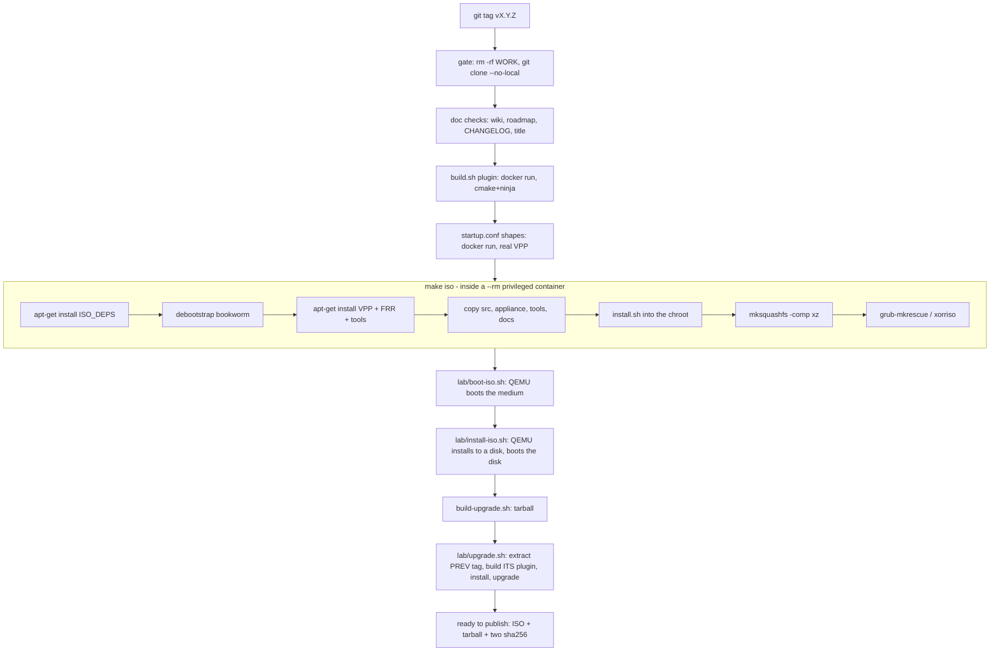
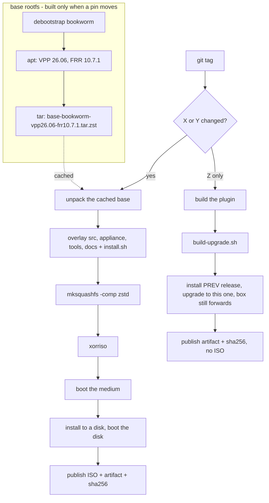

# Where the release time goes

## TL;DR

**A release takes 36 minutes of wall clock, and about 30 seconds of it is
compiling this product.** Measured over the six releases cut on 2026-09-19:
36, 36, 36, 36, 36 and 38 minutes from tag to the gate's last line. A cold
build of the `bpa` plugin — from a clone with no build directory at all — is
**4 seconds**.

The time is in three places, none of them compilation:

1. **Building a Debian filesystem from nothing**, every time: `debootstrap`
   plus an `apt-get install` of VPP, FRR and the base tools over the network,
   then `mksquashfs -comp xz` over the result. Nothing is cached between
   builds: the work directory is deleted at the start of every run.
2. **Three QEMU boots**: the medium booted, the medium installed to a disk and
   that disk booted, and a box of the *previous* release installed and then
   upgraded. The install phase alone is documented in `lab/install-iso.sh` at
   **687–692 seconds**.
3. **The container installing its own tools four times**: every ISO target runs
   `apt-get update && apt-get install` inside a `--rm` container because
   `ISO_DEPS` and `qemu-system-x86` are not in the dev image.

The proposed X.Y.Z model — Z rebuilds nothing but the changed components and
publishes no ISO — **fits this product with one condition**: the gate's claim
is *"this medium was built, booted, installed and booted again"*, and a Z
release that skips the ISO has to make a different claim, in writing, about
what it did prove. The mechanism for that already exists and is already
gated: the upgrade artifact, and `lab/upgrade.sh`, which installs the previous
release and puts the new one on top of it.

> The key words **MUST**, **MUST NOT**, **SHOULD** and **MAY** in this document
> are to be interpreted as described in
> [RFC 2119](https://www.rfc-editor.org/rfc/rfc2119).

## 5W2H

| | |
|---|---|
| **What** | Where the 36 minutes of a release go, what is rebuilt that did not change, and what a patch-level release could skip. |
| **Why** | The waiting is the cost of the release discipline, and the discipline is not negotiable — so the waiting has to be attacked where it is not buying evidence. |
| **Who** | Whoever cuts a release, which today is one command: `tools/release-gate.sh`. |
| **Where** | `tools/release-gate.sh`, `appliance/build-iso.sh`, the `iso`/`test-*` targets in `Makefile`, `lab/boot-iso.sh`, `lab/install-iso.sh`, `lab/upgrade.sh`. |
| **When** | Before changing the versioning strategy, so the change is aimed at the measured cost. |
| **How** | Read the scripts, measure what is cheap to measure, and say plainly which numbers are measured and which are not. |
| **How much** | 36 min today. The measured floor of what must stay is about 20 min; the rest is rebuild and reinstall of things that did not change. |

## Current build pipeline

## Timing breakdown

**Measured** means a number this repository produced. **Not instrumented**
means the step has no timing of its own and the figure is bounded by what
surrounds it — those are marked, and the instrumentation plan below says
exactly where to put the clock.

| Step | Current time | Rebuild required? | Cacheable? | Incremental? |
|---|---|---|---|---|
| Clone the tag into `/tmp/prisma-release` | seconds (measured: the clone is local) | every run, by design — the gate refuses to build from a working tree | no, and it **SHOULD NOT** be | no |
| Doc checks (wiki, roadmap, CHANGELOG, title) | seconds (measured: they run in `make test` too) | every run | n/a | n/a |
| **Plugin compile** | **4 s cold, 3.3 s incremental** (measured) | every run | already fast | already incremental |
| `startup.conf` shapes against a real VPP | ~2 min (stated in `release-gate.sh`; not instrumented) | every run | container start is the cost, not the work | no |
| `apt-get install ISO_DEPS` in the container | not instrumented — **runs 4×** per release | never: the inputs never change | **yes — bake into the dev image** | n/a |
| `debootstrap bookworm` | not instrumented; part of the ~10 min `make iso` | every run | **yes — a base tarball keyed by suite** | no |
| `apt-get install` VPP + FRR + tools in the chroot | not instrumented; the network-bound half of `make iso` | every run | **yes — an apt cache, or a prebuilt rootfs layer** | no |
| Copy `src`, `appliance`, `tools`, `docs` + `install.sh` | seconds | every run — this is the only part that changes on a patch | n/a | **yes, this is the incremental unit** |
| `mksquashfs -comp xz -processors 2 -mem 768M` | not instrumented; the CPU-bound half of `make iso` | every run | no (its input changes) | no — but `-comp zstd` is a large, honest win |
| `grub-mkrescue` / `xorriso` | seconds (visible in the log: "13% done" then complete) | every run | no | no |
| **`make iso` total** | **~10 min** (stated in `TESTING.md`; not instrumented per phase) | every run | mostly | partly |
| `lab/boot-iso.sh` (QEMU) | ≤ 7 min, `BOOT_SECS` default 420 (measured as a bound) | every run | no | no |
| `lab/install-iso.sh` (QEMU) | **687–692 s** ≈ 11.5 min (measured, recorded in the file) | every run | no | no |
| `build-upgrade.sh` | "seconds, no root and no container" (`TESTING.md`) | every run | n/a | n/a |
| `lab/upgrade.sh` | not instrumented; extracts the **previous tag** and **compiles its plugin again** | every run | **yes — `.build-old/<tag>` is already a cache, and the gate deletes it** | yes |
| **Total** | **36 min** (measured, six consecutive releases) | | | |

## Biggest bottlenecks

1. **`lab/install-iso.sh` — ~11.5 min, measured.** One QEMU boot, an install
   to a virtual disk, a reboot with the medium detached, and the self-test read
   off the console. It is the most expensive single step and it is also the one
   that has caught the most: #119, #121, #307, #377 were all invisible from a
   live boot.
2. **`make iso` — ~10 min, of which the product's own contribution is a file
   copy.** A whole Debian userland is fetched and built from nothing so that
   about 4 MB of `src/`, `appliance/`, `tools/` and `docs/` can be put inside
   it. Everything before the copy is identical between two releases whose
   `VPP_VERSION` and `FRR_VERSION` have not moved.
3. **`lab/upgrade.sh` — the previous release is rebuilt from source every
   time.** `.build-old/<tag>` exists precisely to cache it, and the gate's
   `rm -rf "$WORK"` throws it away on every run, so the cache has never once
   been hit in a release.

## Unnecessary rebuilds

* **The Debian base.** `debootstrap` produces the same tree for the same suite
  and the same package list. It is rebuilt on every release.
* **VPP and FRR.** Pinned to exact versions (`26.06-release`,
  `10.7.1-0~deb12u1`) and downloaded again on every release.
* **The container's own tools.** `ISO_DEPS` for `iso`, and `qemu-system-x86`
  for `test-iso`, `test-install` and `test-mirror` — four `apt-get install`
  runs per release, of packages that are the same every time, into a container
  that is thrown away.
* **The previous release's plugin**, compiled again by `lab/upgrade.sh` on
  every run because the work directory that holds its cache is deleted first.
* **The squashfs**, recompressed in full whenever any file inside it changes —
  which on a patch release is the 4 MB of product, not the 700 MB of Debian.

## Cache opportunities

| What | How | Saves |
|---|---|---|
| `ISO_DEPS` + `qemu-system-x86` | add to `build/Dockerfile.dev` | 4 apt runs per release |
| The debootstrap tree | a tarball keyed by `SUITE` + the `--include` list, rebuilt when either changes | the whole `debootstrap` phase |
| VPP/FRR packages | an apt cache directory bind-mounted into the chroot build, keyed by the two pinned versions | the network-bound half of `make iso` |
| The whole base rootfs | one squashfs layer for "Debian + VPP + FRR", rebuilt only when a pin moves | both phases above, on every release that does not move a pin |
| `.build-old/<tag>` | keep the gate's work directory, or point the cache at a path outside it | one plugin build and one `git archive` per release |

## Incremental build opportunities

* **The product layer is already separable.** `build-iso.sh` copies four
  directories and runs `install.sh` inside the chroot. That is the only part
  that differs between 0.107.0 and 0.107.1, and it is a few seconds of work
  inside a ten-minute build.
* **The upgrade artifact is already the incremental release.**
  `appliance/build-upgrade.sh` packs exactly those directories plus the built
  plugins, `appliance/upgrade` installs it with the same `install.sh` the ISO
  uses, and the gate already measures that path end to end against the previous
  published release. A patch release that publishes only this artifact is not a
  new mechanism — it is the mechanism this product already ships.
* **`mksquashfs` supports appending**, but the honest incremental unit here is
  the layer, not the append: build the base once, unpack it, overlay the
  product, recompress. With `-comp zstd` the recompression is minutes faster
  than `xz` at a cost in image size that is worth measuring before choosing.

## ISO build analysis

**Yes — the complete operating system filesystem is rebuilt on every release.**
`appliance/build-iso.sh` runs `debootstrap` into an empty directory, adds the
VPP and FRR repositories, installs them, copies the product in, and squashes
the result. There is no base image, no layer cache and no apt cache; the only
thing carried between builds is the dev container image itself, which holds
the compiler and not the appliance.

**And no, the product's own components are not rebuilt unnecessarily** — the
plugin build is 4 seconds cold. The waste is entirely on the operating-system
side of the medium.

Two consequences worth stating plainly:

* A release whose only change is one line of Python pays the same 36 minutes
  as one that changes the dataplane.
* The ISO's reproducibility today rests on the pinned versions and on Debian's
  archive, not on anything this repository keeps. A cached base tarball would
  make it *more* reproducible, not less, because the bytes would be ours.

## The strategy, as decided

Decided by the maintainer on 2026-09-20, from the questions this report
raised. `CONTRIBUTING.md` section 5 carries the rule; this is the reasoning
behind it.

* **A Z release is tagged and published as a pre-release.** Tagged because a
  version running on a box has to exist in the history; pre-release because
  GitHub then leaves **Latest** on the last X or Y, which is the last medium
  this project booted — and that is what an operator landing on the releases
  page should be handed.
* **A Z release proves `make test` and nothing more.** 93 suites, about two
  minutes, and no box is installed. The exposure is bounded by a check that
  already exists: the gate upgrades from the **previous published release**, so
  the first Y after a run of Z releases measures the upgrade from the last of
  them. A Z is proven at the next Y and never before it.
* **A Z release may change only what the artifact carries** — `src/`,
  `tools/`, `docs/`, the `appliance/` files the artifact installs, and the
  plugin. Anything else is a Y, whatever its size, because the artifact cannot
  carry it and a box that took the patch would be running something no medium
  builds.
* **The base rootfs becomes a local, versioned artifact** — Debian plus the
  pinned VPP and FRR, rebuilt only when a pin moves, kept on disk rather than
  published. It makes the medium *more* reproducible than it is today, because
  the bytes stop being whatever the archive served that morning.
* **The instrumentation lands first, on its own**, so the optimisations that
  follow aim at measured numbers rather than at the estimates in this
  document.

## Why the model fits

The model — Z never produces an ISO, X and Y always do — is feasible, and
three things have to move with it.

**1. What a release CLAIMS has to change with what it DOES.**
`CONTRIBUTING.md` section 5 requires every release to ship a medium that was
built, booted, installed and booted again, and `tools/release-gate.sh` refuses
a tag whose note does not say so. A Z release proves something different and
**MUST** say that instead: *built the upgrade artifact, installed the previous
release, put this one on top of it, and the box still forwards.* That is
`lab/upgrade.sh`, which the gate already runs on every release.

**2. The ISO has to be able to consume a versioned base.** Today the medium is
built from the network. For X/Y releases to reuse artifacts, the base rootfs
needs a version of its own — something like `base-bookworm-vpp26.06-frr10.7.1`
— that is built when a pin moves and reused otherwise. That identity is what
makes "the ISO consumes already-built artifacts" checkable rather than hoped
for.

**3. The Z path needs a floor, or it becomes a way to avoid the gate.** The
honest floor is that a Z release **MUST NOT** change anything the ISO carries
and the artifact does not: the kernel, VPP, FRR, the installer's partitioning,
the bootloader. A patch that touches `appliance/build-iso.sh` is not a patch.

**What this repository already has, and what is missing:**

| Needed | Status |
|---|---|
| An artifact for a box already in service | `appliance/build-upgrade.sh`, published with every release since 0.30-something |
| A measured upgrade from the previous release | `lab/upgrade.sh`, run by the gate on every release since #398 |
| A refusal when the artifact cannot be applied | `appliance/upgrade` refuses a release that moves the VPP or FRR pin, naming both versions |
| A versioned base rootfs | **missing** — this is the new work |
| A gate that knows the difference between X/Y and Z | **missing** — `release-gate.sh` has one path |

## Recommended future pipeline

## Expected time savings

Estimates, and marked as such — the per-phase numbers inside `make iso` are
not instrumented yet, which is the first item of the plan below.

| Change | Saves | Confidence |
|---|---|---|
| Bake `ISO_DEPS` and `qemu-system-x86` into the dev image | 4 apt runs per release | high — the work is known, the duration is not |
| Cache the base rootfs (`debootstrap` + VPP + FRR) | most of `make iso`'s ~10 min on every release that moves no pin | high on the mechanism, medium on the number |
| `-comp zstd` instead of `xz` | minutes of the squashfs phase, at a cost in image size | medium — needs one measurement of both |
| Keep `.build-old/<tag>` across runs | one `git archive` and one plugin build per release | high, small |
| **Z releases skip the medium entirely** | **~19 min of the 36** — the ISO build, the boot and the install | high: those three steps are exactly what a Z release would not run |

A Z release under this model is roughly the plugin build, the artifact, and
`lab/upgrade.sh` — **under 15 minutes**, and most of that is the one QEMU
sequence that proves the upgrade works.

## The instrumentation plan, before any of this is believed

Four of the numbers above are bounds rather than measurements. They can all be
had in one release cycle, with no change to what anything does:

1. **`appliance/build-iso.sh`** — its `say()` already prints every phase.
   Print the seconds since the previous `say()` beside each one. That single
   change splits the ~10 minutes into `debootstrap`, the VPP/FRR install, the
   product copy, `install.sh`, `mksquashfs` and `xorriso`.
2. **`tools/release-gate.sh`** — the same beside each `==>`, which turns the
   gate's own log into the per-step table this document had to estimate.
3. **`lab/boot-iso.sh` and `lab/install-iso.sh`** — both already know when they
   started; print the elapsed time with the verdict, the way
   `lab/install-iso.sh` already records 687–692 s in a comment.
4. **`lab/upgrade.sh`** — print whether `.build-old/<tag>` was a hit or a miss,
   which is the only way to see a cache that has never been hit.

None of these changes behaviour, all of them go in the log that is already
kept, and after one release the table above stops being an estimate.
