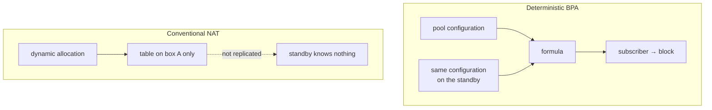

# Prisma Routing - High Availability

## TL;DR

**Nothing here is implemented.** This is analysis and a plan.

The relevant finding: in deterministic mode the mapping is a *function of the
configuration*, so two boxes with the same pool produce the same block for the
same subscriber without exchanging a single byte of state. A failover still
drops in-flight connections — as any NAT does — but they re-establish on the
**same public address**. For the subscriber that is the difference between
"I reloaded the page" and "my IP changed and the bank logged me out".

The trap for whoever implements this: in deterministic mode, two boxes with
**different** configuration fail **silently**.

**That trap now has a check on it, and only that.** `show cgnat ha` compares
the two boxes' mappings and says which pool differs; nothing here elects a
role, moves an address or takes anything over. See
[Configuration equality](#configuration-equality-what-exists) below, which
also states the seam the comparison ends at: the peer's configuration reaches
this box as a file somebody copies, because there is no session between the
two boxes to carry it.

The acceptance test is written and **is red on `master`**: `lab/ha-failover.sh`
stands up two boxes, runs a subscriber's translated flow through a service
address, breaks the active box three different ways, and fails every check that
is the product's. That is the intended result, and the section at the end of
this page says what it measured.

> The key words **MUST**, **MUST NOT**, **SHOULD**, **SHOULD NOT** and **MAY**
> in this document are to be interpreted as described in
> [RFC 2119](https://www.rfc-editor.org/rfc/rfc2119).

## 5W2H

| | |
|---|---|
| **What** | Failover between two Prisma Routing boxes serving the same subscriber base. |
| **Why** | A CGNAT box is a single point of failure for every subscriber behind it. |
| **Who** | The provider's operations team; the subscriber should ideally notice nothing. |
| **When** | On hardware failure, planned maintenance, or software upgrade. |
| **Where** | Between two boxes sharing the same pool configuration and the same upstream. |
| **How** | Proposed: active/standby with VRRP, no session synchronisation. |
| **How much** | Zero state to synchronise for address stability; session synchronisation would cost a control-plane flow comparable to the log itself. |

## What deterministic mode gives for free

In conventional CGNAT the subscriber-to-(public IP, port) mapping is the result
of dynamic allocation: it exists only in the table of the box that created it.
A standby knows nothing, and a failover changes everyone's public address.



| After failover | Conventional NAT | Deterministic BPA |
|---|---|---|
| Subscriber's public IP | changes | **unchanged** |
| Port block | changes | **unchanged** |
| In-flight connections | dropped | dropped |
| New connections | need fresh allocation | work immediately |
| State to synchronise for the above | the whole table | **none** |

The line that matters: in-flight connections drop in both cases, but under BPA
they re-establish on the same public address.

This is not HA. It is the floor HA starts from, and it is already higher than
usual.

## What is still needed for real failover

Preserving in-flight connections requires synchronising the session table,
because the return path needs the **private port**, and no formula produces
that (see [architecture.md](architecture.md)).

| Design | Cost | What it preserves |
|--------|------|-------------------|
| Active/standby without sync | ~zero | Public address and block; connections drop |
| Session sync over multicast | High: every session create and delete becomes a message | In-flight connections |
| Active/active with subscriber partitioning | Medium | Half the traffic unaffected by one failure |

Session synchronisation is the only one that preserves connections and the most
expensive: on a 200k-subscriber box with hundreds of sessions each, replicating
every create and delete is a control-plane flow comparable to the log itself.

**Dynamic mode adds a requirement**: block allocation would have to be
coordinated, or the two boxes would allocate different blocks to the same
subscriber.

## Proposal for a first version

Active/standby with VRRP on both the public and the internal side, no session
synchronisation, and identical configuration guaranteed by the configuration
trail that already exists.

It is honest about what it delivers: it does not preserve connections, it
preserves addresses. For a provider that already removes the worst symptom of a
CGNAT failover.

To be built:

1. Integration with `keepalived` or FRR's VRRP, coherent with `linux_cp`.
2. Verification that both boxes carry the **same** pool configuration.
   **Done**, as far as a box with no peer session can take it
   ([#8](https://github.com/andrediashexa/hexarouting/issues/8)) - the section
   below says where it stops.
3. A `show cgnat ha` comparing a configuration hash between peers. **Done**,
   and spelled `cgnat` rather than `bpa` for a reason recorded below.
4. A lab test with two instances and a forced failure, confirming the
   subscriber keeps address and block. **Done, and red**: `lab/ha-failover.sh`
   ([#9](https://github.com/andrediashexa/hexarouting/issues/9)), written before
   items 1 to 3 so that they are judged against the requirement rather than the
   requirement being written to fit them.

Item 2 **MUST NOT** be skipped. In deterministic mode, two boxes with different
configuration fail silently: the failover starts mapping subscribers to the
wrong blocks with no visible error, and the logs of both boxes will look
perfectly healthy. Configuration equality is a requirement, not a convenience.

## Configuration equality: what exists

`show cgnat ha` answers one question and refuses to answer any other: would a
takeover put subscribers where they already are?

```
prisma> show cgnat ha
  this box
    mapping fingerprint  50e2b92f23c2707c
    pools                residencial

  role
    neither box elects one: this VTY has no virtual router and nothing here
    takes a service address over. What is checked below is whether a takeover
    WOULD land subscribers where they already are.

  peer, from /etc/prisma-routing/peer.conf
    mapping fingerprint  9e7394fc505d2eff
    pools                residencial
    copied               2026-09-12 09:14:31

warning: pool 'residencial' does not map subscribers the same way on the two
    boxes, so a failover moves them to other public addresses and port
    blocks, and neither box logs anything
    this box: block-size 2048
    the peer: block-size 1024
```

The same comparison runs at `commit check` and at `commit`, so a change that
diverges the pair says so at the moment it is made rather than at the moment
the other box is needed.

### Which fields must match, and why there is no list of them

There is no table anywhere of "the fields two peers must agree on", and there
must not be one. The set is **derived**: a subscriber's address and block are a
function of the pool definition, so the fields that must match are exactly the
fields that change the mapping - and the product already decides that, in one
place, for a different reason.

`Config.delta_to` rebuilds a pool on the dataplane exactly when
`Pool.lines(in_place=False)` moves, because a mapping change invalidates every
session on the pool. `test/test_prismash_config.py` asserts that classification
field by field, and asserts that **every field a pool has is classified** - a
field added later and forgotten fails there rather than defaulting to whatever
the diff happens to do with it.

The fingerprint is a digest of that same text. So the question "which fields
must two peers agree on" has one answer, held once, and a field added to a pool
is classified once. A second list would be a second copy of a decision this
product has already made, and the two would disagree the first time one of them
was edited.

What that derivation yields today, for the record rather than as a list to
maintain: the inside and outside prefixes, the block size, the port range, the
policy, the mode, the reserve, and both VRFs. Note what is **absent** - the
timeouts, the ALG switches, the TCP clamp, the bypass lists, the session and
rate ceilings, the port forwards, the stride, the utilisation alarm. Those the
dataplane changes on a pool that is carrying traffic, and they move no
subscriber anywhere: two peers that differ on them are correctly configured,
and warning about them would be a warning an operator learns to skip.

### Where the check stops, and why it stops there

The comparison is between two configurations. Getting the peer's configuration
to this box is a **separate problem**, and it is not solved here: there is no
session between the two boxes, because VRRP is
[#7](https://github.com/andrediashexa/hexarouting/issues/7) and does not exist
yet, so nothing can ask the peer anything.

So the peer's configuration arrives as a file, `/etc/prisma-routing/peer.conf`
(`PRISMA_PEER_CONFIG` overrides it), which is the same artefact `save` writes and
`--load` reads. That seam is deliberate: whatever ends up carrying a peer
relationship writes that file, and the comparison above does not change. Until
something does, the file is whatever was last copied there - which is why every
report prints its date beside the digest. **A digest that matches a
configuration the peer stopped running last week is the same false agreement
this check exists to remove.**

Three consequences worth stating outright, because each of them is a way for a
check like this to lie:

* **An unreadable peer never reads as a match.** Absent, unreadable, empty,
  naming no pool, or carrying a statement this VTY cannot hold: each is
  reported as itself, and none of them as agreement. All five parse to an empty
  configuration if they are parsed carelessly, and an empty configuration
  compares equal to another empty configuration.
* **A dataplane that is not answering stops the report.** This box's own
  configuration is read from the dataplane, so a dead one yields an empty
  configuration and would make the peer look like the one that changed.
* **The divergence is a warning, never a refusal.** Two boxes cannot be
  committed in the same instant, so every legitimate capacity change diverges
  the pair between the first commit and the second. A refusal would fire on
  every correct procedure, and the only way past it would be to stop copying
  the peer's configuration - which removes the check rather than the
  divergence.

### `show cgnat ha` and not `show bpa ha`

Every other `show cgnat` command is the dataplane's own, forwarded word for
word. This one is not, and cannot be: the dataplane holds one box's
configuration and has never heard of the other, so a comparison between two
boxes is answered where both can be read. The issue asking for this wrote it
`show bpa ha`; the spelling changed and the answer did not.

## What the acceptance test measured on `master`

`lab/ha-failover.sh` is the acceptance test for this whole page and it exists
before the implementation, which is what
[roadmap.md](roadmap.md) phase 6 asks for. It is **excluded from
`tools/run-all-labs.sh`**, with the reason recorded in that file's `NOT_LABS`:
it is red because the feature is missing, not because anything is broken.

It arranges two dataplanes on a shared inside LAN and a shared outside LAN,
each with its own addresses, and points a subscriber at a **service address**
that neither box owns. The lab MAY build the topology, start both boxes, and
cause the failure. It **MUST NOT** put the service address on a box, move it,
answer ARP for it, flush the subscriber's ARP cache, or decide which box is
active: that is the product's work, and a lab that does it tests itself.
`lab/lcp.sh` carries the same lesson in its header.

Three findings, each measured against a running pair at 0.67.0.

| What was measured | Result |
|---|---|
| Two boxes, same pool, no state exchanged | Both compute `200.150.16.5 ports 1024-3071` for the same subscriber. The claim at the top of this page holds, on packets. |
| The subscriber's translated round trip through the service address | Never completes. The subscriber's ARP for the gateway stays `INCOMPLETE`, because nothing answers for it. |
| Each of three failures: a pulled uplink, a stopped dataplane, a killed dataplane | The service does not come back within 20 seconds in any of the three. |

Two things the run turned up that whoever implements this has to deal with.

**The VTY has no `vrrp` of its own, so it hands the statement to FRR word for
word.** FRR's VRRP would then run on the `linux_cp` TAP, and the TAP is not
where the packets are: the dataplane interface is. An implementation built that
way moves an address in Linux and leaves the VPP FIB and the BPA feature arcs
on the box that died. This is the incoherence
[#7](https://github.com/andrediashexa/hexarouting/issues/7) names, and the
dataplane already ships the other half of the answer - `vrrp_plugin.so`, RFC
5798, loaded on every box, with no virtual router on it because nothing asks
for one.

**Anything at all under `nat cgnat` is accepted and discarded in silence.**
`nat cgnat ha peer 200.150.0.12 priority 200` passes `commit check`
("configuration check succeeds"), passes `commit` ("commit complete"), and then
appears in no `show running-config` and changes nothing on the box. That is why
the lab asserts nothing about the configuration being *accepted* and everything
about the packet: a check on acceptance would be green on a box that does
nothing. The silent acceptance is a defect of its own, filed separately.

**That second finding no longer holds, and saying so is part of keeping this
page worth reading.** Re-measured at 0.69.0: the same statement the lab types,
`nat cgnat ha peer 200.150.0.12 priority 200`, is now refused at the prompt
before it can enter the candidate at all.

```
error: cgnat ha: this VTY has no such setting
    it would have been accepted, saved and applied to nothing. What this box
    takes here is: block-holddown, interface, logging, pool, session-table,
    timeout
```

[#273](https://github.com/andrediashexa/hexarouting/issues/273) closed the hole
one layer up, in the VTY rather than in the dataplane: the words under `cgnat`
now come from the same table `?` offers from, so a refusal there cannot drift
from what the box says it takes. The lab's stage 2 still carries the old
measurement in a comment, and its verdict is unaffected - it asserted nothing
about acceptance then and asserts nothing about it now, which is exactly why
the finding changing underneath it cost nothing.
