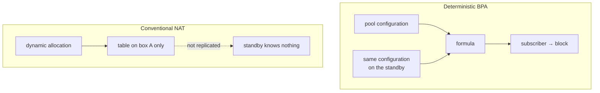

# Prisma Routing - High Availability

## TL;DR

**Nothing here is implemented.** This is analysis and a plan.

The relevant finding: in deterministic mode the mapping is a *function of the
configuration*, so two boxes with the same pool produce the same block for the
same subscriber without exchanging a single byte of state. A failover still
drops in-flight connections — as any NAT does — but they re-establish on the
**same public address**. For the subscriber that is the difference between
"I reloaded the page" and "my IP changed and the bank logged me out".

The trap for whoever implements this: in deterministic mode, two boxes with
**different** configuration fail **silently**.

**That trap now has a check on it, and only that.** `show cgnat ha` compares
the two boxes' mappings and says which pool differs; nothing here elects a
role, moves an address or takes anything over. See
[Configuration equality](#configuration-equality-what-exists) below, which
also states the seam the comparison ends at: the peer's configuration reaches
this box as a file somebody copies, because there is no session between the
two boxes to carry it.

The acceptance test is written and **is red on `master`**: `lab/ha-failover.sh`
stands up two boxes, runs a subscriber's translated flow through a service
address, breaks the active box three different ways, and fails every check that
is the product's. That is the intended result, and the section at the end of
this page says what it measured.

> The key words **MUST**, **MUST NOT**, **SHOULD**, **SHOULD NOT** and **MAY**
> in this document are to be interpreted as described in
> [RFC 2119](https://www.rfc-editor.org/rfc/rfc2119).

## 5W2H

| | |
|---|---|
| **What** | Failover between two Prisma Routing boxes serving the same subscriber base. |
| **Why** | A CGNAT box is a single point of failure for every subscriber behind it. |
| **Who** | The provider's operations team; the subscriber should ideally notice nothing. |
| **When** | On hardware failure, planned maintenance, or software upgrade. |
| **Where** | Between two boxes sharing the same pool configuration and the same upstream. |
| **How** | Proposed: active/standby with VRRP, no session synchronisation. |
| **How much** | Zero state to synchronise for address stability; session synchronisation would cost a control-plane flow comparable to the log itself. |

## What deterministic mode gives for free

In conventional CGNAT the subscriber-to-(public IP, port) mapping is the result
of dynamic allocation: it exists only in the table of the box that created it.
A standby knows nothing, and a failover changes everyone's public address.



| After failover | Conventional NAT | Deterministic BPA |
|---|---|---|
| Subscriber's public IP | changes | **unchanged** |
| Port block | changes | **unchanged** |
| In-flight connections | dropped | dropped |
| New connections | need fresh allocation | work immediately |
| State to synchronise for the above | the whole table | **none** |

The line that matters: in-flight connections drop in both cases, but under BPA
they re-establish on the same public address.

This is not HA. It is the floor HA starts from, and it is already higher than
usual.

## What is still needed for real failover

Preserving in-flight connections requires synchronising the session table,
because the return path needs the **private port**, and no formula produces
that (see [architecture.md](architecture.md)).

| Design | Cost | What it preserves |
|--------|------|-------------------|
| Active/standby without sync | ~zero | Public address and block; connections drop |
| Session sync over multicast | High: every session create and delete becomes a message | In-flight connections |
| Active/active with subscriber partitioning | Medium | Half the traffic unaffected by one failure |

Session synchronisation is the only one that preserves connections and the most
expensive: on a 200k-subscriber box with hundreds of sessions each, replicating
every create and delete is a control-plane flow comparable to the log itself.

**Dynamic mode adds a requirement**: block allocation would have to be
coordinated, or the two boxes would allocate different blocks to the same
subscriber.

## Proposal for a first version

Active/standby with VRRP on both the public and the internal side, no session
synchronisation, and identical configuration guaranteed by the configuration
trail that already exists.

It is honest about what it delivers: it does not preserve connections, it
preserves addresses. For a provider that already removes the worst symptom of a
CGNAT failover.

To be built:

1. Integration with `keepalived` or FRR's VRRP, coherent with `linux_cp`.
   **Done, and with neither of them** - the section *Where the virtual router
   runs* below says what was built instead and why.
2. Verification that both boxes carry the **same** pool configuration.
   **Done** ([#8](https://github.com/andrediashexa/hexarouting/issues/8)): the
   comparison, and since there is a pair to be half of, the refusal as well -
   `commit` on a box that stands for a service address refuses a change that
   would map subscribers differently from its peer. The two sections below
   say how far each half reaches.
3. A `show cgnat ha` comparing a configuration hash between peers. **Done**,
   and spelled `cgnat` rather than `bpa` for a reason recorded below.
4. A lab test with two instances and a forced failure, confirming the
   subscriber keeps address and block. **Done, and 18 of its 22 checks are
   now green**: `lab/ha-failover.sh` ([#9](https://github.com/andrediashexa/hexarouting/issues/9)), written before
   items 1 to 3 so that they are judged against the requirement rather than the
   requirement being written to fit them. What it measures today is in *What
   the acceptance test measures now*, at the end of this page.

Item 2 **MUST NOT** be skipped. In deterministic mode, two boxes with different
configuration fail silently: the failover starts mapping subscribers to the
wrong blocks with no visible error, and the logs of both boxes will look
perfectly healthy. Configuration equality is a requirement, not a convenience.

## Where the virtual router runs, and why it is neither of the two candidates

The question [#7](https://github.com/andrediashexa/hexarouting/issues/7) exists to answer is not
"which VRRP implementation", it is **where the virtual address answers ARP**.
A CPE reaches its gateway by MAC. If the address moves in Linux and the
dataplane knows nothing about it, the box that took the address does not
receive the frames, because the frames go to a MAC on the box that died.

FRR ships VRRP and `keepalived` is the other candidate, and **both run in
Linux**, which on this box means the `linux_cp` TAP. The TAP is not on the
packet path: the dataplane interface is. A pair built on either of them moves
an address in Linux and leaves the VPP FIB and the CGNAT feature arcs behind.

**So it is neither. The dataplane already shipped the answer**: VPP's own
`vrrp_plugin.so`, RFC 5798, loaded on every box this product has ever
installed, with no virtual router on it because nothing asked for one. The VTY
now asks, over the binary API, and the virtual router lives on the interface
that carries the packets:

```
interface ens18
 ipv4 address 100.64.3.252/22
 vrrp 1 address 100.64.3.254
 vrrp 1 priority 200
 vrrp 1 track ens19 decrement 150
 exit
```

What that buys, measured on a running pair in `lab/vrrp.sh`:

* the virtual address answers ARP **with RFC 5798's virtual MAC**,
  `00:00:5e:00:01:<vrid>`, on the dataplane interface;
* the box that takes over takes the MAC with it, so **a CPE that never
  flushed its ARP cache goes on sending to the same MAC** and the frames
  arrive at the other box. The lab flushes nothing, at any point, precisely so
  that a product which never sent a gratuitous ARP could not pass;
* the priorities in the configuration decide, and **preempt is on**: a box
  that comes back takes the service back, so the pair ends where the
  configuration says rather than where the last failure left it.

**One flag, and it is preempt.** `vrrp_vr_flags` is declared in `vrrp.api` as
an `enum` rather than an `enumflags`, and vat2 encodes exactly one of its
names: `"VRRP_API_VR_PREEMPT|VRRP_API_VR_ACCEPT"` is refused, a list of two
segfaults the client, and so does the integer 3. So accept mode is not
available through the binary API, and the cost is stated rather than hidden:
**the virtual address does not answer ICMP**. That is RFC 5798 section 6.4.3's
default for a router that does not own the address, so it is the RFC's answer
and not a shortcut - but a monitoring system that pings the gateway sees
nothing. It should ping each box's own address, which is what says whether
that box is alive; the virtual address only says which of them is holding it.
Forwarding **through** it is unaffected, and that is what the lab measures.

**The advertisement interval is not configurable**, and that is a decision
rather than an omission: it MUST be the same on both boxes or the election
never settles, and a per-box statement is a per-box way to get it wrong. It is
RFC 5798's default of one second, which puts a takeover at about three and a
half seconds. A pair that needs faster than that wants BFD, which is a
different mechanism and a different issue.

**What is configured and what is in force are two screens, not one.**
`show cgnat ha` prints the role, the addresses, the virtual MAC and the
priority the box is **advertising** - which is not the configured one when
something it tracks is down, and that difference is the whole point of
tracking. A box advertising less than it was configured for has a cable out,
not a VRRP problem.

### What could not be measured in a container

Interface tracking is on the box and comes back from the dataplane, and the
lab asserts that. What a container cannot do is make the dataplane **see** the
cable go: these labs forward over af_packet host interfaces, and this VPP
never reports one of those as link down. Measured three ways, all in
`lab/vrrp.sh` and printed by every run - the bridge side of the veth taken
down, the box's own port taken down in Linux, and the veth deleted outright -
and `show hardware` says `up` in all three. A VPP `tap` was tried instead of
an af_packet host interface, on the theory that a virtio device would carry
the host's carrier: it does not either, and `show hardware` says `up` there
too with the Linux side of the tap down. So this is not a matter of choosing
a better interface type in the lab.

So the lab measures the half that tracking rests on instead: an election that
follows the numbers. It lowers box a's priority through the VTY, watches the
service move to box b, raises it again, and watches it come back. A pair whose
service does not move when the priority moves would not fail over on a tracked
interface either. The pulled-uplink measurement itself belongs with the other
readings that need a real NIC, which is
[#28](https://github.com/andrediashexa/hexarouting/issues/28).

## Configuration equality: what exists

`show cgnat ha` answers one question and refuses to answer any other: would a
takeover put subscribers where they already are?

```
prisma> show cgnat ha
  this box
    mapping fingerprint  50e2b92f23c2707c
    pools                residencial

  role
    neither box elects one: this VTY has no virtual router and nothing here
    takes a service address over. What is checked below is whether a takeover
    WOULD land subscribers where they already are.

  peer, from /etc/prisma-routing/peer.conf
    mapping fingerprint  9e7394fc505d2eff
    pools                residencial
    copied               2026-09-12 09:14:31

warning: pool 'residencial' does not map subscribers the same way on the two
    boxes, so a failover moves them to other public addresses and port
    blocks, and neither box logs anything
    this box: block-size 2048
    the peer: block-size 1024
```

The same comparison runs at `commit check` and at `commit`, so a change that
diverges the pair says so at the moment it is made rather than at the moment
the other box is needed.

### Which fields must match, and why there is no list of them

There is no table anywhere of "the fields two peers must agree on", and there
must not be one. The set is **derived**: a subscriber's address and block are a
function of the pool definition, so the fields that must match are exactly the
fields that change the mapping - and the product already decides that, in one
place, for a different reason.

`Config.delta_to` rebuilds a pool on the dataplane exactly when
`Pool.lines(in_place=False)` moves, because a mapping change invalidates every
session on the pool. `test/test_prismash_config.py` asserts that classification
field by field, and asserts that **every field a pool has is classified** - a
field added later and forgotten fails there rather than defaulting to whatever
the diff happens to do with it.

The fingerprint is a digest of that same text. So the question "which fields
must two peers agree on" has one answer, held once, and a field added to a pool
is classified once. A second list would be a second copy of a decision this
product has already made, and the two would disagree the first time one of them
was edited.

What that derivation yields today, for the record rather than as a list to
maintain: the inside and outside prefixes, the block size, the port range, the
policy, the mode, the reserve, and both VRFs. Note what is **absent** - the
timeouts, the ALG switches, the TCP clamp, the bypass lists, the session and
rate ceilings, the port forwards, the stride, the utilisation alarm. Those the
dataplane changes on a pool that is carrying traffic, and they move no
subscriber anywhere: two peers that differ on them are correctly configured,
and warning about them would be a warning an operator learns to skip.

### The refusal, and why it is a refusal on THIS box rather than on the standby

[#8](https://github.com/andrediashexa/hexarouting/issues/8) asks for "the standby
refuses to take over on mismatch". Taken literally that needs a hook that
fires when a box is ABOUT to become master, and RFC 5798 has no such moment to
hang it on: an election is won by a timer expiring, on a box that by
definition cannot reach the other one. VPP's plugin will report a transition
after the fact (`want_vrrp_vr_events`), so a box could take the address and
then put it down again - which is a takeover, a period of wrong translation,
and then an outage, in that order. That is worse than either outcome on its
own.

So the refusal is where a person is: **on the box being configured, at the
commit that would create the divergence**, and it is the same shape as
`commit remap`:

```
error: this change maps subscribers differently from the peer
    this box stands for a service address with another one, so a takeover would
    translate them there
error: pool 'business' is on this box and not on the peer, so after a failover
    its subscribers are translated by nothing at all
    cgnat pool business
    a takeover would put subscribers on blocks the other box never used, and
    neither box would log anything unusual, because nothing unusual happened to
    either of them
    if that is what you mean, type: commit diverge
```

Three properties of that, each deliberate:

* **Only on a box that is in a pair.** A box with no `vrrp` statement is not
  in a pair whatever files somebody left in `/etc`, so its commits are not
  gated; it gets the warning it has always had. A copied file is not a
  relationship, and this VTY does not get to decide that it is.
* **There is a word past it**, because two boxes cannot be committed in the
  same instant: every correct capacity change diverges the pair between the
  first commit and the second. A refusal with no way past it fires on every
  correct procedure, and the way past it becomes "stop copying the peer's
  configuration" - which removes the check rather than the divergence.
* **`commit check` says it too**, in the window where somebody is deciding
  rather than at the moment they type the commit.

**What it does not catch, stated plainly**: the peer being reconfigured after
its file was copied here. Nothing on this box can see that, because there is
no session between the two - and a stale file is exactly what the date beside
the digest in `show cgnat ha` exists to make visible. The gate closes the
window where a human is present and the change is being made; it does not
close the window where the other box changed and nobody copied it again.

`lab/vrrp.sh` measures the whole of it on a running pair: box b, standing for
a service address with box a and holding a copy of box a's configuration,
takes a pool box a has never heard of, is refused, is refused again by
`commit check` in the same words, and goes through when the change is asked
for by name.

### Where the check stops, and why it stops there

The comparison is between two configurations. Getting the peer's configuration
to this box is a **separate problem**, and it is not solved here: there is no
session between the two boxes. VRRP now exists
([#7](https://github.com/andrediashexa/hexarouting/issues/7)) and it carries no
configuration - RFC 5798 advertises a priority and an address, and nothing
else - so there is still nothing to ask the peer with.

So the peer's configuration arrives as a file, `/etc/prisma-routing/peer.conf`
(`PRISMA_PEER_CONFIG` overrides it), which is the same artefact `save` writes and
`--load` reads. That seam is deliberate: whatever ends up carrying a peer
relationship writes that file, and the comparison above does not change. Until
something does, the file is whatever was last copied there - which is why every
report prints its date beside the digest. **A digest that matches a
configuration the peer stopped running last week is the same false agreement
this check exists to remove.**

Three consequences worth stating outright, because each of them is a way for a
check like this to lie:

* **An unreadable peer never reads as a match.** Absent, unreadable, empty,
  naming no pool, or carrying a statement this VTY cannot hold: each is
  reported as itself, and none of them as agreement. All five parse to an empty
  configuration if they are parsed carelessly, and an empty configuration
  compares equal to another empty configuration.
* **A dataplane that is not answering stops the report.** This box's own
  configuration is read from the dataplane, so a dead one yields an empty
  configuration and would make the peer look like the one that changed.
* **The divergence is a warning, never a refusal.** Two boxes cannot be
  committed in the same instant, so every legitimate capacity change diverges
  the pair between the first commit and the second. A refusal would fire on
  every correct procedure, and the only way past it would be to stop copying
  the peer's configuration - which removes the check rather than the
  divergence.

### `show cgnat ha` and not `show bpa ha`

Every other `show cgnat` command is the dataplane's own, forwarded word for
word. This one is not, and cannot be: the dataplane holds one box's
configuration and has never heard of the other, so a comparison between two
boxes is answered where both can be read. The issue asking for this wrote it
`show bpa ha`; the spelling changed and the answer did not.

## What the acceptance test measured on `master`

`lab/ha-failover.sh` is the acceptance test for this whole page and it exists
before the implementation, which is what
[roadmap.md](roadmap.md) phase 6 asks for. It is **excluded from
`tools/run-all-labs.sh`**, with the reason recorded in that file's `NOT_LABS`:
it is red because the feature is missing, not because anything is broken.

It arranges two dataplanes on a shared inside LAN and a shared outside LAN,
each with its own addresses, and points a subscriber at a **service address**
that neither box owns. The lab MAY build the topology, start both boxes, and
cause the failure. It **MUST NOT** put the service address on a box, move it,
answer ARP for it, flush the subscriber's ARP cache, or decide which box is
active: that is the product's work, and a lab that does it tests itself.
`lab/lcp.sh` carries the same lesson in its header.

Three findings, each measured against a running pair at 0.67.0.

| What was measured | Result |
|---|---|
| Two boxes, same pool, no state exchanged | Both compute `200.150.16.5 ports 1024-3071` for the same subscriber. The claim at the top of this page holds, on packets. |
| The subscriber's translated round trip through the service address | Never completes. The subscriber's ARP for the gateway stays `INCOMPLETE`, because nothing answers for it. |
| Each of three failures: a pulled uplink, a stopped dataplane, a killed dataplane | The service does not come back within 20 seconds in any of the three. |

Two things the run turned up that whoever implements this has to deal with.

**The VTY has no `vrrp` of its own, so it hands the statement to FRR word for
word.** FRR's VRRP would then run on the `linux_cp` TAP, and the TAP is not
where the packets are: the dataplane interface is. An implementation built that
way moves an address in Linux and leaves the VPP FIB and the BPA feature arcs
on the box that died. This is the incoherence
[#7](https://github.com/andrediashexa/hexarouting/issues/7) names, and the
dataplane already ships the other half of the answer - `vrrp_plugin.so`, RFC
5798, loaded on every box, with no virtual router on it because nothing asks
for one.

**Anything at all under `nat cgnat` is accepted and discarded in silence.**
`nat cgnat ha peer 200.150.0.12 priority 200` passes `commit check`
("configuration check succeeds"), passes `commit` ("commit complete"), and then
appears in no `show running-config` and changes nothing on the box. That is why
the lab asserts nothing about the configuration being *accepted* and everything
about the packet: a check on acceptance would be green on a box that does
nothing. The silent acceptance is a defect of its own, filed separately.

**That second finding no longer holds, and saying so is part of keeping this
page worth reading.** Re-measured at 0.69.0: the same statement the lab types,
`nat cgnat ha peer 200.150.0.12 priority 200`, is now refused at the prompt
before it can enter the candidate at all.

```
error: cgnat ha: this VTY has no such setting
    it would have been accepted, saved and applied to nothing. What this box
    takes here is: block-holddown, interface, logging, pool, session-table,
    timeout
```

[#273](https://github.com/andrediashexa/hexarouting/issues/273) closed the hole
one layer up, in the VTY rather than in the dataplane: the words under `cgnat`
now come from the same table `?` offers from, so a refusal there cannot drift
from what the box says it takes. The lab's stage 2 still carries the old
measurement in a comment, and its verdict is unaffected - it asserted nothing
about acceptance then and asserts nothing about it now, which is exactly why
the finding changing underneath it cost nothing.

## What the acceptance test measures now

The readings above were taken at 0.67.0, when nothing on either box answered
for a service address. Re-taken against a pair carrying the virtual routers
[#7](https://github.com/andrediashexa/hexarouting/issues/7) built, **18 of the lab's 22 checks
are green**:

| What was measured | Result |
|---|---|
| The subscriber's translated round trip through the service address, before any failure | Works, and the upstream sees the address and block the formula gives - read off the box rather than typed in the lab |
| **A stopped dataplane**, stopped the way the appliance's own `ExecStop` stops it | Survived: the service comes back in about four seconds, **on the same public address and a port in the same block**, and it is no longer the stopped box receiving it |
| **A killed dataplane**, SIGKILL | Survived: the service comes back in about three seconds, same address, same block |
| An in-flight TCP connection across the takeover | Gone, and a new one from the same subscriber gets the same public address and a port in the same block. That is the claim this page makes and the lab states it in those words, so nobody reads a green run as "connections survived" |
| **A pulled uplink** | **Still red, and not because of the product**: a container cannot make the dataplane see a link go down (see above). Three checks hang off that one failure |
| Which box received the traffic after the kill | One reading the lab could not take: the service came back, and the lab's own session-count probe reported neither box as the receiver. That is the lab's instrument rather than the product's behaviour, and it is [#9](https://github.com/andrediashexa/hexarouting/issues/9)'s to settle |

The lab is still excluded from `tools/run-all-labs.sh` for the ordinary
reason: it is red, and a red lab in the suite is a suite nobody trusts. What
changed is why it is red.
