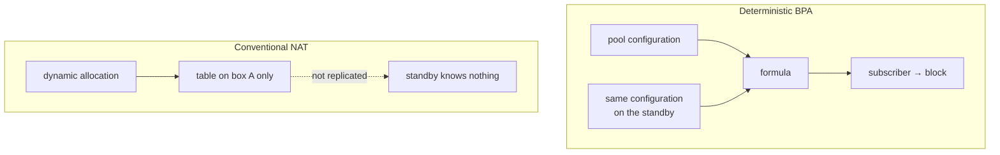

# HexaRouting — High Availability

## TL;DR

**Nothing here is implemented.** This is analysis and a plan.

The relevant finding: in deterministic mode the mapping is a *function of the
configuration*, so two boxes with the same pool produce the same block for the
same subscriber without exchanging a single byte of state. A failover still
drops in-flight connections — as any NAT does — but they re-establish on the
**same public address**. For the subscriber that is the difference between
"I reloaded the page" and "my IP changed and the bank logged me out".

The trap for whoever implements this: in deterministic mode, two boxes with
**different** configuration fail **silently**.

> The key words **MUST**, **MUST NOT**, **SHOULD**, **SHOULD NOT** and **MAY**
> in this document are to be interpreted as described in
> [RFC 2119](https://www.rfc-editor.org/rfc/rfc2119).

## 5W2H

| | |
|---|---|
| **What** | Failover between two HexaRouting boxes serving the same subscriber base. |
| **Why** | A CGNAT box is a single point of failure for every subscriber behind it. |
| **Who** | The provider's operations team; the subscriber should ideally notice nothing. |
| **When** | On hardware failure, planned maintenance, or software upgrade. |
| **Where** | Between two boxes sharing the same pool configuration and the same upstream. |
| **How** | Proposed: active/standby with VRRP, no session synchronisation. |
| **How much** | Zero state to synchronise for address stability; session synchronisation would cost a control-plane flow comparable to the log itself. |

## What deterministic mode gives for free

In conventional CGNAT the subscriber-to-(public IP, port) mapping is the result
of dynamic allocation: it exists only in the table of the box that created it.
A standby knows nothing, and a failover changes everyone's public address.

| After failover | Conventional NAT | Deterministic BPA |
|---|---|---|
| Subscriber's public IP | changes | **unchanged** |
| Port block | changes | **unchanged** |
| In-flight connections | dropped | dropped |
| New connections | need fresh allocation | work immediately |
| State to synchronise for the above | the whole table | **none** |

The line that matters: in-flight connections drop in both cases, but under BPA
they re-establish on the same public address.

This is not HA. It is the floor HA starts from, and it is already higher than
usual.

## What is still needed for real failover

Preserving in-flight connections requires synchronising the session table,
because the return path needs the **private port**, and no formula produces
that (see [architecture.md](architecture.md)).

| Design | Cost | What it preserves |
|--------|------|-------------------|
| Active/standby without sync | ~zero | Public address and block; connections drop |
| Session sync over multicast | High: every session create and delete becomes a message | In-flight connections |
| Active/active with subscriber partitioning | Medium | Half the traffic unaffected by one failure |

Session synchronisation is the only one that preserves connections and the most
expensive: on a 200k-subscriber box with hundreds of sessions each, replicating
every create and delete is a control-plane flow comparable to the log itself.

**Dynamic mode adds a requirement**: block allocation would have to be
coordinated, or the two boxes would allocate different blocks to the same
subscriber.

## Proposal for a first version

Active/standby with VRRP on both the public and the internal side, no session
synchronisation, and identical configuration guaranteed by the configuration
trail that already exists.

It is honest about what it delivers: it does not preserve connections, it
preserves addresses. For a provider that already removes the worst symptom of a
CGNAT failover.

To be built:

1. Integration with `keepalived` or FRR's VRRP, coherent with `linux_cp`.
2. Verification that both boxes carry the **same** pool configuration.
3. A `show bpa ha` comparing a configuration hash between peers.
4. A lab test with two instances and a forced failure, confirming the
   subscriber keeps address and block.

Item 2 **MUST NOT** be skipped. In deterministic mode, two boxes with different
configuration fail silently: the failover starts mapping subscribers to the
wrong blocks with no visible error, and the logs of both boxes will look
perfectly healthy. Configuration equality is a requirement, not a convenience.
