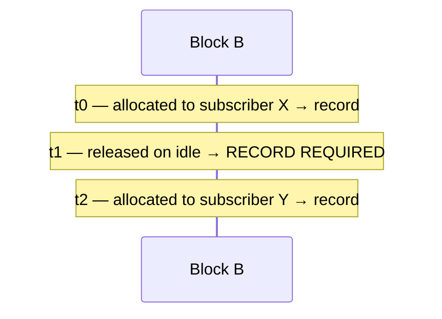

# Prisma Routing - BPA Log Export via IPFIX

## TL;DR

Log **block allocations**, not flows. RFC 8158 defines `natEvent` 16 (port
block allocation) and 17 (de-allocation) for exactly this. Roughly 80 MB/day
for 200k subscribers in dynamic mode, against ~1.6 GB/day for per-flow NAT —
and **zero** in deterministic mode, where the proof is the algorithm plus the
configuration.

De-allocation records are **not optional**: without them a court order lands on
the wrong subscriber.

> The key words **MUST**, **MUST NOT**, **SHOULD**, **SHOULD NOT**, **MAY** and
> **REQUIRED** in this document are to be interpreted as described in
> [RFC 2119](https://www.rfc-editor.org/rfc/rfc2119).

## 5W2H

| | |
|---|---|
| **What** | IPFIX export of port-block lifecycle events, per RFC 8158. |
| **Why** | Marco Civil (Law 12.965/2014, arts. 13–15) requires one year of connection records. Identifying a subscriber from (public IP, port, timestamp) requires the mapping. |
| **Who** | The provider's compliance and legal teams answer with this data; the collector is theirs. |
| **When** | On block allocation, on release, and on exhaustion. Never per flow. |
| **Where** | Exported to a collector the box can reach: over **UDP** the dataplane sends the packet, so the collector has to be reachable through the **VPP FIB**; over **TCP** the exporter owns a kernel socket and the collector is reached through **Linux**. |
| **How** | UDP via VPP's `ipfix-export`, or TCP with local spill for compliance-grade delivery. |
| **How much** | ~25 bytes per record; ~80 MB/day at 200k subscribers in dynamic mode. |

## How much is logged, by mode

| Mode | What is logged | Volume |
|------|----------------|--------|
| Deterministic | **nothing** per subscriber, except a block handed out of a `reserve`; and configuration changes | ~zero |
| Dynamic (PBA) | block allocation and release | ~1 record per block |
| Per-flow NAT (reference) | every flow | 1 record per connection |

In deterministic mode the proof of who used `(public IP, port, instant)` is the
algorithm plus the pool configuration. There is no event to record — which is
precisely why the mode exists. What **MUST** exist instead is a dated
configuration trail; see below.

**A `reserve` is the one exception, and it is the exception that proves the
rule.** Those blocks are held *out* of the formula so that a subscriber which
fills its own has something to be given
([#39](https://github.com/andrediashexa/hexarouting/issues/39)), which makes
them precisely the blocks the algorithm does **not** produce. Each one
therefore **MUST** be exported as a `natEvent 16` with its own port range, and
its release as a `natEvent 17`, exactly like a dynamic block. The reserve
itself is part of the definition the trail records, because it is part of the
arithmetic: a reader who recomputes the mapping without it gets a different
answer and gets it confidently.

## Record format (RFC 8158, Table 21)

| IE | Name | Bits | Required | Content |
|---:|------|-----:|----------|---------|
| 323 | `observationTimeMilliseconds` | 64 | yes | event time, UTC |
| 230 | `natEvent` | 8 | yes | 16, 17 or 12 |
| 8 | `sourceIPv4Address` | 32 | yes | subscriber address |
| 225 | `postNATSourceIPv4Address` | 32 | yes | assigned public address |
| 361 | `portRangeStart` | 16 | yes | block start |
| 362 | `portRangeEnd` | 16 | no | block end |
| 283 | `natPoolId` | 32 | no | pool index |

`natEvent` values used: **16** allocation, **17** de-allocation, **12** ports
exhausted.

VPP already knows these information elements in
`vnet/ipfix-export/ipfix_info_elements.h`, and `flow_report.h` handles
templates, sequence numbers and transport. There is no IPFIX to write from
scratch for the UDP path.

## Why de-allocation is mandatory

This is the point most easily missed, and it changes the legal answer.



A court asks who held `(IP, port in B)` at `t1.5`. A natural query — "the last
allocation before this instant" — answers **X**. Wrong: at `t1.5` nobody held
that block. The provider would hand over an innocent subscriber.

At `t0.5` and `t2.5` the same query is correct. The error appears only in the
gap, which is exactly where nobody tests.

* `natEvent` 17 **MUST** be emitted on release. It is correctness, not tidiness.

## Pinned blocks: configuration is also an allocation

A [static port forward](architecture.md#static-port-forwarding) on a dynamic
pool **pins** the block that carries it: the block is held for that subscriber
for as long as the forward exists, and no hold-down releases it.

That block is held by an operator's decision rather than by a packet, and the
log does not care which:

* Pinning a block **MUST** be emitted as `natEvent` **16**, and unpinning it as
  `natEvent` **17**. A block held for a year with no record is a mapping nobody
  can attribute to a subscriber later, which is the one thing this log exists
  to prevent — and on this product it is a legal obligation rather than a
  nicety.
* The event is on the **block**, not on the forward. A second forward inside a
  block that is already pinned allocates nothing, and a second `natEvent` 16
  with no 17 between them is exactly the gap described above, read from the
  other end: a query would find two allocations of one block to one subscriber
  and no idea which one ended.
* Unpinning emits the release only when the block actually goes back to the
  pool. If the subscriber still has sessions on it, the block is simply an
  ordinary dynamic block again and leaves later, by the hold-down, with the
  release the reap emits.

The record is **queued**, not emitted where the pin happens. A pin usually
happens while a configuration is being replayed — which is before any template
has gone out, and a record emitted then is one no collector can decode (see
below). The queue is drained by `bpa-expire-process`, which is where every
other block event leaves from.

There is no separate trail entry for a pin. The `forward-add` and
`forward-del` lines already carry the forward, and the pin is **derived** from
it: a second record of the same fact is a second thing to keep in step and a
second thing to get wrong.

### Turning the export on re-announces every pinned block

A pin is made once, by a configuration change. A configuration is applied
**pools first, export afterwards** — which is the order a box takes on every
boot — so a pin made in that window would hold a block from then on with
nothing anywhere saying whose it is. And unlike an ordinary dynamic block, a
pinned block never comes up for release, so it never gets a second chance at a
record.

So enabling a transport where there was none emits `natEvent` **16** for every
block that is pinned at that instant, once per block. Only the pinned ones: an
ordinary block held across the same moment is released within a hold-down and
reallocated with a record of its own.

The record is stamped **when the export was enabled**, not when the pin was
made. That is the truth the box can tell — this block is this subscriber's as
of now — and a record that guessed at the earlier instant would be a fabricated
one.

`lab/ipfix.sh` pins a block with the log switched off, switches it on, and
asserts the allocation arrives at a real collector with the right subscriber
and port range.

## Deleting a pool closes the records of the blocks it held

A pool that is deleted frees its blocks itself, and they never reach the reap
that emits `natEvent` 17 for an ordinary release. So every block held at that
instant used to leave an allocation **open**, which is the gap above read from
the far end: the last allocation before the instant asked about says the
subscriber still held those ports, for as long as the log is kept, and it names
somebody who had already been disconnected
([#215](https://github.com/andrediashexa/hexarouting/issues/215)).

* Deleting a pool **MUST** emit `natEvent` 17 for every block it frees, before
  it frees it. Afterwards there is nothing left that knows whose the block was.
* The record is stamped at the **delete**, like the pin replay above and for
  the same reason: the box did not observe the moment the block stopped being
  used, and a record that guessed at it would be a fabricated one.
* **Replacing** a pool is a delete followed by an add, so a `commit remap` that
  changes a pool's addresses or block size closes the records it invalidates.
* Pinned blocks make this likelier rather than worse: a pinned block is by
  definition held at delete time, so a pool carrying static forwards left one
  open record per forward, every time.
* A deterministic pool with no reserve has nothing to close. It allocates no
  blocks and emits no events at all, so a release from there would be the
  second half of a pair whose first half was never written.
* A deterministic pool **with** a reserve does have blocks to close, and for
  the same reason: a reserve block was announced with a `natEvent 16` when it
  was handed out, so a delete that took it back in silence would leave the
  collector holding an allocation that never ends — naming a subscriber who has
  been disconnected, for as long as the log is kept.

`lab/ipfix.sh` allocates three blocks, pins one of them, deletes the pool and
asserts at a real collector that every allocation in the capture has its
release for the same subscriber and the same port range.

## Stopping the box closes them too, and a crash cannot

A box that is stopped is the commonest of the three cases, not the rarest:
every planned reboot goes through it. Taking a new version may or may not be
one: the upgrade artifact runs `appliance/install.sh` over a running box, which
replaces the plugin under a running VPP and restarts nothing, so it does
**not** reach this path at all - the blocks that dataplane is holding are
closed whenever it is next restarted, which is the operator's choice of hour
and not the upgrade's. The reinstall an operator falls back to when the
platform itself moves does reach it, because it begins by booting the new
medium. A pool, meanwhile, is deleted rarely
([#217](https://github.com/andrediashexa/hexarouting/issues/217)).

* A graceful stop **MUST** emit `natEvent` 17 for every block still held,
  before the process leaves. The record is stamped at the **stop**, for the
  same reason as the other two: the box cannot claim an earlier instant it did
  not observe.
* A box that loses power, is killed by the kernel or panics **cannot** emit
  anything, and no amount of work on the stop path changes that. Its
  allocations stay open, and a reader who assumed after the drain that every
  allocation is closed would be wrong about exactly the boxes that crashed.

### Where the drain runs, and why it is in two places

The answer was measured rather than chosen. **VPP's UDP IPFIX export is not a
kernel socket**: `vnet_ipfix_exp_send_buffer()` writes a buffer and hands a
frame to `ip4-lookup`, and the graph is what puts it on the wire. The graph
stops before any in-process exit hook is reached, so a record written there is
written and swallowed. The TCP exporter owns a kernel socket and needs no
graph.

Measured on one block held at the stop, with a real collector on the far side:

| entry point | covers | UDP | TCP |
|---|---|---|---|
| `VLIB_MAIN_LOOP_EXIT` hook in the plugin | every graceful exit: SIGTERM from anywhere, `vppctl quit` | record written, never leaves | `natEvent` 17 decoded at the stop |
| `ExecStop` in a `vpp.service` drop-in, running `vppctl bpa stop-drain` before the signal | `systemctl stop`/`restart`, reboot, upgrade | `natEvent` 17 decoded at the stop | same |

Both exist, and they do not double up: the drain latches, and the hook sees the
latch. A second `natEvent` 17 against one 16 is not tidier than a missing one,
it is a second wrong answer.

`bpa stop-drain` is safe to type by hand even though it is meant for the
ExecStop: a box that is drained and then does **not** stop re-announces every
block it is still holding a few seconds later, with a real `natEvent` 16. The
log then reads "released at T1, held again from T2", which is true; leaving it
alone would mean the log claimed those blocks were free for as long as it is
kept.

## The boot marker: telling a crash from a box that is still running

**A proposal.** RFC 8158 has no event for this and the shape below is a
decision the maintainer may change; the argument for it is what matters.

After the drain, an allocation with no release still has two readings, and they
are opposite answers about a subscriber:

| what the collector sees | reading |
|---|---|
| allocation, then release | the subscriber held those ports between the two. Exact. |
| allocation, no release, and the exporter has not restarted since | **still in force** |
| allocation, no release, and the exporter announced a **new** init time afterwards | **ended at that restart**. The box did not observe the end, so the honest answer is the window `[last record of the old incarnation, new init time]`, not an instant. |

### What the records already carry, and why it is not enough

The IPFIX message header has an Export Time and a Sequence Number, and RFC 7011
does say a Collector **may** notice a restart when the sequence number goes
backwards. It is a heuristic and explicitly ambiguous: over UDP, reordering,
loss and the counter wrapping produce the same thing. A retention log answers a
court order, so a signal that is also the signature of two ordinary network
events is not a basis for saying a subscriber stopped holding an address.
Nothing in the Table 21 record is per-incarnation either:
`observationTimeMilliseconds` is the event's own time and `natPoolId` names a
pool, which survives the restart.

### The shape

A **second template** on the same stream, carrying:

| field | IE | bytes |
|-------|----|-------|
| observationTimeMilliseconds | 323 | 8 |
| systemInitTimeMilliseconds | **160** | 8 |

IE 160 is IANA-registered as *"the absolute timestamp of the last
(re-)initialization of the IPFIX Device"* - this exact statement, decodable by
any collector that knows the IPFIX registry, with no vendor documentation and
no private codepoint. It is in VPP's own element table already.

* Sent when a transport comes up, **before** the pin replay, so a collector
  knows which incarnation the records that follow belong to before it reads
  them. Over TCP that is a guarantee, because a stream delivers in order. Over
  UDP it is the order the box puts them on the wire in and nothing more: two
  datagrams can be reordered by the network, and a marker that arrives late is
  the same class of event as one that is lost, which the next one closes.
  Emitted in `bpa_log_drain()` ahead of the queue, because that is the only
  place the ordering can be decided: the two enable paths can arm the marker
  and cannot send it, and for five releases the arming was followed by a drain
  that sent the pins first
  ([#282](https://github.com/andrediashexa/hexarouting/issues/282)).
* Repeated every 30 s. Over UDP a marker that went out once and was lost would
  leave the collector reading this incarnation's records as the previous one's,
  which is the ambiguity it exists to remove. Sixteen bytes every half minute.
* Latched once, at plugin init, and never recomputed. Its job is to **change**
  when the process is replaced; a value recomputed from the current clock would
  jump every time NTP steps and read as a restart that did not happen. The cost
  is that a box whose clock was wrong before NTP settled carries a wrong
  absolute value for the life of the process - it still differs from the
  previous incarnation's, which is what it is read for.

### What was not chosen

| shape | why not |
|---|---|
| A new `natEvent` value | IANA's registry ends at 17; taking 18 is squatting on a public registry that may assign it elsewhere, and the record needs our documentation to read at all. |
| `natEvent` 17 with a wildcard subscriber and range | A collector that does not know the convention reads it as the release of a block nobody allocated - a new unmatched record, which is the shape being removed. |
| An IPFIX **Options Template** scoped by `observationDomainId` | Formally the right home for exporter metadata. VPP's `ipfix-export` builds Template Sets (id 2) only, so it means a private copy of `vnet_flow_rewrite_generic_callback()` to emit set id 3, for a record every collector would special-case anyway. Worth revisiting if VPP grows options-template support. |
| An eighth field on the block record | Cannot be lost independently of the record it qualifies, which is a real advantage over UDP - but 8 bytes on a 25-byte record is a third more of an 80 MB/day log, to carry a value that changes once per boot. |

### What a collector does with it

Keep the last `systemInitTimeMilliseconds` per (exporter address, observation
domain). While it does not change, an open allocation is still in force. When
it changes, every allocation still open from before it ended at or before the
new value.

`tools/ipfix_collector.py` implements exactly that rule and prints one line per
open allocation: `STILL IN FORCE`, `ENDED AT RESTART`, or `UNDECIDABLE` when no
marker was seen at all. `lab/ipfix-stop.sh` produces all three states in one
capture - a box stopped holding a block, a box killed holding one, and a box
still holding one - and asserts that the collector separates them.

## Volume

Explicit assumptions, for order of magnitude rather than precision: 200k
subscribers, dynamic mode, a block renegotiated ~5 times a day per active
subscriber, ~25 bytes of data per record and ~40 bytes with IPFIX framing.

| Scenario | Records/day | Raw volume/day |
|----------|------------:|---------------:|
| BPA dynamic (alloc + release) | ~2 million | ~80 MB |
| Per-flow NAT (reference) | ~40 million | ~1.6 GB |
| BPA deterministic | 0 | 0 |

One year of retention in dynamic mode is tens of gigabytes, not tens of
terabytes. That is the commercial argument for BPA.

## Transport

RFC 7011 permits SCTP, TCP and UDP.

* **UDP** is simple and widely accepted, but loses records under congestion.
  Losing one `natEvent` 17 recreates the gap described above.
* **TCP** is implemented, with a local spill file.
* **SCTP** is what the standard prefers and what almost nobody deploys in
  Brazil.

Compliance logging **SHOULD** use TCP. UDP **MAY** be used for telemetry, and
both **MAY** be enabled at once.

**And syslog, for the collectors that speak nothing else**
([#20](https://github.com/andrediashexa/hexarouting/issues/20)). The event set
does not change and **MUST NOT**: one record per allocation and release, never
per flow. What changes is who can receive it - many ISP collectors read syslog
and nothing else, and a product that cannot be read by the collector a provider
already runs is disqualified for a reason that has nothing to do with the
quality of its CGNAT.

### Syslog implementation

```
nat cgnat logging syslog <collector> enterprise <n> [port <n>]
                                     [facility <0-23>] [severity <0-7>]
nat cgnat logging syslog disable
```

RFC 5424 over TCP, framed by RFC 6587 **octet counting** - the length and a
space in front of each line. Not a trailing newline: non-transparent framing
cannot carry a message containing the delimiter, and leaves a collector
guessing where a truncated line ended. The default port is 601, which is RFC
6587's, as 4739 is IPFIX's.

It rides the **same exporter** as IPFIX-over-TCP: the same non-blocking
socket, the same spill file when the collector is away, the same replay in
order on reconnection. That machinery is what makes a transport fit for a
compliance log and it has nothing to do with the format of what it carries, so
it has one implementation and the format is a field. The two streams have
spill files of their own, because two streams sharing one would replay each
other's bytes into the wrong collector.

One line per event, in the same grammar as the IPFIX record:

```
<134>1 2026-09-18T02:40:59.123Z cgnat-sp-01 prisma-cgnat - BLOCK-ALLOC
[cgnat@44444 natEvent="16" subscriber="100.64.0.5" public="200.150.0.16"
portStart="1024" portEnd="1027" pool="0"]
100.64.0.5 -> 200.150.0.16 ports 1024-1027 pool 0
```

* the **timestamp** is the same instant at the same resolution as the IPFIX
  `observationTimeMilliseconds`, in UTC. A log whose clock cannot be compared
  with the IPFIX one cannot corroborate it, and corroboration is what a second
  transport is for;
* the **structured data** carries the record's fields under the IPFIX names,
  so a collector parses them without a regular expression that breaks the
  first time a message is reworded;
* the **MSGID** is a name a person filters on - `BLOCK-ALLOC`,
  `BLOCK-RELEASE`, `PORTS-EXHAUSTED`, `BOOT-MARKER`. An event this box has no
  name for is **dropped and counted**, never written: a line naming an event a
  collector cannot map is worse than no line, because it parses, is stored,
  and answers a court request with a shrug;
* the **MSG** after the structured data repeats the fields as a sentence, for
  whoever is reading a tail rather than a collector;
* the **boot marker** is a line of the same shape, `BOOT-MARKER`, carrying
  both instants. What it is for is unchanged and is above.

**The enterprise number is the operator's and has no default.** RFC 5424
reserves a structured-data name without an `@enterprise` suffix for names IANA
has registered, and this product has none; inventing one would put a name in
every operator's log that means something else to whoever registers it later.
So `nat cgnat logging syslog` **MUST** be given an IANA Private Enterprise
Number and is refused without one - at the prompt, where it can be acted on,
rather than in a year of lines a collector silently misparsed.

### UDP implementation

```
nat cgnat logging udp <collector> src <source> [port <n>]   where it goes
nat cgnat logging enable                                    turn it on
nat cgnat logging udp disable                               clear the exporter
```

`bpa logging enable` hands the records to VPP's own flow-report
infrastructure, which refuses to start a report while VPP's IPFIX exporter has
no collector. **For the life of the project nothing configured one**: the
exporter is set with `set ipfix exporter collector <ip> src <ip>`, a VPP CLI
command, and `prismash` had no statement for it and
`appliance/etc/vpp-base.conf` carried none. So UDP export was refused on every
installed box — permanently, because it was not a state an operator could
leave ([#209](https://github.com/andrediashexa/hexarouting/issues/209)). Until
[#76](https://github.com/andrediashexa/hexarouting/issues/76) the VTY
**discarded** that refusal — `self.dp.run()` returned a status nobody read,
`vppctl` exits 0 either way — and the operator got `commit complete` from a
box that exported nothing.

`nat cgnat logging udp` is the statement that closes it. It is committed,
rolled back and read back like every other setting: `show bpa config` emits it
from the exporter the dataplane actually holds, so a saved configuration
carries the destination and a rollback restores it.

#### Where it goes, and what VPP requires

The statement sends VPP's own `set_ipfix_exporter` message, **not** the
plugin's `bpa_logging_set` that carries the other two halves. The exporter is
core state shared with anything else that exports, and `nm -D libvnet.so`
lists `vnet_flow_report_add_del`, `vnet_flow_reports_reset` and
`vnet_ipfix_exporter_lookup` and nothing that sets a collector — so putting it
on the plugin's message would mean copying the core handler into the plugin,
where the copy drifts with every VPP bump. It is still the binary API, which
is what #76 asks for.

What the message requires, measured against `vpp v26.06-release`:

| Field | Behaviour |
|---|---|
| `src_address` | **required**: `0.0.0.0` is refused (retval -7) whatever the collector is |
| `collector_address` | `0.0.0.0` **with a non-zero source** is how the exporter is cleared |
| `path_mtu` | 68–1450; 0, 67, 1451 and 1500 are all refused |
| `collector_port` | 0 is accepted and exports to port 0 — the caller must supply 4739 |
| `template_interval` | 0 is accepted |
| `vrf_id` | `~0` and `0` both accepted |

The exporter starts **zeroed** — `ipfix_exporter_dump` on an untouched box
reports every field 0 except `vrf_id` — so there is no dataplane default to
read back and no "leave it alone" encoding. The VTY therefore reads the
exporter before it writes it, sends back whatever the box already has for the
fields the statement does not name, and fills a zero with VPP's own CLI
defaults: port 4739, path MTU 512, template resend 20 s. Those three numbers
are measured from a dump taken straight after `set ipfix exporter collector
<ip> src <ip>`, which is the path that fills them in.

There is no `show ipfix exporter` command in VPP 26.06 — `show: unknown input`
— so the exporter can only be read through the API or through the plugin.
`show cgnat logging` prints it, which is the line the boot self-test reads.

#### The refusal happens at `commit check`

```
nat cgnat logging enable
commit check
error: cgnat logging enable: UDP export has no collector
    nothing would leave this box; add 'nat cgnat logging udp <collector> src
    <source>' beside it, or export over TCP with 'nat cgnat logging tcp
    <collector>'
    the dataplane refuses the statement, and it would refuse it half way
    through this commit
```

Refused **before** anything is applied, rather than by the dataplane half way
through the apply with the pools already changed. `nat cgnat logging tcp` does
not satisfy it: the two transports are separate paths in the plugin and
`enable` names the UDP one.

#### The saved configuration is written exporter-first

`cgnat logging enable` sorts alphabetically **before** `cgnat logging udp
...`, so a configuration written in plain sorted order refuses its own second
line when it is reloaded — on the boot path, which is the one nobody types by
hand and the one the appliance takes every time it starts. `Config.text()` and
the apply both put the export state last for that reason.

#### The boot self-test says whether export is RUNNING

A setting that was refused looks, from the configuration, exactly like one
that is working — the same shape as the OOM drop-in in
[#172](https://github.com/andrediashexa/hexarouting/issues/172). So
`appliance/selftest` reads two different places and compares them: the file
`prisma-routing.service` hands to `prismash`, and the state the dataplane holds.

* the file names a collector and the dataplane has none → **FAIL**, the
  statement was refused when it was applied;
* the file turns export on and the dataplane has it off → **FAIL**, and the
  line says what is not being recorded;
* the dataplane has export on with no collector → **FAIL**. Clearing VPP's
  exporter leaves the export state enabled — measured — so `state enabled` on
  its own is not evidence that anything is being sent;
* a pool in dynamic mode with neither transport on → **warning**: the box is
  translating traffic and keeping no record of it.

It configures nothing. A check that arranges the condition it is checking for
cannot report its absence, which is
[#184](https://github.com/andrediashexa/hexarouting/issues/184) in one
sentence.

### TCP implementation

`bpa logging tcp <collector> [port <n>]`. VPP's infrastructure only speaks UDP,
so the IPFIX message is assembled directly — the format is simple and not worth
bending the UDP exporter around.

* The socket **MUST** be non-blocking: a slow collector **MUST NOT** stall
  VPP's main thread.
* Pending bytes **MUST** spill to disk when the collector is unreachable. If
  even that fails, the discard **MUST** be counted, never silent.
* **On the exit path, counted is not enough: it MUST be said.** Every other
  discard happens on a box that keeps running, where the counter is readable
  afterwards with `show bpa logging`. The flush in `bpa_stop_drain()` runs from
  `VLIB_MAIN_LOOP_EXIT`, so the counter it increments dies with the process
  moments later. `journalctl -u vpp` is the only place the loss can still be
  read after the box has stopped, and a `notice` does not reach it at VPP's
  default log level - measured on a run that spilled 82,935 bytes, where the
  line is absent from the process output entirely. So a loss on this path goes
  out at **error** level, which is what it is
  ([#270](https://github.com/andrediashexa/hexarouting/issues/270)).
* The spill **MUST** be prepended on reconnect, not appended: an allocation has
  to reach the collector before its release, or the collector reconstructs an
  impossible history.
* Every new connection **MUST** start with the template, also prepended.
* Whatever the socket has not taken when the process leaves **MUST** go to the
  spill file. The stop drain writes one `natEvent` 17 per block still held into
  that buffer and services the socket once; a collector that is even slightly
  behind leaves the tail of that in the process, and the process is about to
  end. Measured with a collector reading normally and 4001 blocks held: 0 bytes
  pending before the stop and **70020 bytes still in the buffer at the exit**,
  which is 1556 releases that used to go with the process
  ([#219](https://github.com/andrediashexa/hexarouting/issues/219)).
* The exit path **MUST NOT** wait for the socket instead. The collector that
  leaves bytes there is the one that has stopped reading, so its window is shut
  and a wait expires having sent nothing; and a wait in a stop path is how a
  reboot becomes a power cycle. Writing the file costs one `write()`.
* The buffer **MUST** always begin at a message boundary. A non-blocking
  `send()` stops in the middle of a message whenever the window is nearly shut,
  and three things read the buffer from the front: the template insert, the
  spill replay, and the spill file itself, which a collector frames by the
  length in each header. Measured before this held: 82917 bytes spilled at a
  stop, all 82917 replayed on the next connection, and **one record decoded out
  of them** - the file began with the tail of a message, and everything behind
  it misframed.

Three of those statements held only in prose. Each was mutated in
`src/plugins/bpa/bpa_log_tcp.c`, and every suite, `lab/ipfix-tcp.sh` and
`lab/ipfix-outbuf.sh` stayed green
([#259](https://github.com/andrediashexa/hexarouting/issues/259),
[#262](https://github.com/andrediashexa/hexarouting/issues/262),
[#263](https://github.com/andrediashexa/hexarouting/issues/263)).
`lab/ipfix-outbuf.sh` now asserts all three, and each needed a different thing
from the lab:

* **The order** needed the collector to be READ as a sequence. Every check in
  this repository was true of a stream in any order — allocations and releases
  paired by subscriber, nothing left open — so the spill could be appended
  instead of prepended and 82935 bytes of the previous boot's log arrive behind
  a record written twenty seconds later. The lab finds the new incarnation's
  own boot marker in the collector's log, by the init time the box reports
  rather than by position, and requires that no block event arrives behind it.
* **The discard** needed the condition to exist at all. The spill only triggers
  above 1 MB and `bpa stop-drain` does not flush the exporter, so the only live
  way in is to write a megabyte of records — 23302 of them at 45 bytes — with
  the collector gone. The lab does that three times: with the spill path
  writable, with a directory where the file goes, and on a filesystem with no
  room left, which are the success, the `open()` failure and the `write()`
  failure.
* **The stop** needed the number that was already printed to be read by
  something. `lab/ipfix-outbuf.sh` had measured the stop in seconds since
  before any of this and left it on the screen.

The three MUSTs above are what those checks are for; a reader deciding whether
one of them may be relaxed should expect that lab to go red.

### The honest limit of TCP

Verified in `lab/ipfix-tcp.sh`: with the collector killed mid-run, records are
buffered and arrive decoded on reconnect. `lab/ipfix-outbuf.sh` covers the
other half of it - the collector connected and not reading while the box is
stopped - and takes its verdict after the box has come back, because a release
that was spilled and replayed closes the allocation just as well, only later.
But TCP does not give end-to-end delivery guarantees - bytes accepted by the socket buffer count as sent and can
be lost if the connection dies immediately after. In the test, two records
emitted at the moment of the outage fell in that window.

A real guarantee would require application-level acknowledgement, which IPFIX
over TCP does not provide. TCP is much better than UDP — no silent loss under
congestion, and a collector outage no longer costs records — but it is not
absolute. `show bpa logging` exposes the counters so the difference is visible
rather than assumed.

## Three pitfalls found while implementing

All three fail silently. The first two cost precisely the earliest records —
when nobody is watching. The third cost every record on one transport, for
weeks, while the tests were green.

### The dataplane cannot emit IPFIX directly

Calling the export path from inside graph dispatch writes the buffer, but it
never leaves the wire. Only events emitted from **process** context reached the
collector.

The correct design, and the one VPP's own NAT plugin uses: the dataplane node
**enqueues** into a per-thread queue (lock-free, each worker writes only its
own) and a process drains it under the barrier and exports. The queue is
bounded, so an unreachable collector becomes counted loss rather than unbounded
memory.

### Records before the template are undecodable

The first events went out on the wire before the first template. `tcpdump`
showed the packets; no collector could read them, because without the template
there is no way to know the record layout.

This is silent loss right after enabling logging or restarting the box.

* Events **MUST** be held while `last_template_sent == 0`.
* A serious collector **SHOULD** buffer a data set that arrives without its
  template and reprocess it when the template appears. `tools/ipfix_collector.py`
  does this, and that is how the ordering became visible instead of looking
  like vanished records.

Verified in `lab/ipfix.sh`, and the two bullets are why the check had to be
written the way it is: the collector that forgives the defect is the same one
the lab reads its verdict from, so every record arrives, decodes and pairs
whether or not the box held anything back. It therefore **counts** the data
sets it had to hold and prints the total, and the lab requires that total to be
zero. The collector is started **before** the exporter is configured, because
one started afterwards cannot tell a box that sent a record too early from a
collector that joined the stream too late. Measured with the guard removed:
five data sets arrived ahead of the template, every check in the lab stayed
green and so did every suite
([#258](https://github.com/andrediashexa/hexarouting/issues/258)).

### The wrong clock reads exactly like a time of day

`vlib_time_now()` counts seconds since VPP started. It is the value at hand
everywhere in a plugin, it is a plausible `f64` of seconds, and handed to a
record it produces this:

```
00:00:05 ALLOCATION   100.64.0.5 -> 200.150.0.16 portas 1024-17407
```

which reads like a timestamp and is not one. The UDP exporter converted to
epoch time; the TCP exporter — the transport that exists **because losing a
record is not acceptable** — did not
([#117](https://github.com/andrediashexa/hexarouting/issues/117)). The same
event carried `14:04:43` on one transport and `00:00:05` on the other.

Three consequences, in order of how bad they are:

* Records from different boots are **not orderable**. The clock returns to
  zero on restart, so the log runs backwards.
* The two transports **cannot corroborate each other**, which is the only
  reason to run both.
* A request naming a time of day — which is every request this log exists to
  answer — cannot be resolved at all.

Rules that come out of it:

* Event time **MUST** be read from the wall clock, and **MUST** be read once
  per event at the single fan-out point, so every transport carries the same
  instant. A timestamp passed in as a parameter is a timestamp some caller
  will get wrong.
* `vlib_time_now()` **MAY** be used for scheduling — a reconnection attempt,
  the next template — and **MUST NOT** be written into a record.
* A log test **MUST** assert the record's own time against the box's clock.
  Counting records cannot detect this: the count was right the whole time.

## Configuration trail

In deterministic mode the configuration **is** the log. Every pool change is
appended to a file, dated in UTC, with the complete definition:

```
2026-09-05T02:07:58Z add pool provedor-a by marina uid 1001 via api \
  inside 100.64.0.0+1024 outside 45.170.16.0+64 outside 200.150.0.0+256 \
  block 512 ports 1024-65535 policy interleaved mode deterministic \
  seq 41 sha256 4e98...81f4
2026-09-05T02:08:00Z del pool provedor-a by marina uid 1001 via api ...
2026-09-05T02:08:01Z add pool provedor-a by unattributed via cli ... block 1024 ...
```

Every line ends with ` seq <n> sha256 <64 hex>`; the examples below elide it to
keep the definition readable.

The question this answers: *what block size was in effect on the date named in
the court order?* Without the trail, the **current** formula answers with the
current block for a date when the pool used another — and names the wrong
subscriber with full confidence.

* Records **MUST** carry the whole definition, not a diff, so they can be read
  without further context.
* Records **MUST** carry the pool's **static port forwards**, and the
  operations that change one are recorded like any other pool change:

  ```
  2026-09-06T21:41:03Z forward-add pool residential by marina uid 1001 via api \
    inside 100.64.0.0+1024 outside 200.150.0.16+4 block 512 ports 1024-65535 \
    policy interleaved mode deterministic forward tcp/6200->100.64.0.5:80
  ```

  A forward is one of two parts of a deterministic pool that the formula
  **cannot** reproduce; the other is a block handed out of a `reserve`, and
  that one is answered for by an exported `natEvent 16` rather than by the
  trail. Everything else in a record exists so that the mapping can be
  recomputed; a forwarded port is a mapping that was decided rather than
  computed, so a trail that omitted it would answer for that port with the
  subscriber the formula names — who is the wrong one, with full confidence.

  On a dynamic pool the same line carries a second meaning: it is also the
  record of a **pinned block**, because the pin is derived from the forward
  and from nothing else. There is deliberately no separate pin entry — a
  second record of one fact is a second thing to keep in step.
* Attaching and detaching CGNAT on an interface **MUST** be recorded too, with
  the direction on the line:

  ```
  2026-09-08T16:11:42Z attach interface TenGigabitEthernet0/8/0 \
    by marina uid 1001 via api direction inside
  2026-09-08T16:40:07Z detach interface TenGigabitEthernet0/8/0 \
    by unattributed via cli direction outside
  ```

  The pools say **how** to translate and the interfaces say **where**.
  Detaching `out2in` stops translation for every subscriber behind that
  interface, so a trail complete about the definitions and silent about where
  they were applied describes a mapping that may not have been in force
  ([#124](https://github.com/andrediashexa/hexarouting/issues/124)). The
  direction is on the line because the rest of the entry does not imply it:
  *attach interface X* alone does not say which half of the translation
  started.

### Who changed it

An entry that cannot say **who** is a log, not an audit trail: a log records
events, an audit trail records accountable actions. The proof offered for
deterministic mode is "the algorithm plus the configuration in force at that
instant" — and if the configuration itself is disputed, a record nobody can
attribute is one that anybody with an interest can question
([#34](https://github.com/andrediashexa/hexarouting/issues/34)).

Every entry names the actor in one of these shapes:

| On the line | What it means |
|---|---|
| `by marina uid 1001 via api` | the VTY named an account and the uid it was acting as |
| `by marina uid 0 via api` | marina, **acting as root** — which neither field says on its own |
| `by uid 1001 via api` | the system could not name the account; the number is what is known |
| `by unattributed via cli` | typed at the VPP CLI, where there is no session to ask |
| `by unattributed via api` | an API client that sent no identity |

* The identity **MUST** be captured when the change is **applied**, not when
  the line is written. It is set from the request immediately before the change
  and cleared immediately after, so an entry can only ever carry the identity
  of the request that produced it.
* An entry that cannot be attributed **MUST** say so. Omitting the field would
  make it indistinguishable from an entry written before this existed — and
  from one where nobody was accountable.
* A field a client does not send arrives as **zero**, and zero is a real uid:
  root. A request carrying neither a name nor a non-zero uid is therefore
  recorded as unattributed rather than credited to the most privileged account
  on the box. False attribution is the one outcome worse than none.
* `SUDO_USER` is preferred over the effective account, because an operator who
  runs the VTY under `sudo` **is** root by the time the call is made, and a
  trail that records `root` for every one of them has recorded nothing.

**What this is not: proof.** The client asserts its own identity, and the
transport in use is shared memory, which carries no peer credentials for the
plugin to check it against. Anyone who can reach the API can already
reconfigure the box, so the trail is not a defence against them — it is the
record of which operator did what among people trusted to be there at all,
which is what an audit trail is. Kernel-verified identity would need the socket
transport ([#76](https://github.com/andrediashexa/hexarouting/issues/76)); making the
trail evidence against its own author is
[#22](https://github.com/andrediashexa/hexarouting/issues/22), the same problem
from the other side.

### Tamper-evidence

Each entry carries a sequence number and a SHA-256 digest over **the previous
digest and its own text**. Changing a byte changes that entry's digest and
every digest after it, so an alteration cannot be made to verify by fixing up
the line it is on.

```
show bpa pool history verify
configuration trail: /var/log/prisma-routing/config-history.log
  7 entries checked, chain intact
  head  seq 7 sha256 4e98de83…81f4
  a chain that verifies proves the file was not edited, not that it is the
  same file: compare this digest with the copy in your remote syslog
```

Three ways a trail can be wrong, and they **MUST** be told apart — a verifier
that answers "broken" to all of them leaves the operator guessing what happened
to their evidence:

| What was done | What is reported |
|---|---|
| an entry's text was changed | `BROKEN at entry 2` — the whole entry, and that it does not match its own digest |
| an entry was removed from the middle | `BROKEN before entry 4` — the sequence jumps from 2 to 4 |
| entries were removed from the end | `TRUNCATED: the file ends at entry 5 and this dataplane wrote up to 7 - 2 entries were removed from the end` |

The **sequence is checked before the digest**, and that order is the diagnosis.
Removing an entry also breaks the digest of the entry that followed it, so a
verifier that checked the hash first would report every removal as an
alteration — of the innocent line after the gap, sending whoever is
investigating to a line nobody touched.

Entries written before the chain existed remain readable and are reported as
**not covered** rather than counted as clean. A file with no chained entries at
all is reported as `no chained entries: nothing here is covered` — never as
intact, because losing the chain entirely is the first thing anyone would try.

The chain's head is recovered from the file at startup, so a restart continues
one chain rather than beginning a second. Without that, every verification
after a restart would report a break at the restart, and an alarm that is
always on is an alarm that is off.

#### What it proves, and what it does not

It detects a trail that was **edited**, and names where. That is the case it
exists for: a record that can be quietly corrected proves what happened only to
somebody who already trusts the operator, and it exists to be shown to somebody
who does not.

It does **not** stop somebody with write access to the file *and* this
algorithm from rewriting the trail and recomputing every digest. Nothing kept
only on the box can — an attacker who owns the box owns the evidence on it.

What makes the chain evidence against its own author is a copy of the digests
somewhere that author does not control, and **that copy already exists**: every
entry, digest included, is also sent to VPP's log, which deployments that take
this seriously forward to a remote syslog. Comparing the head digest against
yesterday's remote copy is what turns *"the file verifies"* into *"the file is
the same one"*. Operators who need the trail to be evidence **SHOULD** forward
the log off the box; without that, the chain catches accident and casual
editing and not a determined administrator.

Truncation at the end is the sharpest case: the remaining links are all
genuine, so the file verifies. It is caught only by comparing against what the
running dataplane remembers writing — and after a restart that followed a
truncation, only the remote copy can tell.

* Each write **MUST** be `fsync`ed: a compliance log **MUST NOT** live only in
  the page cache.
* Entries are also sent to VPP's log. A local file survives a reboot, not a disk
  loss; deployments that take this seriously **SHOULD** forward VPP's log to a
  remote syslog so the trail leaves the box.
* A local file does not survive a disk loss **unless there are two disks**. The
  installer will keep `/var/log/prisma-routing` on a mirror across two of them
  ([appliance.md](appliance.md#the-records-on-two-disks-and-the-system-on-one)),
  which is the other half of the same sentence: forwarding takes the trail off
  the box, and the mirror keeps the copy that is on it. Neither replaces the
  other - a box whose only copy left on a dead disk answers a court order with
  nothing, and so does one whose remote collector was never configured.

`show bpa pool history` reads the trail; `bpa audit-path` changes its location.
The plugin opens the file with `O_CREAT` and cannot create the directory above
it, so `/var/log/prisma-routing` is created by the installer — without it the trail
is missing on exactly the boxes that need it, and the failure is a line in
VPP's log that nobody is looking for.

## What the record cannot know

The trail says which pool definition was in force. The formula says which
subscriber address held a public address and port at that instant. Neither says
whether the packet that created the mapping really came from that subscriber.

A spoofed source is translated like any other and attributed by the same
arithmetic, and the resulting answer names a person who sent nothing — with the
same confidence as every true answer, because nothing downstream can tell them
apart. That is a different failure from a missing record: a gap is visible, and
this is not.

**uRPF** on the inside interfaces is the cheapest part of the defence and it is
**off by default**, so a deployment that has not turned it on **SHOULD** assume
the record is only as trustworthy as the access network beneath it. It runs
before the translator, so a refused packet takes no port and creates no
mapping; see
[architecture.md](architecture.md#spoofed-sources-and-what-the-record-can-promise),
including what it does **not** catch — one subscriber spoofing another on the
same interface, which no route check can see and which needs the address bound
to the subscriber it was issued to
([#21](https://github.com/andrediashexa/hexarouting/issues/21)).

## State

- [x] RFC 8158 template via `flow_report.h`
- [x] `natEvent` 16 on allocation, 17 on release, 12 on exhaustion
- [x] `natEvent` 16 when a forward pins a block, 17 when the last one is
      removed
- [x] `natEvent` 17 for every block a deleted pool was still holding
- [x] `natEvent` 17 for every block held when the box is stopped, on both
      transports, with the ExecStop that reaches UDP and the exit hook that
      reaches TCP
- [x] A boot marker (IE 160) so a collector can tell an allocation still in
      force from one a crashed box was holding
- [ ] The marker's shape is a proposal, not a settled interface: an Options
      Template scoped by `observationDomainId` is formally better and VPP
      cannot build one
- [x] Per-thread queue in the dataplane, drained by a process
- [x] TCP transport with disk spill
- [x] Dated configuration trail, carrying the operator who made the change
- [x] Hash-chained and verifiable, with the limits of that stated above
- [x] End-to-end test with a decoding collector (`lab/ipfix.sh`,
      `lab/ipfix-tcp.sh`, `lab/ipfix-stop.sh`), confirming every allocation has
      its matching release, and that the ones that do not are readable
- [x] Collector selection from the VTY (`nat cgnat logging udp <collector> src
      <source>`), which writes VPP's core exporter rather than plugin-owned
      state - the consequence of that is stated above
