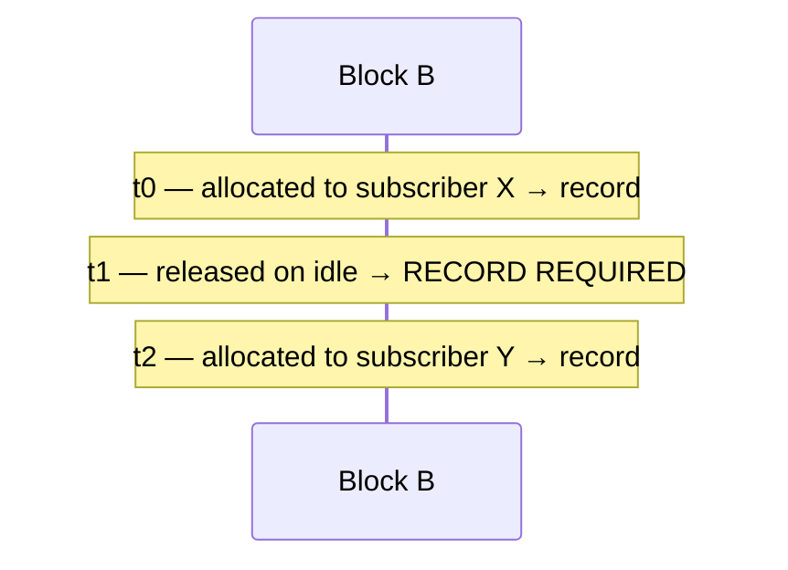

# HexaRouting — BPA Log Export via IPFIX

## TL;DR

Log **block allocations**, not flows. RFC 8158 defines `natEvent` 16 (port
block allocation) and 17 (de-allocation) for exactly this. Roughly 80 MB/day
for 200k subscribers in dynamic mode, against ~2.4 GB/day for per-flow NAT —
and **zero** in deterministic mode, where the proof is the algorithm plus the
configuration.

De-allocation records are **not optional**: without them a court order lands on
the wrong subscriber.

> The key words **MUST**, **MUST NOT**, **SHOULD**, **SHOULD NOT**, **MAY** and
> **REQUIRED** in this document are to be interpreted as described in
> [RFC 2119](https://www.rfc-editor.org/rfc/rfc2119).

## 5W2H

| | |
|---|---|
| **What** | IPFIX export of port-block lifecycle events, per RFC 8158. |
| **Why** | Marco Civil (Law 12.965/2014, arts. 13–15) requires one year of connection records. Identifying a subscriber from (public IP, port, timestamp) requires the mapping. |
| **Who** | The provider's compliance and legal teams answer with this data; the collector is theirs. |
| **When** | On block allocation, on release, and on exhaustion. Never per flow. |
| **Where** | Exported from the box to a collector reachable by the **Linux** stack — the exporter uses a kernel socket, not the VPP dataplane. |
| **How** | UDP via VPP's `ipfix-export`, or TCP with local spill for compliance-grade delivery. |
| **How much** | ~25 bytes per record; ~80 MB/day at 200k subscribers in dynamic mode. |

## How much is logged, by mode

| Mode | What is logged | Volume |
|------|----------------|--------|
| Deterministic | **nothing** per subscriber; only configuration changes | ~zero |
| Dynamic (PBA) | block allocation and release | ~1 record per block |
| Per-flow NAT (reference) | every flow | 1 record per connection |

In deterministic mode the proof of who used `(public IP, port, instant)` is the
algorithm plus the pool configuration. There is no event to record — which is
precisely why the mode exists. What **MUST** exist instead is a dated
configuration trail; see below.

## Record format (RFC 8158, Table 21)

| IE | Name | Bits | Required | Content |
|---:|------|-----:|----------|---------|
| 323 | `observationTimeMilliseconds` | 64 | yes | event time, UTC |
| 230 | `natEvent` | 8 | yes | 16, 17 or 12 |
| 8 | `sourceIPv4Address` | 32 | yes | subscriber address |
| 225 | `postNATSourceIPv4Address` | 32 | yes | assigned public address |
| 361 | `portRangeStart` | 16 | yes | block start |
| 362 | `portRangeEnd` | 16 | no | block end |
| 283 | `natPoolId` | 32 | no | pool index |

`natEvent` values used: **16** allocation, **17** de-allocation, **12** ports
exhausted.

VPP already knows these information elements in
`vnet/ipfix-export/ipfix_info_elements.h`, and `flow_report.h` handles
templates, sequence numbers and transport. There is no IPFIX to write from
scratch for the UDP path.

## Why de-allocation is mandatory

This is the point most easily missed, and it changes the legal answer.



A court asks who held `(IP, port in B)` at `t1.5`. A natural query — "the last
allocation before this instant" — answers **X**. Wrong: at `t1.5` nobody held
that block. The provider would hand over an innocent subscriber.

At `t0.5` and `t2.5` the same query is correct. The error appears only in the
gap, which is exactly where nobody tests.

* `natEvent` 17 **MUST** be emitted on release. It is correctness, not tidiness.

## Volume

Explicit assumptions, for order of magnitude rather than precision: 200k
subscribers, dynamic mode, a block renegotiated ~5 times a day per active
subscriber, ~25 bytes of data per record and ~40 bytes with IPFIX framing.

| Scenario | Records/day | Raw volume/day |
|----------|------------:|---------------:|
| BPA dynamic (alloc + release) | ~2 million | ~80 MB |
| Per-flow NAT (reference) | ~40 million | ~2.4 GB |
| BPA deterministic | 0 | 0 |

One year of retention in dynamic mode is tens of gigabytes, not tens of
terabytes. That is the commercial argument for BPA.

## Transport

RFC 7011 permits SCTP, TCP and UDP.

* **UDP** is simple and widely accepted, but loses records under congestion.
  Losing one `natEvent` 17 recreates the gap described above.
* **TCP** is implemented, with a local spill file.
* **SCTP** is what the standard prefers and what almost nobody deploys in
  Brazil.

Compliance logging **SHOULD** use TCP. UDP **MAY** be used for telemetry, and
both **MAY** be enabled at once.

### TCP implementation

`bpa logging tcp <collector> [port <n>]`. VPP's infrastructure only speaks UDP,
so the IPFIX message is assembled directly — the format is simple and not worth
bending the UDP exporter around.

* The socket **MUST** be non-blocking: a slow collector **MUST NOT** stall
  VPP's main thread.
* Pending bytes **MUST** spill to disk when the collector is unreachable. If
  even that fails, the discard **MUST** be counted, never silent.
* The spill **MUST** be prepended on reconnect, not appended: an allocation has
  to reach the collector before its release, or the collector reconstructs an
  impossible history.
* Every new connection **MUST** start with the template, also prepended.

### The honest limit of TCP

Verified in `lab/ipfix-tcp.sh`: with the collector killed mid-run, records are
buffered and arrive decoded on reconnect. But TCP does not give end-to-end
delivery guarantees — bytes accepted by the socket buffer count as sent and can
be lost if the connection dies immediately after. In the test, two records
emitted at the moment of the outage fell in that window.

A real guarantee would require application-level acknowledgement, which IPFIX
over TCP does not provide. TCP is much better than UDP — no silent loss under
congestion, and a collector outage no longer costs records — but it is not
absolute. `show bpa logging` exposes the counters so the difference is visible
rather than assumed.

## Two pitfalls found while implementing

Both fail silently, and both cost precisely the earliest records — when nobody
is watching.

### The dataplane cannot emit IPFIX directly

Calling the export path from inside graph dispatch writes the buffer, but it
never leaves the wire. Only events emitted from **process** context reached the
collector.

The correct design, and the one VPP's own NAT plugin uses: the dataplane node
**enqueues** into a per-thread queue (lock-free, each worker writes only its
own) and a process drains it under the barrier and exports. The queue is
bounded, so an unreachable collector becomes counted loss rather than unbounded
memory.

### Records before the template are undecodable

The first events went out on the wire before the first template. `tcpdump`
showed the packets; no collector could read them, because without the template
there is no way to know the record layout.

This is silent loss right after enabling logging or restarting the box.

* Events **MUST** be held while `last_template_sent == 0`.
* A serious collector **SHOULD** buffer a data set that arrives without its
  template and reprocess it when the template appears. `tools/ipfix_collector.py`
  does this, and that is how the ordering became visible instead of looking
  like vanished records.

## Configuration trail

In deterministic mode the configuration **is** the log. Every pool change is
appended to a file, dated in UTC, with the complete definition:

```
2026-09-05T02:07:58Z add pool provedor-a by marina uid 1001 via api \
  inside 100.64.0.0+1024 outside 45.170.16.0+64 outside 200.150.0.0+256 \
  block 512 ports 1024-65535 policy interleaved mode deterministic
2026-09-05T02:08:00Z del pool provedor-a by marina uid 1001 via api ...
2026-09-05T02:08:01Z add pool provedor-a by unattributed via cli ... block 1024 ...
```

The question this answers: *what block size was in effect on the date named in
the court order?* Without the trail, the **current** formula answers with the
current block for a date when the pool used another — and names the wrong
subscriber with full confidence.

* Records **MUST** carry the whole definition, not a diff, so they can be read
  without further context.
* Records **MUST** carry the pool's **static port forwards**, and the
  operations that change one are recorded like any other pool change:

  ```
  2026-09-06T21:41:03Z forward-add pool residential inside 100.64.0.0+1024 \
    outside 200.150.0.16+4 block 512 ports 1024-65535 policy interleaved \
    mode deterministic forward tcp/6200->100.64.0.5:80
  ```

  A forward is the one part of a deterministic pool that the formula **cannot**
  reproduce. Everything else in a record exists so that the mapping can be
  recomputed; a forwarded port is a mapping that was decided rather than
  computed, so a trail that omitted it would answer for that port with the
  subscriber the formula names — who is the wrong one, with full confidence.
### Who changed it

An entry that cannot say **who** is a log, not an audit trail: a log records
events, an audit trail records accountable actions. The proof offered for
deterministic mode is "the algorithm plus the configuration in force at that
instant" — and if the configuration itself is disputed, a record nobody can
attribute is one that anybody with an interest can question
([#34](https://github.com/andrediashexa/hexarouting/issues/34)).

Every entry carries one of four forms:

| On the line | What it means |
|---|---|
| `by marina uid 1001 via api` | the VTY named an account and the uid it was acting as |
| `by marina uid 0 via api` | marina, **acting as root** — which neither field says on its own |
| `by uid 1001 via api` | the system could not name the account; the number is what is known |
| `by unattributed via cli` | typed at the VPP CLI, where there is no session to ask |
| `by unattributed via api` | an API client that sent no identity |

* The identity **MUST** be captured when the change is **applied**, not when
  the line is written. It is set from the request immediately before the change
  and cleared immediately after, so an entry can only ever carry the identity
  of the request that produced it.
* An entry that cannot be attributed **MUST** say so. Omitting the field would
  make it indistinguishable from an entry written before this existed — and
  from one where nobody was accountable.
* A field a client does not send arrives as **zero**, and zero is a real uid:
  root. A request carrying neither a name nor a non-zero uid is therefore
  recorded as unattributed rather than credited to the most privileged account
  on the box. False attribution is the one outcome worse than none.
* `SUDO_USER` is preferred over the effective account, because an operator who
  runs the VTY under `sudo` **is** root by the time the call is made, and a
  trail that records `root` for every one of them has recorded nothing.

**What this is not: proof.** The client asserts its own identity, and the
transport in use is shared memory, which carries no peer credentials for the
plugin to check it against. Anyone who can reach the API can already
reconfigure the box, so the trail is not a defence against them — it is the
record of which operator did what among people trusted to be there at all,
which is what an audit trail is. Kernel-verified identity would need the socket
transport ([#76](https://github.com/andrediashexa/hexarouting/issues/76)); making the
trail evidence against its own author is
[#22](https://github.com/andrediashexa/hexarouting/issues/22), the same problem
from the other side.

* Each write **MUST** be `fsync`ed: a compliance log **MUST NOT** live only in
  the page cache.
* Entries are also sent to VPP's log. A local file survives a reboot, not a disk
  loss; deployments that take this seriously **SHOULD** forward VPP's log to a
  remote syslog so the trail leaves the box.

`show bpa pool history` reads the trail; `bpa audit-path` changes its location.
The plugin opens the file with `O_CREAT` and cannot create the directory above
it, so `/var/log/hexarouting` is created by the installer — without it the trail
is missing on exactly the boxes that need it, and the failure is a line in
VPP's log that nobody is looking for.

## What the record cannot know

The trail says which pool definition was in force. The formula says which
subscriber address held a public address and port at that instant. Neither says
whether the packet that created the mapping really came from that subscriber.

A spoofed source is translated like any other and attributed by the same
arithmetic, and the resulting answer names a person who sent nothing — with the
same confidence as every true answer, because nothing downstream can tell them
apart. That is a different failure from a missing record: a gap is visible, and
this is not.

**uRPF** on the inside interfaces is the cheapest part of the defence and it is
**off by default**, so a deployment that has not turned it on **SHOULD** assume
the record is only as trustworthy as the access network beneath it. It runs
before the translator, so a refused packet takes no port and creates no
mapping; see
[architecture.md](architecture.md#spoofed-sources-and-what-the-record-can-promise),
including what it does **not** catch — one subscriber spoofing another on the
same interface, which no route check can see and which needs the address bound
to the subscriber it was issued to
([#21](https://github.com/andrediashexa/hexarouting/issues/21)).

## State

- [x] RFC 8158 template via `flow_report.h`
- [x] `natEvent` 16 on allocation, 17 on release, 12 on exhaustion
- [x] Per-thread queue in the dataplane, drained by a process
- [x] TCP transport with disk spill
- [x] Dated configuration trail, carrying the operator who made the change
- [x] End-to-end test with a decoding collector (`lab/ipfix.sh`,
      `lab/ipfix-tcp.sh`), confirming every allocation has its matching release
- [ ] Collector selection via a dedicated CLI; today the UDP path inherits
      VPP's exporter configuration
