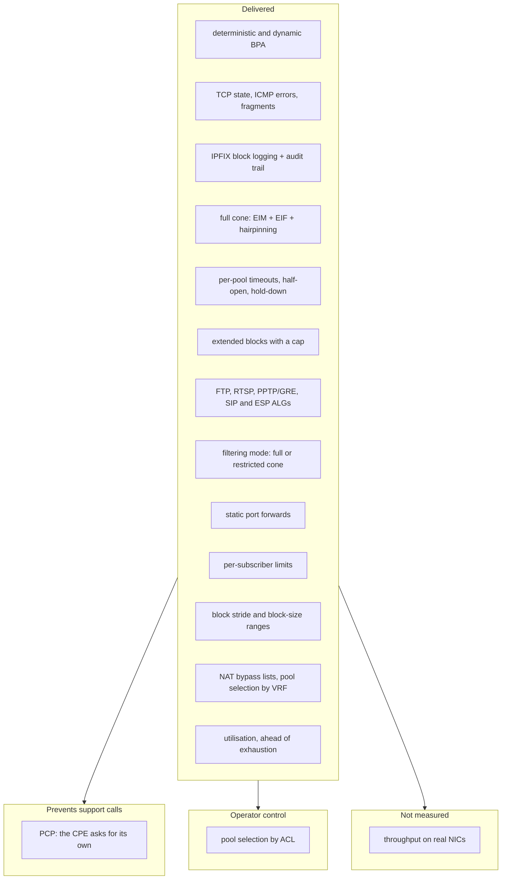
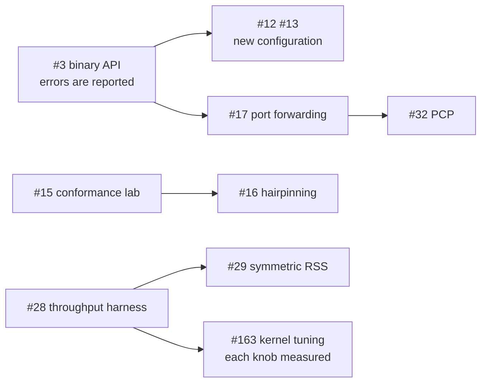

# HexaRouting — CGNAT Roadmap

## TL;DR

HexaRouting translates, logs and routes, and as of **v0.5.0** the four items the
maintainer originally named are all delivered: session lifetime control
(v0.4.0), block sizing under pressure (v0.4.0), the ALGs that matter for a
residential CGNAT (v0.5.0), and the NAT behaviour that decides whether
peer-to-peer applications work — which turned out to be satisfied by the design
and needed a test rather than a feature.

The customer who needs a port **in** is answered as of v0.9.0: a
[static port forward](architecture.md#static-port-forwarding) pins one inbound
port to one subscriber's socket, inside that subscriber's own block and
reserved so the allocator can never hand it to anyone else
([#17](https://github.com/andrediashexa/hexarouting/issues/17)) — on a dynamic
pool too, where the forward pins the whole block so it cannot move to another
customer ([#67](https://github.com/andrediashexa/hexarouting/issues/67)). What is still
missing out of the second tier is **performance**, and that sentence used to
name two more. It read "bounds on the customer who takes too much, seeing a
pool fill before it fills, and **performance**" - the first two shipped as
[#18](https://github.com/andrediashexa/hexarouting/issues/18) in v0.12.0 and
[#27](https://github.com/andrediashexa/hexarouting/issues/27) in v0.17.0, and
the release table below has carried them as released, in those same two
phrases, ever since. The first paragraph of this file was sending a reader to
build what two releases had already delivered. Throughput in
bits per second still needs a real NIC
([#28](https://github.com/andrediashexa/hexarouting/issues/28)), but the
per-packet CPU cost is measured: `bpa-in2out` spends **346 clocks per packet**
where the nodes around it spend 20–35, down from 470 on the same machine once
[#63](https://github.com/andrediashexa/hexarouting/issues/63) moved the
checksum arithmetic off the packet path and onto the session and was closed on
that. The one part of the per-packet cost nothing here can take further is the
L4 checksum, which a NIC does instead of the CPU, so it waits on the same card
[#28](https://github.com/andrediashexa/hexarouting/issues/28) waits on. The
rest is ordered by the cost of not having it.

Most "delivered" markers below name the release they shipped in, and where a
feature can be switched off there is a lab that goes red when it is - twenty
of them, listed in `OFF_MODES` in `tools/run-all-labs.sh`. This line said
**nineteen** until it was counted: `detreserve:off` joined that list on
2026-09-13 and nothing came back here, and `test/test_doc_copies.py` already
reads twenty labs declaring a floor for their off run. Neither is
universal, and the gap is the point: a roadmap that says something is missing
when it shipped is worse than no roadmap, because it is the document people
check instead of the code.

> The key words **MUST**, **MUST NOT**, **REQUIRED**, **SHOULD**,
> **SHOULD NOT**, **RECOMMENDED**, **MAY** and **OPTIONAL** in this document
> are to be interpreted as described in
> [RFC 2119](https://www.rfc-editor.org/rfc/rfc2119).

## 5W2H

| | |
|---|---|
| **What** | The list of what an ISP-grade CGNAT needs, what HexaRouting has, and what is missing. |
| **Why** | The gaps that matter are not the ones that break a graph. They surface months later as calls the operator cannot connect back to the CGNAT. |
| **Who** | Written for the maintainer deciding what to build next, and for an operator judging whether the product fits their network. |
| **Where** | This file. `docs/architecture.md` states how the parts that exist work; this one states what does not exist yet. |
| **When** | Reviewed whenever an item is finished or a new symptom is understood. |
| **How** | One table per theme: the item, the symptom it prevents, and its state. Every "already done" points at code or a test. |
| **How much** | Effort is marked S/M/L relative to the work already in the repository, not in hours. |

## How the themes relate

**This diagram was five nodes behind the tree and is the correction with the
widest reach in this file**, because it is a picture and a picture is read
before any paragraph under it. Everything outside the "Delivered" box reads as
work that remains. Measured against the tracker on 2026-09-15: SIP and ESP are
both in `BPA_ALG_DEFAULT` in `src/plugins/bpa/bpa_pool.h`, per-subscriber
limits are [#18](https://github.com/andrediashexa/hexarouting/issues/18)
closed in v0.12.0, block stride and block-size ranges are
[#55](https://github.com/andrediashexa/hexarouting/issues/55) closed in
v0.67.0, bypass lists are
[#25](https://github.com/andrediashexa/hexarouting/issues/25) closed in
v0.13.0, VRF pool selection is
[#79](https://github.com/andrediashexa/hexarouting/issues/79) closed in
v0.18.0, and utilisation is
[#27](https://github.com/andrediashexa/hexarouting/issues/27) closed in
v0.17.0. Of the six nodes this drawing held outside "Delivered", five had
shipped. What is genuinely outside it is PCP
([#32](https://github.com/andrediashexa/hexarouting/issues/32), open), the ACL
half of pool selection
([#80](https://github.com/andrediashexa/hexarouting/issues/80), open) and
throughput on a real NIC
([#28](https://github.com/andrediashexa/hexarouting/issues/28), open). TFTP is
in neither box: #14 closed with it **decided against**, so a node for it in a
"remains" box is an invitation to build something this project refused.

`tools/roadmap-state.sh` cannot see any of this, because a mermaid label names
no issue number.



## 1. Already satisfied, with evidence

These are stated here because two of them were asked for as if missing. A
claim about current behaviour is worth nothing without the code that shows it.

**Three of the four are asserted end to end, and the fourth in part**: measured
against a running dataplane, with the evidence column saying by which lab and in
what words, because an evidence column that points only at the code it came from
is a map to the intention rather than to the proof. Paired address pooling is
the one stated as a rate rather than as a yes. Its deterministic half is
asserted on a running box by `lab/detreserve.sh`, which is in the suite and has
an off mode; its dynamic half is a preference the allocator applies and cannot
guarantee, so what is asserted is the rate, in `make test` and without a
container (`test/test_bpa_dyn.c`) and, against a running dataplane, in
`lab/crossaddr.sh` - which pinned what the box did before #226, went red on the
fix, and has been rewritten against a running box as floors on the rate over
two arrival patterns and two pool sizes. It is in the suite.

| Behaviour | Why it already holds | Evidence |
|---|---|---|
| **Endpoint-Independent Mapping** (RFC 4787 REQ-1) | The `in2out` session key is `(private ip, private port, protocol)`. The remote address is not part of it, so one internal socket always maps to the same external port regardless of destination. | Measured: one socket reaching 8.8.8.8 then 1.1.1.1 keeps one public port (`lab/nat-behaviour.sh`) |
| **Endpoint-Independent Filtering** (RFC 4787 REQ-8, full-cone) | The `out2in` key is `(public ip, public port, protocol)`. Any external host may reach an open mapping. | Measured: *"endpoint-independent filtering lets an uninvited remote through"* and *"it arrives at the subscriber's own address and port"* (`lab/nat-behaviour.sh`); the key function is `bpa_out2in.c` |
| **Paired address pooling** (RFC 4787 REQ-2, the required default under RFC 6888 REQ-2) | A subscriber's FIRST public address comes from `bpa_forward()`, a function of the subscriber index alone, and cannot vary between sessions. In **dynamic** mode a subscriber that fills its block is given an extension, and the allocator **prefers** a free block on that subscriber's own public address before it takes one from the free stack. A preference and not a rule, so the honest statement is a rate: measured **100%, 99.6% and 99.2%** at the worst cell of three arrival patterns over 1 to 256 public addresses and 1 to 8 workers. Before [#226](https://github.com/andrediashexa/hexarouting/issues/226) the same three read **0.0%, 0.0% and 0.2%**. Each pool reports its own number under `show bpa blocks`. | Measured, without a container: *"4 of 4 extensions on the holder's own public address, with a block elsewhere free every time"* and the three floors (`test/test_bpa_dyn.c`); for the deterministic extension, *"on the subscriber's own public address, so it is still one host"* (`lab/detreserve.sh`) |
| **Port preservation where possible** | The allocator honours the original port when it is inside the block and free. | Measured: *"port 1600 was available before the forward existed"* asserts `100.64.0.5:1600 -> 200.150.0.17:1600` off a running box (`lab/forward.sh`), where it is the precondition of the reservation test; the arithmetic is `bpa_ports.h` and `test/test_bpa_ports.c` |

EIF is **not** universally desirable: it means unsolicited inbound traffic
reaches the subscriber. That is why item 3.3 below is about making it a
choice, not about implementing it.

## 2. The four items requested

### 2.1 TCP timeout control — delivered in v0.4.0 — [#12](https://github.com/andrediashexa/hexarouting/issues/12)

* **Per-pool timeouts.** `bpa timeouts` sets the global values and every pool
  may override any of them; zero inherits. The pool is the unit an operator
  sells, so it is the unit of policy.
* **A separate lifetime for half-open sessions.** SYN sent, never established,
  20 seconds by default. One infected host scanning the internet used to hold a
  port per probe for the transitory timeout, exhaust its own block, and reach
  support as "the internet stopped" from a dataplane that looked healthy.
* **Port hold-down after close.** A released port waits before being handed out
  again, so a delayed segment from the connection that just ended cannot land on
  the new one — a reset nobody can reproduce.
* **A GRE lifetime** for PPTP calls, and a short **ALG-expectation** lifetime
  for media mappings that are announced and never used, both added in v0.5.0.

What did not ship with it: RFC 5382 sets minimums an implementation **SHOULD**
honour, and nothing warned an operator who went below them. That was
[#54](https://github.com/andrediashexa/hexarouting/issues/54), *delivered in
v0.16.0* - `show bpa timeouts` now marks a value "BELOW the floor <rfc> asks
for", and the value is accepted rather than refused.

### 2.2 BPA step control - delivered: extended blocks in v0.4.0, the stride in [#55](https://github.com/andrediashexa/hexarouting/issues/55)

**Extended blocks** shipped: a subscriber that fills its block is given another,
bounded by a per-pool `max-blocks`, and each one produces its own RFC 8158
`natEvent 16` so the log stays complete. That is what turns "the internet
stopped for one customer" into a logged, bounded event, and the cap is what
stops one infected host consuming the pool everybody else needs.

In **deterministic** mode it needs a reserve, which
[#39](https://github.com/andrediashexa/hexarouting/issues/39) delivers. That
pool has no spare block by construction — the formula assigns every block to
some subscriber, so a block handed out as an extension is one taken from
somebody else and their mapping breaks with no error anywhere. `reserve <n>`
holds n blocks of every public address back for exactly this, and it is paid for
in capacity: enabling or resizing one re-maps subscribers and goes through the
capacity-change procedure
([#23](https://github.com/andrediashexa/hexarouting/issues/23)), with zero — no
reserve at all — as the default.

**Stride** shipped with [#55](https://github.com/andrediashexa/hexarouting/issues/55):
`block-stride` puts the nth block a subscriber holds `n × stride × block-size`
ports above its first, on the same public address - side by side at one, spread
at more - with zero, the historical behaviour, as the default. It is not part of
the mapping and moves no existing subscriber, which is asserted rather than
promised, and each block is still its own `natEvent 16` wherever it lands. Where
the worker sharding cannot honour a stride the box warns and names one that
works, rather than refusing and leaving a pool unable to come up after a
restart.

**Per-pool block-size ranges** were measured and found to be **already
delivered** by `block-size` with `max-blocks`: a subscriber starts at
`block-size` ports and grows one block at a time, only when it fills one, as far
as `block-size × max-blocks`. What was missing was that nothing said so, and
`show bpa pool` now prints the range in ports. A **growth step** - handing out
several blocks at once - was measured and not built: it hands out the same
blocks in fewer events and changes nothing a session pays, because a session
walks the blocks a subscriber holds rather than the events that produced them.
The reading is in `ref/validate.py` and is re-taken on every `make model`.

### 2.3 ALG — FTP, RTSP, PPTP, ESP and SIP-over-UDP built; TFTP decided against — [#14](https://github.com/andrediashexa/hexarouting/issues/14)

Protocols that carry an address or port inside the payload break behind any
NAT unless the NAT rewrites the payload too.

**FTP, RTSP and PPTP/GRE are built** (v0.5.0), **ESP passthrough** after them,
and **SIP over UDP** once [#48](https://github.com/andrediashexa/hexarouting/issues/48)
had left exactly one sequence-correction mechanism to inherit. All are
switchable per pool with `bpa alg <pool> <name> <on|off>` and on by default.
The design of each, and what each deliberately refuses to do, is in
[architecture.md](architecture.md#application-level-gateways).

| ALG | Symptom without it | Priority |
|---|---|---|
| **FTP** (active mode, `PORT`/`227`) | FTP works passively, fails actively. Still common with industrial and legacy equipment. | **Built**, [#42](https://github.com/andrediashexa/hexarouting/issues/42) |
| **RTSP** | IP cameras and some streaming boxes: works on the LAN, black frame from outside. | **Built**, [#43](https://github.com/andrediashexa/hexarouting/issues/43) |
| **PPTP / GRE** | VPNs to older corporate concentrators do not connect at all. GRE has no ports, so the Call ID has to play the part one plays. | **Built**, [#44](https://github.com/andrediashexa/hexarouting/issues/44) |
| **SIP over UDP** | VoIP registers and nobody can call the subscriber, or the call connects with no audio. The single most expensive support call an ISP receives. | **Built**, [#14](https://github.com/andrediashexa/hexarouting/issues/14) |
| **IPsec passthrough (ESP)** | Multiple subscribers behind one public address cannot run IPsec without NAT-T; ESP has no ports to demultiplex. | **Built** |
| **SIP over TCP/TLS** | A SIP message over TCP is a stream, so an honest ALG needs reassembly, and TLS is untouchable by any NAT. | **Not being built**, stated as a decision |
| **TFTP** | Provisioning of some CPE. | **Not being built**, decided on #14 - this row said *Low* |

Each ALG **MUST** be individually switchable per pool, and a malformed or
unexpected payload **MUST** leave the packet untouched and increment a counter:
an ALG that rewrites a payload it misparsed is worse than no ALG, because it
corrupts traffic that would otherwise merely fail to connect.

The defaults were decided on
[#14](https://github.com/andrediashexa/hexarouting/issues/14) and are the
reverse of what this section originally said. Every ALG built here is **on**,
SIP included — and SIP being on is a change from what this section used to
require, so the argument is written down rather than assumed. VoIP providers
routinely tell customers to disable SIP ALG on their CPE because one that
misparses SDP produces one-way audio and registrations that drop. That is an
argument against a *guessing* ALG. This one rewrites only a literal IPv4
address equal to the subscriber's own private address, so a message it misreads
is a message it leaves alone, and a CPE that already knows its public address
is untouched by construction rather than by luck — which is exactly the case
those providers are protecting against. H.323, MGCP, SCCP, MSRPC, NetBIOS,
IRC/DCC, TFTP and DNS are **not** being built; the reasoning is on #14.

Each of the five has its own argument for being on, written beside
`BPA_ALG_DEFAULT` in `src/plugins/bpa/bpa_pool.h` and checked against this
section by `test/test_doc_copies.py`. **PPTP** is the one that looks like an
exception and is not: its rewrite changes no length, so no sequence number
moves, and every message is guarded by a 32-bit magic cookie and its own length
field before a single byte is touched. Without it PPTP does not work for anyone
rather than failing only on a collision, so off by default would ship a CGNAT
that breaks every PPTP subscriber until an operator discovers the switch.
**ESP** parses nothing at all and rewrites only the addresses, so there is no
payload it can corrupt, and without it an ESP packet is an unsupported protocol
and the tunnel does not come up. **RTSP** is the black frame nobody blames on
the CGNAT.

### 2.4 EIM/EIF — delivered in v0.4.0 and v0.5.0 — [#15](https://github.com/andrediashexa/hexarouting/issues/15), [#50](https://github.com/andrediashexa/hexarouting/issues/50)

This box is a **full-cone NAT** by default: endpoint-independent mapping
(REQ-1), endpoint-independent filtering (REQ-8) and hairpinning (REQ-9). See
[architecture.md](architecture.md#full-cone-and-the-other-option).

* **Per-pool filtering mode**, `bpa filter <pool> <mode>`, changed in place so
  switching does not disconnect anyone. `address-dependent` accepts replies only
  from the remote the subscriber contacted; that removes unsolicited inbound at
  the cost of breaking some peer-to-peer applications, which is the operator's
  trade-off, not ours.
* **Conformance evidence.** `lab/nat-behaviour.sh` asserts the mapping on
  packets, and asserts full cone by delivering a packet from a host the
  subscriber has never spoken to and reading the subscriber's own address and
  port off the wire. Running it as
  `sh tools/lab.sh nat-behaviour address-dependent` selects the restricted cone,
  where those assertions **MUST** fail — an assertion that passes under both
  modes is not testing filtering.

The claim used to rest on a reading of a hash key. It now rests on a test that
can fail.

## 3. Proposed additions

Ordered by what they cost the provider when absent. These are proposals: none
is committed until the maintainer says so.

### 3.1 Prevents support calls

| Item | Symptom without it | Effort |
|---|---|---|
| **Hairpinning** (RFC 4787 REQ-9) — *delivered, v0.4.0, [#16](https://github.com/andrediashexa/hexarouting/issues/16)* | Two subscribers behind the same CGNAT could not reach each other through the public address. Broke self-hosted services, some games, and cameras accessed by their public address from inside the network. | M |
| **Static port forwarding** — *delivered, v0.9.0, [#17](https://github.com/andrediashexa/hexarouting/issues/17)* | The operator had no answer for the customer who needs an inbound port, other than "buy a public IP" — a lost sale exactly when the provider has none. `forward <tcp\|udp> <public-port> to <private-ip> <private-port>`, on the subscriber's own public address, inside its own block, and refused with the reason when it is not. On a dynamic pool the forward pins the block that carries it — the block the pool's arithmetic gives that subscriber — so it cannot move to another customer while the forward exists ([#67](https://github.com/andrediashexa/hexarouting/issues/67)); the pin is derived from the configuration, so it survives a restart with nothing else stored, and pinning and unpinning are logged as `natEvent` 16 and 17. A block another subscriber is holding is refused at `commit check`, naming them. A public port is one socket per public ADDRESS of the pool, not one per pool: the same port is forwardable once on each address, to the subscriber whose block carries it there ([#214](https://github.com/andrediashexa/hexarouting/issues/214)). | S |
| **PCP (RFC 6887)** | The CPE cannot ask for its own mapping, so every port request becomes a ticket. PCP turns a support call into a protocol exchange. | L |
| **Per-subscriber session and rate limits** — *delivered, v0.12.0, [#18](https://github.com/andrediashexa/hexarouting/issues/18)* | One infected host opens thousands of sessions, exhausts its block, and the *neighbour* sharing the public address is unaffected — but the infected subscriber calls support, and there is no counter to point at. `max-sessions` and `max-session-rate` per pool, zero meaning unlimited, checked where the subscriber record is already resolved. The rate is a token bucket, so the allowed burst is stated rather than an artefact of the window. Three refusal counters, because they need three different answers. | M |
| **MSS clamping** — *delivered, v0.11.0, [#19](https://github.com/andrediashexa/hexarouting/issues/19)* | With PPPoE upstream, large packets are dropped and "some sites do not load" — the same symptom as broken PMTUD, from a different cause. `tcp-mss <bytes\|auto>` per pool, off by default, on `SYN` and `SYN/ACK` in both directions, with the checksum updated incrementally and asserted from a captured packet. `auto` is the smallest CGNAT interface MTU less 40, because the clamp runs before the forwarding lookup and the egress interface is not known there. | S |

### 3.2 Compliance and answering the authorities

| Item | Why | Effort |
|---|---|---|
| **Syslog export as an alternative to IPFIX** | Many ISP log collectors speak only syslog. Today the log is IPFIX-only, which can rule the product out of a deployment for a reason that has nothing to do with the CGNAT. | M |
| **Subscriber identity in the log** (RADIUS / DHCP correlation) | A court order names a person, not an IP. Without correlation, answering it takes a second system and a manual join. With it, the answer is one query. | L |
| **Documented pool-resize migration** — *delivered, v0.19.0, [#23](https://github.com/andrediashexa/hexarouting/issues/23)* | Adding a public prefix changes the deterministic mapping for **every** subscriber. [pool-resize.md](pool-resize.md) carries the procedure, including the migration that costs no outage, and `commit` refuses the change until it is asked for by name. | M |
| **Log integrity** — *delivered, v0.23.0, [#22](https://github.com/andrediashexa/hexarouting/issues/22)* | The trail is append-only with `fsync`, and each entry now carries a SHA-256 over the one before it. `show bpa pool history verify` names the first entry that does not match and tells alteration, removal and truncation apart. | M |

### 3.3 Operator control

| Item | Why | Effort |
|---|---|---|
| **NAT bypass lists** — *delivered, v0.13.0, [#25](https://github.com/andrediashexa/hexarouting/issues/25)* | Some destinations must see the real source: internal servers, CDN caches, government portals, the operator's own management network. `bypass source` and `bypass destination` per pool, replaced entire and applied in place. A bypassed packet takes no port, creates no session and writes no record — asserted from the captured packet **and** from the session count, because the first half alone passes on a bypass that allocates first. | S |
| **Pool selection by ACL or VRF** — *VRF delivered, v0.18.0; the ACL half remains* | A pool is chosen by inside prefix, and since v0.18.0 also by `vrf` and `outside-vrf`, so two tenants can use the same private range. Per-service selection by ACL still needs more. The session table's second key word **used to be** reserved for a VRF id; the PPTP ALG spends it on the remote address, so this now needs a wider key or a packed encoding ([#26](https://github.com/andrediashexa/hexarouting/issues/26)). | M |
| **Per-pool timeouts and ALG switches** — *delivered, v0.4.0 and v0.5.0* | The unit of policy is the pool, because that is the unit an operator sells. Reachable through `vppctl` and through the VTY: the pool sub-lines it used to drop are modelled, and a line it cannot model is announced rather than silently removed ([#47](https://github.com/andrediashexa/hexarouting/issues/47)). | S |
| **Port block utilisation observability** — *delivered, v0.17.0, [#27](https://github.com/andrediashexa/hexarouting/issues/27)* | An operator needs to see block utilisation *before* exhaustion. `natEvent 12` reports the failure; the histogram in `show cgnat pool` predicts it, and `utilisation-alarm` names the subscriber once as it crosses. `show cgnat top` ranks them ([#40](https://github.com/andrediashexa/hexarouting/issues/40), v0.6.0) — the histogram says how many, `top` says which. | S |
| **uRPF on the inside** — *delivered, v0.10.0, [#24](https://github.com/andrediashexa/hexarouting/issues/24)* | Without it a spoofed source is translated and logged as a subscriber who did not send it — a wrong answer to a court order, produced with full confidence. `urpf strict` in an interface block, off by default, VPP's own check driven from the VTY rather than reimplemented. It does **not** catch one subscriber spoofing another on the same interface: no route check can, and the lab asserts that limit rather than describing it. | S |

### 3.4 The way out of CGNAT — **out of scope**, by decision

CGNAT is a bridge, not a destination, and a product that only does CGNAT is
selling the bridge and not the far side. That argument still stands. It is not
this product's argument to act on.

The maintainer scoped this project to **CGNAT only**, and
[#31](https://github.com/andrediashexa/hexarouting/issues/31) was closed on that
basis. NAT64+DNS64 (RFC 6146/6147), DS-Lite (RFC 6333), MAP-E/MAP-T (RFC
7597/7599) and 464XLAT are **not planned here**.

The decision is recorded rather than deleted because the reasoning is worth
keeping: each of these is an L, each would reuse this plugin's session table and
much of its logging, and MAP-E in particular is close in spirit to deterministic
BPA — it removes the session table from the datapath entirely, and with it most
of the logging obligation. If the scope ever changes, that is where to start.

### 3.5 Performance and correctness assurance

| Item | Why | Effort |
|---|---|---|
| **Throughput measurement on real NICs** | The per-packet CPU cost is measured now (`lab/throughput.sh`, v0.8.0) and it is the number that matters most: **346 clocks** in `bpa-in2out`, about 22 cores for 100 Gbps of 64-byte frames, down from 470 when [#63](https://github.com/andrediashexa/hexarouting/issues/63) was taken. Bits per second still needs an E810 or CX6 - [#28](https://github.com/andrediashexa/hexarouting/issues/28) stays open for it. | M |
| **Symmetric RSS** | The handoff works, but symmetric hashing would put both directions on the right worker before the handoff, saving the extra enqueue. | M |
| **RFC 4787, 5382, 5508 and 6888: the requirements this box states** - *delivered, under a narrower title than it had* | This row used to read "RFC 4787 / 5382 conformance suite", which promises the whole of both documents. Measured over the tree rather than judged: the requirement numbers named anywhere in this repository are **RFC 4787 REQ-1, REQ-2, REQ-5, REQ-8 and REQ-9**, **RFC 5382 REQ-5**, **RFC 5508 REQ-2** and **RFC 6888 REQ-2**. That is five of RFC 4787's fourteen, one of RFC 5382's ten, and one each from two RFCs the old title did not admit to. **The RFC 6888 entry is new since this row was written and the row is what found it stale**: on 2026-09-14 `git grep 'RFC 6888'` outside the CHANGELOG answered nothing, and [#226](https://github.com/andrediashexa/hexarouting/issues/226)'s fix put it in eight files on 2026-09-15 - `Makefile`, `docs/architecture.md`, `ref/bpa_model.py`, three plugin sources, `test/test_bpa_dyn.c` and the paired-address-pooling row in section 1 of **this file**, two hundred lines above this sentence. A row whose whole subject is "we claim exactly these and no more" is a row that has to be re-taken, not quoted. Nothing else is claimed, so nothing else is asserted falsely, but a reader judging the product against that title was being told otherwise, which is the direction this file cares about. What stands behind each claim, so the next reader does not measure it again: **REQ-1** mapping and **REQ-8** filtering in `lab/nat-behaviour.sh`, whose `address-dependent` run is the control because the full-cone assertions **MUST** fail in it, and whose own header says the evidence before it was a reading of a hash key; **REQ-9** hairpinning in `lab/hairpin.sh`; **port preservation** off a running box in `lab/forward.sh`; **REQ-2** paired address pooling in `test/test_bpa_dyn.c`, which asserts it for a dynamic pool as the rate it is and states the floor for three arrival patterns, and in `lab/detreserve.sh` for the deterministic reserve; `lab/crossaddr.sh` pinned the behaviour [#226](https://github.com/andrediashexa/hexarouting/issues/226) replaced, went red on the fix rather than in it, and has since been rewritten against a running box to measure the same rate end to end - 16 of 16 extensions paired over four pools, against 0 of 16 with the preference removed - which is the half `test/test_bpa_dyn.c` cannot reach: the SIP media pair the ALG can only take from the subscriber's own address; and the four **timeout floors** in `bpa_pool.h`, which `show bpa timeouts` marks a value below rather than refusing it ([#54](https://github.com/andrediashexa/hexarouting/issues/54), v0.16.0). | **not an effort.** Every requirement this box states is asserted, so there is no suite left to write. What is not asserted is what is not claimed, and a requirement arrives as an implementation and its assertion together, on an issue of its own. |
| **Sustained-load soak test** — *delivered* | `lab/soak.sh` ([#30](https://github.com/andrediashexa/hexarouting/issues/30)), for as many seconds as its one argument says. Every cycle fills the session table and every cycle empties it — fifteen seconds of traffic at a rate that fills the burst, then twenty seconds of nothing, which outlasts the UDP timeout and the block hold-down together — and the box is read at the end of each half. **Every trough is the same state of the box**, so two troughs are directly comparable and anything a later one holds is memory the box did not give back: no working set to subtract and no settling to wait out. Asserts the table back at its baseline at every trough, every session created also expired, every block back in the pool, the box's own allocation and release counters equal, the heap and the resident size unmoved between two empty tables, and a real collector's `natEvent` 17 count equal to its 16 count with no allocation left open. Outside `tools/run-all-labs.sh` (`NOT_LABS`) and outside `make test`: four minutes is its shortest run. | M |

### 3.6 BNG, asked for and not scoped - [#170](https://github.com/andrediashexa/hexarouting/issues/170)

Open, and the reason it is here rather than in a phase is that the answer is a
scope decision and not an estimate. VPP 26.06 ships `pppoe_plugin.so` and
`ppp_plugin.so`, both of which already load on every installed box, and they are
**the dataplane half only**: two nodes and three API messages, with no PADI,
PADO, PADR, PADS, LCP, IPCP, PAP, CHAP or RADIUS anywhere in the binary. For
IPoE it is worse rather than easier, because VPP's `dhcp` plugin is client and
proxy only and there is no DHCP server at all, and per-subscriber QoS has a
policer where a BNG needs a hierarchical shaper.

So the missing control plane is larger than everything in this repository
today, which is the argument on the issue for calling it a second product. Two
measured limits are worth carrying here because they bound any answer: the
plugin parses at most one VLAN tag, which is not how this market's access
networks are built, and its link table is keyed on the client MAC alone, so two
subscribers with the same MAC on different ports collide. Running accel-ppp on
a `linux_cp` TAP **MUST NOT** be the shape, whatever else is: `linux_cp` and the
pppoe plugin both claim ethertypes 0x8863 and 0x8864 box-wide and the pppoe
plugin has to win or no session can be created.

## 4. Deliberately out of scope

* **Carrier-grade NAT for IPv6-to-IPv6 (NPTv6)** — no demand in the target
  deployment, and it weakens IPv6's end-to-end property for no gain here.
* **Deep packet inspection beyond ALG needs** — an ALG parses what it must
  rewrite. Anything more is a different product with different obligations.
* **Per-flow logging** — deliberately refused. It is the thing BPA exists to
  avoid; see [logging.md](logging.md).

## 5. Delivery plan

Every item above is tracked as an issue and assigned to a release milestone.
Releases are cut in this order because each one removes a class of problem the
next one would otherwise have to work around, not because of size.

The project stays on `0.x.x` throughout; `1.0.0` is the maintainer's decision,
as stated in [CONTRIBUTING.md](../CONTRIBUTING.md) section 5. A merge happens
only when the maintainer asks for one, and each merge produces a version bump,
an annotated tag, a changelog entry and a published GitHub Release.

### What each release contains

Released rows carry their version. Unreleased ones do not, deliberately: this
table was renumbered three times in as many releases because the numbers were
promises about order that the work then rearranged. What the plan is for is the
**order**, and the order is what these rows still say.

| Release | Theme | Issues | Why here and not later |
|---|---|---|---|
| **v0.2.0** | Foundations already built | [#1](https://github.com/andrediashexa/hexarouting/issues/1) comments in English, [#2](https://github.com/andrediashexa/hexarouting/issues/2) MTU in the VTY, [#10](https://github.com/andrediashexa/hexarouting/issues/10) versioning, [#11](https://github.com/andrediashexa/hexarouting/issues/11) this roadmap | Three of these sit finished in branches. Merging them first means every later release is tagged, changelogged and readable by whoever inherits it. |
| **v0.3.0** | A control plane that reports failure | [#3](https://github.com/andrediashexa/hexarouting/issues/3), [#4](https://github.com/andrediashexa/hexarouting/issues/4), [#5](https://github.com/andrediashexa/hexarouting/issues/5) hexash on the binary API | Everything after this adds configuration. Adding it on top of a `commit` that cannot tell success from failure means each new feature inherits a control plane that lies. This is the one ordering constraint that is not negotiable. |
| **v0.4.0** | Subscriber experience | [#12](https://github.com/andrediashexa/hexarouting/issues/12) per-pool timeouts and half-open state, [#13](https://github.com/andrediashexa/hexarouting/issues/13) extended blocks | The two things an operator notices in the first month: ports held by dead connections, and one customer cut off while the pool is half empty. |
| **v0.5.0** — *released* | Application compatibility | [#42](https://github.com/andrediashexa/hexarouting/issues/42) FTP, [#43](https://github.com/andrediashexa/hexarouting/issues/43) RTSP and [#44](https://github.com/andrediashexa/hexarouting/issues/44) PPTP/GRE ALGs; [#50](https://github.com/andrediashexa/hexarouting/issues/50) full cone asserted. [#15](https://github.com/andrediashexa/hexarouting/issues/15) and [#16](https://github.com/andrediashexa/hexarouting/issues/16) landed earlier, in v0.4.0. | The failures that do not look like NAT failures to the subscriber, and therefore become long calls. [#14](https://github.com/andrediashexa/hexarouting/issues/14) is closed, with TFTP decided against rather than left to build; SIP-over-UDP and ESP shipped later and are in `BPA_ALG_DEFAULT`. |
| **v0.6.0 to v0.8.0** — *released* | Not what this table said | The appliance and its installer, SSH and local accounts, SNMP, the first performance measurement and a hardware lab that carries packets. | The order below was written before the first ISO was installed by hand. Three releases went to making the box installable and observable, which is the reordering the plan itself says to expect. |
| **v0.9.0** — *released* | Inbound | [#17](https://github.com/andrediashexa/hexarouting/issues/17) static port forwarding | The customer who needs a port **in**, answered. The rest of the "inbound and protection" theme this row used to carry moved to v0.10.0: one feature, one release, rather than a milestone that stays open for months. |
| **v0.10.0** — *released* | The log, protected | [#24](https://github.com/andrediashexa/hexarouting/issues/24) uRPF on an interface | A spoofed source translated and attributed to a subscriber who sent nothing is the one failure the record cannot show as a failure. |
| **v0.11.0** — *released* | The ticket that does not look like NAT | [#19](https://github.com/andrediashexa/hexarouting/issues/19) MSS clamping | "Some sites do not load", from a path narrower than the handshake agreed to. |
| **v0.12.0** — *released* | Bounding one customer | [#18](https://github.com/andrediashexa/hexarouting/issues/18) per-subscriber session and rate limits | The infected host that exhausts its own block, and the counter the operator points at when it calls. |
| **v0.13.0** — *released* | Traffic that must not be translated | [#25](https://github.com/andrediashexa/hexarouting/issues/25) bypass lists | The destinations that have to see the real source, and the sources that must keep their own address. |
| **v0.17.0 to v0.18.0** — *released* | Protection and control | [#27](https://github.com/andrediashexa/hexarouting/issues/27) utilisation, [#26](https://github.com/andrediashexa/hexarouting/issues/26) pool selection by VRF | Bounds on the customer who takes too much, and the controls an operator needs before a pool fills. #26's ACL half is what remains. |
| *then* | Compliance | [#20](https://github.com/andrediashexa/hexarouting/issues/20) syslog, [#21](https://github.com/andrediashexa/hexarouting/issues/21) subscriber identity, [#22](https://github.com/andrediashexa/hexarouting/issues/22) trail integrity, [#23](https://github.com/andrediashexa/hexarouting/issues/23) pool-resize procedure | The log already exists and is correct. This makes it usable by the systems and the people who have to act on it. |
| *then* | High availability | [#6](https://github.com/andrediashexa/hexarouting/issues/6), [#7](https://github.com/andrediashexa/hexarouting/issues/7), [#8](https://github.com/andrediashexa/hexarouting/issues/8), [#9](https://github.com/andrediashexa/hexarouting/issues/9) | Deliberately after correctness. HA over a CGNAT with known gaps replicates the gaps. |
| *then* | Performance, measured | [#28](https://github.com/andrediashexa/hexarouting/issues/28) throughput on real NICs, [#29](https://github.com/andrediashexa/hexarouting/issues/29) symmetric RSS, [#30](https://github.com/andrediashexa/hexarouting/issues/30) soak test — *delivered* | The per-packet cost is measured ([#63](https://github.com/andrediashexa/hexarouting/issues/63)); bits per second is not, and needs a NIC DPDK drives natively. The soak needed neither, and shipped first. |
| *not planned* | The way out of CGNAT | [#31](https://github.com/andrediashexa/hexarouting/issues/31) NAT64, DS-Lite, MAP-E/MAP-T, 464XLAT | **Out of scope by decision** — see section 3.4. The row is kept because the reasoning is worth keeping, not because the work is scheduled. |
| *backlog* | | [#32](https://github.com/andrediashexa/hexarouting/issues/32) PCP | PCP's dependency is met now that #17 has shipped; it earns its cost once manual forwards become a volume. |

### The plan for what remains

Written after reading every open issue rather than their titles, and ordered by
what each one costs while it is absent. Phases, not dates — the only honest
schedule is the one produced after the work.

#### Phase 1 — pay the debt before it multiplies

| Issue | Why it goes first |
|---|---|
| [#69](https://github.com/andrediashexa/hexarouting/issues/69) in-place per-pool settings through the VTY — *delivered, v0.14.0* | Every setting added **after** this inherits the right behaviour for nothing. Turning on a mitigation during an incident no longer tears down the pool. |
| [#35](https://github.com/andrediashexa/hexarouting/issues/35) roles in the VTY — *delivered, v0.15.0* | Read-only, CGNAT operator and administrator, mapped onto system groups and checked where the change is applied. The boundary it does **not** draw — every role still needs the VPP CLI socket, which is total control — is [#76](https://github.com/andrediashexa/hexarouting/issues/76). |
| [#54](https://github.com/andrediashexa/hexarouting/issues/54) warn below the RFC floors — *delivered, v0.16.0* | Accepted and never silent: the warning names the RFC, the floor and what breaks, reaches the operator and the log, and `show bpa timeouts` marks the state for somebody who did not know to ask. |
| [#76](https://github.com/andrediashexa/hexarouting/issues/76) the VTY off the VPP CLI socket - *delivered* | Roles bound what the VTY will do, not what an account can reach, and every role still needed the socket that is total control. The appliance plumbing a non-root operator wants came with it. |

#### Phase 2 — finish protection and control

| Issue | Note |
|---|---|
| [#27](https://github.com/andrediashexa/hexarouting/issues/27) utilisation as a histogram, with a threshold — *delivered, v0.17.0* | `show bpa pool` reports the distribution, and `utilisation-alarm <percent>` logs once per subscriber crossing it — ahead of `natEvent 12`, which only fires once the customer has already lost traffic. |
| [#26](https://github.com/andrediashexa/hexarouting/issues/26) pool selection by ACL and VRF | Split: [#79](https://github.com/andrediashexa/hexarouting/issues/79) VRF — *delivered, v0.18.0*, with the packed key the PPTP ALG made necessary; [#80](https://github.com/andrediashexa/hexarouting/issues/80) ACL remains, and should wait for a deployment that needs it. |

#### Phase 3 — compliance, and it is a sequence

[#35](https://github.com/andrediashexa/hexarouting/issues/35) so an identity exists — *delivered, v0.15.0* → [#34](https://github.com/andrediashexa/hexarouting/issues/34) so the trail records **who**
changed the configuration and not only what — *delivered, v0.21.0*: every entry
carries `by <account> uid <n> via api`, captured from the request at the moment
the change is applied, and an entry that cannot be attributed **says so** rather
than omitting the field. It is an assertion and not proof — the transport is
shared memory, which carries no peer credentials — which is exactly why the
next one matters → [#22](https://github.com/andrediashexa/hexarouting/issues/22) so the trail cannot
be edited afterwards — *delivered, v0.23.0*: each entry is chained to the
previous one by a SHA-256 digest, `show bpa pool history verify` names the first
entry where the chain breaks, and alteration, removal from the middle and
truncation are told apart. What it does **not** do is stop somebody who owns the
box from rewriting the trail and recomputing every digest; the copy that makes
it evidence is the one in the remote syslog, which the entries already reach.

Alongside, and independent of each other: [#20](https://github.com/andrediashexa/hexarouting/issues/20) syslog beside IPFIX,
which today disqualifies the product from deployments for a reason unrelated to
the CGNAT; and [#21](https://github.com/andrediashexa/hexarouting/issues/21) subscriber identity in the log, which is what makes
a record name a person instead of an address.

[#23](https://github.com/andrediashexa/hexarouting/issues/23) — *delivered,
v0.19.0*. It was the sharpest edge in the design and it was undocumented, with
no warning at `commit`. Now `commit` refuses a change that re-maps existing
subscribers until it is asked for by name, saying how many move and where two
of them go, and [pool-resize.md](pool-resize.md) carries the procedure —
including the migration that costs no outage.

#### Phase 4 — the interface becomes a first-class object

Asked for by the maintainer after using the VTY on a real box. An interface
then understood `mtu` and `urpf` and nothing else, so the first thing an
operator needs — an address — sent them back to `vppctl`, which is the tool
this VTY exists to keep them out of.

**Delivered, v0.40.0 to v0.44.0.** `description`, `shutdown`, addresses,
sub-interfaces, VRFs and router advertisements are all modelled in
`Config.interfaces`, completed and read back.
[#128](https://github.com/andrediashexa/hexarouting/issues/128) is the parent.

| Issue | What |
|---|---|
| [#129](https://github.com/andrediashexa/hexarouting/issues/129) | `shutdown` / `no shutdown` and `description` |
| [#130](https://github.com/andrediashexa/hexarouting/issues/130) | IPv4 and IPv6 addresses, secondaries included |
| [#131](https://github.com/andrediashexa/hexarouting/issues/131) | sub-interfaces and VLAN, QinQ included |
| [#132](https://github.com/andrediashexa/hexarouting/issues/132) | binding an interface to a VRF |
| [#133](https://github.com/andrediashexa/hexarouting/issues/133) | MAC, IPv6 RA, and a detailed `show interface` |

**The order is a dependency, not a preference.** Addresses before
sub-interfaces, because a sub-interface is an interface and inherits the whole
block. And VRF **before addresses at apply time**, whatever order they were
written in: binding an interface to a VRF clears the addresses already on it,
so a commit that applies them as written leaves the interface with no address
and reports success.

Deliberately out of scope, and said here so it is a decision rather than an
omission:

* **LACP and bonding** — real, and a phase of its own.
* **Policing and shaping** — likewise.
* **Speed, duplex, autonegotiation.** On a DPDK-bound NIC these are driver
  properties. A knob that silently does nothing is worse than no knob.

#### Phase 5 — BGP, route policy and prefix-lists

Asked for by the maintainer. [#141](https://github.com/andrediashexa/hexarouting/issues/141)
is the plan; the issues below are the work.

**Where it stood when this was written.** BGP worked only in the sense that
FRR did. The VTY staged every routing line verbatim: `router bgp 65000` opened
a block whose contents it never read, and `ip prefix-list` and `route-map` were
not in the grammar at all. No completion, no `?`, no validation — a typo was
FRR's problem, discovered mid-commit.

That was the right call while routing was a supporting feature. It stopped
being the right call the moment an ISP ran its edge on this box.

**The decision, and it was taken: C.** #142 to #148 shipped in v0.48.0 and
v0.51.0 to v0.55.0 — prefix-lists, neighbours and address families,
route-maps, AS-path and community lists, the refusals, RPKI, and the commands
an operator runs while something is wrong. What follows is the reasoning, kept
because the boundary it draws is still the rule for anything added next.

Three ways to go:

| | |
|---|---|
| **A** stay passthrough | cheapest, everything FRR does stays reachable, and none of the refusals below are possible because the VTY cannot see what it applies |
| **B** model all of BGP | every FRR feature must be modelled or become unavailable; the VTY turns into a worse FRR |
| **C** model the path an ISP uses, pass the rest through, **and say which is which** | ← recommended |

C buys the refusals, the completion and the validation where they are worth
most, and makes nothing currently possible impossible. The boundary **MUST**
be visible: a statement passed through unread is not one that was validated,
and a configuration hiding the difference lies about how much it checked.

| Issue | What |
|---|---|
| [#142](https://github.com/andrediashexa/hexarouting/issues/142) | neighbours, peer groups, address families, `show bgp summary` answered by the VTY |
| [#143](https://github.com/andrediashexa/hexarouting/issues/143) | prefix-lists, with the `ge`/`le` sanity FRR does not check |
| [#144](https://github.com/andrediashexa/hexarouting/issues/144) | route-maps: the match and set clauses an ISP edge actually uses |
| [#145](https://github.com/andrediashexa/hexarouting/issues/145) | **the refusals** — the reason to model any of it |
| [#146](https://github.com/andrediashexa/hexarouting/issues/146) | AS-path and community lists |
| [#147](https://github.com/andrediashexa/hexarouting/issues/147) | RPKI origin validation, and what happens when the validator is gone |
| [#148](https://github.com/andrediashexa/hexarouting/issues/148) | the commands an operator runs while something is wrong |

**#145 is the point.** A VTY that only types faster is not worth building.
Three outages this box could refuse:

* **A route-map referenced and never defined.** FRR denies everything. The
  session comes up, carries no routes, and nothing says why. **Delivered**, as
  a refusal, for the three shapes measured to deny everything: `neighbor ...
  route-map ... in|out`, `redistribute ... route-map` and `network ...
  route-map`. A `call` to an undefined map was measured NOT to deny, and is
  reported.
* **A policy that withdraws the prefix carrying the operator's own session.**
  The same failure as the SSH lockout check
  ([#35](https://github.com/andrediashexa/hexarouting/issues/35)), one layer
  down, and the box is the only thing that can see it coming. **Delivered**,
  gated on `commit cutoff` rather than refused, and applied as a confirmed
  commit. The address comes from `SSH_CONNECTION`; a console session is told
  the check could not be made.
* **A pool's public prefix that nothing announces.** Specific to this product.
  Configure `nat cgnat pool clientes outside 200.150.0.16/28` and, unless
  something separately advertises that prefix, every subscriber behind it is
  translated to an address the internet cannot route back to. CGNAT correct,
  BGP correct, service dead. **Delivered**, as a warning and never a refusal,
  for the reason `pool_announce_findings()` measures out.

**Testing.** Counting configuration proves nothing — the lesson this
repository keeps relearning. Every policy issue needs two routers and real
routes, and every assertion is on the **neighbour's table** or the **VPP
FIB**, never on the text of the configuration. Each filter test also asserts
what it must **not** affect, because a policy that applies to everything
passes every test that only checks the routes it was meant to change.

Out of scope, said here so it is a decision: EVPN, VPNv4/L3VPN and MPLS are a
different product; confederations are rare enough that passthrough is right;
route damping is deprecated in practice; and `vtysh` stays reachable, because
this VTY answering some questions does not mean it should answer all of them.

#### What using the appliance turned up, and the order to fix it

Everything in this section was found in one sitting, by booting the ISO and
installing it rather than by reading the code. That is worth saying because it
is the pattern: the labs proved the dataplane for months while the box lied
about itself on the console, and no amount of packet-level testing was going to
find that.

**1. [#99](https://github.com/andrediashexa/hexarouting/issues/99) — an
installed box ships with `bgpd`, `ospfd` and `isisd` disabled.** First because
it is the most severe and among the cheapest: the VTY offers all three, `?`
lists them, `commit` accepts them, and the daemon is not running. The product's
own documentation claims BGP, OSPF and IS-IS. What hid it is that
`lab/routing.sh` starts those daemons **by hand** — the lab and the product
disagree about what is running, and the lab is the optimistic one.

**2. [#100](https://github.com/andrediashexa/hexarouting/issues/100) — the lab
suite runs 35 labs in series on a machine at 15% load** — *delivered, v0.28.0*.
**35 minutes to 12m45s**, with identical verdicts across two runs, which was
the condition rather than a bonus. It also brought `make release-gate`: the
release procedure as one command, after the same person got it wrong three
times in one evening and every one was caught by a rule rather than by
attention.

**3. [#98](https://github.com/andrediashexa/hexarouting/issues/98) — the VTY
does not complete what the box knows** — *delivered, v0.29.0*. `interface <TAB>` offers `<word>`, so
the operator leaves the VTY for `vppctl` or `ip link` — the two tools it exists
to keep them out of — at the first argument. And there is no `show this` to see
the hierarchy being edited. Large, and paid every single day someone uses the
box.

**4. [#83](https://github.com/andrediashexa/hexarouting/issues/83) — the
installer**, whose management address was dropped from scope and came back as
[#303](https://github.com/andrediashexa/hexarouting/issues/303), *delivered in v0.74.0*. The **log
volume** is *delivered in v0.30.0*; **verifying the disk that was just
written**, **answers from a file** and the **mirror** are all *delivered*.
It was led by the log volume because: in dynamic mode the allocation log *is*
the connection record the Marco Civil requires for a year, and it currently
shares a filesystem with everything the box needs to keep working.

**5. [#97](https://github.com/andrediashexa/hexarouting/issues/97) — the
twenty-three second wait** — *delivered, v0.31.0*. with nothing on the console saying what is being
waited for. Smallest, and last, because it is cosmetic next to the four above —
but it is on the first screen anybody sees.

#### Seeing what the box is actually doing

[#95](https://github.com/andrediashexa/hexarouting/issues/95) — *delivered,
v0.26.0*. `show route` reads the **VPP FIB**, and `show route verbose` compares
it against FRR's table and marks the disagreements. `show ip route` in vtysh
answers from FRR, which is the table where a route looks correct on a box that
is dropping the traffic.

Static routes are configurable and discoverable, and `commit check` refuses a
next hop on no connected network rather than accepting a route that would never
reach the FIB.

Two things this turned up, both filed rather than folded in:
[#99](https://github.com/andrediashexa/hexarouting/issues/99), that an
installed box ships with bgpd, ospfd and isisd **disabled** while the VTY
offers all three — hidden because the routing lab starts them by hand; and
[#98](https://github.com/andrediashexa/hexarouting/issues/98), that the VTY
completes keywords and stops at the first argument, so `interface <TAB>` offers
`<word>` instead of the interfaces this box has.

#### The first five minutes with the box

Three defects reported from a real boot on real hardware, and one found while
fixing them —
[#93](https://github.com/andrediashexa/hexarouting/issues/93) and
[#94](https://github.com/andrediashexa/hexarouting/issues/94), both
*delivered, v0.25.0*.

The console looked hung: the self-test wrote to `/dev/console` and the getty
drew the VTY prompt on the same screen with nothing ordering them, so the
report printed on top of the prompt. The install asked for a device path and
then asked for it a second time to confirm — the one moment where a typo is
destructive, transcribed twice.

And underneath both, the one that had been failing on every box since the
appliance existed: `install.sh` writes `!\n! HexaRouting\n!` as the default
configuration, the parser did not treat `!` as a comment, so `hexash --load`
refused the file and `hexarouting.service` **failed on the first boot of every
install**. The self-test reported `HexaRouting ready.` anyway, because it
measured the dataplane, the routing, the tuning and the VTY, and never the unit
whose job is to apply the configuration. Each defect hid the other.

Two items were still open from the same area, and both have since shipped:
[#83](https://github.com/andrediashexa/hexarouting/issues/83), the installer's
missing questions, and
[#95](https://github.com/andrediashexa/hexarouting/issues/95) — the routing
table could not be shown from the VTY and a static route could not be configured
in it (*delivered, v0.26.0*). The second mattered more than it sounds:
`show ip route` reaches FRR's RIB,
and the table that forwards packets is VPP's FIB. An operator debugging *"the
traffic is not flowing"* is shown the table where the route is present and
correct, on a box that is dropping it.

#### The VTY an operator actually types at

Reported from a box in use, in one message, and the first item was reported
**twice** — which is the part worth recording. `show interface` listing nothing
but `local0` was answered both times with "run these five commands and tell
me". That answer is the defect: `local0` alone is the truth and it is not an
answer, and the two files that know are not where the operator is looking.

| Issue | What it is | State |
|---|---|---|
| [#190](https://github.com/andrediashexa/hexarouting/issues/190) | `show interface` says WHY it has no interface — first boot with DPDK off, no interface named, a name that does not resolve, or the interface carrying the default route, refused on purpose | *delivered* |
| [#191](https://github.com/andrediashexa/hexarouting/issues/191) | pipe filters on any `show`: `include`, `match`, `exclude`, `section`, `count`, `first`, `last`, without shelling out to `grep` | *delivered* |
| [#192](https://github.com/andrediashexa/hexarouting/issues/192) | `show interface terse` / `description` / `utilization`, the last sampling the counters and graphing them | *delivered* |
| [#193](https://github.com/andrediashexa/hexarouting/issues/193) | CGNAT under `nat`, static routes under `router static`, both old spellings still accepted | *delivered* |
| [#194](https://github.com/andrediashexa/hexarouting/issues/194) | `start shell` in the command tree — it existed and was hidden | *delivered* |

Three properties these share, and they are the reason the work is grouped
rather than listed:

* **A pipe is not a shell.** Implemented over the text the command already
  produced, after its redactions, because a filter that hands the output to
  `grep` is a shell escape wearing a filter's clothes — reachable by a
  read-only account, on a product that restricts the shell to administrators on
  purpose.
* **A hierarchy that moves must still read the box's own file.** Every box in
  service has a saved configuration and up to twenty rollback revisions in the
  old spelling, and `hexarouting.service` replays that file at every boot on a
  machine nobody is watching.
* **A rate is a difference, and the difference is measured.** On a box loaded
  enough to be worth asking about, a two-second sleep is not two seconds.

Two more came out of doing it, both about the labs and the product rather than
the VTY:

| Issue | What it is | State |
|---|---|---|
| [#196](https://github.com/andrediashexa/hexarouting/issues/196) | six labs started an FRR the product does not ship — no mgmtd, no staticd, so any statement mgmtd owns was silently dropped | *delivered*: one `start_frr` in `lab/lib.sh`, used by every lab that starts FRR |
| [#197](https://github.com/andrediashexa/hexarouting/issues/197) | `commit` reported success for a statement FRR dropped: `frr-reload` exits 0, its own log noticing on a second pass that the line is still missing and sending it again | *delivered*: the static-route half first, then the general read-back check promoted from a warning to a refusal in v0.66.0 |

#197 was ahead of everything else in this section, and it landed in two halves.
The reachable half was that a static route is neither a `router` line nor a
policy statement, so both existing daemon checks - the one from
[#99](https://github.com/andrediashexa/hexarouting/issues/99) and the one from
[#155](https://github.com/andrediashexa/hexarouting/issues/155) - walked
straight past it, and a default route is the most common statement there is on
an edge box. That is refused now, at `commit check` as well as at `commit`.

The class was the harder half: `frr-reload` exits 0 having dropped a statement,
and the product believed it. The general answer is a read-back check - a
statement the candidate holds that is not in FRR's running configuration
afterwards is a failed commit whatever the exit status said, the same argument
`show bgp summary` already makes about the FIB. `statements_frr_dropped()` in
`hexash.py` shipped printing `warning:`, with the promotion condition written
into the code rather than left to anybody's confidence: it becomes a refusal
once the full lab suite has run clean with it refusing. That suite ran with the
refusal in force, 79 runs over 57 lab files and not one of them losing a
`commit complete` it used to have, and **v0.66.0 carries the refusal**. What had
held it back was a measured false positive rather than a missing idea: FRR omits
a statement from its read-back when the value equals a default, so
`poll-interval 60` typed explicitly came back absent (recorded in
`lab/igp.sh`), and refusing on that would have been worse than the bug. The
exception list beside the function is what that measurement became.

v0.68.0 then added the half
[#227](https://github.com/andrediashexa/hexarouting/issues/227) asked for: the
refusal carries the same `<- not checked` mark `show configuration` uses, and
one line saying what the mark means. A statement this VTY walked through its own
grammar and one it forwarded word for word were the same five lines before that,
and those two need different first moves.

`commit` returning success is the one thing in this product an operator has to
be able to trust, because every diagnosis they make afterwards starts from it.

#### What running the labs the way the product ships found

The labs proved the forwarding path single-threaded while every appliance with
more than one core runs VPP workers. Running the whole suite with
`LAB_WORKERS=1` found three defects, and the work that followed found four more of the same
family. They are grouped here because the family is the point: **every one of
them is the product claiming something it did not do, with a counter saying it
had.**

| | | |
|---|---|---|
| [#199](https://github.com/andrediashexa/hexarouting/issues/199) | every translated packet blackholed, on every appliance | *fixed, v0.63.0* |
| [#200](https://github.com/andrediashexa/hexarouting/issues/200) | every cross-worker hairpin dropped | *fixed, v0.63.0* |
| [#201](https://github.com/andrediashexa/hexarouting/issues/201) | an ICMP error steered to a worker that had never heard of the session, and a counter that blamed the internet for it | *fixed, v0.63.0* |
| [#207](https://github.com/andrediashexa/hexarouting/issues/207) | a session pointer held across a second `pool_get`, twice | *fixed* |
| [#206](https://github.com/andrediashexa/hexarouting/issues/206) | `alg <x> off` on the pool line accepted and ignored, taking a lab's whole `off` mode with it | *fixed* |
| [#209](https://github.com/andrediashexa/hexarouting/issues/209) | UDP IPFIX export has never worked on an installed box | *fixed* |
| [#210](https://github.com/andrediashexa/hexarouting/issues/210) | a subscriber refused while blocks stand free, and the pool reporting capacity it cannot deliver | **open**; the claim is honest now, the mechanism is a decision |

**#209 was the one to do next and it is done.** In dynamic mode the allocation
log *is* the connection record — kept a year, on its own filesystem, and what
answers a court order under the Marco Civil. A CGNAT that cannot say which
subscriber held a public port at a given moment cannot answer the one question
it exists to answer, and over UDP it could not export at all: VPP's own IPFIX
exporter needs a collector and nothing in the product ever set one.
`nat cgnat logging udp <collector> src <source> [port <n>]` is the statement
that was missing; it goes to VPP's own `set_ipfix_exporter` over the binary
API, and the read-back stays in the plugin so the statement is saved, rolled
back and audited like every other.

It survived because `lab/ipfix.sh` configured the exporter itself, with
`vppctl`, because it needed one: the lab performing the product's missing step,
for the fifth time in this repository
([#99](https://github.com/andrediashexa/hexarouting/issues/99),
[#168](https://github.com/andrediashexa/hexarouting/issues/168),
[#182](https://github.com/andrediashexa/hexarouting/issues/182),
[#184](https://github.com/andrediashexa/hexarouting/issues/184) were the
others). The lab now contains no `vppctl set ipfix exporter` anywhere, and one
of its assertions greps the lab file itself so the trap cannot come back
quietly. **#182 was the one still open in that family, and it is closed.** It
had the widest blast radius of any of them: nothing in the product created a
`linux_cp` pair, so FRR had no interface for the dataplane port and every
routing feature this product ships was configurable and inert on a box
installed from the ISO. `linux-name <name>` under `interface` creates it over
the binary API, and the name is the operator's rather than derived, because
FRR, `ip` and their own scripts act on it.

Asking out loud whether the pair survives a reboot found two more, and both
ended with the box coming up with **no configuration at all**: `save` wrote the
pair's own TAP into the file, and a loopback was shut down *before* it was
created, so every loopback survived exactly until the next reboot. The family
is closed, and the pattern it taught is the one worth keeping: **a lab that
performs the product's missing step proves nothing**, six times over.

The boot self-test now reports the state this defect lived in. It reads what
the box was **told** at boot against what the dataplane **has**, from two
different places, and configures nothing: a check that arranges the condition
it is checking for cannot report its absence ([#184](https://github.com/andrediashexa/hexarouting/issues/184)).

#### PMTUD inside a tunnel, which is the only signal a tunnel has

A subscriber behind CGNAT with an IPsec or PPTP tunnel had a tunnel that
authenticated, carried small packets, and hung on the first large transfer,
with nothing anywhere saying why. Neither protocol has an MSS to clamp, so the
ICMP *fragmentation needed* is not one signal among several — it is the only
one, and it was being dropped.

| | | |
|---|---|---|
| [#203](https://github.com/andrediashexa/hexarouting/issues/203) ESP | an ICMP error about an outbound IPsec packet dropped | *fixed, v0.64.0* |
| [#203](https://github.com/andrediashexa/hexarouting/issues/203) GRE | an ICMP error about an outbound PPTP packet dropped, and before [#201](https://github.com/andrediashexa/hexarouting/issues/201) looked up on a **constant** | *fixed* |

The GRE half is worth a note beyond its line, because it is the third time the
same thing has been found in this plugin: the session key was read at offset 0
of the embedded GRE header, which is the flags and version word. The reverse
lookup was built out of `0x3001` and matched nothing, on any box, for the life
of the project — and no assertion anywhere could have caught it, because
nothing sent an ICMP error into a tunnel.

ESP turns out to be the easy one and that is the opposite of how it looks: it
has no identifier this box may key on, which is what makes its binding global,
and being global is what makes it reachable from an error that landed on
whatever worker the internet happened to choose. GRE *has* an identifier and
still could not be steered, because the server's Call ID is not drawn from the
subscriber's port block.

#### The checks that fire on correct configurations

A second family, found by asking one question of every finding function: *can
this fire on an ordinary, correct configuration?* The answer was yes four
times, and `docs/routing.md` already says why that matters more than it sounds
— an alarm that is always on is one nobody reads, and these findings are this
box's strongest claim, the diagnoses FRR cannot make.

| | | |
|---|---|---|
| [#198](https://github.com/andrediashexa/hexarouting/issues/198) | the IS-IS IPv6 warning, disproved by this repository's own lab on every run | *withdrawn* |
| [#205](https://github.com/andrediashexa/hexarouting/issues/205) | the OSPF check silenced by the wrong spelling of `passive-interface` and fired by the right one | *fixed* |
| [#208](https://github.com/andrediashexa/hexarouting/issues/208) | BGP unnumbered refused, failing the whole commit | *fixed* |
| — | `route_map_findings` evaluating clauses in written order where FRR uses `seq`; `undefined_policy_lists` refusing a forward reference FRR accepts; an `IndexError` on a half-typed statement | *fixed*, folded into #208 |

#208 mattered beyond its own line: it refused the **whole commit**, so a CGNAT
change in the same candidate was refused with it, over a BGP statement the
operator may not have touched. And the only way round it was `vtysh`, which is
the tool this VTY exists to keep them out of — a routing change made there is
invisible to `commit`, `rollback` and the audit trail.

Two of the issue's claims did **not** reproduce against FRR 10.7.1 and nothing
was changed for them: definitions are already collected in a pass of their own,
so a route-map written above its lists was never order-dependent; and FRR
answers both legacy `ip community-list` / `ip as-path access-list` spellings
with `% Unknown command`, so tolerating them would be tolerance for a statement
FRR rejects. Both are now asserted in `lab/bgp-policy.sh`, so the measurement is
recorded rather than rediscovered by whoever reads the issue next.

It left one thing behind, and it was a dataplane defect rather than a VTY one:
[#213](https://github.com/andrediashexa/hexarouting/issues/213), now fixed. An
unnumbered session did not reach Established because the peer's Router
Advertisement never reached the Linux side of the pair, and FRR learns an
unnumbered peer's address from that advertisement and from nothing else.

The issue named the cause as an IPv6 multicast punt gap and the measurement
disagreed: IPv6 multicast reaches the TAP, an OSPFv3 packet to `ff02::5` on a
pair with no address on either end included. The gap is one node. ICMPv6 is a
protocol VPP handles itself, and the node registered for type 134,
`icmp6-router-advertisement`, is declared with exactly one next node -
`ip6-drop` - while its sibling `icmp6-neighbor-advertisement` is declared with
`ip6-punt`, which is where linux_cp's per-pair redirect is waiting. There is no
configuration for it, so the product's plugin now registers type 134 to a node
of its own that punts. OSPFv3 and IS-IS over IPv6 were never affected, so #213
was not the dependency of
[#187](https://github.com/andrediashexa/hexarouting/issues/187) it was filed
as. Nor was ordinary IPv6 ND: a neighbour advertisement already punted to the
kernel, and a neighbour solicitation is answered by VPP itself, which holds the
same addresses as the TAP through `lcp-sync`. The router advertisement was the
one ND message with nowhere to go.

#### The box an operator is handed, in the first five minutes

Found by giving `lab/install-iso.sh` a console driver
([#189](https://github.com/andrediashexa/hexarouting/issues/189)) and then
using it the way an operator does rather than the way a test does.

| | | |
|---|---|---|
| [#211](https://github.com/andrediashexa/hexarouting/issues/211) | the getty offers a login before the box is ready, and the first `configure` poisons every commit in that session | *fixed* |
| [#212](https://github.com/andrediashexa/hexarouting/issues/212) | `commit confirmed` dies with the session that made it, so it protects nothing | *fixed* |

#211 was two defects wearing one hat. The VTY half: `Vpp.run` ignored
`vppctl`'s exit status, and `vppctl` exits 0 whenever VPP *answered*, a refusal
included - so the error text came back as though it were configuration. The
getty half: the ordering drop-in, which the live image has had since
[#93](https://github.com/andrediashexa/hexarouting/issues/93) and an installed
box had never had, because the ordering and the autologin shared one file and
the installer correctly deletes the autologin. Both fixed, and the drop-in is
two files now so the installer can take one and leave the other.

What made it worth a release of its own is the lab. `lab/install-iso.sh` had a
comment DESCRIBING this defect, stepping around it, and telling whoever came
next not to move the wait earlier without dealing with the bug first. The lab
now starts at the first prompt the box offers, which is where the operator
starts, and both assertions were shown red on a full ISO build, install and
second boot before the fix.

#### The assertions that could not fail, and the report one was hiding

[#151](https://github.com/andrediashexa/hexarouting/issues/151) is this
project's own core rule turned into an audit. Its finding is not the count:

> `routes.vpp_host_interfaces()` looked for a literal `host` token and took the
> next field. No line VPP prints has such a token, so it returned an **empty
> set on every box** — and `compare()` reads an empty set as "VPP owns no
> interface", which suppresses every route FRR holds that the FIB does not. So
> **`in RIB, not in FIB` found nothing, on every box, in silence.**

The claim "the old positional parse cannot work" *was* written down, and
demonstrated against an inline **copy** of the parse rather than against the
function. The copy was wrong, the assertion was green, and the function
shipped. That is the shape: an assertion that reimplements the thing it is
checking is checking itself.

The issue's own list is stale — every Tier 1 and Tier 2 item already carries a
fix. A fresh audit found **52** findings in almost entirely different places,
17 that cannot fail at all and 35 weaker than they read, out of 597 lab
assertions, 529 Python and 203 C. Twelve are fixed. `lab/utilisation.sh` is
the one to remember: **a box with no histogram at all, and an alarm naming the
wrong subscriber every time, passed the shipped lab with 9 green**, because
the needle was the `sed` range's own start anchor.

The largest single gap in the machinery was that **`tools/run-all-labs.sh`
never ran any lab's `off` mode** — the header that proves a lab can fail at
all, and nothing automatic ever asked. That is closed: `OFF_MODES` in that
file names the off run for every lab that has one, the suite runs them beside
the ordinary run, and `report_off()` inverts the verdict so an off run that
passes is a failure.

#### Filed while doing something else, and not folded in

Each of these was measured during another change and written up rather than
fixed in passing. A fix that rides along in somebody else's commit is a fix
nobody reviewed, and the issue is the only place the measurement survives.

| | | |
|---|---|---|
| [#213](https://github.com/andrediashexa/hexarouting/issues/213) | a received Router Advertisement is dropped by VPP instead of punted, so an unnumbered BGP session reaches Active and never Established | *fixed* - and the cause in the title was wrong: IPv6 multicast punt works, ICMPv6 type 134 was the hole |
| [#214](https://github.com/andrediashexa/hexarouting/issues/214) | a public port can be forwarded once per **pool** rather than once per public address, so on an interleaved pool with N addresses only one subscriber in N can hold a forward at a given offset | *fixed* |
| [#215](https://github.com/andrediashexa/hexarouting/issues/215) | deleting a pool emits no `natEvent 17`, so every block it held stays **open** in the retention log — the answer to a court order then names a subscriber who had already been disconnected | *fixed* |
| [#217](https://github.com/andrediashexa/hexarouting/issues/217) | and a box that is **stopped** does the same, on every planned reboot — with a second allocation and no release between them when it comes back | *fixed*, drain and marker together |
| [#219](https://github.com/andrediashexa/hexarouting/issues/219) | TCP bytes still in `outbuf` when the box stops may go with the process - written from reading the path, and reproduced afterwards with 1501 blocks held | *delivered*, and the measurement is further down this file |
| [#218](https://github.com/andrediashexa/hexarouting/issues/218) | `make test` failed twice under a release suite and nothing recorded which assertion | *delivered*, v0.67.0: a runner that reads each suite's verdict line, and the race it then named |
| [#216](https://github.com/andrediashexa/hexarouting/issues/216) | `bpa_dyn_active()` has no callers; either it is unnecessary or a call is missing, and nothing in the code says which | *fixed* — and it was neither: calling it would have leaked a block |

#215's fix also covers a pool being **replaced**, which was not obvious: a
`commit remap` is applied as a delete and an add, so it went through the same
hole.

#217 closed the third, and it needed two pieces rather than one for a reason
worth keeping. **A power loss can never emit the drain**, so a graceful-stop
drain alone would *look* like a fix and leave a collector unable to tell an
allocation the box **died holding** from one **still in force** — which is the
ambiguity that makes the log unreadable after exactly the failures where it
matters. The marker is proposed rather than decided: IE 160
`systemInitTimeMilliseconds`, IANA-registered and already in VPP's element
table, with four rejected alternatives argued in `bpa_log.h`.

The marker then spent four releases on the wrong side of its own replay, and
that was [#282](https://github.com/andrediashexa/hexarouting/issues/282) - *fixed*.
`bpa_log_enable()` queued the pins and only afterwards checked the marker, so
this boot's allocations went out ahead
of this boot's marker and a collector had to read them as the previous
incarnation's - which is the exact attribution the marker exists to settle.
Nothing inside the plugin could show it, because the marker travels in one
report's buffer and the block records in another, so it was read off a real
collector, both ways, before it was believed. `docs/logging.md` also stops
promising a UDP reader an ordering no box can keep: over TCP the stream
delivers in order, over UDP it is the order the box puts them on the wire in
and nothing more.

**Where the drain hangs was measured, not chosen.** With only the in-process
exit hook, a UDP record is written, the counter advances, and it never reaches
the collector — VPP's UDP export is not a kernel socket, it is a packet the
*dataplane* sends, and the graph has already stopped. Over TCP the hook works.
So the drain that covers UDP has to be asked for while the graph is still
running, which is what an `ExecStop` is. A drain only in the hook would have
looked like a fix and lost exactly the transport the product uses by default.

#213 was the one that mattered most, for the reason that puts anything at the
top of this file: **the product accepted the configuration and could not
deliver it.** The VTY took an unnumbered neighbour, FRR held the statement, and
the peer stood in `show bgp summary` at `Idle`, `remote AS 0`, forever.
`lab/routing.sh` now asserts the session reaches Established on both sides over
a link-local address neither box was told.

It was also recorded as a dependency of
[#187](https://github.com/andrediashexa/hexarouting/issues/187), and it is not:
the section below has the measurement.

#### The machinery that checks the product, checked

Two findings, and the second is about the suite itself rather than the box.

**Seventeen labs take an `off` mode and the suite never ran one.** Each of
those headers names the number of checks that **must** go red with the feature
disabled, which is the only evidence a lab can fail at all — and nothing
automatic had ever asked. Every one was run: **every one fails as its header
says**, so the worst case (an off mode that passes, which is an assertion that
cannot fail sitting inside the machinery meant to catch exactly that) does not
exist today. Three headers are exact; three counts in `TESTING.md` were stale
and are now the measured values.

The cost was **measured rather than estimated**, which changed the decision:
`+25%`, not the doubling that kept it out. `1524/4` and `1907/5` are both 381 —
at `LAB_JOBS=16` the clock is batches times the slowest lab in a batch, and the
estimate had counted runs.

**A lab whose dataplane never came up is not a failure, it is a lab that could
not be run**, and the suite said both in the same words. Measured on a release
run: one lab ended in a VPP startup panic with no `[FAIL]` line at all, another
was `connect: Connection refused` on every call with six assertions failing on
empty values, and both passed in isolation — one of them three times. That is
now a `NO VPP` state of its own, counted separately and still failing the
suite, because a suite that could not run two labs has not cleared them.
`lab/install-iso.sh` had already made this distinction and said why: a driver
that cannot tell *the box never answered* from *the box answered and refused*
is worse than no driver, because both look like a timeout and they need
opposite work.

It matters most in the `off` path, which is why the two landed together: an
off run whose VPP never started fails every check, which is exactly what the
inverted verdict would otherwise call a pass.

**The verdict was right and empty**, which cost a second release run two
months later
([#253](https://github.com/andrediashexa/hexarouting/issues/253)). Telling the
reader to look at the machine is only half an instruction: a box too slow to
bring a dataplane up and a dataplane that died are different repairs, and the
one artefact that separates them was `/tmp/vpp.log` inside a container
`tools/lab.sh` throws away. So the lab now prints the tail of it on its way
out, whenever it ends without passing and `vppctl` can no longer reach
anything, and the suite prints that under the verdict with which of the two it
was. The tail is evidence and not a verdict: a lab that measured something
first and then lost its box stays a `FAIL`, because reclassifying that would
excuse a real crash.

**A third finding, and it is the same shape one level down: `make test` could
not say which check had failed.** The report was "about one run in three under
a lab suite", and the only evidence anybody could keep was a count of summary
lines - because the `make test` recipe read each suite's **exit status**, and a
suite that was killed, crashed or never started reported exactly like one that
had been read and failed. Naming the check took a runner that reads the verdict
line instead and reports four states: `pass`, `FAIL`, `NOT MEASURED` and
`NO VERDICT`, the last of which did not exist.

With that in place the defect was named in one run and then measured without
any race at all: `wait-for-vpp` counted **polls** and printed them as
**seconds**, so a quiet period of three ended at 2007 ms and a thirty second
timeout gave up at 29069 ms while printing "within 30s". The check that lost
stimulates a two second wait; the banner fell 9 ms after the stimulus, and
which won was decided by how long a `fork` took. Pure CPU saturation never
reproduced it, because that slows the poll loop too.

It also produced the third state for a timing check, the same shape `NO VPP`
took: `test_boot_wait.sh` measures the **stimulus** rather than the run, so a
dataplane that answered on time and was announced anyway is a failure, while
one that answered late says nothing about the product. `NOT MEASURED` is not a
pass - the run still exits non-zero - so a quiet period that shrank cannot
reach green by waiting for a busy machine.

#### What the box says about its own cores, and a file this product does not own

[#172](https://github.com/andrediashexa/hexarouting/issues/172) part 3 -
*delivered*. The console had reported `corelist-workers 1-7` since the tuner
existed, and that is the **file**. Nothing on an installed box had ever read
what the dataplane **got**. The two come apart with no symptom: a VPP running
since before the profile was rewritten keeps the cores it started with, and a
kernel command line that did not get updated leaves a poll-mode worker sharing
its core with the scheduler. The box forwards either way, and a thread that
never sleeps reads 100% busy either way.

The self-test now compares `/etc/vpp/startup.conf`, `/proc/<vpp pid>/task/*/status`
and `/sys/devices/system/cpu/isolated` - three places, none of them the one
that made the decision, and deliberately not `vppctl show threads`, which is
VPP reporting on itself.

The CPU **bound** the issue asked for turned out to be already applied, by the
kernel, and the lab records it rather than the documentation asserting it: on a
two-cpu box with `isolcpus=1`, pid 1 itself has `Cpus_allowed_list: 0` and
`bgpd` has `ppid 1` and the same mask. Inherited, not enforced: `taskset` onto
the isolated core is accepted. So no cpuset is shipped, and the refusal rests
on the size of that residue rather than on a claim that there is none. One
earlier run read `0-1` and has **not** been explained; it predates the two
lines that would settle it, and both are now read on every run of the lab.

[#220](https://github.com/andrediashexa/hexarouting/issues/220) came out of the
same week and is worth its own line because of what it touched: the version
stamp marked the repository as a git safe directory on **every** run, with no
de-duplication, in `~/.gitconfig` - a file this product does not own. Measured:
2325 copies of one entry, and 552 of the distinct paths were `/tmp` clones that
no longer exist.

#### Half the cost of translating a packet was arithmetic done per packet

[#63](https://github.com/andrediashexa/hexarouting/issues/63) - *delivered*,
**470 to 346 clocks, 26%**. The checksum correction for a session is constant
for the life of that session: the subscriber always sends from the same address
and port and the session always rewrites them to the same pair. It is worked
out once at creation now, and added per packet.

That idea had been tried and reverted once, measuring a 28% reduction and
producing wrong checksums, and the report said the one's-complement semantics
could not be reconciled. They could: **`ip_csum_add_even()` subtracts.** VPP
names both primitives for what happens to the DATA, while the value they
operate on is the checksum, which is the one's complement of the sum over that
data, so a field that ENTERS the data LEAVES the checksum. Applying a delta
with the function whose name says "add" subtracts it, and misses by exactly
twice the delta - which is why the failing packet's checksum was neither right
nor random.

**The mechanism was in the test harness**, which is why nothing caught it.
`test/bpa_tcp_shim.h` defined both primitives the intuitive way round and
composed `ip_csum_update` the other way round to compensate. The composite
agreed with VPP, so every suite passed, and anything that reached for a
primitive directly got the opposite of what the box does with no test able to
see it. The shim mirrors VPP now instead of correcting it.

Three things came out of the measuring rather than the fix. A standalone
program comparing forms over 200000 random packets said the reverted attempt
was wrong on **199988** of them, and named two more would-be bugs beside it
(host-order operands, and one delta used for both checksums). The per-packet
form being replaced could fold to exactly zero and write `0x0000` into a UDP
checksum, which on the wire means "not computed"; the new form cannot reach
zero at all. And the first "after" run read 440 with `ip4-input` at 51 - a busy
box, discarded, and visible only because the lab measures its own baseline
beside the number it is there to take.

#### A command the box had and its own help hid

[#221](https://github.com/andrediashexa/hexarouting/issues/221) - *delivered*,
and it belongs beside #187 rather than in a tidiness section. `show this` is
the only way to read back what has been typed into a block before committing,
it works inside every block this VTY has, and `?` and TAB listed it in three of
six. The three where it was hidden are the blocks this product models itself: a
pool, a user and an SNMP user are **modes** rather than FRR context entries, so
the line that injects `show` never reached them - while the comment beside that
line said "every block". The pool is this product's whole subject and the block
the wiki uses as its example, so the box was hiding a command its own
documentation tells an operator to type.

The word alone was not the whole of it. `show ?` inside a block offered
nothing, in **every** block, so `this` could still only be reached blind.

What found it is worth more than the fix: `test/test_doc_commands.py` types
every command the wiki, `docs/` and `README.md` tell a reader to type at the
command tree, in the mode and the block the prompt says the reader is in. It
walks each one as far as the tree enumerates and stops at arguments, which is
the same boundary `?` and TAB have, and it says so rather than implying it. It
also found four transcripts no box produces, two of them in `docs/`. The
`install` exception is a pair: the page has to explain why an installed box
does not have the command, or the exception fails with it.

#### Records the box wrote and did not send

[#219](https://github.com/andrediashexa/hexarouting/issues/219) - *delivered*.
The stop drain closed the retention log
([#217](https://github.com/andrediashexa/hexarouting/issues/217)) by writing
one `natEvent 17` per block still held, and over TCP those records went no
further than a buffer inside the VPP process. The socket is non-blocking and
the spill to disk only triggers above 1 MB, so between "the collector stopped
reading" and "1 MB has piled up" there is a window where the records exist in
one place only, and the process leaves with them. Measured with 1501 blocks
held: 15372 bytes in the buffer, the drain reporting every block released, and
**none** of the 3012 records arriving, while the UDP control delivered all of
them.

It is not only a stalled collector: with the collector reading as fast as the
box writes and nothing wrong anywhere, the same measurement found 70020 bytes
still in the buffer at the exit, because the drain writes every record in one
go and services the socket once. A box with enough subscribers reaches that on
an ordinary reboot.

The fix is a flush at exit and the bound is **one `write()`**, with no timed
wait, because the collector that leaves bytes there is the one that has stopped
reading: its window is shut, so a wait sends nothing and costs a reboot the
time.

Behind it was an older defect the fix would have made routine. A non-blocking
`send()` stops mid-message and the buffer was advanced by the byte count, so
the spill file could begin at the tail of a message: 82917 bytes written,
82917 replayed, **one record decoded out of them**. The 1 MB spill and the 60
second template refresh could both reach that on a live box today.

#### A protocol the box offered and could not run

[#187](https://github.com/andrediashexa/hexarouting/issues/187) - *delivered*.
The class that goes above everything else here, and the same one as #99 one
protocol later: **the product offered something it could not do.** `router
ospf6` was a word the VTY did not model, so it went to FRR untouched, committed,
and `ospf6d` was enabled in no file the product shipped. The statement was
reachable only by typing it blind - `?` never listed it and TAB never completed
it - and `lab/igp.sh` asserted the resulting refusal as though a protocol the
box refuses were a finished feature.

**The dependency on #213 did not exist, and refuting it is what unblocked
this.** It was recorded from "IPv6 multicast is not punted over a `linux_cp`
pair", which is true of ICMPv6 and false of OSPFv3. Measured on the lab's own
pair, with tcpdump on the TAP:

| sent at the pair | arrives on the TAP |
|---|---|
| IPv4 proto 89 (OSPFv2) to `224.0.0.5` | yes |
| IPv6 proto 89 (OSPFv3) to `ff02::5` | **yes** |
| ICMPv6 type 134 (RA) to `ff02::1` | no |

VPP has no local handler for protocol 89, so an OSPFv3 packet falls through
`ip6-local` to `ip6-punt`, where `linux_cp`'s per-pair punt redirect hands it
out of the TAP - the same reason OSPFv2 has always worked. ICMPv6 is the
exception because VPP handles ICMPv6 itself, and that is #213's own scope.

So the answer to the question the issue asked - take it out of the command
tree, or make it work - was decided by the measurement. The adjacency reaches
`Full` and the prefix reaches the VPP FIB, with no punt beyond the one OSPFv2
uses:

```
2001:db8:66::/64 fib:0 index:19 locks:2
  lcp-rt-dynamic refs:1 src-flags:added,contributing,active,
```

The installer and the boot self-test now carry `ospf6d` beside the other three;
the VTY models `router ospf6` and `ipv6 ospf6 …` so both are discoverable; and
the one OSPFv2 finding that is also true of OSPFv3 - the inherited-MTU stall,
which stops an OSPFv3 adjacency short of `Full` in exactly the same way - fires
on an OSPFv3 stanza, while the findings that have no OSPFv3 spelling stay
silent rather than becoming an alarm that cannot be right.

`lab/igp.sh` asserts the prefix in the VPP FIB, and it no longer holds a daemon
list of its own: it runs `appliance/install.sh` into a fakeroot and starts what
the installer enabled. That is the #99 shape one layer up - the lab's copy of
the product's list was what let `ospf6d` go missing for six releases - and it
is now impossible for the two to disagree without this lab failing.

Two things were found on the way and fixed where they were:
`test/test_selftest.sh` carried a **duplicated verdict block**, `exit 0` and
all, so its last third had never run - twelve assertions, including the #182
pair checks, reporting ALL TESTS PASSED without executing; and a claim that
ospf6d *rewrites* `interface <name> area <a>` into the interface stanza was
written into `lab/frr-readback.sh` and then refuted by that lab on its first
run: FRR 10.7.1 answers `% Unknown command`. The probe that produced the wrong
claim had typed the target spelling before looking for it, which is the trap
section 4d of that file already existed to warn about.

#### The one memory figure with an abort behind it

[#288](https://github.com/andrediashexa/hexarouting/issues/288) - *delivered:
the tuner sizes the statistics segment from the interfaces the box is
configured for*. `hexarouting-tune` computes hugepages, workers,
`buffers-per-numa` and `main-heap-size`, and used to write no `statseg` stanza
at all, so a shipped box ran on VPP's built-in 32 MB. Measured twice, at the
same step: that box aborted between 7,000 and 8,000 interfaces, in `os_panic`
and `SIGABRT`, taking the whole dataplane rather than refusing the interface
that was one too many.

**Where the number comes from is the measurement, divided.** The run printed
`after 7000: 7000 live` and then died creating the next batch, so 32 MiB over
7,000 interfaces - **4,793 bytes each** - is the density that segment was
measured surviving. It is deliberately not the 2.9 kB of counter content
measured at 40,000 interfaces on a 1 GB segment: that figure predicts 12,000
interfaces on the 32 MB default, and the box died below 8,000, because the
counter directory is one contiguous vector that must hold two copies while it
grows.

**What it is sized from is the box, not the subscriber target.**
`/etc/hexarouting/hexarouting.conf` is the file `hexarouting.service` hands to
`hexash --load` at every boot, so the interfaces named in it are the interfaces
the box will create, and the count is taken with **hexash's own parser** rather
than a second reader of that grammar. Sizing from `HEXA_SUBSCRIBERS` was
rejected on its own arithmetic and stays rejected: on this product's 4 GB RAM
floor it would ask for a further 553 MB, out of the 2 GB the tuner leaves
outside hugepages, for interfaces that never appear - a CGNAT subscriber is a
translation, and 200,000 of them share a handful of ports.

Three things the tuner will not do with that count: write a stanza smaller than
what VPP gives away (below 7,000 interfaces it does nothing at all); override a
`statseg` an operator put in `/etc/hexarouting/vpp-base.conf`, which is
concatenated **ahead of** the generated stanzas; or say anything about a size
to a box with no interfaces to size for. A box with no saved configuration, one
whose configuration could not be read, and one this program could not reach
hexash's parser from are three different sentences and none of them is a
number.

The self-test still reads the **dataplane's own heap**: a warning at half the
segment, a failed check naming `os_panic` and `SIGABRT` at three quarters, and
the provenance of the size now has three answers - the operator's stanza, the
tuner's, and VPP's default - because reading only `startup.conf` would tell a
box the tuner sized that its operator had sized it.
`appliance/test_tune.py` drives a box configured for 20,000 interfaces, one for
7,000 and one for 3, a box with no configuration, one whose file cannot be
read, one this program cannot find the parser from, and a box whose operator
already chose the size.

The cost this issue quoted for `statseg { size 1G }` is **not** the cost of the
segment, and `docs/appliance.md` holds that correction and is the only document
that names the figure: in the table it came from it is the RSS difference
between 0 and 40,000 sessions on the 1 GB box, so it is the cost of the traffic.
Nothing measured isolates what a larger segment costs an idle box. What remains
open is the **BNG**: a PPPoE session interface is in no configuration file, so
nothing the tuner reads counts it, and
[#170](https://github.com/andrediashexa/hexarouting/issues/170) is the thing
that would know its own subscriber ceiling.

#### What is blocked on somebody else, and on what

Kept short and kept honest, so the rest of this file is read as work that can
actually start.

| | |
|---|---|
| [#210](https://github.com/andrediashexa/hexarouting/issues/210) options (1) and (2) | a design decision with the evidence now on the issue: a shared table costs 16 to 21 clocks against the node's 346, and borrowing a block **loses every reply** unless the return path gains a shared map or a second handoff hop |
| [#226](https://github.com/andrediashexa/hexarouting/issues/226) whether a dynamic pool's pairing rate is high enough | the mechanism is in: the allocator prefers a free block on the subscriber's own public address, measured at 100%, 99.6% and 99.2% over three arrival patterns against 0.0%, 0.0% and 0.2% before. **The container work is done**: `lab/crossaddr.sh` has been rewritten against a running box, is in the suite at 28 checks, and states the property as floors on a rate rather than as a guarantee - each arrival pattern pairing at least 3 of its 4, and the run losing at most one of sixteen. It measured 16 of 16, and 0 of 16 with the preference removed. What is left is the judgement alone: a preference cannot be a guarantee without refusing extensions, which costs a customer traffic rather than an address |
| [#337](https://github.com/andrediashexa/hexarouting/issues/337) the disclosure for boxes already in the field | the repair is done ([#248](https://github.com/andrediashexa/hexarouting/issues/248)): a box tells whoever logs in that its host keys were not made on it, names them, says the private half is in the published download and that the session being read can be impersonated, and gives the three commands that fix it. What is left is not code. Nothing here names which releases shipped those keys, and a box that is never taken to a new version never runs the code that would tell it, so where the disclosure is said and whether it names the releases is the maintainer's |
| [#277](https://github.com/andrediashexa/hexarouting/issues/277) publishing the wiki | needs `WIKI_TOKEN`, which is the maintainer's. `sh tools/wiki-status.sh` measures the gap: **27 pages corrected here and still showing operators the old text, plus one page the wiki does not have at all**. One is wrong rather than merely stale: the published page says a refused `commit` applies nothing, which stopped being true when the read-back check became a refusal and is read by somebody deciding what state their box is in. The mirror also carries pages for #67, #182, #210, #213, #217, the block stride (#55), what `commit` refuses, and the four IGP `show` commands. `test/test_wiki_roundtrip.sh` checks the mirror keeps the format the two scripts agree on, after five pages were found opening with their own title up to four times (#225). The tooling no longer stands in the way: `tools/wiki-push.sh <file>` reads the document id from `wiki/.ids`, so nobody has to find 28 ids by hand, and `tools/wiki-pull.sh` refuses to rewrite the mirror while those pages are unpublished - it deletes `wiki/`, so pulling first would have lost all 28. What is left is the token |
| [#340](https://github.com/andrediashexa/hexarouting/issues/340) the eight release titles that are not their heading | the gate refuses a new one now, and it can only check the release being cut. Measured over all 74 published: 66 titles are the CHANGELOG heading and 8 are not. Four are truncations - 0.46.0, 0.69.0, 0.70.0 and 0.71.0 each drop the second half, which is where the second defect that release fixed is named - and rewriting those four costs a moment. The other four are a judgement: 0.2.0's extra clause is a fact the CHANGELOG does not carry and should stay, and 0.3.0, 0.38.1 and 0.61.2 are old enough that changing a published note changes what somebody may have linked to |
| [#345](https://github.com/andrediashexa/hexarouting/issues/345) reading back the rx queues the dataplane really opened | needs a card bound to DPDK. `show hardware-interfaces` prints `rx: queues N (max M)` for one and nothing of the kind for the packet-generator interfaces every lab here uses, measured in the dev container - so the reader would be written against a format nobody on this box has seen. [#329](https://github.com/andrediashexa/hexarouting/issues/329)'s guest is where it can be captured and asserted |
| [#28](https://github.com/andrediashexa/hexarouting/issues/28), [#29](https://github.com/andrediashexa/hexarouting/issues/29), HA [#6](https://github.com/andrediashexa/hexarouting/issues/6)-[#9](https://github.com/andrediashexa/hexarouting/issues/9) | hardware this box does not have: real NICs, a second machine, a load generator |
| [#36](https://github.com/andrediashexa/hexarouting/issues/36) Debian 13 | blocked upstream, with the evidence on the issue |

#### Installation - what the installer did not do, and now does

[#83](https://github.com/andrediashexa/hexarouting/issues/83) - *delivered*.
The installer got the hard parts right from the start: it asks everything
before it writes anything, refuses to finish without a root password the
operator supplied, and will not overwrite the medium it booted from. What it
did not do was everything that happens **after** the disk is written, and the
paragraphs below are that list, now worked through.

The management address **was** dropped from the scope by the maintainer, on
the grounds that it is arranged by other means before the box is installed.
That was wrong for the case everybody meets this product in and it is
delivered ([#303](https://github.com/andrediashexa/hexarouting/issues/303)):
on a virtual machine created from this ISO there are no other means, and the
box came back from every reboot with its card `DOWN` and no address, reachable
at its console and nowhere else. The installer asks which card and how it is
addressed, writes `/etc/network/interfaces.d/hexarouting`, and refuses a disk
whose DHCP answer has no client on it - the medium carried none, because
`ifupdown` merely Recommends one. The boot self-test prints the address on
every boot, which is what makes DHCP usable on a box whose address nobody
chose, and `lab/install-iso.sh` switches the machine off and starts it again
to prove it comes back by itself.

The allocation log — which in dynamic mode **is** the connection record the
Marco Civil requires for a year — used to share a filesystem with everything
the box needs to keep working, and fill it; it has had its own volume since
v0.30.0. Nothing verified the disk that was just written, because the self-test
runs on the live medium *before* the install: the failure mode was a box
reporting success and then booting to a `grub>` prompt. It is now checked
before the success line — GRUB has a kernel, the fstab UUIDs resolve, root can
log in — and the unattended path can take its answers from a **file** rather
than publishing the root password in `/proc/cmdline`.

The **mirror** was what remained, and it is built: the installer offers a
second disk and keeps the records on both. The records and **not** the system,
and the asymmetry is the argument - losing the system disk is downtime and
downtime ends with a reinstall; losing the records ends nothing, because the
box is still answerable for a year of them and no procedure puts them back.

Both halves of that trade are measured in `lab/install-iso.sh mirror` rather
than argued. With the mirror disk detached the box boots, `/proc/mdstat` reads
`[2/1] [U_]`, the records are still mounted from the array on its one leg, a
record written before the disk died reads back, and the console says
`[FAIL] the records mirror is DEGRADED` with nobody logged in. With the system
disk detached the survivor reaches no bootloader at all - and the records on it
were read back on another machine, out of the leg alone, with that box switched
off.

The lab found four defects doing it, all of them in the box around the mirror
rather than in the mirror: a degraded array that never started, so the records
volume did not mount at all; a reinstall that could not rewrite a partition the
medium had assembled an array from; the same refusal again on the second disk,
because releasing both disks once left a window between the two writes; and
then the release bringing back what it had itself removed, because erasing a
superblock re-reads the partition table and udev assembles what it finds. Each
reading named the next, and the last one was only readable because the step
before it had been made to print what was in the way.

A box with **one** disk is untouched, and the default run of the same lab
asserts it: no question, no array, and a self-test that does not mention a
mirror.

This section is NOT empty of work, and saying that it was is what let the
measurement above go three months without being taken. The management address
is back in it, as [#303](https://github.com/andrediashexa/hexarouting/issues/303):
an appliance that cannot be reached after a reboot is not an appliance, and
every box installed from the medium is in that state today.

#### Phase 4 - capacity, and it went through #23

[#23](https://github.com/andrediashexa/hexarouting/issues/23) had to come first
and did, in v0.19.0: `commit` refuses a change that re-maps existing
subscribers until it is asked for by name. That is what made the two rows below
safe to build, and both have since shipped.

| Issue | What it took |
|---|---|
| [#39](https://github.com/andrediashexa/hexarouting/issues/39) a reserve of blocks in deterministic mode - *delivered, v0.69.0* | Carving a reserve **reduces capacity**, which changes `blocks_per_ip`, which re-maps every subscriber - the hazard #23 documents, and the reason this waited for it. Until `reserve <n>` existed, a deterministic subscriber that filled its block was dropped while the box was healthy. |
| [#55](https://github.com/andrediashexa/hexarouting/issues/55) stride and per-pool block-size ranges - *delivered, v0.67.0* | The stride half was independent and small and went in on its own. The block-size half carried the same blast radius, and was then measured to be satisfied by `block-size` with `max-blocks` rather than needing a feature; section 2.2 has the reading. |

#### Phase 5 — applications

[#48](https://github.com/andrediashexa/hexarouting/issues/48) came first and is
done: there is now exactly one sequence-correction mechanism, so the ALG that
lengthens a payload next had nothing to choose between.

[#14](https://github.com/andrediashexa/hexarouting/issues/14) **SIP over UDP**
followed, and is built — the most expensive support call an ISP takes. It
turned out not to need #48's work at all, which is the useful thing to record:
a datagram has no stream to renumber, so the ALG carries none of that
apparatus. **SIP over TCP** is written up as not done rather than half done.

[#67](https://github.com/andrediashexa/hexarouting/issues/67) forwards on
dynamic pools followed and is *delivered*, in v0.9.0: the forward pins the
block that carries it, so it cannot move to another customer while the forward
exists. The one thing here nobody has built is
[#32](https://github.com/andrediashexa/hexarouting/issues/32) PCP, and nothing
stands in front of it any more: the forwarding table it automates arrived with
#17 in v0.9.0, and the per-subscriber bounds it should respect with #18 in
v0.12.0.

#### Phase 6 — high availability

[#9](https://github.com/andrediashexa/hexarouting/issues/9) **first**: the failover lab has to be written before the
implementation and observed to fail on `master`. Written afterwards it would be
shaped by the implementation instead of by the requirement. Then [#7](https://github.com/andrediashexa/hexarouting/issues/7)
VRRP coherent with `linux_cp`, and [#8](https://github.com/andrediashexa/hexarouting/issues/8) configuration equality between
peers — the one part of HA that cannot wait, because in deterministic mode two
peers with different configuration fail **silently**: the failover maps
subscribers to the wrong blocks and both boxes log nothing.

#### Phase 7 — performance, which needs hardware

[#28](https://github.com/andrediashexa/hexarouting/issues/28) on a real NIC
unblocks [#29](https://github.com/andrediashexa/hexarouting/issues/29)
symmetric RSS, and with it the last piece of the per-packet cost: the L4
checksum. [#63](https://github.com/andrediashexa/hexarouting/issues/63) is
closed, having put the checksum correction on the session where it is worked
out once, and the checksum itself is the part a NIC does instead of the CPU.
The line above used to say offload was the only real remedy for the whole of
it, and that was true when it was written and is not now.
[#30](https://github.com/andrediashexa/hexarouting/issues/30) the soak test is **delivered**, and it did run earlier: `lab/soak.sh`
needs no NIC, because a leak is visible at the packet rate a packet generator
reaches. What it still pays most on is a stable base, which is why it sits
here rather than in the release that wrote it.

**What its short run proves and what only a long one does**, because the
difference is the whole design and not a caveat. The default 210 s run is six
cycles and 38208 sessions, and it proves the mechanism: that the table empties
at every trough, that blocks return, that the box's own allocation and release
counters end equal, that one `natEvent` 17 reaches a real collector for every
16, and that each assertion is wired to something that can move. It proves
nothing about a week. A leak is a **rate**, so what the memory assertion can
see is its 1.00 MB margin divided by the sessions the run churned: about 27
bytes per session over 210 s, 0.2 bytes over eight hours, and one byte in 3000
over a week — a leak nothing else in this repository could detect. That factor
is bought with wall time and with nothing else, which is why the duration is
the argument.

Measured on 2026-09-14 over 700 s: 127360 sessions created and 127360 expired,
2532 blocks taken and 2532 given back, 2532 allocation records and 2532 release
records at the collector, and a trough heap that moved by **0.01 MB in
nineteen comparisons** — one step of the smallest size the reading can show —
with resident size unchanged.

**Its control is eight deliberately broken runs, not an off mode**, and that
is a departure from `OFF_MODES` worth stating. There is no feature here to
switch off; a mode that made the box leak on purpose would be the lab
performing the product's step in the other direction. So each assertion was
shown red against an edited plugin — sessions that never expire, blocks that
are never reaped, a `natEvent` 17 that is never exported, a kilobyte leaked
per translated packet, one exported record in a hundred dropped — and against
three mis-set-up runs that turn the lab's own preconditions red. None of them
is left in the tree.

**One of those controls found a defect in the lab rather than in the box**,
which is the argument for running them at all. Breaking the heap parser on
purpose — the shape a VPP release that renames a field would produce — left
the check written to catch exactly that **green**: the empty column shifted
every column after it left, so three assertions were answering about the wrong
number and the one guarding them said yes. The sample line carries a
placeholder for a missing reading now, and the two memory deltas are computed
with a guard, because under `dash` `$(( NA - NA ))` is zero and zero is inside
any margin.

[#163](https://github.com/andrediashexa/hexarouting/issues/163) kernel and boot tuning is also here, and **only** here: it lists the
parameters the tuner does not yet set, each as a hypothesis with a named cost,
and it may not ship any of them before #28 can say whether they do anything.
Applying jitter knobs and declaring an improvement is the failure this
repository is organised against. The same issue records the refusal to ship a
**custom-built kernel** — no argument for one survives the fact that the kernel
is off the packet path, and every one of them gives up Debian's security
updates on an appliance shipped to providers.

#### Outside the queue

[#36](https://github.com/andrediashexa/hexarouting/issues/36) Debian 13, blocked upstream with measured evidence: fd.io
publishes no trixie suite. **Re-tested 2026-09-09 against v0.51.0 and both
blockers still hold** — with a stronger datum than the first measurement: two
newer release trains have shipped since (`fdio/2510`, `fdio/2602`) and neither
added a trixie suite, so this is no longer an absence about to be corrected.
The second blocker is the harder one and is a property of the fd.io key itself:
Debian 13 verifies with `sqv`, which rejects the key's SHA-1 binding signature,
so it would survive trixie packages appearing under the same key. Revisit when
upstream moves, not on a schedule.

#### Upgrading a box

[#291](https://github.com/andrediashexa/hexarouting/issues/291), and it was
ahead of the rename below rather than part of it. `appliance/install.sh` says
on its fourth line that it is the path "for updating a box in production
without reinstalling it", and the repository asserted upgrade-safety in at
least five places with no red light behind any of them. `lab/install-iso.sh`
installed a box and booted it; `lab/in-place.sh` changed a setting on a running
one; **nothing installed one version and then put another on top of it**.

`lab/upgrade.sh` does now. It compiles v0.68.0's dataplane plugin, runs that
tag's own `install.sh`, configures the box through the VTY that install put
there, then runs the current tree's `install.sh` over it and asserts the box is
still configured. The central assertion is the file the old version saved being
accepted whole, because `hexash --load` refuses it whole or not at all: a
statement the new VTY does not accept does not degrade an upgraded box, it
unconfigures it, at a boot nobody is watching. Renaming one pool statement out
of the new tree's grammar takes **17 of its 35** checks red and leaves the box
with no pool and no addresses. This paragraph said *nineteen* and was the only
place that did: `lab/upgrade.sh`'s own header and `TESTING.md` both say 17, and
the lab is where the number was taken. Both figures were written on 2026-09-14,
so this was a copy that never matched its source rather than one the tree moved
out from under it. The live count is not re-taken here, because the lab needs a
container to run at all, and `lab/upgrade.sh` has taken six commits since - so
35 is the reading of that day and not a promise about today's run.

The plugin's version was the constant `"0.1"`, unmoved in seventy-one releases,
so `show plugins` could not tell an operator which dataplane they were running,
which is the one question an upgrade leaves open. It carries its build stamp
now, from the same calculation `install.sh` uses for the VERSION file, and
`show version` prints both and says when they differ.

**Found by measuring the path rather than by reading it**, and each row says
where it stands.

| | |
|---|---|
| [#291](https://github.com/andrediashexa/hexarouting/issues/291) item 3 - *fixed* | `install.sh` behaved identically on a second run and closed with a first install's sentence, so an operator who had already tuned the box read "and reboot so that isolcpus and hugepages take effect" as nothing to do. It reads the stamp before overwriting it now, names both versions, and on a box with systemd names which services are still the older build and what restarting each costs. It still restarts nothing: the default was never the defect, the silence was |
| [#295](https://github.com/andrediashexa/hexarouting/issues/295) - *fixed* | **and the path itself did not exist where an operator is.** Measured on a real appliance: no `install.sh`, no source tree, no toolchain. The in-place route served the release gate and `lab/upgrade.sh`, which have a build tree; anybody holding a published medium had only a reinstall, which erases the volume carrying a year of connection records. The claims were corrected and the wiki given a page first; the mechanism is option A, an upgrade artifact published beside the medium. `appliance/build-upgrade.sh` packs the four directories the ISO installs from with the built plugins inside, and `appliance/upgrade` runs the same `install.sh` out of it - one implementation, so an operator's upgrade is the one the gate already drives. It carries no packages, so a release that moves the VPP or FRR `build-iso.sh` pins is refused on the box, naming both versions, before anything is written. What is still open: nothing takes a **booted** box from one release to the next except `lab/upgrade.sh`, which runs out of a source tree |
| [#293](https://github.com/andrediashexa/hexarouting/issues/293) - *fixed* | in that window the new VTY could not create a pool, because the API message grew fields the running plugin does not have, and the refusal named `bpa_pool_add_del` rather than the upgrade that caused it. It now says which dataplane answered and what clearing it costs |
| [#294](https://github.com/andrediashexa/hexarouting/issues/294) - *fixed* | `hexash --load` refused the **whole** configuration over a static route that was correct, because the next-hop check read the live FIB while the address making the next hop reachable was in the file being loaded. What a boot survived on was FRR's own copy of the route, in another daemon's file |
| [#296](https://github.com/andrediashexa/hexarouting/issues/296) - *fixed* | the same path read the other way, and the dangerous direction: a pool whose public range held one of the box's own addresses was refused when typed and became one line in VPP's log when the same file was loaded at boot. Driven on a real dataplane both ways before anything was changed. The VTY refuses it in one code path now; the plugin's live walk stays, because it catches an address the candidate does not describe |
| [#301](https://github.com/andrediashexa/hexarouting/issues/301) | an install that cannot find the vat2 plugin warns on **stderr**, keeps the previous version's, writes the new `bpa_plugin.so` over the old one, and stamps the box with the new version. The box then asserts a build it has only half of, with a vat2 plugin older than the dataplane plugin beside it - which is the skew #293 measured as unable to answer a message that grew a field. Three shapes on the issue and none chosen |

#### What the box said about itself, and what it was

Four findings from one afternoon of driving a real appliance and then reading
what the checks around it could actually see. They are one shape: a green line
about a box that was not in the state the line described.

[#297](https://github.com/andrediashexa/hexarouting/issues/297) - *fixed*. The
boot self-test printed `[warn] no dataplane interface: VPP was given no NIC to
forward on` and ended with `HexaRouting ready.` Warnings were never counted:
`bad()` incremented a failure count and a warning was a bare `say`, so a box
with five warnings ended identically to a box with none. That last line is the
one that survives a scrolling console. There are three outcomes under
`fail = 0` now, because a box that is installed and healthy and cannot forward
is a third thing, and is the ordinary state of one on the day it is racked.

[#298](https://github.com/andrediashexa/hexarouting/issues/298) - *fixed*, and
it is why #297 nearly shipped a check that could not fail. `test/test_selftest.sh`
arranged 105 boxes and **every one of them failed something** - its own count
line said `105 of 105`. So the summary every healthy appliance prints had never
been executed, and the assertion written for #297 went green and then stayed
green under both mutations of the thing it was testing. There is a box that
passes now: **33** checks green, no `[FAIL]`, no `[warn]` and no `[info]`. It
was 30 when this was written; `sh test/test_selftest.sh` prints
*"33 checks pass on it and not one goes red"* today, because the fixture
gained checks and nothing came back here. The
suite had the failing half of the control and not the passing one, which is
the argument `lab/nat-behaviour.sh` already makes about its own off mode.

[#300](https://github.com/andrediashexa/hexarouting/issues/300). Found by
building that fixture, by reading rather than by anything failing: `*connected`
matches `disconnected` and is tested first, so a box whose retention records
are spilling to disk because the collector is unreachable prints
`[ ok ] TCP export ... connected`. Neither arm of that `case` has ever run,
because every fixture has the TCP transport disabled - #298's argument one
layer down.

[#299](https://github.com/andrediashexa/hexarouting/issues/299) - *fixed*. On a box whose dataplane held only `local0`, a pool committed cleanly
and `show cgnat pool` reported `capacity 504 subscribers (usable 504)`. Nothing
was attached to CGNAT, so no packet could reach it in either direction. The
figure now carries the reason beside it and names which half is missing, under
the rule the worker-sharding caveat three lines above it already follows: a
line that appears on a correctly attached box is one people learn to skip, and
then they skip the real one too. Not a refusal, because pools before interfaces
is what `--load` does at every boot. The self-test's own
`[ ok ] 1 CGNAT pool(s) configured` for that same pool, six lines below the
warning saying the box could not forward, went with it: it says the count and
the consequence now, as `[info]` rather than a second `[warn]`, because the
box is already warned about the cause and a count an operator acts on stops
meaning anything when one cause contributes to it twice.

#### What a box can say about itself, and what it cannot

[#302](https://github.com/andrediashexa/hexarouting/issues/302). `show version`
prints one line about the whole box and can verify exactly one of the files
that box is made of. Measured on the appliance the maintainer supplied: the
stamp reads `0.70.0 (f10a3ed)`, `hexash.py` and `bpa_plugin.so` are from that
install, and `/usr/bin/hexarouting-tune` is from 0.71.0. Nothing on the box
says so, and `show version` is right about the only thing it checks.

That box reached the state honestly - one file was copied onto it to prove the
page-size fix on a CPU that was available - and the point is not that it
happened. It is that nothing on the box can tell you it happened.

[#291](https://github.com/andrediashexa/hexarouting/issues/291) item 2 gave the
dataplane plugin a real build stamp and made `show version` compare it, which
was the right first move and covers one file. `install.sh` puts about twenty
on a box and the other nineteen carry no version at all.
[#301](https://github.com/andrediashexa/hexarouting/issues/301) is the instance
of this with a sharp edge, where the file that is wrong is the interface the
VTY needs to learn that a configuration was refused.

`install.sh` is the only thing that knows what it installed. A manifest with a
checksum per file is the cheap shape; **where it is read back and what a
mismatch means are the decisions**, and the second is the harder one - a file
that differs is not necessarily wrong, since an operator may have edited a
conffile `install.sh` deliberately does not overwrite, and a check that
shouted about every deliberate edit is one somebody switches off.

#### A box can say which of its own files are not from the version it claims

[#302](https://github.com/andrediashexa/hexarouting/issues/302) - *fixed*.
`show version` printed one line about a box made of about twenty files and
could verify one of them. Measured on a root stamped `0.70.0 (f10a3ed)` with
v0.68.0's `hexarouting-tune` copied onto it: the self-test report was
**identical line for line** to the same box untouched, 42 lines each.

`appliance/install.sh` records what it installed as it installs it, through a
wrapper around `install`, so nothing is enumerated and there is no second list
to fall out of date. The boot self-test checks it with `sha256sum -c` and takes
the verdict from the **exit status**: `<path>: FAILED` is coreutils' wording
rather than ours, and a needle for it would stop matching the day coreutils
rephrased, silently and in the direction that reports a broken box as healthy.

The three files the installer deliberately does not overwrite are named with no
checksum at all, because a checksum nobody may act on is an invitation to start
acting on it. There were three and not the two anybody would guess:
`hexarouting.conf` was a `printf` of a banner rather than a copy.

Measured and printed by the suite on every run rather than left as a number in
a commit message, which is what makes the drift readable: this said **18 ms at
every boot over 31 files and 2.5 MB**, and `sh test/test_manifest.sh` now
prints 32 files and about 2.7 MB. The exact byte count is left to the suite
rather than written here, because it moves with every commit and a number that
rots on the next merge is the thing this sweep is about. The milliseconds are
the machine the suite happened to run on and are not comparable between two of
them, which is why the line prints the CPU beside them.

#### A box installed from the medium could not be reached, and a box with one card could not forward

[#303](https://github.com/andrediashexa/hexarouting/issues/303) - *fixed,
v0.74.0*. Escalated three times by the maintainer, from a fresh install on a
real VM, and it is two defects that meet on the same machine.

The installer wrote nothing under `/etc/network/`. Measured on a 0.72.0
appliance: `/etc/network/interfaces.d/` empty, `networking.service` enabled
with nothing to do, the card up with no address, and the `ip` commands typed at
the console gone with the power. The installer asks now, with the other
questions and before the first write, which card the box is managed on and how
it is addressed, and the boot self-test reads that same file back on every boot
and reports what became of it. The medium also carried no DHCP client at all -
`ifupdown` only *Recommends* one and `debootstrap` installs no Recommends - so
the default answer was a file that read perfectly and did nothing.

And that VM has one card, so `dataplane interface ens18` was refused with
advice naming a card the box has not got. The refusal keeps its ground
everywhere it can be followed; where it cannot, the card goes to the dataplane
and the management address goes with it onto the `linux_cp` pair, MAC and all,
as a confirmed commit that puts the configuration back and restarts the box if
nobody confirms.

**Why the gate never caught it**, measured rather than shrugged at: the gate's
box has one NIC, it never contacts the box over the network, and it never asks
the box to accept a dataplane interface. `lab/install-iso.sh` now power-cycles
the machine and reaches it from outside, and `lab/one-nic.sh` carries the
handover against a real dataplane.

**And nothing had ever performed the bind.** Handing a card over means
unbinding it from its kernel driver and binding it to `vfio-pci` or
`uio_pci_generic`. `lab/one-nic.sh` models that step and says so in its own
header, because a container has no PCI device to give DPDK; `lab/install-iso.sh`
booted a real guest with a real virtio card and never asked the box to take it.
So what was proven was the decision and the boot-time replay, and the driver
change itself was unmeasured - on the path most smaller deployments will run.
Its PHASE 4 and 5 ask the box, through the VTY, with the one statement an
operator has on a single-card machine, and then require four things to be true
together: the card is on a driver DPDK can use and not the one it started on,
the name it was reached on is now the pair rather than the card, the management
address is back on that name, and the dataplane holds an interface that is not
`local0`. The network reading is taken before the phase logs in at all, because
a box that takes its card and stops answering has eaten its own management port
([#329](https://github.com/andrediashexa/hexarouting/issues/329)).

It went red on its first run and found two defects that no unit test could have.

[#332](https://github.com/andrediashexa/hexarouting/issues/332) - *fixed*. The
boot after the handover made no pair at all, so the box came back holding its
card with no address on anything and nobody could reach it. `commit` writes the
card and its management path into the tuner's file, and that file is what
performs the handover; the pair is made by `hexash --load` out of
`/etc/hexarouting/hexarouting.conf`, which **`commit` does not write - only
`save` does**. So the boot replayed a file that had never heard of the card.
The record has a second home now, and a boot where the card is on neither side
refuses, naming the card, the MAC and the address, instead of returning success
in silence.

[#336](https://github.com/andrediashexa/hexarouting/issues/336) - *fixed*. And
the reason that state existed: `commit` bound the card **immediately**, while
printing "NOT IN EFFECT YET: the dataplane claims its card when it starts, and
this commit does not restart it". Naming the card restarts `hexarouting-tune`,
that unit runs `apply-tuning`, and `apply-tuning` performs the bind - which is
right at boot, where VPP is ordered after it, and wrong from a commit, where
nothing starts VPP afterwards. Measured on a booted guest: the driver read
`uio_pci_generic` and the netdev was gone three lines under that sentence. The
bind now runs only when the dataplane is positively known not to be up, and
"nobody here can be asked" is its own third answer, because that is a chroot or
a container rather than a box starting.

With both in, a guest hands its only card over and comes back reachable, with
the dataplane holding the port and the pair, and the address back on the name
it was always reached on.

The wiki was the third half. The requirements page listed RAM and an
instruction set and said nothing about network cards - the one resource the
appliance exists for - and the install and getting-started pages assumed two.
All three say it now.

#### The installation medium told the operator to reboot

[#305](https://github.com/andrediashexa/hexarouting/issues/305) - *fixed,
v0.74.0*. Two lines apart on the same screen: the banner said nothing there
survives a reboot, and `show interface` said to reboot once the tuning has been
applied. The explanation decided from the startup file alone, and that file is
identical on a medium and on an installed box's first boot, where the advice is
right. `running_from_live_medium()` was already in the same file and the boot
self-test already used it in four places.

**Nothing tested it**, which is the part worth keeping: `lab/boot-iso.sh`
booted the medium and only ever read, and the gate read the self-test's line,
which is correct on a medium. The one sentence that was wrong was the one
nothing asked for. That lab now writes on the console - waiting for the prompt
rather than guessing when it arrives - and refuses both a medium that answers
with a reboot and a run where the question was never asked.

#### The VTY refuses its own `prohibit-password`

[#304](https://github.com/andrediashexa/hexarouting/issues/304) - *open*.
`sshd -T` answers `permitrootlogin without-password` for the
`prohibit-password` the VTY offers and writes; the VTY reads its own setting
back, does not recognise the spelling sshd replies with, and refuses. A box
configured that way fails to load its own saved configuration at boot.

Not reachable as the product ships, because `appliance/install.sh` writes
`PermitRootLogin yes`. Reachable on any box whose operator tightens it, which
is the box most likely to be tightened for a reason. Found while building the
one-NIC lab, where a fixture worked around it - and a workaround in a fixture
is a defect somebody will meet without one. **Measure first**: if the refusal
does not reproduce against a real `sshd -T`, the issue is closed rather than
fixed.


#### A count that answers a different question from the line above it

[#306](https://github.com/andrediashexa/hexarouting/issues/306) - *fixed,
v0.74.1*.
`show interface` on a box with no dataplane interface says "the dataplane has
no interface to forward on" and then, four lines down, "1 interface(s) on the
dataplane". The one it counts is `local0`, VPP's own null interface, which can
never forward. Read off the console of the 0.74.0 medium during that tag's
release gate.

It is the third instance of one shape in two releases, and each of the first
two was found on a real box rather than by a test:
[#299](https://github.com/andrediashexa/hexarouting/issues/299), where the
self-test reported a configured pool six lines under a warning that the box
could not forward, and
[#305](https://github.com/andrediashexa/hexarouting/issues/305), where the
medium was told to reboot two lines under a banner saying nothing there
survives one. **A count an operator acts on stops meaning anything when it
counts something that does not count**, and the pattern is that the wrong
sentence is always the one nothing was asking about.

The decision is the work and it is not obvious. `local0` should still be
listed, because a listing that hides an interface the dataplane has stops
being what people reach for when something is off. It is the count that claims
to be about forwarding. Whichever way it goes, the box must not be able to say
both things about itself in one screen.

#### The gate installed a medium it had not booted

[#307](https://github.com/andrediashexa/hexarouting/issues/307) - *fixed,
v0.74.1*. `make test-install` depended on the phony `iso` target, so
`tools/release-gate.sh` built a medium, booted it, and then built a second one
over the same path and installed that. Measured on the v0.74.0 run: the boot
finished at 18:02:23 and the file's mtime is 18:07:51.

The gate's own argument for the install phase is that booting a medium and
installing it are different claims about **the same medium**, and the `sha256`
it prints for publication is taken at the end - so it described the build
nobody booted. The boot phase goes through `tools/lab.sh`, which does not
rebuild; the install phase went through `make`, which does. The asymmetry is
what hid it for the life of the script.

`tools/iso-ready.sh` decides between absent, current and stale, and the gate
records the medium's checksum before the boot and compares it after the
install, so a second cause is caught too. **v0.74.0 was published after its
artifact was booted on its own**, because the gate's live boot had run against
the other build.


#### Ten things the product said and did not do, found by looking for them

*Fixed, v0.74.1.* Five defects of one shape had been found in two releases, each
one on a real box by a person rather than by anything in this repository:
[#303](https://github.com/andrediashexa/hexarouting/issues/303) (no management
network), [#305](https://github.com/andrediashexa/hexarouting/issues/305) (the
medium told to reboot),
[#306](https://github.com/andrediashexa/hexarouting/issues/306) (a count that
answered a different question from the line above it),
[#307](https://github.com/andrediashexa/hexarouting/issues/307) (the gate
publishing a medium it had not booted) and
[#295](https://github.com/andrediashexa/hexarouting/issues/295) (an upgrade path
that does not exist on an installed box). **Five of one shape is a pattern, and
a pattern is something to go looking for rather than to keep meeting.**

So the shape was swept for deliberately, with every candidate reproduced before
it was written down. Ten held, and roughly sixty-six were discarded:

* [#311](https://github.com/andrediashexa/hexarouting/issues/311) - the release
  gate accepted a medium whose self-test said the box was **not ready**, and
  reprinted that line under its own "is ready to publish". `said_a_good_verdict()`
  had been in the holder since it was written, for exactly this, and nothing
  called it.
* [#312](https://github.com/andrediashexa/hexarouting/issues/312) -
  `commit confirmed 0` armed nothing, wrote nothing, printed no deadline and
  answered `commit complete`. `600` armed ten hours. The help had always said
  `<1-60>`.
* [#313](https://github.com/andrediashexa/hexarouting/issues/313) - the audit
  trail's tamper check had no VTY spelling, and the page that sends an operator
  to it puts it at the last step before the disk is erased.
* [#308](https://github.com/andrediashexa/hexarouting/issues/308),
  [#309](https://github.com/andrediashexa/hexarouting/issues/309),
  [#310](https://github.com/andrediashexa/hexarouting/issues/310) - a command
  that does not exist, a refusal the box stopped making, and #305 living on in
  a second message.
* [#314](https://github.com/andrediashexa/hexarouting/issues/314) - three pages
  confirming a port forward with a command that cannot print one.
* [#315](https://github.com/andrediashexa/hexarouting/issues/315),
  [#316](https://github.com/andrediashexa/hexarouting/issues/316),
  [#317](https://github.com/andrediashexa/hexarouting/issues/317) - a CI that
  does not exist, a first-page command that rewrites the peer machine and then
  dies, and three numbers stated as measured.

**What the shape actually is**, now that there are fifteen of them: a sentence
that is true of one box and false of another, printed by a path that never asked
which box it was on. #305 and #310 are the same startup file on a medium and on
an installed box. #309 is the refusal that holds with two cards and not with one.
#312 is the value that is falsy and the value that is out of range taking the
same branch. It is not carelessness in the wording; it is a missing question.

**What was checked, and what deliberately was not.** Every command a message
quotes is now walked against the command tree; every path any document names is
resolved against the filesystem; the off-run counts in `TESTING.md` are compared
against the floors the suite enforces; and every reader the verdict holder
defines must have a caller. What has no check is whether a command answers the
question a page is asking, and that is written into
[#314](https://github.com/andrediashexa/hexarouting/issues/314) rather than
approximated: the general version of it was measured at 12 false findings out of
193 lines, which is the rate `test/test_doc_copies.py` records getting a check
switched off.

**Then those three were swept too**, because a section nobody measured is how
#303 happened and writing "not swept" is not the same as measuring it.
`docs/architecture.md`, `docs/routing.md` and `docs/logging.md`, 7,126 lines,
read end to end: five more held, about forty candidates were checked and
discarded.

* [#320](https://github.com/andrediashexa/hexarouting/issues/320) is the
  expensive one and it is not technical. The **commercial argument** was stated
  two ways: `docs/logging.md`'s opening said per-flow NAT costs ~2.4 GB/day and
  its own volume table said ~1.6 GB for the same 40 million records at the ~40
  bytes the page states as its premise. The wiki's table, which is what an
  operator sizes hardware with, said 2,4 GB directly under a premise line
  saying 40 bytes. The ratio between those rows read as 30x in one place and
  20x in the other.
* [#318](https://github.com/andrediashexa/hexarouting/issues/318) - a page
  describing a refusal the box stopped printing that way, where the commit that
  changed it rewrote the section the sentence points at and left the sentence.
* [#319](https://github.com/andrediashexa/hexarouting/issues/319) - two numbers,
  **each repeated in a test comment beside an assertion that disagreed with
  it**.

And one the sweep found and set aside as a rule question: `docs/` was outside
the English-only check's scope entirely, for the sake of one file that quotes a
Brazilian-Portuguese wiki's titles. Three sections of `docs/routing.md` were in
Portuguese. 33 lines, translated; the one file excused by name instead of the
directory being excused for it.

**Then four of those seven were swept too**, and this paragraph said otherwise
for a day. `docs/appliance.md` and `docs/context.md` were read against the box,
and `CONTRIBUTING.md` and `README.md` fell out of the English rule's own scope
question. Six statements did not hold, and they are release 0.74.2:

* [#321](https://github.com/andrediashexa/hexarouting/issues/321) -
  `docs/appliance.md` says two refusals fire at the prompt, over a table of
  three. The third is the one #303 added.
* [#322](https://github.com/andrediashexa/hexarouting/issues/322) - the two
  unattended-install tables on that page list **seven** answer keys where the
  installer accepts **eleven**, and the four missing ones are exactly
  `mgmt-interface`, `mgmt-address`, `mgmt-gateway` and `mgmt-dns`. An
  unattended install written from those tables answers nothing about the
  network and takes the DHCP default, which is #303's box reached by reading
  the documentation instead of by the installer being wrong.
* [#323](https://github.com/andrediashexa/hexarouting/issues/323) - the English
  rule binds every `*.md` and the check read **11 of 54**. `CONTRIBUTING.md`,
  `README.md` and `TESTING.md` sat outside every one of them.
* [#324](https://github.com/andrediashexa/hexarouting/issues/324) -
  `docs/context.md` invariant 1.8 says every merge into master is a release,
  and **222 of 300 merges were not**.
* [#325](https://github.com/andrediashexa/hexarouting/issues/325) - the same
  file justifies publishing no throughput figure with a 3% bench resolution
  that is measured nowhere.
* [#326](https://github.com/andrediashexa/hexarouting/issues/326) -
  `docs/appliance.md` quotes a tuner report line that #290 rewrote three hours
  later.

**Still not read end to end:** `docs/bng.md`, `docs/ha.md` and
`docs/pool-resize.md` - 1,140 lines. Both of the first two describe something
that does not exist yet (HA is
[#6](https://github.com/andrediashexa/hexarouting/issues/6) to
[#9](https://github.com/andrediashexa/hexarouting/issues/9), BNG is
[#170](https://github.com/andrediashexa/hexarouting/issues/170)), so the shape
to expect there is a page written in the present tense about a feature nobody
has built: a sentence true of a box somebody imagined and false of every box
that exists.


#### A box in a VM, which is where most of these will run

*Fixed, unreleased.* The maintainer's ask, translated: **what hurts today is
making it work in a VM, because many of the smaller deployments will run that
way**. Production is bare metal or SR-IOV passthrough; the smaller
installation is a guest with one virtio card, and that box could not be brought
up. Eleven defects, every one of
them found on a real guest rather than by reading.

The blocker was
[#330](https://github.com/andrediashexa/hexarouting/issues/330): the tuner
wrote a dataplane configuration for hardware it never looked at - **7 receive
queues and MTU 9000 on a card with one queue and a maximum MTU of 1500**. VPP
refused the interface and the box had no dataplane. It reads the card now, and
says so when it could not.
[#331](https://github.com/andrediashexa/hexarouting/issues/331) is the same
path asked the other way: a box with no dataplane card at all was told its card
is `(not a PCI device)`, a sentence about a card that does not exist. Three
states now, and the third is `none, because no card has been given to the
dataplane on this box`.

Then the handover.
[#332](https://github.com/andrediashexa/hexarouting/issues/332): `commit` bound
the card to DPDK and never created the `linux_cp` pair, so the guest came back
with its only card owned by VPP, no address anywhere, and nobody able to reach
it. [#336](https://github.com/andrediashexa/hexarouting/issues/336) is the half
that makes that unrecoverable: the box bound the card **immediately** while
printing a message saying it had not, so an operator who read the message and
rebooted found a NIC neither stack owned. It binds at boot now, and the three
answers it can give - bound, not bound, cannot tell - are distinct, because "I
could not ask systemd" is not "the dataplane is down".

What the VTY said about all this was worse than useless.
[#327](https://github.com/andrediashexa/hexarouting/issues/327): `show
interface` listed what is not there and never said where to see what is, so the
operator left the VTY for `ip l`.
[#328](https://github.com/andrediashexa/hexarouting/issues/328): `show
hardware` told a one-card guest that **DPDK cannot take a NIC through it**,
which is false - the install binds it - and the sentence was printed by a path
that had not asked which box it was on. The same shape as the fifteen above.

And the instruments hid all of it.
[#329](https://github.com/andrediashexa/hexarouting/issues/329): **no lab had
ever bound a NIC.** The driver change every box makes at boot was modelled in
four places and performed in none, which is how #330, #332 and #336 could all
be true at once with a green suite. `lab/install-iso.sh` does it on a booted
guest now: the card on `uio_pci_generic`, `ens9` as the pair, the address back
on it, and `GigabitEthernet0/9/0 tap4096` in the dataplane.
[#334](https://github.com/andrediashexa/hexarouting/issues/334): the self-test's
pair check only looked at boxes running a routing protocol, so a plain handover
box - the one the maintainer has - was warned instead of failed.
[#335](https://github.com/andrediashexa/hexarouting/issues/335): two self-test
checks had never been seen to fail, because the vat2 stub answered a constant
and no box in any fixture got a manifest that did not match.
[#333](https://github.com/andrediashexa/hexarouting/issues/333): a test that
word-matched kernel parameter names **in prose**, so it went red on work that
was right.

The measurement that matters is that the guest boots, binds and forwards, and
that it took three runs to get there. **Each red was a different defect**,
which is what a lab that performs the step is for.

#### The instruments, measured against themselves

*Fixed, unreleased.* A test that cannot fail is worse than no test, and there
are now enough of them here to know the shapes by name: a constant stub, a
fixture that answers by accident, a needle matching a label, an empty haystack,
and an assertion whose expected value is computed by the function under test.
`TESTING.md` records the four ways a **mutation** lies, which is the other half
and cost more time this week than the defects did.

* [#338](https://github.com/andrediashexa/hexarouting/issues/338) -
  `appliance/test_startup_conf.sh` and `appliance/test_tuned_conf.sh` ran only
  from a docker target, so everything they assert sat outside `N suites: N
  passed` with nothing saying so. Every run now counts the harness files in the
  tree, says how many it read, and names the rest. Discovered, not listed.
* [#339](https://github.com/andrediashexa/hexarouting/issues/339) -
  `release_disk()` answered "free" when it meant "I could not look", and both
  callers discarded the refusal under it. A disk nobody could ask about is not
  a disk that is free.
* [#341](https://github.com/andrediashexa/hexarouting/issues/341) -
  `wiki-pull.sh`'s "nothing came back" guard was `[ -s docs.json ]`, and an
  answer holding no published documents reads out as `[]`, which is two bytes
  and passes a size test. Measured against a stub: the rewrite ran, **every
  page in the mirror was deleted**, `wiki/.ids` came back empty, `wiki/.pulled`
  was written empty, and the script exited 0 saying `0 pages`. The guard is the
  document count now. That script's whole first half exists to stop `wiki/`
  being emptied.
* [#342](https://github.com/andrediashexa/hexarouting/issues/342) - the
  eight-hour soak's two hardest checks were red on a box that had done nothing
  wrong. The collector had a budget fixed before the run, 822 cycles drift
  about 80 seconds past their own arithmetic, and it stopped listening inside
  the final cycle. It reported **104,227 allocations against 104,181** while
  the box's own counters read 104,227 against 104,227 with zero blocks in use.
  A collector outlived by its exporter reports what it did not wait for as
  allocations nobody ever released, which in the log an operator is obliged to
  keep is indistinguishable from a leak. The caller says when to stop now, and
  the collector says which of the two ended it.
* [#151](https://github.com/andrediashexa/hexarouting/issues/151) - a floor
  **below** what the off run measures was silent. `lab/ipfix-outbuf.sh` sat at
  8 while two runs measured 9, because the commit that repaired the ninth
  assertion wrote "the floor is unchanged by this" into the header and nothing
  asked the off run whether that was still true. The suite says when a floor is
  behind its lab, by how much, and what raising it buys.

The sweep for assertions that cannot fail is complete over `appliance/`,
`tools/`, the VTY, the labs and the 34 Python suites - **1,744 assertion sites
in the last of those, 108 anchored product mutations, one defect**: the only
check in the tree about the `match` pipe filter compared one product-backed
call with itself.

An instrument is only worth the next defect it refuses, not the one it found.
Four findings on 2026-09-15 came out of that distinction, and #359, #360, #361
and #362 are closed: the console rule is on the file now rather than on the
screens each earlier fix had measured, the shape `?` promised for `block-size`
is enforced where the request is made, `ports` has the three refusals it never
had, and seven verdict rows fit the console. What each of them measured is
below; what two of them explicitly did NOT cover is
[#363](https://github.com/andrediashexa/hexarouting/issues/363), which is open.

**The console rule holds 131 rows and not the 296 that carry a value**
([#363](https://github.com/andrediashexa/hexarouting/issues/363)). That is the
majority, and it cannot be closed by reading the source: the width of those
rows is not a property of it. `error: neighbour {peer} does not keep what it
received` is 48 columns plus the peer, which fits an IPv4 address and does not
fit a full-length IPv6 one - and that is not hypothetical, because #349
shortened two headlines for exactly that, measured on an IPv6 peer. The method
is the one #276 used for `say_finding`: drive each site with the widest value
that can actually reach it, taking the widest MEMBER of a closed set where the
value comes from one, and where the value is genuinely unbounded - an
operator's route-map name - put it on a row of its own so a fold costs nothing,
which is what `say_finding` and #362's pool refusal already do. What is wanted
is not 296 fixes but the reader that refuses the 297th site.

The two that are closed, and what they measured:

* [#359](https://github.com/andrediashexa/hexarouting/issues/359) - the console
  width was fixed three times, on the screens each fix had measured, and never
  on the file. #252, #271, #349 and #355 split thirty-odd rows between them; a
  static sweep of `src/hexash/hexash.py` for `print()` calls whose argument is
  FULLY literal finds **fourteen more at 82 to 135 columns** on a console of
  79, and reports the 177 carrying an interpolated value that it cannot bound
  that way. Two of the fourteen are the `configure` refusal on a box whose
  dataplane has not answered yet, where the advice - `show version` says which
  daemons are up, and this clears within a minute of boot - sits at the end of
  a 129-column row. That is the screen a VM meets while it is still starting.
  The fix is mechanical; the rule belongs on the file, because a check that
  drives fourteen screens is a check the fifteenth walks past.
* [#360](https://github.com/andrediashexa/hexarouting/issues/360) - `?` says
  `block-size` is a **power of two** and nothing in the VTY enforces it.
  #350 through #354 swept all 23 numeric ranges at 45 sites and stopped at the
  ranges: `block-size 100` is inside `<64-32768>`, is taken at the prompt,
  staged, written to the file, and refused by the dataplane at commit. It is
  the mirror of #352's expensive half, where the refusal named a number the
  operator never typed - here it names the number they did type, and still
  arrives one step too late, after a candidate is built.
* [#361](https://github.com/andrediashexa/hexarouting/issues/361) - and the
  statement beside it, `ports`, was enforced by **nothing at all**: a max below
  the min, both ends above 65535, and a negative one were taken at the prompt
  and staged, on a field the dataplane carries as a u16. Three refusals, not
  one, because they are three different mistakes - and the third, a range too
  narrow to hold one block, is asked of the finished pool at the commit rather
  than at either line, because `block-size` and `ports` can be typed in either
  order and a guard at either would refuse the first half of a correct pool.
* [#362](https://github.com/andrediashexa/hexarouting/issues/362) - seven
  refusal VERDICTS at 83 to 217 columns, which is the row `err` must never
  fold. The 217-column one was the `nat cgnat logging` usage line, and it did
  not take a reflow: it is built from `CGNAT_CONFIG` now, and deriving it
  showed the hand-written copy had already drifted from `?` in two spellings.
  The same commit found the FRR-silent sentence written out twice, character
  for character, at two call sites.

The dataplane plugin's C suites were swept on 2026-09-15, and the sweep is now
complete over every body of assertions this repository has. Ten harnesses,
7,577 lines, **570 `CHECK (...)` sites, 108 anchored product mutations, seven
defects**. A static pass over the same files flagged exactly one candidate -
`bpa_dyn_block_of` on both sides of a comparison in `test_bpa_dyn.c`, which is
three calls each compared against zero and not a defect - so the number a
static reading produces here is 1 and the number anchored mutation produces is
7. Every mutation compiled under `-Wall -Wextra -Werror`; a build failure is
not a red check and none is counted among the 108.

Six of the seven are one shape: **a fixture that answers for a second reason**.
`test_bpa_rtsp.c` asked a non-SETUP request and a non-200 reply to be refused
with messages carrying no Transport header at all, so both were refused by the
absence and stayed green with the method test and the status test each deleted.
`test_bpa_rewrite.c` asserted that GRE's Call ID travelled untouched and the
Call ID sits at offset 26, where the delta for a GRE session folds to zero - so
the early return could be deleted, the packet fall into the UDP branch, the
flags word at offset 20 be overwritten, and all 41 checks pass.
`test_bpa_icmp.c` measured the embedded port from the embedded header's length
and every fixture quoted a 20-byte embedded header. `test_bpa_sip.c` had the
sent-by span guard and the port ceiling unprobed from either side.
`test_bpa_dyn.c` never quietened a subscriber holding an extension, so the walk
over `d->extras` in `bpa_dyn_idle()` ran over an empty list, and never asked a
subscriber holding two blocks for an ordinary flow, so `by_sub` naming the
primary was a claim nothing could contradict.

The seventh is not in a harness at all. **Five of the ten recipes did not name
`src/plugins/bpa/bpa_seq.h`**, which they reach through `test/bpa_tcp_shim.h` -
so the serial-number arithmetic the FTP ALG rests on could be changed and
`make test_bpa_ftp` would answer "is up to date". Measured: the signed
comparison in `bpa_seq_delta_at()` cut to a plain `>` and all five suites
green. That is `TESTING.md`'s *a mutation that does not reach the compiler* as
a standing property of the build rather than as an accident of one campaign,
and it is the only finding here that was invisible to every assertion in the
tree by construction.

**And the sweep is over ASSERTIONS, which is not the same as over what a
program can SAY** ([#364](https://github.com/andrediashexa/hexarouting/issues/364)).
`appliance/selftest` has a reader that refuses a message no box prints - 118
messages, a box for every one, read out of the product's own source - and it
was written after a hand sweep found seven branches nothing in this repository
had ever executed. `appliance/hexarouting-install` has 139 printed lines and no
such reader, and measured on 2026-09-15 against a full run of all four suites
that touch it: **113 of its 117 lines carrying a needle of twelve or more
literal characters are printed by no run of anything here.** That is 97%, and
the 113 are the interactive half - the disk list, the two *"there is no disk"*
refusals an operator meets after mistyping a letter, the management-network
paragraph #303 added, and `EVERYTHING ON THE DISK YOU CHOOSE IS DESTROYED`,
which is the one sentence standing between an operator and somebody else's
data. The four suites drive that program through an answer file, which is the
non-interactive path and is not what a first install uses.
`appliance/bind-dataplane-nic` (39 lines) and `appliance/apply-tuning` (24)
had the same gap.

**Closed, and the count went up rather than down.** All three have the reader
now, over a shared `test/say-coverage.sh` rather than a third per-component
copy: **193 messages over 129 boxes** for the installer, 39 over 17 for the
bind, 31 over 22 for the tuner, both halves, no allowlist and no remainders.
(181, 37 and 30 when #364 closed. The extraction now also takes a printer
called inside a `$(...)`, which is how every question in the installer is
asked, and the two prompts that then had no box - `Hostname` and `Timezone` -
have one: #367 needed the questions to be messages before it could tell a
prompt row from the refusal captured beside it.)
181 and not 117 because the extraction is a strict superset of the scan that
produced that number - it takes `die` and `fatal` refusals and printers called
as the body of a `case` arm or after `||`, and drops what is not a screen. Six
branches had never run anywhere; five have a box, one of them the bind that
SUCCEEDS, which no box could reach before because a static fake sysfs cannot
move a device. The sixth had no box to arrange and could not fire on any input,
and is gone.

**The last output body with no reader is the dataplane's own CLI**
([#366](https://github.com/andrediashexa/hexarouting/issues/366)).
`src/plugins/bpa/bpa_cli.c` is what `show bpa ...` prints, which is what an
operator types when a customer calls, and **36 of its 58 messages carrying a
usable needle are named by no lab, no suite, no wiki page and no document.**
Named by nothing is weaker than printed by nothing and the difference is
stated on the issue - but the 36 include `BEYOND CAPACITY: the pool has no
block for`, `this answers for NOW ONLY. The block belonged to somebody else`
and `port refusals are not a box fault`, which are the sentences that stop an
operator attributing traffic to the wrong subscriber and stop a support ticket
becoming a hardware RMA. The stronger measurement cannot be taken today at
all: `tools/run-all-labs.sh` writes each lab's output to a `mktemp -d` and
deletes it on exit, so the corpus that would answer the question does not
survive the run that makes it. That is the first half of #366.

**And the 79-column budget is a rule about the VTY and about nothing else**
([#367](https://github.com/andrediashexa/hexarouting/issues/367)). #359, #362
and #363 put it on `src/hexash/` three ways - literal rows by a static sweep,
verdict rows once the `error: ` prefix is counted, and the 296 interpolated
ones by driving each site at its widest value. The appliance prints to a BOOT
CONSOLE, which is a serial line or a VGA text screen: 80 columns hard, no
reflow, no scrollback, and the installer's rows are read by somebody while
they decide what to type. Nothing had measured any of it. #364's boxes made
the corpus exist, so it could be measured for the first time: **2,143 real
rows**, of which most that exceed 79 are an artefact of how the corpus is
captured - `ask` prompts use `printf` with no newline, so a prompt and the
message after it land on one captured row - and **five are genuine**, at 88,
99, 120, 137 and 141 columns on a real box. The widest is `error: missing
tools:` with all ten missing, which is what an operator meets on a medium
built wrong, and the one at 137 is the management path `bind-dataplane-nic`
records, holding an interface name, an address and a MAC. The method is
#363's, one component over; the fix is usually to move the value off the row
rather than to wrap the verdict, because `say_list` and `say_prose` already
fold and the scripts choose between them on purpose.

**And a reader that names a branch as never run can be wrong about that**
([#369](https://github.com/andrediashexa/hexarouting/issues/369)).
`tools/plugin-says.sh` found its first product-facing defect within a day of
landing - `bpa_audit.c`'s plural tamper branch, the half of *"N entries were
removed from the middle"* that no lab had ever produced, on the screen
somebody reads when they are asking whether the configuration trail was
altered. `lab/audit.sh` removes two adjacent entries now and produces both
halves. **And the reader went on naming it.** Reproduced at four indentations:
the same row is attributed at nought and two spaces and reported unseen at
four and six, and the labs indent a screen by two with `sed 's/^/  /'` as a
matter of house style. So the corpus is the LAB'S RENDERING of the box's
output rather than the box's output, and a lab being tidy may be
indistinguishable from a branch never running. The 38 and the 48 those readers
name are an upper bound until that is fixed, and the re-measurement afterwards
is the real worklist.

**And a reader can be right about most screens and blind to one word**
([#365](https://github.com/andrediashexa/hexarouting/issues/365)).
`test/test_wiki_screens.py` compares every screen the public wiki quotes
against what the product builds - by driving it where it can, 25 screens
character for character, and by template for another 34 - and it caught two
pages the same session broke, within the hour. It did **not** catch a third:
the BGP page carried `error: neighbour 200.150.0.2 does not keep what it
received` after the noun was taken out of that verdict, and the reader passed
on it before and after. The product builds that row as `f"{peer} does not keep
what it received"`, so the template OPENS with a hole, a hole is matched as
`[^\n]+?`, and `neighbour 200.150.0.2` goes into it whole. **199 of the
corpus's templates open with a hole.** The file's four existing defences are
all about a template being MOSTLY hole and this one is 60% literal, so it
passes every one of them correctly; the question is not how much of a row is a
hole but what a hole is allowed to contain, and the reader knows each slot's
expression from the AST. What has to be measured before that rule goes in is
what it costs in false reds, because a check that goes red on correct work is
one people learn to run around.

**Vector provenance.** Only `test_bpa_pool.c` reads `test/bpa_vectors.h`, and
its 21,072 lines come from `ref/gen_vectors.py` over `ref/bpa_model.py` - pure
Python, no `ctypes`, no `subprocess`, nothing that calls into the C. The other
nine harnesses generate their own inputs and check them against arithmetic
written out a second time inside the harness: a full one's-complement
recomputation in `test_bpa_mss.c`, `test_bpa_ftp.c` and `test_bpa_rewrite.c`, a
whole-array walk in `test_bpa_auto_mss.c`, and a simulation of the mechanism
rather than a restatement of the closed form in `test_bpa_pool.c`'s capacity
section. `test/bpa_vec_shim.h` is VPP's `vec_*` API and not test data.

**What could not be anchored, stated as limits rather than dropped.**
Sixteen product behaviours survived a mutation with every check green, and each
is a cost or a shortcut rather than an answer: the `opt_end < opt` and
`len < 2` guards in `bpa_mss.h` (the harness says so itself, and deleting the
second one hangs the suite instead of giving a wrong answer); the two `nd == 0`
refusals and the `len < 12` bound in `bpa_rtsp.h`; the `n_free == 0` and
`n_free < 2` shortcuts and the rotating cursor in `bpa_ports.h`, where the scan
reproduces the shortcut's answer and the cursor changes which free port comes
back rather than whether one does; the rescan's `n_at_min` in
`bpa_auto_mss.h`, which is only ever consumed by a later rescan;
`bpa_sip_eol()`'s insistence on a CR before the LF, which no fixture carries;
`bpa_owner_worker()`, which no C harness calls; and five in `bpa_dyn.c` - the
hold-down's exact duration, which the fixtures separate by a factor of ten
rather than by one second; the alternation of the paired walk's two directions,
where the third arm and the second walk find the same blocks in a different
order; the unconditional removal from `extras` in `bpa_dyn_pin()`, which needs
a subscriber holding an extension and no primary at all; `n_exhausted` on the
primary acquire path, counted only on the reserve path; and the stride's
worker-slice arm, which both stride sections run at one worker on purpose. The
last two are gaps a fixture could close and are worth an issue; the other
fourteen are properties no input can name.

#### Phase 8 - the rename to Prisma Routing

[#202](https://github.com/andrediashexa/hexarouting/issues/202). **The
maintainer has decided the name and scheduled the work**, so this is no longer
an open question in the blocked table above: the product is renamed
**HexaRouting -> Prisma Routing**, two words, and it is a phase of this plan
like any other.

It is the last phase on purpose. The two ordering rules below are the reason,
and neither is about the difficulty of the work.

Recorded here with its measured size rather than an impression of it, **and the
measurement has to be re-taken rather than quoted**. On 2026-09-11 it was 905
lines across 101 files carrying `hexarouting`, 372 across 73 carrying `hexash`
and 87 carrying the role group names. Re-taken on 2026-09-15 with `git grep`:
**2,809 lines across 166 files** carry `hexarouting`, **1,033 across 117**
carry `hexash`, **105 across 17** carry `hexa-admin` or `hexa-cgnat`, **622
across 61** carry a `HEXA_` environment variable, and **13 across 10** carry
`Hexanetworks`, which is the company and stays. The `hexarouting` figure
tripled in four days, because every release writes the name into the CHANGELOG
and every sweep writes it into a document. A number this file states about its
own tree is a number with a date on it, and this one had none.

**The name is two words.** This file and the issue both carried it as
`PrismaRouting` for four days, which is a different name, and a product whose
own roadmap cannot spell it is a product whose banner, whose ISO filename and
whose release note will not agree either. Where the name has to be one token -
a package name, a unit name, a path, a group - it is `prismarouting`, and that
is a spelling of the two-word name rather than a second name.

The rename is not the hard part. **A box already in service carries the old name
in the path of its saved configuration, in its unit names, in its group names
and in the login shell of every operator account it created.** An upgrade that
renames those without a migration leaves that box unconfigured at the next boot,
on a machine nobody is watching — which is the exact failure
[#193](https://github.com/andrediashexa/hexarouting/issues/193) was careful
about when it kept both spellings of a hierarchy that moved.

Four of those are worse than a path. The role groups are read by GID, so a group
that is *recreated* rather than renamed silently takes every operator's role
away. `/var/log/hexarouting` is a separate filesystem holding, in dynamic mode,
the connection record the Marco Civil requires for a year: moving that mountpoint
is a data migration under a retention obligation, not a rename. `hexash` is the
recorded login shell of accounts that already exist. And the ISO filename is
covered by [#91](https://github.com/andrediashexa/hexarouting/issues/91)'s rule
that a medium's name must carry its identity, because a file loses its context
the moment it is copied to a USB stick.

The acceptance test is the real work, and it is the one
[#291](https://github.com/andrediashexa/hexarouting/issues/291) asks for rather than a second: install the old name, upgrade,
boot, and assert the configuration is still in effect. **That is what makes this
issue closeable**, and it is worth having whatever the box is called, which is
why it is written up in its own section above.

##### The five decisions the work makes, rather than waits for

Scheduling the rename means these stop being open questions and become the
first five things the work decides. Four are recommended here with a reason; one
is still the maintainer's and is marked as such, because getting it wrong is
measured in somebody else's outage rather than in rework.

| Decision | Recommended | Why |
|---|---|---|
| **Do boxes in service upgrade, or is it new installs only?** | **The maintainer's.** Not recommended here | Everything below follows from it. A clean break is defensible and cheap; it MUST then say so in the release note in as many words, because an operator who upgrades and reboots gets a box that forwards nothing and a saved configuration the new name cannot see |
| **Does `hexash` rename?** | **No.** It keeps its name | It is the recorded login shell in `/etc/passwd` for every account the product created, it is in every operator's fingers, and it is in all 33 wiki pages. A renamed shell does not exist until the package makes it exist, and an account whose shell does not exist cannot log in. The product and its command disagreeing about their names is a smaller cost than that, and it is a cost paid once and visibly |
| **Do the role groups rename?** | **Yes, but by GID and never by recreation** | An account's membership is by GID. `groupmod -n` keeps it; `groupadd` of a new name and a `groupdel` of the old one silently takes every operator's role away, on a box where the only account left with rights is `root` over the console. `appliance/install.sh:353` is where both groups are created and is the one place this has to be right |
| **Does `/var/log/hexarouting` move?** | **No.** The mountpoint stays | It is a separate filesystem ([#83](https://github.com/andrediashexa/hexarouting/issues/83)) holding, in dynamic mode, the connection record the Marco Civil requires to be kept for a year. Moving a mountpoint under a live retention obligation is a data migration and not a rename, and it buys nothing an operator can see |
| **Does the repository and its remote rename?** | **Yes, and the old URLs MUST keep resolving** | Cheap and independent of the product. But every `Claude-Session` line and every issue URL already written into 74 release notes and this file points at the old remote, and a rename that breaks them costs this project the record it keeps of why anything was done |

##### Two ordering rules, and they are why this is Phase 8

Both are for the reader of the release note rather than for the work.

It **MUST** ship alone. A note that says "renamed, and also fixed the
forwarding path" is one whose reader cannot tell which change broke their box.

It **SHOULD** wait until the worker-path defects are closed
([#201](https://github.com/andrediashexa/hexarouting/issues/201)), because a
rename touching 2,809 lines makes every later `git blame` on those files answer
with the rename - and those are the files where the next defect will be
diagnosed by reading history.

##### What it is NOT allowed to do

A sweep. The name appears in four kinds of place and only one of them is safe
to `sed`:

* **strings a human reads** - the banner, the prompt, the self-test, the wiki.
  Mechanical, and the one place a sweep is safe;
* **paths and unit names** - need the migration above, and the installer needs
  a test that proves an upgraded box still finds its configuration;
* **identifiers in code** - the 622 `HEXA_` lines are read by the VTY, by
  `apply-tuning` and by the labs. The labs SET them; a rename that misses one
  leaves a lab configuring a box that is not the one under test, and the lab
  still says `LAB PASSED`;
* **the ISO filename** - [#91](https://github.com/andrediashexa/hexarouting/issues/91)'s
  rule is that the medium's name carries its identity, because a file loses its
  context the moment it is copied to a USB stick. `tools/version-stamp.sh` is
  the only place that calculation lives.

`Hexanetworks` stays: it is the company and not the product, and its 13
occurrences MUST be checked one at a time rather than swept.

#### If only three were possible

[#35](https://github.com/andrediashexa/hexarouting/issues/35), [#23](https://github.com/andrediashexa/hexarouting/issues/23) and [#69](https://github.com/andrediashexa/hexarouting/issues/69). The first two are not features —
they are things that are already wrong and that only announce themselves by
causing damage. The third is what stops the debt growing with every issue added
after it.

### Dependencies that actually constrain the order

Most of the plan could be reordered. These four links cannot:



* **#3 before any new configuration.** A feature added while `commit` reports
  success on a dataplane that refused it inherits that defect permanently.
* **#17 before #32.** PCP is the automated path onto the forwarding table; the
  table has to exist first.
* **#15 before #16.** Hairpinning changes which packets are delivered. Without
  the conformance lab asserting the current mapping and filtering behaviour
  first, a hairpinning regression is indistinguishable from a design choice.
* **#28 before #29.** Symmetric RSS is an optimisation. Optimising before the
  harness exists means the improvement is asserted rather than measured, which
  is how this project has been wrong before.
* **#23 before #39 and before the block-size half of #55.** Both change a
  pool's capacity, and changing capacity re-maps every existing subscriber. A
  change with that blast radius must not arrive as a side effect of a feature
  about something else.
* **#48 before the SIP ALG in #14.** A third mechanism that lengthens a payload
  would have to choose between the two sequence-adjustment implementations that
  already exist, and whichever it chose, the other would become dead weight
  nobody dares remove.
* **#9 before #7 and #8.** The failover lab is the acceptance test for HA and
  MUST be observed to fail before the implementation exists; written
  afterwards, it tests what was built rather than what was required.
* **#28 before #163.** Every tuning parameter in that issue is a hypothesis
  about jitter on a path nobody has measured. Shipping one without the harness
  does not make the box faster; it makes the claim unfalsifiable.

Everything else is a preference and may be reordered on demand from a real
deployment. A provider blocked on SIP moves #14 forward; that is a better
reason than this table.

### Working rules for each release

1. Every issue gets its own branch, cut from `master`, per
   [CONTRIBUTING.md](../CONTRIBUTING.md) section 3.
2. A branch is not ready until it carries a test that **fails without it**.
   For items in section 1 of this document — behaviour that already holds —
   the test MUST be observed to pass on `master` first, since there it
   confirms rather than proves.
3. Nothing merges until the maintainer asks. Branches accumulate; that is
   intended, and it is why each one has to stand on its own.
4. A release is cut when its milestone is empty, or when the maintainer
   decides what remains can wait.
5. **This file is compared against the tracker when a release is cut**, with
   `sh tools/roadmap-state.sh`. It prints every issue named here with its
   state, flags the ones a section still discusses as work that remains while
   they are closed, and flags open issues this file never mentions.
   [#292](https://github.com/andrediashexa/hexarouting/issues/292) is why: on 2026-09-14 the file named 116 issues, 99 of
   them closed, and had never mentioned seven that were open - two of which an
   operator was exposed to that day. A roadmap wrong in both directions is
   worse than no roadmap, because it is the document people check instead of
   the code. The tool is deliberately **not** part of `make test`, which has to
   work with no network. It **is** part of `make release-gate`, and this said
   the opposite: "deliberately not part of `make release-gate`: whether a
   stale roadmap should refuse a release is the maintainer's call". The gate
   grew the call at `tools/release-gate.sh:401` and nothing came back here, so
   this file told a reader that a stale roadmap cannot stop a release when it
   can. `tools/roadmap-state.sh`'s own header carried the same sentence and was
   corrected first, which is how this one was found. The concern the old
   sentence raised is answered where the call is: the gate skips the check
   loudly when `gh` cannot answer, so a release is never refused because GitHub
   was unreachable, and `test/test_wiki_roundtrip.sh` holds the gate and the
   tool to the same answer. The gate is the one thing here that has caught
   every release mistake this project has made, and it is where a document
   nobody re-measures belongs.

### What this plan does not promise

* **Dates.** Nothing here is estimated in time. The S/M/L marks are relative
  to work already in this repository, and the only honest schedule is the one
  produced after the first two releases are done.
* **That the order survives contact.** The first real deployment will
  reprioritise this list, and it should. What the plan buys is that the
  reordering is a decision rather than a discovery.
