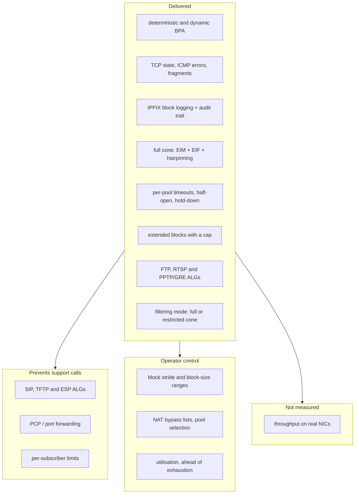
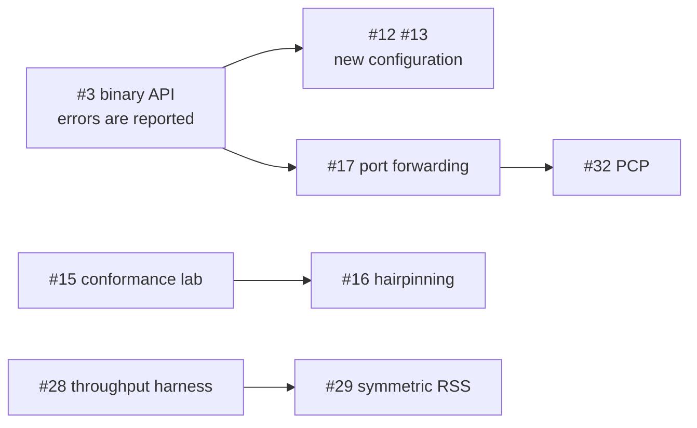

# HexaRouting — CGNAT Roadmap

## TL;DR

HexaRouting translates, logs and routes, and as of **v0.5.0** the four items the
maintainer originally named are all delivered: session lifetime control
(v0.4.0), block sizing under pressure (v0.4.0), the ALGs that matter for a
residential CGNAT (v0.5.0), and the NAT behaviour that decides whether
peer-to-peer applications work — which turned out to be satisfied by the design
and needed a test rather than a feature.

What is still missing is now the second tier: the customer who needs a port
**in**, bounds on the customer who takes too much, seeing a pool fill before it
fills, and the fact that **throughput has never been measured**
([#28](https://github.com/andrediashexa/hexarouting/issues/28)). The rest is
ordered by the cost of not having it.

Every "delivered" below points at the release it shipped in, and every one of
them has a lab that fails when the feature is removed. A roadmap that says
something is missing when it shipped is worse than no roadmap, because it is
the document people check instead of the code.

> The key words **MUST**, **MUST NOT**, **REQUIRED**, **SHOULD**,
> **SHOULD NOT**, **RECOMMENDED**, **MAY** and **OPTIONAL** in this document
> are to be interpreted as described in
> [RFC 2119](https://www.rfc-editor.org/rfc/rfc2119).

## 5W2H

| | |
|---|---|
| **What** | The list of what an ISP-grade CGNAT needs, what HexaRouting has, and what is missing. |
| **Why** | The gaps that matter are not the ones that break a graph. They surface months later as calls the operator cannot connect back to the CGNAT. |
| **Who** | Written for the maintainer deciding what to build next, and for an operator judging whether the product fits their network. |
| **Where** | This file. `docs/architecture.md` states how the parts that exist work; this one states what does not exist yet. |
| **When** | Reviewed whenever an item is finished or a new symptom is understood. |
| **How** | One table per theme: the item, the symptom it prevents, and its state. Every "already done" points at code or a test. |
| **How much** | Effort is marked S/M/L relative to the work already in the repository, not in hours. |

## How the themes relate

## 1. Already satisfied, with evidence

These are stated here because two of them were asked for as if missing. A
claim about current behaviour is worth nothing without the code that shows it.

**These are now asserted, not read.** `lab/nat-behaviour.sh` measures them
against a running dataplane; the evidence column below points at code because
that is where the property comes from, but a change that breaks it fails a test
rather than shipping.

| Behaviour | Why it already holds | Evidence |
|---|---|---|
| **Endpoint-Independent Mapping** (RFC 4787 REQ-1) | The `in2out` session key is `(private ip, private port, protocol)`. The remote address is not part of it, so one internal socket always maps to the same external port regardless of destination. | Measured: one socket reaching 8.8.8.8 then 1.1.1.1 keeps one public port (`lab/nat-behaviour.sh`) |
| **Endpoint-Independent Filtering** (RFC 4787 REQ-8, full-cone) | The `out2in` key is `(public ip, public port, protocol)`. Any external host may reach an open mapping. | same key function, `bpa_out2in.c` |
| **Paired address pooling** (RFC 4787 REQ-2) | A subscriber's public address comes from `bpa_forward()`, a function of the subscriber index alone. It cannot vary between sessions. | `bpa_pool.h`, `ref/bpa_model.py` |
| **Port preservation where possible** | The allocator honours the original port when it is inside the block and free. | `bpa_ports.h`, `test/test_bpa_ports.c` |

EIF is **not** universally desirable: it means unsolicited inbound traffic
reaches the subscriber. That is why item 3.3 below is about making it a
choice, not about implementing it.

## 2. The four items requested

### 2.1 TCP timeout control — delivered in v0.4.0 — [#12](https://github.com/andrediashexa/hexarouting/issues/12)

* **Per-pool timeouts.** `bpa timeouts` sets the global values and every pool
  may override any of them; zero inherits. The pool is the unit an operator
  sells, so it is the unit of policy.
* **A separate lifetime for half-open sessions.** SYN sent, never established,
  20 seconds by default. One infected host scanning the internet used to hold a
  port per probe for the transitory timeout, exhaust its own block, and reach
  support as "the internet stopped" from a dataplane that looked healthy.
* **Port hold-down after close.** A released port waits before being handed out
  again, so a delayed segment from the connection that just ended cannot land on
  the new one — a reset nobody can reproduce.
* **A GRE lifetime** for PPTP calls, and a short **ALG-expectation** lifetime
  for media mappings that are announced and never used, both added in v0.5.0.

What did **not** ship with it: RFC 5382 sets minimums an implementation
**SHOULD** honour, and nothing warns an operator who goes below them. That is
[#54](https://github.com/andrediashexa/hexarouting/issues/54).

### 2.2 BPA step control — extended blocks delivered in v0.4.0 — [#13](https://github.com/andrediashexa/hexarouting/issues/13)

**Extended blocks** shipped: a subscriber that fills its block is given another,
bounded by a per-pool `max-blocks`, and each one produces its own RFC 8158
`natEvent 16` so the log stays complete. That is what turns "the internet
stopped for one customer" into a logged, bounded event, and the cap is what
stops one infected host consuming the pool everybody else needs.

Only in **dynamic** mode. A deterministic pool has no spare block by
construction — the formula assigns every block to some subscriber, so a block
handed out as an extension is one taken from somebody else, and their mapping
breaks with no error anywhere. Carving out a reserve re-maps every existing
subscriber, which is [#39](https://github.com/andrediashexa/hexarouting/issues/39)
and depends on the capacity-change procedure
([#23](https://github.com/andrediashexa/hexarouting/issues/23)).

Still missing, now tracked as
[#55](https://github.com/andrediashexa/hexarouting/issues/55): the **stride**
between the blocks one subscriber holds, and **per-pool block-size ranges** so a
pool can start subscribers small and grow only those who need it.

### 2.3 ALG — FTP, RTSP and PPTP built; SIP, TFTP and ESP missing, M per protocol — [#14](https://github.com/andrediashexa/hexarouting/issues/14)

Protocols that carry an address or port inside the payload break behind any
NAT unless the NAT rewrites the payload too.

**FTP, RTSP and PPTP/GRE are built** (v0.5.0), switchable per pool with
`bpa alg <pool> <name> <on|off>` and on by default. The design of each, and
what each deliberately refuses to do, is in
[architecture.md](architecture.md#application-level-gateways).

| ALG | Symptom without it | Priority |
|---|---|---|
| **FTP** (active mode, `PORT`/`227`) | FTP works passively, fails actively. Still common with industrial and legacy equipment. | **Built**, [#42](https://github.com/andrediashexa/hexarouting/issues/42) |
| **RTSP** | IP cameras and some streaming boxes: works on the LAN, black frame from outside. | **Built**, [#43](https://github.com/andrediashexa/hexarouting/issues/43) |
| **PPTP / GRE** | VPNs to older corporate concentrators do not connect at all. GRE has no ports, so the Call ID has to play the part one plays. | **Built**, [#44](https://github.com/andrediashexa/hexarouting/issues/44) |
| **SIP** | VoIP registers but has no audio, or one-way audio. The single most expensive support call an ISP receives. | High |
| **TFTP** | Provisioning of some CPE. | Low |
| **IPsec passthrough (ESP)** | Multiple subscribers behind one public address cannot run IPsec without NAT-T; ESP has no ports to demultiplex. | Medium |

Each ALG **MUST** be individually switchable per pool, and a malformed or
unexpected payload **MUST** leave the packet untouched and increment a counter:
an ALG that rewrites a payload it misparsed is worse than no ALG, because it
corrupts traffic that would otherwise merely fail to connect.

The defaults were decided on
[#14](https://github.com/andrediashexa/hexarouting/issues/14) and are the
reverse of what this section originally said. Every ALG built here is **on**
except **SIP**, which is off and whose enabling **MUST** be a deliberate act:
VoIP providers routinely tell customers to disable SIP ALG on their CPE,
because one that misparses SDP produces one-way audio and registrations that
drop — failures harder to diagnose than the ones it prevents, and modern SIP
solves NAT traversal from the endpoint. H.323, MGCP, SCCP, MSRPC, NetBIOS,
IRC/DCC, TFTP and DNS are **not** being built; the reasoning is on #14.
Each ALG **MUST** be individually switchable per pool, and **SHOULD** default
to off unless its parse is cheap to make safe: an ALG that rewrites a payload
it misparsed is worse than no ALG, because it corrupts traffic that would
otherwise merely fail to connect.

FTP, SIP and PPTP default **on**. For PPTP the departure is deliberate and
narrow: its rewrite changes no length, so no sequence number moves, and every
message is guarded by a 32-bit magic cookie and its own length field before a
single byte is touched. Without it PPTP does not work for anyone rather than
failing only on a collision, so "off by default" would ship a CGNAT that breaks
every PPTP subscriber until an operator discovers the switch.

### 2.4 EIM/EIF — delivered in v0.4.0 and v0.5.0 — [#15](https://github.com/andrediashexa/hexarouting/issues/15), [#50](https://github.com/andrediashexa/hexarouting/issues/50)

This box is a **full-cone NAT** by default: endpoint-independent mapping
(REQ-1), endpoint-independent filtering (REQ-8) and hairpinning (REQ-9). See
[architecture.md](architecture.md#full-cone-and-the-other-option).

* **Per-pool filtering mode**, `bpa filter <pool> <mode>`, changed in place so
  switching does not disconnect anyone. `address-dependent` accepts replies only
  from the remote the subscriber contacted; that removes unsolicited inbound at
  the cost of breaking some peer-to-peer applications, which is the operator's
  trade-off, not ours.
* **Conformance evidence.** `lab/nat-behaviour.sh` asserts the mapping on
  packets, and asserts full cone by delivering a packet from a host the
  subscriber has never spoken to and reading the subscriber's own address and
  port off the wire. Running it as
  `sh tools/lab.sh nat-behaviour address-dependent` selects the restricted cone,
  where those assertions **MUST** fail — an assertion that passes under both
  modes is not testing filtering.

The claim used to rest on a reading of a hash key. It now rests on a test that
can fail.

## 3. Proposed additions

Ordered by what they cost the provider when absent. These are proposals: none
is committed until the maintainer says so.

### 3.1 Prevents support calls

| Item | Symptom without it | Effort |
|---|---|---|
| **Hairpinning** (RFC 4787 REQ-9) — *delivered, v0.4.0, [#16](https://github.com/andrediashexa/hexarouting/issues/16)* | Two subscribers behind the same CGNAT could not reach each other through the public address. Broke self-hosted services, some games, and cameras accessed by their public address from inside the network. | M |
| **Static port forwarding** | The operator has no answer for the customer who needs an inbound port. Today the answer is "buy a public IP", which is a lost sale when the provider has none. | S |
| **PCP (RFC 6887)** | The CPE cannot ask for its own mapping, so every port request becomes a ticket. PCP turns a support call into a protocol exchange. | L |
| **Per-subscriber session and rate limits** | One infected host opens thousands of sessions, exhausts its block, and the *neighbour* sharing the public address is unaffected — but the infected subscriber calls support, and there is no counter to point at. Limits also cap the damage of a scan. | M |
| **MSS clamping** | With PPPoE upstream, large packets are dropped and "some sites do not load" — the same symptom as broken PMTUD, from a different cause. | S |

### 3.2 Compliance and answering the authorities

| Item | Why | Effort |
|---|---|---|
| **Syslog export as an alternative to IPFIX** | Many ISP log collectors speak only syslog. Today the log is IPFIX-only, which can rule the product out of a deployment for a reason that has nothing to do with the CGNAT. | M |
| **Subscriber identity in the log** (RADIUS / DHCP correlation) | A court order names a person, not an IP. Without correlation, answering it takes a second system and a manual join. With it, the answer is one query. | L |
| **Documented pool-resize migration** | Adding a public prefix changes the deterministic mapping for **every** subscriber. The audit trail records it, but there is no documented procedure to do it without invalidating past answers. This is a documentation and tooling gap, not a code one, and it is the sharpest edge in deterministic mode. | M |
| **Log integrity** | The trail is append-only with `fsync`, but nothing detects tampering. A hash chain would make the record defensible rather than merely present. | M |

### 3.3 Operator control

| Item | Why | Effort |
|---|---|---|
| **NAT bypass lists** | Some destinations must see the real source: internal servers, CDN caches, government portals, the operator's own management network. | S |
| **Pool selection by ACL or VRF** | Today a pool is chosen by inside prefix. Multi-VRF and per-service selection need more. The session table's second key word **used to be** reserved for a VRF id; the PPTP ALG spends it on the remote address, so this now needs a wider key or a packed encoding ([#26](https://github.com/andrediashexa/hexarouting/issues/26)). | M |
| **Per-pool timeouts and ALG switches** — *delivered, v0.4.0 and v0.5.0* | The unit of policy is the pool, because that is the unit an operator sells. Reachable through `vppctl`; **not** through the VTY, which drops pool sub-lines it does not know ([#47](https://github.com/andrediashexa/hexarouting/issues/47)). | S |
| **Port block utilisation observability** | An operator needs to see block utilisation *before* exhaustion. `natEvent 12` reports the failure; a histogram predicts it. `show bpa blocks` reports blocks in use and refusals per pool, which is a start and not the histogram ([#27](https://github.com/andrediashexa/hexarouting/issues/27)). | S |
| **uRPF on the inside** | Without it a spoofed source is translated and logged as a subscriber who did not send it — a wrong answer to a court order, produced with full confidence. | S |

### 3.4 The way out of CGNAT — **out of scope**, by decision

CGNAT is a bridge, not a destination, and a product that only does CGNAT is
selling the bridge and not the far side. That argument still stands. It is not
this product's argument to act on.

The maintainer scoped this project to **CGNAT only**, and
[#31](https://github.com/andrediashexa/hexarouting/issues/31) was closed on that
basis. NAT64+DNS64 (RFC 6146/6147), DS-Lite (RFC 6333), MAP-E/MAP-T (RFC
7597/7599) and 464XLAT are **not planned here**.

The decision is recorded rather than deleted because the reasoning is worth
keeping: each of these is an L, each would reuse this plugin's session table and
much of its logging, and MAP-E in particular is close in spirit to deterministic
BPA — it removes the session table from the datapath entirely, and with it most
of the logging obligation. If the scope ever changes, that is where to start.

### 3.5 Performance and correctness assurance

| Item | Why | Effort |
|---|---|---|
| **Throughput measurement on real NICs** | Every performance claim in this repository is currently untested. `TESTING.md` says so, and it should stop being true before anyone quotes 100 Gbps. | M |
| **Symmetric RSS** | The handoff works, but symmetric hashing would put both directions on the right worker before the handoff, saving the extra enqueue. | M |
| **RFC 4787 / 5382 conformance suite** | Turns section 1's claims into assertions. | M |
| **Sustained-load soak test** | Session table behaviour under churn over hours is not covered. Exhaustion bugs show up at hour six, not minute six. | M |

## 4. Deliberately out of scope

* **Carrier-grade NAT for IPv6-to-IPv6 (NPTv6)** — no demand in the target
  deployment, and it weakens IPv6's end-to-end property for no gain here.
* **Deep packet inspection beyond ALG needs** — an ALG parses what it must
  rewrite. Anything more is a different product with different obligations.
* **Per-flow logging** — deliberately refused. It is the thing BPA exists to
  avoid; see [logging.md](logging.md).

## 5. Delivery plan

Every item above is tracked as an issue and assigned to a release milestone.
Releases are cut in this order because each one removes a class of problem the
next one would otherwise have to work around, not because of size.

The project stays on `0.x.x` throughout; `1.0.0` is the maintainer's decision,
as stated in [CONTRIBUTING.md](../CONTRIBUTING.md) section 5. A merge happens
only when the maintainer asks for one, and each merge produces a version bump,
an annotated tag, a changelog entry and a published GitHub Release.

### What each release contains

| Release | Theme | Issues | Why here and not later |
|---|---|---|---|
| **v0.2.0** | Foundations already built | [#1](https://github.com/andrediashexa/hexarouting/issues/1) comments in English, [#2](https://github.com/andrediashexa/hexarouting/issues/2) MTU in the VTY, [#10](https://github.com/andrediashexa/hexarouting/issues/10) versioning, [#11](https://github.com/andrediashexa/hexarouting/issues/11) this roadmap | Three of these sit finished in branches. Merging them first means every later release is tagged, changelogged and readable by whoever inherits it. |
| **v0.3.0** | A control plane that reports failure | [#3](https://github.com/andrediashexa/hexarouting/issues/3), [#4](https://github.com/andrediashexa/hexarouting/issues/4), [#5](https://github.com/andrediashexa/hexarouting/issues/5) hexash on the binary API | Everything after this adds configuration. Adding it on top of a `commit` that cannot tell success from failure means each new feature inherits a control plane that lies. This is the one ordering constraint that is not negotiable. |
| **v0.4.0** | Subscriber experience | [#12](https://github.com/andrediashexa/hexarouting/issues/12) per-pool timeouts and half-open state, [#13](https://github.com/andrediashexa/hexarouting/issues/13) extended blocks | The two things an operator notices in the first month: ports held by dead connections, and one customer cut off while the pool is half empty. |
| **v0.5.0** — *released* | Application compatibility | [#42](https://github.com/andrediashexa/hexarouting/issues/42) FTP, [#43](https://github.com/andrediashexa/hexarouting/issues/43) RTSP and [#44](https://github.com/andrediashexa/hexarouting/issues/44) PPTP/GRE ALGs; [#50](https://github.com/andrediashexa/hexarouting/issues/50) full cone asserted. [#15](https://github.com/andrediashexa/hexarouting/issues/15) and [#16](https://github.com/andrediashexa/hexarouting/issues/16) landed earlier, in v0.4.0. | The failures that do not look like NAT failures to the subscriber, and therefore become long calls. SIP, TFTP and ESP remain open under [#14](https://github.com/andrediashexa/hexarouting/issues/14). |
| **v0.6.0** | Inbound and protection | [#17](https://github.com/andrediashexa/hexarouting/issues/17) port forwarding, [#18](https://github.com/andrediashexa/hexarouting/issues/18) per-subscriber limits, [#19](https://github.com/andrediashexa/hexarouting/issues/19) MSS clamping, [#24](https://github.com/andrediashexa/hexarouting/issues/24) uRPF, [#25](https://github.com/andrediashexa/hexarouting/issues/25) bypass lists, [#26](https://github.com/andrediashexa/hexarouting/issues/26) pool selection, [#27](https://github.com/andrediashexa/hexarouting/issues/27) utilisation | Answers for the customer who needs a port in, and bounds on the customer who takes too many. |
| **v0.7.0** | Compliance | [#20](https://github.com/andrediashexa/hexarouting/issues/20) syslog, [#21](https://github.com/andrediashexa/hexarouting/issues/21) subscriber identity, [#22](https://github.com/andrediashexa/hexarouting/issues/22) trail integrity, [#23](https://github.com/andrediashexa/hexarouting/issues/23) pool-resize procedure | The log already exists and is correct. This release makes it usable by the systems and the people who have to act on it. |
| **v0.8.0** | High availability | [#6](https://github.com/andrediashexa/hexarouting/issues/6), [#7](https://github.com/andrediashexa/hexarouting/issues/7), [#8](https://github.com/andrediashexa/hexarouting/issues/8), [#9](https://github.com/andrediashexa/hexarouting/issues/9) | Deliberately after correctness. HA over a CGNAT with known gaps replicates the gaps. |
| **v0.9.0** | Performance, measured | [#28](https://github.com/andrediashexa/hexarouting/issues/28) throughput on real NICs, [#29](https://github.com/andrediashexa/hexarouting/issues/29) symmetric RSS, [#30](https://github.com/andrediashexa/hexarouting/issues/30) soak test | Before this release the performance numbers do not exist. After it they do, with their conditions. |
| **v0.10.0** | The way out of CGNAT | [#31](https://github.com/andrediashexa/hexarouting/issues/31) NAT64, DS-Lite, MAP-E/MAP-T, 464XLAT | The far side of the bridge. |
| *backlog* | | [#32](https://github.com/andrediashexa/hexarouting/issues/32) PCP | Depends on #17 and earns its cost only once manual forwards become a volume. |

### Dependencies that actually constrain the order

Most of the plan could be reordered. These four links cannot:

* **#3 before any new configuration.** A feature added while `commit` reports
  success on a dataplane that refused it inherits that defect permanently.
* **#17 before #32.** PCP is the automated path onto the forwarding table; the
  table has to exist first.
* **#15 before #16.** Hairpinning changes which packets are delivered. Without
  the conformance lab asserting the current mapping and filtering behaviour
  first, a hairpinning regression is indistinguishable from a design choice.
* **#28 before #29.** Symmetric RSS is an optimisation. Optimising before the
  harness exists means the improvement is asserted rather than measured, which
  is how this project has been wrong before.

Everything else is a preference and may be reordered on demand from a real
deployment. A provider blocked on SIP moves #14 forward; that is a better
reason than this table.

### Working rules for each release

1. Every issue gets its own branch, cut from `master`, per
   [CONTRIBUTING.md](../CONTRIBUTING.md) section 3.
2. A branch is not ready until it carries a test that **fails without it**.
   For items in section 1 of this document — behaviour that already holds —
   the test MUST be observed to pass on `master` first, since there it
   confirms rather than proves.
3. Nothing merges until the maintainer asks. Branches accumulate; that is
   intended, and it is why each one has to stand on its own.
4. A release is cut when its milestone is empty, or when the maintainer
   decides what remains can wait.

### What this plan does not promise

* **Dates.** Nothing here is estimated in time. The S/M/L marks are relative
  to work already in this repository, and the only honest schedule is the one
  produced after the first two releases are done.
* **That the order survives contact.** The first real deployment will
  reprioritise this list, and it should. What the plan buys is that the
  reordering is a decision rather than a discovery.
