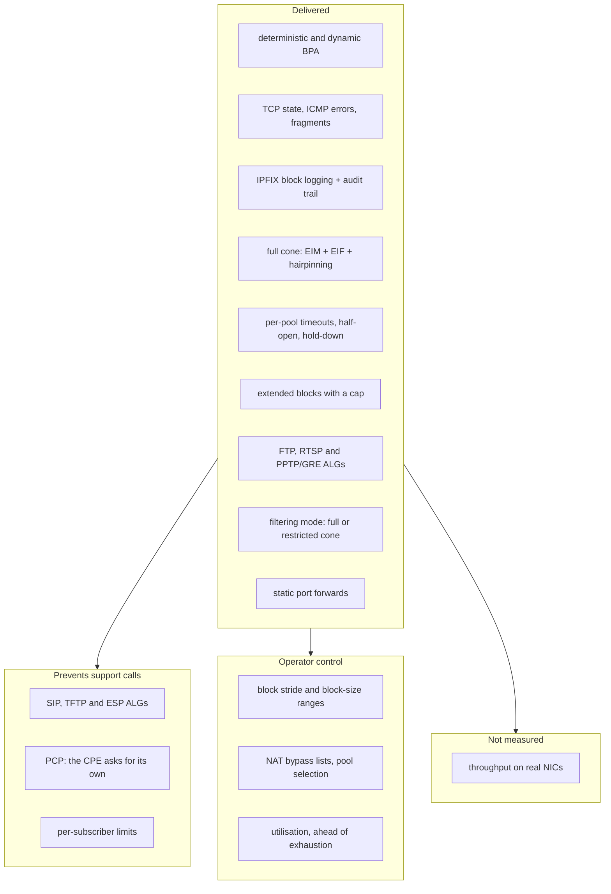
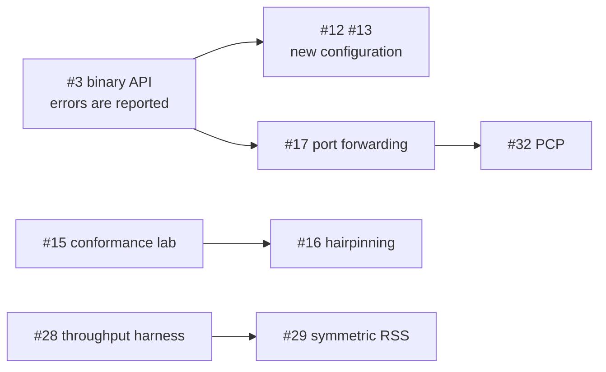

# HexaRouting — CGNAT Roadmap

## TL;DR

HexaRouting translates, logs and routes, and as of **v0.5.0** the four items the
maintainer originally named are all delivered: session lifetime control
(v0.4.0), block sizing under pressure (v0.4.0), the ALGs that matter for a
residential CGNAT (v0.5.0), and the NAT behaviour that decides whether
peer-to-peer applications work — which turned out to be satisfied by the design
and needed a test rather than a feature.

The customer who needs a port **in** is answered as of v0.9.0: a
[static port forward](architecture.md#static-port-forwarding) pins one inbound
port to one subscriber's socket, inside that subscriber's own block and
reserved so the allocator can never hand it to anyone else
([#17](https://github.com/andrediashexa/hexarouting/issues/17)). What is still
missing is the rest of the second tier: bounds on the customer who takes too
much, seeing a pool fill before it fills, and **performance**. Throughput in
bits per second still needs a real NIC
([#28](https://github.com/andrediashexa/hexarouting/issues/28)), but the
per-packet CPU cost is measured: `bpa-in2out` spends **395 clocks per packet**
where the nodes around it spend 20–35, and the bisection on
[#63](https://github.com/andrediashexa/hexarouting/issues/63) says half of what
remains is checksum arithmetic that only NIC offload removes. The rest is
ordered by the cost of not having it.

Every "delivered" below points at the release it shipped in, and every one of
them has a lab that fails when the feature is removed. A roadmap that says
something is missing when it shipped is worse than no roadmap, because it is
the document people check instead of the code.

> The key words **MUST**, **MUST NOT**, **REQUIRED**, **SHOULD**,
> **SHOULD NOT**, **RECOMMENDED**, **MAY** and **OPTIONAL** in this document
> are to be interpreted as described in
> [RFC 2119](https://www.rfc-editor.org/rfc/rfc2119).

## 5W2H

| | |
|---|---|
| **What** | The list of what an ISP-grade CGNAT needs, what HexaRouting has, and what is missing. |
| **Why** | The gaps that matter are not the ones that break a graph. They surface months later as calls the operator cannot connect back to the CGNAT. |
| **Who** | Written for the maintainer deciding what to build next, and for an operator judging whether the product fits their network. |
| **Where** | This file. `docs/architecture.md` states how the parts that exist work; this one states what does not exist yet. |
| **When** | Reviewed whenever an item is finished or a new symptom is understood. |
| **How** | One table per theme: the item, the symptom it prevents, and its state. Every "already done" points at code or a test. |
| **How much** | Effort is marked S/M/L relative to the work already in the repository, not in hours. |

## How the themes relate

## 1. Already satisfied, with evidence

These are stated here because two of them were asked for as if missing. A
claim about current behaviour is worth nothing without the code that shows it.

**These are now asserted, not read.** `lab/nat-behaviour.sh` measures them
against a running dataplane; the evidence column below points at code because
that is where the property comes from, but a change that breaks it fails a test
rather than shipping.

| Behaviour | Why it already holds | Evidence |
|---|---|---|
| **Endpoint-Independent Mapping** (RFC 4787 REQ-1) | The `in2out` session key is `(private ip, private port, protocol)`. The remote address is not part of it, so one internal socket always maps to the same external port regardless of destination. | Measured: one socket reaching 8.8.8.8 then 1.1.1.1 keeps one public port (`lab/nat-behaviour.sh`) |
| **Endpoint-Independent Filtering** (RFC 4787 REQ-8, full-cone) | The `out2in` key is `(public ip, public port, protocol)`. Any external host may reach an open mapping. | same key function, `bpa_out2in.c` |
| **Paired address pooling** (RFC 4787 REQ-2) | A subscriber's public address comes from `bpa_forward()`, a function of the subscriber index alone. It cannot vary between sessions. | `bpa_pool.h`, `ref/bpa_model.py` |
| **Port preservation where possible** | The allocator honours the original port when it is inside the block and free. | `bpa_ports.h`, `test/test_bpa_ports.c` |

EIF is **not** universally desirable: it means unsolicited inbound traffic
reaches the subscriber. That is why item 3.3 below is about making it a
choice, not about implementing it.

## 2. The four items requested

### 2.1 TCP timeout control — delivered in v0.4.0 — [#12](https://github.com/andrediashexa/hexarouting/issues/12)

* **Per-pool timeouts.** `bpa timeouts` sets the global values and every pool
  may override any of them; zero inherits. The pool is the unit an operator
  sells, so it is the unit of policy.
* **A separate lifetime for half-open sessions.** SYN sent, never established,
  20 seconds by default. One infected host scanning the internet used to hold a
  port per probe for the transitory timeout, exhaust its own block, and reach
  support as "the internet stopped" from a dataplane that looked healthy.
* **Port hold-down after close.** A released port waits before being handed out
  again, so a delayed segment from the connection that just ended cannot land on
  the new one — a reset nobody can reproduce.
* **A GRE lifetime** for PPTP calls, and a short **ALG-expectation** lifetime
  for media mappings that are announced and never used, both added in v0.5.0.

What did **not** ship with it: RFC 5382 sets minimums an implementation
**SHOULD** honour, and nothing warns an operator who goes below them. That is
[#54](https://github.com/andrediashexa/hexarouting/issues/54).

### 2.2 BPA step control — extended blocks delivered in v0.4.0 — [#13](https://github.com/andrediashexa/hexarouting/issues/13)

**Extended blocks** shipped: a subscriber that fills its block is given another,
bounded by a per-pool `max-blocks`, and each one produces its own RFC 8158
`natEvent 16` so the log stays complete. That is what turns "the internet
stopped for one customer" into a logged, bounded event, and the cap is what
stops one infected host consuming the pool everybody else needs.

Only in **dynamic** mode. A deterministic pool has no spare block by
construction — the formula assigns every block to some subscriber, so a block
handed out as an extension is one taken from somebody else, and their mapping
breaks with no error anywhere. Carving out a reserve re-maps every existing
subscriber, which is [#39](https://github.com/andrediashexa/hexarouting/issues/39)
and depends on the capacity-change procedure
([#23](https://github.com/andrediashexa/hexarouting/issues/23)).

Still missing, now tracked as
[#55](https://github.com/andrediashexa/hexarouting/issues/55): the **stride**
between the blocks one subscriber holds, and **per-pool block-size ranges** so a
pool can start subscribers small and grow only those who need it.

### 2.3 ALG — FTP, RTSP and PPTP built; SIP, TFTP and ESP missing, M per protocol — [#14](https://github.com/andrediashexa/hexarouting/issues/14)

Protocols that carry an address or port inside the payload break behind any
NAT unless the NAT rewrites the payload too.

**FTP, RTSP and PPTP/GRE are built** (v0.5.0), switchable per pool with
`bpa alg <pool> <name> <on|off>` and on by default. The design of each, and
what each deliberately refuses to do, is in
[architecture.md](architecture.md#application-level-gateways).

| ALG | Symptom without it | Priority |
|---|---|---|
| **FTP** (active mode, `PORT`/`227`) | FTP works passively, fails actively. Still common with industrial and legacy equipment. | **Built**, [#42](https://github.com/andrediashexa/hexarouting/issues/42) |
| **RTSP** | IP cameras and some streaming boxes: works on the LAN, black frame from outside. | **Built**, [#43](https://github.com/andrediashexa/hexarouting/issues/43) |
| **PPTP / GRE** | VPNs to older corporate concentrators do not connect at all. GRE has no ports, so the Call ID has to play the part one plays. | **Built**, [#44](https://github.com/andrediashexa/hexarouting/issues/44) |
| **SIP** | VoIP registers but has no audio, or one-way audio. The single most expensive support call an ISP receives. | High |
| **TFTP** | Provisioning of some CPE. | Low |
| **IPsec passthrough (ESP)** | Multiple subscribers behind one public address cannot run IPsec without NAT-T; ESP has no ports to demultiplex. | Medium |

Each ALG **MUST** be individually switchable per pool, and a malformed or
unexpected payload **MUST** leave the packet untouched and increment a counter:
an ALG that rewrites a payload it misparsed is worse than no ALG, because it
corrupts traffic that would otherwise merely fail to connect.

The defaults were decided on
[#14](https://github.com/andrediashexa/hexarouting/issues/14) and are the
reverse of what this section originally said. Every ALG built here is **on**
except **SIP**, which is off and whose enabling **MUST** be a deliberate act:
VoIP providers routinely tell customers to disable SIP ALG on their CPE,
because one that misparses SDP produces one-way audio and registrations that
drop — failures harder to diagnose than the ones it prevents, and modern SIP
solves NAT traversal from the endpoint. H.323, MGCP, SCCP, MSRPC, NetBIOS,
IRC/DCC, TFTP and DNS are **not** being built; the reasoning is on #14.
Each ALG **MUST** be individually switchable per pool, and **SHOULD** default
to off unless its parse is cheap to make safe: an ALG that rewrites a payload
it misparsed is worse than no ALG, because it corrupts traffic that would
otherwise merely fail to connect.

FTP, SIP and PPTP default **on**. For PPTP the departure is deliberate and
narrow: its rewrite changes no length, so no sequence number moves, and every
message is guarded by a 32-bit magic cookie and its own length field before a
single byte is touched. Without it PPTP does not work for anyone rather than
failing only on a collision, so "off by default" would ship a CGNAT that breaks
every PPTP subscriber until an operator discovers the switch.

### 2.4 EIM/EIF — delivered in v0.4.0 and v0.5.0 — [#15](https://github.com/andrediashexa/hexarouting/issues/15), [#50](https://github.com/andrediashexa/hexarouting/issues/50)

This box is a **full-cone NAT** by default: endpoint-independent mapping
(REQ-1), endpoint-independent filtering (REQ-8) and hairpinning (REQ-9). See
[architecture.md](architecture.md#full-cone-and-the-other-option).

* **Per-pool filtering mode**, `bpa filter <pool> <mode>`, changed in place so
  switching does not disconnect anyone. `address-dependent` accepts replies only
  from the remote the subscriber contacted; that removes unsolicited inbound at
  the cost of breaking some peer-to-peer applications, which is the operator's
  trade-off, not ours.
* **Conformance evidence.** `lab/nat-behaviour.sh` asserts the mapping on
  packets, and asserts full cone by delivering a packet from a host the
  subscriber has never spoken to and reading the subscriber's own address and
  port off the wire. Running it as
  `sh tools/lab.sh nat-behaviour address-dependent` selects the restricted cone,
  where those assertions **MUST** fail — an assertion that passes under both
  modes is not testing filtering.

The claim used to rest on a reading of a hash key. It now rests on a test that
can fail.

## 3. Proposed additions

Ordered by what they cost the provider when absent. These are proposals: none
is committed until the maintainer says so.

### 3.1 Prevents support calls

| Item | Symptom without it | Effort |
|---|---|---|
| **Hairpinning** (RFC 4787 REQ-9) — *delivered, v0.4.0, [#16](https://github.com/andrediashexa/hexarouting/issues/16)* | Two subscribers behind the same CGNAT could not reach each other through the public address. Broke self-hosted services, some games, and cameras accessed by their public address from inside the network. | M |
| **Static port forwarding** — *delivered, v0.9.0, [#17](https://github.com/andrediashexa/hexarouting/issues/17)* | The operator had no answer for the customer who needs an inbound port, other than "buy a public IP" — a lost sale exactly when the provider has none. `forward <tcp\|udp> <public-port> to <private-ip> <private-port>`, on the subscriber's own public address, inside its own block, and refused with the reason when it is not. Deterministic pools only: on a dynamic pool the block moves, and the forward would follow it to another customer. | S |
| **PCP (RFC 6887)** | The CPE cannot ask for its own mapping, so every port request becomes a ticket. PCP turns a support call into a protocol exchange. | L |
| **Per-subscriber session and rate limits** — *delivered, v0.12.0, [#18](https://github.com/andrediashexa/hexarouting/issues/18)* | One infected host opens thousands of sessions, exhausts its block, and the *neighbour* sharing the public address is unaffected — but the infected subscriber calls support, and there is no counter to point at. `max-sessions` and `max-session-rate` per pool, zero meaning unlimited, checked where the subscriber record is already resolved. The rate is a token bucket, so the allowed burst is stated rather than an artefact of the window. Three refusal counters, because they need three different answers. | M |
| **MSS clamping** — *delivered, v0.11.0, [#19](https://github.com/andrediashexa/hexarouting/issues/19)* | With PPPoE upstream, large packets are dropped and "some sites do not load" — the same symptom as broken PMTUD, from a different cause. `tcp-mss <bytes\|auto>` per pool, off by default, on `SYN` and `SYN/ACK` in both directions, with the checksum updated incrementally and asserted from a captured packet. `auto` is the smallest CGNAT interface MTU less 40, because the clamp runs before the forwarding lookup and the egress interface is not known there. | S |

### 3.2 Compliance and answering the authorities

| Item | Why | Effort |
|---|---|---|
| **Syslog export as an alternative to IPFIX** | Many ISP log collectors speak only syslog. Today the log is IPFIX-only, which can rule the product out of a deployment for a reason that has nothing to do with the CGNAT. | M |
| **Subscriber identity in the log** (RADIUS / DHCP correlation) | A court order names a person, not an IP. Without correlation, answering it takes a second system and a manual join. With it, the answer is one query. | L |
| **Documented pool-resize migration** | Adding a public prefix changes the deterministic mapping for **every** subscriber. The audit trail records it, but there is no documented procedure to do it without invalidating past answers. This is a documentation and tooling gap, not a code one, and it is the sharpest edge in deterministic mode. | M |
| **Log integrity** | The trail is append-only with `fsync`, but nothing detects tampering. A hash chain would make the record defensible rather than merely present. | M |

### 3.3 Operator control

| Item | Why | Effort |
|---|---|---|
| **NAT bypass lists** — *delivered, v0.13.0, [#25](https://github.com/andrediashexa/hexarouting/issues/25)* | Some destinations must see the real source: internal servers, CDN caches, government portals, the operator's own management network. `bypass source` and `bypass destination` per pool, replaced entire and applied in place. A bypassed packet takes no port, creates no session and writes no record — asserted from the captured packet **and** from the session count, because the first half alone passes on a bypass that allocates first. | S |
| **Pool selection by ACL or VRF** | Today a pool is chosen by inside prefix. Multi-VRF and per-service selection need more. The session table's second key word **used to be** reserved for a VRF id; the PPTP ALG spends it on the remote address, so this now needs a wider key or a packed encoding ([#26](https://github.com/andrediashexa/hexarouting/issues/26)). | M |
| **Per-pool timeouts and ALG switches** — *delivered, v0.4.0 and v0.5.0* | The unit of policy is the pool, because that is the unit an operator sells. Reachable through `vppctl`; **not** through the VTY, which drops pool sub-lines it does not know ([#47](https://github.com/andrediashexa/hexarouting/issues/47)). | S |
| **Port block utilisation observability** — *delivered, v0.17.0, [#27](https://github.com/andrediashexa/hexarouting/issues/27)* | An operator needs to see block utilisation *before* exhaustion. `natEvent 12` reports the failure; the histogram in `show cgnat pool` predicts it, and `utilisation-alarm` names the subscriber once as it crosses. `show cgnat top` ranks them ([#40](https://github.com/andrediashexa/hexarouting/issues/40), v0.6.0) — the histogram says how many, `top` says which. | S |
| **uRPF on the inside** — *delivered, v0.10.0, [#24](https://github.com/andrediashexa/hexarouting/issues/24)* | Without it a spoofed source is translated and logged as a subscriber who did not send it — a wrong answer to a court order, produced with full confidence. `urpf strict` in an interface block, off by default, VPP's own check driven from the VTY rather than reimplemented. It does **not** catch one subscriber spoofing another on the same interface: no route check can, and the lab asserts that limit rather than describing it. | S |

### 3.4 The way out of CGNAT — **out of scope**, by decision

CGNAT is a bridge, not a destination, and a product that only does CGNAT is
selling the bridge and not the far side. That argument still stands. It is not
this product's argument to act on.

The maintainer scoped this project to **CGNAT only**, and
[#31](https://github.com/andrediashexa/hexarouting/issues/31) was closed on that
basis. NAT64+DNS64 (RFC 6146/6147), DS-Lite (RFC 6333), MAP-E/MAP-T (RFC
7597/7599) and 464XLAT are **not planned here**.

The decision is recorded rather than deleted because the reasoning is worth
keeping: each of these is an L, each would reuse this plugin's session table and
much of its logging, and MAP-E in particular is close in spirit to deterministic
BPA — it removes the session table from the datapath entirely, and with it most
of the logging obligation. If the scope ever changes, that is where to start.

### 3.5 Performance and correctness assurance

| Item | Why | Effort |
|---|---|---|
| **Throughput measurement on real NICs** | The per-packet CPU cost is measured now (`lab/throughput.sh`, v0.8.0) and it is the number that matters most: 395 clocks in `bpa-in2out` after the hairpin pre-filter, about 25 cores for 100 Gbps of 64-byte frames. Bits per second still needs an E810 or CX6 — [#28](https://github.com/andrediashexa/hexarouting/issues/28) stays open for it, and [#63](https://github.com/andrediashexa/hexarouting/issues/63) is the cost itself. | M |
| **Symmetric RSS** | The handoff works, but symmetric hashing would put both directions on the right worker before the handoff, saving the extra enqueue. | M |
| **RFC 4787 / 5382 conformance suite** | Turns section 1's claims into assertions. | M |
| **Sustained-load soak test** | Session table behaviour under churn over hours is not covered. Exhaustion bugs show up at hour six, not minute six. | M |

## 4. Deliberately out of scope

* **Carrier-grade NAT for IPv6-to-IPv6 (NPTv6)** — no demand in the target
  deployment, and it weakens IPv6's end-to-end property for no gain here.
* **Deep packet inspection beyond ALG needs** — an ALG parses what it must
  rewrite. Anything more is a different product with different obligations.
* **Per-flow logging** — deliberately refused. It is the thing BPA exists to
  avoid; see [logging.md](logging.md).

## 5. Delivery plan

Every item above is tracked as an issue and assigned to a release milestone.
Releases are cut in this order because each one removes a class of problem the
next one would otherwise have to work around, not because of size.

The project stays on `0.x.x` throughout; `1.0.0` is the maintainer's decision,
as stated in [CONTRIBUTING.md](../CONTRIBUTING.md) section 5. A merge happens
only when the maintainer asks for one, and each merge produces a version bump,
an annotated tag, a changelog entry and a published GitHub Release.

### What each release contains

Released rows carry their version. Unreleased ones do not, deliberately: this
table was renumbered three times in as many releases because the numbers were
promises about order that the work then rearranged. What the plan is for is the
**order**, and the order is what these rows still say.

| Release | Theme | Issues | Why here and not later |
|---|---|---|---|
| **v0.2.0** | Foundations already built | [#1](https://github.com/andrediashexa/hexarouting/issues/1) comments in English, [#2](https://github.com/andrediashexa/hexarouting/issues/2) MTU in the VTY, [#10](https://github.com/andrediashexa/hexarouting/issues/10) versioning, [#11](https://github.com/andrediashexa/hexarouting/issues/11) this roadmap | Three of these sit finished in branches. Merging them first means every later release is tagged, changelogged and readable by whoever inherits it. |
| **v0.3.0** | A control plane that reports failure | [#3](https://github.com/andrediashexa/hexarouting/issues/3), [#4](https://github.com/andrediashexa/hexarouting/issues/4), [#5](https://github.com/andrediashexa/hexarouting/issues/5) hexash on the binary API | Everything after this adds configuration. Adding it on top of a `commit` that cannot tell success from failure means each new feature inherits a control plane that lies. This is the one ordering constraint that is not negotiable. |
| **v0.4.0** | Subscriber experience | [#12](https://github.com/andrediashexa/hexarouting/issues/12) per-pool timeouts and half-open state, [#13](https://github.com/andrediashexa/hexarouting/issues/13) extended blocks | The two things an operator notices in the first month: ports held by dead connections, and one customer cut off while the pool is half empty. |
| **v0.5.0** — *released* | Application compatibility | [#42](https://github.com/andrediashexa/hexarouting/issues/42) FTP, [#43](https://github.com/andrediashexa/hexarouting/issues/43) RTSP and [#44](https://github.com/andrediashexa/hexarouting/issues/44) PPTP/GRE ALGs; [#50](https://github.com/andrediashexa/hexarouting/issues/50) full cone asserted. [#15](https://github.com/andrediashexa/hexarouting/issues/15) and [#16](https://github.com/andrediashexa/hexarouting/issues/16) landed earlier, in v0.4.0. | The failures that do not look like NAT failures to the subscriber, and therefore become long calls. SIP, TFTP and ESP remain open under [#14](https://github.com/andrediashexa/hexarouting/issues/14). |
| **v0.6.0 to v0.8.0** — *released* | Not what this table said | The appliance and its installer, SSH and local accounts, SNMP, the first performance measurement and a hardware lab that carries packets. | The order below was written before the first ISO was installed by hand. Three releases went to making the box installable and observable, which is the reordering the plan itself says to expect. |
| **v0.9.0** — *released* | Inbound | [#17](https://github.com/andrediashexa/hexarouting/issues/17) static port forwarding | The customer who needs a port **in**, answered. The rest of the "inbound and protection" theme this row used to carry moved to v0.10.0: one feature, one release, rather than a milestone that stays open for months. |
| **v0.10.0** — *released* | The log, protected | [#24](https://github.com/andrediashexa/hexarouting/issues/24) uRPF on an interface | A spoofed source translated and attributed to a subscriber who sent nothing is the one failure the record cannot show as a failure. |
| **v0.11.0** — *released* | The ticket that does not look like NAT | [#19](https://github.com/andrediashexa/hexarouting/issues/19) MSS clamping | "Some sites do not load", from a path narrower than the handshake agreed to. |
| **v0.12.0** — *released* | Bounding one customer | [#18](https://github.com/andrediashexa/hexarouting/issues/18) per-subscriber session and rate limits | The infected host that exhausts its own block, and the counter the operator points at when it calls. |
| **v0.13.0** — *released* | Traffic that must not be translated | [#25](https://github.com/andrediashexa/hexarouting/issues/25) bypass lists | The destinations that have to see the real source, and the sources that must keep their own address. |
| *next* | Protection and control | [#26](https://github.com/andrediashexa/hexarouting/issues/26) pool selection, [#27](https://github.com/andrediashexa/hexarouting/issues/27) utilisation | Bounds on the customer who takes too much, and the controls an operator needs before a pool fills. |
| *then* | Compliance | [#20](https://github.com/andrediashexa/hexarouting/issues/20) syslog, [#21](https://github.com/andrediashexa/hexarouting/issues/21) subscriber identity, [#22](https://github.com/andrediashexa/hexarouting/issues/22) trail integrity, [#23](https://github.com/andrediashexa/hexarouting/issues/23) pool-resize procedure | The log already exists and is correct. This makes it usable by the systems and the people who have to act on it. |
| *then* | High availability | [#6](https://github.com/andrediashexa/hexarouting/issues/6), [#7](https://github.com/andrediashexa/hexarouting/issues/7), [#8](https://github.com/andrediashexa/hexarouting/issues/8), [#9](https://github.com/andrediashexa/hexarouting/issues/9) | Deliberately after correctness. HA over a CGNAT with known gaps replicates the gaps. |
| *then* | Performance, measured | [#28](https://github.com/andrediashexa/hexarouting/issues/28) throughput on real NICs, [#29](https://github.com/andrediashexa/hexarouting/issues/29) symmetric RSS, [#30](https://github.com/andrediashexa/hexarouting/issues/30) soak test | The per-packet cost is measured ([#63](https://github.com/andrediashexa/hexarouting/issues/63)); bits per second is not, and needs a NIC DPDK drives natively. |
| *not planned* | The way out of CGNAT | [#31](https://github.com/andrediashexa/hexarouting/issues/31) NAT64, DS-Lite, MAP-E/MAP-T, 464XLAT | **Out of scope by decision** — see section 3.4. The row is kept because the reasoning is worth keeping, not because the work is scheduled. |
| *backlog* | | [#32](https://github.com/andrediashexa/hexarouting/issues/32) PCP, [#67](https://github.com/andrediashexa/hexarouting/issues/67) forwards on dynamic pools | PCP's dependency is met now that #17 has shipped; it earns its cost once manual forwards become a volume. #67 is what a dynamic pool needs before it can hold one at all. |

### The plan for what remains

Written after reading every open issue rather than their titles, and ordered by
what each one costs while it is absent. Phases, not dates — the only honest
schedule is the one produced after the work.

#### Phase 1 — pay the debt before it multiplies

| Issue | Why it goes first |
|---|---|
| [#69](https://github.com/andrediashexa/hexarouting/issues/69) in-place per-pool settings through the VTY — *delivered, v0.14.0* | Every setting added **after** this inherits the right behaviour for nothing. Turning on a mitigation during an incident no longer tears down the pool. |
| [#35](https://github.com/andrediashexa/hexarouting/issues/35) roles in the VTY — *delivered, v0.15.0* | Read-only, CGNAT operator and administrator, mapped onto system groups and checked where the change is applied. The boundary it does **not** draw — every role still needs the VPP CLI socket, which is total control — is [#76](https://github.com/andrediashexa/hexarouting/issues/76). |
| [#54](https://github.com/andrediashexa/hexarouting/issues/54) warn below the RFC floors — *delivered, v0.16.0* | Accepted and never silent: the warning names the RFC, the floor and what breaks, reaches the operator and the log, and `show bpa timeouts` marks the state for somebody who did not know to ask. |
| [#76](https://github.com/andrediashexa/hexarouting/issues/76) the VTY off the VPP CLI socket | Roles bound what the VTY will do, not what an account can reach. Also carries the appliance plumbing a non-root operator needs. |

#### Phase 2 — finish protection and control

| Issue | Note |
|---|---|
| [#27](https://github.com/andrediashexa/hexarouting/issues/27) utilisation as a histogram, with a threshold — *delivered, v0.17.0* | `show bpa pool` reports the distribution, and `utilisation-alarm <percent>` logs once per subscriber crossing it — ahead of `natEvent 12`, which only fires once the customer has already lost traffic. |
| [#26](https://github.com/andrediashexa/hexarouting/issues/26) pool selection by ACL and VRF | Split: [#79](https://github.com/andrediashexa/hexarouting/issues/79) VRF — *delivered, v0.18.0*, with the packed key the PPTP ALG made necessary; [#80](https://github.com/andrediashexa/hexarouting/issues/80) ACL remains, and should wait for a deployment that needs it. |

#### Phase 3 — compliance, and it is a sequence

[#35](https://github.com/andrediashexa/hexarouting/issues/35) so an identity exists — *delivered, v0.15.0* → [#34](https://github.com/andrediashexa/hexarouting/issues/34) so the trail records **who**
changed the configuration and not only what — *delivered, v0.21.0*: every entry
carries `by <account> uid <n> via api`, captured from the request at the moment
the change is applied, and an entry that cannot be attributed **says so** rather
than omitting the field. It is an assertion and not proof — the transport is
shared memory, which carries no peer credentials — which is exactly why the
next one matters → [#22](https://github.com/andrediashexa/hexarouting/issues/22) so the trail cannot
be edited afterwards — *delivered, v0.23.0*: each entry is chained to the
previous one by a SHA-256 digest, `show bpa pool history verify` names the first
entry where the chain breaks, and alteration, removal from the middle and
truncation are told apart. What it does **not** do is stop somebody who owns the
box from rewriting the trail and recomputing every digest; the copy that makes
it evidence is the one in the remote syslog, which the entries already reach.

Alongside, and independent of each other: [#20](https://github.com/andrediashexa/hexarouting/issues/20) syslog beside IPFIX,
which today disqualifies the product from deployments for a reason unrelated to
the CGNAT; and [#21](https://github.com/andrediashexa/hexarouting/issues/21) subscriber identity in the log, which is what makes
a record name a person instead of an address.

[#23](https://github.com/andrediashexa/hexarouting/issues/23) — *delivered,
v0.19.0*. It was the sharpest edge in the design and it was undocumented, with
no warning at `commit`. Now `commit` refuses a change that re-maps existing
subscribers until it is asked for by name, saying how many move and where two
of them go, and [pool-resize.md](pool-resize.md) carries the procedure —
including the migration that costs no outage.

#### What using the appliance turned up, and the order to fix it

Everything in this section was found in one sitting, by booting the ISO and
installing it rather than by reading the code. That is worth saying because it
is the pattern: the labs proved the dataplane for months while the box lied
about itself on the console, and no amount of packet-level testing was going to
find that.

**1. [#99](https://github.com/andrediashexa/hexarouting/issues/99) — an
installed box ships with `bgpd`, `ospfd` and `isisd` disabled.** First because
it is the most severe and among the cheapest: the VTY offers all three, `?`
lists them, `commit` accepts them, and the daemon is not running. The product's
own documentation claims BGP, OSPF and IS-IS. What hid it is that
`lab/routing.sh` starts those daemons **by hand** — the lab and the product
disagree about what is running, and the lab is the optimistic one.

**2. [#100](https://github.com/andrediashexa/hexarouting/issues/100) — the lab
suite runs 35 labs in series on a machine at 15% load** — *delivered, v0.28.0*.
**35 minutes to 12m45s**, with identical verdicts across two runs, which was
the condition rather than a bonus. It also brought `make release-gate`: the
release procedure as one command, after the same person got it wrong three
times in one evening and every one was caught by a rule rather than by
attention.

**3. [#98](https://github.com/andrediashexa/hexarouting/issues/98) — the VTY
does not complete what the box knows.** `interface <TAB>` offers `<word>`, so
the operator leaves the VTY for `vppctl` or `ip link` — the two tools it exists
to keep them out of — at the first argument. And there is no `show this` to see
the hierarchy being edited. Large, and paid every single day someone uses the
box.

**4. [#83](https://github.com/andrediashexa/hexarouting/issues/83) — the
installer**, with the management address dropped from its scope. What remains
is led by the **log volume**: in dynamic mode the allocation log *is* the
connection record the Marco Civil requires for a year, and it currently shares
a filesystem with everything the box needs to keep working. Then the mirror,
then verifying the disk that was just written.

**5. [#97](https://github.com/andrediashexa/hexarouting/issues/97) — the
twenty-three second wait** with nothing on the console saying what is being
waited for. Smallest, and last, because it is cosmetic next to the four above —
but it is on the first screen anybody sees.

#### Seeing what the box is actually doing

[#95](https://github.com/andrediashexa/hexarouting/issues/95) — *delivered,
v0.26.0*. `show route` reads the **VPP FIB**, and `show route verbose` compares
it against FRR's table and marks the disagreements. `show ip route` in vtysh
answers from FRR, which is the table where a route looks correct on a box that
is dropping the traffic.

Static routes are configurable and discoverable, and `commit check` refuses a
next hop on no connected network rather than accepting a route that would never
reach the FIB.

Two things this turned up, both filed rather than folded in:
[#99](https://github.com/andrediashexa/hexarouting/issues/99), that an
installed box ships with bgpd, ospfd and isisd **disabled** while the VTY
offers all three — hidden because the routing lab starts them by hand; and
[#98](https://github.com/andrediashexa/hexarouting/issues/98), that the VTY
completes keywords and stops at the first argument, so `interface <TAB>` offers
`<word>` instead of the interfaces this box has.

#### The first five minutes with the box

Three defects reported from a real boot on real hardware, and one found while
fixing them —
[#93](https://github.com/andrediashexa/hexarouting/issues/93) and
[#94](https://github.com/andrediashexa/hexarouting/issues/94), both
*delivered, v0.25.0*.

The console looked hung: the self-test wrote to `/dev/console` and the getty
drew the VTY prompt on the same screen with nothing ordering them, so the
report printed on top of the prompt. The install asked for a device path and
then asked for it a second time to confirm — the one moment where a typo is
destructive, transcribed twice.

And underneath both, the one that had been failing on every box since the
appliance existed: `install.sh` writes `!\n! HexaRouting\n!` as the default
configuration, the parser did not treat `!` as a comment, so `hexash --load`
refused the file and `hexarouting.service` **failed on the first boot of every
install**. The self-test reported `HexaRouting ready.` anyway, because it
measured the dataplane, the routing, the tuning and the VTY, and never the unit
whose job is to apply the configuration. Each defect hid the other.

Still open from the same area:
[#83](https://github.com/andrediashexa/hexarouting/issues/83) the installer's
missing questions, and
[#95](https://github.com/andrediashexa/hexarouting/issues/95) — the routing
table cannot be shown from the VTY and a static route cannot be configured in
it. The second matters more than it sounds: `show ip route` reaches FRR's RIB,
and the table that forwards packets is VPP's FIB. An operator debugging *"the
traffic is not flowing"* is shown the table where the route is present and
correct, on a box that is dropping it.

#### Installation — blocked by nothing, paid on every box

[#83](https://github.com/andrediashexa/hexarouting/issues/83) — the installer
gets the hard parts right already: it asks everything before it writes
anything, refuses to finish without a root password the operator supplied, and
will not overwrite the medium it booted from. What it does not do is everything
that happens **after** the disk is written.

It never asks about the network, so an install ends with somebody still in
front of the console or making a second trip to the cage — and management is
the one interface that MUST NOT be handed to VPP, which makes it the one the
installer could safely configure. It makes a single ext4 root and nothing else,
so the allocation log — which in dynamic mode **is** the connection record the
Marco Civil requires for a year — shares a filesystem with everything the box
needs to keep working, and fills it. There is no mirror, so one disk failure on
a box under a retention obligation loses the records themselves, which is a
different class of loss from downtime. And nothing verifies the disk that was
just written: the selftest runs on the live medium, before the install, so the
failure mode is a box reporting success and then booting to a `grub>` prompt.

Nothing blocks this and nothing depends on it, which is exactly why it keeps
being deferred. The management address alone is paid on every single install.

#### Phase 4 — capacity, which depends on #23

| Issue | Why it waits |
|---|---|
| [#39](https://github.com/andrediashexa/hexarouting/issues/39) a reserve of blocks in deterministic mode | Carving a reserve **reduces capacity**, which changes `blocks_per_ip`, which re-maps every subscriber — the hazard #23 documents. Today a deterministic subscriber that fills its block is simply dropped while the box is healthy. |
| [#55](https://github.com/andrediashexa/hexarouting/issues/55) stride and per-pool block-size ranges | Block-size ranges have the same blast radius. The stride half is independent and small. |

#### Phase 5 — applications

[#48](https://github.com/andrediashexa/hexarouting/issues/48) first: two TCP sequence-adjustment mechanisms do the same job and
are carried by every session. A third ALG that lengthens a payload — **SIP** —
would have to pick one, and half of any reader's mental model would then be
wrong.

Then [#14](https://github.com/andrediashexa/hexarouting/issues/14) SIP, the most expensive support call an ISP takes;
[#67](https://github.com/andrediashexa/hexarouting/issues/67) forwards on dynamic pools, which needs the block pinned; and
[#32](https://github.com/andrediashexa/hexarouting/issues/32) PCP last — now unblocked, since it depends on #17 and should be
bounded by #18, both delivered.

#### Phase 6 — high availability

[#9](https://github.com/andrediashexa/hexarouting/issues/9) **first**: the failover lab has to be written before the
implementation and observed to fail on `master`. Written afterwards it would be
shaped by the implementation instead of by the requirement. Then [#7](https://github.com/andrediashexa/hexarouting/issues/7)
VRRP coherent with `linux_cp`, and [#8](https://github.com/andrediashexa/hexarouting/issues/8) configuration equality between
peers — the one part of HA that cannot wait, because in deterministic mode two
peers with different configuration fail **silently**: the failover maps
subscribers to the wrong blocks and both boxes log nothing.

#### Phase 7 — performance, which needs hardware

[#28](https://github.com/andrediashexa/hexarouting/issues/28) on a real NIC unblocks [#29](https://github.com/andrediashexa/hexarouting/issues/29) symmetric RSS and what
remains of [#63](https://github.com/andrediashexa/hexarouting/issues/63), whose only real remedy is checksum offload.
[#30](https://github.com/andrediashexa/hexarouting/issues/30) the soak test can run earlier but pays most on a stable base — it
catches the leak that appears at hour six.

#### Outside the queue

[#36](https://github.com/andrediashexa/hexarouting/issues/36) Debian 13, blocked upstream with measured evidence: fd.io
publishes no trixie suite. Revisit when they do.

#### If only three were possible

[#35](https://github.com/andrediashexa/hexarouting/issues/35), [#23](https://github.com/andrediashexa/hexarouting/issues/23) and [#69](https://github.com/andrediashexa/hexarouting/issues/69). The first two are not features —
they are things that are already wrong and that only announce themselves by
causing damage. The third is what stops the debt growing with every issue added
after it.

### Dependencies that actually constrain the order

Most of the plan could be reordered. These four links cannot:

* **#3 before any new configuration.** A feature added while `commit` reports
  success on a dataplane that refused it inherits that defect permanently.
* **#17 before #32.** PCP is the automated path onto the forwarding table; the
  table has to exist first.
* **#15 before #16.** Hairpinning changes which packets are delivered. Without
  the conformance lab asserting the current mapping and filtering behaviour
  first, a hairpinning regression is indistinguishable from a design choice.
* **#28 before #29.** Symmetric RSS is an optimisation. Optimising before the
  harness exists means the improvement is asserted rather than measured, which
  is how this project has been wrong before.
* **#23 before #39 and before the block-size half of #55.** Both change a
  pool's capacity, and changing capacity re-maps every existing subscriber. A
  change with that blast radius must not arrive as a side effect of a feature
  about something else.
* **#48 before the SIP ALG in #14.** A third mechanism that lengthens a payload
  would have to choose between the two sequence-adjustment implementations that
  already exist, and whichever it chose, the other would become dead weight
  nobody dares remove.
* **#9 before #7 and #8.** The failover lab is the acceptance test for HA and
  MUST be observed to fail before the implementation exists; written
  afterwards, it tests what was built rather than what was required.

Everything else is a preference and may be reordered on demand from a real
deployment. A provider blocked on SIP moves #14 forward; that is a better
reason than this table.

### Working rules for each release

1. Every issue gets its own branch, cut from `master`, per
   [CONTRIBUTING.md](../CONTRIBUTING.md) section 3.
2. A branch is not ready until it carries a test that **fails without it**.
   For items in section 1 of this document — behaviour that already holds —
   the test MUST be observed to pass on `master` first, since there it
   confirms rather than proves.
3. Nothing merges until the maintainer asks. Branches accumulate; that is
   intended, and it is why each one has to stand on its own.
4. A release is cut when its milestone is empty, or when the maintainer
   decides what remains can wait.

### What this plan does not promise

* **Dates.** Nothing here is estimated in time. The S/M/L marks are relative
  to work already in this repository, and the only honest schedule is the one
  produced after the first two releases are done.
* **That the order survives contact.** The first real deployment will
  reprioritise this list, and it should. What the plan buys is that the
  reordering is a decision rather than a discovery.
