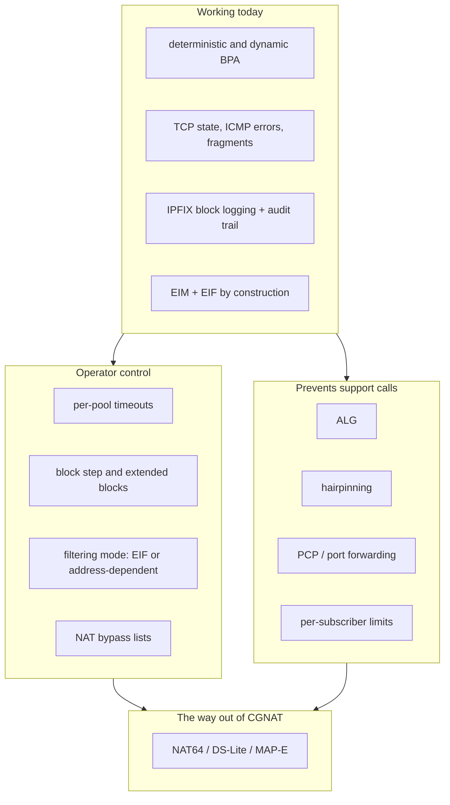

# HexaRouting — CGNAT Roadmap

## TL;DR

HexaRouting translates, logs and routes today. What is still missing is mostly
the part that decides whether an operator gets support calls: session lifetime
control, block sizing under pressure, protocols that carry addresses inside
their payload (ALG), and the NAT behaviour that decides whether peer-to-peer
applications work at all.

Two of the four items the maintainer named are **already satisfied by the
current design** — endpoint-independent mapping and filtering fall out of the
session key, not from a feature — and this document says so with the evidence
rather than promising to build them again. The rest is ordered by the cost of
not having it.

> The key words **MUST**, **MUST NOT**, **REQUIRED**, **SHOULD**,
> **SHOULD NOT**, **RECOMMENDED**, **MAY** and **OPTIONAL** in this document
> are to be interpreted as described in
> [RFC 2119](https://www.rfc-editor.org/rfc/rfc2119).

## 5W2H

| | |
|---|---|
| **What** | The list of what an ISP-grade CGNAT needs, what HexaRouting has, and what is missing. |
| **Why** | The gaps that matter are not the ones that break a graph. They surface months later as calls the operator cannot connect back to the CGNAT. |
| **Who** | Written for the maintainer deciding what to build next, and for an operator judging whether the product fits their network. |
| **Where** | This file. `docs/architecture.md` states how the parts that exist work; this one states what does not exist yet. |
| **When** | Reviewed whenever an item is finished or a new symptom is understood. |
| **How** | One table per theme: the item, the symptom it prevents, and its state. Every "already done" points at code or a test. |
| **How much** | Effort is marked S/M/L relative to the work already in the repository, not in hours. |

## How the themes relate

## 1. Already satisfied, with evidence

These are stated here because two of them were asked for as if missing. A
claim about current behaviour is worth nothing without the code that shows it.

| Behaviour | Why it already holds | Evidence |
|---|---|---|
| **Endpoint-Independent Mapping** (RFC 4787 REQ-1) | The `in2out` session key is `(private ip, private port, protocol)`. The remote address is not part of it, so one internal socket always maps to the same external port regardless of destination. | `bpa_key()` in `src/plugins/bpa/bpa_session.h` |
| **Endpoint-Independent Filtering** (RFC 4787 REQ-8, full-cone) | The `out2in` key is `(public ip, public port, protocol)`. Any external host may reach an open mapping. | same key function, `bpa_out2in.c` |
| **Paired address pooling** (RFC 4787 REQ-2) | A subscriber's public address comes from `bpa_forward()`, a function of the subscriber index alone. It cannot vary between sessions. | `bpa_pool.h`, `ref/bpa_model.py` |
| **Port preservation where possible** | The allocator honours the original port when it is inside the block and free. | `bpa_ports.h`, `test/test_bpa_ports.c` |

EIF is **not** universally desirable: it means unsolicited inbound traffic
reaches the subscriber. That is why item 3.3 below is about making it a
choice, not about implementing it.

## 2. The four items requested

### 2.1 TCP timeout control — partly present, S — [#12](https://github.com/andrediashexa/hexarouting/issues/12)

`bpa timeouts` already sets `udp`, `icmp`, `tcp-transitory` and
`tcp-established` (`bpa_cli.c`), and TCP state is tracked well enough to
release a port on RST (`bpa_tcp_track()`). What is missing:

* Timeouts are **global**, not per pool. A provider serving business and
  residential customers from one box needs different lifetimes.
* There is no separate lifetime for a **half-open** session (SYN sent, never
  established). A scan or a SYN flood from one infected host currently holds
  ports for the transitory timeout.
* RFC 5382 sets minimums an implementation **SHOULD** honour: 2 hours 4
  minutes for established, 4 minutes for transitory. The defaults **MUST** be
  checked against those, and an operator setting something shorter **SHOULD**
  be told what breaks.
* No **port hold-down after close**: a port released and immediately reused
  can collide with a delayed segment from the previous connection. A short
  quarantine costs a little capacity and removes a whole class of "random
  connection resets".

### 2.2 BPA step control — missing, M — [#13](https://github.com/andrediashexa/hexarouting/issues/13)

Today a subscriber gets exactly one block, sized by `block-size`. Real
deployments need more:

* **Extended blocks**: when a subscriber exhausts its block, allocate a
  second one instead of dropping. This is what turns "the internet stopped
  for one customer" into a logged, bounded event. It **MUST** be bounded by a
  per-subscriber maximum, and each additional block **MUST** produce its own
  natEvent 16 so the log stays complete.
* **Block step**: control the stride between the blocks a subscriber holds.
  Contiguous blocks make the log smaller and the audit simpler; strided
  blocks spread a subscriber over the port space.
* **Per-pool block size ranges** rather than one fixed size, so a pool can
  start small per subscriber and grow only for those who need it.

The mapping core already computes over a dense index space, so extended
blocks are an allocator change plus a log change, not a redesign. The
deterministic mode **MUST NOT** silently gain a second block: in that mode the
proof is the formula, and a block that is not derivable from it **MUST** be
logged like a dynamic one.

### 2.3 ALG — missing, M per protocol — [#14](https://github.com/andrediashexa/hexarouting/issues/14)

Protocols that carry an address or port inside the payload break behind any
NAT unless the NAT rewrites the payload too.

| ALG | Symptom without it | Priority |
|---|---|---|
| **FTP** (active mode, `PORT`/`227`) | FTP works passively, fails actively. Still common with industrial and legacy equipment. | High |
| **PPTP / GRE** | VPNs to older corporate concentrators simply do not connect. GRE has no ports, so the session key needs the call ID. | High |
| **SIP** | VoIP registers but has no audio, or one-way audio. The single most expensive support call an ISP receives. | High |
| **RTSP** | IP cameras and some streaming boxes. | Medium |
| **TFTP** | Provisioning of some CPE. | Low |
| **IPsec passthrough (ESP)** | Multiple subscribers behind one public address cannot run IPsec without NAT-T; ESP has no ports to demultiplex. | Medium |

Each ALG **MUST** be individually switchable per pool, and **SHOULD** default
to off except FTP and SIP: an ALG that rewrites a payload it misparsed is
worse than no ALG, because it corrupts traffic that would otherwise merely
fail to connect.

### 2.4 EIM/EIF — already endpoint-independent; the gap is choice, S — [#15](https://github.com/andrediashexa/hexarouting/issues/15)

See section 1. What remains:

* A per-pool **filtering mode**: endpoint-independent (today's behaviour) or
  address-dependent, where only the remote address the subscriber contacted
  may reply. Address-dependent filtering removes unsolicited inbound at the
  cost of breaking some peer-to-peer applications; that is the operator's
  trade-off, not ours.
* **Conformance evidence**: an RFC 4787 / RFC 5382 test in the labs, so the
  claim in section 1 is asserted by something that can fail, rather than by
  a comment about a hash key.

## 3. Proposed additions

Ordered by what they cost the provider when absent. These are proposals: none
is committed until the maintainer says so.

### 3.1 Prevents support calls

| Item | Symptom without it | Effort |
|---|---|---|
| **Hairpinning** (RFC 4787 REQ-9) | Two subscribers behind the same CGNAT cannot reach each other through the public address. Breaks self-hosted services, some games, and cameras accessed by their public address from inside the network. | M |
| **Static port forwarding** | The operator has no answer for the customer who needs an inbound port. Today the answer is "buy a public IP", which is a lost sale when the provider has none. | S |
| **PCP (RFC 6887)** | The CPE cannot ask for its own mapping, so every port request becomes a ticket. PCP turns a support call into a protocol exchange. | L |
| **Per-subscriber session and rate limits** | One infected host opens thousands of sessions, exhausts its block, and the *neighbour* sharing the public address is unaffected — but the infected subscriber calls support, and there is no counter to point at. Limits also cap the damage of a scan. | M |
| **MSS clamping** | With PPPoE upstream, large packets are dropped and "some sites do not load" — the same symptom as broken PMTUD, from a different cause. | S |

### 3.2 Compliance and answering the authorities

| Item | Why | Effort |
|---|---|---|
| **Syslog export as an alternative to IPFIX** | Many ISP log collectors speak only syslog. Today the log is IPFIX-only, which can rule the product out of a deployment for a reason that has nothing to do with the CGNAT. | M |
| **Subscriber identity in the log** (RADIUS / DHCP correlation) | A court order names a person, not an IP. Without correlation, answering it takes a second system and a manual join. With it, the answer is one query. | L |
| **Documented pool-resize migration** | Adding a public prefix changes the deterministic mapping for **every** subscriber. The audit trail records it, but there is no documented procedure to do it without invalidating past answers. This is a documentation and tooling gap, not a code one, and it is the sharpest edge in deterministic mode. | M |
| **Log integrity** | The trail is append-only with `fsync`, but nothing detects tampering. A hash chain would make the record defensible rather than merely present. | M |

### 3.3 Operator control

| Item | Why | Effort |
|---|---|---|
| **NAT bypass lists** | Some destinations must see the real source: internal servers, CDN caches, government portals, the operator's own management network. | S |
| **Pool selection by ACL or VRF** | Today a pool is chosen by inside prefix. Multi-VRF and per-service selection need more. The session table already reserves a word for a VRF id. | M |
| **Per-pool timeouts and ALG switches** | Follows from 2.1 and 2.3: the unit of policy should be the pool, because that is the unit an operator sells. | S |
| **Port block utilisation observability** | An operator needs to see block utilisation *before* exhaustion. `natEvent 12` reports the failure; a histogram predicts it. | S |
| **uRPF on the inside** | Without it a spoofed source is translated and logged as a subscriber who did not send it — a wrong answer to a court order, produced with full confidence. | S |

### 3.4 The way out of CGNAT

CGNAT is a bridge, not a destination. The product that only does CGNAT is
selling the bridge and not the far side.

| Item | Why | Effort |
|---|---|---|
| **NAT64 + DNS64** (RFC 6146/6147) | IPv6-only access networks with IPv4 reachability. Reuses this plugin's session table and much of its logging. | L |
| **DS-Lite AFTR** (RFC 6333) | IPv4 over an IPv6 access network, keeping IPv4 service without IPv4 addressing in the access. | L |
| **MAP-E / MAP-T** (RFC 7597/7599) | Stateless or nearly stateless, which removes the session table from the data path entirely — and with it most of the logging obligation. Closest in spirit to deterministic BPA. | L |
| **464XLAT** | The client-side counterpart that makes IPv6-only access work with IPv4-only applications. | M |

### 3.5 Performance and correctness assurance

| Item | Why | Effort |
|---|---|---|
| **Throughput measurement on real NICs** | Every performance claim in this repository is currently untested. `TESTING.md` says so, and it should stop being true before anyone quotes 100 Gbps. | M |
| **Symmetric RSS** | The handoff works, but symmetric hashing would put both directions on the right worker before the handoff, saving the extra enqueue. | M |
| **RFC 4787 / 5382 conformance suite** | Turns section 1's claims into assertions. | M |
| **Sustained-load soak test** | Session table behaviour under churn over hours is not covered. Exhaustion bugs show up at hour six, not minute six. | M |

## 4. Deliberately out of scope

* **Carrier-grade NAT for IPv6-to-IPv6 (NPTv6)** — no demand in the target
  deployment, and it weakens IPv6's end-to-end property for no gain here.
* **Deep packet inspection beyond ALG needs** — an ALG parses what it must
  rewrite. Anything more is a different product with different obligations.
* **Per-flow logging** — deliberately refused. It is the thing BPA exists to
  avoid; see [logging.md](logging.md).

## 5. Ordering

If the items above were done in the order that removes the most operator pain
per unit of work:

1. Per-pool timeouts, half-open state, port hold-down (2.1)
2. Extended blocks with a per-subscriber cap (2.2)
3. FTP and SIP ALG (2.3)
4. Hairpinning and static port forwarding (3.1)
5. Filtering mode and the conformance suite (2.4)
6. Per-subscriber limits and utilisation observability (3.1, 3.3)
7. Syslog export and identity correlation (3.2)
8. HA — already tracked as [#6](https://github.com/andrediashexa/hexarouting/issues/6)

Items 1 to 3 are what an operator notices in the first month. Item 8 is what
they notice once, at the worst possible moment.
