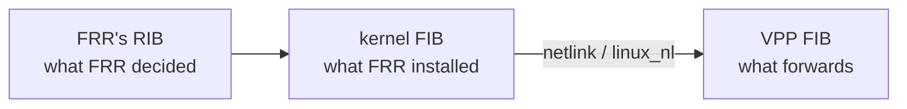
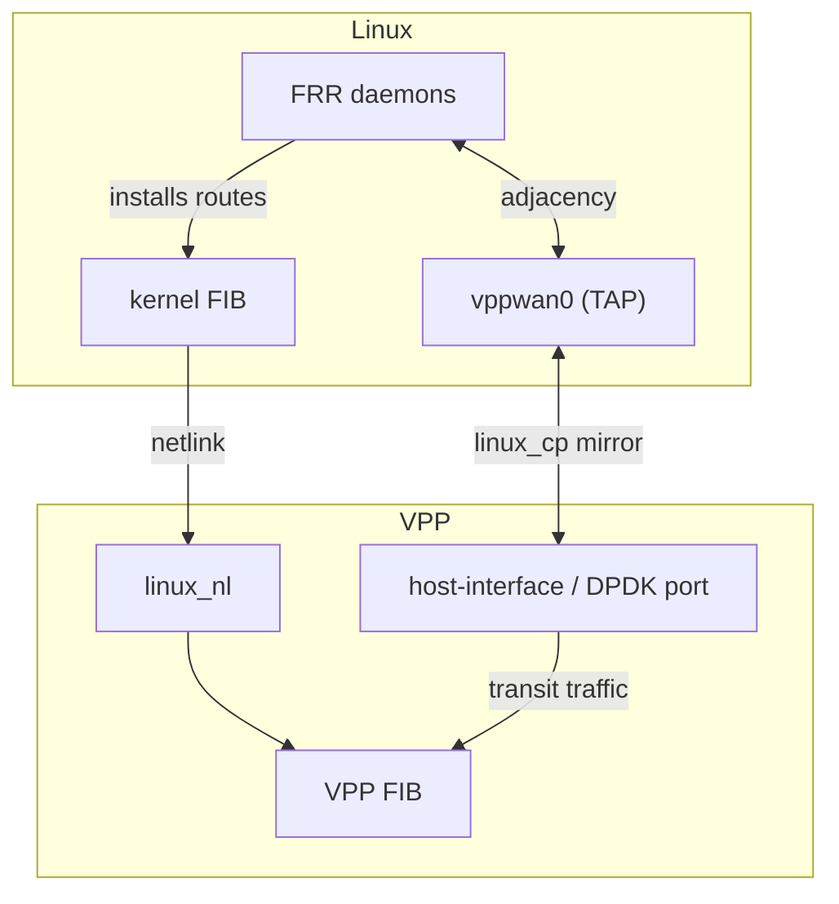
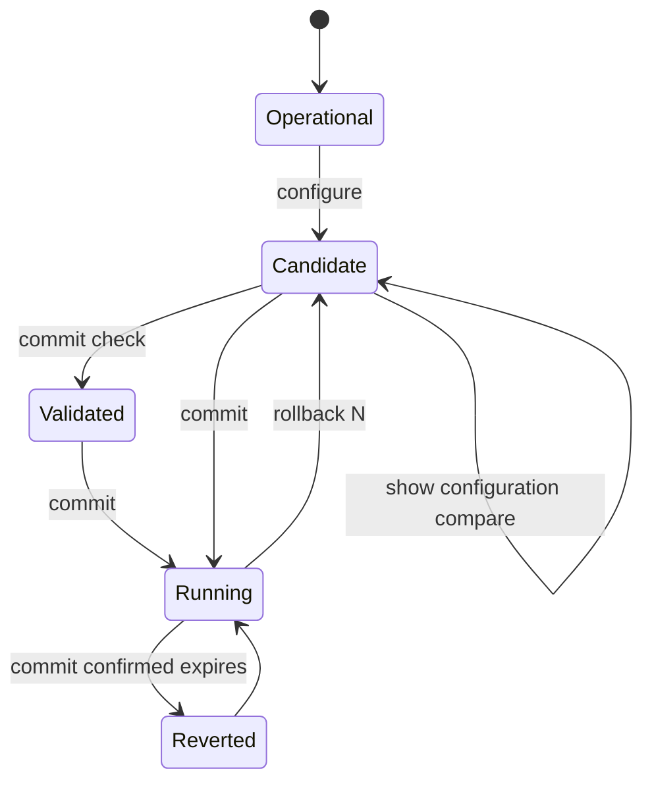

# Prisma Routing - Routing and VTY

## TL;DR

FRR provides BGP, OSPF and IS-IS. VPP's `linux_cp` mirrors each dataplane
interface as a Linux TAP, so FRR sees ordinary netdevs and needs no
modification; `linux_nl` carries the routes FRR installs back into the VPP FIB.
`prismash` is one CLI for routing and CGNAT: CGNAT under `nat`, static routes in a
`router static` block, and both of those hierarchies translated here because
neither VPP's plugin nor FRR has them — the older spellings (`cgnat ...`,
`ip route ...`) stay readable forever, because every box in service saved its
configuration in them.

Two failures found in the lab, both silent: OSPF stalls in `Exchange` when the
TAP inherits a different MTU, and IS-IS never comes up unless OSI passthrough
is explicitly enabled.

> The key words **MUST**, **MUST NOT**, **SHOULD**, **SHOULD NOT**, **MAY** and
> **RECOMMENDED** in this document are to be interpreted as described in
> [RFC 2119](https://www.rfc-editor.org/rfc/rfc2119).

## 5W2H

| | |
|---|---|
| **What** | Integration of FRR's control plane with the VPP dataplane, plus a unified configuration shell. |
| **Why** | A CGNAT box on a provider's border is a router; it must speak the provider's IGP and EGP. |
| **Who** | Network operators who already know FRR syntax and expect it to work unchanged. |
| **When** | Routes propagate to the VPP FIB within seconds of adjacency establishment. |
| **Where** | Control-plane packets are punted to Linux TAPs; the dataplane keeps forwarding. |
| **How** | `linux_cp` mirrors interfaces; `linux_nl` listens to netlink; `prismash` forwards routing commands to `vtysh`. |
| **How much** | No measurable dataplane cost: punt only affects protocol packets, not transit. |

## The table you can see is not always the table that forwards

Three tables hold routes and only one of them moves packets:



`show ip route` in `vtysh` answers from the **first**. That is the command an
operator reaches for when traffic is not flowing, and it is the table where the
route is present and correct on a box that is dropping the traffic. Nothing in
that output says the FIB was ever asked.

So the VTY has its own:

```
prisma> show route
  Destination          Next hop          Interface    Kind
  0.0.0.0/0            10.0.0.2          host-veth-vpp forward
  10.0.0.0/24          connected         host-veth-vpp connected
  203.0.113.0/24       10.0.0.2          host-veth-vpp forward

  3 entries carrying traffic
```

It reads **VPP's FIB**. `show route verbose` reads both and marks every prefix
where they disagree, with the count and what it means — two lists side by side
and a reader left to compare them is not an answer.

### What it deliberately does not show

* **Per-neighbour adjacencies.** VPP creates a `/32` for every resolved
  neighbour, whose only next hop is its own address. On a box with a dozen
  neighbours they are most of the table, and a routing table that is mostly ARP
  is a routing table nobody reads. `verbose` shows them, marked `neighbour`.
* **Housekeeping entries** — the drops and local addresses VPP creates per
  interface address. Also in `verbose`, marked for what they are.

### What it deliberately does not flag

* **A local address.** Traffic to it is received, not dropped. Calling that
  "not forwarding" is wrong.
* **A route through an interface VPP does not own.** On a real box that is the
  management port, which **MUST NOT** be handed to VPP — so every route through
  it is in FRR and absent from the FIB, correctly and permanently. Flagging
  those would leave a standing alarm on every machine, and an alarm that is
  always on is one nobody reads.

The VPP column reports **what VPP holds** — `forward`, `connected`, `local`,
`neighbour`, `drop` or `absent` — rather than yes/no. A prefix VPP is
explicitly dropping and a prefix VPP has never heard of are different
situations with different causes, and reporting both as "no" is a false
statement in the one table whose job is to settle a disagreement.

## The VTY offers what the box has

`?` and TAB complete keywords from the command tree. Where the tree takes a
**name**, the tree knows only that a word goes there — the box knows which
words:

```
prisma# [edit] interface ?
  TenGigabitEthernet0/8/0  interface (up)
  host-veth-vpp            interface (up)
  pg0                      interface (up)
  <interface>, or a name that creates one
    a name this box has not got is how one is made: <parent>.<tag> creates a
    VLAN sub-interface - its parent has to exist - and loop<n> creates a
    loopback. Anything else is refused at the commit, naming what the box has.
```

Interfaces come from the dataplane; pools, accounts and SNMP users come from
the **candidate**, so they complete what is being edited rather than only what
is committed.

**And the line under the hint is the whole of
[#406](https://github.com/andrediashexa/hexarouting/issues/406).** Typing a
name the box has not got is how a VLAN sub-interface and a loopback are made —
both have worked for releases — and `?` offered only the interfaces that
already existed, so the list read as the complete set of what may be typed. A
maintainer asked for sub-interfaces to be implemented on a box that had had
them all along. A feature nobody can find is a feature nobody has, and the
place to say so is the screen somebody is looking at while they type.

The shapes are in `HINT_NOTES`, keyed by the marker they belong under, and are
folded to the console by `console_prose` — the sentence is 90 columns and this
is a screen read on a serial console. `show interface <name>` and `interface
<name>` under `nat` > `cgnat` keep the plain `<interface>` marker: those take a name the
box HAS, and offering "or invent one" there would be offering a name they
refuse.

Before this, `interface <TAB>` answered `<word>` — true and useless. It told
the operator what they already knew and sent them to `vppctl` or `ip link` in
another window, which are the two tools this VTY exists to keep them out of, at
the first argument ([#98](https://github.com/andrediashexa/hexarouting/issues/98)).

`local0` is never offered: it is VPP's own loopback and configures nothing.

Inside a block, `?` offers **only what is valid there**:

```
prisma# [edit interface GigabitEthernet0/12/0] ?
  cgnat        this interface's side of the CGNAT
  description  what this interface is for
  exit         leave the interface
  ip           routing-protocol settings FRR owns on this interface
  ipv4         IPv4 addressing
  ipv6         IPv6 addressing
  isis         IS-IS settings on this interface
  linux-name   another name for FRR and 'ip' to see this interface by; without one it is its own
  mac-address  the MAC this interface answers to
  mtr          ping every hop of the path, as a report
  mtu          MTU, on both the dataplane interface and its TAP
  no           remove a statement from this interface
  ping         send echo requests and say what came back
  show         display information
  shutdown     take the interface administratively down
  top          go to the top of the configuration
  traceroute   the path to a host, one row per hop
  up           go up one level, or <n> levels
  urpf         drop packets whose source does not route back this way
  vlan         VLAN tag, on a sub-interface
  vrf          the routing table this interface's addresses live in; 0 takes the interface back out of one
  vrrp         stand for a service address together with the peer (RFC 5798), on the dataplane interface where the packets are
```

It used to offer the whole configuration tree - fifteen options, of which
three were valid there. Offering the level above invites somebody to type
`cgnat pool` inside an interface and find out afterwards what that meant. The
list it offers today is a different one: every statement in it is valid inside
an interface, because the interface became a first-class object.

Five of those rows are not statements at all. `top`, `up`, `ping`, `traceroute`
and `mtr` are **words every configuration level owns**, and they are offered
wherever they work - which is every level, blocks included
([#400](https://github.com/andrediashexa/hexarouting/issues/400)). `top` and
`up` are left out at the top of configuration mode, where there is nothing
above to go to and the box refuses them: a `?` that offers a word the next
keystroke refuses teaches the operator that the list is a guess.

An FRR block offers `exit` and `show`, those five words, and nothing else. This
VTY does not model FRR's statements, and offering some of them would be **a
guess presented as a grammar**.

Completion **ignores case** and always inserts the machine's spelling: `ten`,
`TEN` and `TenGig` all complete to `TenGigabitEthernet0/8/0`. Demanding the
right capitalisation before it will help is completion that only works for
somebody who already knows the answer.

**A source that cannot answer offers nothing and says so.** A VTY that becomes
unusable when the dataplane is down is a VTY that cannot be used to fix it — so
a dead or missing source leaves the `<interface>` hint in place and completes
nothing, rather than hanging or raising.

## `show interface` - the dataplane's own

```
prisma> show interface
  Interface                  State  MTU    Address             Linux
  GigabitEthernet0/12/0      up     9000   203.0.113.1/24      tap0
  TenGigabitEthernet0/8/0    up     1500   -                   -

  2 interface(s) on the dataplane can forward
```

It answers from the **dataplane**. It used to be handed to `vtysh`, which sees
only what `linux_cp` has mirrored: on a box with a `GigabitEthernet0/12/0`
configured, the answer was `lo`
([#112](https://github.com/andrediashexa/hexarouting/issues/112)). Same shape as
`show ip route` answering from the RIB.

The **Linux** column carries the `linux_cp` pair, because that is the name FRR
and `ip` know the interface by.

**On an installed box the names are the cards' Linux names.** The tuner names
every card it claims after the netdev Linux had - `ens19`, `enp3s0f0` - so
that is what this listing, the prompt and FRR call it, and a card with an
`interface` block is paired into Linux under that same name
([#389](https://github.com/andrediashexa/hexarouting/issues/389),
`docs/appliance.md`). The `GigabitEthernet0/12/0` spelling in the transcripts
here is VPP's own for a device nobody named, which is what a lab's `pg0` and
a hand-edited `startup.conf` still get; FRR refuses a name over 16 characters,
and the commit check says so before FRR is handed one.

* **What is listed is what an operator configured**: cards, VLAN
  sub-interfaces and loopbacks. `local0` is not - it is VPP's null interface
  and takes no configuration of any kind - and neither is the TAP half of a
  `linux_cp` pair, which this product creates and destroys and which is
  already on its partner's row, in the `Linux` column
  ([#403](https://github.com/andrediashexa/hexarouting/issues/403)).

  Both were listed until 0.103.0, on the argument that hiding an interface the
  dataplane reports is this command deciding what the operator may see. That
  argument holds for interfaces the box HAS; it does not hold for an artefact
  of VPP or for half of a pair, and the cost of keeping them was a count that
  was wrong by the number of cards - each one counted twice, once as itself
  and once as its TAP. The half of the argument that was about diagnosis
  survives: a TAP named OUTRIGHT still answers, so `show interface tap4096` on
  a box whose pair is broken shows what is there.

  `routes.operator_interfaces()` is the one place that decides it, and it is
  the same reading `Config.drop_lcp_taps()` already used to keep a TAP out of
  the configuration read back from the box - so a name cannot be configuration
  in one screen and noise in another.
* FRR's view of the same interfaces stays at `show ip interface`.
* With the dataplane down it says it could not ask. An empty table would read
  as *"this box has no interfaces"*, which is a very different statement.

### `terse`, `description` and `utilization`

Three views on the same interfaces, each existing for a question the table above
answers badly.

**`show interface terse`** prints one line per interface with **two** state
columns:

```
prisma> show interface terse
  Interface                  Admin  Link   Proto  Local
  GigabitEthernet0/12/0      up     up     inet   203.0.113.1/24
  TenGigabitEthernet0/8/0    up     down   -      -

  2 interface(s) on the dataplane can forward
  TenGigabitEthernet0/8/0: configured up, link down - that is the wire or the far end, not this configuration
```

Admin and link are two facts, and the difference between them is the fault.
`show interface` reports the admin flag — what somebody configured — and an
operator reading `down` there cannot tell whether a colleague ran `shutdown` or
the fibre is cut. **Up/down is a wire; down/down is a person.** One "state"
column cannot say which, and this is the listing people reach for when something
is wrong, so it says both and then names the mismatches, which is the one
conclusion the view exists to make reachable without being read for.

The link state comes from `show hardware-interfaces brief`, a different command
from the one the admin state comes from. A sub-interface is not hardware and the
dataplane reports no link for it, so it takes its **parent's** — an ISP
terminates subscribers on sub-interfaces, and a blank column exactly there would
be a blank column everywhere it matters.

**`show interface description`** puts the descriptions next to the same two
columns:

```
prisma> show interface description
  Interface                  Admin  Link   Description
  GigabitEthernet0/12/0      up     up     ASSINANTES PON-3
  TenGigabitEthernet0/8/0    up     down   TRANSITO Vivo AS26599

  2 of 2 interface(s) described
```

The description is the dataplane's own interface tag, read back from the box, so
it survives a restart of the VTY and says the same thing to anything that asks
VPP directly. It is set over the API and not with `vppctl set interface tag`,
which truncates at the first space — `lab/vty.sh` asserts a description with two
spaces in it for that reason.

This command used to print the table and then a line saying the dataplane
carries no per-interface description. That was true when it was written and
stopped being true when `description` began to be stored as the tag, and it was
left saying so — which is worse than never having answered, because a reader
stops looking for a feature that exists.

**`show interface utilization [<name>] [interval <s>] [count <n>]`** samples the
counters and graphs the rate:

```
prisma> show interface utilization
  sampling every 2s, 5 time(s) - 10s in total; Ctrl-C stops early

  Interface                             rx            tx  rx history tx history
  GigabitEthernet0/12/0        8.40 Mbit/s   3.10 Mbit/s  ▁▁▁▂▁      ▁▁▁▁▁
  TenGigabitEthernet0/8/0    675.56 Mbit/s   1.24 Gbit/s  ▃▄▄▅▄      ▆▇▇█▇

  bars are each interface's share of its own line rate
    GigabitEthernet0/12/0      0.8% of 1.00 Gbit/s
    TenGigabitEthernet0/8/0   12.4% of 10.00 Gbit/s
```

`show interface` prints a counter, which is a total since boot. Nobody wants the
total; they want to know whether the link is busy **now**, and the only way
there from a total is two of them divided by the time between. So the command
takes time to answer and says how much before it starts, rather than appearing
to have hung.

* **The elapsed time is measured, not assumed from the sleep.** On a box under
  the load worth asking about, a two-second sleep is not two seconds, and a rate
  computed from the nominal interval would be wrong in exactly the conditions the
  question gets asked in.
* **A bar needs a capacity.** Where the dataplane reports a link speed the bar
  is that interface's share of its own line rate and the percentage is real.
  Where it does not — every virtual interface says `unknown` — the bar is scaled
  to the busiest sample in the run and the footer **says so**, because a
  percentage of a capacity the box does not know is a number nobody could
  defend.
* Traffic that rounds to nothing is drawn at the lowest level rather than at the
  baseline: a trickle and silence are different answers, and on a graph scaled to
  a 10G peak they would otherwise be the same character. Index 0 of the ramp is a
  visible baseline, not a space, for the same reason.
* The ramp is Unicode blocks when stdout is UTF-8 and ASCII otherwise: an
  appliance is also operated over a serial console that may be answering in
  ASCII, and a row of question marks is worse than no graph.
* An interface that appeared **mid-sample** is skipped rather than reported: its
  counter is a total since it was created, and printing that as a rate would
  invent a spike out of an interface somebody just made. A counter that went
  backwards means something ran `clear interfaces` during the sample; that step
  reads as zero and the footer says it happened.
* `lab/vty.sh` asserts the rate against a packet generator set to a known
  800 kbit/s — a window wide enough for a software generator, narrow enough that
  reporting bytes instead of bits, or per-sample totals instead of rates, falls
  outside it — and asserts the graph by comparing a run with traffic against a
  run without, rather than by looking for a particular character, which would be
  an assertion about the terminal.

### `monitor interface` — the same counters, live

**`monitor interface [<name>...] [interval <s>]`** is the view that stays
([#519](https://github.com/andrediashexa/hexarouting/issues/519)): one screen,
redrawn in place at every sample until `q` or Ctrl-C, a chart per interface for
each direction. This is `lab/monitor-interface.sh`'s screen, pg0 carrying a
stream set to 800 kbit/s:

```
monitor interface   every 1s   page 1/1   q quit  l scale  n/p page    07:17:26
pg0   scale 1.00 Mbit/s, auto
  1.00 Mbit/s┤                                      ▂ ▂▂ rx 822.98 kbit/s
             │                                      █▄██    1029 pps
             │                                      ████
            0┤                                      ████ errors 0
  1.00 Mbit/s┤                                           tx 0 bit/s
             │                                              0 pps
             │
            0┤                                      ···· drops 0
```

* **The keys.** `q` or Ctrl-C leaves, and the terminal is given back exactly as
  it was - its modes, the screen under the view, the cursor; `lab/monitor-
  interface.sh` compares them before and after, including after the dataplane
  was stopped mid-view. `l` switches every chart between its own scale and its
  line rate; `n`, space, the right or down arrow and Page Down turn the page,
  and `p`, `b`, left, up and Page Up turn it back.
* **The scale is always printed.** By default each interface is scaled to its
  own busiest sample on screen, rounded up to 1, 2 or 5 times a power of ten,
  so a 10 Mbit/s trickle on a 10G port is visible; `l` draws it against the
  line rate instead and the title says `line rate 10.00 Gbit/s: rx 12.4% tx
  0.1%`. An interface whose dataplane reports no speed says `no line rate
  known` and stays on its own scale.
* **Beside each chart**: the latest rate in bit/s and in packets per second,
  and the errors (`rx-error`, `tx-error`) and drops (`drops`, `rx-miss`,
  `rx-no-buf`) summed over the samples on screen. Before the second sample
  there is no rate, and the column says `--`, never 0.
* **The window scrolls**: as many samples as the terminal is wide, the newest
  on the right. The rows are four per direction, eight levels to a row, in
  Unicode blocks when stdout is UTF-8 and in ASCII otherwise. Interfaces that
  do not fit the terminal's height are on further pages, never cut.
* **A name** is that interface; a word that is no interface's name is every
  interface it starts. With none, every interface but `local0`.
* **The same sampler** as `show interface utilization`, so the two cannot
  disagree about a rate: the rate over the measured time between readings, an
  interface that appeared mid-sample skipped, a counter that went backwards read
  as zero and said on the bottom row. A dataplane that stops answering does not
  end the view: the chart holds its last sample and the bottom row says since
  when.
* **Not in a script.** `prismash -c`, a pipe or a file gets a refusal naming
  `show interface utilization`, which samples and prints once, and no escape
  sequence.
* **What a sample costs**, measured before the default of one a second was
  chosen: on 201 interfaces with traffic, `show interface` took 4 ms (41 ms at
  its worst), 3 ms of the reader's CPU and 2.2 ms of VPP's main thread; the
  statistics segment read through `vpp_get_stats` took 10 ms, 9 ms and 0.3 ms.
  Either is under 1% of a core at one a second, and the CLI is the one
  `show interface utilization` already reads.

## `show hardware` — the NICs the box has, before the dataplane has any

`show interface` answers from the dataplane, and that is the right source for
every question except one. On a fresh appliance VPP has been given no NIC, so
the table is empty — and that is exactly the moment an operator needs to see
what NICs the box has, in order to choose one. The only screen that could tell
them was the one that had nothing to say, and the way to the list was to leave
the VTY and read `/sys` or run `ip link`. For an appliance whose whole argument
is that it is driven from `prismash`, a first setup step that is a shell is a VTY
that is decoration
([#283](https://github.com/andrediashexa/hexarouting/issues/283)).

```
prisma> show hardware
  the dataplane has no interface to forward on: no interface was named, so VPP
  was given no NIC.
  Name it here: 'configure', 'system', 'dataplane', then
  'interface <name>' and 'commit'. A name this box has not got is
  refused, and the refusal says which ones it has.
  'show hardware' is where the names come from: it lists this box's cards as
  Linux has them, and marks the one carrying the default route.

  Interface     PCI            Driver           Link           Speed
  eno1          0000:03:00.0   ixgbe            up             1000Mb/s
    3c:ec:ef:1a:2b:3c  ixgbe, a kernel driver
      DPDK cannot take the card through it as it is; when this card is given to
      the dataplane the box moves it to a driver DPDK can use, chosen at boot
      from whether this box has an IOMMU; this VTY could not ask
    *** carries the DEFAULT ROUTE ***
  ens1f0        0000:5e:00.0   ixgbe            down           -
    b4:96:91:0d:1e:2f  ixgbe, a kernel driver
      DPDK cannot take the card through it as it is; when this card is given to
      the dataplane the box moves it to a driver DPDK can use, chosen at boot
      from whether this box has an IOMMU; this VTY could not ask

  2 NIC(s) on this box, as Linux has them
  The dataplane claims all 2. No card is reserved for Linux: this box was
  installed with no management network, so it is reached at its console.
  'interface <name>' under 'system', 'dataplane' claims that card alone instead.
  'eno1' carries the default route: it is how this box is reached. If the
  dataplane takes it, named or claimed, its address moves onto the linux_cp
  pair the dataplane keeps for it, and this box is then reached through the
  dataplane rather than beside it.
  This box will claim 'eno1' anyway when the dataplane next starts, because
  nothing reserves it: it is not the management network this box was
  installed with.
```

### A card the box has and the dataplane has not

The rule above is in the **future** on purpose — the dataplane claims its cards
when it starts — and the tense was not enough
([#405](https://github.com/andrediashexa/hexarouting/issues/405)). A second NIC
went into a running box; this screen said *"The dataplane claims all 1"*, and
the VTY then said *"interface ens19: this box has no such interface"*. Both
sentences were true and the pair of them is not readable.

So the screen names the cards that are **not on the dataplane yet**, under the
rule, and says what hands them over:

```
  The dataplane does not hold ens19 yet: a card is claimed when the dataplane
  starts, and the cards it claims are computed on that boot.
  Until this box is rebooted the dataplane cannot be given one: it is started
  with an allowlist naming the cards it had at boot, so a card added since is
  outside the process entirely.
  'system reboot' does it, and says what it costs first.
```

**There is no live path, and that is a decision rather than an omission.** The
tuner writes one `dev` stanza per claimed card into `startup.conf` and VPP is
started with an EAL allowlist naming exactly those, so a card that appeared
afterwards is not merely unclaimed — it is outside the process, and nothing the
VTY can send reaches it. Taking it in means restarting the dataplane, which
stops forwarding for every subscriber on the box.
[#336](https://github.com/andrediashexa/hexarouting/issues/336) decided that
binding happens at boot and only at boot, and that decision holds here: a box
that moved a card to a userspace driver by itself, on a timer, would be a box
that can lose the card it is reached over while nobody is watching.

The refusal at the prompt says the same thing rather than denying the card
exists:

```
error: interface ens19: the dataplane does not hold this card
    the box has it and Linux still does; the dataplane claims a card when it
    starts, and the cards it claims are computed on that boot
    'show hardware' lists it, and 'system reboot' is what hands it over
```

and the boot self-test says it too, as a **warning** — the box forwards, its
configuration is sound, and what is wrong is that a card somebody installed is
doing nothing:

```
  [warn] a card this box has is not on the dataplane
         ens19
         the dataplane claims its cards when it starts, and it is
         started with a list naming the ones it had then - so a
         card added since is outside it until this box reboots.
         'show hardware' lists it; 'system reboot' hands it over.
```

Three screens, one sentence, because an operator reads whichever one they were
already looking at.

Every value is read from a file, through a seam that a test can point somewhere
else: `Shell.SYS_CLASS_NET` and `Shell.PROC_NET_ROUTE`, the way
`Shell.STARTUP_CONF`, `Shell.TUNE_ENV`, `Shell.PCI_DEVICES` and
`Shell.PCI_DRIVERS` already are. Nothing shells out to `ip link`, which is one
of the two tools this VTY exists to keep the operator out of, and the
assertions run against a `/sys` tree built in a tempdir rather than against a
stubbed method.

* **PCI address** is `device` resolved and then **walked up** until a component
  is shaped `0000:3b:00.0`; a link with no such ancestor is **skipped**. `lo`,
  a bridge, a tap and a virtio-mmio NIC all fail that test, and none of them is
  a device DPDK could be given. A **virtio guest's NIC passes it**: the
  `device` link there points at the virtio bus device, whose parent is the PCI
  one, so a reading that stopped at the basename answered "not PCI" for every
  NIC in every VM and this screen told a virtio guest it had nothing to choose
  from ([#286](https://github.com/andrediashexa/hexarouting/issues/286)). DPDK
  drives virtio through its own poll-mode driver and the card was always
  eligible. It is the same walk `nic_pci()` in `appliance/prisma-routing-tune`
  does, so a NIC this screen offers is a NIC the tuner can resolve - the two
  cannot disagree about what is a candidate.
* **Driver** is `device/driver` resolved, and it is the driver holding the NIC
  *now*, not a guess. `vfio-pci`, `uio_pci_generic` and `igb_uio` are the three
  DPDK can take a device through; everything else is a kernel driver and is
  said to be one. `mlx5` is the exception in practice — it is bifurcated and
  works kernel-bound — which is what makes this look intermittent across
  hardware rather than broken.
* **Speed** is `speed`, which the kernel writes as `-1` for a link that is down
  and refuses to answer for at all on some drivers. Both come out as `-`: a
  negative megabit printed as a number is a number somebody reads past.
* **The MAC** is on its own line, whole. It is what gets matched against a label
  on the port or a lease in the DHCP server, so it stays one greppable token
  rather than being wrapped into a sixth column.

### The default-route mark is the point of the screen

The card carrying the default route is the one this box is reached on, and
what happens to it when the dataplane takes it is the one thing an operator
has to know before typing: the address moves onto the `linux_cp` pair, and the
box is reached through the dataplane afterwards.
[#123](https://github.com/andrediashexa/hexarouting/issues/123) made the tuner
refuse that NIC by name, and the mark was written so the refusal did not
arrive after the operator had chosen. The refusal went in
[#385](https://github.com/andrediashexa/hexarouting/issues/385) - a box is
configured at its console when it is new - and the mark stays, because the
choice still has a consequence worth reading first.

It is read from `/proc/net/route`, destination `00000000`, the same file and the
same field the tuner reads. The route file is ordered in the test so that a
reading which took the first row naming an interface names the **wrong** NIC
rather than passing by luck.

A box with no default route at all is told so, rather than being left with an
absent mark to interpret:

```
  no interface carries a default route on this box, so none of them is the
  management path by that test.
```

And a default route on something this list cannot hold - a bridge, a bond, a
VLAN, a NIC with no PCI address - is **named**:

```
  1 NIC(s) on this box, as Linux has them
  none of these carries the default route. It is on 'br0', which is not a PCI
  NIC, and that is still the path this box is reached over.
```

An unmarked list would otherwise read as "none of these is the management
path", and that reading is the one that costs the box.

### A box with one NIC: the card moves and the address goes with it

The mark above says what the choice means. On a box with **one** card it also
used to say the box could never forward: the refusal's advice - name the card
carrying subscriber traffic instead - named a card that does not exist, and a
VM with one virtual NIC is how most people first meet this product
([#303](https://github.com/andrediashexa/hexarouting/issues/303)).

That refusal is gone from every box now
([#385](https://github.com/andrediashexa/hexarouting/issues/385)): naming the
card carrying the default route is accepted with a second card present as it
was without one. What made the one-card box possible is what makes every box
reachable afterwards: the dataplane has what a real router uses for this,
`linux_cp` keeps a TAP paired with the port, and the management address lives
on the TAP. The box is then reached **through** the dataplane rather than
beside it. The card keeps its MAC across the handover - DPDK takes the device,
address and all - so nothing upstream has to learn a new one.

**Nothing is written down at the prompt any more**
([#385](https://github.com/andrediashexa/hexarouting/issues/385)). Until
0.76.1 naming the only card made the VTY read three things off Linux at that
moment - the address and prefix from `ip -4 -o addr show dev <card>`, the MAC
from `/sys/class/net/<card>/address`, the gateway from `/proc/net/route` -
print them back, add `ip route 0.0.0.0/0 <gw>` to the candidate, and write the
record beside the card in `tune.env` as a second line, so the boot after the
commit could put the address on the pair. The tuner reads the same
three things off the live card on the boot that claims it, whichever box it is
on and whether or not the card was named, and leaves them in
`/run/prisma-routing/dataplane-management`; a record taken at the prompt was a
second copy of a fact the box recomputes, and one that could be a day older
than the boot that used it. So `interface <card>` under `system` > `dataplane` is accepted like
any other statement, and the commit says what it says for every card: the
dataplane claims it when it starts, and this commit does not restart it.

A card whose way back the tuner cannot read is **not claimed**, and the
journal says which of the three was missing. An address it cannot see is an
address it cannot put back, and a handover it cannot undo on the far side is
the walk to the console. Two addresses on the card is the same answer: choosing
between them is choosing which address the box comes back on.

The address reading is the one thing in that path that is not a file. Linux
publishes an interface's own address nowhere under `/sys` or `/proc` in a form
that names the interface - `/proc/net/route` carries the subnet and not the
address, `/proc/net/fib_trie` carries the address and not the interface holding
it - so the tuner asks `ip`, through the seam its suite drives.

**And the boot replay puts back the record the tuner computed, whatever the
saved file says, which is
[#332](https://github.com/andrediashexa/hexarouting/issues/332) and half of
[#385](https://github.com/andrediashexa/hexarouting/issues/385).** The pair is
made by `prismash --load`, out of the configuration file
`prisma-routing.service` replays - and `commit` does not write that file. Only
`save` does. So a box that did what the VTY tells it to do, commit and reboot,
came up replaying a file that had never heard of the card: on a fresh appliance
the three comments the installer ships, which `Config.is_empty()` returns on
before `apply()` is reached at all. Measured on a booted guest by
`lab/install-iso.sh`: the bind worked, `virtio-pci` to `uio_pci_generic`, the
netdev gone, the dataplane holding `GigabitEthernet0/9/0` - and no pair, no
address on any interface, and nobody able to reach it. `load()` takes the
card from its holder when the file being replayed names none, and puts the
way back from `/run` on the pair on every boot that has one - on the empty
file, on a file that names the card, on a file saved before it was named -
because the record's existence is the tuner's statement that this boot gave
the card away. Until #385 the VTY's own record in `tune.env` was read first,
and only where the file named no card, so a file that named the card and
carried no record was a boot that put nothing back.

**A card the dataplane has not got means two different boots, and they are
told apart by asking Linux.** While Linux still has the card the handover has
not happened yet - the boot before the operator reboots into it, the one after
a rollback gave the card back - and there is nothing to do and nothing to say,
which is what `prismash --load` running on every boot requires. Once Linux has
given the card up and the dataplane has not got it, the card is on neither side
and the address has nowhere to go, and the box says so on the console rather
than returning success:

```
error: the card this box is reached on was handed over and nothing took it
    Linux no longer has ens18 and no interface the dataplane holds has
    52:54:00:00:00:01, so there is no pair for 10.95.200.198/24 to go on
```

Read from `/sys/class/net` by MAC, because the Linux name is the one thing that
does not survive the handover and a device DPDK has taken is not under that
directory at all. A tree with no `/sys/class/net` in it - a developer's box,
this VTY's own suites - is "cannot look" and not "the card is gone", the same
posture `dataplane_if_refusal()` takes about an empty card list.

### The handover arms nothing, and nothing needs undoing

The box does not lose the session at the commit. It loses it at the restart
after it, and for two releases that made this a confirmed commit whether or
not the operator asked - a thirty-minute window, longer than the ten an SSH or
account change gets, because it had to cover a reboot and a login rather than
a reconnection
([#212](https://github.com/andrediashexa/hexarouting/issues/212)).

**That window was removed in
[#378](https://github.com/andrediashexa/hexarouting/issues/378), because it
stopped undoing anything.** Since the box claims its own card, the state its
revert produced - `PRISMA_DATAPLANE_IF` empty, on a box with one card - is
exactly the state that claims that card. An operator who came back and
confirmed, and one who did nothing, ended in the same place; the second paid a
reboot to get there. The screen was wrong twice over: it said the card goes
back to Linux, and it implied that not typing `commit` would lose it. The card
stays either way.

What the window was for is done earlier, on every boot, without a reboot:
`prisma-routing-tune` reads the card's address, MAC and gateway off it in the
window before anything is unbound, and this VTY puts them back on the
`linux_cp` pair. A card whose way back cannot be read is not claimed at all,
and a dataplane that will not start hands the card to Linux
([#379](https://github.com/andrediashexa/hexarouting/issues/379)).

So naming the card by hand on a one-card box is a statement of intent and
nothing else. The box records nothing for it and arms nothing, and the commit
says what it says for any card: the dataplane claims it when it starts, and
this commit does not restart it.

`commit confirmed <minutes>` is still there for an operator who wants a window
around any change, and its revert still puts the configuration back. What it
no longer does is restart the box: a revert is a configuration, and the one
restart this ever had gave back a card the next start re-claims.

A revert that gives back no card restarts nothing, which is what keeps every
other unconfirmed commit on every other box from rebooting it. Nor does one
whose card never moved: the window runs from the commit and the commit does
not move the card, so an operator who commits and waits before rebooting has
the deadline pass while the box is still on its old path. There the revert is
an ordinary one - the setting goes, and restarting would be this feature
rebooting a box that was reachable the whole time. The dataplane is asked
whether it actually holds the recorded MAC before anything is restarted.

What proves the whole of it is `lab/install-iso.sh`, PHASE 4 and 5, on an
installed box: the card claimed and bound by the box itself, the address on the
pair and the route back after a power cycle, and an SSH banner read from
outside. The one-NIC lab, `one-nic`, used to model the handover in a container
- the card named at the prompt, the bind stood in for with a `tc` drop, the
boot replay, a ping and a TCP session from off the box's subnet - and went with
[#385](https://github.com/andrediashexa/hexarouting/issues/385): every claim it
could still make is either the prompt accepting a name, which
`test/test_dataplane_if.py` holds without a box, or the boot replay putting the
way back on the pair, which it could only have held by writing the tuner's
`/run` record itself - the product's work, which its own header forbade it to
do - and which the installed box holds with the real tuner.

### What the dataplane holds is said once, and first

A NIC VPP has claimed is **not under `/sys/class/net` at all** — the device has
been taken off the kernel. A list that quietly omitted it would read as a
missing NIC, which is a hardware fault and a different afternoon. So the state
of the dataplane is stated before the list:

```
prisma> show hardware
  the dataplane holds TenGigabitEthernet0/8/0. A NIC VPP owns is no longer
  listed by Linux, so it is not in the list below.
```

When the dataplane holds nothing, the sentence is
`Shell.why_no_dataplane_interface()` — the same reading, in the same order, in
the same words as `show interface` and the boot self-test. Two diagnoses of one
fact that disagree are worse than one, so this screen reuses that one rather
than writing a second.

A dataplane that cannot be asked says that, and is not reported as empty.

### A tree with no NIC in it must not read as a healthy box

```
  no PCI NIC is visible to Linux on this box, and the dataplane has none
  either, so there is no card here to give it.
  A virtio card in a virtual machine does resolve to a PCI address and is
  eligible, so a missing one here is missing from Linux too.
```

The second line is there because the reading it corrects is the one somebody
makes on the box where this screen matters most. A guest's NIC **is** a
candidate ([#286](https://github.com/andrediashexa/hexarouting/issues/286)), so
"none here" on a VM means Linux has no card either, and not that virtio was
passed over.

Whether the dataplane could be **asked** changes the sentence, because it
changes what can be concluded. With the dataplane unreachable a card it had
taken is missing from this reading too, so a box that handed every card over
and a box that never had one read alike - and the screen says so, and names
`systemctl status vpp` as what tells them apart.

"Nothing to show" and "nothing is wrong" look identical on a screen, and this
screen is read on a box that forwards nothing. The check that the empty case
says something is one of the assertions, and it was shown failing by making the
command print its table header for a box with no NICs.

The path the values were read from is deliberately **not** in any of these
sentences. It is a seam, so on a box under test it would name a directory that
exists nowhere, and a transcript an operator is comparing against their own box
would be comparing against scaffolding.

## An interface name this box has not got is refused

```
error: interface Ten0: this box has no such interface
    it has: GigabitEthernet0/12/0, TenGigabitEthernet0/8/0
    (a linux_cp pair answers to both its dataplane name and its Linux one)
    the statement would commit and do nothing
```

`interface Ten0` - a typo for `TenGigabitEthernet0/8/0` - used to create an
FRR stanza for something that is not there: it committed cleanly, appeared in
the running configuration, and did nothing
([#105](https://github.com/andrediashexa/hexarouting/issues/105)).

The refusal **lists what the box has**, because it already knows - it is the
same source the completion reads - and somebody handed a bare "no" has to go
and look.

It holds for all four ways of naming an interface: the FRR block,
`cgnat interface`, and the `mtu` and `urpf` statements, which this VTY models
outside the routing section.

* **`prismash --load` refuses the whole file**, not statement by statement. It
  runs at boot with nobody watching, and applying half a file leaves the box
  holding half of it.
* **With the dataplane unreachable the check is skipped, not failed.** A VTY
  that cannot commit while the dataplane is down is a VTY that cannot be used
  to fix it.

## An interface is more than its MTU

```
prisma# [edit interface GigabitEthernet0/12/0] ?
  cgnat        this interface's side of the CGNAT
  description  what this interface is for
  exit         leave the interface
  ip           routing-protocol settings FRR owns on this interface
  ipv4         IPv4 addressing
  ipv6         IPv6 addressing
  isis         IS-IS settings on this interface
  linux-name   another name for FRR and 'ip' to see this interface by; without one it is its own
  mac-address  the MAC this interface answers to
  mtr          ping every hop of the path, as a report
  mtu          MTU, on both the dataplane interface and its TAP
  no           remove a statement from this interface
  ping         send echo requests and say what came back
  show         display information
  shutdown     take the interface administratively down
  top          go to the top of the configuration
  traceroute   the path to a host, one row per hop
  up           go up one level, or <n> levels
  urpf         drop packets whose source does not route back this way
  vlan         VLAN tag, on a sub-interface
  vrf          the routing table this interface's addresses live in; 0 takes the interface back out of one
  vrrp         stand for a service address together with the peer (RFC 5798), on the dataplane interface where the packets are
```

**`description` lives in the dataplane**, as a VPP interface tag returned by
`sw_interface_dump`, and is mirrored to the Linux side as the interface alias.
It is therefore read back from the box like the MTU and the uRPF mode, rather
than remembered between invocations — which this VTY deliberately does not do.
A description only the VTY knows is a description that disagrees with every
other tool on the box.

**`shutdown` reaches both sides of the `linux_cp` pair.** Shutting the VPP
interface alone leaves FRR holding adjacencies over a port that has stopped
forwarding: the neighbour believes the link is fine until its own dead timer
fires, and traffic is black-holed in the meantime. Same split as the MTU, and
this project has now shipped it twice.

Applied **down first, up last**, with everything else in between: an interface
being taken down should stop carrying traffic before its configuration changes
underneath it, and one being brought up should come up already configured.

### Addresses

```
interface GigabitEthernet0/12/0
  ipv4 address 200.150.0.1/24
  ipv4 address 200.150.1.1/24
  ipv6 address 2001:db8::1/64
  exit
```

Repeatable, with `no ipv4 address <prefix>` removing one. Over
`sw_interface_add_del_address`, which carries **one prefix field for both
families** and infers the family from the value. So the VTY checks that the
keyword and the prefix agree:

```
error: '10.0.0.1/24' is not an IPv6 prefix
```

Without that check the dataplane would take `ipv6 address 10.0.0.1/24` and
quietly configure something nobody wrote.

Three details that are decisions, not accidents:

* **Removals are applied before additions.** An operator replacing
  `10.0.0.1/24` with `10.0.0.2/24` expects one address at the end, not both for
  the moment in between.
* **The delta compares sets**, so adding an address does not re-apply the
  others. Re-applying is not free — it removes and re-adds — and on the
  interface carrying the session that is a disconnection nobody asked for.
* Removing one address **must not** take the others. `del_all` is one field
  away from the one being set, and "remove this address" turning into "remove
  every address" would drop the adjacency and the management path together.
  The lab adds two, removes one, and asserts the other two survived.

### Sub-interfaces and VLANs

```
interface GigabitEthernet0/12/0.100
  vlan 100
  ipv4 address 100.64.0.1/22
  exit

interface GigabitEthernet0/12/0.200
  vlan 200 inner 10
  exit
```

`no interface <name>.<n>` removes one, and takes what was on it — an address
left behind would describe a port that does not exist.

**The suffix must equal the outer tag.** VPP names a sub-interface after its
`sub_id`, so accepting `Gi0/12/0.7` with `vlan 100` would produce a box calling
it `Gi0/12/0.100` while the configuration called it `.7` — and the running
configuration is read from the box. The two names have to be the same name.

Sub-interfaces are created **before** anything can be put on them and destroyed
**after** everything has been taken off, which is why they are their own part
of the delta rather than another dictionary keyed by interface name.

The interface-existence check from
[#105](https://github.com/andrediashexa/hexarouting/issues/105) had to learn
about them: a sub-interface the configuration **creates** is not one the box is
missing, and without that the check refused the very commit that would have
brought it into existence. A sub-interface whose *parent* is absent is a
different error and says so.

#### A parent that is shut down

**VPP will not bring a sub-interface administratively up while its parent is
down.** Its own CLI says so — `set interface state: super-interface pg0 must be
up` — and over the binary API the same refusal arrives as
`VNET_API_ERROR_UNSPECIFIED`, which is what reached an operator as *"the
dataplane refused it: unspecified error"*
([#407](https://github.com/andrediashexa/hexarouting/issues/407)).

That refusal used to fail the whole commit, and **failing does not change what
the configuration wants**: the sub-interface had no `shutdown`, so it was
wanted up, so the next commit carried it again and failed too. Measured on a
box in service: an `ipv4 address` on a different card could not be committed at
all, because a VLAN sub-interface of a second, shut-down card was in the
candidate. A box that cannot commit is the worst thing this product can be, and
[#400](https://github.com/andrediashexa/hexarouting/issues/400) is the same
sentence from the VTY's side.

Three things now:

* **The parent's `no shutdown` is applied before the child's**, so a commit
  that brings both up works in one pass.
* **A child whose parent will still be down is not attempted**, and the box
  says so rather than failing:

  ```
  warning: interface pg1.300: left shut down
      the dataplane will not bring a sub-interface up while its parent is down,
      and pg1 is shut down; 'no shutdown' on pg1 brings both up
  ```

* **Its being down is not written into the configuration.** A `shutdown` nobody
  typed would say the interface is *meant* to be down, and the candidate an
  operator loads is read back from the box — so bringing the parent up later
  would leave the child behind, for a reason nothing on the screen explains.
  `device_admin_down()` leaves a child out while its parent is down;
  `device_admin_down_raw()` is the unfiltered reading, and the apply uses it,
  because a set neither configuration holds cannot come out of the delta of
  them.

**Measured, and it is what decides the shape above:** a sub-interface does
**not** follow its parent up. With the child down and the parent brought up,
the child stays down — so the configuration saying "up" is the only thing that
will ever bring it up. It does not follow the parent *down* either: the child
reads `up` in `show interface` while the parent is down, forwarding nothing.

`lab/subif.sh` drives the whole sequence on a real dataplane: a sub-interface
created under a shut-down parent, a commit about a different interface that has
to succeed, and the parent's `no shutdown` bringing the child up with it.

**A QinQ sub-interface also matches frames carrying more than two tags**, and
the VTY says so every time it creates one:

```
warning: pg0.700 also matches anything carrying more tags
    it is outer 700 inner 900, and VPP's ethernet input reads three or more
    tags as two, so a QinQ sub-interface on this box cannot be made to refuse
    them (#136)
```

Two separate reasons, and only one of them was known when
[#136](https://github.com/andrediashexa/hexarouting/issues/136) was filed.

`create_subif` takes `sub_if_flags`, which VPP declares as an `enum` although
every member is a bit, and `vat2` generates a parser for an `enum` that
compares **one** name whole. Anything else is a null-pointer dereference:
`20`, `0`, `null` and `["A","B"]` all segfault it, while `"A|B"` and `"A,B"`
exit 0 having sent nothing. A type declared `enumflags` instead — `tunnel_flags`,
say — generates a loop over a JSON array and ORs the members, so the multi-bit
value **is** expressible in vat2's JSON and these two types are simply declared
with the wrong keyword upstream. `SUB_IF_API_FLAG_TWO_TAGS` therefore goes
without `SUB_IF_API_FLAG_EXACT_MATCH`.

Sending it would change nothing an operator could see. Measured on
`vpp 26.06-release` with the packet generator: a three-tag frame lands on a
QinQ sub-interface created by the VPP CLI **with** `exact-match` exactly as it
lands on one created without. `eth_input_tag_lookup()` in
`vnet/ethernet/node.c` — the path a sub-interface on a real port takes — reads
"three or more tags" as two and never asks for `SUBINT_CONFIG_MATCH_3_TAG`.
The flag is honoured on a *single*-tag sub-interface, where `dot1q 60
exact-match` does drop a two-tag frame that `dot1q 50` accepts; the VTY needs
nothing there, because `create_vlan_subif` takes no flags and VPP already
makes that sub-interface exact-matching.

`lab/subif.sh` asserts the over-match rather than describing it, so a VPP that
ever stops taking the three-tag frame fails the lab and the warning comes out.

**The client refuses what it cannot say.** `vppapi.py` checks the shape of
these flag fields before starting `vat2`, and reports a `vat2` that died or
refused as `cannot-send` — "the dataplane never saw it" — rather than as
`not-running`, which used to send the operator to restart a dataplane that was
answering perfectly.

### An interface in a VRF

```
interface GigabitEthernet0/12/0
  vrf 7
  ipv4 address 10.7.0.1/24
  exit
```

Numeric, the same way a pool's `vrf` is numeric. Two ways to name the same
table would be two things to keep in step, and they would disagree. Table 0 is
the default and needs no statement, so it is not written for every port on
every box.

Pools have carried a VRF since v0.18.0 and there was no way to put an
**interface** in one, so the feature was half-built: the pool named a table
nothing could be bound to
([#132](https://github.com/andrediashexa/hexarouting/issues/132)).

**VPP refuses to move an interface that still holds addresses** — `retval
-114`. It does not silently clear them, which is what this issue was written
expecting; the behaviour was measured rather than assumed, and the assumption
was wrong. The practical consequence is the same either way: the move is
**remove, move, re-add**, as one operation.

So an interface whose VRF changes is taken out of the ordinary address delta
and has its addresses applied once, inside the move. Treating it as two
independent deltas produces the refusal; doing the move first and the
addresses second produces a port that is briefly in the new table with nothing
on it.

The lab asserts the address is in that table and **not** in the default one,
then moves the interface to a second VRF and asserts the address followed and
left the first. That second pair is what catches a commit that moves the
interface and leaves its addresses behind — which reports success and produces
a port in the right table with nothing on it.

### A VRF's Linux device

```
vrf red table 10
interface GigabitEthernet0/12/0
  vrf 10
  ipv4 address 10.10.0.1/24
  exit
```

`vrf <name> table <id>` makes the Linux VRF device `red` on table 10, the
number the interface's `vrf 10` puts it in, and puts the interface's Linux end
(its linux_cp TAP, or its `linux-name`) in it. That device is what FRR calls
the VRF: `router bgp 65000 vrf red`, `vrf red` with its static routes, and
`show vrf` all find the table through it, so after the commit they work with
no step on the host
([#540](https://github.com/andrediashexa/hexarouting/issues/540)).

Before #540 a tenant VRF had a table in VPP and no device in Linux: FRR's
`router bgp 65000 vrf red` stayed inactive, and `lab/policy-c.sh` made `red`
and `svc` by hand with `ip link add red type vrf table 10`. It does not any
more; it commits the statement and asserts what the host holds.

It is told from FRR's `vrf red` block by its `table`: FRR has no `vrf <name>
table`, so the words cannot be one of FRR's statements, and `vrf red` alone is
still FRR's block, handed to FRR as before.

| Done | On the host | In VPP |
|---|---|---|
| `vrf red table 10` | `ip link add red type vrf table 10`, then up | nothing: the table is the interfaces' `vrf 10` |
| an interface's `vrf 10` | its Linux end `master red` | the interface into table 10, as before |
| an interface's `no vrf` | its Linux end `nomaster` | the interface back to table 0 |
| `no vrf red table` | `ip link del red`; the kernel takes the members out | nothing |
| `vrf red table 11` over 10 | `red` removed and made again: a device's table is fixed when it is made | nothing |

**Through the host's doors, not a shell.** From the management container the
same `ip link` would act on the container's own interfaces, so each of these
is a door of `src/prismash/doors.py`, with its words checked. A name does not
say what a device is - `ip link del dev eth0 type vrf` deletes eth0, measured
on Debian's 6.1, the `type` is not a filter - so the daemon asks the host
before it opens the door: only a VRF is removed, a member is taken out only of
a VRF, and nothing goes into or out of `prisma-bp` or out of a bridge.

**The box's own VRF is not one of these.** `prisma-*` names are refused
(`prisma-bp` is the containers' backplane, #447), `show running-config` does
not list them, and a table one of them holds - `prisma-bp`'s 128 - is refused
at `commit check`, read off the host rather than assumed. The kernel's own
tables, 253 to 255, and the name `default` are refused too.

**Read back, not remembered.** `show running-config` lists the VRF devices the
host has, so a device made by hand appears there, and a `--load` or a
`rollback` to a configuration without it removes it. The members are converged on every
commit that has a VRF device, from what the host says: a dataplane restart
makes every TAP anew, and the next commit puts each back in its VRF.

**At boot.** `prisma-routing.service` runs `prismash --load` after the
containers and FRR, so FRR starts with `router bgp 65000 vrf red` and no `red`;
the load makes the device and FRR activates the VRF when it appears.
`lab/policy-c.sh` measures exactly that: it removes `red` and `svc` from the
host, loads the saved file, and asserts the devices, their members, red's BGP
session and a packet across the leak come back.

### What the lab asserts, and why the second one is the point

```
pg0.100 rx: 0 -> 1     [ ok ] the tagged frame landed on the sub-interface
pg0.100 rx: 1 -> 1     [ ok ] a frame with a different tag did NOT land on it
```

Frames are injected at `ethernet-input`, not `ip4-input`, because the whole
question is whether the L2 tag steers the frame onto the right sub-interface
and injecting at L3 skips exactly that. Without the second assertion, a
sub-interface that swallowed every frame regardless of tag would pass
everything else in the lab.

### A box with no FRR could not configure an interface

Writing that lab found it. Entering an interface block stages `interface
<name>` as an FRR stanza, so **every** commit touching an interface triggered
routing validation — and on a box where FRR is not running, that failed and
rolled back the whole commit, CGNAT half included
([#137](https://github.com/andrediashexa/hexarouting/issues/137)).

`Frr.available()` existed, said *"A box may run CGNAT with no routing"* in its
own docstring, and was never called.

No lab caught it because **every lab that drives `prismash` also starts FRR**.
The product's own supported configuration — CGNAT without routing — was not one
any test ran. `lab/subif.sh` does not need FRR, so it did not start it, and the
defect surfaced immediately.

`real_routing()` now tells apart the statements an operator wrote from the
interface stanzas the VTY stages itself, and the check path and the apply path
share it so they cannot drift.

## LACP bundles (#455)

`interface ae<n>` is a bundle, created by being named like a loopback, with
`member <port>`, `lacp mode active|passive`, `lacp rate fast|slow` and
`load-balance l2|l23|l34` (defaults active, slow, l34) in its block. The model
is `Config.bundles`, and `config.bundle_statement()` is its one reader for
the file and the prompt. On the dataplane it is a bond in LACP mode
(`bond_create2`), at the instance the name carries, **renamed to `ae<n>`**
(`sw_interface_set_interface_name`) so the configuration, `show interface`
and the linux_cp pair FRR routes over all say one name - VPP's own
`BondEthernet<n>` would need a translation for one kind of interface
everywhere else. Members join with `bond_add_member`, carrying the mode
(`is_passive`) and the rate (`is_long_timeout`), which is why a change to
either rebuilds the bundle, and so does the hash, fixed at creation. A new
bond starts down and is brought up in the same commit. It is read back with
`sw_bond_interface_dump` and `sw_member_interface_dump`; a bond with any other
name is not this configuration's and is left alone. `commit check` refuses a
member the box does not have, a port in two bundles, and a member with
configuration of its own. `show lacp` is the dataplane's `show lacp details`.

Measured in `lab/lacp.sh`, configured through the VTY against a Linux
802.3ad bond in a peer namespace: both members reach collecting-distributing
on both ends, traffic crosses, and still crosses with one member cut; the
running configuration reads the bundle back. The off run puts the address on
one port with no bundle, and five checks go red.

## Loopbacks, and the pair that makes an interface visible to FRR

### Nothing created a linux_cp pair

`lcp create` appeared in five labs and nowhere else in this repository. Nothing
in `appliance/` and nothing in `prismash` paired a dataplane interface into the
kernel. The `linux-cp` settings in the startup configuration — `lcp-sync`,
`lcp-auto-subint` — govern how an **existing** pair behaves; `lcp-auto-subint`
creates a pair for a sub-interface of an interface that is *already* paired.
Neither creates the first one.

So on a box installed from the ISO, VPP owned the NIC and FRR saw no interface
for it. **BGP, OSPF and IS-IS were configurable and inert.** The labs created
the pair by hand, which meant they proved a box nobody received — the third
instance of that shape, after the routing daemons (#99) and OSI passthrough
(#168).

```
interface GigabitEthernet0/12/0
  linux-name vppwan0
  ipv4 address 200.150.0.1/24
  exit
```

`linux-name` is what the kernel, `ip` and FRR see the interface by. Linux
refuses a name over 15 characters and cannot have `/` in one at all — which
matters here because VPP's own names are full of them, and copying one across
is the obvious mistake to make, so it is refused with that sentence rather than
with the dataplane's bare return code.

The pair is **read back** from the box, not remembered. That is the lesson
#161 cost: a state that can be set and never read is one the operator cannot
turn off, and one the running configuration will not admit is on.

TAP rather than TUN, and not as a default: the routing protocols this product
carries are not all IP. IS-IS is OSI straight over the link, and a TUN pair has
no link layer to carry it.

### Loopbacks

```
interface loop0
  ipv4 address 10.99.0.1/32
  description router-id, which a port cannot take with it
  exit
```

**Nothing says `linux-name` there, and the loopback is still visible to FRR.**
A loopback with an `interface` block is paired into Linux under its own name by
default, the way a claimed card is
([#404](https://github.com/andrediashexa/hexarouting/issues/404)). It has to
be: the address a loopback carries is the address FRR announces and binds to,
FRR sees only what Linux has, and until this defaulted the one interface whose
whole purpose is to be reachable by the routing daemons was the one they could
not see. Measured on a box in service — four statements, `commit complete`, the
address on the dataplane, and `vtysh` calling `loop0` a *pseudo interface*.

The default is put into the model at apply, so the next commit does not take
it away, and it is **not written** when it is the interface's own name
([#461](https://github.com/andrediashexa/hexarouting/issues/461)): the
maintainer called `linux-name ens19` under `interface ens19` useless, and it
said nothing a block does not. Since #461 the default covers **every**
interface with a block whose name Linux can take and does not already hold for
something else - a sub-interface and a hot card as well as a card and a
loopback. `linux-name <other>` overrides it and is the only form the text
carries; `no linux-name` takes the override back rather than unpairing, which
the prompt says as it is typed. A file with the old same-name line is read, and
an interface whose block held nothing else keeps its block and its pair.
A loopback's name is free in Linux for a different reason than a card's — a
card's is free because the card left Linux, while `loop0` is a name VPP invents
for an interface Linux never had, its own loopback being `lo` — and either way
it is there to be taken.

Naming a loopback is what **creates** it, the way naming a sub-interface is —
there is nothing else on the box to create it from. `loop<n>` is VPP's own
spelling, so the configuration and `show interface` cannot disagree about what
the thing is called, and the instance number in the name is the instance number
VPP is given: a configuration saying `loop3` produces `loop3`, not whatever was
next free.

`no interface loop0` takes the whole path back down — address, pair, interface.
A physical port is still refused, because that is not something a configuration
can remove and accepting the words for one would promise what the commit cannot
deliver.

**Why a router needs one.** An address on a physical port disappears with the
port. A BGP `router-id`, an OSPF or IS-IS router-id, an iBGP `update-source`
that survives a link failure, and an SNMP or logging source address that does
not move all want an interface that is always up. Until this existed the VTY
could **refuse** `neighbor X update-source Loopback0` for not existing and
offered no way to make one — which is worse than not offering the statement.

### How it is tested

No lab that exercises the VTY creates a pair by hand any more. Every one that
needed a pair — `lcp`, `routing`, `vty`, `igp`, `bgp-policy`, `ipfix-tcp` — now
gets one the way a box gets one, by committing `linux-name` through the VTY.
Two labs that are about the log rather than about the VTY still run `vppctl
lcp create` to stand their topology up: `lab/ipfix-outbuf.sh` and
`lab/ipfix-stop.sh`. While those lines existed each of those labs performed the
product's missing step, and a lab that does that does not test the product; it
tests a box nobody receives. That is the same conclusion as the routing
daemons ([#99](https://github.com/andrediashexa/hexarouting/issues/99)) and OSI
passthrough ([#168](https://github.com/andrediashexa/hexarouting/issues/168)).

The loopback section is where the pairing is proved end to end, because a
loopback is created and paired entirely by the product: there is no NIC and no
veth behind it, so nothing but the product could have made it. It is committed
with **no `linux-name`**, which is the assertion since #404. The rest are that
the interface is on the dataplane, the kernel has it, the address is on it, FRR
holds it, and the pair is in the running configuration read back from the box —
and in the candidate, which is what says the default was written rather than
implied. Then removal, asserted on both the dataplane and the kernel.

And the negative half, without which none of that shows the **pair** is what
did it. That half is now built with `vppctl loopback create-interface`, behind
the product's back, because a loopback configured through this VTY is paired
and the unpaired state can no longer be reached by typing at it. Before #404
the two states were *with* `linux-name` and *without*, and this lab asserted
the unpaired one as the product's ordinary behaviour — a lab pinning what the
box did wrong, which is how this reached a maintainer's box with a green suite
behind it. One measurement changed how that is asserted. `vtysh -c "show interface"` **does** list an unpaired interface —
configuring one stages an `interface` stanza into FRR, and zebra makes a
placeholder object for any interface its configuration names. What FRR does
not have is a real one, and it says so in those words:

```
Interface loop1 is down
  vrf: default
  pseudo interface
```

against the same interface once the product has configured it, with nothing
typed about the pair:

```
Interface loop1 is down
  vrf: default
  index 10 metric 0 mtu 9000 speed 10 txqlen 1000
  flags: <BROADCAST,MULTICAST>
```

`pseudo interface` is therefore the marker both halves are asserted on. The
word the positive half used to look for — `Unknown` — appears in no FRR output
either way, so that check passed on a box with no pair at all.

### And the pair has to survive a reboot

`prisma-routing.service` runs `prismash --load /etc/prisma-routing/prisma-routing.conf`,
which is the same apply path a commit takes — so the pair a box has at boot is
the pair its saved file names. `lab/lcp.sh` asks that out loud: pair a
loopback, save, take it down, and hand the box back the file it wrote.

It found two defects, both of which ended with the unit failing and the box
coming up with **no** configuration at all.

The dataplane reads report every interface VPP has, and once the product makes
pairs one of them is the pair's own TAP — so `save` wrote `interface tap4097`
into the file, and at the next boot, against a VPP with no pairs yet, the
interface-existence check refused the file whole. The Linux end of a pair is
now out of the configuration at both ends: off the device, so no new file
carries one, and out of a file the box is handed, so boxes that already saved
one still boot. Which TAPs those are is read off the box and never guessed
from the name — `tap<n>` is equally what an operator's own `create tap` makes,
and `lab/hw-vpp.sh` runs its whole WAN over one.

And a loopback is created administratively **down**, so its saved
configuration carries `shutdown` — while the apply order shut interfaces down
*before* it created them. The first statement applied named an interface the
dataplane did not have yet, and every loopback this product can create
survived exactly until the next reboot. An interface the same delta is about
to create is now shut down after it exists.

### MAC, router advertisements, and one interface in detail

```
interface GigabitEthernet0/12/0
  mac-address 02:aa:bb:cc:dd:ee
  no ipv6 nd suppress-ra
  exit
```

`mac-address` matters on a card swap: the upstream's ARP cache, DHCP
reservations and any L2 filtering all key on it.

**VPP advertises this box as a router by default. This product does not.**
Measured on a running dataplane, not assumed: an interface holding an IPv6
address sends a router advertisement every 200 seconds, with a 600-second
lifetime, plus three initial advertisements when advertising starts. On a
subscriber-facing port that is a second default gateway for every subscriber
who gets their prefix by DHCPv6-PD, which is why the default here is the
opposite of VPP's.

So suppression is applied when an IPv6 address is added, and `no ipv6 nd
suppress-ra` is the **exception** an operator writes on the ports that should
advertise — an uplink, a transit link, a port facing routers rather than
subscribers. `ipv6 nd suppress-ra` is accepted too, and says out loud what is
already true.

`is_no` in `sw_interface_ip6nd_ra_config` undoes a previous configuration
rather than meaning "not suppressed", so resuming advertisements is `is_no` on
the suppression and not `suppress = 0`.

The state is **read back** from `sw_interface_ip6nd_ra_dump` (`send_radv`, and
`cease_radv` unset), like every other interface attribute. It was not, once,
and the consequence was not a cosmetic one: the running configuration always
claimed "suppressed", the difference against a candidate that also said
"suppressed" came out empty, and an operator who had enabled advertisements
could not turn them off again — with `show running-config` not admitting they
were on (#161). `show ip6 interface` prints the same text either way, so no
text-based reader would have closed that gap.

The lab measures all three states by counting packets on the wire in the peer
namespace — none by default, three once asked for, none again after
suppressing. Two things had to be right before that measurement said anything:
the capture is opened **before** the commit, because the initial advertisements
go out as advertising starts; and it runs inside the namespace the far end of
the link lives in. Capturing from the wrong namespace is not a loud failure —
tcpdump exits, the file stays empty, and every count reads zero, which made
"the default sends none" pass because nothing could be counted on either side
of the setting.

### `show interface <name>`

```
  pg0
    state       up
    mtu         9000
    addresses   10.0.0.1/24
    linux       vppwan0
    vrf         0 (default)
    mac         02:fe:c1:ed:07:aa
    urpf        off
    cgnat       not attached
    counters
      rx bytes                     120
      punt                           2
```

A summary answers "is the link up". A fault report needs the counters: *up*
and *up and dropping four percent of what arrives* look identical in a table,
and the second is what the operator was calling about. The counters are
printed **uninterpreted**, because during a fault the operator will also look
at `vppctl`, and a number this VTY had summarised would be one they could not
compare.

**An exact name wins over the prefix filter.** `show interface pg0` on a box
that also has `pg0.100` matches both by prefix, so "exactly one match" never
fired for any interface with sub-interfaces — which is every interface an ISP
terminates subscribers on.

### Two things this cost, both worth keeping

**The VTY had a catch-all that sent unrecognised interface statements to FRR.**
`mtu` and `urpf` were intercepted by name; everything else fell through to
`candidate.routing`. So `description` and `shutdown` were staged as FRR
statements — and **FRR accepts both words inside an interface stanza**, so
nothing errored. The description reached FRR's configuration and never the
dataplane; `shutdown` never reached anything that forwards packets.

The lab did not catch it because the assertions read `show running-config`,
which includes FRR's half. They matched the copy that had gone to the wrong
place. **Three assertions were vacuous**, and two more passed because `local0`
is always administratively down, so the running configuration said `shutdown`
on every box before anybody typed it.

The assertions now read the dataplane: the tag from `sw_interface_dump`, the
state from the State column of `show interface`, and one that checks the
description was **not** handed to FRR.

**`flags: 0` segfaults `vat2`.** Administrative down is the absence of
`IF_STATUS_API_FLAG_ADMIN_UP`, and the natural encoding — an empty flag set,
written as `0` — crashes the client, which parses the field as an enum name and
cannot render the empty set. Down is therefore sent as
`IF_STATUS_API_FLAG_LINK_UP`: VPP reads only `ADMIN_UP` out of this message and
ignores the rest, so the value means exactly "admin down". It is written that
way because the obvious encoding crashes the client, not because it reads well,
and the code says so.

## `show this`

The configuration of the hierarchy being edited, and nothing above it:

```
prisma# [edit nat / cgnat / pool residential] show this
pool residential
 prefix-inside 100.64.0.0/22
 prefix-outside 200.150.0.16/30
 block-size 512
 policy interleaved
 mode deterministic
 tcp-mss 1400
 exit
```

It shows the **candidate**. Somebody in the middle of an edit asking *"what is
here"* is asking about what they are building; answering with what is committed
would answer a question they did not ask.

It works in every level the VTY has — a pool, a user, an SNMP user and an FRR
block — which required letting `show` reach the sub-modes: each dispatches its
own lines, and without that the command was refused in the one place it exists
for.

Inside an FRR block it shows the block **and everything nested under it**, one
space per level:

```
prisma# [edit router bgp 65001] show this
router bgp 65001
 neighbor 10.0.0.2 remote-as 65002
 address-family ipv4 unicast
  neighbor 10.0.0.2 activate
```

### How it knows what is in the block

The routing half of the candidate is a flat list of verbatim FRR statements
with no record of which block each one belongs to, and it arrives in **two
different shapes**: read back from FRR it is indented, and typed at this VTY it
is not, because `feed()` strips leading whitespace before dispatch.

Walking it by indentation therefore worked on a configuration that had been
committed and re-read, and stopped at the first line of one being typed — which
is the only moment anybody runs `show this`. An operator who typed four
statements, ran it and saw only the header would reasonably conclude nothing
had been accepted
([#180](https://github.com/andrediashexa/hexarouting/issues/180)).

`config.block_paths()` reads each shape by the evidence it carries: an indented
line states its level outright, and a line at column 0 gets the rule
`do_config` itself applies — an opener starts a block, an `exit` leaves one,
anything else belongs to the block currently open. That is also the rule
`frr-reload.py` uses on the same list, which is why leaving a block now stages
its `exit` in the candidate: without it the next top-level statement was handed
to FRR *inside* the block just left.

Inside `router static` the routes come back in **that block's own words**:

```
prisma# [edit router static] show this
router static
 0.0.0.0/0 next-hop 10.0.0.2
```

FRR has no `router static` at all — these are top-level `ip route` statements —
so this is the same transform `save` writes into the configuration file, and
what `show this` says the block holds is what a `commit` will apply.

Inside an interface it shows what the **VTY** stages for that interface —
description, addresses, VLAN tags, VRF, MTU, uRPF and the rest — beside the FRR
statements typed in the same block. Those fields live in `Config`, not in the
routing list, and the same list is what `save` writes.

Inside a pool it prints the pool as it is typed under `cgnat` - `pool
residential` and its lines. In `cgnat` it prints that level's statements, and
in `nat` the whole block (#446). `show configuration` and `show running-config`
go through `Config.text()` and therefore carry the `nat` > `cgnat` block and
the `router static` block, which is also what `save` writes - so the screen
can be copied into a file and loaded back.

## The boundary between what was checked and what was carried

This VTY models part of FRR and forwards the rest. Both halves used to print
the same way, so a configuration display said nothing about which was which:

```
prisma# [edit] show configuration
...
! routing
router bgp 65000
neighbor 10.0.0.2 remote-as 65001
coalesce-time 1000
neighbor 10.0.0.2 soft-reconfiguration inbound
exit
```

The first of those three statements is in the command tree. The other two are
offered by `?` nowhere, and reach FRR unread. An operator reading that screen
had no way to separate what the box had checked from what it had merely
carried, and so read a guarantee into all of it.

The boundary **MUST** be visible
([#141](https://github.com/andrediashexa/hexarouting/issues/141)). The same
screen now reads:

```
! routing
router bgp 65000
neighbor 10.0.0.2 remote-as 65001
coalesce-time 1000  <- not checked
neighbor 10.0.0.2 soft-reconfiguration inbound  <- not checked
exit
! prismash: 2 statement(s) above are marked '<- not checked': this VTY has no
! prismash: grammar for them and handed them to FRR word for word
```

### What decides it: the command tree, and nothing beside it

`prismash.statement_checked()` walks the grammar in force for the block the
statement sits in - the **same** walk that decides what `?` offers there. There
is no list of modelled statements kept alongside the tree, and there
deliberately never will be: a second list has to be kept in step with the
grammar by hand, it goes stale, and a stale list marks a statement as checked
when nothing checked it. That is the defect class this repository calls
*confidently wrong*, and a marker that is confidently wrong is worse than no
marker at all.

Two consequences worth knowing:

* **The same statement is marked in one block and not in another.**
  `neighbor 10.0.0.2 soft-reconfiguration inbound` is in the address-family
  neighbour grammar and not in the plain one, so it is marked inside
  `router bgp` and not inside `address-family ipv4 unicast`. That is the tree
  answering, not a word list.
* **Teaching the tree a statement is the whole change.** Adding it to
  `BGP_BLOCK` stops it being marked, with nothing else edited. There is an
  assertion for exactly that, because it is the property the design rests on.

`config.block_paths()` says which block each line is in, the same function
`show this` uses, so the display and the marking cannot disagree about where a
statement sits.

### Where it is shown

| | |
|---|---|
| `show this` | **Yes**, and this is the one that matters most: it is what an operator runs *while they are still typing*. Being told at commit time that half of what they typed went through unread is being told after the fact. |
| `show configuration` | Yes. |
| `show running-config` | Yes - it shares `print_config()` with `show configuration`. |
| `show configuration compare` | No. It prints a **diff**, whose lines already carry a marker of their own and cannot be copied back as configuration; the question it answers is *what changed*, and the statements it names are marked in the two commands above. |

Only the routing half is marked. Everything above `! routing` is modelled by
construction: `Config.parse()` records a line it cannot hold in `unknown`, and
`commit` refuses to run while either the candidate or the running configuration
holds one. There is no passthrough there to mark, and a marker is a claim -
"this was checked" has to stay worth something.

Standing in a block this VTY has no grammar for at all, the header carries the
mark, because *nothing in here was read* is different news from *this one
statement was not*:

```
prisma# [edit vrf red] show this
vrf red  <- not checked
 ip route 10.9.0.0/16 10.0.0.9  <- not checked
! prismash: 2 statement(s) above are marked '<- not checked': this VTY has no
! prismash: grammar for them and handed them to FRR word for word
```

### How it is shown, and why it is sixteen characters

Two parts, because they answer two questions.

**Per line**, `  <- not checked`. Short on purpose: the console an operator
reaches this box on when the network is down is 80 columns, and the statements
most likely to be marked are the long ones -
`neighbor 2001:db8:aaaa:bbbb::1 soft-reconfiguration inbound` is 59 of those
columns before anything is appended. The marker this replaced was
`    <- not checked by this VTY`, which put that line at 89 columns and wrapped
it; a marker that wraps stops being read. An assertion holds every marked line
of a realistic configuration under 80 columns, and the commit refusal that
quotes these same lines is held to the same number, from the same constant -
see *The prose is wrapped by measurement* below.

**Once at the end**, a two-line note saying what the mark means and **how
many** there were. The count is the number an operator reviewing a change
before a maintenance window actually wants: *two of these went through unread*
is a different decision from *thirty did*.

The note is printed **only when something is marked**. Passing statements
through is the normal case for FRR configuration, and by the rule this
repository already applies to alarms
([#205](https://github.com/andrediashexa/hexarouting/issues/205),
[#208](https://github.com/andrediashexa/hexarouting/issues/208)) a line printed
under every configuration would be read once and skipped forever.

### `commit` says nothing; `commit check` names the number

A successful `commit` prints nothing about the boundary, and that is argued
from the same rule. Passthrough is the **normal** case here - a working FRR
edge has `no bgp ebgp-requires-policy` in it, and this VTY models no `no`
statement inside a block at all - so a warning on every commit would be an
alarm that is always on. Worse than being ignored on its own: the habit of
skipping the last lines of a commit takes the *"FRR accepted these statements
and did not keep them"* refusal with it, and that one is about a commit that
did not happen.

The **refusal** is the exception, and it is argued below under what `commit`
concludes from a statement's absence.

`commit check` is the opposite kind of moment. It is a question the operator
chose to ask, and its whole subject is how much was verified. It already said
*"routing statements are checked for structure only"*, a sentence that names no
number. Now it names one:

```
prisma# [edit] commit check
configuration check succeeds for CGNAT and the box's own configuration
  2 routing statement(s) have no grammar in this VTY and were not read at all
    'show configuration' marks them; they go to FRR exactly as typed
  routing statements are checked for structure only; FRR validates them at
  commit, and can still refuse one
```

### Presentation only, and why that is the dangerous half

`save` writes a file the box **reads back at boot**, and `commit` hands the
same statements to `frr-reload`. A marker that leaked into either becomes a
statement FRR does not understand; the load is refused whole, and the box comes
up with **no configuration at all**. That is how both boot defects behind
[#182](https://github.com/andrediashexa/hexarouting/issues/182) ended, and it
is worse than the problem the marker solves.

**Measured at a live FRR 10.7.1**, because this is the half that must not be
supposed:

```
probe# configure terminal
probe(config)# router bgp 65000
probe(config-router)# coalesce-time 2000  <- not checked
% Unknown command: coalesce-time 2000  <- not checked
```

and the same statement in a **file**, which is the shape the boot takes, is
refused by `vtysh` before any daemon sees it - `frr-reload.py --test` stops at:

```
ERROR: vtysh failed to process new configuration: vtysh (mark file) exited
with status 2: line 5: % Unknown command:  coalesce-time 1000  <- not checked
```

The same file with the marker removed gets past that stage. A file carrying
only the `! prismash:` note lines gets past it as well - `!` opens a comment in
FRR's parser too - but that is defence in depth and not the reason the parser
strips them: this file is read back by `prismash --load`, whose routing section
takes every line it is given as a statement.

The same session measured the two statements from the issue, and both answers
are worth having. `coalesce-time 1000` is accepted by FRR and kept verbatim,
so the example is real passthrough and not a typo. And
`neighbor 10.0.0.2 soft-reconfiguration inbound` typed directly inside
`router bgp` is accepted and **relocated** by FRR into
`address-family ipv4 unicast` on read-back - which is exactly why this VTY
marks it in the outer block: it has no grammar for the statement there, and
what FRR did with it is not something the box was in a position to say.

So the marking exists only in the display path, and that is asserted
separately: after a `show configuration`, a `show running-config`, a
`show this` and a `commit check`, `Config.text()` is byte for byte what it was,
the list handed to `frr-reload` is the statements as typed, and the file
`save_running()` writes carries neither the mark nor the note and parses back
to the same statements.

The other half of the same hazard is that an operator copies what is **on the
screen** into a file. `Config.parse()` therefore strips the marker from the end
of a line and skips any line starting with `! prismash:`, and both constants live
in `config.py` so the half that writes them and the half that removes them
cannot come to be spelled differently.

### How much of a working box is outside the boundary

Measured, not estimated. A provider edge was configured at a live FRR 10.7.1 -
prefix-list, route-map with `match` and `set`, an eBGP transit session with
policy, OSPF, a default route - and its `show running-config` read back and put
through the display. **Three statements of twenty-four** are marked:

```
hostname prisma-routing  <- not checked
service integrated-vtysh-config  <- not checked
...
 no bgp ebgp-requires-policy  <- not checked
```

That proportion is the point of the design being proportionate: a display where
everything is marked says as little as one where nothing is. The read-back is
kept as a fixture in `test/test_prismash_complete.py`, with each of the
twenty-one unmarked statements named one by one - a count passes just as well
when the wrong lines are the clean ones.

### What it immediately revealed

The first thing a visible boundary shows is how much is outside it. `no`
statements inside a block - `no bgp ebgp-requires-policy`, which nearly every
FRR BGP configuration carries - are modelled nowhere, so they mark. That is not
the marker being noisy; it is the marker being right, and it names the next
piece of grammar worth having.

## Which daemons run

`frrinit.sh` starts `zebra`, `mgmtd` and `staticd` unconditionally. Everything
else is a line in `/etc/frr/daemons`, and Debian ships `bgpd=no`, `ospfd=no`,
`ospf6d=no` and `isisd=no`.

So a box installed without changing that runs the dataplane, the VTY and static
routes, and **not one routing protocol** - while the VTY offers all four, `?`
lists them and `commit` accepts them
([#99](https://github.com/andrediashexa/hexarouting/issues/99)).

`appliance/install.sh` therefore enables them explicitly. Inheriting a
distribution default for something this product claims to support is how it
went unnoticed for as long as it did - and what hid it is that `lab/routing.sh`
starts those daemons **by hand**, so the lab proved a control plane the shipped
box did not have. `lab/install-iso.sh` now asserts them on the installed disk,
which is the only place the question means anything.

`ospf6d` was the fourth, and it was missing from that list for longer than the
other three
([#187](https://github.com/andrediashexa/hexarouting/issues/187)). `router
ospf6` was a word the VTY did not model and handed straight to FRR, so it
committed on a box where the daemon serving it was enabled nowhere. The
decision the issue asked for - take the statement out of the command tree, or
make it work - was settled by measuring rather than arguing: an OSPFv3
adjacency over a `linux_cp` pair reaches Full and its prefix reaches the VPP
FIB, over the same punt path OSPFv2 has always used. `lab/igp.sh` asserts it
there, and it no longer holds a daemon list of its own: it runs
`appliance/install.sh` into a fakeroot and starts what the installer enabled,
so the lab cannot go on proving a control plane the shipped box does not have.

`commit check` refuses a `router <protocol>` statement whose daemon is not
running:

```
error: router bgp 65001: bgpd is not running
    the statement would commit and reach nothing. Enable bgpd in
    /etc/frr/daemons and restart frr
```

That refusal exists because the silence is not otherwise guaranteed: `vtysh`
prints `bgpd is not running` while `frr-reload.py` still returns 0, which is
how a commit reports success for configuration that reached nothing.

The boot self-test reports which routing daemons are answering, as a warning
rather than a failure - a box deliberately running fewer daemons is a
legitimate deployment, and a box that cannot run BGP should say so before
somebody configures BGP on it.

### `show version` names them, because seven messages send the operator there

Seven of the VTY's own messages named `show version` as the way to find out
which daemons are running: the `commit` branch where nothing took, `show bgp`
with no answer, `show ospf` twice, `show isis` twice, and `configure` refusing a
box whose dataplane is still starting. `show version` printed three version
strings and said nothing about daemons, so every one of those hints ended at a
command that could not answer it
([#272](https://github.com/andrediashexa/hexarouting/issues/272)) - which costs
more than no hint at all, because a reader who finds no mention of `bgpd`
concludes `bgpd` is fine.

It now prints both halves:

```
Prisma Routing 0.67.0
  dataplane: vpp v26.06-release
  routing:   FRRouting 10.7.1 (prisma-routing).
  daemons:   running  mgmtd ospfd staticd watchfrr zebra
             stopped  bgpd isisd ospf6d
             a stopped daemon takes the configuration that needs it and reaches
             nothing; enable it in /etc/frr/daemons and restart frr
```

The **stopped** row **MUST** be printed, and it is the one the operator came
for. They arrived from a message that named a single daemon - "bgpd may not be
running" - so the answer has to name that daemon too. A list of what is up
answers "is bgpd running" only by an absence the reader has to notice, and a
reader scanning for a word that is not there is how the wrong conclusion gets
drawn.

The **running** row is whatever FRR reports, not only what this VTY can
configure: that half is a measurement, and narrowing a measurement to a list
loses whatever the list forgot. The stopped row can only be the other way
round, and the daemons it expects are read off the command tree rather than
kept by hand - which is exactly what #187 was, every list on the box missing
`ospf6d` while the grammar offered `router ospf6`. A daemon `ROUTER_DAEMON`
knows but the grammar does not offer, `ripd` among them, is **not** reported:
that map validates whatever reaches FRR, and "ripd stopped" on every box would
be true and useless.

An FRR that is not answering **MUST** be reported as such and **MUST NOT** be
reported as no daemons running:

```
  daemons:   FRR is not answering, so which daemons are running is not known
             this box's routing control plane is down rather than idle:
             'systemctl status frr' and its journal say why
```

Those are different faults and the next move differs: one is a control plane
that is down, the other is a box whose daemons were never enabled in
`/etc/frr/daemons`. Reporting the first as the second sends the operator to edit
a file on a box that would not have read it. `Frr.daemons()` returns `None` for
the first and a set for the second, and it is the **one** place that asks FRR -
the `commit check` refusal above reads the same call, so the two answers cannot
come to disagree.

Both rows are wrapped against `CONSOLE_COLUMNS` rather than printed whole. The
running row's length is not the VTY's to predict - a box with `ldpd`, `bfdd`,
`pathd` and the rest enabled runs well past the 80 columns of the serial
console these messages are read on
([#252](https://github.com/andrediashexa/hexarouting/issues/252)) - and
truncating it would drop the end, which is where the name somebody is looking
for is as likely to be as anywhere else. No daemon name is ever split, so each
one stays greppable.

## Two hierarchies the tools underneath do not have

CGNAT is configured in the `nat` > `cgnat` levels, and static routes inside
a `router static` block:

```
nat
 cgnat
  pool residential
   prefix-inside 100.64.0.0/22
   exit
  timeout udp 300
  exit
 exit

interface TenGigabitEthernet0/0/0
 cgnat inside
 exit

router static
 0.0.0.0/0 next-hop 200.150.0.1
 exit
```

Neither hierarchy exists in the tool that ends up holding the configuration.
VPP's plugin knows `cgnat`; FRR has no `router static` at all - its static
routes are top-level `ip route` statements, and a `router static` line handed to
`frr-reload` is refused mid-commit. So both are **this VTY's own grammar**,
translated at the one place typed configuration enters (`Shell.nat_rewrite`,
`hierarchy_rewrite`) and at the one place a file is read
(`config.denest_nat`, `config.ungroup_static`), so the screen and the file
cannot drift apart. The model underneath still holds the plugin's flat words
(`cgnat pool residential`), and so does the dataplane's own `show bpa config`,
which is why `Config.parse(..., dataplane=True)` reads that text without the
block.

**`nat` and `cgnat` are levels that are entered** (#446, the maintainer's
decision of 2026-09-24). `nat` enters `[edit nat]`, where `cgnat` is the only
statement; `cgnat` enters `[edit nat / cgnat]`, where the pools, logging,
identity, the timeouts and the session table are typed in their own words -
`pool residential`, `logging enable`, `no pool residential`. A pool is entered
from there and `exit` returns to it.

**An interface's side of the CGNAT is on the interface** (#465, the
maintainer's decision of 2026-09-26): `cgnat inside` or `cgnat outside` in its
block, `no cgnat` to take it out. The model is the one field it always was,
`Config.interfaces`, and only where it is written moved. `interface ens18
inside` under `cgnat` is still taken, with a note naming where it will be
shown, because runbooks and scripts type it. A file saved with it under
`cgnat` is still read, the next `save` writes it in the interface's block, and
`show bpa config` still reads back the plugin's flat
`cgnat interface <name> <side>`. `exit` and `up` leave one level, `top` and `end` all of
them, and `commit`, `show` and `rollback` mean the same at every level.
`cgnat` is a level of its own, rather than `nat` holding the pools directly,
so that other kinds of translation can sit beside it.

**The one-line form is gone**, typed and in a file, by the same decision:
`nat cgnat pool ...`, `nat cgnat interface ...` and the older bare
`cgnat ...` are refused, with what to type instead:

```
error: the one-line CGNAT form is gone
    enter 'nat', then 'cgnat', and type the rest there: 'pool <name>',
    'interface <name> inside', 'logging ...'
```

A saved file that still carries the form is refused whole at boot, which is
the #436 precedent: the upgrade page tells the operator to `save` after the
upgrade and before the reboot, and `save` writes what is running in the
block. `lab/upgrade.sh` asserts both halves - the old file refused by this
tree's grammar, and the file `save` leaves holding the block.

What the box **writes** is the block: `Config.text()` emits the pools, then the
attachments, then the globals, inside `nat` > `cgnat`, and the static routes as
a `router static` block, so `show running-config`, `show configuration` and the
file `save` writes all carry it. The round trip is asserted in
`test/test_prismash_config.py` and end to end in `lab/vty.sh`, which loads a
one-line file and watches it refused with nothing applied, loads the block
and watches the pool reach the dataplane and the route reach FRR, saves, and
loads what the box itself wrote.

Under `nat` only `cgnat` is taken:

```
error: under 'nat' there is 'cgnat' and nothing else
    'cgnat' enters it; 'exit' leaves 'nat'
```

* **Inside a block nothing is rewritten.** A route-map clause or a description
  may legitimately begin with any word, and rewriting on the strength of a first
  token would edit somebody's policy. The rewrite runs only at the top level of
  configuration mode, plus inside `router static`, which is this VTY's own
  block.

The static routes of a VRF are **not** hoisted into the block: FRR writes them
inside the `vrf red` stanza, indented, and moving one out of it would move the
route to another table - a display transform that changes where packets go. So
`config.group_static()` hoists a route only where `config.block_paths()` says
nothing encloses it; the statement alone cannot answer this, which is why
`config.is_static_route()` deliberately does not try.

**A message that NAMES one MUST name the block too.** `router static` is the
global table, so a refusal that calls a VRF's route `router static /
10.9.0.0/16 next-hop 10.0.0.9` sends the operator to a table the route is not in - and
if they type it where the message said it was, they have put a route meant for
a VRF in the global table. Measured at FRR 10.7.1: a route typed into `vrf red`
is read back inside that block, indented, still spelled `ip route`. So a
refusal names it the way `show configuration` prints it:

```
error: FRR accepted 1 statement(s) of this commit and did not keep them
    vrf red / ip route 10.9.0.0/16 10.0.0.9  <- not checked
```

`config.as_hierarchy()` takes the block path for this reason and `config.block_of()`
finds it, because a refusal is handed a statement with its position already
stripped off - and position is the whole question for a static route
([#251](https://github.com/andrediashexa/hexarouting/issues/251)).

## Moving inside the hierarchy: `top` and `up`

`[edit router bgp 65000]` reads as JunOS to anybody who has ever met JunOS, and
in JunOS `top` and `up` mean what they look like. This VTY means the same thing
by them:

```
prisma# [edit] nat
prisma# [edit nat] cgnat
prisma# [edit nat / cgnat] pool residential
prisma# [edit nat / cgnat / pool residential] prefix-inside 100.64.0.0/10
prisma# [edit nat / cgnat / pool residential] top
prisma# [edit] router bgp 65000
prisma# [edit router bgp 65000] address-family ipv4 unicast
prisma# [edit ...r bgp 65000 / address-family ipv4 unicast] up
prisma# [edit router bgp 65000] top
prisma# [edit]
```

**Neither of them is `exit`.** The candidate survives, configuration mode
survives, and the operator lands where they said — which is the whole
difference between a navigation word and a way out. `exit` at the top of
configuration mode leaves the mode; `top` and `up` never do.

**A pool, an interface, an account, an SNMP user and an FRR block are one level
each**, and they do not nest: a sub-mode is entered from the top of
configuration mode, so a box is in one or the other and never in both.
`Shell.config_depth()` counts them the same way, which is what lets these be
one pair of words rather than four.

**`up` writes the block's own `exit` into the candidate**, exactly as typing
`exit` would. The routing section is a flat list and `block_paths()` decides
which block a statement belongs to by reading it forward, so a block that was
opened and never closed swallows whatever is typed next — the defect behind
[#180](https://github.com/andrediashexa/hexarouting/issues/180). `router
static` is the exception it already is everywhere else: FRR has no such block,
so there is nothing to close.

**Going up further than the tree goes is refused, not clamped**, and this is
the one place this VTY deliberately does not behave like JunOS:

```
prisma# [edit router bgp 65000] up 2
error: up 2: there are only 1 level(s) below the top here
    'top' goes all the way up in one word
```

Leaving more levels than were asked for puts the operator somewhere they did
not type, and the next statement lands there — the same class of surprise this
issue is about. `top` is one word away and says it exactly. `top` at the top,
by contrast, is **not** a refusal: it says "put me at the root", and a box
already there has done what was asked.

### Why they had to exist: the words a level owns

Before [#400](https://github.com/andrediashexa/hexarouting/issues/400) neither
word was a statement of this VTY, so both fell through to the passthrough that
hands a line to FRR verbatim. `top` typed at `[edit router bgp 65000]` became a
routing statement, `vtysh` refused the candidate at the next `commit`, and
**every commit after that failed the same way** — on a box whose routing was
fine. It was found on a production box, where an address had been typed twice
over because the commit in between had been refused and read as a no-op.

`ping`, `traceroute` and `mtr` were the same defect with a different word. They
are answered in operational mode, they were dispatched there and nowhere else,
so in configuration mode they went into the candidate as well.

All five now live in **one place** — `Shell.owns_word()`, called at the head of
`do_config`, `do_pool`, `do_user` and `do_snmp_user`. The alternative is four
copies of two branches, and the copy that gets forgotten is the one in the mode
somebody is standing in when they need it, which is exactly how this happened.
They are offered by `?` wherever they work, out of `Shell.level_words()`, and
`top` and `up` are left out at the top of configuration mode where the box
refuses them: a `?` that offers a word the next keystroke refuses teaches the
operator that the list is a guess.

### What a refused commit now says

FRR's own words are the first line and are unchanged — it says which statement
it could not parse and nothing here says it better. What it does not say is how
that statement got there, or how to get out:

```
prisma# [edit] commit
routing validation failed: line 4: % Unknown command: top
    these statements were handed to FRR unread, so a word that is not a
    statement is one of them:
      top
    'rollback 0' discards the candidate and leaves the running configuration
    alone; 'show configuration' marks every statement this VTY passed through
    unread
```

The named set is the one the boundary marker marks — `unread_statements()`
calls the same `block_paths()` and `statement_checked()` that `mark_routing()`
does, so a refusal cannot name a different set from the one `show
configuration` shows. It stops at five: a refusal that prints forty lines is
one nobody reads to the end of, and the screen that shows every one of them
already exists.

The way out is the half that was missing. On the box this was filed from,
`commit` had been refused three times before anybody thought of `rollback 0`.

### Where it is measured

`lab/vty.sh` drives a session on a running box that navigates with `top` and
`up`, sets an MTU inside an interface, opens `router static` after a `top`,
answers a probe, and then **commits**. The commit is the assertion: a candidate
carrying one of these words is one `vtysh` refuses, so a lab that only read the
candidate back would have passed before the fix as well. It also asserts the
two refusals, and that a word FRR cannot read still fails the commit with the
statement and `rollback 0` named.

That lab is how the fix was found to be incomplete. The first pass gave the
words to `do_config`, `do_pool`, `do_user` and `do_snmp_user` and missed a
fifth path: `hierarchy_rewrite()` reads the inside of `router static` before
`do_config` sees the line, and its pass-through list did not carry them - so
`top` worked at every level except that one, which is the copy-per-level
failure this issue is about, one layer further in. `test/test_prismash_units.py`
now has a box for it as well, because a defect a lab found and no unit box
holds is a defect that comes back the next time the list is edited.

### FRR is asked at the prompt, before a statement is staged

Until [#431](https://github.com/andrediashexa/hexarouting/issues/431) the
passthrough staged whatever reached it, and the first reader of a typed
routing statement was `frr-reload --test` at `commit`. `banana split` at
`[edit]` went into the candidate; so did `bananas` inside `router bgp` and
`netwrk 10.0.0.0/8` inside an address-family. The operator met each one at
`commit`, in FRR's words, lines away from where it was typed. The maintainer
filed it from a box.

Every line that reaches the passthrough is now handed to
`vtysh --dryrun -f <file>` first, where the file is the open block path
followed by the line. A statement FRR refuses is refused **where it is
typed**, and nothing is staged:

```
prisma# [edit router bgp 65000] netwrk 10.0.0.0/8
error: not a statement FRR accepts here; nothing staged
    FRR answered: % Unknown command: netwrk 10.0.0.0/8
    '?' lists what this level takes
```

**Why FRR's grammar and not this VTY's.** This VTY models a part of each
FRR grammar on purpose (`statement_grammar()` says why), and a partial model
cannot answer "does this statement exist". Only the whole grammar can, and
`vtysh` carries the whole grammar compiled in.

**Measured on FRR 10.7.1, the pinned version, with no daemon running.** This
is the property the design rests on: a box whose `bgpd` is down still gets its
typo caught.

| typed | `vtysh --dryrun` |
|---|---|
| `banana split` | rc 2, `% Unknown command` |
| `neighbour-typo ...` inside `router bgp` | rc 2, `% Unknown command` |
| `bgp router-id 999.1.1.1` inside `router bgp` | rc 2, `% Unknown command`: a bad **value** gets the same words |
| `neighbor` inside `router bgp` | rc 4, `% Command incomplete` |
| `neighbor 192.0.2.1 remote-as 65001` | rc 0 |

A run takes about 18 ms. Because a bad value gets the same answer as a bad
word, the refusal quotes FRR instead of naming a word it guesses was wrong.

**A block FRR refuses is not entered.** The check runs before `frr_ctx`
grows, so the operator is not left inside a block the box has just refused,
where every next line would land.

**When FRR cannot be asked** (no `vtysh`, or no answer in 10 s), the statement
is staged, and the prompt says so: *staged WITHOUT being checked, because FRR
could not be asked*. Staging it silently would claim a check that did not
happen. Refusing it would make routing impossible to configure on a box whose
`vtysh` is missing, when `commit` still runs `frr-reload --test` as the net
under it.

**What this does not change.** The `<- not checked` marker still means what it
meant: this VTY's own tree did not read the statement. FRR's grammar did,
when it was typed. A statement loaded from a saved file was not checked at a
prompt, and FRR refuses a bad one there as it always has: the whole file, at
`commit`. The two doors give the same answer. Only the moment differs.

**The VTY-owned hierarchies had one gap of their own.** `cgnat interface`
with no name did not reach its branch, which wants a space after the word, so
it was staged as `nat cgnat interface`. The same was true of `cgnat pool`,
`cgnat timeout` and `cgnat logging foo`: #273 checked the first word after
`cgnat` and nothing after it. `cgnat_statement_short()` now walks the rest
against `CGNAT_CONFIG`, the same table `?` offers from.


## Static routes

```
prisma# [edit] router static
prisma# [edit router static] 0.0.0.0/0 next-hop 200.150.0.1
prisma# [edit router static] 192.168.0.0/24 next-hop 172.16.0.1 distance 200 tag 100 description link to POP-2
prisma# [edit router static] 2001:db8::/32 next-hop 2001:db8:0:1::1
prisma# [edit router static] exit
prisma# [edit] commit
```

**One statement, since
[#436](https://github.com/andrediashexa/hexarouting/issues/436)**:
`<prefix> next-hop <next-hop> [distance <1-255>] [tag <1-4294967295>]
[description <text>]`. The next hop is an address, an interface, `blackhole`,
`Null0` or `reject`. `distance` and `tag` MAY come in either order, and
`description` MUST be last because it takes the rest of the line. There is no
`ip route` or `ipv6 route` here: the family comes from the prefix, because a
prefix with a colon in it is IPv6 and nothing else, and asking for the family
as well is asking the operator for the chance to contradict themselves.

* **The spelling before it, `route <prefix> <next-hop>`, is refused**, at the
  prompt and in a saved file, and so is FRR's own `ip route` typed inside the
  block. The maintainer decided on 2026-09-24 not to carry a second spelling.
  The consequence is written down on purpose: a box whose saved file still has
  `route ...` refuses that file at boot. The way through costs one command:
  the upgrade restarts nothing, so the routes are still in FRR afterwards, and
  `save` writes what is running, in the new spelling. The wiki's upgrade page
  says to `save` before rebooting, and lab/upgrade.sh measures exactly that.
  The rollback revisions written before the upgrade are the part `save`
  cannot reach. A revision holding a static route in the old spelling is
  listed and loaded, and its `commit check` names that line and applies
  nothing. lab/upgrade.sh asserts that too, so the cost is measured.
* **A route is its prefix and next hop.** Typing the same pair again changes
  that route, it does not add a second one. `no <prefix> next-hop <next-hop>`
  removes it, whatever tag and distance it carries.
* **Tag and distance are FRR's.** Measured on FRR 10.7.1: they are taken in
  any order and always read back as `ip route <prefix> <hop> tag <n> <distance>`,
  which is the spelling this VTY stores and translates back.
* **The description is this box's.** FRR has no field for one: `ip route ...
  description x` is `% Unknown command`. It is kept in
  `/etc/prisma-routing/static-route-descriptions`, written by `commit`, and read
  back by `running_config()` for the routes FRR still has. A description whose
  route is gone is not shown. Changing only a description is a change of its
  own (`route_desc_changed`), so that commit is applied, and is not reported as
  one with nothing to do.

Staged in the candidate and applied by `frr-reload` like every other routing
statement, so it is committed and rolled back the same way - and a rollback
removes it from the **FIB**, which is the only place that matters.

`commit check` refuses a next hop that is on no connected network:

```
error: this next hop is on no connected network: 172.31.99.1
    router static / 10.55.0.0/16 next-hop 172.31.99.1
    the route would be accepted and never reach the forwarding table
```

Accepted, such a route sits in FRR and never reaches the FIB - the exact
failure `show route verbose` exists to find afterwards, and cheaper to say at
the prompt than to have somebody find during an outage.

The refusal names the statement the way `show configuration` prints it, which
is what the operator has on the screen. A top-level `ip route` is translated
back to `router static / <prefix> next-hop ...`, this VTY's own spelling, precisely because
searching the screen for `ip route` after reading the error found nothing. A
route inside a block this VTY has no grammar for keeps FRR's spelling, because
that is how the block is printed too.

### The question is asked of the table the route is in

A route inside a `vrf red` block forwards out of **that VRF's** table, so the
check resolves its next hop there and **MUST NOT** answer from the global one.
It used to answer from FIB table 0 for every static route in the candidate, and
that gave both wrong answers at once
([#255](https://github.com/andrediashexa/hexarouting/issues/255)). Measured at a
live VPP 26.06 with `172.31.99.0/24` connected only in table 10 and
`200.150.0.0/24` connected only in table 0:

| Typed inside `vrf red` | Before | After |
|---|---|---|
| `ip route 10.55.0.0/16 172.31.99.1` | refused | accepted |
| `ip route 10.55.0.0/16 200.150.0.2` | accepted | refused |

The second line is what the issue was filed for - a route that cannot forward,
committed in silence on evidence from a table it does not forward in. The first
costs more: a configuration that works, turned away at the prompt, which is the
harm [#208](https://github.com/andrediashexa/hexarouting/issues/208) was filed
for and the worst thing this VTY can do.

**Which table a VRF is, is FRR's answer and not this VTY's.** An interface's
`vrf` here is a number and an FRR block is a name, and only the box knows they
mean the same table - so the mapping is read from `show vrf`, where FRR reports
`vrf red id 3 table 10`. Measured that the number is the one the FIB is keyed
by: a kernel route in table 10 arrives in VPP as `ipv4-VRF:10`, because
`linux_nl` creates the FIB from the kernel's own table id.

**A VRF the box cannot place is SAID, not passed over.** FRR reports a VRF with
no Linux device as `inactive`, and there is no table to resolve anything
against:

```
note: 1 static route(s) in 'vrf green' were not checked for a reachable next hop
    FRR reports no routing table for it, so nothing on this box holds its
    routes yet
    first one: ip route 10.55.0.0/16 172.31.99.1
```

A note and **not** a refusal: the VRF may be about to exist, and refusing a
configuration this VTY merely cannot see is the same harm as above. But it is
printed, because a check that quietly does not run is one the operator believes
ran and passed. An FRR that could not be asked at all says so in those words
instead - *"no table for this VRF"* would send somebody to create one that is
already there.

**On FRR 10 a static route is configured through `mgmtd` and served by
`staticd`.** Without them `vtysh` answers `mgmtd is not running` to every
`ip route`, which is how one can be typed, accepted and never exist.
`frrinit.sh` starts both on an installed box; anything that starts FRR daemons
by hand has to start them too - `lab/routing.sh` did not, and that is what this
was found by.

## Components

| Piece | Role |
|-------|------|
| VPP | Dataplane: forwarding and CGNAT (`bpa` plugin) |
| FRR | Control plane: `bgpd`, `ospfd`, `ospf6d`, `isisd`, `zebra` |
| `linux_cp` + `linux_nl` | The glue between them |
| `prismash` | Prisma Routing's configuration shell |



FRR does not need to know VPP exists.

## Pitfall 1 - inherited MTU stalls OSPF

The TAP created by `linux_cp` comes up with MTU 9000. If the physical link is
1500, OSPF forms a neighbour, reaches **`Exchange/DR` and stops there**: it
compares MTU in Database Description packets and gives up silently. No log
says "MTU mismatch"; the operator sees an adjacency that never completes.

With the MTU aligned, the adjacency reached **`Full` in 8 seconds**.

* MTU **MUST** be explicit configuration, never inherited.

**The box now supplies that explicit configuration itself when the card cannot
carry VPP's default.** On a card whose maximum MTU is below 9000 - every
virtual machine - the tuner writes `ethernet { default-mtu <the card's
maximum> }` into `startup.conf`, so the dataplane interface *and* its
`linux_cp` pair start at a value the card accepts with nobody told to do
anything ([#382](https://github.com/andrediashexa/hexarouting/issues/382), and
`docs/appliance.md` carries the measurements). That is a **default, not an
override**: `mtu <n>` below is applied after VPP is up and wins. It also does
not touch a card that can do 9000 or more.

**OSPFv3 has the same stall, for the same reason.** RFC 5340 keeps the
Interface MTU field in the database description packet, so a `linux_cp` pair
at 9000 against a 1500 wire stops an OSPFv3 adjacency short of `Full` exactly
as it does an OSPFv2 one - measured on `lab/igp.sh`'s topology, and measured
again reaching `Full` within seconds of the two being made to agree. The
warning `commit check` prints therefore fires on an OSPFv3 interface as well,
and `ipv6 ospf6 mtu-ignore` and `ipv6 ospf6 passive` silence it the way the
`ip ospf` spellings do
([#187](https://github.com/andrediashexa/hexarouting/issues/187)).

It is the ONLY OSPFv2 finding that carries over. Everything else
`ospf_findings` reports is about a statement OSPFv3 does not have - `network
… area`, `passive-interface`, an interface inside an IPv4 CGNAT pool - so an
OSPFv3 stanza is met with silence rather than with a warning that cannot be
right. An alarm that is always on is one nobody reads.

### Configuring it

```
prisma# [edit] interface host-veth-vpp
prisma# [edit interface host-veth-vpp] mtu 1500
prisma# [edit interface host-veth-vpp] exit
prisma# [edit] commit
```

Accepted range 576-9216, refused by the parser rather than by the device, so
the operator is told at the point of typing instead of at commit time. `no mtu`
removes the statement.

**It is applied to both sides.** `linux_cp` pairs a VPP interface with a Linux
TAP, and only the VPP interface is on the packet path. Setting the TAP alone -
which is what FRR's own `mtu` would do - leaves the half that matters unchanged
and reproduces the mismatch this exists to prevent.

Two details that cost time to find:

* Over the CLI the command was `set interface mtu **packet** <n>`, not `set
  interface mtu <n>`: the second changes the hardware maximum frame size, which
  most drivers refuse - and refuse while `vppctl` still exits **0**, so the
  failure is invisible. The MTU now goes over the binary API instead
  (`sw_interface_set_mtu`), which removes that particular trap.
* The result is still **read back** rather than inferred from the reply. A
  retval of 0 says VPP accepted the message, not that the driver took the
  number, and those are different answers.

A third, found late: **the Linux half was never being set at all**
([#114](https://github.com/andrediashexa/hexarouting/issues/114)). The code
looked for a `host` field in `show lcp`. VPP prints

```
itf-pair: [0] host-veth-vpp tap4096 vppwan0 5 type tap
```

There is no such field. The parse found nothing and returned - which is also
what it correctly does on a box that has no TAP for that interface, so the
failure was invisible. Meanwhile `lcp-sync` is on by default and VPP mirrors
the MTU onto the TAP by itself, so the lab's assertion that the TAP had the
right MTU passed. It was measuring VPP, not this code.

It was settled by turning `lcp-sync` off and committing again. The TAP did not
move. Two rules come out of it, and they cost a release each to learn:

* **Parse what the box prints, captured, not what you remember it printing.**
  A positional parse breaks on the next VPP version silently, by finding
  nothing.
* **An assertion that cannot fail is not an assertion.** The lab now turns
  `lcp-sync` off before checking the TAP, so it can only pass if `prismash` did
  the work.

The running configuration reports the MTU of **every** interface the dataplane
has, not only the ones somebody typed. "Explicitly configured" is not a
property the dataplane can answer, and inventing that distinction would mean
the VTY remembering things between invocations - which it deliberately does
not. The consequence is the one that matters: a rollback can restore the
previous MTU, because the previous value was recorded rather than guessed.

## Pitfall 2 - IS-IS is not carried over IP

IS-IS runs OSI CLNS directly over the link layer, using L2 multicast
`01:80:C2:00:00:14/15`. Captures at three points located the loss precisely:

| Capture point | IS-IS hellos |
|---------------|--------------|
| Peer's interface, sending | present |
| VPP's physical interface | present |
| The TAP | **none** |

VPP's counter showed `osi-input: unknown osi protocol`. The frame arrives, is
recognised as OSI, and nobody is registered to receive IS-IS.

VPP 26.06's `linux_cp` already solves this; it is simply not enabled:

```
lcp osi-proto enable 0x83
```

`0x83` is the IS-IS NLPID.

* Deployments using IS-IS **MUST** enable OSI passthrough.
* Because **BGP and OSPF come up without it**, testing with only those two
  gives false confidence and IS-IS stays mute until someone needs it. IS-IS is
  therefore implemented last, deliberately: it is what validates the L2 punt.

## Pitfall 3 - CGNAT eating its own control plane

BGP sessions and OSPF/IS-IS adjacencies terminate on the box's **own**
addresses. `bpa-out2in` runs on the `ip4-unicast` arc, before `ip4-lookup` and
therefore before `ip4-local` decides a packet is local - so it sees the BGP
packet first. If a public pool contains a peering address, the session drops
intermittently with nothing obvious anywhere.

Two defences, both **REQUIRED**:

1. Pool creation **MUST** be refused when the public set contains an address
   configured on a local interface. The error names the address and the
   interface.
2. An address configured **after** the pool cannot be refused, so it **MUST**
   be reported at error level in `show logging` - operators read that, not the
   VPP process's stderr.

Pool addresses themselves are normally **not** interface addresses: they reach
the box by an upstream route, not local configuration.

## VTY

### The VTY is the front door

An operator logging into the appliance, over console or SSH, lands in `prismash`
rather than in a Unix shell. Root's login shell is `/usr/bin/prismash-login`,
a wrapper rather than `prismash` itself, and the reason is lockout: a `prismash`
that fails to start would otherwise leave nobody able to reach the box.

`start shell` opens a real shell as a child of the VTY; leaving it returns to
the VTY rather than logging out. It **is** in the command tree, so completion
and `?` offer it.

* The escape is **restricted** rather than hidden: administrators only. Hiding
  was never the boundary - the role check is
  ([#35](https://github.com/andrediashexa/hexarouting/issues/35)), and it is
  what makes that sentence true rather than a hope. A shell on this box is
  every capability at once. It was hidden until the argument turned around: a
  command an administrator cannot find is a command they ask for, which is how
  it came back into the tree
  ([#194](https://github.com/andrediashexa/hexarouting/issues/194)). A
  read-only or CGNAT account that types it is refused by name -
  `error: start shell: permission denied for a read-only account`.
* A shell **MUST** remain reachable **for an administrator**. Recovery,
  `tcpdump`, and reading a log the VTY does not expose all need one, and an
  appliance that makes them impossible gets a permanent hole opened by the
  first operator who needs one. For any other account it **MUST NOT** be
  (#442): see below.
* Booting with `prismash=off` skips the VTY entirely for an administrator, and
  **MUST** keep working even when `prismash` is broken - it is read from `/proc/cmdline` by the
  wrapper, so it does not depend on the VTY starting.

See [appliance.md](appliance.md) for the login table and the recovery paths.

### Ctrl-C stops a command, never the session

Reported from a box over ssh
([#441](https://github.com/andrediashexa/hexarouting/issues/441)): Ctrl-C at
the prompt was handled like Ctrl-D. `repl()` returned 0, `prismash-login`
exited 0, and the session closed. Ctrl-C during a command that did not catch
it (a `show` waiting on vtysh) was worse. prismash died of SIGINT with a
traceback, and `prismash-login` answers a non-zero exit by starting a login
shell, which for an account denied `start shell` is the one thing that was
meant to be out of reach
([#442](https://github.com/andrediashexa/hexarouting/issues/442)).

* **At the prompt**, Ctrl-C discards the line and asks again. Ctrl-D leaves.
* **During a command**, Ctrl-C stops the command and returns to the prompt.
* **During `commit`, `rollback` and `load`**, SIGINT is ignored until they
  return: `sigint_ignored()`. The terminal sends the signal to the whole
  foreground process group, which includes the frr-reload a commit runs. A
  Python handler would protect this process alone, because exec resets a
  caught signal to its default in the child. `SIG_IGN` is the one
  disposition exec keeps. So the key does nothing visible while a commit
  applies, and that is the trade: a commit half applied because somebody hit
  a key is worse than a slow one.

`test/test_prismash_ctrl_c.py` presses the key on a real pty, because only a
terminal turns it into SIGINT. The unit box for `sigint_ignored()` holds the
part a pty cannot see: that a child started during a commit survives it.

### Only an administrator is handed a shell by the login, either

`start shell` refuses an account that is not an administrator, and until
[#442](https://github.com/andrediashexa/hexarouting/issues/442) the login
wrapper did not. It handed a login shell to **every** account on three paths:
a non-interactive ssh command (`ssh <account>@<box> <command>`, which sshd
runs as the login shell's `-c`), `prismash=off` on the kernel command line,
and a VTY that exited with an error. Every account this VTY owns is in `vpp`,
`frr` and `frrvty`, because it could not read the dataplane or FRR otherwise.
So a shell was `vppctl` and `vtysh` with every capability the role withholds,
and the first path needed no crash at all.

`appliance/prismash-login` now asks one question on every path: root or
`prisma-admin`. Those keep everything they had: scp and rsync, the fallback
that keeps them from being locked out of a box whose VTY is broken, and
`prismash=off`. Any other account's ssh command is run by the **VTY** as one
`prismash -c`, where its role applies, so `ssh noc@box "show cgnat pool"`
works. A crash, a missing VTY or `prismash=off` ends that account's session
with a sentence saying why. `test/test_prismash_login.sh` holds both sides.

### How prismash reaches the dataplane

Through the **binary API**, not `vppctl`.

`vppctl` exits 0 even when the command it ran failed; the only evidence of a
refusal is the text it printed. A control plane built on that cannot tell
"pool created" from "pool rejected", so `commit` could report success while the
dataplane held none of the configuration.

The client is `src/prismash/vppapi.py`, driving `vat2`. Two alternatives were
rejected:

| Option | Why not |
|---|---|
| `vpp_papi`, the Python bindings | fd.io does not package them. Using them means vendoring the library out of the VPP source tree and keeping that copy in step with every VPP bump. |
| Keep parsing `vppctl` text | It is the defect being removed. Text patterns break at the first reworded message, and there is no return code to check. |

`vat2` ships inside the `vpp` package itself, so it is on every installed box
and every ISO, and it is versioned with VPP by construction. The cost is a
process per call rather than a persistent connection - irrelevant for
configuration, which happens at human speed and is all `prismash` does.

Six failure states are distinguished, beside `ok`, because they need different
actions:

| State | Means | What the operator does |
|---|---|---|
| `ok` | applied | nothing |
| `refused` | the dataplane said no, with a return code | fix the configuration |
| `not-running` | no reply at all | start the dataplane |
| `no-plugin` | VPP is up, the CGNAT API is not registered | fix the install |
| `no-client` | `vat2` is missing | install the `vpp` package |
| `bad-reply` | it answered something this client cannot read | a version mismatch; fix the install |
| `cannot-send` | the client could not encode it, and VPP never saw it | change what was asked for, not the dataplane |

Collapsing these into "it failed" is how an unplugged dataplane and a rejected
configuration become indistinguishable. A refusal **MUST** carry the name from
`vnet/error.h` and the sentence the plugin sent to VPP's log, and **MUST** name
what was refused - a return value alone is not actionable, and is not shown:

```
error: pool 'client-bad': the dataplane refused it: invalid value (bpa_pool_init: pool 'client-bad': block size 500 must be a power of two)
```

### What goes over the API, and what does not

| Operation | Path | Why |
|---|---|---|
| Create, replace, delete a pool | binary API | These are writes. A write reported as successful when it was refused is the defect being removed. |
| `commit check` | CLI | Validation has no API message of its own, and inventing one that creates-then-deletes would rebuild the outage risk that a name check once caused. It writes nothing either way. |
| Reachability, before any change | binary API | Asked **once**, before anything is touched. Discovering the dataplane is unreachable halfway through leaves the box in neither the old configuration nor the new one, and the operator with no way to know which pools made it. |

A refused write **MUST** fail the commit, **MUST** name the pool - a commit
carrying several pools has to say which one - and **MUST** leave the candidate
intact, or the operator loses the edit they were trying to correct.

An upgrade hazard worth stating: a box updated without the current
`install.sh` has no vat2 plugin, and every commit touching a pool will fail.
That is the correct behaviour - the alternative is falling back to text
parsing, which is the defect - and the message says exactly what is missing.

The client takes no plugin path. On an appliance there is none to give, because
`install.sh` puts the vat2 plugin where `vat2` already looks - and `lab/api.sh`
mirrors that layout rather than passing `-p`, so it proves the client in the
configuration a box actually runs.

### Design

The goal is one CLI in the style operators expect: `configure terminal`,
`show running-config`, `save`, covering routing **and** CGNAT. `write memory`
is not this VTY's word: it falls through to `vtysh` and saves FRR's
configuration, not the box's.

| Option | How | Cost |
|--------|-----|------|
| A. Wrap `vtysh` | Route `router bgp` to `vtysh`, `cgnat …` to VPP | Chosen |
| B. FRR-style daemon registered with `vtysh` | Link `libfrr`, translate to the binary API | Rejected |
| C. Own VTY from scratch | Full control | Reimplements what `libfrr` already does |

**Option B was rejected after checking.** `vtysh`'s daemon list is **compiled
in** (`vtysh_client[]`) with no plugin mechanism. Registering a new daemon
would mean maintaining a `vtysh` fork for the life of the product, reapplied on
every FRR release. Forwarding delivers the same unified
`show running-config` without that permanent cost.

### Configuration model: candidate, commit, rollback

Configuration follows the Juniper model. Statements typed in configuration
mode edit a **candidate**; the device is untouched until `commit`.



| Command | Effect |
|---------|--------|
| `configure` | Load the running configuration into a candidate |
| `show configuration compare` | Unified diff, running → candidate |
| `commit check` | Validate without applying |
| `commit` | Apply, and store a new revision |
| `commit comment "<text>"` | Same, with a note recorded against the revision |
| `commit confirmed <min>` | Apply, and roll back automatically unless confirmed - from the box, not from this session |
| `rollback <0-19>` | Load a committed revision into the candidate |
| `show rollback` | List revisions with timestamp and comment |

Requirements:

* Edits **MUST NOT** reach the dataplane before `commit`.
* `commit` **MUST** validate before applying, and **MUST** restore the previous
  state if application fails halfway.
* `commit check` **MUST NOT** change anything on the device. An earlier
  version deleted and recreated the running pool to work around a
  name-collision check; it worked, and left a production pool one failed
  command away from disappearing during a read-only operation. `bpa pool …
  check` therefore performs no name check: in a candidate model, an existing
  name is a replacement, not a collision.
* `commit check` **MUST** validate against the device, not merely against
  syntax. The plugin exposes `bpa pool … check`, which runs every check the
  creation path runs - block size, prefix overlap, capacity, and collision
  with a local address - and creates nothing. Checking syntax alone would
  approve pools the device refuses, which is false confidence exactly where an
  operator is relying on the check.
* CGNAT **MUST** be applied before routing. A routing change can cost
  reachability, and doing it last keeps the half-configured window short.
* Pools are replaced whole rather than edited in place: the device takes a pool
  definition in a single command, and a partial edit would leave an invalid
  pool between the two halves of the change.
* `rollback 0` returns the candidate to the running configuration, discarding
  uncommitted edits - the same meaning JunOS gives it.

### `commit confirmed`, and where its deadline lives

`commit confirmed` exists for the change that cuts your own access. If the
operator cannot type `commit` again, the box returns on its own.

For two years it could not. The deadline was instance state on the `Shell`
object that made the commit, checked from that shell's own REPL loop - so
logging out, losing the SSH connection, closing the serial console or killing
the process took the deadline with it and left the configuration. The failure
the feature guards against is *"this change cut off the session I am typing
in"*, and in that scenario the session is exactly what does not survive: it
reverted in every case where it was not needed and in none of the cases where
it was. Worse, a change to SSH or to accounts becomes a `commit confirmed`
whether or not the operator asked, and the box said so in words describing a
guarantee it did not provide - so an operator who read them was *less* likely
to keep a second session open ([#212](https://github.com/andrediashexa/hexarouting/issues/212)).

The deadline now lives on the box:

| | |
|---|---|
| `/etc/prisma-routing/confirm-pending` | the configuration to go back to, and the absolute time it is due. Mode 0660, group `prisma-cgnat`: it holds a whole configuration, password hashes included |
| `prisma-routing-confirm.timer` | elapses every 15 seconds, and 60 seconds after boot |
| `prisma-routing-confirm.service` | `ConditionPathExists` on that file, so nothing is started while nothing is pending. `prismash --confirm-expired` is what it runs, as root |

**The file is the record of the confirmation, and it is removed the moment the
operator confirms** - not when the window ends. That is what lets the box tell
a confirmed change from an unconfirmed one across a reboot:

* Rebooted **after** confirming: there is no file, and nothing reverts. The
  change the operator confirmed stands.
* Rebooted **before** the deadline: the file is still there and so is its
  deadline, which is an absolute time and not an amount of uptime. A box that
  was off past its own deadline comes back and reverts at once, because nobody
  confirmed.

What the design deliberately cannot tell apart is a reboot that *is* the
operator coming back from a reboot in the middle of the maintenance. Both
revert. That is the safe direction: the operator can type one word to keep the
change, and cannot type anything at all to recover a box they cannot reach.

Polled rather than armed at the instant of the commit, because the account that
commits is not root - it holds a role, which is membership of `prisma-admin` or
`prisma-cgnat`. Arming a transient unit from an operator's session would mean
granting every such account the ability to make the box run units, which is a
far larger grant than the feature is worth; writing a file into a directory
its role group already owns is not a grant at all. The cost is that the error
on the deadline is one tick of that timer. Measured, not assumed: a transient
timer with these exact properties elapsed at 16.008, 16.096, 15.888 and 16.012
seconds, because the interval is counted from the last activation and the
oneshot's own start is inside it. So `commit confirmed 10` reverts between
10:00 and roughly 10:16 after the commit. The error being removed is infinite.

`ConditionPathExists` was measured the same way: with the path absent the
command ran zero times and systemd reported `ConditionResult=no`; with it
present, once. On the installed box the console carries no unit chatter at all
- the only thing this feature ever prints there is the revert itself.

The session that made the commit keeps a copy of the deadline, and it is
neither the promise nor a duplicate of it. It makes the revert punctual - it
fires at the deadline itself rather than at the next tick of the timer - and
it is the whole mechanism where there is no systemd to run that timer, which
is every lab container. Whichever fires first removes the file, so the other
finds nothing to do, and a session that armed a window checks the file before
acting on its own copy: a change confirmed from another session must not be
undone by the one that armed it.

A store that cannot be written is **not** papered over. The commit still
applies and the in-session timer is still set, and the box says that is all it
is worth:

```
warning: the revert could NOT be armed on the box
    /etc/prisma-routing: Permission denied
    it will run in 10 minute(s) IF THIS SESSION LASTS THAT LONG, and not
    otherwise
    which is not the case it exists for: keep a second session open, and use
    'rollback 1' there if this one stops answering
```

A weaker promise that is kept beats a strong one that is not.

`commit` and `save` remain two decisions, and inside an open window they can
disagree: the revert puts the *running* configuration back and does not rewrite
the file the next boot reads. Saving inside the window therefore says so, and
tells the operator to confirm first and save again.

Five failed attempts and the box stops trying: a unit that fires every fifteen
seconds must not print the same failure onto the console forever, because that
is the same as printing nothing. It moves the configuration to
`confirm-pending.failed`, says the box is holding a change nobody confirmed,
and points at `rollback 1`.

### The model refuses what it cannot hold

`Config.parse` used to drop, in silence, any line inside a `pool` block it did
not recognise. That looks like a small gap and was not one, because **the
candidate is built from the running configuration**:

```
configure          → candidate = parse(show bpa config)   ← the line is lost here
… unrelated edit …
commit             → the pool is replaced with the candidate ← and removed here
```

An operator who set something with `vppctl` and then committed **any**
unrelated change through the VTY had that setting silently reverted. It applied
to every per-pool setting the project had merged: the timeouts
([#12](https://github.com/andrediashexa/hexarouting/issues/12)), `max-blocks`
([#13](https://github.com/andrediashexa/hexarouting/issues/13)), the filtering
mode ([#15](https://github.com/andrediashexa/hexarouting/issues/15)) and the ALG
switches ([#14](https://github.com/andrediashexa/hexarouting/issues/14)). Each
of those has a lab that passes, because each lab drives `vppctl` directly.

Two rules now, and the first is the general one:

* **Nothing is dropped in silence.** A line the model cannot hold is recorded
  with its number and the reason. `commit` and `--load` **refuse**; reading the
  device's running configuration **warns**, because a VTY that cannot start
  against a slightly newer dataplane is worse than one that says what it does
  not understand.
* **Every per-pool setting the dataplane accepts, the model carries** - through
  `lines()` in the same order the device emits them, through
  `device_command()`, and through `api_args()`. The binary API gained the
  fields to carry them (`bpa.api` 0.2.0); before that they had no way to reach
  the dataplane at all.

The order in `lines()` is not cosmetic. It has to match `show bpa config`
exactly, or the running configuration and a candidate built from it differ on
every commit for no reason.

`lab/vty-pool.sh` sets each of them through the VTY and asks **the dataplane**
whether they arrived, then makes a setting with `vppctl`, commits an unrelated
change through the VTY, and asserts the setting survived. Asking `prismash`
whether `prismash` stored something proves nothing - that is exactly what the old
code did successfully.

### `prismash -c`: one command, or a script?

Both, and the word that settles it is `commit`.

`prismash -c "show cgnat pool"` is a question. It changes nothing, so there is
nothing for it to be half of, and it **MUST** keep working exactly as it does:
it is how `appliance/selftest` and `appliance/test_startup_conf.sh` ask a
booted box what it is holding.

A sequence of `-c` arguments ending in `commit` is a script. It describes a
configuration, and this product had already answered that question for the
other thing that describes one. `Shell.load()` refuses a saved file rather than
trimming it, and wrote down why: applied minus the line this VTY cannot hold,
the file on disk and the running configuration disagree, on a box nobody is
watching, and the difference is discovered later by somebody reading both.

**That argument carries, because the script is the file.** A batch is written
down in a deployment tool, a runbook or a shell script, and that text is what
somebody reads afterwards to find out what the box was asked for. Until
[#376](https://github.com/andrediashexa/hexarouting/issues/376) a batch
committed minus its refused statement left the script and the box disagreeing
in exactly that way, and said the word that means it did what it was asked:

```
error: invalid argument: block-size 16: expected 64-32768
commit complete
```

The pool was created, carrying the **default** block size. Nothing was silent:
the refusal is printed and the exit status is 1, so a script that tests the
status was never misled. A script that logs the output, or a person reading it
afterwards, was.

So the rule is on the **commit** and not on the batch, which is what keeps the
one-off question working:

* `commit` **MUST** refuse while a statement of this batch was refused, name
  those statements, and apply nothing. `commit check` is refused by it too:
  "configuration check succeeds" about a candidate the batch did not ask for is
  the same false sentence one step earlier.
* The batch **MUST** still run to its end, which is `load()`'s shape as well.
  `load()` does not stop at the first line it cannot hold; it reads the whole
  file and then names every one of them. A batch that stopped would report one
  refusal per run, so a twelve-statement batch would be fixed one refusal at a
  time. Nothing the rest of the batch runs can reach the box: the box changes
  at `commit`, and `commit` is refused.
* An **interactive** session **MUST NOT** be gated by it, and the line is drawn
  where `load()` draws it, on whether anybody is reading the refusal as it
  happens. A batch's argv was fixed before the first refusal existed, so the
  batch cannot be an answer to one. An operator who types `block-size 16`,
  reads the refusal and types `block-size 1024` has answered it, and refusing
  that commit would be the alarm that is always on which
  [#205](https://github.com/andrediashexa/hexarouting/issues/205) and
  [#208](https://github.com/andrediashexa/hexarouting/issues/208) are about.
* A refusal from `commit` itself is **NOT** counted. The candidate is then
  exactly what the batch asked for and the refusal is about applying it, which
  `commit` says better than this could: `lab/ipfix.sh` drives that pair on a
  real box, a `commit check` refused because nothing is configured to export
  to, and the `commit` behind it answering "candidate did not pass validation;
  nothing applied".

What it deliberately does not cover: `save` writes the **running**
configuration and not the candidate, so a refused statement has nothing to do
with it and it is left alone; and a batch that only asks questions is not
gated at all, because there is no `commit` in it to gate.

**How much of this repository it changes: two invocation sites.** Counted over
every way the tree names the VTY as a program, with each backslash
continuation joined first, there are 283 `prismash -c` invocation sites in 37
files; 200 of them pass more than one statement and 193 carry a `commit`.
Driving each batch's statements through an offline `Shell` finds a statement
refused before the `commit` in two of them: `lab/vty-ssh.sh` drives
`ssh port 99999`, which is the section asserting this VTY bounds the port
itself, and `lab/ha-failover.sh` drives `ha peer` under `nat` > `cgnat`, which is the
section demonstrating that this box has no HA to configure. Neither asserts on
what the `commit` behind it answered.

`test/test_prismash_batch.py` is the check. It asserts on what the box
**printed** and on what reached the **dataplane**, because the exit status
proves nothing
here: it was already 1 before any of this, which is why nothing caught it for
the life of the product.

### Rolling back routing, not just CGNAT

A rollback that restored CGNAT and left routing untouched would leave the box
in a state that never existed. Routing is therefore part of the same
configuration document, and rollback converges FRR onto the revision using
`frr-reload.py`, which computes the delta.

* Without `frr-reload.py`, a rollback could only add statements, never remove
  them - and a rollback that cannot remove is not a rollback. Its absence
  **MUST** be reported rather than silently degrading to a partial restore.

### The dataplane is the source of truth

Each `prismash -c …` is a new process, so in-memory state does not survive
between invocations - the first version wrote an empty configuration. The
plugin therefore emits its own configuration in VTY syntax
(`show bpa config`), which `prismash` reads.

This mirrors `vtysh`: the daemon knows its configuration, not the shell. A
useful side effect is that a public range merged from adjacent prefixes is
decomposed back into CIDR on output, so the saved configuration can be reread.

### The SSH daemon and the accounts, in the configuration

The last configuration on the box that `commit` and `rollback` did not cover.
It is now in the candidate like everything else:

```
ssh port 22
ssh listen-address 0.0.0.0
ssh permit-root-login prohibit-password
ssh password-authentication no
user noc
 role cgnat-operator
 ssh-key ssh-ed25519 AAAAC3NzaC1lZDI1NTE5AAAAI... noc@laptop
 exit
```

`role` is what the account may change, and is what puts it in the groups that
decide it - see [Roles](#roles-what-each-account-may-change). An account
without one is read-only.

Accounts are **real POSIX accounts**, not a private database - an appliance that
invents its own accounts is one whose accounts nobody deprovisions when somebody
leaves. A user created here gets the VTY as its login shell, which is also how
the VTY knows which accounts are its own: the shell is the marker, so there is
no list to keep in step.

A password is the alternative to a key, and it is given as a **crypt hash**
(`openssl passwd -6`), never as plaintext. Plaintext in `/etc/shadow` does not
fail loudly; it produces an account whose password simply never matches.

#### The lockout, and the three things that stand between it and you

This is the one configuration that can strand the operator on the other side of
the country, so it has three guards rather than one.

1. **`commit check` refuses a change that leaves nobody able to log in.**
   Refused only when *this change* causes it: a box that already has nobody able
   to reach it over SSH - freshly installed, reached by console - must still be
   able to commit a CGNAT change. Console access is deliberately not counted as
   an escape; "you still have the console" is not an answer at 2am for a box in
   somebody else's datacentre.
2. **Any change under `ssh` or `user` is applied as `commit confirmed`,** whether
   or not the operator asked, and the VTY says so. The revert is armed on the
   box and not in the session that made the commit, so logging out, losing the
   session or rebooting does not cancel it - typing `commit` does. See
   "`commit confirmed`, and where its deadline lives" above.
3. **`sshd -t` validates the generated file before the daemon is reloaded,** and
   the previous file is put back if it refuses. A syntax error that stops sshd
   starting is the same lockout by another route. It fails **closed**: refusing
   a valid change costs an operator a retry, accepting an invalid one costs them
   the box. `/run/sshd` is created first, because `sshd -t` refuses to run at all
   without its privilege-separation directory and that would reject a perfectly
   good change for a reason that has nothing to do with it.

#### Secrets

Password hashes are in `prisma-routing.conf` and in every rollback revision -
they have to be, or a rollback could not restore a password. So:

* `/etc/prisma-routing` and its rollback store are `2770` and group-owned by
  `prisma-cgnat`, and the files under them are `0660` - set once by the
  installer, and deliberately not re-stated on every write. See *Roles*.
* `show running-config` prints `password <set, not shown>`. A hash on a screen
  shared during an incident is a hash that has left the building, and it is
  crackable offline at the attacker's leisure.
* The audit trail records that credentials changed, not what they changed to.

### SNMP: the CGNAT as the NMS sees it

Every ISP already has an NMS, and it is where somebody actually looks. A CGNAT
whose only observability is `vppctl` on the box is a CGNAT nobody watches until
a customer calls.

```
snmp enabled yes
snmp listen-address 10.0.0.1
snmp port 161
snmp enterprise-number 65535
snmp community <read-only community>
snmp-user nms
 auth sha <passphrase>
 priv aes <passphrase>
 exit
```

**Read-only, twice.** The generated `snmpd.conf` contains `rocommunity` and
`rouser` and never `rwcommunity`, and the agent itself answers every SET with
`not-writable`. Configuration belongs to the VTY, where it is validated,
committed and rollback-able; an SNMP SET that reconfigures a CGNAT is an outage
one typo away.

**No stale numbers.** If the dataplane is not answering, the agent serves
*nothing* rather than the values it last saw. A monitoring system that keeps
reporting yesterday's numbers through an outage hides it; one that reports a gap
shows it. The liveness check therefore runs on **every** poll, before the cache
is consulted - caching it too is the obvious saving and it is exactly the bug
the lab caught, with SNMP still reporting a subscriber after the dataplane had
been killed.

#### What is served, and the one thing that is not

From **RFC 4008**, `natDefTimeouts` (`.1.3.6.1.2.1.123.1.1`) - six objects that
map exactly onto this box's timeouts, so an existing NMS reads them with no
custom template. The rest of RFC 4008 is per-interface or per-binding: this box
tracks neither shape, and per-binding would mean walking the session table,
which no `show` here is allowed to do.

The numbers an operator actually watches - subscribers holding blocks, ports
used against ports held, subscribers at 90% of their block, port refusals,
packets dropped - have **no standard OID**. They live under the operator's own
**IANA Private Enterprise Number**, and there is no default and cannot be one:
an OID under somebody else's PEN is a lie about who the object belongs to, and
it collides the day that organisation uses the same subtree.

> **Until `snmp enterprise-number` is set, that half is dark.** Registration is
> free, takes days to weeks, and the request names the company rather than the
> software - so it is the maintainer's to make, not something this code can do.

| OID under `.1.3.6.1.4.1.<PEN>.1` | Meaning |
|---|---|
| `.1.0` | subscribers holding a block right now |
| `.2.0` | ports allocated across all of them |
| `.3.0` | ports in the blocks currently held |
| `.4.0` | subscribers at 90% of their blocks or more |
| `.5.0` | times a subscriber was refused a port |
| `.6.0` | packets the CGNAT did not pass |

Community strings and v3 passphrases are passwords on the wire, so they are
handled like the SSH credentials above: never printed by `show running-config`,
and in files readable only by root.

**Not covered:** the SNMPv3 handshake is exercised only as far as
configuration - that the user is granted read-only access and created in
net-snmp's store. A poll authenticated with v3 is not asserted end to end.
`IF-MIB` counters for the VPP interfaces are not served at all; the kernel does
not see those NICs, so `snmpd` has nothing to report about them.

### Commands for the question an operator arrives with

Most of the `show cgnat` sub-commands report aggregates - *"thread 0: 3
sessions, 2 active subscribers"*. That is enough to know the box is working and useless
for the question people actually arrive with, which is always about one
customer.

| Command | The question |
|---|---|
| `show cgnat subscriber <ip>` | "100.64.0.5 says nothing works" - public address, blocks, ports used and free, sessions, and whether it has been refused a port |
| `show cgnat translation <ip> <port>` | "who was behind this address and port" - the question a court order or an abuse report asks |
| `show cgnat top [n]` | which subscribers are closest to running out - the question that prevents the call instead of answering it |
| `show cgnat drops` | why packets did not get through |

Two properties are load-bearing.

**`translation` says where its answer comes from.** In deterministic mode the
answer is arithmetic and holds for any instant, past or present, as long as the
pool has not been resized. In dynamic mode it holds for **now only** - the block
belonged to somebody else yesterday, and only the RFC 8158 log says whom. The
command prints which of the two it is giving, because handing a court the second
as though it were the first is a wrong answer delivered with confidence.

**`drops` separates a drop from a success.** VPP registers every node counter as
an "error", so `show errors` lists *"packets translated"* beside *"no pool for
source address"* as though they were the same kind of thing. `bpa_errors.h`
tags each counter with whether it means a packet was lost, in the same list as
its description so the two cannot drift, and this command prints the drops under
their own heading first.

None of them walks the session table. `subscriber` and `top` read the
per-subscriber record - one entry per active subscriber rather than one per
session, which on a real box differ by three orders of magnitude - and
`translation` answers by arithmetic. A `show` that stalls forwarding is worse
than no `show`.

`lab/troubleshoot.sh` checks them against `ref/bpa_model.py` rather than against
the plugin: a test that asks the implementation what it should have said agrees
with any mistake in it.

### The banner, and where it must not appear

An interactive login opens with an ASCII wordmark above the version line. On a
serial console, mid-incident, with several boxes open in several terminals, an
operator wants to know which product they are looking at before reading
anything else.

Plain ASCII, 59 columns, six lines: a racked box is reached through a BMC whose
console is 80 columns of whatever font it decided on, box-drawing characters
render as noise there, and a banner that wraps is worse than none.

It **MUST NOT** appear when stdout is not a terminal. `prismash -c` and piped
commands are how every lab and every script drives this VTY, and a banner
prepended to their output breaks the parsing.

The version line stays: the banner identifies the product, the version
identifies the build, and an operator on the phone needs the second.

### Completion and help

Tab completes; `?` lists the valid options at the cursor with a description:

```
prisma> show cgnat ?
  alg          which ALGs the dataplane has on, per pool
  blocks       blocks allocated in dynamic mode, and how many a forward pins
  drops        why packets did not get through
  forward      the port forwards the dataplane holds
  ha           whether this box and its peer map subscribers the same way
  history      dated configuration trail
  identity     how many identities this box holds, and when it read them
  logging      IPFIX export state
  memory       the CGNAT's memory: what it holds and what still fits
  pool         configured CGNAT pools
  session      active sessions per thread
  subscriber   everything about one subscriber
  top          subscribers closest to exhausting their blocks
  translation  who was behind a public address and port

prisma# [edit nat / cgnat / pool residential] prefix-inside ?
  <A.B.C.D/M>
```

The tree covers the CGNAT commands fully and the routing entry points. Past an
FRR command it **admits it does not know**, rather than presenting a copied
list of thousands of commands that would drift out of date with every FRR
release and start suggesting commands that no longer exist.

### Filtering a `show`

A `show` may be piped into one or more filters: `include`, `match`, `exclude`,
`section`, `count`, `first <n>`, `last <n>`.

```
show running-config | section interface
show running-config | include timeout | count
```

Three properties are deliberate.

**The filters run over the text the command already produced, after its
redactions.** That is what makes `show running-config | include password` safe:
what the filter sees is `<set, not shown>`, the same line the unfiltered command
would have printed, so no filter can reveal a value the command hides. The unit
test asserts this against the real `redact()` rather than a hand-written string.

**A pipe is a filter only after `show`.** Anywhere else a `|` is a character in
a regular expression or in a description - an AS-path list is full of them - and
treating it as a filter would cut a policy in half silently.

**An unknown filter is refused, not ignored**, and the refusal lists what this
box has. Ignoring it would answer the question the operator did not ask, with
nothing on the screen saying so.

The list is short on purpose. Every entry answers a question an operator asks on
this box, and the one thing it **MUST NOT** become is a shell: a pipe implemented
by handing the text to `grep` is a shell escape wearing a filter's clothes,
reachable by a read-only account, on a product that restricts the shell to
administrators on purpose. The argument is therefore a plain substring,
with a matched pair of surrounding quotes taken off because everybody types
them - and `section` knows one structure only: a line at column 0
and everything indented under it, which is the shape of this configuration.

### Limits of this version

* The error check on what is still read over `vppctl` is textual, because
  `vppctl` returns 0 even on failure. The configuration writes no longer are:
  they go over the binary API, which answers with a retval. What remains on the
  CLI socket is the `show`s and `bpa pool ... check`, which has no API message
  of its own.
* A box running CGNAT with no routing daemon is a legitimate deployment, so a
  missing or silent FRR **MUST NOT** block a CGNAT-only commit.
* `prismash` is written in Python. It is an interactive control-plane shell,
  outside any packet path; C would take three times the code for the same
  result.

### Roles: what each account may change

Two capabilities, mapped onto **system groups** rather than a database this
appliance keeps of its own. An appliance that invents its own accounts is an
appliance whose accounts nobody deprovisions when somebody leaves.

| Group | May change |
|---|---|
| `prisma-admin` | everything: routing, the box's own configuration, CGNAT |
| `prisma-cgnat` | CGNAT configuration only |
| neither | nothing - read-only |

`root` has both, because root can talk to the dataplane socket directly and
pretending otherwise would be theatre.

**`prisma-admin` is additive.** It grants the capability; it does not grant file
access. `/etc/prisma-routing` is group-owned by `prisma-cgnat`, so **an
administrator MUST also be a member of `prisma-cgnat`** - otherwise they can
apply a change and then fail to record its rollback revision.

**The modes have one owner, and it is `appliance/install.sh`**: `2770` on
`/etc/prisma-routing` and on its rollback store, `0660` on the files inside, group
`prisma-cgnat`. The VTY does not restate them. It used to `chmod 0700` on every
`save` and every `commit`, so the **first** one on the box - root, applying the
configuration at boot - closed the directory the operator's group had just been
given, and from then on every non-root `save` failed and every non-root
`commit` reported that no rollback revision could be recorded
([#188](https://github.com/andrediashexa/hexarouting/issues/188)). It cannot be
the other way round either: half of this is ownership, and a non-root operator
cannot `chgrp` a directory it does not own.

**setgid**, because the group alone is not enough. Without it a revision root
writes at boot is group `root`, and one operator's revision is unreadable to
the next - a rollback store only the account that wrote it can read is not one.
What the VTY still states is the half that must never slip: what it has to
create, it creates no wider than the group. These files carry the password hash
of every account on the box, so world-readable is an offline cracking target
handed to every login, and no group problem is worth fixing that way.

#### How a role is granted

Through the VTY, and only through the VTY:

```
configure
 user noc
  role administrator          # or: role cgnat-operator
  ssh-key ssh-ed25519 AAAA... noc@noc
  exit
 commit
```

`no role` takes it away again, and takes the memberships with it - a demotion
that leaves the group behind is not a demotion.

`commit` writes the memberships the role is **made of**:

| written for | groups |
|---|---|
| `role administrator` | `prisma-admin`, `prisma-cgnat` |
| `role cgnat-operator` | `prisma-cgnat` |
| **every** account the VTY owns, role or none | `vpp`, `frr`, `frrvty` |

The last row is not a role and is not the operator's to choose. VPP creates its
sockets `srwxrwxr-x root:vpp`, `/etc/frr` is `drwxr-x--- frr:frr`, and the
daemons' `.vty` sockets are group `frrvty` - so an account outside those three
is refused by the **socket** on every command, the read-only ones included. A
read-only account that cannot open them has no reading to do either.

Only those five memberships are touched. An account put in `sudo`, or in a
monitoring group, keeps it: a demotion that silently took those away would be
the VTY deciding something nobody asked it to decide.

The role in `show running-config` is **read back from the group database**,
never remembered from the file - so removing a membership by hand shows up in
the running configuration, rather than the VTY going on reporting a rank the
box no longer grants.

`root` takes no role. Its rights come from being root, and `role` under
`user root` is refused rather than written.

**A commit MUST NOT remove the last administrator.** It is the SSH lockout
through the other door: a CGNAT operator cannot grant a role, so a box with no
reachable administrator can only be recovered from a root shell. Like the SSH
refusal, it fires only when *that change* is what causes it.

Until this existed, the VTY created every account in **no group at all**: the
role was in the configuration file and nowhere else, `capabilities()` came
back empty, and the account could not open the dataplane socket or run
`vtysh` ([#184](https://github.com/andrediashexa/hexarouting/issues/184)).
`lab/vty.sh` granted the memberships with `usermod`, so the roles lab proved a
box nobody received.

#### Where the check lives

At the point where the change is applied, in `Shell.apply()`, which `commit`,
`rollback` and `--load` all reach. The gates on `configure` and on the shell
escape are convenience. A check that only hides a command from the completion
tree is not an authorization check, and `lab/vty.sh` issues the commands
directly rather than through the tree for exactly that reason.

Authorization answers **before** validation. A CGNAT operator committing a
routing change is told they may not, not that FRR is unhealthy - which would
be both the wrong answer and one they were not entitled to.

#### What granting a role also grants

The configuration is one document. An account that may configure reads the
running configuration to build its candidate, and that document contains the
**password hashes** of every local account and the SNMP credentials. There is
no CGNAT-only view of it. Granting `prisma-cgnat` therefore grants sight of
those, and the directory is group-owned rather than world-readable for that
reason.

#### The boundary this does not draw

Every role needs to reach the dataplane, and reaching the **VPP CLI socket** is
total control of it: an account with that socket can run `bpa pool <name> del`
and disconnect every subscriber behind it. So the roles bound what the **VTY**
will do, not what a determined account can reach.

Closing it means moving every configuration change onto the binary API, after
which the socket can be root-only
([#76](https://github.com/andrediashexa/hexarouting/issues/76)). Where that
stands:

| operation | how it reaches the dataplane |
|---|---|
| pools, forwarding, limits, bypass | binary API |
| CGNAT attach or detach on an interface | binary API |
| MTU | binary API (`sw_interface_set_mtu`) |
| uRPF | binary API (`urpf_update`) |
| timeouts, block-holddown, session-table | binary API (`bpa_global_set`) |
| IPFIX export state and its collector | binary API (`bpa_logging_set`) |
| the `check` path | **still the CLI socket**, and has no API message of its own ([#3](https://github.com/andrediashexa/hexarouting/issues/3)) |
| every `show` | the CLI socket, read-only, and intended to stay |

Two things had to be true before any of this mattered on a real box, and
neither was:

* **`api-segment { gid vpp }` group-owns `/dev/shm/vpe-api` and not
  `/dev/shm/global_vm`**, and a client maps both - so a non-root account got
  `svm_region_map: Permission denied` and the VTY reported a timeout it could
  not explain. A drop-in on `vpp.service` fixes the second segment after the
  dataplane starts. `lab/vty.sh` had been doing exactly that by hand since
  roles were built: the lab arranged an environment the product never
  produced.
* **The ISO did not carry the vat2 plugin at all**
  ([#119](https://github.com/andrediashexa/hexarouting/issues/119)), so the
  binary API was unreachable on an installed box no matter who was asking.

The boot self-test proves the property rather than the mode bits, and it does
it with **the accounts the box actually has**. It used to synthesise the
membership with `setpriv --groups vpp`, which answers "would an account in
group `vpp` work" - always yes - and never "is any account in group `vpp`",
which for the life of the product was no. So it now reports an account that
holds a role and not the memberships, names them, and says so as a failed
check. A box with no operator account yet says that instead, and does not fail
for it.

One thing measured while doing that, which is not about memberships and is not
fixed:

* **A root API client puts `/dev/shm/global_vm` back to `root:root`.**
  Measured in `lab/vty.sh`: the drop-in above fixes the segment after the
  dataplane starts, and the next `prismash` run as root undoes it - after which
  every non-root client crashes in `svm_region_map`. On an installed box
  `prisma-routing.service` applies the configuration as root at every boot.

#### What applying a routing change needs, beyond the role

A role says an account **may** change routing. Three paths decide whether it
**can**, and all three belong to FRR rather than to this product
([#186](https://github.com/andrediashexa/hexarouting/issues/186)):

| path | shipped as | what happens without it |
|---|---|---|
| `/var/log/frr` | `drwxr-x--- frr:frr`, by the frr package | `frr-reload --reload` opens `--logfile` there before it looks at `--stdout`, and dies in `FileHandler` |
| `/var/run/frr` | `0710 frr:frr`, by `frrcommon.sh` | `--rundir` is where the delta is staged for `vtysh -f`; the write is refused |
| `/etc/frr/frr.conf` | `0640 frr:frr`, by the frr package | `frr-reload` ends by asking `vtysh` to persist the result, and the open fails |

The first two are **scratch**, so the VTY hands `frr-reload` a private
directory of its own for both - nothing package-owned is touched, and nothing
has to survive an frr upgrade. `--stdout` replaces the log handler anyway, so
that log file was opened and never written to.

The third is not scratch: persisting FRR's configuration **is** writing that
file, so `appliance/install.sh` makes it `0660`. The **file** and not the
directory, measured both ways on FRR 10.7.1: with the file group-writable
`vtysh` rewrites it in place and it stays `frr:frr`, which works for the next
account too; with the *directory* group-writable instead, `vtysh` renames it
aside and creates a new one owned by whoever committed, after which the next
administrator cannot write it at all. The cost is stated where it is set: an
frr upgrade that reinstalls the conffile puts `0640` back, and non-root commits
fail - loudly - until the installer is re-run.

`commit check` never needed any of this: `--test` logs to stdout and stages
nothing. That is why the split was **check succeeds, commit fails** - the worst
one available, because it is found in the maintenance window, after the check
has already said yes.

`bpa_global_set` takes the whole set of global settings, and a **zero timeout
means "leave it alone"** - zero is not a valid timeout, so it needs no separate
flag. The two settings that *can* legitimately be zero carry an explicit flag
instead. The caller sends what the configuration says; what the configuration
does not mention is not the caller's to reset.

The session-table refusal survived the move, and had to: the tables are
allocated with the first pool, and a new size afterwards would describe a table
nobody is using. It now **explains itself**, which it did not at first:

```
error: cgnat session-table: the dataplane refused it: the change is refused while it is in use (session-table: tables already created; set this before configuring pools)
```

One row, 169 columns of it: the refusal goes through `err_dataplane`, which
wraps nothing and adds `say_version_split`'s paragraph under it only on a box
whose dataplane is a different build from the rest of it; the sentence is the
dataplane's own, handed through whole.

The first version returned the code and logged nothing. The client attaches the
last line of VPP's log to a refusal so the operator gets a sentence instead of
a number - and with nothing written, it attached an unrelated error about the
configuration trail. That is worse than no explanation: it sends the operator
to debug a file permission when the tables are simply already allocated.

Attaching CGNAT to an interface is **not yet attributable** in the audit
trail: the message carries no `audit_user`
([#124](https://github.com/andrediashexa/hexarouting/issues/124)). It was a
`vppctl` call before, so it was never attributable - moving it to the API made
the gap visible rather than creating it.

`bpa_logging_set` carries the IPFIX export state and its TCP collector, which
were the last configuration changes made with `vppctl`. It carries no
`audit_user` either, and for a different reason: the trail in `bpa_audit.c` is
per-pool and records nothing global at all, so `bpa_global_set` has no identity
on it and this message would be naming an operator on a line nobody writes.

Moving it fixed something that was not the socket. `self.dp.run()` returned a
status the caller discarded, and the dataplane **refuses** `bpa logging enable`
when no IPFIX exporter is configured - so an operator who turned the export on
read `commit complete` off a box that exports nothing. `vppctl` exits 0 either
way, which is the reason `vppapi.py` exists.

That refusal was permanent on a shipped box, because nothing in this product
ever configured VPP's exporter and no statement reached it
([#209](https://github.com/andrediashexa/hexarouting/issues/209)). The
statement now exists - `logging udp <collector> src <source>`, under `nat` > `cgnat` - and
it goes to VPP's **own** `set_ipfix_exporter`, not onto `bpa_logging_set`: the
exporter is core state shared with anything else that exports, and `libvnet`
exports no setter a plugin could call, so carrying it on the plugin's message
would mean copying the core handler into the plugin. It is still the binary
API. The plugin reads it back in `show bpa config`, which is where the CGNAT
running configuration is produced, and `commit check` refuses `logging enable`
without it before anything is applied. `docs/logging.md` has the measurements.

### What the acceptance criterion is, and what it is not

`lab/vty.sh` drives one commit that changes a pool, a pool setting, a bypass
list, an interface attachment, two global settings, the IPFIX collector, an MTU
and a uRPF mode - with `PRISMA_TRACE=1`, and asserts that every `[device]` line
in the trace is a `show` or a `check`. It asserts beside it that the commit was
not vacuous - a commit that changes nothing sends nothing and would satisfy the
rule without testing it - and that the export state and the exporter beside it
are both in force afterwards, read off the dataplane. The refusal itself is
asserted by `lab/ipfix.sh`, on a box with no exporter, which is where it
belongs now that a box can have one.

The other clause of the criterion is that what stays is **read-only**, and
`show cgnat subscriber|translation|top <argument>` is the one place an
operator's own text reaches the socket - with the read-only role holding it.
`Vpp.run()` passes `shlex.split(cmd)` as **argv**, so the argument stays an
argument. Measured rather than reasoned: with a pool named `trace-only` on the
box, `show cgnat subscriber 1.2.3.4; vppctl bpa pool trace-only del` and the
same with an embedded newline both leave the pool standing, and `lab/vty.sh`
asserts it. The same lab run against a `Vpp.run()` that hands the string to a
shell instead deletes the pool.

An assertion of this shape already existed in `lab/commit.sh`, and it did not
catch `bpa logging tcp`. It was about `commit check` alone: a check applies
nothing, so the writes a **commit** makes were never in a trace anybody looked
at. `lab/commit.sh` had also already learned the other half of this - list what
is *allowed* rather than what is forbidden, because an assertion that names the
forbidden commands stops testing the moment one of them changes shape - and
that lesson is why the gap was a missing scope rather than a missing rule.

This is an **authority** boundary and not an availability one
([#172](https://github.com/andrediashexa/hexarouting/issues/172)). Every change
above is still reachable over the binary API; moving a write there decides
**who may make it**, not what it costs when it is made. "The planes are
separated" is not a conclusion this supports.

## A pool's public prefix that nothing announces

```
warning: pool 'clientes': nothing here announces 200.150.0.16/28
    subscribers behind it would be translated to an address the internet cannot route back to
    announce it from another box, or originate it here with
    'ip route 200.150.0.16/28 blackhole' and 'network 200.150.0.16/28' under the BGP address family
```

Three rows under the verdict and none of them folded: this is `commit`'s
announce printer, which writes each row whole, so the two long ones run past
an 80-column console. They are quoted at the width the box prints them.

The check this product can make and nobody else can.

Configure a pool with `prefix-outside 200.150.0.16/28`. Configure BGP. Both correct.
Unless something advertises a prefix **covering** that /28, every subscriber
behind the pool is translated to an address the internet cannot route back to:
traffic leaves and nothing returns. The CGNAT is right, the routing is right,
and the service is dead - and nothing in the box connected the two halves,
because they are configured in different places by different people on
different days.

`pool_announce_findings()` answers it, over `bgp_originations()`.

### Why it is a warning and not a refusal

The issue that asked for this
([#145](https://github.com/andrediashexa/hexarouting/issues/145)) said "not a
refusal" and gave one reason: the prefix may be announced from another box.
That reason is correct and it is not the strongest one. Measured on FRR 10.7.1:

| configured | `show bgp ipv4 unicast` |
|---|---|
| `network 200.150.9.16/28`, no matching route in the RIB | `200.150.9.16/28` present, **no `*>`** |
| the same, plus `ip route 200.150.9.16/28 blackhole` | `*> 200.150.9.16/28` |

The statement is stored either way. So a `network` statement is **necessary
and not sufficient**: what this check can test is a proxy for the
announcement, not the announcement. A commit refused for the absence of that
proxy would block configurations that work, while still passing the box whose
`network` statement originates nothing - a refusal that is wrong in both
directions at once.

Two further ways to originate a covering prefix are not in the text at all,
both measured:

| configured | result |
|---|---|
| `aggregate-address 200.150.0.0/16 summary-only`, a more-specific in the table | `*> 200.150.0.0/16`, and the more-specific goes `s>` |
| the same aggregate, no more-specific | `No BGP prefixes displayed, 0 exist` |
| `network 200.150.9.16/28 route-map RM-DENY` | nothing originated |
| the same with a `permit` map | `*> 200.150.9.16/28` |

A refusal would therefore fire on an arbitrary subset of the mistake and be
silent on the rest. It is warned about instead, which is the shape
[#208](https://github.com/andrediashexa/hexarouting/issues/208) established:
refusing a whole commit over a BGP statement was itself the defect there. An
alarm that is always on is one nobody reads.

### What it can follow, and what blinds it

* **Containment, not equality.** A `network 200.150.0.0/24` covers a pool's
  `/28`, and a covering aggregate is the ordinary case rather than the odd
  one. `routes.covers_prefix()` answers "does this prefix contain the whole of
  that one", which is a different question from the address test beside it:
  `200.150.0.0/24` contains the *address* `200.150.0.16` and also all of
  `200.150.0.16/28`, but a shorter prefix can never be covered by a longer one,
  and an address test cannot tell those apart.
* **A redistributed static route counts, and is resolved.** Originating your
  own aggregate from a blackhole route is the ordinary way an ISP does it.
  Measured: `redistribute static` under `router bgp` with `ip route
  200.150.9.16/28 blackhole` present gives `*> 200.150.9.16/28 ... ?`, and
  removing the route empties the table. FRR's static routes are all in the
  configuration, so this is resolved against the candidate's own routes rather
  than treated as unfollowable - and `redistribute static` with a route that
  covers something else still warns. Only **top-level** static routes count: a
  route inside `vrf red` is in another table.
* **The stanza decides, not the word.** `redistribute static` under `router
  ospf` puts nothing into BGP - measured, with the covering route present and
  BGP configured throughout: `No BGP prefixes displayed, 0 exist`. The two
  statements are the same six characters, so the block context comes from
  `config.block_paths()`, which is the one thing here that reads both shapes
  `routing` arrives in: indented when FRR read it back, flat when it was typed
  at this VTY. Reading the word wherever it appeared treated the edge box that
  leaks BGP into its IGP as one it could not see through, and that box got no
  warning at all.
* **It stays quiet when it cannot see.** `redistribute connected`, anything
  through a route-map, and `aggregate-address` can advertise a prefix whose
  identity is not in the configuration, so a candidate carrying one produces no
  warning at all. **A warning that fires on a working box is worse than no
  warning**, because the next one - the real one - is ignored too.
* **A box with no `router bgp` is told nothing.** It announces nothing from
  here by definition, and is exactly the deployment whose prefix is carried by
  a router upstream.

The advice names the blackhole route as well as the `network` because of the
first measurement above: advice that does not work when followed is worse than
no advice.

The lab asserts the warning, the covering aggregate that silences it, the
redistributed static that silences it, the static that covers something else
and does not, the IGP redistribution that neither announces nor hides, and -
on the same output that carries the warning - that the check still succeeds.
The order matters: "the warning stays quiet" is trivially true on a box where
the warning never fires, so it is only meaningful beside the case that proves
it does.

## BGP neighbours

The VTY passed the whole `router bgp` stanza through and understood none of
it. No completion, no `?`, and a typo found when FRR refused it in the middle
of a commit. Modelling it is not about refusing more - most of BGP is still
passed through - it is about the operator being able to **discover what the
box takes, from the box, at the point they are typing**.

```
router bgp 65000
  bgp router-id 10.0.0.1
  neighbor 10.0.0.2 remote-as 65001
  neighbor 10.0.0.2 description transito-primario
  neighbor 10.0.0.2 password <secret>
  address-family ipv4 unicast
    neighbor 10.0.0.2 activate
    network 200.150.0.0/24
  exit-address-family
  exit
```

### Two grammars, because the same word means two things

`neighbor X route-map RM in` belongs to an address family and does nothing
outside one; `neighbor X remote-as` outside an address family is what creates
the session. So `router bgp` and `address-family` offer different sets, and
`remote-as` is deliberately **not** offered inside an address family.

### The words after an address

`neighbor <address> <statement>` could not be completed at all, and the reason
is structural rather than an omission: the tree walk stops at an argument, so
everything after the address fell through to the configuration tree, which has
no `remote-as` in it. The walk now starts from the block's own grammar, which
fixed the same gap inside `interface` - `ipv4 address` completed nothing
either.

### What completes from the box

* **neighbours**, by address, with the AS on the other end beside them. An ISP
  box carries several sessions and they are told apart by AS, not by the last
  octet.
* **peer groups**, by name, and labelled as groups. A group is completed in the
  same place as an address because the same statements apply to it, but it is
  not a session, and calling it "neighbour" sends an operator looking for a
  router at that name.
* **route-maps** and **prefix-lists**, read back from FRR rather than from a
  model kept here.
* **interfaces** for `update-source`.

### What it refuses

Structural only. Whether the neighbour *answers* is not in the configuration
and is not claimed.

* **A neighbour with no `remote-as`.** FRR refuses every other statement for a
  neighbour whose AS it has not been told - except in the unnumbered form,
  which it accepts and leaves Idle at AS 0 forever. Measured on 10.7.1; both
  are refused here, and the message says which of the two it is.
* **A peer group nobody declared.** `neighbor X peer-group PG` where `PG` was
  never created by `neighbor PG peer-group`.
* **A member whose group has no AS either.** A member inherits `remote-as` from
  its group, so a neighbour with no AS of its own is perfectly correct when the
  group has one - which is why this is not a two-line check.
* **`update-source` naming an interface this box does not have.** FRR accepts
  it, the session sources from nothing and never comes up, and the
  configuration reads correctly.
* **An unnumbered neighbour on an interface this box does not have.** The same
  fault through the other door. FRR accepts `neighbor nosuchif0 interface
  remote-as external`, lists the peer in `show bgp summary`, and never
  mentions the missing interface again.

### BGP unnumbered

```
neighbor vppwan0 interface remote-as external
neighbor vppwan0 interface peer-group UPLINKS
```

eBGP to a directly connected peer with no address on the link, which is the
ordinary way to build a fabric or a simple handoff without spending a /30 per
link. The neighbour is an **interface name**, `remote-as` is a later word on
the same line rather than a statement of its own, and `external` and
`internal` are values as legitimate as a number.

Read positionally, all of that was "a neighbour with no AS", so the statement
could not be typed - and because a refusal fails the candidate **whole**, a
CGNAT or interface change in the same commit was refused with it. That is the
worst shape a false positive can take, and it is what #208 was filed for.

The interface name is held to the rule #205 established for `passive-interface`:
it is an FRR statement, so the name must be a spelling FRR can act on. A
linux_cp pair answers to several names and only its Linux end is a netdev FRR
has; naming the dataplane's end is **warned about, not refused**, because that
name is the one `show interface` reports and the operator cannot get the other
one from anything this VTY prints. `frr_acts_on()` is shared with
`ospf_findings()` rather than copied, which is how two answers to one question
start to drift.

**The session did not come up until #213, and the reason was not here.**
Measured on `lab/routing.sh`'s pair with tcpdump on both ends: our Router
Advertisements crossed VPP and reached the wire, so the far end learned this
box and went to Active - and the far end's advertisements reached the wire and
never reached the TAP. FRR learns an unnumbered peer's address from that
advertisement and from nothing else, so bgpd sat at Idle with "remote AS 0".

It was **not** a multicast punt gap, which is what the issue was filed as.
IPv6 multicast reaches the TAP perfectly well: an OSPFv3 packet to `ff02::5`
arrives on a pair with no address on either end, measured. What VPP does with
an ICMPv6 packet is the difference. ICMPv6 is a protocol VPP handles itself,
so the advertisement went to `ip6-icmp-input` and from there to the node
registered for type 134 - `icmp6-router-advertisement`, which is declared with
exactly **one** next node, `ip6-drop`, and no configuration adds another. Its
three siblings do not do that: `icmp6-neighbor-advertisement` is declared with
`ip6-punt`, and `icmp6-router-solicitation` punts when this box is not
configured to answer, with an upstream comment saying "but maybe Linux is via
LCP". `ip6-punt` is where linux_cp is waiting - creating a pair installs an
IPv6 punt redirect for the phy that DVRs the packet out of the TAP - so
neighbour advertisements have always reached Linux and router advertisements
never did.

There is no knob for it, so the fix is a node: `src/plugins/bpa/bpa_ra.c`
registers ICMPv6 type 134 to a node of its own whose only next is `ip6-punt`,
after `ip6_ra_init` so the registration is not overwritten. `show errors`
counts what it punted. What is given up is VPP's own processing of a received
advertisement - the RS retransmit timer and the `ip6_ra_report` subscribers,
which belong to the DHCPv6-PD client and not to this product. On a box where
every dataplane port is paired into the kernel, the kernel is the IPv6 control
plane, exactly as it already is for ARP, which linux_cp punts with nodes of
its own.

Punting them hands a neighbour a lever it did not have while VPP was dropping
them. With the kernel's own default, the peer's advertisement put `default via
fe80::... proto ra` in the kernel's table, `linux_nl` synced it and the VPP FIB
forwarded `::/0` through the neighbour - measured. `appliance/etc/sysctl.conf`
carries `net.ipv6.conf.{all,default}.accept_ra = 0` for it, and the unnumbered
session is unaffected: zebra reads advertisements on a socket of its own rather
than through the kernel's autoconfiguration.

`lab/routing.sh` asserts the session reaches **Established** over a link-local
address neither box was told, that the kernel took no route from the
advertisements, and that none of it reached the VPP FIB - with nothing typed
that an operator would not type.

### The password

`neighbor X password <secret>` is worse than an account's entry, which is a
hash: this is the secret itself, and it opens the session on the **other**
router too. It is redacted in `show running-config` **and** in `show this`
inside the block - the second path reads the routing lines straight out of the
candidate, so a password printed nowhere else was printed there.

Redaction is a display transform. The stored configuration and every rollback
revision keep the real value, or a rollback could not restore the session,
which is why those files are not world-readable.

### How it is tested

`lab/routing.sh` no longer writes this side's `bgpd.conf`. The session is
configured **through the VTY**, so everything downstream that depends on
`203.0.113.0/24` - the FIB wait, the route comparison, the pool announcement
checks - is evidence that the VTY configured a BGP session that works, on a box
where nothing else did. The prefix is asserted in the **VPP FIB**, not in FRR's
table: FRR holding a route is a different claim from the box forwarding on it.

## Origin validation (RPKI)

FRR speaks RTR. An ISP that validates origins elsewhere should not have an edge
box that accepts whatever it is told.

```
rpki
 rpki cache tcp 10.0.0.10 8282 preference 1
 exit
route-map RM-TRANSITO-IN deny 5
 match rpki invalid
exit
route-map RM-TRANSITO-IN permit 10
exit
```

### It is a module, and a module that is not loaded is not there

`bgpd --version` reports `--enable-rpki` whether or not the module is present.
It ships in a **separate package**, `frr-rpki-rtrlib`, from the same repository
and at the same version as `frr` itself - so it adds no new source and no
version skew. The appliance installs it, and `/etc/frr/daemons` carries
`-M rpki` in `bgpd_options`.

Without both, every RPKI command answers **`bgpd is not running`**, because
bgpd refuses to start when told to load a module it cannot find. That symptom
points at the wrong thing entirely, which is why the boot self-test checks for
the module by name.

### The transport keyword is not optional

`rpki cache tcp <host> <port> [source <A.B.C.D>] preference <1-255>`, or
`rpki cache ssh ...`. Leaving out `tcp` is a plain unknown command - on the live
box as well as in the file `frr-reload` validates. It was left out once here,
and the resulting failure read like an upstream limitation rather than a missing
word.

### The failure this prevents, and the one it creates

Rejecting RPKI-invalid routes is the point. The failure it **creates** is worse
and has to be handled: **a validator that is not connected eventually marks
everything `notfound`**. A policy that denies `invalid` keeps working; a policy
that treats `notfound` as suspicious degrades every route on the box, and cache
outages are ordinary.

So `commit` reports a route-map matching `rpki` with no cache configured:

```
warning: no RPKI cache is configured, so every route is notfound and this
    clause matches all of them
    match rpki notfound
```

Reported, not refused - an operator may be building the policy before the
cache, in that order, on purpose.

### What the box says when the cache goes away

Measured, and both halves matter.

`show rpki cache-connection` prints a header line, **`Connected to group 1`**,
which stays for as long as the cache is configured - seventy seconds after the
server was killed it still said Connected. The real state is the per-cache
**`(connected)`** marker, which disappears within a second. Everything in this
product reads the marker, never the header.

And the prefix table is **not** emptied when the cache goes. Validation keeps
running on what was already learned until `expire_interval` passes - 7200
seconds by default - and only then does everything become `notfound`. So
`show bgp summary` says:

```
  RPKI: 1 cache(s) configured, NONE connected
        validation is running on data the caches already sent, which expires;
        after that every route is notfound
```

rather than "nothing is validated", which would send an operator looking for an
outage that has not started yet. The boot self-test says the same.

### How it is tested

A cache is a service, so the lab runs one - `stayrtr` with a two-entry VRP set.
`203.0.113.0/24` really is originated by AS 65001 and the ROA says 65001:
**valid**. `198.51.100.0/24` really is originated by AS 65002 and the ROA says
64999, so a ROA covers it and the origin does not match: **invalid**.

The assertion is on the VPP FIB, and it is two-sided - the invalid route MUST
NOT be there **and** the valid one MUST still be. Dropping everything would
satisfy the first on its own. It is in `lab/bgp-policy.sh`, which is where every
assertion in this section lives: `lab/routing.sh` states outright that it builds
no RPKI module.

## The BGP commands an operator runs while something is wrong

Configuring BGP is half the job. The other half is what gets typed at 2am, and
until now it meant leaving `prismash` for `vtysh` on a box whose whole point is
that the operator does not have to.

### `show bgp summary`, against the table that forwards

```
  Neighbour          AS       State          Prefixes  Up
  10.0.0.2           65001    Established    2         00:01:55
  10.1.0.2           65001    Established    2         00:03:37

  2 session(s), 2 established
  all 3 BGP prefix(es) are in the forwarding table
```

FRR's own summary says a session is Established and carrying N prefixes. That
is a real answer to a different question: **the table that forwards is VPP's**,
a full table exercises the `linux_nl` path far harder than a lab does, and a
prefix FRR holds that VPP never got moves no packets. So the count of what
reached the forwarding table is on the same screen, where the operator is
already looking:

```
  3 of 412 BGP prefix(es) are NOT in the forwarding table
    203.0.113.0/24
    ...
    'show route verbose' compares the two tables in full
```

The count is taken once for the whole table rather than per session, and
deliberately: the FIB does not record which session a route arrived on, and
putting a per-neighbour number on the line would be putting a number there that
could not be defended.

Everything else under `show bgp` goes to FRR untouched. This VTY is not going to
re-implement `show bgp <prefix>`.

### Routes the box is not keeping

`show bgp neighbor X received-routes` answers from what the neighbour sent
**before** inbound policy - which the box only has if it was told to keep it.
Without `soft-reconfiguration inbound`, FRR prints an empty table, and "no
routes received" and "I am not keeping them" are different answers to be
looking at during an incident:

```
error: 10.0.0.2 does not keep what it received
    so this would print an empty table either way
    add 'neighbor 10.0.0.2 soft-reconfiguration inbound' under the address
    family; it costs memory
    'show bgp neighbor 10.0.0.2 routes' shows what survived inbound policy,
    which the box does have
```

`clear bgp X soft in` is refused for the same reason and says the same thing,
with the alternative that always works - resetting the session and taking the
routes again.

### `clear`

Operational, and it changes nothing on disk. `clear bgp <neighbour> [soft
[in|out]]`, admin-only, because a session reset is an outage on purpose.

### Graceful shutdown

`bgp graceful-shutdown` (RFC 8326) drains traffic before maintenance instead of
dropping it. It is tested by its **effect**, never by the configuration
containing the words:

* the neighbour receives the well-known community - asserted by the name FRR
  renders, `gracefulShutdown`, because the raw `65535:0` never appears in its
  output and asserting the number would be asserting a rendering nothing
  produces;
* the local preference of received routes drops to `0`, so this box stops
  preferring what it holds and traffic drains towards whoever else has a path;
* and undoing it takes both back off. A maintenance switch that cannot be
  switched back is not one.

### How the announce/withdraw pair is tested

Announce through the VTY, then assert the prefix is in the **neighbour's**
table *and* in the **VPP FIB**. Withdraw it and assert it leaves both. FRR
holding a route is a different claim from the box forwarding on it, and the two
have to be made separately.

## The IGP commands an operator runs while something is wrong

`show ip ospf neighbor` and `show isis neighbor` were handed to `vtysh`
untouched, and **FRR's table is not the table that forwards**. OSPF was not in
the `show` tree at all - `show ?` offered `bgp` and `isis`, and both IGP entries
ended the command
([#176](https://github.com/andrediashexa/hexarouting/issues/176)).

```
show ospf neighbor          show isis adjacency
show ospf interface         show isis interface
clear ospf process          clear isis adjacency [<system-id>]
clear ospf neighbor <id>
```

FRR's own spellings still work and still reach FRR: `show ip ospf neighbor` and
`show isis neighbor` land on the same screens, `show ospf database` is passed
through in FRR's words, and bare **`show ip ospf`** is still the process summary
an operator arriving from another vendor expects. The product's tree offers the
short forms, and `adjacency` rather than `neighbor` for IS-IS because that is
what the protocol calls them.

### An adjacency that will not leave Exchange

```
  Neighbour         Interface      State            Dead       Up
  10.0.0.2          vppwan0        Exchange/DR      38.328s    6.679s

  1 adjacency(ies), 0 full
  10.0.0.2 on vppwan0 is in Exchange, which is where the two ends compare MTU;
  this end advertises 9000
    an adjacency that stops here is the far end running a smaller one, and
    neither side logs a word about it
    'show ospf interface' has both of this box's MTUs; 'mtu <n>' sets them
    together, and 'ip ospf mtu-ignore' is the escape hatch
```

That is Pitfall 1 above, on the screen an operator is already looking at. OSPF
carries the interface MTU in its Database Description packets and the receiver
drops any claiming one larger than its own; `linux_cp` starts the TAP at 9000,
so what ospfd advertises is more often wrong than right. **FRR's own answer to
the same question contains no mention of MTU at all** - `lab/igp.sh` asserts
that, so the claim is measured rather than made.

`show ospf interface` carries both of this box's MTUs, in two columns:

```
  Interface      Area       State              Cost   Adjacent   OSPF MTU  Dataplane
  vppwan0        0.0.0.0    Backup             10     0 of 1     9000      1400  (host-veth-vpp)
```

The left one is what ospfd sees, which is the TAP's; the right one is the
dataplane's, with the name an operator can type at this VTY. When they disagree
the screen prints **the sentence `commit check` already prints, from the same
function** - two diagnoses of one fact that disagree are worse than one.

A `passive-interface` or `ip ospf mtu-ignore` silences it, and until now did
not: both name the interface the way FRR does - the Linux name - while the MTU
is the dataplane's and keyed by the dataplane's name, so neither ever matched.

### A circuit that is Up and Active with nobody on it

```
  no IS-IS adjacency
  circuit vppwan0 in area HEXA is Up and Active with no adjacency
  the dataplane is NOT punting IS-IS to the kernel (NLPID 0x83), so no hello
  ever reaches isisd
    34 frame(s) counted in osi-input as an unknown OSI protocol, which is the
    hellos arriving and being dropped
    committing an IS-IS instance through this VTY turns the punt on; a box
    configured through vtysh never had it
```

Pitfall 2, said out loud. The count is the evidence that separates "the punt is
off" from "the neighbour is switched off": the frames **arrived** and were
dropped for want of a registered receiver.

It is said the other way round too. When the punt is on and a circuit is still
silent the screen says so and sends the operator to the far end, because "the
punt is on" is what stops somebody chasing this box's best-known trap.

### The count that ties back to the dataplane

Every one of these screens ends with the number
[#148](https://github.com/andrediashexa/hexarouting/issues/148) put on `show bgp
summary`, in the same words:

```
  all 1 OSPF prefix(es) are in the forwarding table
  2 of 14 IS-IS prefix(es) are NOT in the forwarding table
    198.19.0.0/24
    'show route verbose' compares the two tables in full
```

Only the routes **zebra selected** are counted, and that is not a detail: an
IS-IS box learns its own connected link back from its neighbour, zebra keeps the
connected route, and the IS-IS copy is held and never installed. Counting it
would put a permanent fault on a box where nothing is wrong.

### The overload bit

`set-overload-bit` is IS-IS's maintenance drain, and the failure mode is leaving
it on. `show isis adjacency` reports it - **read from the LSP this box is
flooding**, not from the configuration that asked for it, because a drain
reported by the words that requested it is reported by a line that may not have
taken effect. `lab/igp.sh` asserts it in the **neighbour's** copy of this box's
LSP, and asserts that taking it off reaches the neighbour too.

### `clear`

`clear ospf process`, `clear ospf neighbor <id>` and `clear isis adjacency
[<system-id>]`, administrators only, the way `clear bgp` is. OSPF has no
per-session reset: tearing the process down takes every adjacency with it, which
is why the word is `process`.

They are asserted in the lab **by what they do** - the IS-IS adjacency's flap
count going up, the OSPF adjacency's uptime going backwards - and never by what
they print. A `clear` that printed "cleared" and did nothing would satisfy any
assertion about its output, and it is the one command an operator runs
*because* they want something to happen.

### What is not claimed

* IPv4 only, like `show route` and `show bgp summary`: the FIB parser reads
  `show ip fib`. An IS-IS instance carrying IPv6 gets its adjacency state and
  its circuits here, and nothing about whether its v6 prefixes reached the v6
  FIB.
* The far end's MTU is not knowable from this box. What is advertised from this
  end is, and that is what the screen says.
* The RIB/FIB divergence is asserted in `test/test_prismash_igp.py` and not in
  the lab: producing one live means breaking `linux_nl`, and taking a route out
  of the FIB by hand does not hold - `linux_nl` puts it straight back. The lab
  asserts the other half, that a healthy box says so and does not cry wolf.

## AS-path and community lists

`bgp as-path access-list` and `bgp community-list` are what a route-map matches
on, and neither was modelled. Both complete now, and a route-map's `match
as-path`, `match community` and `match large-community` complete from the names
the box actually has.

### A regex that does not compile

FRR compiles an AS-path regex when the statement is **applied**, which is
mid-commit - the worst moment to find out. The VTY compiles it at the prompt:

```
error: the regular expression does not compile: missing ), unterminated
    subpattern at position 6
    bgp as-path access-list AS-BAD permit ^65001(
```

FRR uses POSIX extended regular expressions and Python's `re` is close but not
identical, so the VTY now holds an opinion about what FRR accepts. An opinion
that drifts refuses configurations that are fine, so ten cases go to **both**
in `lab/bgp-policy.sh` and they MUST agree - the same arrangement as the
prefix-range rule, for the same reason.

### A regex that compiles and matches the wrong thing

This is the common failure and it cannot be refused. `permit 65001` is legal,
compiles, and also matches `165001` and `650012`, because a missing `^` or `$`
turns an exact match into a substring one. FRR's `_` makes it worse in the
other direction: it means *any boundary* - start, end, or separator - not an
underscore character.

An operator reading their own regex back does not see this. A count against the
paths the box has actually received does:

```
note: AS-LOOSE '65002' matches 2 of 5 received AS path(s); e.g. '65001 65002'
```

Read from `show bgp ipv4 unicast json`, not from the human table: a long AS
path wraps onto the next line there, and a parser reading it by column loses
exactly the long paths a regex is most likely to get wrong.

When there are no paths yet, the VTY says so rather than reporting zero -
"matches 0" and "there was nothing to match against" are different answers, and
only one of them is about the regex.

### A name nothing defines

```
warning: no AS-path list called 'AS-CLIENTES' is defined; until one is, the
    clause matches nothing
    match as-path AS-CLIENTES
```

**Reported, not refused** - a change from what this did, and the argument is
the one `rpki_findings` already makes in its own docstring. Measured on FRR
10.7.1: the clause is accepted, stored, and **bound when the list arrives**,
with nothing retyped. So building a policy map-first and lists-second is a
correct order of work, and refusing it took every unrelated change in the same
commit down with it.

What is left is the true positive: a list name with a typo in it matches
nothing forever, and nothing else on the box ever mentions it. Both spellings
of a community list - `bgp community-list standard NAME` and `bgp
community-list NAME` - count as defining it. The legacy `ip community-list` and
`ip as-path access-list` spellings do **not**, and do not need to: FRR 10.7.1
answers both with "Unknown command", measured in `lab/bgp-policy.sh`.

### How it is tested

`lab/bgp-policy.sh` runs a **third autonomous system** one hop behind the peer,
so
the box receives paths with two different origins: `203.0.113.0/24` via
`65001`, and `198.51.100.0/24` via `65001 65002`.

A policy accepts only what `65002` originated. `198.51.100.0/24` MUST stay in
the VPP FIB and `203.0.113.0/24` MUST leave it - and the second half is the one
that matters, because a regex matching everything would keep both, and a test
that only looked at the route the policy was meant to select would pass on it.

## Route-maps

Route-maps are where an ISP's policy lives, and the VTY modelled none of it.
`match` and `set` now complete, from the box: prefix-lists, AS-path lists,
community lists, route-maps and neighbours are offered by name, read back from
FRR rather than from a model kept here.

The clause set modelled is the one an ISP edge uses:

| match | set |
|---|---|
| `ip address prefix-list` | `local-preference` |
| `ip next-hop prefix-list` | `metric` |
| `ipv6 address prefix-list` | `community` (with `additive`) |
| `as-path` | `large-community` |
| `community` | `next-hop` |
| `large-community` | `as-path prepend` / `exclude` |
| `metric` | `weight` |
| `peer` | `origin` |

### What is refused, and what is only said

The split is the point.

**A `deny` clause carrying `set` is refused.** The set never runs - the route is
denied - so the operator wrote something that reads like policy and is not.
That one is a mistake every time.

**A `permit` clause with no `match` is reported, not refused.** It permits every
route. That is a common, deliberate way to end a policy, and it is also exactly
what "I had not finished typing" looks like. The VTY cannot tell them apart, and
neither can anyone afterwards - which is why it must be said at `commit`:

```
warning: no 'match': this permits every route. If that is meant, it is the end
    of the policy; if not, the policy is unfinished
    route-map RM-TRANSITO-IN permit 20
```

**A clause an earlier catch-all makes unreachable is reported.** Sequence
numbers are the operator's and this MUST NOT renumber them, but a policy that
looks right and does nothing is worth a sentence.

"Earlier" means **earlier by `seq`**, which is the only order FRR has -
measured: `route-map ORD permit 20` typed first and `permit 10` second, and
FRR's own `show route-map` lists 10 before 20. Reading the written order
called the inserted clause unreachable, and inserting a low-seq clause in
front of a catch-all is what sequence numbers are *for*.

`on-match next`, `on-match goto` and the `continue` an operator types for the
second were parsed and then ignored, so one of them poisoned the verdict on
every later clause. A route-map containing one gets **no** reachability claim
at all: where the reading goes next depends on whether the clause matched,
which is not in the configuration. `continue` was also not a word the parser
knew, so it ended the clause - and a `deny` clause carrying a `set` after one
was not refused.

### What was not checked is marked

Most of a route-map still passes straight through to FRR, and so it is marked:

```
route-map RM-PASS permit 10
 match ip address prefix-list PL-MEUS-BLOCOS
 set tag 100  <- not checked
```

This started here, in a route-map, and now covers **every** block of the
routing half - the marking, where it is shown, why the mark is short, and why
it must never reach the saved file are all in
[The boundary between what was checked and what was carried](#the-boundary-between-what-was-checked-and-what-was-carried).

### How it is tested

On the tables, never on the text of the configuration. `lab/bgp-policy.sh` has
a
**second link to the same peer**, so both sessions carry `203.0.113.0/24` and
`set local-preference` has something to choose between:

* **local-preference changes which path the dataplane forwards on.** The
  assertion is on the VPP FIB's next hop, and on the fact that it *changed* -
  which path the tie-break picked first is read at runtime, and the policy
  prefers the other one, so the test is about the policy and not about FRR's
  tie-break.
* **`set as-path prepend` appears in the neighbour's received AS path**, read
  from the neighbour's table in JSON. `65000 65000 65000` on the session with
  the policy.
* **A match that matches nothing changes nothing.** The second session carries
  the same prefix with a policy whose `match` selects a prefix this box does not
  announce, and the neighbour still sees `65000`. Same prefix, same box, same
  moment: the policy is the only difference between the two AS paths. Without
  this half, a `set` that applied to everything would pass every test that only
  checked the routes it was supposed to affect.

## Routing policy: `policy-options` (#458, #535, #536, #537, #538)

One reference for the whole language, after its four phases: what a policy
says, where it is applied, what FRR is given for it, what it did and would
do, and what was measured. Each phase's issue - #458 for the language and
BGP neighbors, #535 for the rest of Junos's conditions and actions, #536
for the other attach points, #537 for leaking between VRFs, #538 for the
counters and the simulation - is named where its part is.

### The language

The maintainer chose Junos's shape (2026-09-25). Named prefix lists,
communities, large and extended communities and AS-path expressions, and
`policy-statement`s made of ordered `term`s, live under `policy-options`. A
policy is applied per BGP neighbor or peer group, inside the address family,
as `neighbor X import <policy>` or `export <policy>`, or into an IGP as
`export <policy>` inside `router ospf` or `router isis`. Each place takes one
policy or a chain, `[ A B ]`.

- **`from`** conditions: `prefix-list`, `route-filter <net>
  exact|orlonger|longer|upto /n`, `community`, `as-path`, `protocol`, `tag`,
  `metric`, and since #535 `neighbor <address>`, `family inet|inet6`,
  `origin igp|egp|incomplete`, `local-preference <n>`, `next-hop <address>`,
  `large-community <name>`, `extended-community <name>`,
  `validation-state valid|invalid|unknown`, `policy <name>` and since #537
  `source-vrf <vrf>|default`, at a `vrf-import` only. Conditions of
  the same kind are ORed; different kinds are ANDed.
- **`set`** actions: `local-preference <n>|+n|-n`, `community
  add|set|delete`, `large-community add|set|delete`, `extended-community
  add|set`, `as-path-prepend <asn>...`, `as-path-prepend last-as <1-10>`,
  `as-path remove-private`, `metric`, `med <n>|+n|-n|igp`, `weight`,
  `origin`, `tag`, `next-hop <address>|self|peer-address|discard` and
  `metric-type 1|2`.
- **`then`**: `accept` and `reject` end the evaluation. `next term`, or no
  `then`, applies the sets and goes on. `next policy` applies the sets and
  hands the route to the next policy of the chain.
- **The default, decided with the maintainer, is Junos's.** A route no term
  decided is accepted on a BGP neighbor and not exported into an IGP, unless
  the policy says otherwise with `default-action accept|reject`.

### Where a policy is applied

Every place, the statement typed, the route-map FRR holds, the daemon that
runs it - whose counters `show policy` reads - and what a route no term
decided gets:

| Typed | FRR holds | Run by | Default |
|---|---|---|---|
| `neighbor <peer> import <p>` | `neighbor <peer> route-map PO-<p>-IN in` | bgpd | accept |
| `neighbor <peer> export <p>` | `neighbor <peer> route-map PO-<p>-OUT out` | bgpd | accept |
| `export <p>` in `router ospf` | `redistribute <proto> route-map PO-<p>-OSPF-<PROTO>`, one per protocol | ospfd | reject |
| `export <p>` in `router isis` | `redistribute ipv4\|ipv6 <proto> level-1\|level-2 route-map PO-<p>-ISIS-<PROTO>` | isisd | reject |
| `neighbor <peer> default-originate policy <p>` | `... route-map PO-<p>-BGP-DEFAULT` | bgpd | reject |
| `network <prefix> policy <p>` | `... route-map PO-<p>-BGP-NETWORK` | bgpd | accept |
| `aggregate-address <prefix> policy <p> suppress-policy <s>` | `route-map PO-<p>-BGP-AGGREGATE`, `suppress-map PO-<s>-BGP-SUPPRESS` | bgpd | accept, reject |
| `neighbor <peer> advertise <p> exist\|non-exist <c>` | `advertise-map PO-<p>-BGP-ADVERTISE ... PO-<c>-BGP-CONDITION` | bgpd | reject, reject |
| `table-policy <p>` | `table-map PO-<p>-BGP-TABLE` | bgpd | accept |
| `vrf-import <vrf>\|default policy <p>` | `import vrf route-map PO-<p>-BGP-VRFIMPORT` | bgpd | reject |
| `default-information originate ... policy <p>` in OSPF | `... route-map PO-<p>-OSPF-DEFAULT` | ospfd | reject |
| `default-information originate ... policy <p>` in IS-IS | `... route-map PO-<p>-ISIS-DEFAULT` | isisd | reject |
| `fib-policy bgp\|ospf\|isis\|static <p>` | `ip protocol <proto> route-map PO-<p>-FIB-<PROTO>` | zebra | accept |

Each takes one policy or a chain, `[ A B ]`, and `test policy ... at <use>`
names each with the word after `at` (below). The four kinds are below in
turn.

#### On a BGP neighbor

The first use (#458), and the one the default was decided on: a route no
term decided is accepted, on an import and an export alike, which is
Junos's - FRR's route-map would deny it, and `bgp ebgp-requires-policy`
would then exchange nothing. `then next policy` and `from policy` work
everywhere, but the chain is most often a neighbor's: `neighbor <peer>
import [ A B ]`.

#### Exported into OSPF and IS-IS

`export <policy>` inside `router ospf` or `router isis` redistributes what the
policy accepts. It is staged as one `redistribute` per protocol the IGP can
take routes from (`policy.export_lines()`), each with a map compiled for that
protocol alone, `PO-<policy>-OSPF-STATIC` and so on. A map per source
protocol, because ospfd and isisd evaluate a redistribute route-map without
knowing where the route came from: which `redistribute` carries the map is
what says it. A term whose `from protocol` names another protocol is left out
of that map rather than compiled into a clause that would match the wrong
routes. Every protocol gets its `redistribute`, not only the ones the policy
names today, so a term added later applies without the export being typed
again. IS-IS takes both families and both levels, `ospf6` for IPv6.

**The default is Junos's, and it is not BGP's.** A route no term decided is
not exported into an IGP, so those maps end in `deny 65535`. What only a BGP
route has - `from community`, `from as-path`, and the `local-preference`,
`community`, `as-path-prepend` and `next-hop` sets - is refused at the
export (`policy.igp_findings()`). A map that ignored the condition would
export exactly what the term was written to hold back.

#### Where BGP originates and installs, and the IGPs' defaults (#536)

A policy is also applied where BGP originates, aggregates, advertises on a
condition and installs, where OSPF and IS-IS originate their default, and on
what zebra installs from each protocol. Each statement is typed in the VTY's
words and stored as the FRR statement it stands for, naming a map the
compiler emits; `policy_uses()` reads every one back off FRR's running
configuration, so a box that is read back compiles the same maps again.

| Typed | Where | FRR holds | Default |
|---|---|---|---|
| `neighbor <peer> default-originate policy <p>` | BGP | `default-originate route-map PO-<p>-BGP-DEFAULT` | reject |
| `network <prefix> policy <p>` | BGP | `network <prefix> route-map PO-<p>-BGP-NETWORK` | accept |
| `aggregate-address <prefix> [summary-only] [policy <p>] [suppress-policy <s>]` | BGP | `route-map PO-<p>-BGP-AGGREGATE`, `suppress-map PO-<s>-BGP-SUPPRESS` | accept, reject |
| `neighbor <peer> advertise <p> exist\|non-exist <c>` | BGP | `advertise-map PO-<p>-BGP-ADVERTISE exist-map\|non-exist-map PO-<c>-BGP-CONDITION` | reject, reject |
| `table-policy <p>` | BGP | `table-map PO-<p>-BGP-TABLE` | accept |
| `fib-policy bgp\|ospf\|isis\|static <p>` | top level | `ip protocol <proto> route-map PO-<p>-FIB-<PROTO>`, and `ipv6 protocol` (`ospf6` for OSPF) | accept |
| `default-information originate [always] [metric <n>] [metric-type 1\|2] policy <p>` | OSPF | `... route-map PO-<p>-OSPF-DEFAULT` | reject |
| `default-information originate ipv4\|ipv6 level-1\|level-2 [always] [metric <n>] policy <p>` | IS-IS | `... route-map PO-<p>-ISIS-DEFAULT` | reject |

Each takes one policy or a chain, and `no` in front removes it. The default
column is what a route no term decided gets (`policy.ATTACHES`,
`policy.use_default()`): the attach point with no policy where it has one -
a network or an aggregate is announced, a route is installed - and nothing
where the policy names the routes something waits for: the default route is
not sent, nothing is suppressed, nothing is advertised on the condition.

What a use cannot do is refused where the policy is applied
(`policy.use_findings()`):
- a FIB policy and an IGP's default take nothing only BGP has, as an IGP
  export does;
- a FIB policy sets nothing but `src`: zebra's maps take `set src` and no
  other set;
- a table policy sets `metric` and `next-hop` only, which is what FRR applies
  on `table-map`;
- a suppress-policy and the two policies of an `advertise` only match: a set
  there changes nothing;
- `set src <address>` is new, and for a FIB policy only. A term that sets an
  IPv4 source is a term about IPv4 routes, as if it said `from family inet`
  (`policy.term_families()`): zebra cannot give an IPv6 route an IPv4 source.
  `test policy` says so for a prefix of the other family;
- `from protocol` is refused on an IGP's default, whose daemon chooses the
  routes it looks at;
- `summary-only` beside a `suppress-policy` is refused: FRR 10.7.1 refuses
  the pair, "can't be used at the same time".

**What FRR 10.7.1 does not have, measured with `vtysh` before this was
written:** `aggregate-address ... attribute-map` (the aggregate's attributes
are its `route-map`), `distribute-list route-map ... in` in OSPF and IS-IS,
and `table-map` in OSPF. So the policy on what an IGP installs is its FIB
policy, `fib-policy ospf|isis`, applied by zebra, and not a filter inside the
IGP: ospfd and isisd keep the route, and it is not installed.
`ip protocol connected` is refused too, so a FIB policy is per BGP, OSPF,
IS-IS or static. Static routes already took `tag`; `from tag` matches it.

**bgpd warns about a map the same commit defines.** frr-reload hands bgpd a
neighbor's `default-originate route-map` and `advertise-map` before the
route-maps of the same text, and bgpd prints "The route-map ... does not
exist." The maps were in FRR's running configuration straight after, and the
default route and the conditional advertisement followed them, so the commit
drops that warning for a `PO-` map it defined (`compiled_map_warning()`), and
still prints it for any other.

#### Between VRFs (#537)

A VRF imports the BGP routes of another VRF, or of the default table,
through a policy. It is typed inside a BGP address family, `address-family
ipv4|ipv6 unicast` under `router bgp <asn> vrf <vrf>` - or under `router bgp
<asn>`, which is the default table importing a VRF:

| Typed | FRR holds | Default |
|---|---|---|
| `vrf-import <vrf>\|default policy <p>` | `import vrf <vrf>\|default` and `import vrf route-map PO-<p>-BGP-VRFIMPORT` | reject |
| `vrf-import <vrf>\|default` | `import vrf <vrf>\|default` | everything |

**One policy per address family.** FRR 10.7.1 holds one `import vrf
route-map` per address family and applies it to every VRF the family
imports, so the policy is the family's, not the import's: a second policy in
the same family is refused, and so is an import without a policy in a family
that has one - it would go through the policy all the same, which the
statement would not say. `no vrf-import <vrf>` drops the import, and the
policy with the last import of the family; an import the family does not
have is refused, "nothing removed", rather than staged as a `no` FRR would
keep nothing of and the commit would report as dropped. The VRF a route came from is the
new condition `from source-vrf <vrf>|default` (FRR's `match source-vrf`),
ORed with itself like `from neighbor`, and refused anywhere but a
`vrf-import`. A route no term decided is not imported - Junos's vrf-import
default - so the policy says what leaks.

At a leak a policy sets `local-preference`, `community`, `large-community`,
`med`, `metric`, `origin` and `weight`. It does not set `next-hop`, which is
the exporting VRF's and is what carries the traffic there, nor
`extended-community`, the route targets FRR's leak is made of. `from
neighbor` is refused: a leaked route comes from a VRF.

**No RD or route target to configure.** FRR's `import vrf` derives both
for the leak itself (`Imported from 10.30.0.1:2:203.0.113.0/24`, the
exporting VRF's router ID and an index), and nothing else on the box uses
L3VPN. Exposing them would be an L3VPN feature with one use.

**Measured with `vtysh -C -f`** in the product's FRR image
(`prisma-frr:0.148.9`, FRR 10.7.1) before the grammar was written: `import
vrf <name>`, `import vrf default` inside a VRF, `import vrf <name>` in the
default instance, `import vrf route-map`, all in IPv4 and IPv6 unicast, and
`match source-vrf` - each returned 0.

**Refused, at the prompt and at commit.** No route leaks into or out of a
VRF of the box's own: `prisma-bp` (the containers' backplane, #447) and every
name under `prisma-`. That is `leak_error()`, at the prompt, for `vrf-import`
and for FRR's own `import vrf` typed by hand; and `leak_findings()` at
commit, for a file that reached it another way, refused when the change
brings it. A VRF importing itself is refused too.

**The Linux VRF is `vrf <name> table <id>`.** FRR's BGP in a VRF needs a
Linux VRF device of that name, on the table number of the VPP table -
linux-nl syncs kernel table N into VPP table N. When phase C shipped the VTY
made none, and `lab/policy-c.sh` made `red` and `svc` by hand; since #540 it
commits `vrf red table 10` and `vrf svc table 30` and the box makes them and
puts the LCP host interfaces in them ("A VRF's Linux device").

**A connected route leaked reaches VPP through prisma-routing-leaks
(#541).** FRR leaks a route whose next hop is the other VRF itself - a
connected or a `redistribute connected` route - into the kernel as `dev
<vrf>`, the VRF device. linux-nl has no VPP interface for a VRF device and
copies nothing for it: until 0.148.14 VPP's table never got the route, and
the echo reply to the customer's connected address was dropped in the
importing table. A leaked route with a next hop, which is every BGP route
learned from a neighbour, reaches VPP the usual way.

`appliance/prisma-routing-leaks`, a host daemon
(`prisma-routing-leaks.service`), does in VPP what the kernel does with
such a route: for each `dev <vrf>` route in a tenant VRF's table or the main
table, a route in the matching VPP table whose path is a lookup in the other
VRF's table -

    ip route add 10.10.0.0/24 table 30 via ip4-lookup-in-table 10

and VPP resolves the rest in table 10 as for a packet that arrived there.
It is not a step of the commit, because the route exists only once bgpd has
leaked it, which is after the commit and again whenever an address, a
neighbour or the dataplane comes and goes. It reads the kernel's tables on
every route or link change netlink reports and every 5 seconds, and makes
VPP agree: a route the kernel lost is removed, one VPP lost (a dataplane
restart) is put back at the next tick. It removes only routes it added -
they are listed in `/run/prisma-routing/leaks` - and leaves `prisma-*` VRFs
alone. Each change is one journal line in VRF names:

    prisma-routing-leaks: 10.10.0.0/24 in svc, through red (VPP table 30, a lookup in table 10): installed

Not copied: an ECMP route with one path through a VRF among real ones (a
lookup is not one path among others), IPv6 link-local and multicast
prefixes, and the kernel's own routes. `lab/policy-c.sh` measures it: a
ping from svc and from the upstream to red's connected subnet, 100% loss
without the daemon and 0% with it; an import withdrawn removes the route
from that table only; a route deleted from VPP by hand is back within a
tick; after the boot's `--load` it is back with the VRFs.

### What FRR is given

**Compiled, not interpreted.** `src/prismash/policy.py` is a pure compiler
from the flat model lines to FRR:
- one route-map per use, `PO-<policy>-IN|OUT` or `PO-<policy>-OSPF|ISIS-<FROM>`,
  with clause seq term x 10, and the use's default as a last clause at 65535;
- a term that matches prefixes of both families is split into one clause per
  family, because FRR ANDs `match ip` with `match ipv6` in a single clause;
- the prefix conditions of a term are one generated prefix-list per family.
  `from family` keeps only that family's list, or with no prefix condition
  matches every prefix of it (`0.0.0.0/0 le 32`, `::/0 le 128`);
- FRR takes one `match peer`, `match origin`, `match local-preference`,
  `match ... next-hop` and `match rpki` per clause, so a term ORing several
  of them is one clause per combination. More than 10 would run into the next
  term's numbers, and the commit refuses it;
- a chain is one map, named for its policies, `PO-A+B-IN`. Policy k's clauses
  start at k x 1000. `then next policy` is `on-match goto` the next policy's
  first clause, or the use's default at 65535 for the last one. A
  `default-action` is a clause at the end of its policy's block, 65534 when
  the policy is alone;
- `from policy X` is `call PO-X-SUB-IN` (or `-OUT`, or the IGP's), a map of X
  alone with its own default. The semantics are FRR's, measured in the lab:
  X's reject rejects the route, X's accept goes on into the calling term. A
  term calls one policy, and a policy that reaches itself is refused;
- `from policy X` on a `then reject` term (#542) rejects exactly the routes
  X accepts - and the term's other conditions match - and lets the rest go
  on to the next term. **0.148.9 to 0.148.12 compiled it wrong**: the term
  was a deny clause, FRR runs `call` only on a permit clause, so X was never
  asked and the term rejected every route its other conditions matched.
  It is now a permit clause carrying `call PO-X-NOT-IN` and `on-match next`,
  no sets: X inverted, its clauses numbered as its own, an accept term a
  deny clause, a reject term a permit clause that ends the map, its
  `default-action` and the use's default reversed, and a term that decides
  nothing kept as it was, sets and `on-match` included. What X's sets did
  stays on a route X rejects, which goes on with them;
- what `call` does, measured on FRR 10.7.1 before #542 chose the above: in
  a matched permit clause the clause's sets run first and then the called
  map, which sees them (a community the clause adds is one the called map
  can match, and a value both set is the called map's); the called map's
  deny denies the route and nothing after it runs, `on-match next` included;
  its permit goes on to the clause's `on-match`; a called map no clause of
  matches denies; a deny clause calls nothing. So a call has one terminal
  branch, its deny, and a map called inverted can hold a `from policy` only
  on an accept term - its own call inverted in turn, the inner policy's
  accept being the outer one's. A reject term whose policy has a reject,
  next term or next policy term with `from policy` would need a call whose
  deny goes on, and is refused at commit, naming that term;
- the compiler's names are built from the operator's, and a name may hold
  `-`: a policy literally named `X-SUB` or `X-NOT` compiles its own map to
  the name of X's called or inverted map, a term `1-Ta` of `X` its list to
  the name of term `a` of `X-T1` (`PO-X-T1-Ta-4`), a community `Tx-C` that
  a `set community delete` names its list to the name of policy `C` term
  `x`'s. FRR holds one object per name, so the two would be merged or one
  would replace the other, and the routing would be wrong with nothing said.
  The commit refuses it (#543), naming both and the FRR name:
  `policy-statement <p>: <one> and <other> compile to the same FRR <kind>
  <name>; FRR keeps one object per name, so rename one of them`. Each owner is
  found by compiling it as the commit does, so only a configuration whose
  names actually meet is refused, and every other compiles as before;
- `next-hop discard` is `set ip next-hop 192.0.2.1` and `set ipv6 next-hop
  global 100::1`, with `ip route 192.0.2.1/32 blackhole tag 4294967294` and
  its IPv6 twin emitted beside the maps. FRR 10.7.1 refuses `set ip next-hop
  blackhole` outright, so the discard is an address that resolves to a
  blackhole. The tag is how the box knows those two routes are the
  compiler's. On a single-hop eBGP neighbor FRR will not resolve that next
  hop recursively - measured, the route stayed in zebra as `192.0.2.1
  inactive` and its traffic followed the next less specific route - unless
  the neighbor has `disable-connected-check`, so the commit refuses an import
  that reaches a discard on such a neighbor without it, and names the
  statement;
- `next-hop self` and `peer-address` are both FRR's `set ip next-hop
  peer-address`, which means this box outbound and the neighbor inbound.
  `self` is refused on an import and `peer-address` on an export, at the
  neighbor;
- `as-path remove-private` is `set as-path exclude as-path-access-list
  PO-PRIVATE-AS`, a list of RFC 6996's private ranges. FRR applies it to each
  ASN, wherever it stands: a peer's own private AS goes with the rest;
- `extended-community add` is FRR's plain `set extcommunity rt|soo`, which
  merges into what the route carries. FRR takes no `additive` there: vtysh's
  check passed the word as one more value, bgpd refused the line, and the
  clause ran with no set at all. `set` clears first, with `set extcommunity
  none`. FRR has no list delete for extended communities, so neither has
  this;
- `metric-type` is emitted only into OSPF; elsewhere it is refused where the
  policy is applied. `validation-state unknown` is FRR's `notfound`, and the
  commit warns when no RPKI cache is configured, because then every route is
  notfound.

Its output for a policy using every one of these was fed to `vtysh -C -f` in
the product's FRR image (`prisma-frr:0.148.6`, FRR 10.7.1). It returned 0, and
the same file with one bad line appended returned 2, naming it. What
compiled before #535 compiles byte for byte as before:
`test/policy-golden-0.148.6.txt` is 0.148.6's output for the suite's
fixtures, and `test/test_prismash_policy.py` compares against it.

**The source lives beside the configuration.** FRR hands back only the
compiled text, so `running_config()` strips every `PO-` object, and the two
tagged discard routes, from FRR's running configuration and reads the policy
from `/etc/prisma-routing/policy-options`.
That file is written by rename after FRR took the compiled text. `frr_lines()`
is the one place the compiled text and the routing are joined, and a reload,
a check and a commit check all go through it. The `PO-` namespace is the
compiler's, so a route-map or list typed by hand with that name is refused at
the prompt.

### What it did, and what it would do (#538)

FRR keeps no record of which clause decided a route. What it keeps is how
many routes each clause matched, per daemon, and the routes themselves
after the policy. So the box answers the two questions an operator has of a
policy - what did it do, and what would it do - from those, and says which
answer is FRR's and which is the box's own simulation.

**`show policy`** lists each policy-statement, its terms, and where the
running routing applies it (`policy_applications()`, read off the compiled
route-maps FRR holds). In configuration mode it reads the candidate. It says
`default-action`, and where a chain is applied, under each of its policies.

**`show policy <name>`** adds the policy in full, as it is typed, and its
**hits**: at each place it is applied, how many routes each term matched.
They are FRR's route-map counters (`show route-map json`), read in the
daemon that runs that use - bgpd, ospfd, isisd or zebra, the table above -
and mapped back from clause to term by the compiler's own numbering
(`policy.clause_owner()`): a term at position n of policy k in a chain is
k x 1000 + n x 10, its split clauses are summed, a policy's `default-action`
and the use's default are rows of their own. A map a `from policy` term
calls is a section of its own, named for the use, and the inverted map a
reject term calls (#542) one more, `called inverted`: its rows are the
called policy's terms, so the accept term's hits there are the routes the
reject term rejected. The reject term's own row counts every route its
other conditions matched, the ones the call then let go on included -
measured, `invoked` moves when the clause matches, before its call decides.
Measured on FRR 10.7.1
before this was written: a clause's `invoked` counts the routes it
**matched**, not the ones it was asked about - five static routes
redistributed through four clauses left the first at 1. A route evaluated
again - a soft reset, an update - counts again, so a hit is a match, not a
route. One route-map serves every place it is applied, and they share its
counts: two neighbors importing the same policy are one count. A daemon that
reports no such map is said - `no counter` - rather than shown as 0, and so
is a term that compiled to no clause at a use (a protocol it does not
name), `-`.

```
prisma> show policy UP
policy-statement UP
  terms: 3
  term cust
   from prefix-list CUST
   from community CUSTC
   set local-preference 200
   set community add MINE
   then accept
   exit
  term black
   from community BLACK
   then reject
   exit
  term bogon
   from route-filter 10.0.0.0/8 orlonger
   then reject
   exit
  applied: neighbor 10.0.0.2 import [ UP TAIL ]
  hits, the routes each term matched, by FRR's counters:
    neighbor 10.0.0.2 import
      bgpd, route-map PO-UP+TAIL-IN
              1  UP term cust
              1  UP term black
              1  UP term bogon
              1  TAIL term t
              1  no term decided: the use's default, accept
  a hit is a clause that matched a route, each time the daemon ran the map: a
  route evaluated again - a soft reset, a change - counts again. One route-map
  serves every place it is applied, and they share its counts.
```

**`test policy <policy> <prefix>`** walks a route to that prefix through the
terms (`policy.evaluate()`), from the prefix alone: a prefix list matches
exactly, as FRR's `permit <network>` does, and a route-filter as its kind
says. A condition the prefix cannot answer - community, AS path, protocol,
tag, metric and every phase A condition but the family - is reported as
deciding only if the route carries it, and the walk goes on, so both
outcomes are on the screen. When no term decides, every use's default is
said, because this form is asked before any use. `from family` is answered
from the prefix, and the walk ends at `then next policy`.

**`test policy <policy> route <prefix> [<attribute> <value>]... [at <use>]`**
simulates the map the policy - one, or a chain, `A+B` - compiles to at a
use, with a route described: `neighbor`, `community`, `large-community`,
`extended-community`, `as-path`, `origin`, `local-preference`, `med`,
`tag`, `next-hop`, `validation-state`, `source-vrf` and `weight`, lists
comma-separated (`community 65001:10,65001:20`, `as-path 65001,64512`). A
list not given is none; a value not given is not known. `at` takes
`import` (the default), `export`, `default-originate`, `network`,
`aggregate`, `suppress`, `advertise`, `condition`, `table`, `vrf-import`,
`ospf-default`, `isis-default`, `ospf <protocol>`, `isis <protocol>` and
`fib <protocol>`. `policy.simulate()` walks the clauses as FRR runs them -
every phase A to C condition and action, a chain's next policy, a policy's
`default-action`, `from policy` as FRR's `call` (on an accept, next term
or next policy term its reject rejects; on a reject term what it accepts is
rejected and what it rejects goes on, with its sets - #542; the term's own
sets before the call, as FRR runs them), `from
protocol` answered by the use, the use's own default - and prints the term
that decided, the route after its sets, the sets that change nothing at
that use, and what the box refuses about the policy there.

**What cannot be simulated is said, not guessed.** A condition on what the
route does not say makes its term `unknown`: the walk goes on as if it did
not match, and the answer says it assumed so. RPKI is the one that cannot
be described away: with no cache in sync FRR's `match rpki` matches **no**
state - measured with bgpd's RPKI module loaded and no cache, a `match rpki
notfound` clause matched nothing - and FRR's JSON then carries no state for
the path, so a route read off the box has the state `none`, which no
`from validation-state` matches, as in FRR.

```
prisma> test policy UP+TAIL route 203.0.113.0/24 neighbor 10.0.0.2 community 65001:10 as-path 65001
at import: UP+TAIL
  bgpd, route-map PO-UP+TAIL-IN
  the route: as described: a list not given is none, a value not given is not
  known
    prefix 203.0.113.0/24
    neighbor 10.0.0.2
    community 65001:10
    large-community (none)
    extended-community (none)
    as-path 65001
  UP term cust: match
      then accept
result: accept, by UP term cust
  the route after the sets:
    prefix 203.0.113.0/24
    neighbor 10.0.0.2
    community 65001:10 65000:538
    large-community (none)
    extended-community (none)
    as-path 65001
    local-preference 200
```

**`test policy <policy> rib <prefix> [vrf <name>] [neighbor <address>] [at
<use>]`** simulates the same with the route the box holds
(`Shell.rib_route()`): zebra's route of the use's protocol for an IGP export
and a FIB policy, BGP's best path for the rest, the path from `neighbor` at
an import, and going to `neighbor` at an export. At a `vrf-import`, `vrf`
is the VRF the route comes from. **What FRR shows is after the policy**,
and that is said where it matters: a path in the BGP table carries its
import's sets, and `received-routes` - kept only with
`soft-reconfiguration inbound` - has the path as it came but no
communities, while its `detail` form shows the attributes after the import
again (all three measured on FRR 10.7.1). So at an import, an attribute the
applied import may set is taken from `received-routes` where that has it;
communities the import only adds are the table's less those, taken as not
carried before; and the rest is not known. A route the import rejected is
read from `received-routes`, or, without soft reconfiguration, not at all,
which the refusal says.

**`show policy route <prefix> [vrf <name>]`** answers which policy decided a
route the box holds: each place the running routing applies a policy that
the route passed, the term that decided there - simulated, from the route
as `rib` reads it, and said so - and beside it what FRR shows of the
outcome: the path from the neighbor in the BGP table (accepted) or only in
`received-routes` (rejected), what was advertised to a neighbor, whether
zebra holds it from BGP after the table policy, whether zebra installed it,
whether ospfd originates it as an external LSA, whether BGP originates a
`network`, the VRF a leaked path came from. Where the simulation and FRR
differ, the line says so, and when the simulation assumed something, that
FRR's is what happened. A default origination, a conditional advertisement
and a suppression are not about one route, and are said as such; their
counters say what they matched.

```
prisma> show policy route 203.0.113.0/24
route 203.0.113.0/24
  neighbor 10.0.0.2 import: UP+TAIL
    simulated: accept, by UP term cust
    FRR: the path from 10.0.0.2 is in the BGP table: accepted
  table-policy: TBL
    simulated: accept, by no term: the default of the use
    FRR: zebra holds it from BGP
  fib-policy bgp: FIB
    simulated: accept, by term c
    FRR: zebra installed it
  ospf export, from bgp: OEXP
    simulated: accept, by term c
    FRR: ospfd originates it, as external
  neighbor 10.2.0.2 export: DN
    simulated: accept, by term mine
    FRR: advertised to 10.2.0.2
```

A path the neighbor sent that carries this box's own AS is dropped by BGP's
loop check before any policy sees it, and `received-routes` still holds it -
measured, the upstream sent the box's own `network` back. That is said as
BGP's, not as the policy's reject.

**The API** (#532) answers the same, from the same code
(`Shell.policies_data()`, `policy_counters_data()`, `test_policy_data()`):
`ListPolicies`, `GetPolicyCounters` and `TestPolicy` in
`OperationalService`, described in `docs/api.md`.

### Measured

**Measured in `lab/policy.sh`**, on two sessions to one peer with a third AS
behind it:
- `then reject` removed the other AS's prefix from that session;
- the default kept everything else;
- `set local-preference 200` made the second link best, and the VPP FIB
  forwarded through it alone;
- the export's `as-path-prepend 65000 65000` and `community add` reached the
  peer, beside the other session's plain `65000`.

MODE=off, which commits without the `import`/`export` lines, turns 6 checks
red.

**Measured in `lab/policy-a.sh`** (#535), on the same topology, with the peer
marking what it sends and a `stayrtr` cache on the box:
- RTBH: a /32 carrying 65535:666 took the next hop 192.0.2.1, the VPP FIB
  holds the /32 itself as a drop, and five pings sent to it through the box
  never left it - with a default route pointing back out, so a /32 that had
  not become a drop would have been forwarded. Without
  `disable-connected-check` on the session the commit refused, naming it;
- `validation-state invalid` rejected the prefix its ROA gives to another
  AS, and the valid one stayed;
- each new `from` selected its route, and each `set` was read back in the
  box's BGP table or the neighbor's: large communities added and deleted,
  extended communities added and set, origin, MED +10, weight, `last-as`,
  `remove-private`, `peer-address` over a third-party next hop, `local-
  preference +50` on one neighbor only;
- the chain: the first policy set a local preference and passed the route
  on, and the second decided on it; the second policy's `default-action
  reject` removed what neither took;
- `from policy`: the subroutine's accept went on into the term, its reject
  removed the route;
- `from policy` on a reject term (#542, in lab/policy-d.sh): of the routes
  that reached UP's term gate, bgpd removed the one GATE accepts and kept
  the others - 198.51.100.0/24 went on to TAIL, 100.64.30.0/24 to the
  chain's default with the MED 31 GATE set on it - `test policy` and `show
  policy route` saying the same; against 0.148.12's compiler the same lab
  lost 198.51.100.0/24, 100.64.10.0/24 and 100.64.30.0/24 there;
- `metric-type 1` in the box's own external LSA;
- `next-hop self` on an import and `metric-type` on a BGP export were refused
  at the neighbor.

MODE=off, which commits the same policies without the `import`/`export`
lines, turns 27 checks red. `from family inet6` is measured in the unit suite
only: the lab's sessions are IPv4.

Measured in `lab/policy-igp.sh`: a policy accepting one of two static routes,
from protocol static, with `set metric 77`, put that route in the OSPF
neighbour's table at cost 77 and not the other. With FRR's plain
`redistribute static` instead, both arrived at the default metric (the off
run).

**Measured in `lab/policy-b.sh`**, one link to an upstream with BGP, OSPF and
IS-IS over it. Each daemon was asked whether it held what it was given
(#539), and each held it. Then:
- the default route reached the upstream while 10.9.0.0/16 was in the box's
  table, and was withdrawn about four seconds after the upstream withdrew it;
- the `network`'s policy put MED 44 and its community on the upstream's copy;
- the aggregate carried its policy's community, the more specific route the
  suppress-policy accepted was held back, and the other was sent;
- `advertise ... non-exist` held 10.50.0.0/24 back while 10.9.0.0/16 was
  there and sent it once it was gone, with `bgp conditional-advertisement
  timer 5` on the box;
- the table policy kept one BGP route out of zebra and VPP while BGP still
  held it, and zebra had the other at metric 77;
- `fib-policy static` kept a static route out of VPP, and put `src 10.0.0.1`
  on another's kernel route; `fib-policy ospf` and `fib-policy isis` kept a
  route out of VPP that ospfd and isisd still had;
- a static route tagged 60 was matched by `from tag 60` and exported into
  OSPF with metric 66;
- OSPF's `default-information originate policy` (no `always`) originated a
  default while the tagged route was there, on a box with no default route,
  and flushed it when the route was removed. ospfd evaluates the policy
  against the routes it redistributes, and the tagged route was also
  exported into OSPF; a condition on a route ospfd does not redistribute was
  not measured;
- IS-IS's `default-information originate ... always policy` is applied to the
  default route itself: accepted with `set metric 50`, the upstream had it at
  60 (50 and the link's 10); rejected, it was withdrawn.

MODE=off, which commits the same policies without the attach statements,
turns 34 checks red. What phase A compiled compiles byte for byte as before:
`test/policy-golden-0.148.9.txt` is 0.148.9's output for phase A's fixture.

**Measured in `lab/policy-c.sh`**, three tables - the default one to an
upstream, `red` with a customer's router, `svc` with a shared-services
router - each a VPP table and a Linux VRF of the same number. `red` imports
`svc` and the default table through one policy, LEAK; `svc` and the default
table import `red` without one. bgpd was asked whether it held each
statement (#539), and held it. Then:
- the service, 203.0.113.0/24, was in red's BGP `Imported from` svc, with
  the policy's local preference 200 and community, in zebra's red table, in
  the kernel's, and in VPP's table 10 forwarding out of svc's interface;
- svc's second prefix, 192.0.2.0/24, which no term takes, was in none of
  them;
- the default table's default route was in red's BGP, zebra and VPP's table
  10 forwarding out of the upstream's interface, and the upstream's other
  prefix stayed out;
- a ping from the customer's LAN reached the service and came back, and
  another followed the leaked default to the upstream; one to the rejected
  prefix did not;
- `no vrf-import default` took the default route out of red's BGP, zebra and
  VPP's table 10, and the service stayed;
- `show policy` says `applied: vrf-import`, and `test policy` says the
  default of a leak.

MODE=off, which commits the same policies without the `vrf-import`
statements, turns 25 of its 41 checks red. What phase B compiled compiles
byte for byte as before: `test/policy-golden-0.148.10.txt` is 0.148.10's
output for phase B's fixture, and 0.148.9's and 0.148.6's files are
compared as well.
IPv6's import is held by bgpd and not measured in a forwarding plane: the
lab's tables are IPv4.

**Measured in `lab/policy-d.sh`** (#538), the box between an upstream that
marks what it sends and a downstream, with the policies on a neighbor's
import as a chain, an export, the table policy, a FIB policy, an export
into OSPF and a `network`. FRR's daemons are the oracle:
- every term of every policy there counted the routes it took, in the
  daemon that runs it - bgpd for the chain's terms, its default, the
  export's four terms, the table policy and the network; zebra for the FIB
  policy; ospfd for the export into OSPF, from BGP and from static;
- a route the upstream sent later moved its term's counter;
- `test policy ... route`, with each route as the upstream sends it, decided
  as bgpd did: the term, and the local preference bgpd holds (200 by UP's
  term, 150 by TAIL's in the chain), and the rejections;
- `test policy ... rib` read the import's path back to before its sets, and
  decided it by the same term; a rejected route from soft
  reconfiguration's copy; the export by DN's term, with the AS path the
  downstream received behind the box's AS; the table policy's metric, which
  zebra holds; the OSPF export's metric, which ospfd originates;
- `show policy route` named the deciding term at each place, beside bgpd's,
  zebra's and ospfd's outcome, and never disagreed with them.

MODE=off, which commits the same policies without attaching any, turns
35 of its 46 checks red. The which-decided answer for IS-IS's export, a
default origination, a conditional advertisement and a suppression is not
per route, and is not asserted.

## A route-map referenced and not defined

```
error: no route-map called 'RM-IN' is defined, and FRR denies everything this
    statement governs until one is; define it, or write 'route-map RM-IN
    permit 10' to let everything through
    neighbor 10.0.0.2 route-map RM-IN in
```

That is what the box prints, not a reflowing of it. Four rows, the widest 77
columns, inside the 79 a serial console leaves usable: the reason first because
it is the verdict, and the statement last on a row of its own so an operator can
grep `show configuration` for it and type it back. The width section at the end
of this page is where that shape comes from.

Until #319 this paragraph said the opposite - that `err()` wraps nothing and the
box prints one line of 221 columns, with a pointer to the width section for why
it had been left alone. The commit that made the change above rewrote that
section and left this sentence describing what it had just stopped doing.

**REFUSED.** The commit does not happen and the statement never reaches FRR
([#145](https://github.com/andrediashexa/hexarouting/issues/145)).

FRR takes the statement. It prints `The route-map 'RM-IN' does not exist.`,
stores it, exits 0 - and then denies everything the statement governs. The
session comes up, carries no routes, and nothing on the box says why.

### What FRR actually does, measured

Two speakers over a veth pair on FRR 10.7.1, the peer offering
`203.0.113.0/24` and `198.51.100.0/24`, asserted on the receiving side's
table:

| configured | what the receiving side holds |
|---|---|
| no route-map at all | both prefixes |
| `neighbor 10.9.0.2 route-map RM-MISSING in` | **zero**, session Established |
| `route-map RM-MISSING permit 10` added | both, with nothing retyped |
| `neighbor 10.9.0.1 route-map OUT-MISSING out` | the other end holds zero |
| `redistribute kernel route-map RM-NOPE` | originates nothing |
| the same with the map defined | `*u 203.0.113.0/24` |
| `network 203.0.113.0/24 route-map RM-NONE` | originates nothing |
| the same with the map defined | `*u 203.0.113.0/24` |

Those three shapes - `neighbor ... route-map ... in|out`, `redistribute ...
route-map`, `network ... route-map` - are what `ROUTE_MAP_FATAL` names, and
they are the only ones refused.

### Why this is refused when an undefined community list is not

`undefined_policy_lists()` reports a `match community CM-X` against a list
nothing defines and does **not** refuse it, because FRR binds the list when it
arrives and building a policy in two commits therefore works
([#208](https://github.com/andrediashexa/hexarouting/issues/208)). An
undefined route-map is not that case: for the whole window between the two
commits the session carries nothing, and there is no order of typing in which
that is what the operator meant.

The second reason is local to this box. FRR's warning goes to the vtysh
session; this VTY hands whole configurations to `frr-reload.py`, and
`Frr._summarise()` runs only when the reload **fails**. FRR exits 0 over an
undefined route-map, so nothing on this box ever looks at that output, and the
warning is not merely easy to miss - it is never read. (`_summarise()` keeps
lines carrying `Exiting:`, `ERROR`, `% `, `Failed` or `Exception:`, and falls
back to everything the daemon said when the only match is the
`% Configuration failed.` footer, which a reason-less footer had made it print
twice.)

### Refused only when this change is what causes it

The same guard the SSH lockout checks use, and here it is what keeps a box
bootable: `--load` runs this check at boot and refuses the file **whole** if
it fails, so a box whose saved configuration already carries the reference
would come up with nothing on it at all. That is a worse outcome than the
fault being refused, and it is the same trap the stale `tap<n>` stanza in
`Shell.load()` exists for. A box already in that state is warned and can be
worked on; a commit that introduces the reference is refused.

### What is reported and not refused

* **`call RM-MISSING`.** Measured, same pair: a `permit` clause carrying a
  call to a map nothing defines still advertises the prefix. FRR skips a call
  it cannot resolve and the clause continues, so the statement is dead rather
  than deadly.
* **Every other place a map can be named** - `table-map`,
  `default-originate route-map`, `advertise-map` and the rest of the
  conditional-advertisement family, `ip protocol X route-map Y`. What each
  costs there was not measured, and a refusal built on what somebody believes
  FRR does is how #208 was filed.
* **A route-map defined that nothing uses.** Dead configuration is untidy, not
  dangerous - and it is also exactly what an operator building a policy
  map-first has on the box between two commits.

`bgp route-map delay-timer 10` names no route-map, and neither does a
`description` an operator writes a sentence in. Read as references, the first
would refuse a commit over a timer and the second over a comment.

## A policy that withdraws the prefix carrying this session

```
error: 203.0.115.0/24: no neighbour would be sent it after this change, and it covers 203.0.115.9 - the address this session arrived on
    the outbound policy denies it to every neighbour that has one, so nothing would advertise a route back to this box's end of your own session
    if that is what you mean, type: commit cutoff
```

Both long rows are printed whole - `err` wraps nothing, and the advice is
written to be read once - so on a console they run past 80 columns. The
screen is quoted as the box prints it, not folded to fit this page.

The SSH lockout check refuses a configuration nobody could log in with
([#35](https://github.com/andrediashexa/hexarouting/issues/35)). This is the
same failure one layer down: an operator on the other side of the country
applies an outbound policy that stops advertising the prefix their own session
runs over, the session drops mid-commit, and if the commit was not confirmed
the rollback timer is the only way back.

**Gated, not refused**, which is the shape
[#23](https://github.com/andrediashexa/hexarouting/issues/23) established for
a change that re-maps subscribers. Withdrawing a prefix on purpose is an
ordinary thing to do - a maintenance drain, a customer leaving - and the box
cannot tell that apart from the mistake. So it asks for the commit by name:

```
commit cutoff
```

and applies it **as `commit confirmed 10` whether or not that was asked for**,
the way a change to SSH or to accounts already is. The word acknowledges the
consequence; it does not provide a way back, and the rollback timer has to be
armed before the session it protects goes away.

### Where the address comes from

`SSH_CONNECTION`, which sshd sets for the session's own process as
`<client> <client port> <server> <server port>`. The **server** half is the
one that matters: reachability of the client's address is the client network's
business, and reachability of the address the session terminates on is what
this box advertises and what an outbound policy can take away.

On a serial console there is no such variable, and the check cannot be made.
That is said rather than skipped - a check that quietly does not run is one the
operator believes ran and passed:

```
note: this change alters what this box advertises
    the prefix carrying this session was not checked
    this session did not arrive over SSH, so there is no address to check it
    against. A serial console cannot be cut off by a withdrawal; a session
    reaching this box through another one can
```

The note is printed only when the change moves something in
`advertisement_fingerprint()` - what this box originates, and the outbound
policy of every neighbour. On every commit it would be an alarm nobody reads.

### What it can follow, and what silences it

Measured on FRR 10.7.1 with two speakers, this box originating
`203.0.113.0/24` and `198.18.0.0/24`, asserted on the **peer's** table:

| configured | what the peer holds |
|---|---|
| no policy | both |
| `route-map OUT permit 10` matching a list holding only `198.18.0.0/24` | `198.18.0.0/24` only |
| `route-map OUT deny 5` matching a list holding `203.0.113.0/24` | the same |
| `neighbor prefix-list PL-OUT out`, `deny 203.0.113.0/24` then a permit | the same |
| the policy removed | both again |

So the **implicit deny at the end of a route-map** withdraws a prefix as
surely as a deny clause naming it, and that is the case an operator does not
see by reading their own policy back. `route_map_verdict()` and
`prefix_list_verdict()` follow both, and refuse to answer for anything else:

* a `match` on a community, an AS-path, a metric - decided by the route's
  attributes and not by its prefix;
* a clause carrying `call`, `on-match` or `continue` - flow this does not
  follow;
* a `distribute-list` or a `filter-list` on the neighbour;
* an origination `bgp_originations()` is blind to - an `aggregate-address`, a
  `network` through a route-map, a `redistribute connected`.

Any one of those on any neighbour that could carry the prefix and **the whole
finding is withdrawn**. The gate fires only when every neighbour that has a
policy denies it and no neighbour is unreadable, because a gate that fires on
a working configuration is one the operator learns to type past - and then
types past on the day it was right.

It is silent, too, on a box that does not originate a covering prefix today:
that is the ordinary CGNAT behind an edge router, whose announcement is not in
this box's configuration at all.

**A neighbour that is configured and has never come up counts as a carrier.**
This reads the configuration, not the session table. The limit is real and it
was found by the lab rather than reasoned about: a third neighbour sitting
Idle in a peer group was enough to silence the finding on a box whose two live
sessions had both been denied the prefix. The alternative is worse - a gate
that depends on whether a session happens to be established at that instant is
a gate that fires or does not fire for the same change, and nobody trusts it.
An operator draining a prefix everywhere applies the policy everywhere,
peer groups included, which is what the lab now does.


## An eBGP neighbour with no maximum-prefix

```
warning: this eBGP session has no 'maximum-prefix': a peer that leaks a full
    table fills this box and nothing here stops it. 'neighbor 10.0.0.2
    maximum-prefix 10000' tears the session down instead of the box
    neighbor 10.0.0.2 remote-as 65001
```

A peer that leaks a full table into a box sized for a few thousand routes takes
it down, and BGP stops nothing by default: FRR accepts every prefix the
neighbour sends until memory runs out. `maximum-prefix` is the only statement
that tears the session down instead, and a box that does not carry one has no
defence written anywhere.

**A warning and never a refusal.** A route server, a customer whose table is
known small and a lab peer all run without a limit on purpose. Refusing them
would be the shape #208 named, and the operator who learns to work around one
check works around the next.

### It speaks once

The subtraction `route_map_reference_findings` already uses, for a different
reason. There the reason is that `--load` runs the same check at boot and
refusing the file whole would leave the box with nothing on it. Here the reason
is volume: a box with three deliberately unlimited upstreams would otherwise
carry three warnings on every commit it ever takes, and an alarm that is always
on is one nobody reads. So the warning is printed for the neighbours **this
change** brings into that state, and a commit that touches something else is
silent about sessions that were already running without a limit.

### What it will not decide

Every one of these is a configuration somebody has, and a warning printed over
a configuration this check misread is the same harm as a refusal, only quieter.

| Written | Said |
|---|---|
| `neighbor X remote-as <other AS>`, no limit | warned |
| `neighbor X remote-as external`, no limit | warned |
| `neighbor X interface remote-as external` | warned - the unnumbered form, read by keyword, because reading it positionally is what #208 refused a working commit over |
| `neighbor X remote-as <this stanza's AS>` | nothing: iBGP |
| `neighbor X remote-as internal` | nothing: iBGP |
| `neighbor X remote-as auto` | nothing: the AS it resolves to is not in the text |
| a neighbour with no `remote-as` anywhere | nothing: `bgp_errors` already refuses that session, and a second sentence about a limit on a session that will never open is noise on top of a refusal |
| `neighbor X maximum-prefix 10000` | nothing |
| the limit inside `address-family ipv4 unicast` | nothing: FRR takes it in both places and so does this |
| `neighbor UPSTREAM maximum-prefix 500000` on the group | nothing, for every member of it - the group is where an operator with six upstreams puts the limit exactly once |
| `neighbor X maximum-prefix-out 100` | warned: that statement limits what this box **sends**, so the word is matched whole |

**iBGP is out of scope by decision.** The peer on the other end is a box the
same operator runs, its table is the table this AS already decided to hold, and
a limit there fires on the network growing rather than on a leak.

**The local AS is the stanza's, not the file's.** `router bgp 65001 vrf blue`
carries its own, so the same neighbour AS is eBGP in one stanza and iBGP in
another; reading one AS for the whole file gets one of them wrong.

### One assertion that is defended twice, recorded as such

`neighbor` is an OSPF word as well as a BGP one - `neighbor 10.0.0.2
poll-interval 60` under `router ospf` - and the walk tracks the stanza for that
reason. Taking the `router bgp` guard **out** of the walk leaves the assertion
about it **green**, because `poll-interval` is neither a `remote-as` nor a
`peer-group` and the undecidable case is skipped anyway. The property is true
and worth stating; the guard that would make it true on its own is not what
pins it. Written down rather than passed over, because a mutation that produces
no red is the trap this project keeps rediscovering.

## Prefix-lists

```
prisma# [edit] ip ?
  prefix-list  a named list of prefixes, for matching in policy
prisma# [edit] ip prefix-list <TAB>
  PL-BOGONS    ip prefix-list
  PL-CLIENTES  ip prefix-list
  <prefix-list>
```

**The statements themselves are still passed through to FRR**, and that is a
decision rather than an omission. FRR stores them, the running configuration is
read back from FRR, and `rollback` already restores them - so a model here
would be a second copy of something that already works, and a second thing to
keep in step.

What was missing is the operator being able to find out what to type without
leaving for `vtysh`, which is the whole point of this VTY. Names complete from
**the same source `show running-config` answers from**, so completion cannot
offer a name the box does not have.

### What FRR already checks, measured rather than assumed

The plan for this work asserted that FRR does not validate `ge` and `le`. **It
does.** On FRR 10.7.1:

| Written | What FRR does |
|---|---|
| `permit 10.0.0.0/8 ge 24 le 16` | refused: `Make sure that mask length <= ge <= le` |
| `permit 10.0.0.0/8 le 33` | refused by the parser |
| `permit 2001:db8::/32 le 129` | refused by the parser |
| `permit 10.0.0.0/8 ge 8` | **accepted and stored** |

So half the checks planned here would have duplicated a refusal the dataplane
already makes, with this VTY's wording instead of FRR's - which is worse for
anybody searching the error text.

What FRR does not catch is `ge` equal to the prefix length: `10.0.0.0/8 ge 8`
is a no-op, either a typo for a longer `ge` or a line that could be deleted.
That is worth reporting and **not** worth refusing: it is valid, and refusing
what the dataplane accepts teaches operators to work around the VTY.

### One behaviour worth knowing before writing policy

In `vtysh`, **one bad statement discards the whole transaction**. A batch of
three prefix-lists where the second is invalid stores none of them, including
the valid third:

```
% Configuration failed.
commit failed ... reason: 'Invalid prefix range for 10.0.0.0/8: ...'
```

This VTY hands FRR a whole routing section through `frr-reload.py` rather than
through `vtysh -c`. **Measured since:** the same all-or-nothing applies, and it
costs more than the transaction. The refusal arrives through `mgmtd`, which
keeps the rejected entry in its candidate datastore and fails the *next*
configuration commit with the same message - naming a prefix-list that is in no
running configuration, on no disk, and in nothing the VTY sent. That is why the
VTY refuses a bad `ge`/`le` itself, before FRR sees it.

## A policy whose daemon is not running

`ip prefix-list`, `route-map`, `bgp as-path access-list` and the community
lists have **no `router` line**, so the daemon check keyed on one never looked
at them.

Measured on FRR 10.7.1 with only `staticd` running:

```
vtysh -c "configure terminal" -c "ip prefix-list A seq 10 permit 10.0.0.0/8"
  → no error
vtysh -c "show running-config" | grep prefix-list
  → nothing
```

Accepted and discarded, silently, depending on a daemon nobody was asked
about. With `mgmtd` and `zebra` up, the same statement is stored.

**A `router bgp` stanza that goes nowhere is noticed** - no session comes up.
**A prefix-list that goes nowhere is invisible** until traffic that should have
been filtered is not, or traffic that should have passed is dropped, and by
then nobody connects it to a commit that reported success days earlier.

`commit` now refuses, names the daemon and names the file to edit - because
the fix is `/etc/frr/daemons`, and a message that does not say so sends
somebody to read their own configuration for an error that is not in it.

The lab has both halves: the refusal with the daemon stopped, and an ordinary
policy commit that still works with it running. A check that refuses in both
cases is not a check, and one that refuses too much is worked around - and is
then wrong on the day it was right.

This is the same shape as
[#99](https://github.com/andrediashexa/hexarouting/issues/99), where `bgpd`,
`ospfd` and `isisd` shipped disabled and routing configuration for daemons
that were not running committed cleanly. That fix reported the daemons on an
installed box; this is the half that was left.

## What FRR keeps, and what `commit` can conclude from its absence

`commit` reads FRR's own running configuration back afterwards and refuses when
a statement this commit introduced is not in it. That is
[#197](https://github.com/andrediashexa/hexarouting/issues/197): `frr-reload`
exits 0 having dropped a statement, and without this the box says **commit
complete** over it. Every diagnosis an operator makes afterwards starts from
that sentence.

The check could not be written for a long time, and the reason was a measured
false positive rather than a missing idea: FRR leaves some statements out of
its own read-back, so refusing on "typed but not read back" would refuse
correct configurations. **The rule everybody assumed was behind that is
wrong**, and finding out is what made the check possible.

Measured on FRR 10.7.1, one statement at a time, each undone before the next:

| typed | read back |
|---|---|
| `timers throttle spf 0 50 5000` | **omitted** |
| `ip ospf hello-interval 10` | **omitted** |
| `ip ospf retransmit-interval 5` | **omitted** |
| `ip ospf dead-interval 40` | comes back |
| `ip ospf cost 10` | comes back |

Every one of those is the FRR default. So omission is per **statement**, not
per value: there is no table of FRR defaults to chase across versions and no
comparison to get right. There is a short list of statements FRR drops, and
`lab/frr-readback.sh` is what produces it and keeps it honest - an FRR upgrade
that changes one of these answers fails there rather than silently changing
what this VTY refuses.

Two further shapes came out of the same measurement, and neither had been
named:

* **Rewritten.** `passive-interface vppwan0` comes back as `ip ospf passive`,
  in the *interface* stanza rather than the router one, and `continue 20` comes
  back as `on-match goto 20`. Both were already known here from somewhere else
  - the first to `ospf_findings`
  ([#205](https://github.com/andrediashexa/hexarouting/issues/205)), the second
  to `route_map_findings`
  ([#208](https://github.com/andrediashexa/hexarouting/issues/208)) - which is
  the evidence that this list is discoverable rather than open-ended. When a
  rewritten statement's rewrite is missing too, the refusal names what FRR
  would have written: an operator told "`passive-interface` is missing" will
  grep for it and find nothing.
* **Negated.** `bgp default ipv4-unicast` is the default, so turning it **on**
  writes nothing and turning it **off** writes the `no` line. A read-back
  looking only for positives calls the first a dropped statement.

The comparison is against FRR's **running configuration**, not against
`frr-reload --test`'s idea of what is outstanding. That distinction is the
whole reason this is possible now: `--test` reports a default-valued statement
under *Lines To Add* for ever, so a check built on it calls every commit
carrying one a failure. FRR's running configuration does not lie that way - it
simply does not contain the statement, which is a question that can be asked.

The list is short on purpose, and anything added to it **MUST** come with a
probe in `lab/frr-readback.sh`. A list that grows by guesswork turns this check
back off one entry at a time.

`lab/igp.sh` carries the other half, which is the one that would hurt an
operator: a commit of statements FRR does not store still says **commit
complete**, on a box where OSPF is running perfectly - with two assertions
beside it proving FRR really did omit and really did rewrite, so that
"complete" is not simply what this box says to everything.

### What the policy compiled to is judged by what the daemon runs

The check above reads FRR's **configuration**, and for the lines the policy
compiler writes that is the wrong question
([#539](https://github.com/andrediashexa/hexarouting/issues/539)). Measured on
FRR 10.7.1 with the line #535's lab found, `set extcommunity rt 65000:100
additive` (`lab/commit-readback.sh`):

| asked | answer |
|---|---|
| `vtysh -C`, the syntax check the commit check uses | accepted |
| applied to bgpd | `% [BGP] Argument form is unsupported or malformed.` |
| `show running-config`, and bgpd's own `show running-config bgpd` | the line, word for word |
| bgpd's `show route-map` | the clause, with **no set clause at all** |

So a read-back of the configuration passes the very line bgpd refused, and the
clause runs without it - a term that was to add a community accepts the route
with nothing added. Before this, that commit said **commit complete**.

`commit` now reads `show route-map json` once, when the route-maps the policy
compiled to changed, and judges each new clause by the daemon that runs its
map - bgpd for a neighbor's import or export, ospfd or isisd for an export
into the IGP, zebra for a FIB policy. Every daemon holds every route-map, and
zebra holding a clause with no BGP set is not bgpd refusing it. A clause
whose daemon runs fewer `match` or `set` rules than were sent is a refused
line: **counted, then named**, because FRR words its rules its own way and a
line absent by text alone could be a rewrite, while no rewrite leaves fewer
rules behind. A commit whose compiled route-maps did not change does not ask.

**It is rolled back**, unlike the operator's own dropped statement above, and
the difference is what the line is. A dropped statement of the operator's is
one of theirs, named, to retype; a refused line of a compiled clause leaves a
clause that still runs - without its `set`, or matching more than the term
said - which is the policy doing something nobody wrote, on live routes:

```
error: FRR refused 1 line(s) the routing policy compiled to
    in policy-statement P term ec:
      route-map PO-P-IN permit 10: set extcommunity rt 65000:100 additive
    vtysh accepted these lines and the daemon that runs the policy is not
    running them, so it would decide without them
error: commit failed; rolling back to the previous state
```

The prefix and community lists a clause matches on are not judged this way:
`show route-map` does not show them.

### The refusal says whether this VTY had ever read the statement

The refusal names statements, so it is a configuration display in miniature,
and it carries the same `<- not checked` mark
([#227](https://github.com/andrediashexa/hexarouting/issues/227)):

```
prisma# [edit] commit
error: FRR accepted 1 statement(s) of this commit and did not keep them
    coalesce-time 2000  <- not checked
    a statement marked '<- not checked' has no grammar in this VTY: it went to
    FRR word for word, so this box never read it either
    this commit is NOT in effect as written, and nothing was rolled back: the
    rest of it is applied. 'rollback 1' puts the box back
    the configuration this box holds and the one FRR is running are not the
    same; 'show configuration' is this box's, 'start shell' then 'vtysh -c
    "show running-config"' is FRR's
```

Without the mark, that refusal and the refusal over `bgp router-id 10.0.0.1`
are the same five lines, although the box walked the second through its own
grammar and forwarded the first word for word.

**It is one question, not two.** The objection to putting the mark here is
that the refusal answers *FRR did not keep this* and the mark answers *had
this VTY read it*, and a message that answers two questions stops being read.
But this refusal names no cause at all - the branch beside it names one, *a
daemon that is not running* - and whether the box read the statement is the
only part of the cause the box holds. A marked statement went to FRR verbatim,
so `% Unknown command` is live and the statement itself is where to look
first; an unmarked one is built from keywords this VTY offers, so the cause is
on FRR's side. Different first moves.

**The alarm-always-on rule does not reach here, and that was measured rather
than weighed.** By the rule of
[#205](https://github.com/andrediashexa/hexarouting/issues/205) and
[#208](https://github.com/andrediashexa/hexarouting/issues/208), a marker that
fires on a line every box has is one operators learn to skip - and three of the
twenty-four statements of the provider read-back above are marked, one of them
`no bgp ebgp-requires-policy`. That same read-back, committed against an FRR
holding it, prints `commit complete` and nothing else. All sixteen statements
it introduces **can** produce this refusal and three of them are unread, but
only once FRR has really dropped them, which is already a failed commit. A
mark inside a message a working box never prints cannot become an alarm that
is always on. That is what separates the refusal from `commit` itself.

**The mark, not the count.** `unchecked_note()` gives the display a count
because the display shows every statement; the refusal stops at five, so a
count there names statements the reader cannot see and sends them to
`show configuration` to find out which - the round trip the mark saves. The
one line under the statements says what the mark means and no number, and it
is printed only when one of the five printed statements carries it.

**Not the branch beside it.** The *"reached FRR and changed nothing"* message
is deliberately left unmarked. There nothing took at all, the cause is
measured to be a daemon rather than the statements, and a mark on the
statements would read as the cause - which is the one place the objection
above would really happen.

`unchecked_in()` is produced **by** `mark_routing()` rather than beside it, so
a statement named as unread by a refusal and printed clean by
`show configuration` is not a state this can reach. A statement whose words
appear in two blocks counts as read when any occurrence was read, because
`neighbor <ip> soft-reconfiguration inbound` is modelled inside the address
family and not in the block above it.

### The prose is wrapped by measurement; the statements are not wrapped at all

The console an operator reaches this box on when routing is down is 80
columns, which is the same argument that cut the marker to sixteen characters
above. It was never applied to the message the marker now appears in. Measured
on the merged tree, in columns:

| | Plain | With a VRF | Marked | `... and N more` |
|---|---|---|---|---|
| `error: FRR accepted N statement(s) ...` | 71 | 71 | 71 | 71 |
| the statement | 26 | 59 | 38 | 37 |
| `a statement marked ... it went` | | 75 | 75 | |
| `to FRR word for word ...` | | 58 | 58 | |
| `... and N more` | | | | 18 |
| `this commit is NOT in effect ...` | **82** | **82** | **82** | **82** |
| `of it is applied. 'rollback 1' ...` | 52 | 52 | 52 | 52 |
| `the configuration this box holds ...` | **178** | **178** | **178** | **178** |

The branch beside it, over statements FRR took and stored none of, was worse:
its error line measured **116**, its first hint **82** and its second **105**.

The 82-column line is the evidence for the rule rather than just another line
over budget: it is a line somebody wrapped **by hand**, at what they took for
80 columns, and it was over. Hand wrapping cannot be reviewed and cannot be
re-measured after somebody edits the sentence.

So the refusal is split in two, and the two halves are treated differently
([#252](https://github.com/andrediashexa/hexarouting/issues/252)):

* A message's **own prose MUST** be wrapped by `prismash.console_prose()` to
  `config.CONSOLE_COLUMNS`, and **MUST NOT** be wrapped by hand. It is
  asserted, over every shape both refusals have.
* A **statement the refusal quotes MUST** be printed whole: not wrapped, not
  truncated, past the margin if it has to be.

The second half is the trade the issue left open, and it is decided by what an
operator does with that line. They do two things with it, and both want the
bytes whole and contiguous: they grep for it in `show configuration`, or they
type it back in at the prompt.

| | Greppable | Typeable | Costs |
|---|---|---|---|
| Wrapped at the margin | no | yes | the newline is a real newline in the scrollback and in anything the session is piped through, and it lands inside a token as often as not |
| Truncated | only from the start | no | loses an end, and which end mattered cannot be known here |
| Continuation indent | no | yes | the same newline, plus columns, plus statement lines that look like configuration and are not |
| Printed whole | **yes** | **yes** | the shape of the message on that one line |

Truncation is the one that looks cheapest and is not. `<- not checked` sits at
the **end** of the line, so a cut takes the marker off first: a truncating
refusal prints `... route-server-client  <- not` and says nothing about the
mark it just removed. And #251 put the block at the **front** of the statement
precisely because a VRF route has no top-level spelling to go and look for, so
neither end of the line is the disposable one.

What the box owes the operator instead is that a statement which **can** fit
does fit. The refusal adds the four-space indent and nothing else beside the
mark, so the budget is 79 less four less sixteen: **59 columns** of statement,
which holds `neighbor 2001:db8:aaaa:bbbb::1 soft-reconfiguration inbound` at
59 and does not hold
`neighbor 2001:db8:aaaa:bbbb:cccc:dddd:eeee:ffff route-server-client` at 67.
That arithmetic is asserted against the same two constants the code uses, so a
third thing appearing on the line fails, and widening the mark moves both
sides of it together.

`config.CONSOLE_COLUMNS` is one number in one place for the same reason
`UNCHECKED_MARK` is: the display's width assertion and the refusal's now spend
the same budget, and two literals is how a 178-column line came to be printed
while the display's assertion stayed green for two releases.

#### The rest of what `commit` and `commit check` print

[#252](https://github.com/andrediashexa/hexarouting/issues/252) fixed the two
read-back branches and stopped there, listing four more lines it had measured
on the way. Driving the two commands instead of reading the source found
**thirty**, from 81 to 231 columns, and the widest of them was on nobody's
list — a warning printed every time a QinQ sub-interface is created. That gap is
the point: the four were what happened to be driven while fixing something else,
and a line nobody drives is a line nobody measures.

| Where | Columns |
|---|---|
| the QinQ sub-interface warning | 231 |
| the session that did not arrive over SSH | 189 |
| the advice for a daemon FRR starts itself | 186 |
| "nobody able to configure the box" | 135 |
| "this commit can cut off the session you are using" | 133 |
| a configuration line and its reason on one row | 133 |
| the UDP-export advice | 127 |
| "no rollback revision could be recorded" | 118 |
| what `commit check` says it verified | 107 |
| twenty-one more, between 81 and 104 | |

Three shapes account for all of them, and each has one answer:

| Shape | What was done |
|---|---|
| prose printed with `print()` | wrapped by `console_prose`, which is the rule above |
| an `err()` headline over budget | the verdict stays on the headline and the rest moves below it, because `err` prints one line and wraps nothing |
| a quoted statement, path or configuration line sharing a row with prose | the quoted half gets a row of its own, whole |

The third is the one that changes what an operator reads, and it is the rule
above applied where it had not been. `error: <route>: <next hop> is on no
connected network` put a statement and a sentence under one budget, so neither
could be guaranteed; split, the next hop names the fault on the headline and the
route sits on its own row, greppable in `show configuration`:

```
error: this next hop is on no connected network: 172.31.99.1
    router static / 10.55.0.0/16 next-hop 172.31.99.1
    the route would be accepted and never reach the forwarding table
```

**A quoted line still runs past the margin when it has to**, and that is the
rule and not a gap in it. A real SHA-512 crypt hash makes
`line 3: password <hash>` 119 columns; it is printed whole, because it is the
row the operator goes and edits. What the box no longer does is put prose on
that row as well — which is what made it 133.

One shape was deliberately **not** changed there: `err(f"{stmt}: {why}")`,
which the BGP, IS-IS, OSPF, route-map and AS-path checks all use. None of them
measured over the budget on any fixture #271 drove, and restructuring eight
messages on no measurement is the wording change #252 refused to mix into a
width fix. It was recorded as a limit rather than left implicit: a long enough
statement makes any of them exceed the console. That limit is closed below.

#### `rollback`, `save`, `--load`, and the row that carries both halves at once

[#276](https://github.com/andrediashexa/hexarouting/issues/276) drove the paths
#271 left: the two checks named above, and the `line <n>: <text>    (<why>)`
row that `Shell.revert_confirm` and `Shell.load` print - the one #271 split in
`do_commit` and left in its two copies, because they belong to `rollback` and
to `--load` rather than to `commit`.

`save` is driven with them, because the issue names it and because one of its
rows was wrapped **by hand** at what somebody took for 80 columns and is 87 -
the defect #252 is named for, standing in a command #252 did not drive.

The input is what an ISP types, which is what #271's fixtures did not have:
an IPv6 neighbour, a route-map named for the policy it carries, an IPv6
prefix-list, a crypt hash pasted without its leading `$`, and the box's own
`/etc/prisma-routing/` paths. Measured that way, **every one of the checks is
over**, and so is every copy of the row:

| Where | Columns |
|---|---|
| `neighbor <v6> route-map RM-TRANSIT-V6-IN in`, route-map not defined | 264 |
| the configuration line and its reason on one row, on a pasted hash | 222 |
| an IPv6 neighbour with no `remote-as` | 217 |
| an IPv6 prefix-list whose range does not hold | 201 |
| an AS-path regex that does not compile | 174 |
| a peer group nobody declared | 153 |
| a `deny` clause carrying `set` | 141 |
| the reason for an undefined community list, as a warning | 135 |
| `passive-interface` naming an interface the box has not got | 131 |
| "commit confirmed 10: nobody confirmed it within ..." | 113 |
| an IS-IS circuit whose instance nothing declares | 104 |
| `save` reporting a file it could not write | 120 |
| thirteen more, between 80 and 103 | |

The two at the bottom of that range are the argument for measuring rather than
reading: `error: the configuration to roll back to has lines this VTY does not
understand:` and `the configuration it was to go back to is in <path>.failed`
are **80 columns**, one over, and both look like they fit.

Six rows measured **inside** the budget on the same run and were left alone,
which is the same discipline #271 applied to the eight checks: a message that
does not measure over is a message this issue has no business rewording.

The answers are the three from the table above, and the third one - a row that
carries a quoted line **and** prose - is now the common case rather than the
exception. `err(f"{stmt}: {why}")` becomes `Shell.say_finding()`, which puts
the reason first, because it is the verdict and it is what `err` can only give
one row to, and the statement last, on a row of its own:

```
error: no route-map called 'RM-IN' is defined, and FRR denies everything this
    statement governs until one is; define it, or write 'route-map RM-IN
    permit 10' to let everything through
    neighbor 10.0.0.2 route-map RM-IN in
```

A **path** is quoted for the same reason a statement is, and `--load` is given
its path by whoever ran it, so no wording can bound that row:

```
error: refusing to load this file, these lines are not understood:
    /etc/prisma-routing/prisma-routing.conf
    line 2: password 6$Xq7kPz2r$4Pv3cJ9sQm2WdT1hRfLb8XkY...
        (password: expected a crypt hash such as $y$... or $6$... (openssl
        passwd -6), not a plaintext password)
```

That is read at **boot**, on a box refusing its own saved configuration, which
is the worst moment to be handed a broken row.

**A wrapped sentence breaks a needle that straddles the break**, and one lab
assertion did: `lab/bgp-policy.sh` searched for `until one is, the clause
matches nothing`, which the wrap now splits. `lab/verdict.sh` gained
`expect_said`, which is `expect_in` over the haystack with whitespace
collapsed - the shell half of `unwrapped()` in `test/test_prismash_bgp.py`, added
by #271 for exactly this. A needle that must stay on **one** row still uses
`expect_in`: that is a different question and it keeps its own answer.


## FRR version

Debian 12 ships FRR 8.4.4, already old. Production **SHOULD** pin a version
from FRR's own repository (`deb.frrouting.org`), as `build/Dockerfile.dev`
does. A control-plane version **MUST NOT** float with whatever the distribution
happens to carry.

## State

- [x] `linux_cp` + `linux_nl` in the lab (`lab/lcp.sh`)
- [x] BGP, OSPF and IS-IS over the TAP, all three routes in the VPP FIB
      (`lab/routing.sh`)
- [x] Pool validated against local addresses, both directions
- [x] `prismash` with completion and contextual help
- [x] Candidate/commit/rollback covering CGNAT and routing
- [x] MTU as an explicit interface parameter in the VTY, on both sides of the pair
- [x] Migrate configuration writes to the binary API
