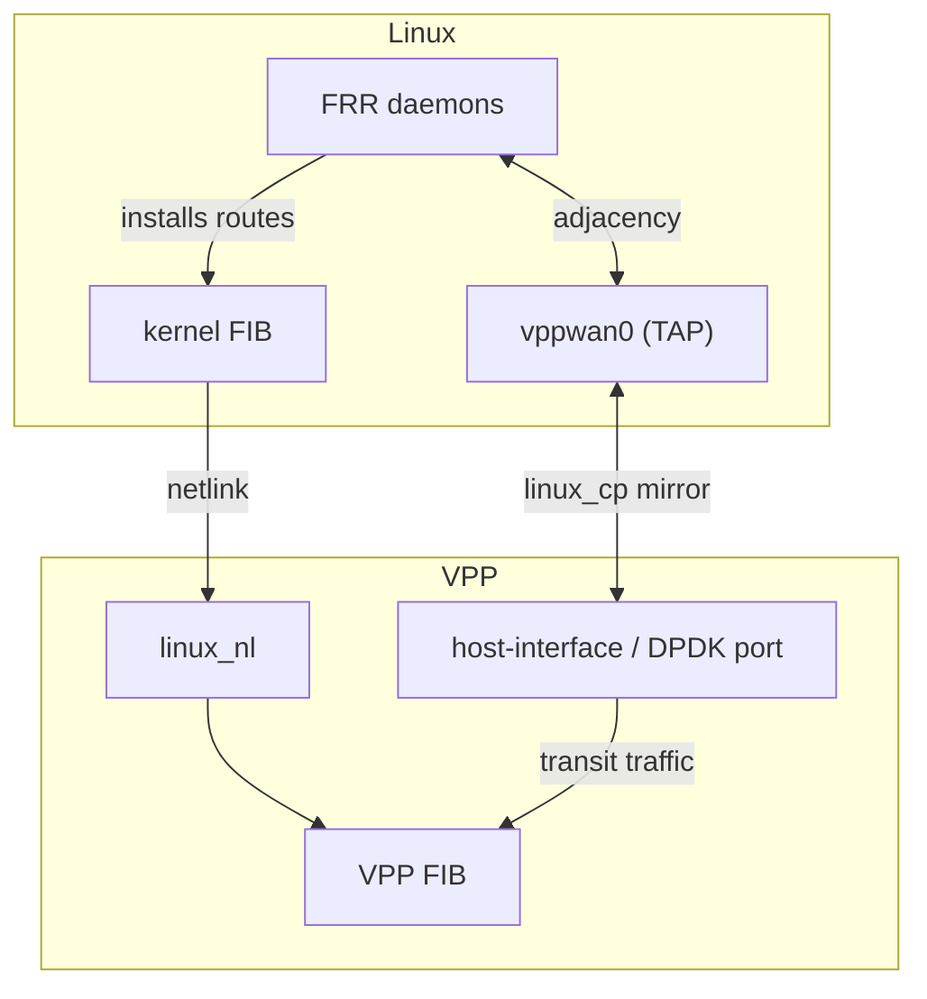
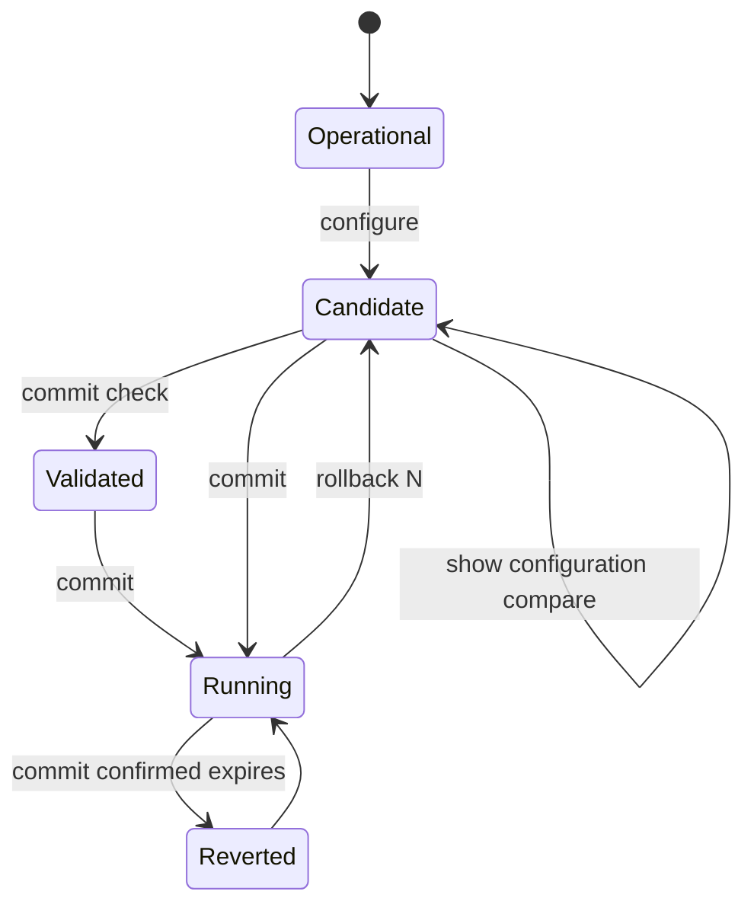

# HexaRouting — Routing and VTY

## TL;DR

FRR provides BGP, OSPF and IS-IS. VPP's `linux_cp` mirrors each dataplane
interface as a Linux TAP, so FRR sees ordinary netdevs and needs no
modification; `linux_nl` carries the routes FRR installs back into the VPP FIB.
`hexash` is one CLI for routing and CGNAT.

Two failures found in the lab, both silent: OSPF stalls in `Exchange` when the
TAP inherits a different MTU, and IS-IS never comes up unless OSI passthrough
is explicitly enabled.

> The key words **MUST**, **MUST NOT**, **SHOULD**, **SHOULD NOT**, **MAY** and
> **RECOMMENDED** in this document are to be interpreted as described in
> [RFC 2119](https://www.rfc-editor.org/rfc/rfc2119).

## 5W2H

| | |
|---|---|
| **What** | Integration of FRR's control plane with the VPP dataplane, plus a unified configuration shell. |
| **Why** | A CGNAT box on a provider's border is a router; it must speak the provider's IGP and EGP. |
| **Who** | Network operators who already know FRR syntax and expect it to work unchanged. |
| **When** | Routes propagate to the VPP FIB within seconds of adjacency establishment. |
| **Where** | Control-plane packets are punted to Linux TAPs; the dataplane keeps forwarding. |
| **How** | `linux_cp` mirrors interfaces; `linux_nl` listens to netlink; `hexash` forwards routing commands to `vtysh`. |
| **How much** | No measurable dataplane cost: punt only affects protocol packets, not transit. |

## The table you can see is not always the table that forwards

Three tables hold routes and only one of them moves packets:


`show ip route` in `vtysh` answers from the **first**. That is the command an
operator reaches for when traffic is not flowing, and it is the table where the
route is present and correct on a box that is dropping the traffic. Nothing in
that output says the FIB was ever asked.

So the VTY has its own:

```
hexarouting> show route
  Destination          Next hop          Interface    Kind
  0.0.0.0/0            10.0.0.2          host-veth-vpp forward
  203.0.113.0/24       10.0.0.2          host-veth-vpp forward
  10.0.0.0/24          connected         host-veth-vpp connected

  3 entries carrying traffic
```

It reads **VPP's FIB**. `show route verbose` reads both and marks every prefix
where they disagree, with the count and what it means — two lists side by side
and a reader left to compare them is not an answer.

### What it deliberately does not show

* **Per-neighbour adjacencies.** VPP creates a `/32` for every resolved
  neighbour, whose only next hop is its own address. On a box with a dozen
  neighbours they are most of the table, and a routing table that is mostly ARP
  is a routing table nobody reads. `verbose` shows them, marked `neighbour`.
* **Housekeeping entries** — the drops and local addresses VPP creates per
  interface address. Also in `verbose`, marked for what they are.

### What it deliberately does not flag

* **A local address.** Traffic to it is received, not dropped. Calling that
  "not forwarding" is wrong.
* **A route through an interface VPP does not own.** On a real box that is the
  management port, which **MUST NOT** be handed to VPP — so every route through
  it is in FRR and absent from the FIB, correctly and permanently. Flagging
  those would leave a standing alarm on every machine, and an alarm that is
  always on is one nobody reads.

The VPP column reports **what VPP holds** — `forward`, `connected`, `local`,
`neighbour`, `drop` or `absent` — rather than yes/no. A prefix VPP is
explicitly dropping and a prefix VPP has never heard of are different
situations with different causes, and reporting both as "no" is a false
statement in the one table whose job is to settle a disagreement.

## The VTY offers what the box has

`?` and TAB complete keywords from the command tree. Where the tree takes a
**name**, the tree knows only that a word goes there — the box knows which
words:

```
hexarouting# [edit] interface ?
  host-veth-vpp             interface (up)
  pg0                       interface (up)
  TenGigabitEthernet0/8/0   interface (up)
```

Interfaces come from the dataplane; pools, accounts and SNMP users come from
the **candidate**, so they complete what is being edited rather than only what
is committed.

Before this, `interface <TAB>` answered `<word>` — true and useless. It told
the operator what they already knew and sent them to `vppctl` or `ip link` in
another window, which are the two tools this VTY exists to keep them out of, at
the first argument ([#98](https://github.com/andrediashexa/hexarouting/issues/98)).

`local0` is never offered: it is VPP's own loopback and configures nothing.

Dentro de um bloco, `?` oferece **apenas o que vale ali**:

```
hexarouting# [edit interface GigabitEthernet0/12/0] ?
  exit   leave the interface
  mtu    MTU, on both the dataplane interface and its TAP
  show   display information
  urpf   drop packets whose source does not route back this way
```

Antes oferecia a árvore de configuração inteira — quinze opções, das quais três
valiam ali. Oferecer o nível de cima convida alguém a digitar `cgnat pool`
dentro de uma interface e descobrir depois o que aquilo significou.

Um bloco do FRR oferece `exit` e `show` e nada mais: este VTY não modela as
declarações do FRR, e oferecer algumas seria **um palpite apresentado como
gramática**.

A completação **ignora maiúsculas e minúsculas** e sempre insere a grafia da
máquina — `ten`, `TEN` e `TenGig` completam todos para
`TenGigabitEthernet0/8/0`. Exigir a capitalização certa antes de ajudar é
completação que só funciona para quem já sabe a resposta.

**A source that cannot answer offers nothing and says so.** A VTY that becomes
unusable when the dataplane is down is a VTY that cannot be used to fix it — so
a dead or missing source leaves the `<interface>` hint in place and completes
nothing, rather than hanging or raising.

## `show interface` — as do dataplane

```
hexarouting> show interface
  Interface                  State  MTU    Address             Linux
  GigabitEthernet0/12/0      up     9000   203.0.113.1/24      tap0
  TenGigabitEthernet0/8/0    up     1500   -                   -
  local0                     down   0      -                   -
```

Responde pelo **dataplane**. Antes era repassado ao `vtysh`, que enxerga só o
que o `linux_cp` espelhou — numa caixa com uma `GigabitEthernet0/12/0`
configurada, a resposta era `lo`
([#112](https://github.com/andrediashexa/hexarouting/issues/112)). É a mesma
forma do `show ip route` respondendo pela RIB.

A coluna **Linux** traz o par do `linux_cp`, porque esse é o nome que o FRR e o
`ip` usam.

* `local0` **aparece** — esconder uma interface que o dataplane reporta seria
  este comando decidindo o que o operador pode ver — mas **não é oferecida na
  completação**, porque não configura nada.
* Pedir `description` diz por que não existe essa coluna, em vez de deixar
  alguém procurando uma que nunca vem. A visão do FRR continua em
  `show ip interface`.
* Com o dataplane fora, ele diz que não conseguiu perguntar. Uma tabela vazia
  leria como *"esta caixa não tem interfaces"*, que é afirmação bem diferente.

## Um nome de interface que não existe é recusado

```
error: interface Ten0: this box has no such interface
    it has: GigabitEthernet0/12/0, TenGigabitEthernet0/8/0, local0
    the statement would commit and do nothing
```

`interface Ten0` — um erro de digitação de `TenGigabitEthernet0/8/0` — criava
uma estrofe no FRR para algo que não está lá: commitava limpo, aparecia na
configuração em vigor e não fazia nada
([#105](https://github.com/andrediashexa/hexarouting/issues/105)).

A recusa **lista o que a caixa tem**, porque ela já sabe — é a mesma fonte da
completação — e quem recebe só um "não" tem de ir procurar.

Vale para as quatro formas de nomear uma interface: o bloco do FRR, o
`cgnat interface`, e as declarações `mtu` e `urpf`, que o VTY modela por fora
da seção de roteamento.

* **`hexash --load` recusa o arquivo inteiro**, e não statement a statement.
  Isso roda no boot, sem ninguém olhando, e aplicar metade de um arquivo deixa
  a caixa segurando metade dele.
* **Com o dataplane inalcançável a checagem é pulada, não reprovada.** Um VTY
  que não consegue commitar enquanto o dataplane está fora é um VTY que não
  serve para consertá-lo.

## An interface is more than its MTU

```
hexarouting# [edit interface GigabitEthernet0/12/0] ?
  description  what this interface is for
  exit         leave the interface
  mtu          MTU, on both the dataplane interface and its TAP
  show         display information
  shutdown     take the interface administratively down
  urpf         drop packets whose source does not route back this way
```

**`description` lives in the dataplane**, as a VPP interface tag returned by
`sw_interface_dump`, and is mirrored to the Linux side as the interface alias.
It is therefore read back from the box like the MTU and the uRPF mode, rather
than remembered between invocations — which this VTY deliberately does not do.
A description only the VTY knows is a description that disagrees with every
other tool on the box.

**`shutdown` reaches both sides of the `linux_cp` pair.** Shutting the VPP
interface alone leaves FRR holding adjacencies over a port that has stopped
forwarding: the neighbour believes the link is fine until its own dead timer
fires, and traffic is black-holed in the meantime. Same split as the MTU, and
this project has now shipped it twice.

Applied **down first, up last**, with everything else in between: an interface
being taken down should stop carrying traffic before its configuration changes
underneath it, and one being brought up should come up already configured.

### Addresses

```
interface GigabitEthernet0/12/0
  ipv4 address 200.150.0.1/24
  ipv4 address 200.150.1.1/24
  ipv6 address 2001:db8::1/64
  exit
```

Repeatable, with `no ipv4 address <prefix>` removing one. Over
`sw_interface_add_del_address`, which carries **one prefix field for both
families** and infers the family from the value. So the VTY checks that the
keyword and the prefix agree:

```
error: '10.0.0.1/24' is not an IPv6 prefix
```

Without that check the dataplane would take `ipv6 address 10.0.0.1/24` and
quietly configure something nobody wrote.

Three details that are decisions, not accidents:

* **Removals are applied before additions.** An operator replacing
  `10.0.0.1/24` with `10.0.0.2/24` expects one address at the end, not both for
  the moment in between.
* **The delta compares sets**, so adding an address does not re-apply the
  others. Re-applying is not free — it removes and re-adds — and on the
  interface carrying the session that is a disconnection nobody asked for.
* Removing one address **must not** take the others. `del_all` is one field
  away from the one being set, and "remove this address" turning into "remove
  every address" would drop the adjacency and the management path together.
  The lab adds two, removes one, and asserts the other two survived.

### Sub-interfaces and VLANs

```
interface GigabitEthernet0/12/0.100
  vlan 100
  ipv4 address 100.64.0.1/22
  exit

interface GigabitEthernet0/12/0.200
  vlan 200 inner 10
  exit
```

`no interface <name>.<n>` removes one, and takes what was on it — an address
left behind would describe a port that does not exist.

**The suffix must equal the outer tag.** VPP names a sub-interface after its
`sub_id`, so accepting `Gi0/12/0.7` with `vlan 100` would produce a box calling
it `Gi0/12/0.100` while the configuration called it `.7` — and the running
configuration is read from the box. The two names have to be the same name.

Sub-interfaces are created **before** anything can be put on them and destroyed
**after** everything has been taken off, which is why they are their own part
of the delta rather than another dictionary keyed by interface name.

The interface-existence check from
[#105](https://github.com/andrediashexa/hexarouting/issues/105) had to learn
about them: a sub-interface the configuration **creates** is not one the box is
missing, and without that the check refused the very commit that would have
brought it into existence. A sub-interface whose *parent* is absent is a
different error and says so.

**A QinQ sub-interface also matches frames carrying more than two tags**, and
the VTY says so every time it creates one:

```
warning: pg0.700 matches outer 700 inner 900 AND anything carrying more tags
than that; VPP's ethernet input reads three or more tags as two, so a QinQ
sub-interface on this box cannot be made to refuse them (#136)
```

Two separate reasons, and only one of them was known when
[#136](https://github.com/andrediashexa/hexarouting/issues/136) was filed.

`create_subif` takes `sub_if_flags`, which VPP declares as an `enum` although
every member is a bit, and `vat2` generates a parser for an `enum` that
compares **one** name whole. Anything else is a null-pointer dereference:
`20`, `0`, `null` and `["A","B"]` all segfault it, while `"A|B"` and `"A,B"`
exit 0 having sent nothing. A type declared `enumflags` instead — `tunnel_flags`,
say — generates a loop over a JSON array and ORs the members, so the multi-bit
value **is** expressible in vat2's JSON and these two types are simply declared
with the wrong keyword upstream. `SUB_IF_API_FLAG_TWO_TAGS` therefore goes
without `SUB_IF_API_FLAG_EXACT_MATCH`.

Sending it would change nothing an operator could see. Measured on
`vpp 26.06-release` with the packet generator: a three-tag frame lands on a
QinQ sub-interface created by the VPP CLI **with** `exact-match` exactly as it
lands on one created without. `eth_input_tag_lookup()` in
`vnet/ethernet/node.c` — the path a sub-interface on a real port takes — reads
"three or more tags" as two and never asks for `SUBINT_CONFIG_MATCH_3_TAG`.
The flag is honoured on a *single*-tag sub-interface, where `dot1q 60
exact-match` does drop a two-tag frame that `dot1q 50` accepts; the VTY needs
nothing there, because `create_vlan_subif` takes no flags and VPP already
makes that sub-interface exact-matching.

`lab/subif.sh` asserts the over-match rather than describing it, so a VPP that
ever stops taking the three-tag frame fails the lab and the warning comes out.

**The client refuses what it cannot say.** `vppapi.py` checks the shape of
these flag fields before starting `vat2`, and reports a `vat2` that died or
refused as `cannot-send` — "the dataplane never saw it" — rather than as
`not-running`, which used to send the operator to restart a dataplane that was
answering perfectly.

### An interface in a VRF

```
interface GigabitEthernet0/12/0
  vrf 7
  ipv4 address 10.7.0.1/24
  exit
```

Numeric, the same way a pool's `vrf` is numeric. Two ways to name the same
table would be two things to keep in step, and they would disagree. Table 0 is
the default and needs no statement, so it is not written for every port on
every box.

Pools have carried a VRF since v0.18.0 and there was no way to put an
**interface** in one, so the feature was half-built: the pool named a table
nothing could be bound to
([#132](https://github.com/andrediashexa/hexarouting/issues/132)).

**VPP refuses to move an interface that still holds addresses** — `retval
-114`. It does not silently clear them, which is what this issue was written
expecting; the behaviour was measured rather than assumed, and the assumption
was wrong. The practical consequence is the same either way: the move is
**remove, move, re-add**, as one operation.

So an interface whose VRF changes is taken out of the ordinary address delta
and has its addresses applied once, inside the move. Treating it as two
independent deltas produces the refusal; doing the move first and the
addresses second produces a port that is briefly in the new table with nothing
on it.

The lab asserts the address is in that table and **not** in the default one,
then moves the interface to a second VRF and asserts the address followed and
left the first. That second pair is what catches a commit that moves the
interface and leaves its addresses behind — which reports success and produces
a port in the right table with nothing on it.

### What the lab asserts, and why the second one is the point

```
pg0.100 rx: 0 -> 1     [ ok ] the tagged frame landed on the sub-interface
pg0.100 rx: 1 -> 1     [ ok ] a frame with a different tag did NOT land on it
```

Frames are injected at `ethernet-input`, not `ip4-input`, because the whole
question is whether the L2 tag steers the frame onto the right sub-interface
and injecting at L3 skips exactly that. Without the second assertion, a
sub-interface that swallowed every frame regardless of tag would pass
everything else in the lab.

### A box with no FRR could not configure an interface

Writing that lab found it. Entering an interface block stages `interface
<name>` as an FRR stanza, so **every** commit touching an interface triggered
routing validation — and on a box where FRR is not running, that failed and
rolled back the whole commit, CGNAT half included
([#137](https://github.com/andrediashexa/hexarouting/issues/137)).

`Frr.available()` existed, said *"A box may run CGNAT with no routing"* in its
own docstring, and was never called.

No lab caught it because **every lab that drives `hexash` also starts FRR**.
The product's own supported configuration — CGNAT without routing — was not one
any test ran. `lab/subif.sh` does not need FRR, so it did not start it, and the
defect surfaced immediately.

`real_routing()` now tells apart the statements an operator wrote from the
interface stanzas the VTY stages itself, and the check path and the apply path
share it so they cannot drift.

### MAC, router advertisements, and one interface in detail

```
interface GigabitEthernet0/12/0
  mac-address 02:aa:bb:cc:dd:ee
  no ipv6 nd suppress-ra
  exit
```

`mac-address` matters on a card swap: the upstream's ARP cache, DHCP
reservations and any L2 filtering all key on it.

**VPP advertises this box as a router by default. This product does not.**
Measured on a running dataplane, not assumed: an interface holding an IPv6
address sends a router advertisement every 200 seconds, with a 600-second
lifetime, plus three initial advertisements when advertising starts. On a
subscriber-facing port that is a second default gateway for every subscriber
who gets their prefix by DHCPv6-PD, which is why the default here is the
opposite of VPP's.

So suppression is applied when an IPv6 address is added, and `no ipv6 nd
suppress-ra` is the **exception** an operator writes on the ports that should
advertise — an uplink, a transit link, a port facing routers rather than
subscribers. `ipv6 nd suppress-ra` is accepted too, and says out loud what is
already true.

`is_no` in `sw_interface_ip6nd_ra_config` undoes a previous configuration
rather than meaning "not suppressed", so resuming advertisements is `is_no` on
the suppression and not `suppress = 0`.

The state is **read back** from `sw_interface_ip6nd_ra_dump` (`send_radv`, and
`cease_radv` unset), like every other interface attribute. It was not, once,
and the consequence was not a cosmetic one: the running configuration always
claimed "suppressed", the difference against a candidate that also said
"suppressed" came out empty, and an operator who had enabled advertisements
could not turn them off again — with `show running-config` not admitting they
were on (#161). `show ip6 interface` prints the same text either way, so no
text-based reader would have closed that gap.

The lab measures all three states by counting packets on the wire in the peer
namespace — none by default, three once asked for, none again after
suppressing. Two things had to be right before that measurement said anything:
the capture is opened **before** the commit, because the initial advertisements
go out as advertising starts; and it runs inside the namespace the far end of
the link lives in. Capturing from the wrong namespace is not a loud failure —
tcpdump exits, the file stays empty, and every count reads zero, which made
"the default sends none" pass because nothing could be counted on either side
of the setting.

### `show interface <name>`

```
pg0
  state       up
  mtu         9000
  addresses   10.0.0.1/24
  linux       vppwan0
  vrf         0 (default)
  mac         02:fe:c1:ed:07:aa
  urpf        off
  cgnat       not attached
  counters
    rx bytes                     120
    punt                           2
```

A summary answers "is the link up". A fault report needs the counters: *up*
and *up and dropping four percent of what arrives* look identical in a table,
and the second is what the operator was calling about. The counters are
printed **uninterpreted**, because during a fault the operator will also look
at `vppctl`, and a number this VTY had summarised would be one they could not
compare.

**An exact name wins over the prefix filter.** `show interface pg0` on a box
that also has `pg0.100` matches both by prefix, so "exactly one match" never
fired for any interface with sub-interfaces — which is every interface an ISP
terminates subscribers on.

### Two things this cost, both worth keeping

**The VTY had a catch-all that sent unrecognised interface statements to FRR.**
`mtu` and `urpf` were intercepted by name; everything else fell through to
`candidate.routing`. So `description` and `shutdown` were staged as FRR
statements — and **FRR accepts both words inside an interface stanza**, so
nothing errored. The description reached FRR's configuration and never the
dataplane; `shutdown` never reached anything that forwards packets.

The lab did not catch it because the assertions read `show running-config`,
which includes FRR's half. They matched the copy that had gone to the wrong
place. **Three assertions were vacuous**, and two more passed because `local0`
is always administratively down, so the running configuration said `shutdown`
on every box before anybody typed it.

The assertions now read the dataplane: the tag from `sw_interface_dump`, the
state from the State column of `show interface`, and one that checks the
description was **not** handed to FRR.

**`flags: 0` segfaults `vat2`.** Administrative down is the absence of
`IF_STATUS_API_FLAG_ADMIN_UP`, and the natural encoding — an empty flag set,
written as `0` — crashes the client, which parses the field as an enum name and
cannot render the empty set. Down is therefore sent as
`IF_STATUS_API_FLAG_LINK_UP`: VPP reads only `ADMIN_UP` out of this message and
ignores the rest, so the value means exactly "admin down". It is written that
way because the obvious encoding crashes the client, not because it reads well,
and the code says so.

## `show this`

The configuration of the hierarchy being edited, and nothing above it:

```
hexarouting# [edit cgnat pool] show this
cgnat pool residential
 inside 100.64.0.0/22
 outside 200.150.0.16/30
 block-size 512
 tcp-mss 1400
 exit
```

It shows the **candidate**. Somebody in the middle of an edit asking *"what is
here"* is asking about what they are building; answering with what is committed
would answer a question they did not ask.

It works in every level the VTY has — a pool, a user, an SNMP user and an FRR
block — which required letting `show` reach the sub-modes: each dispatches its
own lines, and without that the command was refused in the one place it exists
for.

## Which daemons run

`frrinit.sh` starts `zebra`, `mgmtd` and `staticd` unconditionally. Everything
else is a line in `/etc/frr/daemons`, and Debian ships `bgpd=no`, `ospfd=no`
and `isisd=no`.

So a box installed without changing that runs the dataplane, the VTY and static
routes, and **not one routing protocol** — while the VTY offers all three, `?`
lists them and `commit` accepts them
([#99](https://github.com/andrediashexa/hexarouting/issues/99)).

`appliance/install.sh` therefore enables them explicitly. Inheriting a
distribution default for something this product claims to support is how it
went unnoticed for as long as it did — and what hid it is that `lab/routing.sh`
starts those daemons **by hand**, so the lab proved a control plane the shipped
box did not have. `lab/install-iso.sh` now asserts them on the installed disk,
which is the only place the question means anything.

`commit check` refuses a `router <protocol>` statement whose daemon is not
running:

```
error: router bgp 65001: bgpd is not running
    the statement would commit and reach nothing. Enable bgpd in
    /etc/frr/daemons and restart frr
```

That refusal exists because the silence is not otherwise guaranteed: `vtysh`
prints `bgpd is not running` while `frr-reload.py` still returns 0, which is
how a commit reports success for configuration that reached nothing.

The boot self-test reports which routing daemons are answering, as a warning
rather than a failure — a box deliberately running fewer daemons is a
legitimate deployment, and a box that cannot run BGP should say so before
somebody configures BGP on it.

## Static routes

```
hexarouting# [edit] ip route 0.0.0.0/0 200.150.0.1
hexarouting# [edit] commit
```

Staged in the candidate and applied by `frr-reload` like every other routing
statement, so it is committed and rolled back the same way — and a rollback
removes it from the **FIB**, which is the only place that matters.

`commit check` refuses a next hop that is on no connected network:

```
error: ip route 10.55.0.0/16 172.31.99.1: 172.31.99.1 is on no connected network
    the route would be accepted and never reach the forwarding table
```

Accepted, such a route sits in FRR and never reaches the FIB — the exact
failure `show route verbose` exists to find afterwards, and cheaper to say at
the prompt than to have somebody find during an outage.

**On FRR 10 a static route is configured through `mgmtd` and served by
`staticd`.** Without them `vtysh` answers `mgmtd is not running` to every
`ip route`, which is how one can be typed, accepted and never exist.
`frrinit.sh` starts both on an installed box; anything that starts FRR daemons
by hand has to start them too — `lab/routing.sh` did not, and that is what this
was found by.

## Components

| Piece | Role |
|-------|------|
| VPP | Dataplane: forwarding and CGNAT (`bpa` plugin) |
| FRR | Control plane: `bgpd`, `ospfd`, `isisd`, `zebra` |
| `linux_cp` + `linux_nl` | The glue between them |
| `hexash` | HexaRouting's configuration shell |



FRR does not need to know VPP exists.

## Pitfall 1 — inherited MTU stalls OSPF

The TAP created by `linux_cp` comes up with MTU 9000. If the physical link is
1500, OSPF forms a neighbour, reaches **`Exchange/DR` and stops there**: it
compares MTU in Database Description packets and gives up silently. No log
says "MTU mismatch"; the operator sees an adjacency that never completes.

With the MTU aligned, the adjacency reached **`Full` in 8 seconds**.

* MTU **MUST** be explicit configuration, never inherited.

### Configuring it

```
hexarouting# [edit] interface host-veth-vpp
hexarouting# [edit]  mtu 1500
hexarouting# [edit]  exit
hexarouting# [edit] commit
```

Accepted range 576-9216, refused by the parser rather than by the device, so
the operator is told at the point of typing instead of at commit time. `no mtu`
removes the statement.

**It is applied to both sides.** `linux_cp` pairs a VPP interface with a Linux
TAP, and only the VPP interface is on the packet path. Setting the TAP alone —
which is what FRR's own `mtu` would do — leaves the half that matters unchanged
and reproduces the mismatch this exists to prevent.

Two details that cost time to find:

* The command is `set interface mtu **packet** <n>`, not `set interface mtu
  <n>`. The second changes the hardware maximum frame size, which most drivers
  refuse — and refuse while `vppctl` still exits **0**, so the failure is
  invisible. The first sets the L3 MTU, which is what OSPF compares.
* The result is therefore **read back** rather than inferred from the exit
  status. Until MTU moves to the binary API alongside the pool operations
  ([#3](https://github.com/andrediashexa/hexarouting/issues/3)), verifying the
  effect is the only honest check.

A third, found late: **the Linux half was never being set at all**
([#114](https://github.com/andrediashexa/hexarouting/issues/114)). The code
looked for a `host` field in `show lcp`. VPP prints

```
itf-pair: [0] host-veth-vpp tap4096 vppwan0 5 type tap
```

There is no such field. The parse found nothing and returned — which is also
what it correctly does on a box that has no TAP for that interface, so the
failure was invisible. Meanwhile `lcp-sync` is on by default and VPP mirrors
the MTU onto the TAP by itself, so the lab's assertion that the TAP had the
right MTU passed. It was measuring VPP, not this code.

It was settled by turning `lcp-sync` off and committing again. The TAP did not
move. Two rules come out of it, and they cost a release each to learn:

* **Parse what the box prints, captured, not what you remember it printing.**
  A positional parse breaks on the next VPP version silently, by finding
  nothing.
* **An assertion that cannot fail is not an assertion.** The lab now turns
  `lcp-sync` off before checking the TAP, so it can only pass if `hexash` did
  the work.

The running configuration reports the MTU of **every** interface the dataplane
has, not only the ones somebody typed. "Explicitly configured" is not a
property the dataplane can answer, and inventing that distinction would mean
the VTY remembering things between invocations — which it deliberately does
not. The consequence is the one that matters: a rollback can restore the
previous MTU, because the previous value was recorded rather than guessed.

## Pitfall 2 — IS-IS is not carried over IP

IS-IS runs OSI CLNS directly over the link layer, using L2 multicast
`01:80:C2:00:00:14/15`. Captures at three points located the loss precisely:

| Capture point | IS-IS hellos |
|---------------|--------------|
| Peer's interface, sending | present |
| VPP's physical interface | present |
| The TAP | **none** |

VPP's counter showed `osi-input: unknown osi protocol`. The frame arrives, is
recognised as OSI, and nobody is registered to receive IS-IS.

VPP 26.06's `linux_cp` already solves this; it is simply not enabled:

```
lcp osi-proto enable 0x83
```

`0x83` is the IS-IS NLPID.

* Deployments using IS-IS **MUST** enable OSI passthrough.
* Because **BGP and OSPF come up without it**, testing with only those two
  gives false confidence and IS-IS stays mute until someone needs it. IS-IS is
  therefore implemented last, deliberately: it is what validates the L2 punt.

## Pitfall 3 — CGNAT eating its own control plane

BGP sessions and OSPF/IS-IS adjacencies terminate on the box's **own**
addresses. `bpa-out2in` runs on the `ip4-unicast` arc, before `ip4-lookup` and
therefore before `ip4-local` decides a packet is local — so it sees the BGP
packet first. If a public pool contains a peering address, the session drops
intermittently with nothing obvious anywhere.

Two defences, both **REQUIRED**:

1. Pool creation **MUST** be refused when the public set contains an address
   configured on a local interface. The error names the address and the
   interface.
2. An address configured **after** the pool cannot be refused, so it **MUST**
   be reported at error level in `show logging` — operators read that, not the
   VPP process's stderr.

Pool addresses themselves are normally **not** interface addresses: they reach
the box by an upstream route, not local configuration.

## VTY

### The VTY is the front door

An operator logging into the appliance, over console or SSH, lands in `hexash`
rather than in a Unix shell. Root's login shell is `/usr/bin/hexash-login`,
a wrapper rather than `hexash` itself, and the reason is lockout: a `hexash`
that fails to start would otherwise leave nobody able to reach the box.

`start shell` opens a real shell as a child of the VTY; leaving it returns to
the VTY rather than logging out. It appears in neither tab completion nor `?`.

* The escape is hidden **and** restricted: administrators only. Hiding was
  never the boundary — the role check is
  ([#35](https://github.com/andrediashexa/hexarouting/issues/35)), and it is
  what makes that sentence true rather than a hope. A shell on this box is
  every capability at once.
* A shell **MUST** remain reachable. Recovery, `tcpdump`, and reading a log the
  VTY does not expose all need one, and an appliance that makes them impossible
  gets a permanent hole opened by the first operator who needs one.
* Booting with `hexash=off` skips the VTY entirely, and **MUST** keep working
  even when `hexash` is broken — it is read from `/proc/cmdline` by the
  wrapper, so it does not depend on the VTY starting.

See [appliance.md](appliance.md) for the login table and the recovery paths.

### How hexash reaches the dataplane

Through the **binary API**, not `vppctl`.

`vppctl` exits 0 even when the command it ran failed; the only evidence of a
refusal is the text it printed. A control plane built on that cannot tell
"pool created" from "pool rejected", so `commit` could report success while the
dataplane held none of the configuration.

The client is `src/hexash/vppapi.py`, driving `vat2`. Two alternatives were
rejected:

| Option | Why not |
|---|---|
| `vpp_papi`, the Python bindings | fd.io does not package them. Using them means vendoring the library out of the VPP source tree and keeping that copy in step with every VPP bump. |
| Keep parsing `vppctl` text | It is the defect being removed. Text patterns break at the first reworded message, and there is no return code to check. |

`vat2` ships inside the `vpp` package itself, so it is on every installed box
and every ISO, and it is versioned with VPP by construction. The cost is a
process per call rather than a persistent connection — irrelevant for
configuration, which happens at human speed and is all `hexash` does.

Five outcomes are distinguished, because they need different actions:

| State | Means | What the operator does |
|---|---|---|
| `ok` | applied | nothing |
| `refused` | the dataplane said no, with a return code | fix the configuration |
| `not-running` | no reply at all | start the dataplane |
| `no-plugin` | VPP is up, the CGNAT API is not registered | fix the install |
| `no-client` | `vat2` is missing | install the `vpp` package |

Collapsing these into "it failed" is how an unplugged dataplane and a rejected
configuration become indistinguishable. A refusal **MUST** carry the return
value, the name from `vnet/error.h`, and the sentence the plugin sent to VPP's
log — the number alone is not actionable:

```
refused -7: the dataplane refused it: invalid value
            (bpa_pool_init: pool 'client-bad': block size 500 must be a power of two)
```

### What goes over the API, and what does not

| Operation | Path | Why |
|---|---|---|
| Create, replace, delete a pool | binary API | These are writes. A write reported as successful when it was refused is the defect being removed. |
| `commit check` | CLI | Validation has no API message of its own, and inventing one that creates-then-deletes would rebuild the outage risk that a name check once caused. It writes nothing either way. |
| Reachability, before any change | binary API | Asked **once**, before anything is touched. Discovering the dataplane is unreachable halfway through leaves the box in neither the old configuration nor the new one, and the operator with no way to know which pools made it. |

A refused write **MUST** fail the commit, **MUST** name the pool — a commit
carrying several pools has to say which one — and **MUST** leave the candidate
intact, or the operator loses the edit they were trying to correct.

An upgrade hazard worth stating: a box updated without the current
`install.sh` has no vat2 plugin, and every commit touching a pool will fail.
That is the correct behaviour — the alternative is falling back to text
parsing, which is the defect — and the message says exactly what is missing.

The client takes no plugin path. On an appliance there is none to give, because
`install.sh` puts the vat2 plugin where `vat2` already looks — and `lab/api.sh`
mirrors that layout rather than passing `-p`, so it proves the client in the
configuration a box actually runs.

### Design

The goal is one CLI in the style operators expect: `configure terminal`,
`show running-config`, `write memory`, covering routing **and** CGNAT.

| Option | How | Cost |
|--------|-----|------|
| A. Wrap `vtysh` | Route `router bgp` to `vtysh`, `cgnat …` to VPP | Chosen |
| B. FRR-style daemon registered with `vtysh` | Link `libfrr`, translate to the binary API | Rejected |
| C. Own VTY from scratch | Full control | Reimplements what `libfrr` already does |

**Option B was rejected after checking.** `vtysh`'s daemon list is **compiled
in** (`vtysh_client[]`) with no plugin mechanism. Registering a new daemon
would mean maintaining a `vtysh` fork for the life of the product, reapplied on
every FRR release. Forwarding delivers the same unified
`show running-config` without that permanent cost.

### Configuration model: candidate, commit, rollback

Configuration follows the Juniper model. Statements typed in configuration
mode edit a **candidate**; the device is untouched until `commit`.



| Command | Effect |
|---------|--------|
| `configure` | Load the running configuration into a candidate |
| `show configuration compare` | Unified diff, running → candidate |
| `commit check` | Validate without applying |
| `commit` | Apply, and store a new revision |
| `commit comment "<text>"` | Same, with a note recorded against the revision |
| `commit confirmed <min>` | Apply, and roll back automatically unless confirmed |
| `rollback <0-19>` | Load a committed revision into the candidate |
| `show rollback` | List revisions with timestamp and comment |

Requirements:

* Edits **MUST NOT** reach the dataplane before `commit`.
* `commit` **MUST** validate before applying, and **MUST** restore the previous
  state if application fails halfway.
* `commit check` **MUST NOT** change anything on the device. An earlier
  version deleted and recreated the running pool to work around a
  name-collision check; it worked, and left a production pool one failed
  command away from disappearing during a read-only operation. `bpa pool …
  check` therefore performs no name check: in a candidate model, an existing
  name is a replacement, not a collision.
* `commit check` **MUST** validate against the device, not merely against
  syntax. The plugin exposes `bpa pool … check`, which runs every check the
  creation path runs — block size, prefix overlap, capacity, and collision
  with a local address — and creates nothing. Checking syntax alone would
  approve pools the device refuses, which is false confidence exactly where an
  operator is relying on the check.
* CGNAT **MUST** be applied before routing. A routing change can cost
  reachability, and doing it last keeps the half-configured window short.
* Pools are replaced whole rather than edited in place: the device takes a pool
  definition in a single command, and a partial edit would leave an invalid
  pool between the two halves of the change.
* `rollback 0` returns the candidate to the running configuration, discarding
  uncommitted edits — the same meaning JunOS gives it.

`commit confirmed` exists for the change that cuts your own access. If the
operator cannot type `commit` again, the box returns on its own.

### The model refuses what it cannot hold

`Config.parse` used to drop, in silence, any line inside a `pool` block it did
not recognise. That looks like a small gap and was not one, because **the
candidate is built from the running configuration**:

```
configure          → candidate = parse(show bpa config)   ← the line is lost here
… unrelated edit …
commit             → the pool is replaced with the candidate ← and removed here
```

An operator who set something with `vppctl` and then committed **any**
unrelated change through the VTY had that setting silently reverted. It applied
to every per-pool setting the project had merged: the timeouts
([#12](https://github.com/andrediashexa/hexarouting/issues/12)), `max-blocks`
([#13](https://github.com/andrediashexa/hexarouting/issues/13)), the filtering
mode ([#15](https://github.com/andrediashexa/hexarouting/issues/15)) and the ALG
switches ([#14](https://github.com/andrediashexa/hexarouting/issues/14)). Each
of those has a lab that passes, because each lab drives `vppctl` directly.

Two rules now, and the first is the general one:

* **Nothing is dropped in silence.** A line the model cannot hold is recorded
  with its number and the reason. `commit` and `--load` **refuse**; reading the
  device's running configuration **warns**, because a VTY that cannot start
  against a slightly newer dataplane is worse than one that says what it does
  not understand.
* **Every per-pool setting the dataplane accepts, the model carries** — through
  `lines()` in the same order the device emits them, through
  `device_command()`, and through `api_args()`. The binary API gained the
  fields to carry them (`bpa.api` 0.2.0); before that they had no way to reach
  the dataplane at all.

The order in `lines()` is not cosmetic. It has to match `show bpa config`
exactly, or the running configuration and a candidate built from it differ on
every commit for no reason.

`lab/vty-pool.sh` sets each of them through the VTY and asks **the dataplane**
whether they arrived, then makes a setting with `vppctl`, commits an unrelated
change through the VTY, and asserts the setting survived. Asking `hexash`
whether `hexash` stored something proves nothing — that is exactly what the old
code did successfully.

### Rolling back routing, not just CGNAT

A rollback that restored CGNAT and left routing untouched would leave the box
in a state that never existed. Routing is therefore part of the same
configuration document, and rollback converges FRR onto the revision using
`frr-reload.py`, which computes the delta.

* Without `frr-reload.py`, a rollback could only add statements, never remove
  them — and a rollback that cannot remove is not a rollback. Its absence
  **MUST** be reported rather than silently degrading to a partial restore.

### The dataplane is the source of truth

Each `hexash -c …` is a new process, so in-memory state does not survive
between invocations — the first version wrote an empty configuration. The
plugin therefore emits its own configuration in VTY syntax
(`show bpa config`), which `hexash` reads.

This mirrors `vtysh`: the daemon knows its configuration, not the shell. A
useful side effect is that a public range merged from adjacent prefixes is
decomposed back into CIDR on output, so the saved configuration can be reread.

### The SSH daemon and the accounts, in the configuration

The last configuration on the box that `commit` and `rollback` did not cover.
It is now in the candidate like everything else:

```
ssh port 22
ssh listen-address 0.0.0.0
ssh permit-root-login prohibit-password
ssh password-authentication no
user noc
 ssh-key ssh-ed25519 AAAAC3NzaC1lZDI1NTE5AAAAI... noc@laptop
 exit
```

Accounts are **real POSIX accounts**, not a private database — an appliance that
invents its own accounts is one whose accounts nobody deprovisions when somebody
leaves. A user created here gets the VTY as its login shell, which is also how
the VTY knows which accounts are its own: the shell is the marker, so there is
no list to keep in step.

A password is the alternative to a key, and it is given as a **crypt hash**
(`openssl passwd -6`), never as plaintext. Plaintext in `/etc/shadow` does not
fail loudly; it produces an account whose password simply never matches.

#### The lockout, and the three things that stand between it and you

This is the one configuration that can strand the operator on the other side of
the country, so it has three guards rather than one.

1. **`commit check` refuses a change that leaves nobody able to log in.**
   Refused only when *this change* causes it: a box that already has nobody able
   to reach it over SSH — freshly installed, reached by console — must still be
   able to commit a CGNAT change. Console access is deliberately not counted as
   an escape; "you still have the console" is not an answer at 2am for a box in
   somebody else's datacentre.
2. **Any change under `ssh` or `user` is applied as `commit confirmed`,** whether
   or not the operator asked, and the VTY says so. It reverts on its own unless
   confirmed from a session that still works.
3. **`sshd -t` validates the generated file before the daemon is reloaded,** and
   the previous file is put back if it refuses. A syntax error that stops sshd
   starting is the same lockout by another route. It fails **closed**: refusing
   a valid change costs an operator a retry, accepting an invalid one costs them
   the box. `/run/sshd` is created first, because `sshd -t` refuses to run at all
   without its privilege-separation directory and that would reject a perfectly
   good change for a reason that has nothing to do with it.

#### Secrets

Password hashes are in `hexarouting.conf` and in every rollback revision —
they have to be, or a rollback could not restore a password. So:

* `/etc/hexarouting` and everything under it is **root-only**, set by the
  installer and again on every write.
* `show running-config` prints `password <set, not shown>`. A hash on a screen
  shared during an incident is a hash that has left the building, and it is
  crackable offline at the attacker's leisure.
* The audit trail records that credentials changed, not what they changed to.

### SNMP: the CGNAT as the NMS sees it

Every ISP already has an NMS, and it is where somebody actually looks. A CGNAT
whose only observability is `vppctl` on the box is a CGNAT nobody watches until
a customer calls.

```
snmp enabled yes
snmp listen-address 10.0.0.1
snmp port 161
snmp enterprise-number 65535
snmp community <read-only community>
snmp-user nms
 auth sha <passphrase>
 priv aes <passphrase>
 exit
```

**Read-only, twice.** The generated `snmpd.conf` contains `rocommunity` and
`rouser` and never `rwcommunity`, and the agent itself answers every SET with
`not-writable`. Configuration belongs to the VTY, where it is validated,
committed and rollback-able; an SNMP SET that reconfigures a CGNAT is an outage
one typo away.

**No stale numbers.** If the dataplane is not answering, the agent serves
*nothing* rather than the values it last saw. A monitoring system that keeps
reporting yesterday's numbers through an outage hides it; one that reports a gap
shows it. The liveness check therefore runs on **every** poll, before the cache
is consulted — caching it too is the obvious saving and it is exactly the bug
the lab caught, with SNMP still reporting a subscriber after the dataplane had
been killed.

#### What is served, and the one thing that is not

From **RFC 4008**, `natDefTimeouts` (`.1.3.6.1.2.1.123.1.1`) — six objects that
map exactly onto this box's timeouts, so an existing NMS reads them with no
custom template. The rest of RFC 4008 is per-interface or per-binding: this box
tracks neither shape, and per-binding would mean walking the session table,
which no `show` here is allowed to do.

The numbers an operator actually watches — subscribers holding blocks, ports
used against ports held, subscribers at 90% of their block, port refusals,
packets dropped — have **no standard OID**. They live under the operator's own
**IANA Private Enterprise Number**, and there is no default and cannot be one:
an OID under somebody else's PEN is a lie about who the object belongs to, and
it collides the day that organisation uses the same subtree.

> **Until `snmp enterprise-number` is set, that half is dark.** Registration is
> free, takes days to weeks, and the request names the company rather than the
> software — so it is the maintainer's to make, not something this code can do.

| OID under `.1.3.6.1.4.1.<PEN>.1` | Meaning |
|---|---|
| `.1.0` | subscribers holding a block right now |
| `.2.0` | ports allocated across all of them |
| `.3.0` | ports in the blocks currently held |
| `.4.0` | subscribers at 90% of their blocks or more |
| `.5.0` | times a subscriber was refused a port |
| `.6.0` | packets the CGNAT did not pass |

Community strings and v3 passphrases are passwords on the wire, so they are
handled like the SSH credentials above: never printed by `show running-config`,
and in files readable only by root.

**Not covered:** the SNMPv3 handshake is exercised only as far as
configuration — that the user is granted read-only access and created in
net-snmp's store. A poll authenticated with v3 is not asserted end to end.
`IF-MIB` counters for the VPP interfaces are not served at all; the kernel does
not see those NICs, so `snmpd` has nothing to report about them.

### Commands for the question an operator arrives with

The first five `show cgnat` commands report aggregates — *"thread 0: 3 sessions,
2 active subscribers"*. That is enough to know the box is working and useless
for the question people actually arrive with, which is always about one
customer.

| Command | The question |
|---|---|
| `show cgnat subscriber <ip>` | "100.64.0.5 says nothing works" — public address, blocks, ports used and free, sessions, and whether it has been refused a port |
| `show cgnat translation <ip> <port>` | "who was behind this address and port" — the question a court order or an abuse report asks |
| `show cgnat top [n]` | which subscribers are closest to running out — the question that prevents the call instead of answering it |
| `show cgnat drops` | why packets did not get through |

Two properties are load-bearing.

**`translation` says where its answer comes from.** In deterministic mode the
answer is arithmetic and holds for any instant, past or present, as long as the
pool has not been resized. In dynamic mode it holds for **now only** — the block
belonged to somebody else yesterday, and only the RFC 8158 log says whom. The
command prints which of the two it is giving, because handing a court the second
as though it were the first is a wrong answer delivered with confidence.

**`drops` separates a drop from a success.** VPP registers every node counter as
an "error", so `show errors` lists *"packets translated"* beside *"no pool for
source address"* as though they were the same kind of thing. `bpa_errors.h`
tags each counter with whether it means a packet was lost, in the same list as
its description so the two cannot drift, and this command prints the drops under
their own heading first.

None of them walks the session table. `subscriber` and `top` read the
per-subscriber record — one entry per active subscriber rather than one per
session, which on a real box differ by three orders of magnitude — and
`translation` answers by arithmetic. A `show` that stalls forwarding is worse
than no `show`.

`lab/troubleshoot.sh` checks them against `ref/bpa_model.py` rather than against
the plugin: a test that asks the implementation what it should have said agrees
with any mistake in it.

### The banner, and where it must not appear

An interactive login opens with an ASCII wordmark above the version line. On a
serial console, mid-incident, with several boxes open in several terminals, an
operator wants to know which product they are looking at before reading
anything else.

Plain ASCII, 59 columns, six lines: a racked box is reached through a BMC whose
console is 80 columns of whatever font it decided on, box-drawing characters
render as noise there, and a banner that wraps is worse than none.

It **MUST NOT** appear when stdout is not a terminal. `hexash -c` and piped
commands are how every lab and every script drives this VTY, and a banner
prepended to their output breaks the parsing.

The version line stays: the banner identifies the product, the version
identifies the build, and an operator on the phone needs the second.

### Completion and help

Tab completes; `?` lists the valid options at the cursor with a description:

```
hexarouting# show cgnat ?
  blocks   blocks allocated in dynamic mode
  logging  IPFIX export state
  pool     configured CGNAT pools
  session  active sessions per thread

hexarouting(config-cgnat-pool)# inside ?
  <A.B.C.D/M>
```

The tree covers the CGNAT commands fully and the routing entry points. Past an
FRR command it **admits it does not know**, rather than presenting a copied
list of thousands of commands that would drift out of date with every FRR
release and start suggesting commands that no longer exist.

### Limits of this version

* The dataplane error check is textual, because `vppctl` returns 0 even on
  failure. Migrating `hexash` to the binary API **SHOULD** replace it.
* A box running CGNAT with no routing daemon is a legitimate deployment, so a
  missing or silent FRR **MUST NOT** block a CGNAT-only commit.
* `hexash` is written in Python. It is an interactive control-plane shell,
  outside any packet path; C would take three times the code for the same
  result.

### Roles: what each account may change

Two capabilities, mapped onto **system groups** rather than a database this
appliance keeps of its own. An appliance that invents its own accounts is an
appliance whose accounts nobody deprovisions when somebody leaves.

| Group | May change |
|---|---|
| `hexa-admin` | everything: routing, the box's own configuration, CGNAT |
| `hexa-cgnat` | CGNAT configuration only |
| neither | nothing — read-only |

`root` has both, because root can talk to the dataplane socket directly and
pretending otherwise would be theatre.

**`hexa-admin` is additive.** It grants the capability; it does not grant file
access. `/etc/hexarouting` is group-owned by `hexa-cgnat`, so **an
administrator MUST also be a member of `hexa-cgnat`** — otherwise they can
apply a change and then fail to record its rollback revision.

#### Where the check lives

At the point where the change is applied, in `Shell.apply()`, which `commit`,
`rollback` and `--load` all reach. The gates on `configure` and on the shell
escape are convenience. A check that only hides a command from the completion
tree is not an authorization check, and `lab/vty.sh` issues the commands
directly rather than through the tree for exactly that reason.

Authorization answers **before** validation. A CGNAT operator committing a
routing change is told they may not, not that FRR is unhealthy — which would
be both the wrong answer and one they were not entitled to.

#### What granting a role also grants

The configuration is one document. An account that may configure reads the
running configuration to build its candidate, and that document contains the
**password hashes** of every local account and the SNMP credentials. There is
no CGNAT-only view of it. Granting `hexa-cgnat` therefore grants sight of
those, and the directory is group-owned rather than world-readable for that
reason.

#### The boundary this does not draw

Every role needs to reach the dataplane, and reaching the **VPP CLI socket** is
total control of it: an account with that socket can run `bpa pool <name> del`
and disconnect every subscriber behind it. So the roles bound what the **VTY**
will do, not what a determined account can reach.

Closing it means moving every configuration change onto the binary API, after
which the socket can be root-only
([#76](https://github.com/andrediashexa/hexarouting/issues/76)). Where that
stands:

| operation | how it reaches the dataplane |
|---|---|
| pools, forwarding, limits, bypass | binary API |
| CGNAT attach or detach on an interface | binary API |
| MTU | binary API (`sw_interface_set_mtu`) |
| uRPF | binary API (`urpf_update`) |
| timeouts, block-holddown, session-table | binary API (`bpa_global_set`) |
| logging | **still the CLI socket**, deliberately: the maintainer asked for logging work to wait |
| the `check` path | **still the CLI socket**, and has no API message of its own ([#3](https://github.com/andrediashexa/hexarouting/issues/3)) |
| every `show` | the CLI socket, read-only, and intended to stay |

Two things had to be true before any of this mattered on a real box, and
neither was:

* **`api-segment { gid vpp }` group-owns `/dev/shm/vpe-api` and not
  `/dev/shm/global_vm`**, and a client maps both — so a non-root account got
  `svm_region_map: Permission denied` and the VTY reported a timeout it could
  not explain. A drop-in on `vpp.service` fixes the second segment after the
  dataplane starts. `lab/vty.sh` had been doing exactly that by hand since
  roles were built: the lab arranged an environment the product never
  produced.
* **The ISO did not carry the vat2 plugin at all**
  ([#119](https://github.com/andrediashexa/hexarouting/issues/119)), so the
  binary API was unreachable on an installed box no matter who was asking.

The boot self-test now proves the property rather than the mode bits: not
root, in the `vpp` group, can call. `setpriv` drops to an unprivileged uid
with that group added, so nothing has to be created — a fresh appliance has no
operator accounts yet, and having the product create one for the benefit of
its own test would be the tail wagging the dog.

`bpa_global_set` takes the whole set of global settings, and a **zero timeout
means "leave it alone"** — zero is not a valid timeout, so it needs no separate
flag. The two settings that *can* legitimately be zero carry an explicit flag
instead. The caller sends what the configuration says; what the configuration
does not mention is not the caller's to reset.

The session-table refusal survived the move, and had to: the tables are
allocated with the first pool, and a new size afterwards would describe a table
nobody is using. It now **explains itself**, which it did not at first:

```
error: cgnat session-table: the dataplane refused it: the change is refused
while it is in use (session-table: tables already created; set this before
configuring pools)
```

The first version returned the code and logged nothing. The client attaches the
last line of VPP's log to a refusal so the operator gets a sentence instead of
a number — and with nothing written, it attached an unrelated error about the
configuration trail. That is worse than no explanation: it sends the operator
to debug a file permission when the tables are simply already allocated.

Attaching CGNAT to an interface is **not yet attributable** in the audit
trail: the message carries no `audit_user`
([#124](https://github.com/andrediashexa/hexarouting/issues/124)). It was a
`vppctl` call before, so it was never attributable — moving it to the API made
the gap visible rather than creating it.

## A pool's public prefix that nothing announces

```
warning: pool 'clientes': nothing here announces 200.150.0.16/28
    subscribers behind it would be translated to an address the internet
    cannot route back to
    add 'network 200.150.0.16/28' under the BGP address family, or
    announce it from another box
```

The check this product can make and nobody else can.

Configure a pool with `outside 200.150.0.16/28`. Configure BGP. Both correct.
Unless something advertises a prefix **covering** that /28, every subscriber
behind the pool is translated to an address the internet cannot route back to:
traffic leaves and nothing returns. The CGNAT is right, the routing is right,
and the service is dead — and until now nothing in the box connected the two
halves, because they are configured in different places by different people on
different days.

Three properties, and the last two are what keep it useful:

* **Containment, not equality.** A `network 200.150.0.0/24` covers a pool's
  `/28`. `routes.covers_prefix()` answers "does this prefix contain the whole
  of that one", which is a different question from the address test beside it:
  `200.150.0.0/24` contains the *address* `200.150.0.16` and also all of
  `200.150.0.16/28`, but a shorter prefix can never be covered by a longer one,
  and an address test cannot tell those apart.
* **It reports; it never refuses.** Announcing the prefix from another box is a
  legitimate design, and a check that refuses a working topology gets worked
  around.
* **It stays quiet when it cannot see.** `redistribute` can advertise a prefix
  in ways this check cannot follow, so a candidate carrying one produces no
  warning at all. **A warning that fires on a working box is worse than no
  warning**, because the next one — the real one — is ignored too.

The lab asserts all three, and the order matters: "the warning stays quiet" is
trivially true on a box where the warning never fires, so it is only meaningful
beside the case that proves it does.

## BGP neighbours

The VTY passed the whole `router bgp` stanza through and understood none of
it. No completion, no `?`, and a typo found when FRR refused it in the middle
of a commit. Modelling it is not about refusing more — most of BGP is still
passed through — it is about the operator being able to **discover what the
box takes, from the box, at the point they are typing**.

```
router bgp 65000
  bgp router-id 10.0.0.1
  neighbor 10.0.0.2 remote-as 65001
  neighbor 10.0.0.2 description transito-primario
  neighbor 10.0.0.2 password <secret>
  address-family ipv4 unicast
    neighbor 10.0.0.2 activate
    network 200.150.0.0/24
  exit-address-family
  exit
```

### Two grammars, because the same word means two things

`neighbor X route-map RM in` belongs to an address family and does nothing
outside one; `neighbor X remote-as` outside an address family is what creates
the session. So `router bgp` and `address-family` offer different sets, and
`remote-as` is deliberately **not** offered inside an address family.

### The words after an address

`neighbor <address> <statement>` could not be completed at all, and the reason
is structural rather than an omission: the tree walk stops at an argument, so
everything after the address fell through to the configuration tree, which has
no `remote-as` in it. The walk now starts from the block's own grammar, which
fixed the same gap inside `interface` — `ipv4 address` completed nothing
either.

### What completes from the box

* **neighbours**, by address, with the AS on the other end beside them. An ISP
  box carries several sessions and they are told apart by AS, not by the last
  octet.
* **peer groups**, by name, and labelled as groups. A group is completed in the
  same place as an address because the same statements apply to it, but it is
  not a session, and calling it "neighbour" sends an operator looking for a
  router at that name.
* **route-maps** and **prefix-lists**, read back from FRR rather than from a
  model kept here.
* **interfaces** for `update-source`.

### What it refuses

Structural only. Whether the neighbour *answers* is not in the configuration
and is not claimed.

* **A neighbour with no `remote-as`.** FRR refuses every other statement for a
  neighbour whose AS it has not been told.
* **A peer group nobody declared.** `neighbor X peer-group PG` where `PG` was
  never created by `neighbor PG peer-group`.
* **A member whose group has no AS either.** A member inherits `remote-as` from
  its group, so a neighbour with no AS of its own is perfectly correct when the
  group has one — which is why this is not a two-line check.
* **`update-source` naming an interface this box does not have.** FRR accepts
  it, the session sources from nothing and never comes up, and the
  configuration reads correctly.

### The password

`neighbor X password <secret>` is worse than an account's entry, which is a
hash: this is the secret itself, and it opens the session on the **other**
router too. It is redacted in `show running-config` **and** in `show this`
inside the block — the second path reads the routing lines straight out of the
candidate, so a password printed nowhere else was printed there.

Redaction is a display transform. The stored configuration and every rollback
revision keep the real value, or a rollback could not restore the session,
which is why those files are not world-readable.

### How it is tested

`lab/routing.sh` no longer writes this side's `bgpd.conf`. The session is
configured **through the VTY**, so everything downstream that depends on
`203.0.113.0/24` — the FIB wait, the route comparison, the pool announcement
checks — is evidence that the VTY configured a BGP session that works, on a box
where nothing else did. The prefix is asserted in the **VPP FIB**, not in FRR's
table: FRR holding a route is a different claim from the box forwarding on it.

## Origin validation (RPKI)

FRR speaks RTR. An ISP that validates origins elsewhere should not have an edge
box that accepts whatever it is told.

```
rpki
 rpki cache tcp 10.0.0.10 8282 preference 1
 exit
route-map RM-TRANSITO-IN deny 5
 match rpki invalid
exit
route-map RM-TRANSITO-IN permit 10
exit
```

### It is a module, and a module that is not loaded is not there

`bgpd --version` reports `--enable-rpki` whether or not the module is present.
It ships in a **separate package**, `frr-rpki-rtrlib`, from the same repository
and at the same version as `frr` itself — so it adds no new source and no
version skew. The appliance installs it, and `/etc/frr/daemons` carries
`-M rpki` in `bgpd_options`.

Without both, every RPKI command answers **`bgpd is not running`**, because
bgpd refuses to start when told to load a module it cannot find. That symptom
points at the wrong thing entirely, which is why the boot self-test checks for
the module by name.

### The transport keyword is not optional

`rpki cache tcp <host> <port> [source <A.B.C.D>] preference <1-255>`, or
`rpki cache ssh ...`. Leaving out `tcp` is a plain unknown command — on the live
box as well as in the file `frr-reload` validates. It was left out once here,
and the resulting failure read like an upstream limitation rather than a missing
word.

### The failure this prevents, and the one it creates

Rejecting RPKI-invalid routes is the point. The failure it **creates** is worse
and has to be handled: **a validator that is not connected eventually marks
everything `notfound`**. A policy that denies `invalid` keeps working; a policy
that treats `notfound` as suspicious degrades every route on the box, and cache
outages are ordinary.

So `commit` reports a route-map matching `rpki` with no cache configured:

```
warning: match rpki notfound: no RPKI cache is configured, so every route is
notfound and this clause matches all of them
```

Reported, not refused — an operator may be building the policy before the
cache, in that order, on purpose.

### What the box says when the cache goes away

Measured, and both halves matter.

`show rpki cache-connection` prints a header line, **`Connected to group 1`**,
which stays for as long as the cache is configured — seventy seconds after the
server was killed it still said Connected. The real state is the per-cache
**`(connected)`** marker, which disappears within a second. Everything in this
product reads the marker, never the header.

And the prefix table is **not** emptied when the cache goes. Validation keeps
running on what was already learned until `expire_interval` passes — 7200
seconds by default — and only then does everything become `notfound`. So
`show bgp summary` says:

```
  RPKI: 1 cache(s) configured, NONE connected
        validation is running on data the caches already sent, which expires;
        after that every route is notfound
```

rather than "nothing is validated", which would send an operator looking for an
outage that has not started yet. The boot self-test says the same.

### How it is tested

A cache is a service, so the lab runs one — `stayrtr` with a two-entry VRP set.
`203.0.113.0/24` really is originated by AS 65001 and the ROA says 65001:
**valid**. `198.51.100.0/24` really is originated by AS 65002 and the ROA says
64999, so a ROA covers it and the origin does not match: **invalid**.

The assertion is on the VPP FIB, and it is two-sided — the invalid route MUST
NOT be there **and** the valid one MUST still be. Dropping everything would
satisfy the first on its own.

## The BGP commands an operator runs while something is wrong

Configuring BGP is half the job. The other half is what gets typed at 2am, and
until now it meant leaving `hexash` for `vtysh` on a box whose whole point is
that the operator does not have to.

### `show bgp summary`, against the table that forwards

```
  Neighbour          AS       State          Prefixes  Up
  10.0.0.2           65001    Established    2         00:01:55
  10.1.0.2           65001    Established    2         00:03:37

  2 session(s), 2 established
  all 3 BGP prefix(es) are in the forwarding table
```

FRR's own summary says a session is Established and carrying N prefixes. That
is a real answer to a different question: **the table that forwards is VPP's**,
a full table exercises the `linux_nl` path far harder than a lab does, and a
prefix FRR holds that VPP never got moves no packets. So the count of what
reached the forwarding table is on the same screen, where the operator is
already looking:

```
  3 of 412 BGP prefix(es) are NOT in the forwarding table
    203.0.113.0/24
    ...
    'show route verbose' compares the two tables in full
```

The count is taken once for the whole table rather than per session, and
deliberately: the FIB does not record which session a route arrived on, and
putting a per-neighbour number on the line would be putting a number there that
could not be defended.

Everything else under `show bgp` goes to FRR untouched. This VTY is not going to
re-implement `show bgp <prefix>`.

### Routes the box is not keeping

`show bgp neighbor X received-routes` answers from what the neighbour sent
**before** inbound policy — which the box only has if it was told to keep it.
Without `soft-reconfiguration inbound`, FRR prints an empty table, and "no
routes received" and "I am not keeping them" are different answers to be
looking at during an incident:

```
error: neighbour 10.0.0.2 does not keep what it received, so this would print
an empty table either way
    add 'neighbor 10.0.0.2 soft-reconfiguration inbound' under the address
    family; it costs memory
    'show bgp neighbor 10.0.0.2 routes' shows what survived inbound policy,
    which the box does have
```

`clear bgp X soft in` is refused for the same reason and says the same thing,
with the alternative that always works — resetting the session and taking the
routes again.

### `clear`

Operational, and it changes nothing on disk. `clear bgp <neighbour> [soft
[in|out]]`, admin-only, because a session reset is an outage on purpose.

### Graceful shutdown

`bgp graceful-shutdown` (RFC 8326) drains traffic before maintenance instead of
dropping it. It is tested by its **effect**, never by the configuration
containing the words:

* the neighbour receives the well-known community — asserted by the name FRR
  renders, `gracefulShutdown`, because the raw `65535:0` never appears in its
  output and asserting the number would be asserting a rendering nothing
  produces;
* the local preference of received routes drops to `0`, so this box stops
  preferring what it holds and traffic drains towards whoever else has a path;
* and undoing it takes both back off. A maintenance switch that cannot be
  switched back is not one.

### How the announce/withdraw pair is tested

Announce through the VTY, then assert the prefix is in the **neighbour's**
table *and* in the **VPP FIB**. Withdraw it and assert it leaves both. FRR
holding a route is a different claim from the box forwarding on it, and the two
have to be made separately.

## AS-path and community lists

`bgp as-path access-list` and `bgp community-list` are what a route-map matches
on, and neither was modelled. Both complete now, and a route-map's `match
as-path`, `match community` and `match large-community` complete from the names
the box actually has.

### A regex that does not compile

FRR compiles an AS-path regex when the statement is **applied**, which is
mid-commit — the worst moment to find out. The VTY compiles it at the prompt:

```
error: bgp as-path access-list AS-BAD permit ^65001(: the regular expression
does not compile: missing ), unterminated subpattern at position 6
```

FRR uses POSIX extended regular expressions and Python's `re` is close but not
identical, so the VTY now holds an opinion about what FRR accepts. An opinion
that drifts refuses configurations that are fine, so ten cases go to **both**
in `lab/routing.sh` and they MUST agree — the same arrangement as the
prefix-range rule, for the same reason.

### A regex that compiles and matches the wrong thing

This is the common failure and it cannot be refused. `permit 65001` is legal,
compiles, and also matches `165001` and `650012`, because a missing `^` or `$`
turns an exact match into a substring one. FRR's `_` makes it worse in the
other direction: it means *any boundary* — start, end, or separator — not an
underscore character.

An operator reading their own regex back does not see this. A count against the
paths the box has actually received does:

```
note: AS-LOOSE '65002' matches 2 of 5 received AS path(s); e.g. '65001 65002'
```

Read from `show bgp ipv4 unicast json`, not from the human table: a long AS
path wraps onto the next line there, and a parser reading it by column loses
exactly the long paths a regex is most likely to get wrong.

When there are no paths yet, the VTY says so rather than reporting zero —
"matches 0" and "there was nothing to match against" are different answers, and
only one of them is about the regex.

### A name nothing defines

```
error: match as-path AS-CLIENTES: no AS-path list called 'AS-CLIENTES' is
defined; the clause would match nothing
```

Same failure as the undefined route-map: it commits, the policy reads
correctly, and the clause matches nothing forever. FRR does not refuse it, so
the VTY does. Both spellings of a community list — `bgp community-list standard
NAME` and `bgp community-list NAME` — count as defining it.

### How it is tested

`lab/routing.sh` runs a **third autonomous system** one hop behind the peer, so
the box receives paths with two different origins: `203.0.113.0/24` via
`65001`, and `198.51.100.0/24` via `65001 65002`.

A policy accepts only what `65002` originated. `198.51.100.0/24` MUST stay in
the VPP FIB and `203.0.113.0/24` MUST leave it — and the second half is the one
that matters, because a regex matching everything would keep both, and a test
that only looked at the route the policy was meant to select would pass on it.

## Route-maps

Route-maps are where an ISP's policy lives, and the VTY modelled none of it.
`match` and `set` now complete, from the box: prefix-lists, AS-path lists,
community lists, route-maps and neighbours are offered by name, read back from
FRR rather than from a model kept here.

The clause set modelled is the one an ISP edge uses:

| match | set |
|---|---|
| `ip address prefix-list` | `local-preference` |
| `ip next-hop prefix-list` | `metric` |
| `ipv6 address prefix-list` | `community` (with `additive`) |
| `as-path` | `large-community` |
| `community` | `next-hop` |
| `large-community` | `as-path prepend` / `exclude` |
| `metric` | `weight` |
| `peer` | `origin` |

### What is refused, and what is only said

The split is the point.

**A `deny` clause carrying `set` is refused.** The set never runs — the route is
denied — so the operator wrote something that reads like policy and is not.
That one is a mistake every time.

**A `permit` clause with no `match` is reported, not refused.** It permits every
route. That is a common, deliberate way to end a policy, and it is also exactly
what "I had not finished typing" looks like. The VTY cannot tell them apart, and
neither can anyone afterwards — which is why it must be said at `commit`:

```
warning: route-map RM-TRANSITO-IN permit 20: no 'match': this permits every
route. If that is meant, it is the end of the policy; if not, the policy is
unfinished
```

**A clause an earlier catch-all makes unreachable is reported.** Sequence
numbers are the operator's and this MUST NOT renumber them, but a policy that
looks right and does nothing is worth a sentence.

### What was not checked is marked

Most of a route-map still passes straight through to FRR. Without a marker an
operator reading the running configuration cannot tell a statement the box
verified from one it merely forwarded, and reads a guarantee into both:

```
route-map RM-PASS permit 10
 match ip address prefix-list PL-MEUS-BLOCOS
 set tag 100    <- not checked by this VTY
```

**Display only**, and that is the design rather than a caveat: the marker must
never reach `Config.text()`, the saved configuration, a rollback revision or
the file handed to FRR. A comment appended mid-statement is not something FRR
is obliged to accept, and a configuration that cannot be fed back is not a
configuration.

### How it is tested

On the tables, never on the text of the configuration. `lab/routing.sh` has a
**second link to the same peer**, so both sessions carry `203.0.113.0/24` and
`set local-preference` has something to choose between:

* **local-preference changes which path the dataplane forwards on.** The
  assertion is on the VPP FIB's next hop, and on the fact that it *changed* —
  which path the tie-break picked first is read at runtime, and the policy
  prefers the other one, so the test is about the policy and not about FRR's
  tie-break.
* **`set as-path prepend` appears in the neighbour's received AS path**, read
  from the neighbour's table in JSON. `65000 65000 65000` on the session with
  the policy.
* **A match that matches nothing changes nothing.** The second session carries
  the same prefix with a policy whose `match` selects a prefix this box does not
  announce, and the neighbour still sees `65000`. Same prefix, same box, same
  moment: the policy is the only difference between the two AS paths. Without
  this half, a `set` that applied to everything would pass every test that only
  checked the routes it was supposed to affect.

## Prefix-lists

```
hexarouting# [edit] ip ?
  prefix-list  a named list of prefixes, for matching in policy
  route        a static route
hexarouting# [edit] ip prefix-list <TAB>
  PL-CLIENTES   ip prefix-list
  PL-BOGONS     ip prefix-list
```

**The statements themselves are still passed through to FRR**, and that is a
decision rather than an omission. FRR stores them, the running configuration is
read back from FRR, and `rollback` already restores them — so a model here
would be a second copy of something that already works, and a second thing to
keep in step.

What was missing is the operator being able to find out what to type without
leaving for `vtysh`, which is the whole point of this VTY. Names complete from
**the same source `show running-config` answers from**, so completion cannot
offer a name the box does not have.

### What FRR already checks, measured rather than assumed

The plan for this work asserted that FRR does not validate `ge` and `le`. **It
does.** On FRR 10.7.1:

| Written | What FRR does |
|---|---|
| `permit 10.0.0.0/8 ge 24 le 16` | refused: `Make sure that mask length <= ge <= le` |
| `permit 10.0.0.0/8 le 33` | refused by the parser |
| `permit 2001:db8::/32 le 129` | refused by the parser |
| `permit 10.0.0.0/8 ge 8` | **accepted and stored** |

So half the checks planned here would have duplicated a refusal the dataplane
already makes, with this VTY's wording instead of FRR's — which is worse for
anybody searching the error text.

What FRR does not catch is `ge` equal to the prefix length: `10.0.0.0/8 ge 8`
is a no-op, either a typo for a longer `ge` or a line that could be deleted.
That is worth reporting and **not** worth refusing: it is valid, and refusing
what the dataplane accepts teaches operators to work around the VTY.

### One behaviour worth knowing before writing policy

In `vtysh`, **one bad statement discards the whole transaction**. A batch of
three prefix-lists where the second is invalid stores none of them, including
the valid third:

```
% Configuration failed.
commit failed ... reason: 'Invalid prefix range for 10.0.0.0/8: ...'
```

This VTY hands FRR a whole routing section through `frr-reload.py` rather than
through `vtysh -c`. **Measured since:** the same all-or-nothing applies, and it
costs more than the transaction. The refusal arrives through `mgmtd`, which
keeps the rejected entry in its candidate datastore and fails the *next*
configuration commit with the same message — naming a prefix-list that is in no
running configuration, on no disk, and in nothing the VTY sent. That is why the
VTY refuses a bad `ge`/`le` itself, before FRR sees it.

## A policy whose daemon is not running

`ip prefix-list`, `route-map`, `bgp as-path access-list` and the community
lists have **no `router` line**, so the daemon check keyed on one never looked
at them.

Measured on FRR 10.7.1 with only `staticd` running:

```
vtysh -c "configure terminal" -c "ip prefix-list A seq 10 permit 10.0.0.0/8"
  → no error
vtysh -c "show running-config" | grep prefix-list
  → nothing
```

Accepted and discarded, silently, depending on a daemon nobody was asked
about. With `mgmtd` and `zebra` up, the same statement is stored.

**A `router bgp` stanza that goes nowhere is noticed** — no session comes up.
**A prefix-list that goes nowhere is invisible** until traffic that should have
been filtered is not, or traffic that should have passed is dropped, and by
then nobody connects it to a commit that reported success days earlier.

`commit` now refuses, names the daemon and names the file to edit — because
the fix is `/etc/frr/daemons`, and a message that does not say so sends
somebody to read their own configuration for an error that is not in it.

The lab has both halves: the refusal with the daemon stopped, and an ordinary
policy commit that still works with it running. A check that refuses in both
cases is not a check, and one that refuses too much is worked around — and is
then wrong on the day it was right.

This is the same shape as
[#99](https://github.com/andrediashexa/hexarouting/issues/99), where `bgpd`,
`ospfd` and `isisd` shipped disabled and routing configuration for daemons
that were not running committed cleanly. That fix reported the daemons on an
installed box; this is the half that was left.

## FRR version

Debian 12 ships FRR 8.4.4, already old. Production **SHOULD** pin a version
from FRR's own repository (`deb.frrouting.org`), as `build/Dockerfile.dev`
does. A control-plane version **MUST NOT** float with whatever the distribution
happens to carry.

## State

- [x] `linux_cp` + `linux_nl` in the lab (`lab/lcp.sh`)
- [x] BGP, OSPF and IS-IS over the TAP, all three routes in the VPP FIB
      (`lab/routing.sh`)
- [x] Pool validated against local addresses, both directions
- [x] `hexash` with completion and contextual help
- [x] Candidate/commit/rollback covering CGNAT and routing
- [x] MTU as an explicit interface parameter in the VTY, on both sides of the pair
- [ ] Migrate configuration writes to the binary API
