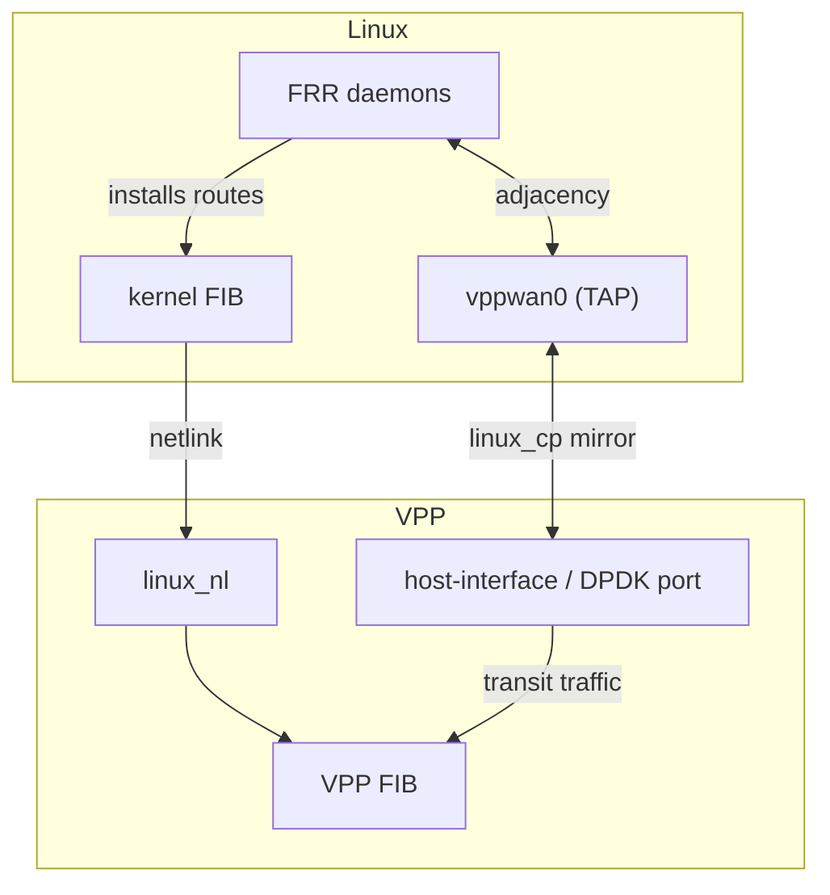
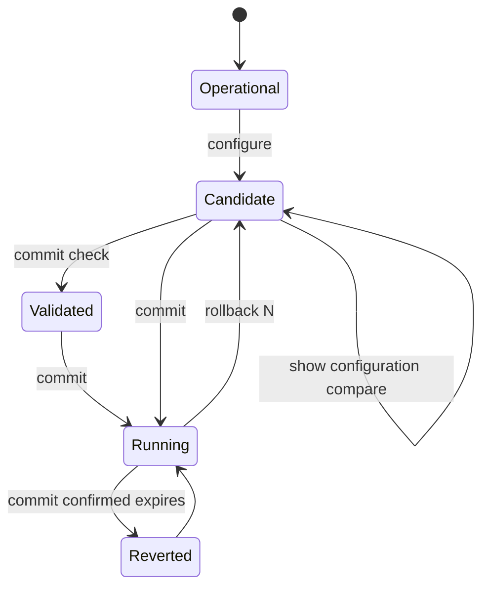

# HexaRouting — Routing and VTY

## TL;DR

FRR provides BGP, OSPF and IS-IS. VPP's `linux_cp` mirrors each dataplane
interface as a Linux TAP, so FRR sees ordinary netdevs and needs no
modification; `linux_nl` carries the routes FRR installs back into the VPP FIB.
`hexash` is one CLI for routing and CGNAT.

Two failures found in the lab, both silent: OSPF stalls in `Exchange` when the
TAP inherits a different MTU, and IS-IS never comes up unless OSI passthrough
is explicitly enabled.

> The key words **MUST**, **MUST NOT**, **SHOULD**, **SHOULD NOT**, **MAY** and
> **RECOMMENDED** in this document are to be interpreted as described in
> [RFC 2119](https://www.rfc-editor.org/rfc/rfc2119).

## 5W2H

| | |
|---|---|
| **What** | Integration of FRR's control plane with the VPP dataplane, plus a unified configuration shell. |
| **Why** | A CGNAT box on a provider's border is a router; it must speak the provider's IGP and EGP. |
| **Who** | Network operators who already know FRR syntax and expect it to work unchanged. |
| **When** | Routes propagate to the VPP FIB within seconds of adjacency establishment. |
| **Where** | Control-plane packets are punted to Linux TAPs; the dataplane keeps forwarding. |
| **How** | `linux_cp` mirrors interfaces; `linux_nl` listens to netlink; `hexash` forwards routing commands to `vtysh`. |
| **How much** | No measurable dataplane cost: punt only affects protocol packets, not transit. |

## Components

| Piece | Role |
|-------|------|
| VPP | Dataplane: forwarding and CGNAT (`bpa` plugin) |
| FRR | Control plane: `bgpd`, `ospfd`, `isisd`, `zebra` |
| `linux_cp` + `linux_nl` | The glue between them |
| `hexash` | HexaRouting's configuration shell |



FRR does not need to know VPP exists.

## Pitfall 1 — inherited MTU stalls OSPF

The TAP created by `linux_cp` comes up with MTU 9000. If the physical link is
1500, OSPF forms a neighbour, reaches **`Exchange/DR` and stops there**: it
compares MTU in Database Description packets and gives up silently. No log
says "MTU mismatch"; the operator sees an adjacency that never completes.

With the MTU aligned, the adjacency reached **`Full` in 8 seconds**.

* MTU **MUST** be explicit configuration, never inherited.

### Configuring it

```
hexarouting# [edit] interface host-veth-vpp
hexarouting# [edit]  mtu 1500
hexarouting# [edit]  exit
hexarouting# [edit] commit
```

Accepted range 576-9216, refused by the parser rather than by the device, so
the operator is told at the point of typing instead of at commit time. `no mtu`
removes the statement.

**It is applied to both sides.** `linux_cp` pairs a VPP interface with a Linux
TAP, and only the VPP interface is on the packet path. Setting the TAP alone —
which is what FRR's own `mtu` would do — leaves the half that matters unchanged
and reproduces the mismatch this exists to prevent.

Two details that cost time to find:

* The command is `set interface mtu **packet** <n>`, not `set interface mtu
  <n>`. The second changes the hardware maximum frame size, which most drivers
  refuse — and refuse while `vppctl` still exits **0**, so the failure is
  invisible. The first sets the L3 MTU, which is what OSPF compares.
* The result is therefore **read back** rather than inferred from the exit
  status. Until MTU moves to the binary API alongside the pool operations
  ([#3](https://github.com/andrediashexa/hexarouting/issues/3)), verifying the
  effect is the only honest check.

The running configuration reports the MTU of **every** interface the dataplane
has, not only the ones somebody typed. "Explicitly configured" is not a
property the dataplane can answer, and inventing that distinction would mean
the VTY remembering things between invocations — which it deliberately does
not. The consequence is the one that matters: a rollback can restore the
previous MTU, because the previous value was recorded rather than guessed.

## Pitfall 2 — IS-IS is not carried over IP

IS-IS runs OSI CLNS directly over the link layer, using L2 multicast
`01:80:C2:00:00:14/15`. Captures at three points located the loss precisely:

| Capture point | IS-IS hellos |
|---------------|--------------|
| Peer's interface, sending | present |
| VPP's physical interface | present |
| The TAP | **none** |

VPP's counter showed `osi-input: unknown osi protocol`. The frame arrives, is
recognised as OSI, and nobody is registered to receive IS-IS.

VPP 26.06's `linux_cp` already solves this; it is simply not enabled:

```
lcp osi-proto enable 0x83
```

`0x83` is the IS-IS NLPID.

* Deployments using IS-IS **MUST** enable OSI passthrough.
* Because **BGP and OSPF come up without it**, testing with only those two
  gives false confidence and IS-IS stays mute until someone needs it. IS-IS is
  therefore implemented last, deliberately: it is what validates the L2 punt.

## Pitfall 3 — CGNAT eating its own control plane

BGP sessions and OSPF/IS-IS adjacencies terminate on the box's **own**
addresses. `bpa-out2in` runs on the `ip4-unicast` arc, before `ip4-lookup` and
therefore before `ip4-local` decides a packet is local — so it sees the BGP
packet first. If a public pool contains a peering address, the session drops
intermittently with nothing obvious anywhere.

Two defences, both **REQUIRED**:

1. Pool creation **MUST** be refused when the public set contains an address
   configured on a local interface. The error names the address and the
   interface.
2. An address configured **after** the pool cannot be refused, so it **MUST**
   be reported at error level in `show logging` — operators read that, not the
   VPP process's stderr.

Pool addresses themselves are normally **not** interface addresses: they reach
the box by an upstream route, not local configuration.

## VTY

### The VTY is the front door

An operator logging into the appliance, over console or SSH, lands in `hexash`
rather than in a Unix shell. Root's login shell is `/usr/bin/hexash-login`,
a wrapper rather than `hexash` itself, and the reason is lockout: a `hexash`
that fails to start would otherwise leave nobody able to reach the box.

`start shell` opens a real shell as a child of the VTY; leaving it returns to
the VTY rather than logging out. It appears in neither tab completion nor `?`.

* The escape is hidden, **not** restricted. Anyone who can log in can run it.
  It **MUST NOT** be described as a security control; authorization is
  [#35](https://github.com/andrediashexa/hexarouting/issues/35).
* A shell **MUST** remain reachable. Recovery, `tcpdump`, and reading a log the
  VTY does not expose all need one, and an appliance that makes them impossible
  gets a permanent hole opened by the first operator who needs one.
* Booting with `hexash=off` skips the VTY entirely, and **MUST** keep working
  even when `hexash` is broken — it is read from `/proc/cmdline` by the
  wrapper, so it does not depend on the VTY starting.

See [appliance.md](appliance.md) for the login table and the recovery paths.

### How hexash reaches the dataplane

Through the **binary API**, not `vppctl`.

`vppctl` exits 0 even when the command it ran failed; the only evidence of a
refusal is the text it printed. A control plane built on that cannot tell
"pool created" from "pool rejected", so `commit` could report success while the
dataplane held none of the configuration.

The client is `src/hexash/vppapi.py`, driving `vat2`. Two alternatives were
rejected:

| Option | Why not |
|---|---|
| `vpp_papi`, the Python bindings | fd.io does not package them. Using them means vendoring the library out of the VPP source tree and keeping that copy in step with every VPP bump. |
| Keep parsing `vppctl` text | It is the defect being removed. Text patterns break at the first reworded message, and there is no return code to check. |

`vat2` ships inside the `vpp` package itself, so it is on every installed box
and every ISO, and it is versioned with VPP by construction. The cost is a
process per call rather than a persistent connection — irrelevant for
configuration, which happens at human speed and is all `hexash` does.

Five outcomes are distinguished, because they need different actions:

| State | Means | What the operator does |
|---|---|---|
| `ok` | applied | nothing |
| `refused` | the dataplane said no, with a return code | fix the configuration |
| `not-running` | no reply at all | start the dataplane |
| `no-plugin` | VPP is up, the CGNAT API is not registered | fix the install |
| `no-client` | `vat2` is missing | install the `vpp` package |

Collapsing these into "it failed" is how an unplugged dataplane and a rejected
configuration become indistinguishable. A refusal **MUST** carry the return
value, the name from `vnet/error.h`, and the sentence the plugin sent to VPP's
log — the number alone is not actionable:

```
refused -7: the dataplane refused it: invalid value
            (bpa_pool_init: pool 'client-bad': block size 500 must be a power of two)
```

### What goes over the API, and what does not

| Operation | Path | Why |
|---|---|---|
| Create, replace, delete a pool | binary API | These are writes. A write reported as successful when it was refused is the defect being removed. |
| `commit check` | CLI | Validation has no API message of its own, and inventing one that creates-then-deletes would rebuild the outage risk that a name check once caused. It writes nothing either way. |
| Reachability, before any change | binary API | Asked **once**, before anything is touched. Discovering the dataplane is unreachable halfway through leaves the box in neither the old configuration nor the new one, and the operator with no way to know which pools made it. |

A refused write **MUST** fail the commit, **MUST** name the pool — a commit
carrying several pools has to say which one — and **MUST** leave the candidate
intact, or the operator loses the edit they were trying to correct.

An upgrade hazard worth stating: a box updated without the current
`install.sh` has no vat2 plugin, and every commit touching a pool will fail.
That is the correct behaviour — the alternative is falling back to text
parsing, which is the defect — and the message says exactly what is missing.

The client takes no plugin path. On an appliance there is none to give, because
`install.sh` puts the vat2 plugin where `vat2` already looks — and `lab/api.sh`
mirrors that layout rather than passing `-p`, so it proves the client in the
configuration a box actually runs.

### Design

The goal is one CLI in the style operators expect: `configure terminal`,
`show running-config`, `write memory`, covering routing **and** CGNAT.

| Option | How | Cost |
|--------|-----|------|
| A. Wrap `vtysh` | Route `router bgp` to `vtysh`, `cgnat …` to VPP | Chosen |
| B. FRR-style daemon registered with `vtysh` | Link `libfrr`, translate to the binary API | Rejected |
| C. Own VTY from scratch | Full control | Reimplements what `libfrr` already does |

**Option B was rejected after checking.** `vtysh`'s daemon list is **compiled
in** (`vtysh_client[]`) with no plugin mechanism. Registering a new daemon
would mean maintaining a `vtysh` fork for the life of the product, reapplied on
every FRR release. Forwarding delivers the same unified
`show running-config` without that permanent cost.

### Configuration model: candidate, commit, rollback

Configuration follows the Juniper model. Statements typed in configuration
mode edit a **candidate**; the device is untouched until `commit`.



| Command | Effect |
|---------|--------|
| `configure` | Load the running configuration into a candidate |
| `show configuration compare` | Unified diff, running → candidate |
| `commit check` | Validate without applying |
| `commit` | Apply, and store a new revision |
| `commit comment "<text>"` | Same, with a note recorded against the revision |
| `commit confirmed <min>` | Apply, and roll back automatically unless confirmed |
| `rollback <0-19>` | Load a committed revision into the candidate |
| `show rollback` | List revisions with timestamp and comment |

Requirements:

* Edits **MUST NOT** reach the dataplane before `commit`.
* `commit` **MUST** validate before applying, and **MUST** restore the previous
  state if application fails halfway.
* `commit check` **MUST NOT** change anything on the device. An earlier
  version deleted and recreated the running pool to work around a
  name-collision check; it worked, and left a production pool one failed
  command away from disappearing during a read-only operation. `bpa pool …
  check` therefore performs no name check: in a candidate model, an existing
  name is a replacement, not a collision.
* `commit check` **MUST** validate against the device, not merely against
  syntax. The plugin exposes `bpa pool … check`, which runs every check the
  creation path runs — block size, prefix overlap, capacity, and collision
  with a local address — and creates nothing. Checking syntax alone would
  approve pools the device refuses, which is false confidence exactly where an
  operator is relying on the check.
* CGNAT **MUST** be applied before routing. A routing change can cost
  reachability, and doing it last keeps the half-configured window short.
* Pools are replaced whole rather than edited in place: the device takes a pool
  definition in a single command, and a partial edit would leave an invalid
  pool between the two halves of the change.
* `rollback 0` returns the candidate to the running configuration, discarding
  uncommitted edits — the same meaning JunOS gives it.

`commit confirmed` exists for the change that cuts your own access. If the
operator cannot type `commit` again, the box returns on its own.

### The model refuses what it cannot hold

`Config.parse` used to drop, in silence, any line inside a `pool` block it did
not recognise. That looks like a small gap and was not one, because **the
candidate is built from the running configuration**:

```
configure          → candidate = parse(show bpa config)   ← the line is lost here
… unrelated edit …
commit             → the pool is replaced with the candidate ← and removed here
```

An operator who set something with `vppctl` and then committed **any**
unrelated change through the VTY had that setting silently reverted. It applied
to every per-pool setting the project had merged: the timeouts
([#12](https://github.com/andrediashexa/hexarouting/issues/12)), `max-blocks`
([#13](https://github.com/andrediashexa/hexarouting/issues/13)), the filtering
mode ([#15](https://github.com/andrediashexa/hexarouting/issues/15)) and the ALG
switches ([#14](https://github.com/andrediashexa/hexarouting/issues/14)). Each
of those has a lab that passes, because each lab drives `vppctl` directly.

Two rules now, and the first is the general one:

* **Nothing is dropped in silence.** A line the model cannot hold is recorded
  with its number and the reason. `commit` and `--load` **refuse**; reading the
  device's running configuration **warns**, because a VTY that cannot start
  against a slightly newer dataplane is worse than one that says what it does
  not understand.
* **Every per-pool setting the dataplane accepts, the model carries** — through
  `lines()` in the same order the device emits them, through
  `device_command()`, and through `api_args()`. The binary API gained the
  fields to carry them (`bpa.api` 0.2.0); before that they had no way to reach
  the dataplane at all.

The order in `lines()` is not cosmetic. It has to match `show bpa config`
exactly, or the running configuration and a candidate built from it differ on
every commit for no reason.

`lab/vty-pool.sh` sets each of them through the VTY and asks **the dataplane**
whether they arrived, then makes a setting with `vppctl`, commits an unrelated
change through the VTY, and asserts the setting survived. Asking `hexash`
whether `hexash` stored something proves nothing — that is exactly what the old
code did successfully.

### Rolling back routing, not just CGNAT

A rollback that restored CGNAT and left routing untouched would leave the box
in a state that never existed. Routing is therefore part of the same
configuration document, and rollback converges FRR onto the revision using
`frr-reload.py`, which computes the delta.

* Without `frr-reload.py`, a rollback could only add statements, never remove
  them — and a rollback that cannot remove is not a rollback. Its absence
  **MUST** be reported rather than silently degrading to a partial restore.

### The dataplane is the source of truth

Each `hexash -c …` is a new process, so in-memory state does not survive
between invocations — the first version wrote an empty configuration. The
plugin therefore emits its own configuration in VTY syntax
(`show bpa config`), which `hexash` reads.

This mirrors `vtysh`: the daemon knows its configuration, not the shell. A
useful side effect is that a public range merged from adjacent prefixes is
decomposed back into CIDR on output, so the saved configuration can be reread.

### The SSH daemon and the accounts, in the configuration

The last configuration on the box that `commit` and `rollback` did not cover.
It is now in the candidate like everything else:

```
ssh port 22
ssh listen-address 0.0.0.0
ssh permit-root-login prohibit-password
ssh password-authentication no
user noc
 ssh-key ssh-ed25519 AAAAC3NzaC1lZDI1NTE5AAAAI... noc@laptop
 exit
```

Accounts are **real POSIX accounts**, not a private database — an appliance that
invents its own accounts is one whose accounts nobody deprovisions when somebody
leaves. A user created here gets the VTY as its login shell, which is also how
the VTY knows which accounts are its own: the shell is the marker, so there is
no list to keep in step.

A password is the alternative to a key, and it is given as a **crypt hash**
(`openssl passwd -6`), never as plaintext. Plaintext in `/etc/shadow` does not
fail loudly; it produces an account whose password simply never matches.

#### The lockout, and the three things that stand between it and you

This is the one configuration that can strand the operator on the other side of
the country, so it has three guards rather than one.

1. **`commit check` refuses a change that leaves nobody able to log in.**
   Refused only when *this change* causes it: a box that already has nobody able
   to reach it over SSH — freshly installed, reached by console — must still be
   able to commit a CGNAT change. Console access is deliberately not counted as
   an escape; "you still have the console" is not an answer at 2am for a box in
   somebody else's datacentre.
2. **Any change under `ssh` or `user` is applied as `commit confirmed`,** whether
   or not the operator asked, and the VTY says so. It reverts on its own unless
   confirmed from a session that still works.
3. **`sshd -t` validates the generated file before the daemon is reloaded,** and
   the previous file is put back if it refuses. A syntax error that stops sshd
   starting is the same lockout by another route. It fails **closed**: refusing
   a valid change costs an operator a retry, accepting an invalid one costs them
   the box. `/run/sshd` is created first, because `sshd -t` refuses to run at all
   without its privilege-separation directory and that would reject a perfectly
   good change for a reason that has nothing to do with it.

#### Secrets

Password hashes are in `hexarouting.conf` and in every rollback revision —
they have to be, or a rollback could not restore a password. So:

* `/etc/hexarouting` and everything under it is **root-only**, set by the
  installer and again on every write.
* `show running-config` prints `password <set, not shown>`. A hash on a screen
  shared during an incident is a hash that has left the building, and it is
  crackable offline at the attacker's leisure.
* The audit trail records that credentials changed, not what they changed to.

### Commands for the question an operator arrives with

The first five `show cgnat` commands report aggregates — *"thread 0: 3 sessions,
2 active subscribers"*. That is enough to know the box is working and useless
for the question people actually arrive with, which is always about one
customer.

| Command | The question |
|---|---|
| `show cgnat subscriber <ip>` | "100.64.0.5 says nothing works" — public address, blocks, ports used and free, sessions, and whether it has been refused a port |
| `show cgnat translation <ip> <port>` | "who was behind this address and port" — the question a court order or an abuse report asks |
| `show cgnat top [n]` | which subscribers are closest to running out — the question that prevents the call instead of answering it |
| `show cgnat drops` | why packets did not get through |

Two properties are load-bearing.

**`translation` says where its answer comes from.** In deterministic mode the
answer is arithmetic and holds for any instant, past or present, as long as the
pool has not been resized. In dynamic mode it holds for **now only** — the block
belonged to somebody else yesterday, and only the RFC 8158 log says whom. The
command prints which of the two it is giving, because handing a court the second
as though it were the first is a wrong answer delivered with confidence.

**`drops` separates a drop from a success.** VPP registers every node counter as
an "error", so `show errors` lists *"packets translated"* beside *"no pool for
source address"* as though they were the same kind of thing. `bpa_errors.h`
tags each counter with whether it means a packet was lost, in the same list as
its description so the two cannot drift, and this command prints the drops under
their own heading first.

None of them walks the session table. `subscriber` and `top` read the
per-subscriber record — one entry per active subscriber rather than one per
session, which on a real box differ by three orders of magnitude — and
`translation` answers by arithmetic. A `show` that stalls forwarding is worse
than no `show`.

`lab/troubleshoot.sh` checks them against `ref/bpa_model.py` rather than against
the plugin: a test that asks the implementation what it should have said agrees
with any mistake in it.

### The banner, and where it must not appear

An interactive login opens with an ASCII wordmark above the version line. On a
serial console, mid-incident, with several boxes open in several terminals, an
operator wants to know which product they are looking at before reading
anything else.

Plain ASCII, 59 columns, six lines: a racked box is reached through a BMC whose
console is 80 columns of whatever font it decided on, box-drawing characters
render as noise there, and a banner that wraps is worse than none.

It **MUST NOT** appear when stdout is not a terminal. `hexash -c` and piped
commands are how every lab and every script drives this VTY, and a banner
prepended to their output breaks the parsing.

The version line stays: the banner identifies the product, the version
identifies the build, and an operator on the phone needs the second.

### Completion and help

Tab completes; `?` lists the valid options at the cursor with a description:

```
hexarouting# show cgnat ?
  blocks   blocks allocated in dynamic mode
  logging  IPFIX export state
  pool     configured CGNAT pools
  session  active sessions per thread

hexarouting(config-cgnat-pool)# inside ?
  <A.B.C.D/M>
```

The tree covers the CGNAT commands fully and the routing entry points. Past an
FRR command it **admits it does not know**, rather than presenting a copied
list of thousands of commands that would drift out of date with every FRR
release and start suggesting commands that no longer exist.

### Limits of this version

* The dataplane error check is textual, because `vppctl` returns 0 even on
  failure. Migrating `hexash` to the binary API **SHOULD** replace it.
* A box running CGNAT with no routing daemon is a legitimate deployment, so a
  missing or silent FRR **MUST NOT** block a CGNAT-only commit.
* `hexash` is written in Python. It is an interactive control-plane shell,
  outside any packet path; C would take three times the code for the same
  result.

## FRR version

Debian 12 ships FRR 8.4.4, already old. Production **SHOULD** pin a version
from FRR's own repository (`deb.frrouting.org`), as `build/Dockerfile.dev`
does. A control-plane version **MUST NOT** float with whatever the distribution
happens to carry.

## State

- [x] `linux_cp` + `linux_nl` in the lab (`lab/lcp.sh`)
- [x] BGP, OSPF and IS-IS over the TAP, all three routes in the VPP FIB
      (`lab/routing.sh`)
- [x] Pool validated against local addresses, both directions
- [x] `hexash` with completion and contextual help
- [x] Candidate/commit/rollback covering CGNAT and routing
- [ ] MTU as an explicit interface parameter in the VTY
- [ ] Migrate configuration writes to the binary API
