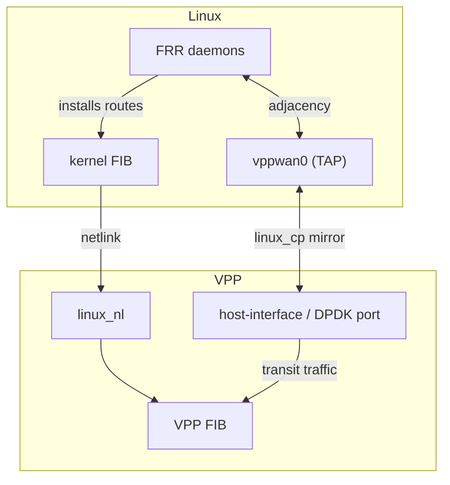

# HexaRouting — Routing and VTY

## TL;DR

FRR provides BGP, OSPF and IS-IS. VPP's `linux_cp` mirrors each dataplane
interface as a Linux TAP, so FRR sees ordinary netdevs and needs no
modification; `linux_nl` carries the routes FRR installs back into the VPP FIB.
`hexash` is one CLI for routing and CGNAT.

Two failures found in the lab, both silent: OSPF stalls in `Exchange` when the
TAP inherits a different MTU, and IS-IS never comes up unless OSI passthrough
is explicitly enabled.

> The key words **MUST**, **MUST NOT**, **SHOULD**, **SHOULD NOT**, **MAY** and
> **RECOMMENDED** in this document are to be interpreted as described in
> [RFC 2119](https://www.rfc-editor.org/rfc/rfc2119).

## 5W2H

| | |
|---|---|
| **What** | Integration of FRR's control plane with the VPP dataplane, plus a unified configuration shell. |
| **Why** | A CGNAT box on a provider's border is a router; it must speak the provider's IGP and EGP. |
| **Who** | Network operators who already know FRR syntax and expect it to work unchanged. |
| **When** | Routes propagate to the VPP FIB within seconds of adjacency establishment. |
| **Where** | Control-plane packets are punted to Linux TAPs; the dataplane keeps forwarding. |
| **How** | `linux_cp` mirrors interfaces; `linux_nl` listens to netlink; `hexash` forwards routing commands to `vtysh`. |
| **How much** | No measurable dataplane cost: punt only affects protocol packets, not transit. |

## Components

| Piece | Role |
|-------|------|
| VPP | Dataplane: forwarding and CGNAT (`bpa` plugin) |
| FRR | Control plane: `bgpd`, `ospfd`, `isisd`, `zebra` |
| `linux_cp` + `linux_nl` | The glue between them |
| `hexash` | HexaRouting's configuration shell |



FRR does not need to know VPP exists.

## Pitfall 1 — inherited MTU stalls OSPF

The TAP created by `linux_cp` comes up with MTU 9000. If the physical link is
1500, OSPF forms a neighbour, reaches **`Exchange/DR` and stops there**: it
compares MTU in Database Description packets and gives up silently. No log
says "MTU mismatch"; the operator sees an adjacency that never completes.

With the MTU aligned, the adjacency reached **`Full` in 8 seconds**.

* MTU **MUST** be explicit configuration, never inherited.

## Pitfall 2 — IS-IS is not carried over IP

IS-IS runs OSI CLNS directly over the link layer, using L2 multicast
`01:80:C2:00:00:14/15`. Captures at three points located the loss precisely:

| Capture point | IS-IS hellos |
|---------------|--------------|
| Peer's interface, sending | present |
| VPP's physical interface | present |
| The TAP | **none** |

VPP's counter showed `osi-input: unknown osi protocol`. The frame arrives, is
recognised as OSI, and nobody is registered to receive IS-IS.

VPP 26.06's `linux_cp` already solves this; it is simply not enabled:

```
lcp osi-proto enable 0x83
```

`0x83` is the IS-IS NLPID.

* Deployments using IS-IS **MUST** enable OSI passthrough.
* Because **BGP and OSPF come up without it**, testing with only those two
  gives false confidence and IS-IS stays mute until someone needs it. IS-IS is
  therefore implemented last, deliberately: it is what validates the L2 punt.

## Pitfall 3 — CGNAT eating its own control plane

BGP sessions and OSPF/IS-IS adjacencies terminate on the box's **own**
addresses. `bpa-out2in` runs on the `ip4-unicast` arc, before `ip4-lookup` and
therefore before `ip4-local` decides a packet is local — so it sees the BGP
packet first. If a public pool contains a peering address, the session drops
intermittently with nothing obvious anywhere.

Two defences, both **REQUIRED**:

1. Pool creation **MUST** be refused when the public set contains an address
   configured on a local interface. The error names the address and the
   interface.
2. An address configured **after** the pool cannot be refused, so it **MUST**
   be reported at error level in `show logging` — operators read that, not the
   VPP process's stderr.

Pool addresses themselves are normally **not** interface addresses: they reach
the box by an upstream route, not local configuration.

## VTY

The goal is one CLI in the style operators expect: `configure terminal`,
`show running-config`, `write memory`, covering routing **and** CGNAT.

| Option | How | Cost |
|--------|-----|------|
| A. Wrap `vtysh` | Route `router bgp` to `vtysh`, `cgnat …` to VPP | Chosen |
| B. FRR-style daemon registered with `vtysh` | Link `libfrr`, translate to the binary API | Rejected |
| C. Own VTY from scratch | Full control | Reimplements what `libfrr` already does |

**Option B was rejected after checking.** `vtysh`'s daemon list is **compiled
in** (`vtysh_client[]`) with no plugin mechanism. Registering a new daemon
would mean maintaining a `vtysh` fork for the life of the product, reapplied on
every FRR release. Forwarding delivers the same unified
`show running-config` without that permanent cost.

### The dataplane is the source of truth

Each `hexash -c …` is a new process, so in-memory state does not survive
between invocations — the first version wrote an empty configuration. The
plugin therefore emits its own configuration in VTY syntax
(`show bpa config`), which `hexash` reads.

This mirrors `vtysh`: the daemon knows its configuration, not the shell. A
useful side effect is that a public range merged from adjacent prefixes is
decomposed back into CIDR on output, so the saved configuration can be reread.

### Completion and help

Tab completes; `?` lists the valid options at the cursor with a description:

```
hexarouting# show cgnat ?
  blocks   blocks allocated in dynamic mode
  logging  IPFIX export state
  pool     configured CGNAT pools
  session  active sessions per thread

hexarouting(config-cgnat-pool)# inside ?
  <A.B.C.D/M>
```

The tree covers the CGNAT commands fully and the routing entry points. Past an
FRR command it **admits it does not know**, rather than presenting a copied
list of thousands of commands that would drift out of date with every FRR
release and start suggesting commands that no longer exist.

### Limits of this version

* The dataplane error check is textual, because `vppctl` returns 0 even on
  failure. Migrating `hexash` to the binary API **SHOULD** replace it.
* `hexash` is written in Python. It is an interactive control-plane shell,
  outside any packet path; C would take three times the code for the same
  result.

## FRR version

Debian 12 ships FRR 8.4.4, already old. Production **SHOULD** pin a version
from FRR's own repository (`deb.frrouting.org`), as `build/Dockerfile.dev`
does. A control-plane version **MUST NOT** float with whatever the distribution
happens to carry.

## State

- [x] `linux_cp` + `linux_nl` in the lab (`lab/lcp.sh`)
- [x] BGP, OSPF and IS-IS over the TAP, all three routes in the VPP FIB
      (`lab/routing.sh`)
- [x] Pool validated against local addresses, both directions
- [x] `hexash` with completion and contextual help
- [ ] MTU as an explicit interface parameter in the VTY
- [ ] Migrate configuration writes to the binary API
