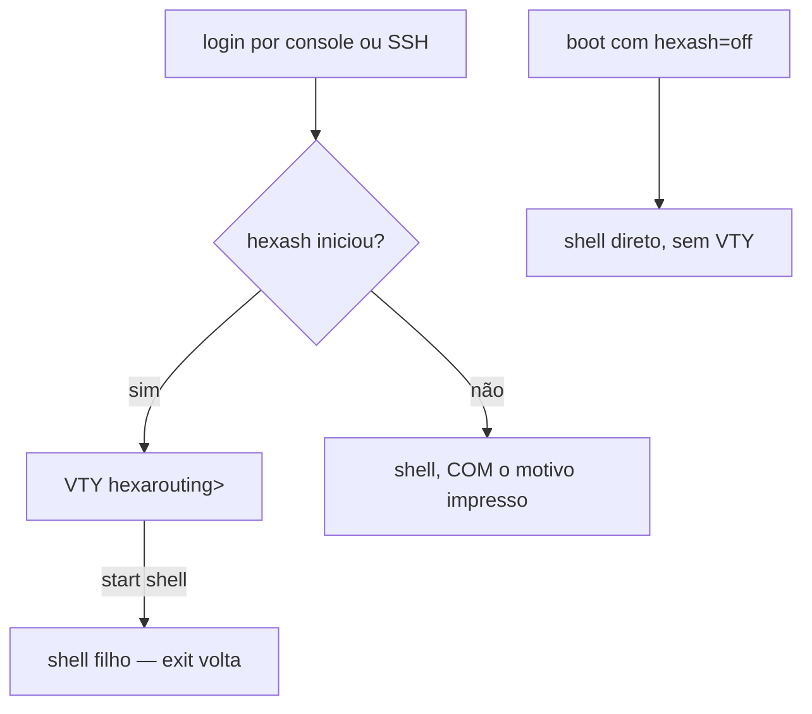

# Acesso, login e papéis



## Onde você cai ao entrar

| Situação | O que acontece |
|----------|----------------|
| Login por console ou SSH | Cai no `hexash` |
| `start shell` dentro da VTY | Abre um shell como filho; `exit` volta para a VTY |
| `scp`, `rsync`, `git` por SSH | Chegam a um shell real — shell de login invocado com `-c` passa direto |
| `hexash` falha ao iniciar | Cai num shell **com o motivo impresso** |
| Boot com `hexash=off` | Pula a VTY inteiramente; a ISO oferece isso como entrada de menu |

Na **ISO** o console tem autologin — a conta root está travada, não há o que autenticar. Na máquina **instalada** não há autologin e a senha é a definida durante a instalação.

O autologin de console é feito **apenas pela ISO**, e o instalador o remove do alvo. Numa máquina instalada ele significaria que acesso físico ou IPMI equivale a acesso total sem senha — decisão do operador, não padrão do produto.

### `start shell`

Está na árvore de comandos: TAB e `?` oferecem. E é **restrito a administradores** — um shell nesta caixa é todas as capacidades de uma vez, então quem não tem `hexa-admin` é recusado pelo nome do papel que tem:

```
error: start shell: permission denied for a read-only account
    membership of hexa-cgnat allows CGNAT configuration, hexa-admin allows everything
```

```
error: start shell: permission denied for a cgnat-operator account
    this change needs hexa-admin
```

Esconder nunca foi a fronteira; a verificação de capacidade é. E um comando que o administrador não consegue encontrar é um comando que ele vai pedir a alguém — por isso ele é oferecido em vez de escondido.

O shell abre como processo **filho** da VTY: sair dele volta para a VTY, não encerra a sessão.

### Por que existe saída de emergência

Apontar o shell de login para uma aplicação cria risco de travamento total: um `hexash` que falhasse ao iniciar deixaria ninguém capaz de alcançar a máquina, nem por console nem por SSH. Por isso há **duas saídas independentes**, e a segunda (`hexash=off` no boot) não depende do `hexash` funcionar.


:::info
`install.sh` **não** troca o shell de login de ninguém, a menos que `HEXA_VTY_LOGIN=1` esteja setado. Numa Debian existente a máquina pode ter outras funções, e trocar o shell do root silenciosamente é o tipo de surpresa que o operador descobre no pior momento.

:::

## Papéis e permissões

Duas capacidades, mapeadas em **grupos do sistema** — não num banco de contas próprio da appliance. Uma appliance que inventa as próprias contas é uma appliance cujas contas ninguém desprovisiona quando alguém sai da empresa.

| Grupo | Pode alterar |
|-------|--------------|
| `hexa-admin` | tudo: roteamento, configuração da própria máquina e CGNAT |
| `hexa-cgnat` | somente configuração de CGNAT |
| nenhum dos dois | somente leitura |

`root` tem as duas, porque root fala com o socket do dataplane diretamente e fingir o contrário seria teatro.

As capacidades são lidas da participação em grupos **no momento em que a VTY inicia**, e nunca de algo que o programa guarde: a resposta precisa ser a que o sistema daria, senão desprovisionar uma conta aqui não a desprovisiona de fato.

Uma conta que o sistema não consegue descrever recebe **nada**. Falhar aberto aqui significaria que um NSS quebrado vira direito total de configuração.

### Uma conta comum precisa alcançar o dataplane

Os papéis só valem alguma coisa se quem não é `root` conseguir configurar a caixa. Se apenas `root` consegue, todo operador vira `root` — e aí os papéis não são frouxos, são **decorativos**, que é pior: a caixa anuncia um limite que não tem.

Numa appliance instalada a partir da **0.39.0** isso está resolvido, e o auto-teste de boot verifica **fazendo a chamada** com uma conta que existe de verdade — não conferindo permissão de arquivo e não fabricando a participação em grupo para poder responder sim.

Numa caixa recém-instalada ainda não existe conta de operador nenhuma, e ele diz isso em voz alta em vez de responder por contas que não existem:

```
[info] no operator account exists yet: only root can use this box
       create one with 'user <name>' and give it a role
```

Depois que você cria a conta e dá um papel a ela, o mesmo auto-teste passa a **nomear** a conta que alcança o dataplane:

```
[ ok ] the binary API works for netadm, an account that really has the group
```

Se aparecer `[FAIL]`, os papéis não estão valendo naquela caixa: todo mundo que precisar configurar vai precisar de `root`. Duas formas, e elas querem ações diferentes:

```
[FAIL] netadm has role administrator and is in none of: vpp frr frrvty
       the role cannot be exercised: VPP's sockets are group vpp
       and /etc/frr is group frr. Re-apply the role from the VTY:
       configure / user netadm / role administrator / commit
```

A conta tem posto e não tem alcance: ela recebeu o papel e ficou de fora dos grupos que abrem os sockets do dataplane e do roteamento, então **todo comando que ela der falha por permissão** — inclusive os de leitura, e a mensagem parece recusa de autorização sem ser. Reaplicar o papel pela VTY, como a própria linha diz, refaz as participações.

```
[FAIL] no account on this box is in group vpp: only root can use the API
```

Nenhuma conta desta caixa alcança o dataplane. Antes de distribuir contas por papel, resolva isso — senão os papéis existem no papel e não na máquina.


:::warning
Mídias anteriores à **0.37.0** não instalavam o componente que atende essa chamada, e nas 0.37.0 e 0.38.x ele respondia apenas para `root`. Numa caixa instalada com mídia anterior à 0.39.0, confira essa linha antes de distribuir contas por papel.

:::

### O que cada mudança exige

| Tipo de mudança | Capacidade exigida |
|-----------------|--------------------|
| Pools, interfaces CGNAT, timeouts, limites, bypass, forwards | `hexa-cgnat`       |
| Roteamento, SSH, contas de usuário, SNMP, MTU, uRPF | `hexa-admin`       |

## Invocando o hexash

```sh
hexash                       # sessão interativa
hexash -c "show cgnat pool"  # um comando e sai
hexash -c "cmd1" -c "cmd2"   # vários comandos em sequência
hexash --load [arquivo]      # aplica um arquivo de configuração salvo
```

`--load` sem argumento usa `/etc/hexarouting/hexarouting.conf`. É o que roda no boot, pela `hexarouting.service`.

O código de saída é **1** se qualquer comando falhou, **0** caso contrário — o que permite usar `hexash -c` em script sem depender de casar padrões de texto na saída.

### Caminhos

| Caminho | Conteúdo |
|---------|----------|
| `/etc/hexarouting/hexarouting.conf` | configuração salva, aplicada no boot |
| `/etc/hexarouting/rollback/` | revisões commitadas (as 20 mais recentes) |

Variáveis de ambiente `HEXA_CONFIG` e `HEXA_ROLLBACK` sobrescrevem esses caminhos.

Em arquivos de configuração, `!` inicia comentário — o resto da linha é ignorado.

# Ver também

* [Primeiros passos](/doc/primeiros-passos-TAWDdSrYG7) — a sequência completa de configuração
* [Roteamento, SSH, usuários e SNMP](/doc/roteamento-ssh-usuarios-e-snmp-LoibxwFM5m) — como criar contas e ajustar o SSH
