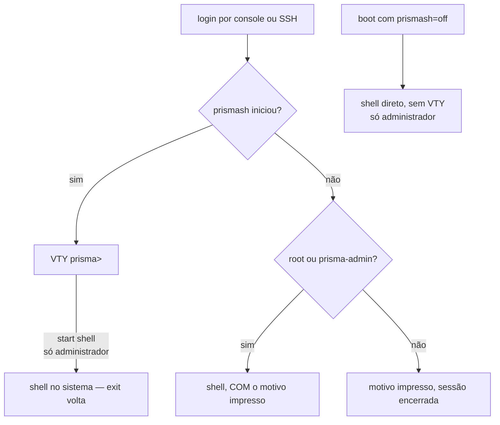

# Acesso, login e papéis

Onde uma conta cai quando entra na caixa, por console ou SSH, e o que cada papel pode mudar. Para quem vai criar as contas de operador e precisa saber o que cada uma alcança.



## Onde você cai ao entrar

| Situação | O que acontece |
|----------|----------------|
| Login por console ou SSH | Cai no `prismash` |
| `start shell` dentro da VTY | Só `root` e `prisma-admin`: abre um shell no sistema; `exit` volta para a VTY |
| `ssh <conta>@<caixa> "<comando>"`, `scp`, `rsync` | `root` e `prisma-admin` chegam a um shell real. **Qualquer outra conta** tem o comando executado pela VTY, como um `prismash -c`, com o papel dela; `scp` e `rsync` não funcionam para ela |
| `prismash` falha ao iniciar | `root` e `prisma-admin` caem num shell **com o motivo impresso**. Qualquer outra conta vê o motivo e a sessão termina |
| Boot com `prismash=off` | Pula a VTY inteiramente, para `root` e `prisma-admin`; a ISO oferece isso como entrada de menu |

Na **ISO** o console tem autologin — a conta root está travada, não há o que autenticar. Na máquina **instalada** não há autologin e a senha é a definida durante a instalação.

O autologin de console é feito **apenas pela ISO**, e o instalador o remove do alvo. Numa máquina instalada ele significaria que acesso físico ou IPMI equivale a acesso total sem senha — decisão do operador, não padrão do produto.

### `start shell`

Está na árvore de comandos: TAB e `?` oferecem. E é **restrito a administradores** — um shell nesta caixa é todas as capacidades de uma vez, então quem não tem `prisma-admin` é recusado pelo nome do papel que tem:

```
error: start shell: permission denied for a read-only account
    membership of prisma-cgnat allows CGNAT configuration, prisma-admin allows
    everything
```

```
error: start shell: permission denied for a cgnat-operator account
    this change needs prisma-admin
```

Esconder nunca foi a fronteira; a verificação de capacidade é. E um comando que o administrador não consegue encontrar é um comando que ele vai pedir a alguém — por isso ele é oferecido em vez de escondido.

Quem abre o shell é o **sistema da caixa**, não a VTY: a VTY confere o papel e pede; o sistema confere de novo, pelos grupos da conta, e é a resposta dele que vale. Se o sistema recusar, a VTY diz `start shell: the host refused a shell for this account`. Sair do shell volta para a VTY, com a configuração candidata intacta.

O limite vale para tudo que dá um shell, não só para `start shell`. Toda conta da VTY participa dos grupos que abrem o dataplane e o roteamento, então um shell para uma conta que não é administradora seria tudo o que o papel dela nega.

### Por que existe saída de emergência

Apontar o shell de login para uma aplicação cria risco de travamento total: um `prismash` que falhasse ao iniciar deixaria ninguém capaz de alcançar a máquina, nem por console nem por SSH. Por isso há **duas saídas independentes**, e a segunda (`prismash=off` no boot) não depende do `prismash` funcionar. As duas são de administrador.

### A VTY roda no plano de gerência

A caixa instalada roda em containers o dataplane, o roteamento, o exportador de registros do CGNAT e o **plano de gerência**, onde a VTY roda; uma caixa com PPPoE configurado roda mais um, o do PPPoE. Um login cai ali **como ele mesmo** — com o mesmo usuário e os mesmos grupos que tem no sistema —, então o papel que a VTY lê é o da conta, e uma conta somente leitura dentro do container pode exatamente o que poderia fora dele. O que a VTY faz no sistema — criar contas, mexer no SSH, no SNMP e nos resolvedores DNS, ajustar o lado Linux de uma interface, reiniciar a caixa — ela pede ao sistema, que confere quem está pedindo pelo próprio kernel e só executa para `root`. É a mesma regra de quando a VTY executava esses comandos ela mesma: mudou onde o comando roda, não quem pode.

Para o operador nada muda no que se digita. Duas consequências práticas:

* **Se o container de gerência não estiver rodando, a VTY roda direto no sistema**, como antes. Uma caixa com esse container parado continua alcançável.
* `install`, `system upgrade` e `system dataplane restart` são executados pelo sistema, com a VTY dele, no mesmo terminal. Você não precisa fazer nada diferente.
* Um `system upgrade` recria o container de gerência no fim, e um login que chega nesses segundos **espera** até 20 segundos, dizendo uma vez que a VTY está reiniciando por causa de uma atualização. Se o tempo acabar, vale a tabela do início desta página: `root` e `prisma-admin` caem num shell com o motivo impresso, e as demais contas veem o motivo e a sessão termina.


:::info
Para fazer os logins voltarem a usar a VTY do sistema em vez da do container, crie o arquivo `/etc/prisma-routing/vty-on-host`. É uma saída para diagnóstico, não uma configuração do dia a dia.

:::


:::info
`install.sh` **não** troca o shell de login de ninguém, a menos que `PRISMA_VTY_LOGIN=1` esteja setado. Numa Debian existente a máquina pode ter outras funções, e trocar o shell do root silenciosamente é o tipo de surpresa que o operador descobre no pior momento.

:::

## Papéis e permissões

Duas capacidades, mapeadas em **grupos do sistema** — não num banco de contas próprio da appliance. Uma appliance que inventa as próprias contas é uma appliance cujas contas ninguém desprovisiona quando alguém sai da empresa.

| Grupo | Pode alterar |
|-------|--------------|
| `prisma-admin` | tudo: roteamento, configuração da própria máquina e CGNAT |
| `prisma-cgnat` | somente configuração de CGNAT |
| nenhum dos dois | somente leitura |

`root` tem as duas, porque root fala com o socket do dataplane diretamente e fingir o contrário seria teatro.

Uma coisa que nenhum papel faz: reiniciar ou desligar a caixa, aplicar uma versão nova ou reiniciar o dataplane. Essas quatro ações — `system reboot`, `system shutdown`, `system upgrade <versão>` e `system dataplane restart` — são do `root` e de quem tem `**operator**` (desde a 0.149.26). Veja [O operador: reinício e atualização sem root](#o-operador-reinicio-e-atualizacao-sem-root).

### O operador: reinício e atualização sem root

`operator` é uma linha no bloco da conta, **ao lado** do papel, e não um papel a mais. Ela coloca a conta no grupo `prisma-operator`, que libera exatamente as quatro ações de sistema e nada mais do que o root faz: nem shell, nem gerenciar contas.

```
configure
 user prisma-web
  role administrator
  operator
  exit
 commit
```

* Um `administrator` **não** é operador só por ser administrador; uma conta somente leitura de um NOC **pode** ser quem reinicia a caixa.
* `no operator` tira de novo. O `root` não aceita a linha: ele já pode tudo isso por ser root.
* É um grupo do sistema, como os papéis: desativar a conta no sistema tira a permissão junto.
* O grupo `prisma-operator` é criado pelo primeiro commit que dá `operator` a alguém. A partir da 0.150.0 o instalador já o cria.

Quem não tem `operator` recebe a recusa antes de qualquer coisa acontecer, com o motivo e o grupo que libera a ação: `prisma-operator`.

A **consulta** de versões — `system upgrade` sem versão, que só diz qual versão a caixa roda e qual é a mais nova publicada — não muda nada, então **qualquer conta** pode fazer. Ela é lida pelo sistema da caixa, porque a rede da VTY termina no backplane e não alcança o site de releases; até a 0.149.25 essa consulta falhava ali para todo mundo.

Na API, `WhoAmI` diz `can_operate`, e as contas lidas por `GetConfig` trazem `operator`.

As capacidades são lidas da participação em grupos **no momento em que a VTY inicia**, e nunca de algo que o programa guarde: a resposta precisa ser a que o sistema daria, senão desprovisionar uma conta aqui não a desprovisiona de fato.

Uma conta que o sistema não consegue descrever recebe **nada**. Falhar aberto aqui significaria que um NSS quebrado vira direito total de configuração.

### Uma conta comum precisa alcançar o dataplane

Os papéis só valem alguma coisa se quem não é `root` conseguir configurar a caixa. Se apenas `root` consegue, todo operador vira `root` — e aí os papéis não são frouxos, são **decorativos**, que é pior: a caixa anuncia um limite que não tem.

Numa appliance instalada a partir da **0.39.0** isso está resolvido, e o auto-teste de boot verifica **fazendo a chamada** com uma conta que existe de verdade — não conferindo permissão de arquivo e não fabricando a participação em grupo para poder responder sim.

Numa caixa recém-instalada ainda não existe conta de operador nenhuma, e ele diz isso em voz alta em vez de responder por contas que não existem:

```
[info] no operator account exists yet: only root can use this box
       create one with 'user <name>' and give it a role
```

A conta se cria na própria VTY, com o papel `administrator` ou `cgnat-operator` (sem papel, ela é somente leitura):

```
prisma> configure
prisma# [edit] user <nome>
prisma# [edit user <nome>] role administrator
prisma# [edit user <nome>] commit
```

O resto — senha, chave SSH, remover a conta — está em [Roteamento, SSH, usuários e SNMP](/s/wiki/doc/roteamento-ssh-usuarios-e-snmp-LoibxwFM5m). Depois que você cria a conta e dá um papel a ela, o mesmo auto-teste passa a **nomear** a conta que alcança o dataplane:

```
[ ok ] the binary API works for netadm, an account that really has the group
```

Se aparecer `[FAIL]`, os papéis não estão valendo naquela caixa: todo mundo que precisar configurar vai precisar de `root`. Duas formas, e elas querem ações diferentes:

```
[FAIL] netadm has role administrator and is in none of: vpp frr frrvty
      the role cannot be exercised: VPP's sockets are group vpp
      and /etc/frr is group frr. Re-apply the role from the VTY:
      configure / user netadm / role administrator / commit
```

A conta tem posto e não tem alcance: ela recebeu o papel e ficou de fora dos grupos que abrem os sockets do dataplane e do roteamento, então **todo comando que ela der falha por permissão** — inclusive os de leitura, e a mensagem parece recusa de autorização sem ser. Reaplicar o papel pela VTY, como a própria linha diz, refaz as participações.

```
[FAIL] no account on this box is in group vpp: only root can use the API
```

Nenhuma conta desta caixa alcança o dataplane. Antes de distribuir contas por papel, resolva isso — senão os papéis existem no papel e não na máquina.


:::warning
Mídias anteriores à **0.37.0** não instalavam o componente que atende essa chamada, e nas 0.37.0 e 0.38.x ele respondia apenas para `root`. Numa caixa instalada com mídia anterior à 0.39.0, confira essa linha antes de distribuir contas por papel.

:::

### O que cada mudança exige

| Tipo de mudança | Capacidade exigida |
|-----------------|--------------------|
| Pools, `cgnat inside`/`cgnat outside` nas interfaces, timeouts, limites, bypass, forwards, logging | `prisma-cgnat`     |
| Todo o resto: roteamento, endereços e demais ajustes de interface, SSH, contas, SNMP, DNS, PPPoE e RADIUS, `system` (placas, núcleos, memória) e a memória do CGNAT (`nat` > `cgnat` > `memory`), que é um ajuste da máquina | `prisma-admin`     |
| `start shell`, `install` | `prisma-admin`     |
| `system reboot`, `system shutdown`, `system upgrade <versão>`, `system dataplane restart` | `root` ou `operator` (`prisma-operator`), qualquer que seja o papel |
| `system upgrade` sem versão (a consulta) | qualquer conta, inclusive somente leitura |
| `show`, `ping`, `traceroute`, `mtr` | qualquer conta, inclusive somente leitura |

## Invocando o prismash

```sh
prismash                       # sessão interativa
prismash -c "show cgnat pool"  # um comando e sai
prismash -c "cmd1" -c "cmd2"   # vários comandos em sequência
prismash --load [arquivo]      # aplica um arquivo de configuração salvo
```

`--load` sem argumento usa `/etc/prisma-routing/prisma-routing.conf`. É o que roda no boot, pela `prisma-routing.service`.

O código de saída é **1** se qualquer comando falhou, **0** caso contrário - o que permite usar `prismash -c` em script sem depender de casar padrões de texto na saída. `prismash -c`, `ssh <caixa> "<comando>"` e uma saída que não vai para um terminal nunca param em `--More--`: a paginação só existe numa sessão interativa.

### Um comando recusado recusa o `commit` do mesmo lote

Se qualquer comando de uma mesma invocação `prismash -c` for recusado, o `commit` daquela invocação é recusado junto: a caixa nomeia os comandos que não entraram e **não aplica nada**. Ou o lote inteiro entra, ou nada entra.

```
error: invalid argument: block-size 16: expected 64-32768
error: refusing to commit: 1 statement(s) in this batch were refused
    block-size 16
    NOTHING was applied and this box is unchanged: the candidate this batch
    built is not the configuration it asked for
```

A razão é a mesma do `--load`, que recusa um arquivo inteiro em vez de aplicá-lo sem a linha que não entendeu: um lote aplicado sem um de seus comandos deixa o seu script e a caixa descrevendo configurações diferentes, e essa diferença só aparece depois, para quem ler os dois.

O lote continua rodando até o fim, de propósito: assim todas as recusas aparecem de uma vez e você corrige todas antes de rodar de novo. Nada que venha depois alcança a caixa, porque a caixa só muda no `commit` e o `commit` foi recusado.

Isso vale só para `prismash -c`. Numa sessão interativa quem está lendo a recusa decide o que fazer com ela, e o `commit` digitado depois é aplicado normalmente. Um `prismash -c` que só faz perguntas também não é afetado: não há `commit` nele.

### Caminhos

| Caminho | Conteúdo |
|---------|----------|
| `/etc/prisma-routing/prisma-routing.conf` | configuração salva, aplicada no boot |
| `/etc/prisma-routing/rollback/` | revisões commitadas (as 20 mais recentes) |

Variáveis de ambiente `PRISMA_CONFIG` e `PRISMA_ROLLBACK` sobrescrevem esses caminhos.

Em arquivos de configuração, `!` inicia comentário — o resto da linha é ignorado.

# Ver também

* [Primeiros passos](/s/wiki/doc/primeiros-passos-TAWDdSrYG7) — a sequência completa de configuração
* [Roteamento, SSH, usuários e SNMP](/s/wiki/doc/roteamento-ssh-usuarios-e-snmp-LoibxwFM5m) — como criar contas e ajustar o SSH
