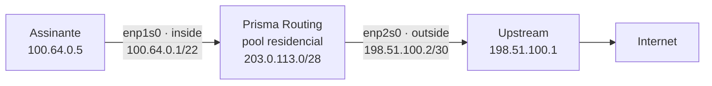
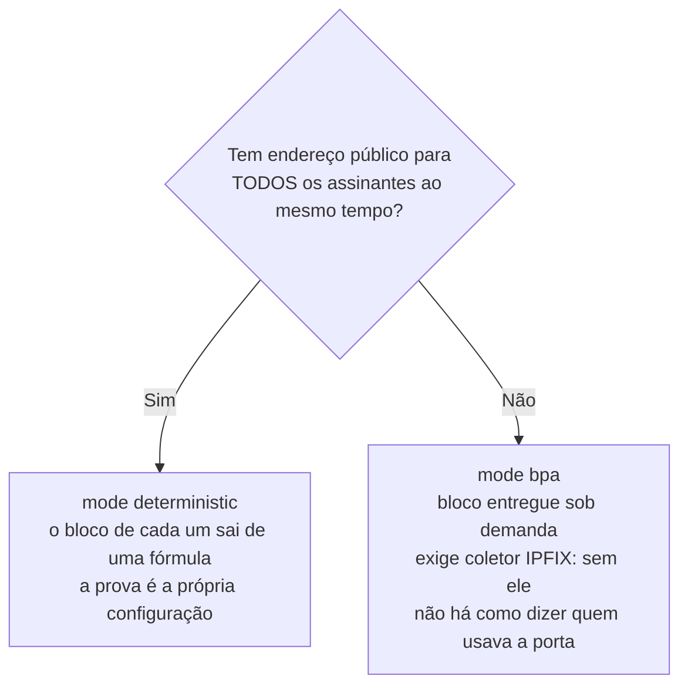

# Configurar o CGNAT passo a passo

Da caixa instalada até o primeiro assinante navegando traduzido, numa ordem que dá para seguir no console. Cada passo traz o que digitar, o que a caixa responde e como saber que deu certo antes de ir para o próximo. As telas desta página foram tiradas de uma caixa rodando esta versão, com um assinante de verdade atrás dela.

O exemplo usa uma topologia pequena, que você troca pelos seus números:



| O quê | No exemplo | No seu caso |
|-------|------------|-------------|
| Rede dos assinantes (atrás da caixa) | `100.64.0.0/22` | o que o seu BNG/OLT entrega; `100.64.0.0/10` é o espaço reservado para isso |
| Endereços públicos do pool | `203.0.113.0/28` | um prefixo seu, que **não** está configurado em interface nenhuma |
| Porta dos assinantes | `enp1s0`   | a placa virada para o BNG |
| Porta de saída | `enp2s0`, com `198.51.100.2/30` | a placa virada para o upstream |

# Antes de começar: três decisões

**1. Determinístico ou dinâmico.** É a decisão que muda o que você deve à justiça depois.



**2. Quantas portas cada assinante ganha** (`block-size`, potência de dois). 512 é um bom começo para residencial. Menos que isso enche com um console de jogo e uma TV ligados. Mais que isso gasta endereço público.

**3. Quantos endereços públicos você precisa.** No determinístico, cada endereço público atende `portas ÷ block-size` assinantes. Com `ports 1024 65535` são 64.512 portas: blocos de 512 dão **126 assinantes por endereço público**. O `/28` do exemplo tem 16 endereços, então comporta 2.016 assinantes, e a rede interna de `/22` tem 1.024. Sobra.

| Assinantes | block-size | Endereços públicos | Prefixo |
|------------|------------|--------------------|---------|
| 1\.000     | 512        | 8                  | `/29`   |
| 10\.000    | 512        | 80                 | `/25`   |
| 200\.000   | 512        | 1\.588             | `/21`   |


:::warning
**A interface de gerência nunca entra no CGNAT**, nem como `inside` nem como `outside`. Se você administra a caixa pela rede, anote agora por qual placa, e não a use em nenhum passo desta página.

:::

# 1. Veja as placas que o dataplane tem

```
prisma> show interface terse
```

```
  Interface                  Admin  Link   Proto  Local
  enp1s0                     down   up     -      -
  enp2s0                     down   up     -      -

  2 interface(s) on the dataplane can forward
```

`Link up` é o cabo conectado. `Admin down` é só porque ninguém configurou a porta ainda. O próximo passo resolve isso.

# 2. Enderece as duas portas e a rota de saída

```
prisma> configure
prisma# [edit] interface enp1s0
prisma# [edit interface enp1s0] description assinantes
prisma# [edit interface enp1s0] ipv4 address 100.64.0.1/22
prisma# [edit interface enp1s0] no shutdown
prisma# [edit interface enp1s0] exit
prisma# [edit] interface enp2s0
prisma# [edit interface enp2s0] description upstream
prisma# [edit interface enp2s0] ipv4 address 198.51.100.2/30
prisma# [edit interface enp2s0] no shutdown
prisma# [edit interface enp2s0] exit
prisma# [edit] router static
prisma# [edit router static] 0.0.0.0/0 next-hop 198.51.100.1 description upstream
prisma# [edit router static] exit
prisma# [edit] commit
```

| Linha | Para quê |
|-------|----------|
| `ipv4 address 100.64.0.1/22` em `enp1s0` | é o gateway que os assinantes usam |
| `ipv4 address 198.51.100.2/30` em `enp2s0` | o enlace com o upstream |
| `0.0.0.0/0 next-hop 198.51.100.1` | a rota default: por onde o tráfego traduzido sai |

Se os assinantes **não** estão numa rede diretamente conectada, e sim atrás de um BNG que fala com a caixa por um enlace, acrescente também a rota de volta para eles, no mesmo bloco: `100.64.0.0/10 next-hop <endereço-do-BNG>`.

**Confira antes de seguir:**

```
prisma# [edit] exit
prisma> show interface terse
```

```
  Interface                  Admin  Link   Proto  Local
  enp1s0                     up     up     inet   100.64.0.1/22
  enp2s0                     up     up     inet   198.51.100.2/30

  2 interface(s) on the dataplane can forward
```

E o upstream responde:

```
prisma> ping 198.51.100.1 count 2
```

```
2 packets transmitted, 2 received, 0% packet loss, time 1001ms
```

Se o ping não volta, pare aqui: o CGNAT não tem como funcionar sobre um enlace que não funciona.

# 3. Crie o pool

Toda a configuração de CGNAT fica dentro de `nat` e, dentro dele, de `cgnat`. Entre nos dois níveis e crie o pool:

```
prisma> configure
prisma# [edit] nat
prisma# [edit nat] cgnat
prisma# [edit nat / cgnat] pool residencial
prisma# [edit nat / cgnat / pool residencial] prefix-inside 100.64.0.0/22
prisma# [edit nat / cgnat / pool residencial] prefix-outside 203.0.113.0/28
prisma# [edit nat / cgnat / pool residencial] block-size 512
prisma# [edit nat / cgnat / pool residencial] ports 1024 65535
prisma# [edit nat / cgnat / pool residencial] policy interleaved
prisma# [edit nat / cgnat / pool residencial] mode deterministic
prisma# [edit nat / cgnat / pool residencial] tcp-mss auto
prisma# [edit nat / cgnat / pool residencial] exit
```

O `exit` do pool volta para `cgnat`, que é onde o próximo passo continua. O prompt mostra sempre em que nível você está, `top` volta direto para `[edit]`, e `commit` funciona de dentro do pool também, se você quiser aplicar antes de sair dele.

| Linha | O que decide |
|-------|--------------|
| `prefix-inside` | quem é traduzido: os endereços dos assinantes |
| `prefix-outside` | com quais endereços públicos eles saem |
| `block-size 512` | quantas portas cada assinante ganha |
| `ports 1024 65535` | a faixa usável de cada endereço público; abaixo de 1024 ficam as portas de serviço |
| `policy interleaved` | assinantes vizinhos saem por endereços públicos **diferentes**, o que dilui um bloqueio de reputação num IP só |
| `mode deterministic` | o bloco de cada um sai de uma fórmula, sem registro de alocação |
| `tcp-mss auto` | evita conexões que abrem e travam sem erro nenhum quando há túnel ou PPPoE no caminho |

Não lembra o que vem depois? **TAB** completa e `?` lista o que vale naquele ponto, com descrição.

# 4. Diga qual porta é de dentro e qual é de fora

O lado do CGNAT é uma propriedade da interface, e se digita no bloco dela:

```
prisma# [edit nat / cgnat] top
prisma# [edit] interface enp1s0
prisma# [edit interface enp1s0] cgnat inside
prisma# [edit interface enp1s0] exit
prisma# [edit] interface enp2s0
prisma# [edit interface enp2s0] cgnat outside
prisma# [edit interface enp2s0] exit
```

`inside` é a porta por onde os assinantes chegam. `outside` é a porta por onde o tráfego traduzido sai.

# 5. Confira o que vai mudar, antes de mudar

```
prisma# [edit] show configuration compare
```

```
+nat
+ cgnat
+  pool residencial
+   prefix-inside 100.64.0.0/22
+   prefix-outside 203.0.113.0/28
+   block-size 512
+   ports 1024 65535
+   policy interleaved
+   mode deterministic
+   tcp-mss auto
+   exit
+  exit
+ exit
 interface enp1s0
  ipv4 address 100.64.0.1/22
+ cgnat inside
  exit
```

E, mais abaixo, a mesma linha `+ cgnat outside` no bloco da `enp2s0`.

Tudo com `+` é o que entra. Depois peça à caixa para validar, sem aplicar nada:

```
prisma# [edit] commit check
```

```
configuration check succeeds for CGNAT and the box's own configuration
  routing statements are checked for structure only; FRR validates them at
  commit, and can still refuse one
```

A segunda linha aparece porque a rota default do passo 2 é configuração de roteamento: a VTY confere a forma dela, e quem a valida de fato é o roteamento, no `commit`.

O `commit check` recusa aqui o que não daria certo, e diz por quê. A recusa que mais aparece num pool novo é a de um endereço público que também está numa interface da caixa:

```
error: pool 'errado': public address 198.51.100.2 is configured on enp2s0
    interface enp2s0 / ipv4 address 198.51.100.2/30
    nat / cgnat / pool errado / prefix-outside 198.51.100.0/30
    cgnat would translate the box's own control-plane traffic on that address:
    bpa-out2in runs before the box decides a packet is for itself, so the BGP
    session or OSPF adjacency on it drops for no apparent reason
    take the address off the interface, or narrow the pool's public range so
    that it does not contain it
```

Ela existe porque o CGNAT olha o pacote antes de a caixa decidir se ele é para ela mesma: um endereço de enlace dentro do pool faz a sessão BGP daquele enlace cair sem motivo aparente. Corrija o `prefix-outside` para um prefixo que não esteja em interface nenhuma.

# 6. Aplique

```
prisma# [edit] commit comment "pool residencial inicial"
```

```
commit complete
```

O comentário fica na trilha de configuração, junto com a definição do pool, e é o que você vai ler daqui a um ano, quando alguém perguntar desde quando o mapeamento é esse.


:::info
**Mexendo de longe?** `commit confirmed 5` aplica agora e desfaz sozinho em cinco minutos se você não digitar `commit` de novo. Se a mudança cortar o seu acesso, a caixa volta ao que era.

:::

# 7. Faça a internet saber voltar para o pool

O tráfego sai com origem `203.0.113.x`. Para a resposta voltar, a internet precisa saber que `203.0.113.0/28` é alcançado por esta caixa. Há dois jeitos:

| Jeito | Quando usar |
|-------|-------------|
| O upstream aponta uma rota estática para o pool, com próximo salto `198.51.100.2` | enlace com um provedor só, que aceita configurar a rota |
| A própria caixa anuncia o prefixo em BGP | o jeito normal num ISP com AS próprio |

Para anunciar daqui, o prefixo precisa existir na tabela de rotas (a rota `blackhole` faz isso) e ser declarado no BGP:

```
configure
 router static
  203.0.113.0/28 next-hop blackhole description pool residencial
  exit
 router bgp 65000
  bgp router-id 198.51.100.2
  neighbor 198.51.100.1 remote-as 64500
  neighbor 198.51.100.1 maximum-prefix 10000
  address-family ipv4 unicast
   network 203.0.113.0/28
  exit-address-family
  exit
 commit
```

Do `router bgp` para dentro a sintaxe é a do roteamento (FRR), e a VTY entrega essas linhas a ele como foram digitadas.

A rota `blackhole` não prende tráfego nenhum de assinante: o CGNAT trata o pacote antes da consulta de rota. Ela só dá ao BGP algo para anunciar.

Se você esquecer esta parte e a caixa tiver BGP, o `commit check` avisa, e o aviso já traz as duas linhas que resolvem:

```
warning: pool 'dinamico': nothing here announces 203.0.113.16/28
    subscribers behind it would be translated to an address the internet cannot route back to
    announce it from another box, or originate it here with
    'ip route 203.0.113.16/28 blackhole' and 'network 203.0.113.16/28' under the BGP address family
```

A linha `ip route ... blackhole` que o aviso sugere também é aceita, digitada fora de qualquer bloco: ela vira a mesma rota de `router static`. Esse aviso não recusa o commit, porque anunciar o pool por outro equipamento é um desenho válido.

Sem o `maximum-prefix`, o `commit` também avisa, e com razão: um vizinho que vaze a tabela inteira enche a memória da caixa.

```
warning: this eBGP session has no 'maximum-prefix': a peer that leaks a full
    table fills this box and nothing here stops it. 'neighbor 198.51.100.1
    maximum-prefix 10000' tears the session down instead of the box
    neighbor 198.51.100.1 remote-as 64500
```

# 8. Grave

```
prisma# [edit] exit
prisma> save
```

```
configuration saved to /etc/prisma-routing/prisma-routing.conf
```

`commit` faz valer agora. `save` grava em disco. Sem o `save`, tudo desta página some no próximo boot.

# 9. Só no modo dinâmico: o coletor IPFIX

No modo dinâmico a caixa decide na hora qual bloco cada assinante recebe, e a única prova de quem tinha qual porta é o registro exportado. **Sem coletor, um pedido judicial fica sem resposta.** Configure antes de pôr assinantes no pool:

```
prisma> configure
prisma# [edit] nat
prisma# [edit nat] cgnat
prisma# [edit nat / cgnat] logging udp <ip-do-coletor> src 198.51.100.2
prisma# [edit nat / cgnat] logging enable
prisma# [edit nat / cgnat] commit
```

`src` é obrigatório, e `enable` sem destino é recusado. Para não perder registro quando o coletor cai, existe também o transporte TCP (`logging tcp <ip-do-coletor>`, também dentro de `cgnat`), e para um coletor que só entende syslog, `logging syslog <ip-do-coletor> enterprise <n>`. [Logging IPFIX e trilha de auditoria](/s/wiki/doc/logging-ipfix-e-trilha-de-auditoria-lREEjJu1Bq) explica a diferença entre os três.

Se você esquecer, o `commit` **não** avisa: um pool `bpa` sem exportação é aceito em silêncio, porque um pool montado antes de o coletor existir é uma configuração válida. Quem diz se a caixa está exportando é `show cgnat logging` e o autoteste de boot, que avisa quando um pool roda em modo `bpa` e nada está sendo exportado.

No modo determinístico este passo é opcional: a fórmula responde sozinha, como mostra o último passo. A exceção é um pool determinístico com `reserve`, porque os blocos da reserva ficam fora da fórmula e também precisam do coletor.

# 10. Confira com um assinante de verdade

**O pool:**

```
prisma> show cgnat pool
```

```
pool residencial [deterministic / interleaved]
  inside       100.64.0.0+1024 (1024 addresses, 1 range(s))
  outside      203.0.113.0+16 (16 addresses, 1 range(s))
  ports        1024-65535 (64512 per IP)
  block        512 ports -> 126 blocks per public IP
  sharing      126:1
  per sub      512 ports (one block)
  capacity     2016 subscribers (usable 1024)
```

`capacity` é quantos assinantes os endereços públicos comportam, e `usable` é quantos o `prefix-inside` tem. Se `usable` for maior que `capacity`, faltam endereços públicos.

**Um assinante, antes de ele navegar.** No determinístico a caixa já sabe o endereço e as portas dele:

```
prisma> show cgnat subscriber 100.64.0.5
```

```
subscriber 100.64.0.5   pool residencial, index 5, worker thread 0
  the formula gives it 203.0.113.5 ports 1024-1535
  no live state: this subscriber holds no block and has no sessions on this box
```

**O mesmo assinante, depois de abrir uma página:**

```
subscriber 100.64.0.5   pool residencial, index 5, worker thread 0
  the formula gives it 203.0.113.5 ports 1024-1535
  block 0  203.0.113.5  ports 1024-1535   3 of 512 in use (0%), 509 free
  sessions 3   refusals: ports 0, session cap 0, rate cap 0
```

`3 of 512 in use` são as conexões dele naquele momento. `refusals` em zero quer dizer que nada dele foi recusado por falta de porta.

O tráfego do assinante para a **própria caixa** — o `ping` para o gateway `100.64.0.1`, um `ssh` ou uma consulta DNS a ela — não é traduzido nem abre sessão: ele chega à caixa com o endereço do assinante, e `show cgnat drops` o conta em `everything else it counted`, na linha `packets to this box itself, left untranslated`: não é perda.

**Quem está mais perto de encher o bloco**, e **o que não passou**:

```
prisma> show cgnat top
```

```
subscriber       pool               ports  full  blocks  refusals
100.64.0.5       residencial      3/512      0%       1         0
1 subscriber(s) holding blocks
```

```
prisma> show cgnat drops
```

```
bpa-in2out
  nothing dropped
  everything else it counted
            14  packets translated
             3  sessions created
```

**A pergunta de um ofício ou de uma denúncia de abuso**: quem estava atrás de um endereço público e de uma porta:

```
prisma> show cgnat translation 203.0.113.5 1029
```

```
203.0.113.5:1029  ->  100.64.0.5
  pool residencial, block 5, DETERMINISTIC
  from the FORMULA. It holds for any instant, past or present, as long as this pool's addresses and block size have not changed since. No allocation record is involved.
```

No determinístico essa resposta vale para qualquer momento, passado ou presente, enquanto os endereços e o `block-size` do pool não mudarem. É por isso que mudar o mapeamento de um pool em uso não é trivial.


:::warning
**Mudar** `**prefix-inside**`**,** `**prefix-outside**`**,** `**block-size**`**,** `**ports**`**,** `**policy**` **ou** `**mode**` **num pool em uso muda o endereço e as portas de quase todo mundo, e derruba todas as sessões do pool.** A caixa não deixa isso acontecer por engano: o `commit` recusa, diz quantos assinantes mudam e pede que você confirme pelo nome.

```
error: this change re-maps subscribers that already have mappings
    1008 of 1024 subscribers change public address or port block; 0 hold live
    state right now
```

Para crescer sem derrubar ninguém, o caminho é um **segundo pool**. Ver [Ampliar capacidade sem derrubar assinantes](/s/wiki/doc/ampliar-capacidade-sem-derrubar-assinantes-rWQkaj9r1u).

:::

# Como conferir

Antes de considerar o CGNAT pronto:

- [ ] `show interface terse` mostra as duas portas `up up`, com os endereços certos
- [ ] o upstream responde ao `ping`
- [ ] `commit check` passa sem erro, e sem o aviso de prefixo não anunciado (ou você sabe quem anuncia)
- [ ] a porta de gerência **não** aparece como `interface` dentro de `nat` > `cgnat`
- [ ] `show cgnat pool` mostra `usable` menor ou igual a `capacity`
- [ ] `show cgnat subscriber <ip-de-teste>` mostra bloco e sessões depois que o assinante navega
- [ ] `show cgnat translation <ip-público> <porta>` devolve o assinante
- [ ] no modo dinâmico: `show cgnat logging` diz `state enabled` e o coletor está recebendo
- [ ] `save` foi executado


:::success
Com todos os itens marcados, o assinante sai pela internet com o endereço público do pool, e qualquer porta usada por ele pode ser rastreada até ele.

:::

# Ver também

* [Configuração de pool](/s/wiki/doc/configuracao-de-pool-btyS572Ih6) — cada campo do pool, campo a campo
* [Configuração de CGNAT](/s/wiki/doc/configuracao-de-cgnat-EIWRFS6OnJ) — interfaces, timeouts globais e logging
* [Receitas do dia a dia](/s/wiki/doc/receitas-do-dia-a-dia-IcocgdbXW2) — abrir porta, limitar um assinante, ampliar o pool
* [Operação e diagnóstico](/s/wiki/doc/operacao-e-diagnostico-A4fcKDVwZt) — quando algo não funcionar
