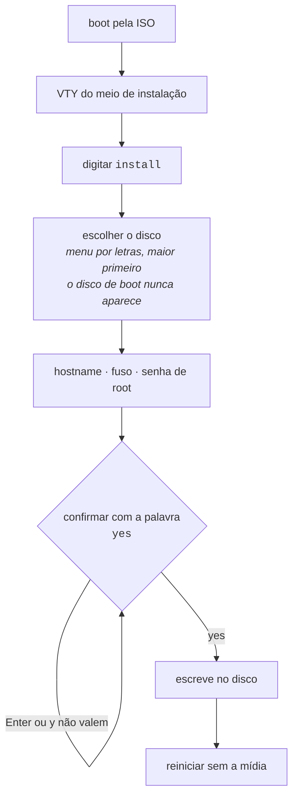

# Instalação da appliance

# Instalação da appliance

A ISO é um **meio de instalação**, não uma appliance para uso direto. Ela dá boot sem credencial nenhuma, roda o produto para inspeção, e oferece um comando que a transforma em uma máquina com dono.




:::info
Nenhum byte é escrito antes de **todas** as respostas estarem coletadas e válidas.

:::

## Instalando

Dê boot pela ISO. O console cai direto na VTY:

```
HexaRouting VTY 0.25.0

This is the installation medium: nothing here survives a reboot.
Type 'install' to install HexaRouting onto a disk.

hexarouting> install
```

O comando `install` existe na VTY **somente quando a máquina está rodando a partir do meio**. Em uma appliance já instalada ele não está na árvore de comandos e o instalador se recusa a rodar — um comando que sobrescreve o disco não deve ficar a um TAB de distância de `interface` num roteador em produção.

## Escolha do disco

Os discos aparecem em lista com letras, **maior primeiro**, com tamanho e modelo. O padrão (Enter) é o maior, porque é o disco que alguém colocou na máquina para segurar o sistema — o pendrive de 32 GB usado no boot não é.

```
Disks on this machine:
  a) /dev/sdb         932G  WD Black 1TB   <- default, the largest
  b) /dev/sda          32G  KINGSTON SA400

Install onto which disk (letter, or a device path) [a]:
```

Duas garantias:

* **O meio de onde o sistema deu boot nunca aparece na lista.** É justamente o disco que alguém com pressa escolhe, e sobrescrevê-lo falha no meio do caminho deixando os dois sistemas inutilizáveis.
* **Um caminho de dispositivo continua sendo aceito.** Scripts têm caminhos e pessoas têm hábitos.

A confirmação repete o disco com tamanho e modelo, e é respondida com a palavra `yes`:

```
  About to ERASE /dev/sdb  932G WD Black 1TB
  Everything on it is lost. This cannot be undone.
  Type 'yes' to install:
```

Enter vazio não é resposta. `y` também não. **Um disco não pode ser destruído segurando a tecla Enter.**

## Tudo é perguntado antes de qualquer escrita

| Pergunta | Recusada quando |
|----------|-----------------|
| Disco alvo | não é dispositivo de bloco, ou é o meio de onde o sistema deu boot |
| Hostname | contém caracteres que um hostname não pode ter |
| Fuso horário | não existe essa zona em `/usr/share/zoneinfo` |
| Senha de root | está vazia, ou as duas digitações não conferem |

Nenhum byte é escrito no disco antes de todas as respostas estarem coletadas e válidas.

## Onde ficam os registros de conexão

O disco é dividido em **três** partições, não duas:

| Partição | Conteúdo |
|----------|----------|
| ESP      | 512 MB   |
| raiz     | o resto, menos os registros |
| `/var/log/hexarouting` | o que o operador pediu |

Em modo dinâmico o log de alocação **é** o registro de conexão que o Marco Civil exige guardar por um ano. No sistema de arquivos raiz ele divide espaço com tudo que a caixa precisa para funcionar — um log que enche para a caixa de escrever a própria configuração, porque ela estava ocupada registrando quem se conectou.

Com sistema de arquivos próprio, um volume de log cheio é um volume de log cheio.

O padrão é conta, não chute, e a conta aparece na tela:

```
  Connection records go on their own filesystem, so that a full log
  cannot stop the box working. One year at 200k subscribers in dynamic
  mode is about 29 GB (see docs/logging.md); deterministic mode logs
  no allocations and needs almost none.
  This disk is 240 GB; at most 231 GB can go to records.
Gigabytes for connection records [30]:
```

**Modo determinístico não registra alocação nenhuma** e precisa de quase nada disso — por isso é uma pergunta e não uma constante. A raiz nunca fica com menos de 8 GB, e um tamanho que a deixaria é recusado com a conta, em vez de aceito e descoberto depois.


:::info
O volume é montado com `nofail`. Uma caixa que não sobe porque o volume de registros sumiu é uma caixa em que ninguém consegue entrar para descobrir por quê — ela sobe e reclama. Por isso o autoteste de boot **informa onde os registros estão**: sem isso, uma caixa cujo volume não montou volta a escrevê-los na raiz em silêncio.

:::

## Instalação não assistida

Para laboratório, teste de boot e PXE, as respostas vêm da linha de comando do kernel:

| Parâmetro | Efeito |
|-----------|--------|
| `hexarouting.install` | pergunta tudo no console |
| `hexarouting.install=/dev/vda` | usa esse disco, ainda perguntando o resto |
| `hexarouting.hostname=<nome>` | responde a pergunta do hostname |
| `hexarouting.timezone=<zona>` | responde a pergunta do fuso |
| `hexarouting.password=<senha>` | responde a pergunta da senha de root |
| `hexarouting.log-gb=<n>` | gigabytes para os registros de conexão |
| `hexarouting.yes` | pula as confirmações e depois **desliga a máquina** |


:::warning
**Atenção com** `**hexarouting.password**`**\*\*\*\*:** a linha de comando do kernel fica legível para todos em `/proc/cmdline` durante toda a vida do sistema que deu boot. Ela não sobrevive para a máquina instalada, mas qualquer um logado no meio durante a instalação consegue lê-la. Para instalação presencial, deixe de fora e responda no prompt.

:::

Com `hexarouting.yes` e sem `hexarouting.log-gb`, o instalador toma o padrão **e diz que tomou**. Uma instalação não assistida não tem console de onde responder, e uma pergunta que ninguém pode responder é uma instalação pendurada.

O desligamento ao final não é conveniência: sem ele a máquina fica num prompt de login até o harness matá-la, e a mensagem de conclusão sai truncada.

# Como conferir

Depois do primeiro boot sem a mídia:

* o console mostra o relatório do self-test, **sem nenhuma linha** `**[FAIL]**`;
* entre elas, `binary API registered, so pools can be configured` — sem ela a caixa roteia e responde, e nenhum pool pode ser criado;
* `show version` responde com a versão do HexaRouting, do VPP e do FRR;
* você consegue entrar com a senha definida durante a instalação.


:::warning
**Não instale com as mídias 0.34.0, 0.35.0 ou 0.36.0.** Duas falhas na mídia, uma escondida atrás da outra:

* a imagem não levava um componente necessário para configurar CGNAT, então a caixa bootava, roteava, respondia e dizia *pronto* — e **nenhum pool podia ser criado**;
* e o serviço que aplica a configuração falhava no primeiro boot de toda instalação, porque o arquivo de configuração padrão — só comentários — era lido como uma mudança que removia o acesso SSH.

Corrigidas na **0.37.0**. Uma caixa já instalada com uma dessas mídias precisa ser reinstalada: o componente que falta não está no disco.

A partir da 0.37.0, a mídia de cada versão é instalada em disco e bootada com a mídia removida antes de ser publicada. Bootar a imagem live prova que a mídia dá boot; não prova que ela produz uma appliance que funciona.

:::


:::success
Self-test **sem** `**[FAIL]**` e `show version` respondendo: a instalação está válida. "Pronto" sozinho não bastava — uma caixa dizia pronto e não configurava CGNAT. O próximo passo é [Primeiros passos](/doc/primeiros-passos-TAWDdSrYG7).

:::

# Ver também

* [Acesso, login e papéis](/doc/acesso-login-e-papeis-VcE7gIbI1U) — onde você cai ao entrar, e quem pode o quê
