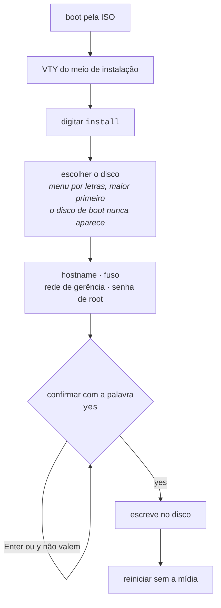

# Instalação da appliance

A ISO é um **meio de instalação**, não uma appliance para uso direto. Ela dá boot sem credencial nenhuma, roda o produto para inspeção, e oferece um comando que a transforma em uma máquina com dono.




:::info
Nenhum byte é escrito antes de **todas** as respostas estarem coletadas e válidas.

:::

## Instalando

Dê boot pela ISO. O console cai direto na VTY:

```
HexaRouting VTY 0.25.0

This is the installation medium: nothing here survives a reboot.
Type 'install' to install HexaRouting onto a disk.

hexarouting> install
```

O comando `install` existe na VTY **somente quando a máquina está rodando a partir do meio**. Em uma appliance já instalada ele não está na árvore de comandos e o instalador se recusa a rodar — um comando que sobrescreve o disco não deve ficar a um TAB de distância de `interface` num roteador em produção.

## Escolha do disco

Os discos aparecem em lista com letras, **maior primeiro**, com tamanho e modelo. O padrão (Enter) é o maior, porque é o disco que alguém colocou na máquina para segurar o sistema — o pendrive de 32 GB usado no boot não é.

```
Disks on this machine:
  a) /dev/sdb         932G  WD Black 1TB   <- default, the largest
  b) /dev/sda          32G  KINGSTON SA400

Install onto which disk (letter, or a device path) [a]:
```

Duas garantias:

* **O meio de onde o sistema deu boot nunca aparece na lista.** É justamente o disco que alguém com pressa escolhe, e sobrescrevê-lo falha no meio do caminho deixando os dois sistemas inutilizáveis.
* **Um caminho de dispositivo continua sendo aceito.** Scripts têm caminhos e pessoas têm hábitos.

A confirmação repete o disco com tamanho e modelo, e é respondida com a palavra `yes`:

```
  About to ERASE /dev/sdb  932G WD Black 1TB
  Everything on it is lost. This cannot be undone.
  Type 'yes' to install:
```

Enter vazio não é resposta. `y` também não. **Um disco não pode ser destruído segurando a tecla Enter.**

## Rede de gerência

**Uma appliance que não pode ser alcançada depois de reiniciar não é uma appliance.** Até a 0.72.0 o instalador não escrevia nada em `/etc/network`: a placa subia `DOWN`, sem endereço, e a caixa só existia pelo console. O que o operador digitava lá não sobrevivia ao próximo boot.

O instalador pergunta, junto com as outras perguntas e antes de qualquer escrita, **em qual placa** a caixa é gerenciada e **como ela é endereçada**:

```
  This box is reached over the network AFTER it reboots, and nothing
  else arranges that. An install with no answer here comes back with
  its card down and no address, reachable only at this console - and
  what is typed at a console does not survive the next reboot.

Network cards on this machine:
  a) ens18      up     virtio_net   10.95.200.196/24   <- default
  b) ens19      down   virtio_net   none
  none) no management network   (this box is reached at its console)

Which card is this box managed on (letter, or a name) [ens18]:
Address: 'dhcp', or one like 10.0.0.2/24 [dhcp]:
```

A lista mostra **o que cada placa é** - se está no ar, qual driver a move, qual endereço ela está carregando neste minuto - porque `ens18` e `ens19` não dizem a ninguém qual cabo está em qual. O padrão é a placa pela qual a própria mídia está alcançando a rede agora.


:::info
**O padrão do endereço é** `**dhcp**`**.** Uma máquina virtual em rede de laboratório tem servidor DHCP e nenhum endereço reservado; uma appliance no rack tem endereço reservado e muitas vezes nenhum DHCP. Só um dos dois pode ser o padrão, e é o primeiro: quem aperta Enter precisa receber uma caixa que funciona. Quem está montando o rack já tem o endereço anotado na frente e digita - é uma resposta nos dois casos.

O preço está dito: uma caixa que responde `dhcp` onde ninguém responde espera o cliente desistir antes de terminar o boot, e depois **diz no console** que está sem endereço.

:::

Com endereço estático, o instalador ainda pergunta o gateway e os servidores DNS. **Um gateway fora da sub-rede do endereço é recusado na hora**, por aritmética: o `ifup` recusa essa rota quando a interface sobe e segue em frente, então a caixa subiria com endereço, sem rota padrão, alcançável a partir da própria sub-rede e de mais lugar nenhum. De longe isso é indistinguível de uma caixa que não bootou.

`none` também é resposta, e é **gravada**. Sem o arquivo, uma caixa cujo operador escolheu não ter rede de gerência e uma caixa instalada por uma mídia que nunca perguntou são a mesma caixa no disco - e uma das duas precisa ser gritada em todo boot enquanto a outra não.

### O que a caixa diz depois

O autoteste de boot lê **o mesmo arquivo** de volta em todo boot e conta o que aconteceu com ele:

| Linha no autoteste | Significado |
|--------------------|-------------|
| `[ ok ] managed on ens18 (dhcp)` | com o endereço e a rota impressos embaixo |
| `[warn] ens18 is up with no default route` | tem endereço, não tem rota padrão, e nenhum gateway foi pedido |
| `[FAIL] ... has an address and no default route` | **o gateway respondido não valeu.** A linha nomeia o gateway que não entrou |
| `[FAIL] ... has no address` | DHCP sem resposta, ou o `ifup` falhou |
| `[FAIL] this box has no card called ens18` | a placa da instalação não está mais na caixa. Lista as que estão |
| `[FAIL] no management network: nothing was ever written for one` | mídia até a 0.72.0. A linha traz os comandos que resolvem a partir daquele console |
| `[info] no management network was asked for at install time` | respondeu `none` |


:::success
**O endereço é impresso em todo boot**, e é metade do motivo de o DHCP poder ser o padrão: uma caixa cujo endereço ninguém escolheu ainda diz, para quem está de pé na frente do console serial, para onde dar `ssh`.

:::

## Tudo é perguntado antes de qualquer escrita

| Pergunta | Recusada quando |
|----------|-----------------|
| Disco alvo | não é dispositivo de bloco, ou é o meio de onde o sistema deu boot |
| Hostname | contém caracteres que um hostname não pode ter |
| Fuso horário | não existe essa zona em `/usr/share/zoneinfo` |
| Placa de gerência | esta máquina não tem placa com esse nome |
| Endereço de gerência | não é `dhcp`, não é `none` e não é endereço com prefixo entre 1 e 32 |
| Gateway | não é endereço, não está na sub-rede do endereço, ou veio junto com `dhcp` |
| Senha de root | está vazia, ou as duas digitações não conferem |

Nenhum byte é escrito no disco antes de todas as respostas estarem coletadas e válidas.

## Onde ficam os registros de conexão

O disco é dividido em **três** partições, não duas:

| Partição | Conteúdo |
|----------|----------|
| ESP      | 512 MB   |
| raiz     | o resto, menos os registros |
| `/var/log/hexarouting` | o que o operador pediu |

Em modo dinâmico o log de alocação **é** o registro de conexão que o Marco Civil exige guardar por um ano. No sistema de arquivos raiz ele divide espaço com tudo que a caixa precisa para funcionar — um log que enche para a caixa de escrever a própria configuração, porque ela estava ocupada registrando quem se conectou.

Com sistema de arquivos próprio, um volume de log cheio é um volume de log cheio.

O padrão é conta, não chute, e a conta aparece na tela:

```
  Connection records go on their own filesystem, so that a full log
  cannot stop the box working. One year at 200k subscribers in dynamic
  mode is about 29 GB (see docs/logging.md); deterministic mode logs
  no allocations and needs almost none.
  This disk is 240 GB; at most 231 GB can go to records.
Gigabytes for connection records [30]:
```

**Modo determinístico não registra alocação nenhuma** e precisa de quase nada disso — por isso é uma pergunta e não uma constante. A raiz nunca fica com menos de 8 GB, e um tamanho que a deixaria é recusado com a conta, em vez de aceito e descoberto depois.


:::info
O volume é montado com `nofail`. Uma caixa que não sobe porque o volume de registros sumiu é uma caixa em que ninguém consegue entrar para descobrir por quê — ela sobe e reclama. Por isso o autoteste de boot **informa onde os registros estão**: sem isso, uma caixa cujo volume não montou volta a escrevê-los na raiz em silêncio.

:::

## Espelho dos registros em dois discos

Com um disco só, uma única falha de hardware numa caixa sob obrigação de guarda de um ano perde **os registros**. Isso não é a mesma coisa que ficar fora do ar: indisponibilidade acaba com uma reinstalação, e a perda dos registros não acaba - a caixa continua respondendo por um ano de dados que nenhum procedimento traz de volta.

Por isso, quando a máquina tem um segundo disco, o instalador pergunta:

```
  This machine has another disk. The connection records can be kept on
  BOTH, so that one disk failing does not take the year of records with
  it - which is a loss no reinstall undoes.
  The system is NOT mirrored: a dead system disk is a reinstall, and
  the records on the survivor can still be read on another machine.
  EVERYTHING ON THE DISK YOU CHOOSE IS DESTROYED.
  a) /dev/sdc         932G  WD Black 1TB
  none) one disk, no mirror   <- default

Mirror the connection records onto which disk [none]:
```


:::info
**O padrão é** `**none**`**, e Enter vazio aceita o padrão.** Um segundo disco dentro da máquina não é autorização para destruir o que há nele. A confirmação final repete **os dois** discos, porque os dois são apagados pelo mesmo `yes`.

:::

**São espelhados os registros, e não o sistema.** A assimetria é a razão de existir do espelho, e os dois lados dela foram medidos numa caixa instalada e depois ligada com aquele disco fora:

| Morre o disco | O que foi observado |
|---------------|---------------------|
| do espelho | a caixa sobe normalmente, os registros continuam montados no arranjo rodando com uma perna só, o que foi gravado antes da falha continua lá, e o autoteste diz `[FAIL] the records mirror is DEGRADED: 1 of 2 disks` sem ninguém logado |
| do sistema | a máquina não chega a carregar nada: fica no firmware. É reinstalação. **Os registros do disco sobrevivente foram lidos em outra máquina**, com aquela caixa desligada |

Uma caixa com **um disco só** não é perguntada, não ganha arranjo nenhum e o autoteste dela não fala em espelho. Nada muda para quem tem um disco.

O segundo disco é recusado quando é o disco alvo, quando é a mídia de boot, quando é uma partição em vez de um disco inteiro, ou quando é menor que o tamanho pedido para os registros - um espelho tem o tamanho do menor disco dele.

### O que a caixa diz depois

O autoteste de boot informa o estado do espelho em **todo** boot. Um espelho que ninguém acompanha vira, em silêncio, um disco só - e depois nenhum.

| Linha no autoteste | Significado |
|--------------------|-------------|
| `[ ok ] records mirrored on 2 disks (...)` | os dois discos, em dia |
| `[ ok ] ... synchronising 20.0%` | os dois discos, ainda copiando. Já está protegido |
| `[warn] the records mirror is REBUILDING` | disco trocado, cópia em andamento |
| `[FAIL] the records mirror is DEGRADED` | **um disco morreu.** A próxima falha perde o ano |
| `[FAIL] ... installed with a records mirror and is not using it` | a caixa foi instalada com espelho e não está usando nenhum |

Logo depois da instalação o espelho ainda está sincronizando, em segundo plano. A caixa já pode ser usada: a gravação vai para os dois discos desde o primeiro instante.

## Instalação não assistida

Para laboratório, teste de boot e PXE, as respostas vêm da linha de comando do kernel:

| Parâmetro | Efeito |
|-----------|--------|
| `hexarouting.install` | pergunta tudo no console |
| `hexarouting.install=/dev/vda` | usa esse disco, ainda perguntando o resto |
| `hexarouting.hostname=<nome>` | responde a pergunta do hostname |
| `hexarouting.timezone=<zona>` | responde a pergunta do fuso |
| `hexarouting.password=<senha>` | responde a pergunta da senha de root |
| `hexarouting.log-gb=<n>` | gigabytes para os registros de conexão |
| `hexarouting.mirror=<disco>` | espelha os registros nesse segundo disco |
| `hexarouting.mgmt-interface=<placa>` | placa pela qual a caixa é gerenciada |
| `hexarouting.mgmt-address=<a>` | `dhcp`, `a.b.c.d/nn`, ou `none` |
| `hexarouting.mgmt-gateway=<ip>` | só com endereço estático |
| `hexarouting.mgmt-dns=<ip>[,<ip>]` | só com endereço estático |
| `hexarouting.yes` | pula as confirmações e depois **desliga a máquina** |


:::warning
**Atenção com** `**hexarouting.password**`**\*\*\*\*:** a linha de comando do kernel fica legível para todos em `/proc/cmdline` durante toda a vida do sistema que deu boot. Ela não sobrevive para a máquina instalada, mas qualquer um logado no meio durante a instalação consegue lê-la. Para instalação presencial, deixe de fora e responda no prompt.

:::

Com `hexarouting.yes` e sem `hexarouting.log-gb`, o instalador toma o padrão **e diz que tomou**. Uma instalação não assistida não tem console de onde responder, e uma pergunta que ninguém pode responder é uma instalação pendurada.

O desligamento ao final não é conveniência: sem ele a máquina fica num prompt de login até o harness matá-la, e a mensagem de conclusão sai truncada.

# Como conferir

Depois do primeiro boot sem a mídia:

* o console mostra o relatório do self-test, **sem nenhuma linha** `**[FAIL]**`;
* entre elas, `binary API registered, so pools can be configured` — sem ela a caixa roteia e responde, e nenhum pool pode ser criado;
* uma linha `managed on <placa>` com o endereço embaixo dela - é por ali que você chega na caixa sem voltar ao console;
* `show version` responde com a versão do HexaRouting, do VPP e do FRR;
* você consegue entrar com a senha definida durante a instalação.


:::warning
**Não instale com as mídias 0.34.0, 0.35.0 ou 0.36.0.** Duas falhas na mídia, uma escondida atrás da outra:

* a imagem não levava um componente necessário para configurar CGNAT, então a caixa bootava, roteava, respondia e dizia *pronto* — e **nenhum pool podia ser criado**;
* e o serviço que aplica a configuração falhava no primeiro boot de toda instalação, porque o arquivo de configuração padrão — só comentários — era lido como uma mudança que removia o acesso SSH.

Corrigidas na **0.37.0**. Uma caixa já instalada com uma dessas mídias precisa ser reinstalada: o componente que falta não está no disco.

A partir da 0.37.0, a mídia de cada versão é instalada em disco e bootada com a mídia removida antes de ser publicada. Bootar a imagem live prova que a mídia dá boot; não prova que ela produz uma appliance que funciona.

:::


:::success
Self-test **sem** `**[FAIL]**` e `show version` respondendo: a instalação está válida. "Pronto" sozinho não bastava — uma caixa dizia pronto e não configurava CGNAT. O próximo passo é [Primeiros passos](/doc/primeiros-passos-TAWDdSrYG7).

:::

# Ver também

* [Acesso, login e papéis](/doc/acesso-login-e-papeis-VcE7gIbI1U) — onde você cai ao entrar, e quem pode o quê
