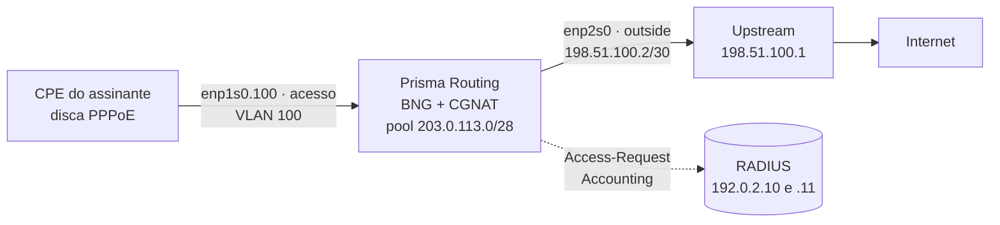

# Pôr assinantes PPPoE no ar, passo a passo

Da porta de acesso até o primeiro assinante discando, autenticado no seu RADIUS, com plano de banda e saindo pelo CGNAT, com o Prisma Routing fazendo o papel de BNG. É para quem vai pôr a caixa no lugar do concentrador PPPoE e quer uma ordem que dá para seguir no console. Cada declaração tem a sua linha em [Configuração de PPPoE](/s/wiki/doc/configuracao-de-pppoe-bfl7lzpl2O); aqui está só o caminho, na ordem em que se faz.

O exemplo usa uma topologia pequena, que você troca pelos seus números:



| O quê | No exemplo | No seu caso |
|-------|------------|-------------|
| Porta de acesso | `enp1s0`, VLAN 100 (`enp1s0.100`) | a placa virada para a OLT ou para o switch de acesso |
| Porta de saída | `enp2s0`, com `198.51.100.2/30` | a placa virada para o upstream |
| Endereço da caixa em cada sessão | `100.64.0.1` | um endereço da faixa dos assinantes |
| Endereços das sessões | `100.64.0.10` a `100.64.3.250` | o que o RADIUS não entregar sai daqui |
| Pool do CGNAT | `100.64.0.0/22` para `203.0.113.0/28` | um `prefix-inside` que cubra os endereços das sessões |
| Servidores RADIUS | `192.0.2.10` e `192.0.2.11` | os seus |
| IPv6 (opcional) | WAN de `2001:db8:100::/40`, delegado de `2001:db8:200::/36` | prefixos seus |

# Antes de começar

**Quem pode.** Os blocos `pppoe` e `aaa` são configuração da caixa inteira, não só de CGNAT: só uma conta `prisma-admin` (ou `root`) os altera. Ver [Acesso, login e papéis](/s/wiki/doc/acesso-login-e-papeis-VcE7gIbI1U).

**O que o RADIUS precisa ter.** A caixa cadastrada como cliente (NAS), com o segredo compartilhado que você vai digitar no passo 3, e os usuários com as senhas. O endereço de cada assinante pode vir do RADIUS (`Framed-IP-Address`) ou do pool da caixa; os dois convivem.

**Uma limitação de desenho.** Todas as interfaces de acesso ficam na mesma placa física: quantas VLANs dela você quiser, uma tag cada. QinQ (duas tags) e alta disponibilidade das sessões não existem nesta versão.


:::warning
**Toda mudança no bloco** `**pppoe**` **derruba todas as sessões PPPoE**: o plano de controle reinicia e os CPEs discam de novo. Numa caixa já em produção, faça as mudanças do bloco `pppoe` numa janela. Mudanças só em `aaa` > `radius` (um servidor a mais, outro modo, outro tempo) não derrubam ninguém, exceto o primeiro servidor configurado e o `dynamic-authorization`, que também reiniciam.

:::

# 1. Prepare a porta de acesso e a VLAN

A porta de acesso não precisa de endereço IP: os assinantes falam PPPoE com ela, não IP. Ela só precisa estar ligada e, se os assinantes chegam marcados, ter a sub-interface com a tag:

```
prisma> configure
prisma# [edit] interface enp1s0
prisma# [edit interface enp1s0] description acesso-olt
prisma# [edit interface enp1s0] no shutdown
prisma# [edit interface enp1s0] exit
prisma# [edit] interface enp1s0.100
prisma# [edit interface enp1s0.100] vlan 100
prisma# [edit interface enp1s0.100] exit
```

| Linha | Para quê |
|-------|----------|
| `no shutdown` em `enp1s0` | liga a placa; a sub-interface sobe junto com ela |
| `interface enp1s0.100` | digitar um nome novo no formato `<pai>.<tag>` cria a sub-interface |
| `vlan 100` | a tag que os CPEs mandam; uma só por sub-interface |

Se os assinantes chegam sem tag, use a própria `enp1s0` como interface de acesso no passo 4 e pule a sub-interface. As duas formas podem conviver na mesma placa. A sub-interface, campo a campo, está em [Configuração de interface](/s/wiki/doc/configuracao-de-interface-j1q58jKWTQ).

# 2. A saída e o pool do CGNAT que vai traduzir as sessões

Cada sessão PPPoE vira uma interface no dataplane, e a caixa a liga ao CGNAT sozinha, assim que a sessão recebe endereço: o endereço da sessão é traduzido pelo pool cujo `prefix-inside` o contém, exatamente como um assinante atrás de uma porta `cgnat inside`. Por isso a porta de acesso **não** leva `cgnat inside`. O que é preciso é a porta de saída e um pool que cubra os endereços que as sessões vão receber:

```
prisma# [edit] interface enp2s0
prisma# [edit interface enp2s0] description upstream
prisma# [edit interface enp2s0] ipv4 address 198.51.100.2/30
prisma# [edit interface enp2s0] cgnat outside
prisma# [edit interface enp2s0] no shutdown
prisma# [edit interface enp2s0] exit
prisma# [edit] router static
prisma# [edit router static] 0.0.0.0/0 next-hop 198.51.100.1 description upstream
prisma# [edit router static] exit
prisma# [edit] nat
prisma# [edit nat] cgnat
prisma# [edit nat / cgnat] pool assinantes-pppoe
prisma# [edit nat / cgnat / pool assinantes-pppoe] prefix-inside 100.64.0.0/22
prisma# [edit nat / cgnat / pool assinantes-pppoe] prefix-outside 203.0.113.0/28
prisma# [edit nat / cgnat / pool assinantes-pppoe] block-size 512
prisma# [edit nat / cgnat / pool assinantes-pppoe] ports 1024 65535
prisma# [edit nat / cgnat / pool assinantes-pppoe] mode deterministic
prisma# [edit nat / cgnat / pool assinantes-pppoe] top
```

O pool é um pool de CGNAT como qualquer outro: a escolha entre determinístico e dinâmico, o tamanho do bloco, o anúncio do prefixo público em BGP e o coletor IPFIX são os de [Configurar o CGNAT passo a passo](/s/wiki/doc/configurar-o-cgnat-passo-a-passo-WMfuk8C8Q7), e valem igual aqui.


:::info
**Um endereço de sessão fora de qualquer** `**prefix-inside**` **não é traduzido.** Nada no `commit` compara o `address-pool` do PPPoE (nem os `Framed-IP-Address` do seu RADIUS) com os pools do CGNAT: confira você que toda faixa que uma sessão pode receber está dentro de um `prefix-inside`.

:::

# 3. Os servidores RADIUS

O RADIUS fica num bloco próprio, `aaa` > `radius`, e não dentro do `pppoe`:

```
prisma# [edit] aaa
prisma# [edit aaa] radius
prisma# [edit aaa / radius] server 192.0.2.10 secret <segredo> priority 1
prisma# [edit aaa / radius] server 192.0.2.11 secret <segredo> priority 2
prisma# [edit aaa / radius] mode failover
prisma# [edit aaa / radius] nas-identifier bng-centro
prisma# [edit aaa / radius] exit
prisma# [edit aaa] exit
```

Cada servidor autentica e recebe contabilização (portas 1812 e 1813) se você não disser outra coisa. Para separar os papéis, `role auth` ou `role acct` no fim da linha do servidor; para outras portas, `auth-port` e `acct-port`. Até oito servidores.

**Failover ou round-robin:**

| `mode` | O que acontece | Quando escolher |
|--------|----------------|-----------------|
| `failover` (o padrão) | todo pedido vai ao servidor de menor `priority`; se ele não responde, o pedido passa ao seguinte e o mudo fica de fora por `dead-time` segundos | um servidor principal e um reserva |
| `round-robin` | cada pedido vai ao próximo servidor ativo, em rodízio | servidores equivalentes, para dividir a carga |

Nos dois modos, a contabilização de uma sessão nunca se divide: o Interim e o Stop vão ao servidor que recebeu o Start dela, enquanto ele responder. E uma sessão nunca cai porque a contabilização ficou sem resposta.

Os tempos (`timeout` 3 s, `retries` 1, `dead-time` 30 s) já são os que fazem um servidor morto custar segundos a **um** assinante e nenhum aos outros. Só mude se tiver motivo.

O segredo nunca aparece numa tela: `show running-config` e `show configuration compare` mostram `<set, not shown>` no lugar dele.

# 4. O bloco `pppoe`

```
prisma# [edit] pppoe
prisma# [edit pppoe] interface enp1s0.100
prisma# [edit pppoe] gateway 100.64.0.1
prisma# [edit pppoe] address-pool 100.64.0.10-100.64.3.250
prisma# [edit pppoe] dns 192.0.2.53
prisma# [edit pppoe] dns 192.0.2.54
prisma# [edit pppoe] tcp-mss 1452
```

| Linha | O que decide |
|-------|--------------|
| `interface enp1s0.100` | onde a caixa atende PPPoE. Pode haver várias, todas da mesma placa. Em qualquer outra interface (o uplink, uma porta `inside`) um PADI é descartado e ninguém responde |
| `gateway 100.64.0.1` | o endereço da caixa em cada sessão. Obrigatório |
| `address-pool ...` | endereços para quem o RADIUS não manda `Framed-IP-Address`; prefixo ou faixa, até 16. Pode faltar se o RADIUS sempre manda o endereço |
| `dns ...` | os resolvedores entregues ao CPE, até 2 |
| `tcp-mss 1452` | limita o MSS do TCP em cada sessão: 1492 de MTU do PPPoE menos 40 de cabeçalhos. Evita conexões que abrem e travam |

O que fica de fora vale o padrão: `mtu` 1492, os três métodos de autenticação (PAP, CHAP, MS-CHAPv2), `session-limit` 16.000 sessões e `ac-name` `prisma-routing`. Se a caixa vai ter mais de 16.000 assinantes, ajuste `session-limit` agora e leia a linha dele na referência: o teto que a caixa aceita depende da RAM dela e só cresce de fato depois de salvar e reiniciar.

# 5. IPv6 nas sessões (opcional)

Sem nenhuma linha `ipv6`, a sessão é só IPv4. Com elas, cada sessão recebe um /64 de WAN por RA (o CPE monta o endereço por SLAAC) e, se o CPE pedir, um prefixo delegado por DHCPv6 para a LAN do cliente:

```
prisma# [edit pppoe] ipv6 prefix-pool 2001:db8:100::/40
prisma# [edit pppoe] ipv6 delegated-pool 2001:db8:200::/36 length 56
prisma# [edit pppoe] ipv6 dns 2001:db8::53
```

| Linha | O que entrega |
|-------|---------------|
| `ipv6 prefix-pool` | o /64 de WAN de cada sessão, quando o RADIUS não manda `Framed-IPv6-Prefix` |
| `ipv6 delegated-pool ... length 56` | um /56 para a LAN de cada cliente, quando o RADIUS não manda `Delegated-IPv6-Prefix` |
| `ipv6 dns` | resolvedores IPv6, no RA e no DHCPv6 |

Se o seu RADIUS entrega os prefixos de todo mundo, `ipv6 enable` liga o IPv6 sem pool nenhum. O IPv6 do assinante é **roteado**, não passa pelo CGNAT: os prefixos dos dois pools precisam ser alcançáveis da internet, anunciados por esta caixa ou por outra, como qualquer rede sua.

# 6. O plano de banda

O plano de cada assinante vem do RADIUS, no Access-Accept. Os atributos próprios do Prisma (fornecedor 67033) são os mais simples:

| Atributo | O que é |
|----------|---------|
| `Prisma-Rate-Limit-Down` | download, em kbit/s (`100000` é 100 Mbit/s) |
| `Prisma-Rate-Limit-Up` | upload, em kbit/s |

Se o seu RADIUS já manda `Cisco-AVPair` (`rate-limit` ou `sub-qos-policy`), ele também é lido; os formatos aceitos estão na referência. O `Mikrotik-Rate-Limit` não é lido.

O dicionário para instalar no servidor RADIUS sai da própria caixa:

```
prisma> show aaa radius dictionary
```

Para quem o RADIUS não manda plano nenhum, um plano padrão no bloco `pppoe`; sem ele, essa sessão fica sem limite:

```
prisma# [edit pppoe] rate-limit default 20M/10M
```

**Como o limite é aplicado.** O padrão é o que serve para a maioria: o download passa por uma fila por sessão (shaper), que segura o excesso e o entrega no ritmo do plano, e o upload por descarte (policer). Com o shaper, um teste de velocidade TCP chega ao plano com poucas retransmissões e o tráfego dividido por igual entre as conexões do assinante. Para voltar ao descarte no download, `rate-limit download policer`; a comparação medida dos dois está em [Configuração de PPPoE](/s/wiki/doc/configuracao-de-pppoe-bfl7lzpl2O). O limite vale para IPv4 e IPv6 somados.

# 7. Disconnect e CoA (opcional)

Para que o seu RADIUS (ou o sistema de gestão por trás dele) derrube uma sessão ou troque o plano dela sem o assinante discar de novo, diga em que endereço da caixa os pedidos chegam e quem pode mandá-los:

```
prisma# [edit pppoe] top
prisma# [edit] aaa
prisma# [edit aaa] radius
prisma# [edit aaa / radius] dynamic-authorization listen 198.51.100.2
prisma# [edit aaa / radius] dynamic-authorization client 192.0.2.10 secret <segredo>
prisma# [edit aaa / radius] top
```

A porta é a 3799 se você não der outra (`port <n>` no fim do `listen`). Um pedido de um endereço que não é `client`, ou com o segredo errado, não recebe resposta. Com isso:

| Pedido | Efeito |
|--------|--------|
| Disconnect-Request com `User-Name` ou `Acct-Session-Id` | a sessão cai; o Stop sai com `Acct-Terminate-Cause = Admin-Reset` |
| CoA-Request com `Prisma-Rate-Limit-Down` e/ou `-Up` | o plano muda na hora, na sessão de pé |
| CoA-Request com `Session-Timeout` | a sessão cai quando o prazo vence |

Um CoA com algo que a caixa não aplica é recusado inteiro (CoA-NAK) e nada muda.

# 8. Aplique e grave

Confira o que vai entrar, aplique e grave:

```
prisma# [edit] show configuration compare
prisma# [edit] commit comment "BNG: PPPoE na VLAN 100"
prisma# [edit] exit
prisma> save
```

No `compare`, tudo com `+` é o que entra, com os segredos em branco. O `commit` confere o bloco antes de aplicar e recusa, dizendo por quê, o que não daria certo: sem `interface` ou sem `gateway`, ninguém para autenticar, ninguém para dar endereço, interfaces de acesso em duas placas, uma sub-interface sem `vlan`, uma interface que o dataplane não tem. Aceito, ele imprime uma linha `pppoe:` dizendo o que o plano de controle PPPoE fez; uma mudança que só releu o RADIUS termina em `no session dropped`.

`commit` faz valer agora; `save` grava em disco. Sem o `save`, tudo some no próximo boot.

# 9. A primeira sessão

Ligue um CPE na VLAN 100 com um usuário que o seu RADIUS conhece e confira, nesta ordem.

**O plano de controle e a configuração:**

```
prisma> show pppoe summary
```

| Linha | O que deve dizer |
|-------|------------------|
| `control plane` | `running`. `configured, NOT running` é um plano de controle que não subiu: veja `show log kind exit` |
| `sessions` | quantas sessões estão ativas, começando e terminando |
| `session trail` | quantas linhas o histórico de sessões já gravou; `NOT written` é sessão pela qual a caixa não consegue responder |
| `access interfaces` | `enp1s0.100` |
| `radius` e uma linha por servidor | o modo, os tempos e cada servidor com seu papel; `failed` ao lado de um servidor que não está respondendo |
| `rate limit` | de onde vem o plano e o padrão, e embaixo o que aplica cada sentido (shaper ou policer) |

**As sessões:**

```
prisma> show pppoe sessions
```

Uma linha por sessão: o id (o mesmo `Acct-Session-Id` que o RADIUS recebeu), o usuário, o endereço que recebeu, o plano em download/upload (`-` sem limite) e há quanto tempo está de pé. Uma sessão ainda autenticando mostra `start` no lugar do tempo. Com IPv6, embaixo vêm as linhas `ipv6` (a WAN) e `delegated` (o prefixo da LAN).

**Uma sessão inteira**, pelo id da primeira coluna:

```
prisma> show pppoe session <id>
```

Mostra o MAC do CPE, os prefixos IPv6, o tráfego e, para cada sentido limitado, quanto passou, quanto esperou na fila e quanto foi descartado. É a tela para quando o assinante diz que o plano não chega.

**O tráfego dele no CGNAT**, pelo endereço que a sessão recebeu:

```
prisma> show cgnat subscriber 100.64.0.10
```

Depois que o assinante navega, aparecem o bloco de portas e as sessões dele, como para qualquer assinante do pool.

**No seu RADIUS**, cada sessão deixa um Accounting-Start, as atualizações intermediárias a cada 300 s (`interim-interval`) com os bytes dela e, ao cair, um Accounting-Stop.

Para derrubar uma sessão de teste, `clear pppoe session <id>` (ou `user <nome>`, `address <A.B.C.D>`, `all`): o CPE recebe PADT, o RADIUS recebe o Stop, e o CPE disca de novo.

# 10. Quem tinha o endereço: o histórico de sessões

Com PPPoE, o endereço interno é entregue na discagem, por ordem de chegada. O CGNAT diz qual endereço interno estava atrás de um IP público e de uma porta; quem tinha aquele endereço interno naquele instante é o histórico de sessões da caixa, gravado no início e no fim de cada sessão, responda ou não o RADIUS:

```
prisma> show pppoe history address 100.64.0.10 at 2026-10-13T02:51:00Z
prisma> show pppoe history user <nome>
prisma> show pppoe history verify
```

O `verify` confere a cadeia de hashes do histórico e, quando ela confere, diz `chain intact` e a cabeça da cadeia. Num pool determinístico as duas etapas saem de uma vez:

```
prisma> show cgnat translation 203.0.113.5 1029 at 2026-10-13T02:51:00Z
```


:::warning
**Sem um coletor de syslog, a prova do histórico fica só dentro da caixa.** A caixa manda a cabeça da cadeia para fora como evento `trail`, mas ele só sai dela se houver coletor configurado em `system` > `logging`. Configure antes de pôr assinantes de verdade, junto com o coletor IPFIX se o pool for dinâmico. Ver [Logging IPFIX e trilha de auditoria](/s/wiki/doc/logging-ipfix-e-trilha-de-auditoria-lREEjJu1Bq).

:::

# Como conferir

Antes de considerar o BNG pronto:

- [ ] `show pppoe summary` diz `control plane` `running` e lista a interface de acesso certa
- [ ] cada servidor RADIUS aparece no resumo, nenhum `failed`
- [ ] um CPE de teste aparece em `show pppoe sessions` com endereço e plano, e não fica em `start`
- [ ] `show pppoe session <id>` mostra tráfego nos dois sentidos
- [ ] `show cgnat subscriber <endereço-da-sessão>` mostra bloco e sessões depois que o CPE navega
- [ ] o RADIUS recebeu o Accounting-Start da sessão de teste
- [ ] com IPv6: a sessão tem as linhas `ipv6` e `delegated`, e o CPE navega em IPv6
- [ ] `show pppoe history verify` diz `chain intact`
- [ ] `save` foi executado


:::success
Com todos os itens marcados, o assinante disca, é autenticado no seu RADIUS, recebe o plano, sai pela internet com o endereço público do pool, e qualquer porta usada por ele pode ser rastreada até o usuário PPPoE.

:::
