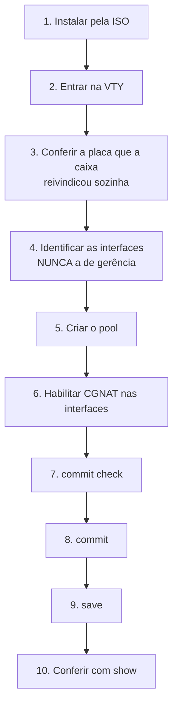
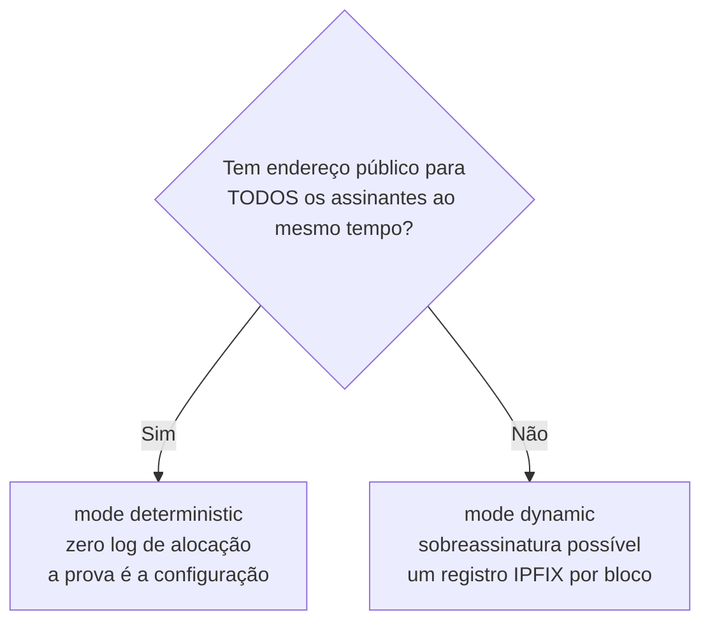

# Primeiros passos

Do disco vazio até assinantes navegando. Cada passo diz **o que digitar** e **como saber que deu certo**.



## Antes de começar, decida duas coisas

**1. Se alguma placa precisa ficar com o Linux.** Numa caixa com várias placas, o dataplane fica com todas menos a que foi gravada como rede de gerência na instalação. Se você quer guardar outra — VLAN de gerência, caminho de backup, storage —, é `interface <placa-dos-assinantes>` em `system` > `dataplane`, que faz a caixa reivindicar aquela e só aquela. Numa caixa de uma placa só não há o que decidir: ela vai para o dataplane e o endereço vai junto.

**2. Determinístico ou dinâmico.**



Conta rápida para o determinístico: `assinantes × block-size ÷ 64512` = quantos endereços públicos você precisa. 200 mil assinantes com blocos de 512 dão cerca de 1.588 endereços — um `/21`.

## 1. Instalar

Dê boot pela ISO e digite `install`. Ele pergunta disco, hostname, fuso e senha de root **antes** de escrever qualquer byte, e o disco de boot nunca aparece na lista de alvos.

## 2. Entrar

Console ou SSH caem direto na VTY:

```
prisma>
```

Precisa de um shell? `start shell`, e `exit` volta.


:::info
**No primeiro boot o console fica quieto por um tempo, e isso é de propósito.** A caixa só oferece o prompt de login depois que o dataplane subiu. Se o VPP demora, o prompt demora junto — a caixa não travou, está esperando.

O motivo é prático: uma VTY aberta antes do dataplane responder não consegue ler a configuração da caixa, e o `configure` digitado ali montaria um candidato incompleto. Enquanto isso, o self-test escreve o relatório de boot no mesmo console; o prompt aparece depois dele, inteiro.

Se mesmo assim você entrar num momento em que o dataplane ainda não respondeu, o `configure` recusa e diz isso, em vez de deixar você trabalhar em cima de uma leitura vazia.

:::

## 3. A placa do dataplane, que a caixa escolhe sozinha

**Uma caixa recém-instalada já encaminha.** Você não precisa dizer a ela qual placa usar: o dataplane reivindica as placas sozinho, por uma regra que cabe numa frase e que dá para prever sem consultar nada.


:::info
**O dataplane reivindica todas as placas PCI que esta caixa tem, exceto uma reservada para o Linux, e nunca a última.**

:::

A reserva **não é um ajuste novo**. É a rede de gerência que o instalador já perguntou, lida de volta do arquivo que ele mesmo escreveu. Quem quer de fato uma placa guardada para o Linux diz isso na instalação, e em nenhum outro lugar depois.

O "nunca a última" é a parte que decide o caso mais comum que existe — a máquina virtual de uma placa só. Ali a reserva é ignorada e o dataplane fica com a placa; do contrário a caixa ficaria instalada, correta e sem encaminhar nada, que é justamente o estado que essa regra existe para acabar.

Uma placa cujo endereço, MAC e gateway a caixa **não consiga ler inteiros** não é reivindicada. Um endereço que ela não sabe ler é um endereço que ela não saberia devolver, e entregar a placa nesse estado seria uma entrega sem volta.

### Conferindo o que ela escolheu, e por quê

```
show hardware
```

Além de listar as placas, a tela explica a decisão. Numa caixa de uma placa só:

```
The dataplane claims it. It is the only card this box has, and a reserve
never takes the last card.
```

Numa caixa com várias e uma reservada na instalação:

```
Reserved for Linux:
```

seguido do nome da placa e da frase que diz que ela é a rede de gerência com que a caixa foi instalada. O autoteste de boot diz a mesma coisa no console, para quem está olhando a tela e não digitou nada ainda.

Uma caixa que comesse uma placa em silêncio seria pior do que uma que pergunta; e uma que poupasse uma em silêncio deixaria o operador sem explicação para uma placa ausente. Por isso as duas metades são ditas.

### Quando você quer escolher: `system` > `dataplane`

O comando continua existindo, e mudou de papel: era passo obrigatório, agora é **override**. Ele é **exclusivo** — nomear uma placa faz a caixa reivindicar aquela e **nenhuma outra**:

```
prisma> configure
prisma# [edit] system
prisma# [edit system] dataplane
prisma# [edit system / dataplane] interface enp2s0
prisma# [edit system / dataplane] commit
```

É assim que se guarda placa para o Linux numa caixa com várias: nomeie a que carrega os assinantes, e todas as demais ficam. `no interface`, no mesmo nível, devolve a escolha para a caixa.

O nome é o que o **Linux** dá à placa. **TAB** e `?` listam as que a caixa tem e marcam qual carrega a rota default:

```
prisma# [edit system / dataplane] interface ?

  enp1s0  carries the default route: its address moves with it
  enp2s0  card
  <nic>
```

Só entram na lista as placas que **têm endereço PCI** — as únicas que o dataplane pode receber. `lo`, uma ponte, um *bond* e um *veth* não aparecem: oferecer um nome que a caixa recusaria em seguida é o contrário do que essa lista serve para fazer.

### Uma recusa na hora em que você digita, e um aviso no commit

**Numa caixa que tem outra placa, a que carrega a rota default é aceita**, se for ela que você nomear. Já foi recusada, e a recusa dizia qual era a outra placa. Ela saiu porque uma caixa nova é configurada no console, e uma recusa que guarda a placa pela qual a caixa é alcançada guarda um passo que ninguém dá pela rede. Na hora em que você digita, nada é dito. O que muda é o `commit`: o parágrafo sobre a sua sessão deixa de dizer que ela está a salvo e passa a dizer o que a caixa de uma placa só diz, que ela cai junto:

```
    restarting it hands the card over and ends every session on this box,
    including this one, so it is not done for you
```

**Um nome que a caixa não tem também é recusado, e ela diz quais tem:**

```
prisma# [edit system / dataplane] interface eth9
error: dataplane interface eth9: this box has no such interface
    the cards it has: enp1s0, enp2s0
    this is the name LINUX gives the card, which is what the dataplane is
    handed; 'show interface' lists what the dataplane already has, and on a box
    with no card that is nothing
```

Nos dois casos nada entra na candidata: a recusa é no prompt, não depois do `commit`.

### O `commit` guarda e recalcula; quem move a placa é o reinício

Mudar o override não move placa nenhuma na hora. A entrega tira a placa do Linux e derruba tudo que chega na caixa por ela, então o `commit` para exatamente antes disso e diz onde está o limite:

```
prisma# [edit] commit
dataplane interface: enp2s0
    stored, and the boot tuning was recomputed for it
    NOT IN EFFECT YET: the dataplane claims its card when it starts, and this
    commit does not restart it
    restarting it hands the card over and ends whatever is reaching this box
    through enp2s0. The path this box is routed out of is 'enp1s0', which Linux
    keeps, so this session is not what it costs
    it is not done for you all the same: nothing here has measured what
    stopping the dataplane costs a box carrying traffic
    reboot the box in a window you have chosen, and it comes up forwarding on
    that card
commit complete
```

**O parágrafo do meio é sobre a sua caixa, e muda com ela.** Nesta a gerência está em `enp1s0`, que o Linux continua tendo, então derrubar o dataplane não derruba a sua sessão. Numa caixa de uma placa só a mesma tela diz que a sessão cai junto:

```
    restarting it hands the card over and ends every session on this box,
    including this one, so it is not done for you
```

São quatro respostas para quatro caixas, e a caixa escolhe a sua lendo por onde é alcançada. Vale reparar para que lado ela erra quando não consegue ler: ela **avisa**. Uma caixa avisada de uma sessão que nunca ia cair gasta uma janela de manutenção que não precisava; uma caixa a quem se disse que a sessão estava a salvo, e não estava, é uma caixa que ninguém alcança.

## 3b. A caixa de uma placa só

Numa máquina virtual com uma placa virtual — que é como a maioria das pessoas conhece este produto — não existe segunda placa. A regra já resolve: **a placa vai para o dataplane e o endereço de gerência vai junto com ela**, sem você digitar nada.

Como isso funciona: o dataplane fica com a porta e mantém, do lado do Linux, uma interface emparelhada com ela. O endereço de gerência passa a morar nessa interface. A caixa deixa de ser alcançada *ao lado* do dataplane e passa a ser alcançada *através* dele. A placa mantém o mesmo MAC na travessia, então nada do outro lado do cabo precisa reaprender nada.

O caminho de volta — endereço, MAC e gateway — é **calculado no boot**, lido da placa na janela em que ela ainda é legível, e não sobrevive ao boot que o calculou. Um registro escrito num `commit` descreveria a caixa do dia em que foi escrito; este não tem como estar velho. A rota default é reposta no Linux junto do endereço, que é o que mantém a caixa alcançável fora da própria sub-rede.


:::warning
Se a caixa subir com a placa entregue e **nada** do outro lado tiver ficado com ela, ela avisa no console em vez de subir calada:

```
error: the card this box is reached on was handed over and nothing took it
    this box has no address and cannot be reached over the network until that
    is repaired from here
    'show hardware' says what the dataplane holds; 'no dataplane interface'
    gives the card back at the next start
```

:::

## 4. Identificar as interfaces

```
show interface
show interface terse
```

Anote qual é a de assinantes (*inside*) e qual é a de upstream (*outside*). Confirme que a de gerência não está entre elas.

`show interface terse` dá uma linha por interface com duas colunas de estado — `Admin`, que é o que está configurado, e `Link`, que é o que o cabo está fazendo. Antes de configurar qualquer coisa, é a forma mais rápida de ver se as duas portas que você vai usar estão realmente conectadas.

## 5. Criar o pool

Este passo e os três seguintes estão, com cada tela que a caixa mostra e a parte do roteamento que falta aqui, em [Configurar o CGNAT passo a passo](/doc/configurar-o-cgnat-passo-a-passo-WMfuk8C8Q7).

```
configure
 nat
  cgnat
   pool residencial
    inside 100.64.0.0/10
    outside 203.0.113.0/24
    block-size 512
    ports 1024 65535
    policy interleaved
    mode deterministic
    tcp-mss auto
    exit
   exit
  exit
```

O que cada linha decide:

| Linha | Decisão |
|-------|---------|
| `inside` | de quem é o tráfego a traduzir |
| `outside` | com quais endereços públicos ele sai |
| `block-size` | quantas portas cada assinante ganha (potência de dois) |
| `ports` | faixa de portas usável do endereço público |
| `policy interleaved` | vizinhos em IPs públicos diferentes, o que dilui bloqueio de reputação |
| `mode deterministic` | bloco por fórmula, sem log de alocação |
| `tcp-mss auto` | evita conexões que travam sem mensagem de erro |

Não sabe o que digitar? **TAB** completa e `**?**` lista as opções válidas com descrição, em qualquer ponto da linha.

## 6. Habilitar nas interfaces

O lado do CGNAT é digitado no bloco de cada interface:

```
interface ens18
 cgnat inside
 exit
interface ens19
 cgnat outside
 exit
```

## 7. Ver o que vai acontecer, antes de acontecer

```
show configuration compare
commit check
```

`commit check` valida sem aplicar e sem tocar no equipamento. Num pool novo é tudo o que há para conferir. Num pool que já existe ele diz mais: se a mudança re-mapear assinantes, a conta sai aqui, antes de aplicar.

Num pool que **já existe**, a pergunta que importa é outra — quanta gente vai cair —, e quem a responde é o `commit` comum: ele recusa a mudança de mapeamento e imprime a contagem exata antes de pedir `commit remap`.

## 8. Aplicar

```
commit comment "pool residencial inicial"
```

Mexendo de longe? Use a rede de segurança:

```
commit confirmed 5
```

Aplica agora e desfaz sozinho em 5 minutos se você não confirmar. Se a mudança cortar seu próprio acesso, a máquina se recupera.

## 9. Salvar

```
exit
save
```

`**commit**` **faz valer agora;** `**save**` **grava em disco.** Sem o `save`, a configuração desaparece no próximo boot. São duas decisões distintas, por isso são dois comandos.

## 10. Conferir

```
show cgnat pool
show cgnat subscriber 100.64.0.5
```

O `show cgnat subscriber` responde com o **endereço público**, a **faixa de portas** daquele assinante e quantas sessões ele tem abertas (`sessions N`).

Se o endereço não pertencer a nenhum pool, ele diz `not inside any configured pool`. Isso é resposta, não erro: significa que nenhum `inside` cobre aquele endereço.

Com tráfego passando:

```
show cgnat top       quem está mais perto de encher o bloco
show cgnat drops     o que não passou, e por quê
```

## E o roteamento?

É do FRR, pela mesma VTY:

```
configure
 router bgp 65000
  ... sintaxe do FRR daqui em diante ...
```


:::warning
**Cuidado com MTU.** O TAP do `linux_cp` vem com 9000. Uma interface que herda esse valor sem o outro lado concordar deixa a adjacência OSPF travada em Exchange. Ajuste com `mtu` dentro do bloco `interface`.

:::

# Como conferir

Antes de considerar a máquina pronta:

- [ ] `show hardware` mostra as placas que o dataplane reivindicou, e a de gerência não está entre elas (ou, numa caixa de uma placa só, a caixa continua alcançável depois do reinício)
- [ ] A interface de gerência **não** está no CGNAT
- [ ] `show cgnat pool` lista o pool
- [ ] `show cgnat subscriber <ip-de-teste>` devolve endereço público e faixa de portas
- [ ] Tráfego de teste sai e volta
- [ ] `save` foi executado
- [ ] Se for modo dinâmico: coletor IPFIX configurado e `show cgnat logging` confirma

# Ver também

* [Receitas do dia a dia](/doc/receitas-do-dia-a-dia-IcocgdbXW2) — as tarefas que vêm depois de estar no ar
* [Configuração de pool](/doc/configuracao-de-pool-btyS572Ih6) — cada campo do pool, campo a campo
* [Operação e diagnóstico](/doc/operacao-e-diagnostico-A4fcKDVwZt) — quando algo não funcionar
