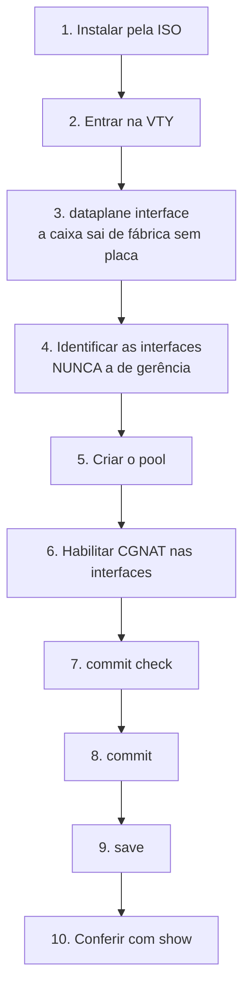
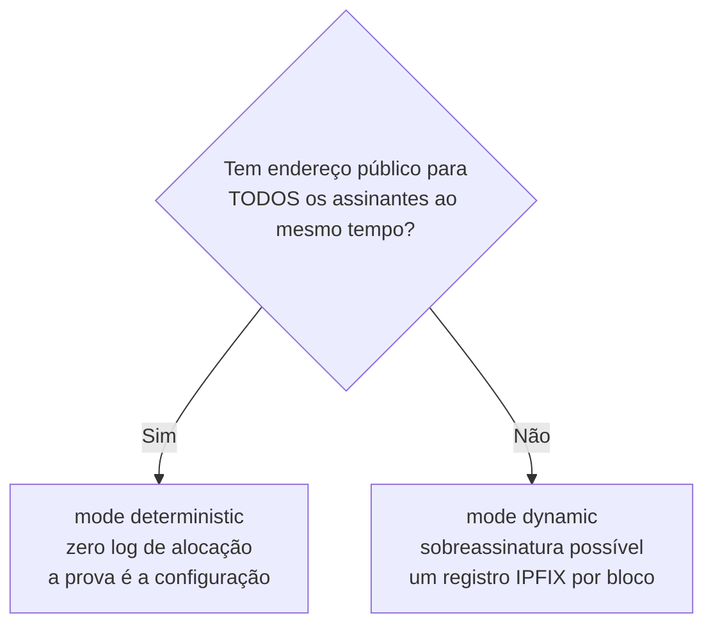

# Primeiros passos

Do disco vazio até assinantes navegando. Cada passo diz **o que digitar** e **como saber que deu certo**.



## Antes de começar, decida duas coisas

**1. Qual interface é a de gerência.** Ela **não** pode ser entregue ao CGNAT. O DPDK tira a placa do Linux; se você entregar a porta pela qual administra a máquina, ela fica inalcançável — e inalcançável remotamente é inconsertável.

**2. Determinístico ou dinâmico.**



Conta rápida para o determinístico: `assinantes × block-size ÷ 64512` = quantos endereços públicos você precisa. 200 mil assinantes com blocos de 512 dão cerca de 1.588 endereços — um `/21`.

## 1. Instalar

Dê boot pela ISO e digite `install`. Ele pergunta disco, hostname, fuso e senha de root **antes** de escrever qualquer byte, e o disco de boot nunca aparece na lista de alvos.

## 2. Entrar

Console ou SSH caem direto na VTY:

```
hexarouting>
```

Precisa de um shell? `start shell`, e `exit` volta.


:::info
**No primeiro boot o console fica quieto por um tempo, e isso é de propósito.** A caixa só oferece o prompt de login depois que o dataplane subiu. Se o VPP demora, o prompt demora junto — a caixa não travou, está esperando.

O motivo é prático: uma VTY aberta antes do dataplane responder não consegue ler a configuração da caixa, e o `configure` digitado ali montaria um candidato incompleto. Enquanto isso, o self-test escreve o relatório de boot no mesmo console; o prompt aparece depois dele, inteiro.

Se mesmo assim você entrar num momento em que o dataplane ainda não respondeu, o `configure` recusa e diz isso, em vez de deixar você trabalhar em cima de uma leitura vazia.

:::

## 3. Dizer à caixa qual placa carrega os assinantes

**Uma caixa recém-instalada não entrega placa nenhuma ao dataplane.** Ela sai de fábrica sem nenhuma nomeada, de propósito: sem nome, o dataplane não pega nada, e numa máquina de uma placa só o que ele pegaria seria justamente a de gerência. O self-test de boot avisa que a caixa não tem interface de dataplane e diz o que digitar.

Isso é configuração como qualquer outra — candidata, `commit`, `save`:

```
hexarouting> configure
hexarouting# [edit] dataplane interface enp2s0
hexarouting# [edit] commit
```

O nome é o que o **Linux** dá à placa, não o que o dataplane daria: antes da entrega a placa só existe para o Linux, e é por esse nome que ela aparece em todo o resto. `show interface` mostra o que o dataplane **já tem**, que numa caixa sem placa nenhuma é nada — por isso não é essa a lista de onde escolher.

Não precisa decorar o nome. **TAB** e `?` listam as placas que a caixa tem e marcam qual delas carrega a rota default:

```
hexarouting# [edit] dataplane interface ?

  enp1s0  carries the default route: refused
  enp2s0  card
  <nic>
```

Só entram na lista as placas que **têm endereço PCI** — as únicas que o dataplane pode receber. `lo`, uma ponte, um *bond* e um *veth* não aparecem: oferecer um nome que a caixa recusaria em seguida é o contrário do que essa lista serve para fazer.

Numa caixa de uma placa só a mesma lista marca a mesma placa com outra frase, porque ali a entrega é permitida:

```
  ens18  the only card: handed over, address and all
  <nic>
```

Essa linha é lida **antes** de você digitar o nome, e é para isso que ela serve. Por isso ela cabe no console: escrita por extenso ela passava de cem colunas numa tela de setenta e nove, e o terminal quebrava justamente a frase que dizia o que entregar aquela placa significa.

Repare que ali a marca **não é** `refused`. Numa caixa de uma placa só a entrega é permitida, e dizer `refused` seria recusar na tela o que a caixa aceita em seguida. A condição é a mesma que a recusa usa - existe outra placa para nomear? -, lida da mesma lista, para que a dica e a resposta não possam discordar sobre o que a caixa tem.

### O commit guarda e recalcula, mas não entrega a placa

A entrega tira a placa do Linux e derruba tudo que chega na caixa por ela. Por isso o `commit` para exatamente antes disso e diz onde está o limite:

```
hexarouting# [edit] commit
dataplane interface: enp2s0
    stored, and the boot tuning was recomputed for it
    NOT IN EFFECT YET: the dataplane claims its card when it starts, and this
    commit does not restart it
    restarting it hands the card over and ends whatever is reaching this box
    through enp2s0. The path this box is routed out of is 'enp1s0', which Linux
    keeps, so this session is not what it costs
    it is not done for you all the same: nothing here has measured what
    stopping the dataplane costs a box carrying traffic
    reboot the box in a window you have chosen, and it comes up forwarding on
    that card
commit complete
```

**Esse último parágrafo é sobre a sua caixa, e muda com ela.** Nesta aqui a gerência está em `enp1s0`, que o Linux continua tendo, então derrubar o dataplane não derruba a sua sessão. Numa caixa de uma placa só - aquela em que a placa entregue é a que carrega a gerência - a mesma tela diz outra coisa, e o que ela diz é que a sessão cai junto:

```
    restarting it hands the card over and ends every session on this box,
    including this one, so it is not done for you
```

Há ainda um terceiro caso, e ele é o da caixa de uma placa só **depois** da primeira entrega: a rota default passa a estar num nome que não é placa nenhuma do Linux - é a interface que o dataplane mantém emparelhada com a porta. Um reinício do dataplane leva essa interface junto, então a caixa não diz que a sessão está a salvo:

```
    restarting it hands the card over and ends whatever is reaching this box
    through it
    the default route is on 'ens18', which is not one of this box's cards - on
    a box that has already handed one over it is the pair the dataplane keeps,
    and a restart takes that with it - so this session may go too, and it is
    not done for you
```

E quando a caixa não consegue ler por onde é alcançada — nenhuma rota default em lugar nenhum — ela diz isso, em vez de escolher uma das outras respostas:

```
    restarting it hands the card over and ends whatever is reaching this box
    through it
    no interface here carries a default route, so which path this session
    arrived on cannot be read: take it that this one goes too, and it is not
    done for you
```

São quatro respostas para quatro caixas, e a caixa escolhe a sua lendo por onde é alcançada de **uma** fonte — a mesma que a recusa lê. Vale reparar para que lado ela erra quando não consegue ler: ela avisa. Uma caixa avisada de uma sessão que nunca ia cair gasta uma janela de manutenção que não precisava; uma caixa a quem se disse que a sessão estava a salvo, e não estava, é uma caixa que ninguém alcança.

Ou seja: **reinicie a caixa numa janela escolhida por você**, e ela sobe encaminhando pela placa nomeada. Enquanto não reiniciar, `show interface` continua sem mostrar nada — e a própria caixa explica por quê, se você perguntar.

### Duas recusas, na hora em que você digita

**Numa caixa que tem outra placa, a que carrega a rota default é recusada**, mesmo que você a nomeie. As duas falhas não são simétricas: uma caixa sem interface de dataplane se resolve entrando por rede; uma caixa que engoliu a própria gerência se resolve indo até ela a pé. E havendo outra placa, entregar a de gerência custa a caixa sem ganhar nada, então a recusa diz qual é a outra:

```
hexarouting# [edit] dataplane interface enp1s0
error: dataplane interface enp1s0: it carries the default route
    handing it to the dataplane takes the card away from Linux, and this box
    off the network with it
    the two mistakes do not cost the same: a box with no dataplane card is
    fixed over the network, and a box that ate its own management is fixed by
    walking to it
    name the card carrying subscriber traffic instead: enp2s0
```

**Um nome que a caixa não tem também é recusado, e ela diz quais tem:**

```
hexarouting# [edit] dataplane interface eth9
error: dataplane interface eth9: this box has no such interface
    the cards it has: enp1s0, enp2s0
    this is the name LINUX gives the card, which is what the dataplane is
    handed; 'show interface' lists what the dataplane already has, and on a box
    with no card that is nothing
```

Nos dois casos nada entra na candidata: a recusa é no prompt, não depois do `commit`.

## 3b. Uma caixa com uma placa só

Numa máquina virtual com uma placa virtual, que é como a maioria das pessoas conhece este produto, não existe segunda placa para nomear. A recusa acima mandaria você fazer uma coisa impossível, então ela não se aplica ali: **a placa vai para o dataplane e o endereço de gerência vai junto com ela**.

Como isso funciona: o dataplane fica com a porta e mantém, do lado do Linux, uma interface emparelhada com ela. O endereço de gerência passa a morar nessa interface. A caixa deixa de ser alcançada *ao lado* do dataplane e passa a ser alcançada *através* dele. A placa mantém o mesmo endereço MAC na travessia, então nada do outro lado do cabo precisa reaprender coisa alguma.

Você digita uma linha só. O resto a caixa lê sozinha da configuração que o Linux já tem na placa:

```
hexarouting> configure
hexarouting# [edit] dataplane interface ens18
dataplane interface ens18: this box has no other card, so it keeps its management
    10.95.200.198/24 moves onto the linux_cp pair the dataplane keeps for
    ens18, and the box is then reached through the dataplane rather than beside
    it
    the card keeps its MAC across the handover, so nothing upstream has to
    learn a new one
    'ip route 0.0.0.0/0 10.95.200.1' is added, because the default route this
    box has now lives on a card Linux is about to lose
    this does not happen at this commit: the dataplane claims its card when it
    starts, and the box is on the old path until it is restarted
```

Confira o endereço e a rota que aparecem aí **antes** de confirmar. São a leitura que a caixa fez da placa, e é com eles que ela vai voltar.

### O commit é confirmado, você tendo pedido ou não

A caixa não perde a sua sessão no `commit`; ela perde no reinício seguinte. Se alguma coisa nesse meio estiver errada, não sobra sessão nenhuma para consertar, que é exatamente para isso que existe o `commit confirmed`. Então ele é aplicado assim de qualquer jeito, com uma janela maior que a de sempre, porque ela precisa caber um reinício e um login:

```
this commit hands over the card this box is reached on
    the box keeps its address, on the dataplane's side of it, and nothing
    proves that until it has been restarted and answered
    applying it as 'commit confirmed 30' rather than as a plain commit: restart
    the box, log in again and type 'commit' to keep it
...
rollback at 2026-09-14T18:36:13Z, in 30 minute(s)
```

O prazo fica gravado na caixa e **não é cancelado por reiniciar**: é justamente essa propriedade que faz a coisa funcionar aqui. A sequência é:


1. `dataplane interface <placa>` e `commit`.
2. Reinicie a caixa. Ela sobe com a placa no dataplane e o endereço no par do lado do Linux.
3. Entre de novo, no mesmo endereço de sempre, e digite `commit`. Pronto.

Essa decisão é a única que a caixa anota nela mesma no `commit`, sem depender do `save` mais adiante nesta página: a placa e o endereço que vai com ela ficam gravados no momento em que você confirma, porque é disso que ela precisa para voltar. Salve o resto normalmente.

Se a caixa subir com a placa entregue e **nada** do outro lado tiver ficado com ela, ela avisa no console em vez de subir calada, e diz o que fazer:

```
error: the card this box is reached on was handed over and nothing took it
    this box has no address and cannot be reached over the network until that
    is repaired from here
    'show hardware' says what the dataplane holds; 'no dataplane interface'
    gives the card back at the next start
```

Se você **não** conseguir entrar, não faça nada: no fim da janela a caixa põe a configuração anterior de volta e **se reinicia sozinha**, porque devolver a placa ao Linux só acontece num novo start. Ela avisa isso no console:

```
commit confirmed 30: nobody confirmed it within 30 minute(s), so this box has
put the previous configuration back
dataplane interface: none
    stored, and the boot tuning was recomputed for it
    the card this box has now is given up at the next start of the dataplane,
    not at this commit
restarting the box: the card goes back to Linux at the next start
    the dataplane holds it until then, so this is the only way back onto the
    network without a reboot by hand
```

Depois desse reinício a caixa está de volta como estava antes: sem dataplane, alcançável pela placa como sempre foi.

**O reinício só acontece se a placa tiver mesmo saído.** A janela conta a partir do `commit`, e o `commit` não move a placa — o reinício seguinte é que move. Se o prazo vencer antes de você reiniciar, a caixa apenas desfaz a configuração: ela pergunta ao dataplane se ele está com aquele MAC antes de reiniciar qualquer coisa, e uma caixa que nunca perdeu a placa continuou alcançável o tempo todo.


:::tip
Se a caixa **não** conseguir ler o endereço da placa (placa sem endereço, sem rota default, ou com dois endereços e nenhum jeito de escolher) ela recusa a entrega e diz o que está faltando. Um endereço que ela não consegue ler é um endereço que ela não consegue devolver, e aí a entrega não teria volta.

:::

## 4. Identificar as interfaces

```
show interface
show interface terse
```

Anote qual é a de assinantes (*inside*) e qual é a de upstream (*outside*). Confirme que a de gerência não está entre elas.

`show interface terse` dá uma linha por interface com duas colunas de estado — `Admin`, que é o que está configurado, e `Link`, que é o que o cabo está fazendo. Antes de configurar qualquer coisa, é a forma mais rápida de ver se as duas portas que você vai usar estão realmente conectadas.

## 5. Criar o pool

```
configure
 nat cgnat pool residencial
  inside 100.64.0.0/10
  outside 203.0.113.0/24
  block-size 512
  ports 1024 65535
  policy interleaved
  mode deterministic
  tcp-mss auto
  exit
```

O que cada linha decide:

| Linha | Decisão |
|-------|---------|
| `inside` | de quem é o tráfego a traduzir |
| `outside` | com quais endereços públicos ele sai |
| `block-size` | quantas portas cada assinante ganha (potência de dois) |
| `ports` | faixa de portas usável do endereço público |
| `policy interleaved` | vizinhos em IPs públicos diferentes, o que dilui bloqueio de reputação |
| `mode deterministic` | bloco por fórmula, sem log de alocação |
| `tcp-mss auto` | evita conexões que travam sem mensagem de erro |

Não sabe o que digitar? **TAB** completa e `**?**` lista as opções válidas com descrição, em qualquer ponto da linha.

## 6. Habilitar nas interfaces

```
nat cgnat interface TenGigabitEthernet0/0/0 inside
nat cgnat interface TenGigabitEthernet0/0/1 outside
```

## 7. Ver o que vai acontecer, antes de acontecer

```
show configuration compare
commit check
```

`commit check` valida sem aplicar e sem tocar no equipamento. Num pool novo é tudo o que há para conferir. Num pool que já existe ele diz mais: se a mudança re-mapear assinantes, a conta sai aqui, antes de aplicar.

Num pool que **já existe**, a pergunta que importa é outra — quanta gente vai cair —, e quem a responde é o `commit` comum: ele recusa a mudança de mapeamento e imprime a contagem exata antes de pedir `commit remap`.

## 8. Aplicar

```
commit comment "pool residencial inicial"
```

Mexendo de longe? Use a rede de segurança:

```
commit confirmed 5
```

Aplica agora e desfaz sozinho em 5 minutos se você não confirmar. Se a mudança cortar seu próprio acesso, a máquina se recupera.

## 9. Salvar

```
exit
save
```

`**commit**` **faz valer agora;** `**save**` **grava em disco.** Sem o `save`, a configuração desaparece no próximo boot. São duas decisões distintas, por isso são dois comandos.

## 10. Conferir

```
show cgnat pool
show cgnat subscriber 100.64.0.5
```

O `show cgnat subscriber` responde com o **endereço público**, a **faixa de portas** daquele assinante e quantas sessões ele tem abertas (`sessions N`).

Se o endereço não pertencer a nenhum pool, ele diz `not inside any configured pool`. Isso é resposta, não erro: significa que nenhum `inside` cobre aquele endereço.

Com tráfego passando:

```
show cgnat top       quem está mais perto de encher o bloco
show cgnat drops     o que não passou, e por quê
```

## E o roteamento?

É do FRR, pela mesma VTY:

```
configure
 router bgp 65000
  ... sintaxe do FRR daqui em diante ...
```


:::warning
**Cuidado com MTU.** O TAP do `linux_cp` vem com 9000. Uma interface que herda esse valor sem o outro lado concordar deixa a adjacência OSPF travada em Exchange. Ajuste com `mtu` dentro do bloco `interface`.

:::

# Como conferir

Antes de considerar a máquina pronta:

- [ ] `dataplane interface` está definido, com `commit`, e a caixa foi reiniciada depois disso
- [ ] numa caixa de uma placa só: você entrou de novo depois do reinício e digitou `commit` para confirmar a entrega
- [ ] A interface de gerência **não** está no CGNAT
- [ ] `show cgnat pool` lista o pool
- [ ] `show cgnat subscriber <ip-de-teste>` devolve endereço público e faixa de portas
- [ ] Tráfego de teste sai e volta
- [ ] `save` foi executado
- [ ] Se for modo dinâmico: coletor IPFIX configurado e `show cgnat logging` confirma

# Ver também

* [Receitas do dia a dia](/doc/receitas-do-dia-a-dia-IcocgdbXW2) — as tarefas que vêm depois de estar no ar
* [Configuração de pool](/doc/configuracao-de-pool-btyS572Ih6) — cada campo do pool, campo a campo
* [Operação e diagnóstico](/doc/operacao-e-diagnostico-A4fcKDVwZt) — quando algo não funcionar
