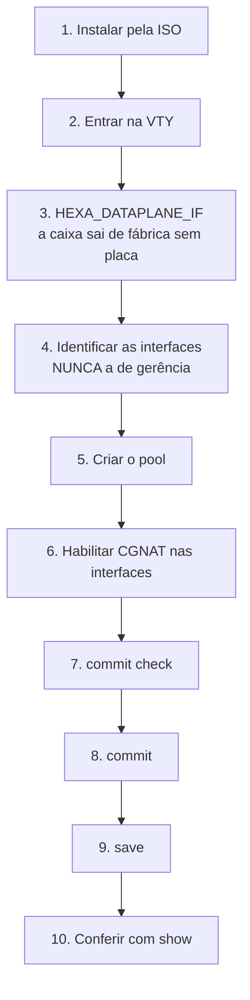
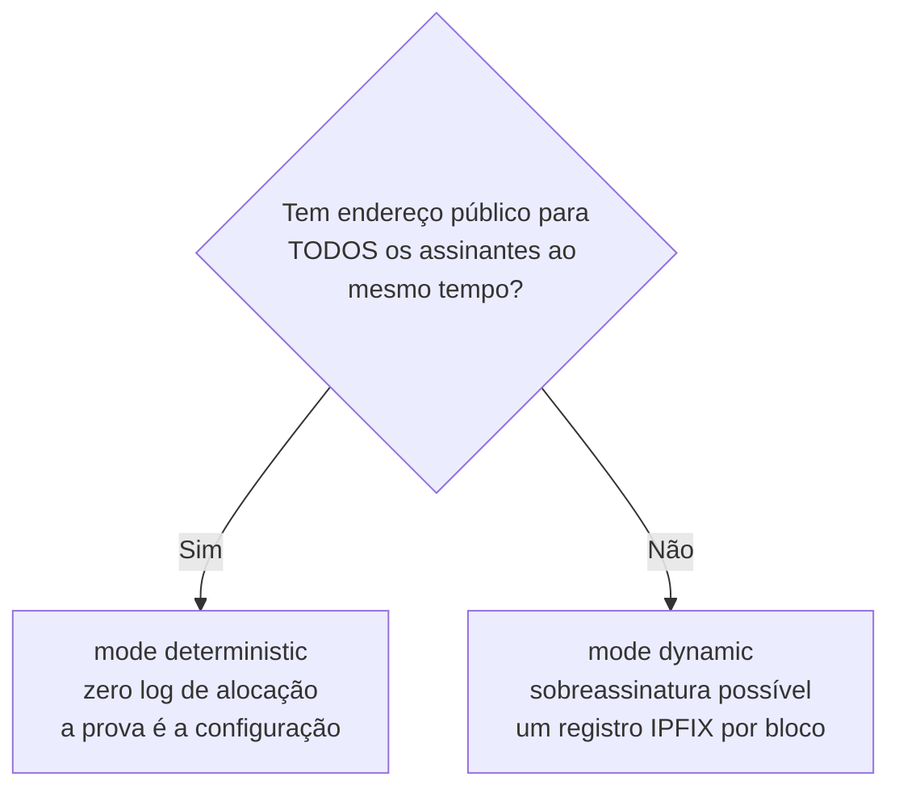

# Primeiros passos

Do disco vazio até assinantes navegando. Cada passo diz **o que digitar** e **como saber que deu certo**.



## Antes de começar, decida duas coisas

**1. Qual interface é a de gerência.** Ela **não** pode ser entregue ao CGNAT. O DPDK tira a placa do Linux; se você entregar a porta pela qual administra a máquina, ela fica inalcançável — e inalcançável remotamente é inconsertável.

**2. Determinístico ou dinâmico.**



Conta rápida para o determinístico: `assinantes × block-size ÷ 64512` = quantos endereços públicos você precisa. 200 mil assinantes com blocos de 512 dão cerca de 1.588 endereços — um `/21`.

## 1. Instalar

Dê boot pela ISO e digite `install`. Ele pergunta disco, hostname, fuso e senha de root **antes** de escrever qualquer byte, e o disco de boot nunca aparece na lista de alvos.

## 2. Entrar

Console ou SSH caem direto na VTY:

```
hexarouting>
```

Precisa de um shell? `start shell`, e `exit` volta.

:::info
**No primeiro boot o console fica quieto por um tempo, e isso é de propósito.**
A caixa só oferece o prompt de login depois que o dataplane subiu. Se o VPP
demora, o prompt demora junto — a caixa não travou, está esperando.

O motivo é prático: uma VTY aberta antes do dataplane responder não consegue
ler a configuração da caixa, e o `configure` digitado ali montaria um candidato
incompleto. Enquanto isso, o self-test escreve o relatório de boot no mesmo
console; o prompt aparece depois dele, inteiro.

Se mesmo assim você entrar num momento em que o dataplane ainda não respondeu,
o `configure` recusa e diz isso, em vez de deixar você trabalhar em cima de uma
leitura vazia.
:::

## 3. Dizer à caixa qual placa carrega os assinantes

**Uma caixa recém-instalada não entrega placa nenhuma ao dataplane.** A configuração sai de fábrica vazia, de propósito, e o self-test de boot avisa que a caixa não tem interface de dataplane e nomeia o arquivo a editar.

Edite `/etc/hexarouting/tune.env`:

```
HEXA_DATAPLANE_IF=<nome da placa dos assinantes>
```

e reinicie. Só depois disso o VPP recebe a placa.


:::warning
**A placa que carrega a rota default é recusada, mesmo que você a nomeie**, e a recusa é impressa. As duas falhas não são simétricas: uma caixa sem interface de dataplane se resolve entrando por rede; uma caixa que engoliu a própria gerência se resolve indo até ela a pé.

:::

## 4. Identificar as interfaces

```
show interface
show interface terse
```

Anote qual é a de assinantes (*inside*) e qual é a de upstream (*outside*). Confirme que a de gerência não está entre elas.

`show interface terse` dá uma linha por interface com duas colunas de estado — `Admin`, que é o que está configurado, e `Link`, que é o que o cabo está fazendo. Antes de configurar qualquer coisa, é a forma mais rápida de ver se as duas portas que você vai usar estão realmente conectadas.

## 5. Criar o pool

```
configure
 nat cgnat pool residencial
  inside 100.64.0.0/10
  outside 203.0.113.0/24
  block-size 512
  ports 1024 65535
  policy interleaved
  mode deterministic
  tcp-mss auto
  exit
```

O que cada linha decide:

| Linha | Decisão |
|-------|---------|
| `inside` | de quem é o tráfego a traduzir |
| `outside` | com quais endereços públicos ele sai |
| `block-size` | quantas portas cada assinante ganha (potência de dois) |
| `ports` | faixa de portas usável do endereço público |
| `policy interleaved` | vizinhos em IPs públicos diferentes, o que dilui bloqueio de reputação |
| `mode deterministic` | bloco por fórmula, sem log de alocação |
| `tcp-mss auto` | evita conexões que travam sem mensagem de erro |

Não sabe o que digitar? **TAB** completa e `**?**` lista as opções válidas com descrição, em qualquer ponto da linha.

## 6. Habilitar nas interfaces

```
nat cgnat interface TenGigabitEthernet0/0/0 inside
nat cgnat interface TenGigabitEthernet0/0/1 outside
```

## 7. Ver o que vai acontecer, antes de acontecer

```
show configuration compare
commit check
```

`commit check` valida sem aplicar e sem tocar no equipamento. Num pool novo é tudo o que há para conferir. Num pool que já existe ele diz mais: se a mudança re-mapear assinantes, a conta sai aqui, antes de aplicar.

Num pool que **já existe**, a pergunta que importa é outra — quanta gente vai cair —, e quem a responde é o `commit` comum: ele recusa a mudança de mapeamento e imprime a contagem exata antes de pedir `commit remap`.

## 8. Aplicar

```
commit comment "pool residencial inicial"
```

Mexendo de longe? Use a rede de segurança:

```
commit confirmed 5
```

Aplica agora e desfaz sozinho em 5 minutos se você não confirmar. Se a mudança cortar seu próprio acesso, a máquina se recupera.

## 9. Salvar

```
exit
save
```

`**commit**` **faz valer agora;** `**save**` **grava em disco.** Sem o `save`, a configuração desaparece no próximo boot. São duas decisões distintas, por isso são dois comandos.

## 10. Conferir

```
show cgnat pool
show cgnat subscriber 100.64.0.5
```

O `show cgnat subscriber` responde com o **endereço público**, a **faixa de portas** daquele assinante e quantas sessões ele tem abertas (`sessions N`).

Se o endereço não pertencer a nenhum pool, ele diz `not inside any configured pool`. Isso é resposta, não erro: significa que nenhum `inside` cobre aquele endereço.

Com tráfego passando:

```
show cgnat top       quem está mais perto de encher o bloco
show cgnat drops     o que não passou, e por quê
```

## E o roteamento?

É do FRR, pela mesma VTY:

```
configure
 router bgp 65000
  ... sintaxe do FRR daqui em diante ...
```


:::warning
**Cuidado com MTU.** O TAP do `linux_cp` vem com 9000. Uma interface que herda esse valor sem o outro lado concordar deixa a adjacência OSPF travada em Exchange. Ajuste com `mtu` dentro do bloco `interface`.

:::

# Como conferir

Antes de considerar a máquina pronta:

- [ ] `HEXA_DATAPLANE_IF` está definido e a caixa foi reiniciada depois disso
- [ ] A interface de gerência **não** está no CGNAT
- [ ] `show cgnat pool` lista o pool
- [ ] `show cgnat subscriber <ip-de-teste>` devolve endereço público e faixa de portas
- [ ] Tráfego de teste sai e volta
- [ ] `save` foi executado
- [ ] Se for modo dinâmico: coletor IPFIX configurado e `show cgnat logging` confirma

# Ver também

* [Receitas do dia a dia](/doc/receitas-do-dia-a-dia-IcocgdbXW2) — as tarefas que vêm depois de estar no ar
* [Configuração de pool](/doc/configuracao-de-pool-btyS572Ih6) — cada campo do pool, campo a campo
* [Operação e diagnóstico](/doc/operacao-e-diagnostico-A4fcKDVwZt) — quando algo não funcionar
