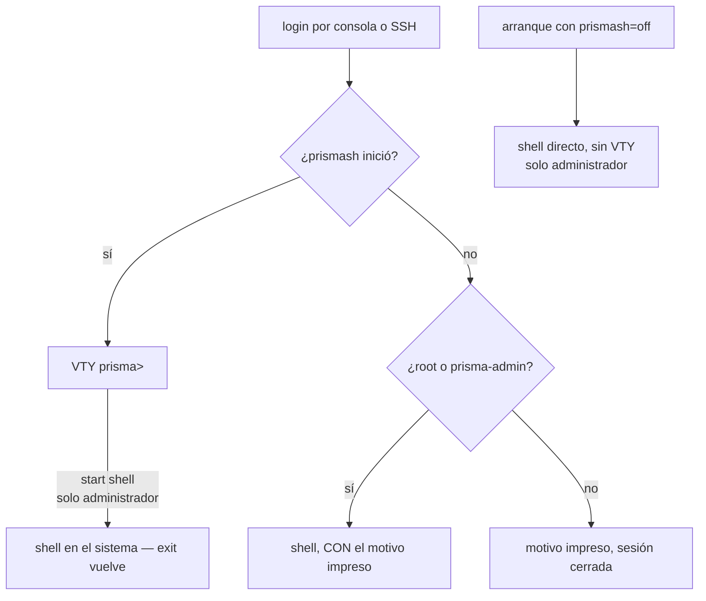

# Acceso, login y roles

Dónde cae una cuenta cuando entra al equipo, por consola o SSH, y qué puede cambiar cada rol. Para quienes van a crear las cuentas de operador y necesitan saber qué alcanza cada una.



## Dónde cae usted al entrar

| Situación | Qué ocurre |
|-----------|------------|
| Login por consola o SSH | Cae en el `prismash` |
| `start shell` dentro de la VTY | Solo `root` y `prisma-admin`: abre un shell en el sistema; `exit` vuelve a la VTY |
| `ssh <cuenta>@<equipo> "<comando>"`, `scp`, `rsync` | `root` y `prisma-admin` llegan a un shell real. **Cualquier otra cuenta** tiene el comando ejecutado por la VTY, como un `prismash -c`, con su rol; `scp` y `rsync` no funcionan para ella |
| `prismash` falla al iniciar | `root` y `prisma-admin` caen en un shell **con el motivo impreso**. Cualquier otra cuenta ve el motivo y la sesión termina |
| Arranque con `prismash=off` | Omite la VTY por completo, para `root` y `prisma-admin`; la ISO ofrece esto como entrada de menú |

En la **ISO** la consola tiene autologin: la cuenta root está bloqueada, no hay nada que autenticar. En la máquina **instalada** no hay autologin y la contraseña es la definida durante la instalación.

El autologin de consola lo hace **solo la ISO**, y el instalador lo elimina del destino. En una máquina instalada significaría que el acceso físico o por IPMI equivale a acceso total sin contraseña: una decisión del operador, no un valor predeterminado del producto.

### `start shell`

Está en el árbol de comandos: TAB y `?` lo ofrecen. Y está **restringido a administradores**: un shell en este equipo son todas las capacidades a la vez, así que quien no tiene `prisma-admin` es rechazado con el nombre del rol que tiene:

```
error: start shell: permission denied for a read-only account
    membership of prisma-cgnat allows CGNAT configuration, prisma-admin allows
    everything
```

```
error: start shell: permission denied for a cgnat-operator account
    this change needs prisma-admin
```

Ocultarlo nunca fue la frontera; la verificación de capacidad sí lo es. Y un comando que el administrador no logra encontrar es un comando que le va a pedir a otra persona; por eso se ofrece en lugar de ocultarse.

Quien abre el shell es el **sistema del equipo**, no la VTY: la VTY verifica el rol y lo solicita; el sistema vuelve a verificarlo, por los grupos de la cuenta, y lo que vale es su respuesta. Si el sistema lo rechaza, la VTY dice `start shell: the host refused a shell for this account`. Salir del shell vuelve a la VTY, con la configuración candidata intacta.

El límite vale para todo lo que da un shell, no solo para `start shell`. Toda cuenta de la VTY participa en los grupos que abren el dataplane y el enrutamiento, así que un shell para una cuenta que no es administradora sería todo lo que su rol le niega.

### Por qué existe una salida de emergencia

Apuntar el shell de login a una aplicación crea el riesgo de un bloqueo total: un `prismash` que fallara al iniciar dejaría a todos sin poder alcanzar la máquina, ni por consola ni por SSH. Por eso hay **dos salidas independientes**, y la segunda (`prismash=off` en el arranque) no depende de que `prismash` funcione. Ambas son de administrador.

### La VTY se ejecuta en el plano de gestión

El equipo instalado ejecuta en contenedores el dataplane, el enrutamiento, el exportador de registros del CGNAT y el **plano de gestión**, donde se ejecuta la VTY; un equipo con PPPoE configurado ejecuta uno más, el del PPPoE. Un login cae ahí **como sí mismo** —con el mismo usuario y los mismos grupos que tiene en el sistema—, así que el rol que lee la VTY es el de la cuenta, y una cuenta de solo lectura dentro del contenedor puede exactamente lo que podría fuera de él. Lo que la VTY hace en el sistema —crear cuentas, modificar SSH, SNMP y los resolvedores DNS, ajustar el lado Linux de una interfaz, reiniciar el equipo— se lo pide al sistema, que verifica quién lo pide a través del propio kernel y solo lo ejecuta para `root`. Es la misma regla de cuando la VTY ejecutaba esos comandos por sí misma: cambió dónde se ejecuta el comando, no quién puede.

Para el operador no cambia nada en lo que se escribe. Dos consecuencias prácticas:

* **Si el contenedor de gestión no está en ejecución, la VTY se ejecuta directamente en el sistema**, como antes. Un equipo con ese contenedor detenido sigue siendo alcanzable.
* `install`, `system upgrade` y `system dataplane restart` los ejecuta el sistema, con su propia VTY, en la misma terminal. No necesita hacer nada diferente.
* Un `system upgrade` recrea el contenedor de gestión al final, y un login que llega en esos segundos **espera** hasta 20 segundos, diciendo una vez que la VTY se está reiniciando por una actualización. Si se acaba el tiempo, vale la tabla del inicio de esta página: `root` y `prisma-admin` caen en una shell con el motivo impreso, y las demás cuentas ven el motivo y la sesión termina.


:::info
Para que los logins vuelvan a usar la VTY del sistema en lugar de la del contenedor, cree el archivo `/etc/prisma-routing/vty-on-host`. Es una salida para diagnóstico, no una configuración del día a día.

:::


:::info
`install.sh` **no** cambia el shell de login de nadie, a menos que `PRISMA_VTY_LOGIN=1` esté definido. En una Debian existente la máquina puede tener otras funciones, y cambiar el shell de root silenciosamente es el tipo de sorpresa que el operador descubre en el peor momento.

:::

## Roles y permisos

Dos capacidades, mapeadas en **grupos del sistema**, no en una base de cuentas propia del appliance. Un appliance que inventa sus propias cuentas es un appliance cuyas cuentas nadie da de baja cuando alguien deja la empresa.

| Grupo | Puede modificar |
|-------|-----------------|
| `prisma-admin` | todo: enrutamiento, configuración de la propia máquina y CGNAT |
| `prisma-cgnat` | solo la configuración de CGNAT |
| ninguno de los dos | solo lectura    |

`root` tiene las dos, porque root habla directamente con el socket del dataplane y fingir lo contrario sería teatro.

Algo que ningún rol hace: reiniciar o apagar el equipo, aplicar una versión nueva o reiniciar el dataplane. Esas cuatro acciones —`system reboot`, `system shutdown`, `system upgrade <versión>` y `system dataplane restart`— son de `root` y de quien tiene `**operator**` (desde la 0.149.26). Vea [El operador: reinicio y actualización sin root](#el-operador-reinicio-y-actualizacion-sin-root).

### El operador: reinicio y actualización sin root

`operator` es una línea en el bloque de la cuenta, **junto al** rol, y no un rol más. Coloca a la cuenta en el grupo `prisma-operator`, que habilita exactamente las cuatro acciones de sistema y nada más de lo que hace root: ni shell, ni gestionar cuentas.

```
configure
 user prisma-web
  role administrator
  operator
  exit
 commit
```

* Un `administrator` **no** es operador solo por ser administrador; una cuenta de solo lectura de un NOC **puede** ser quien reinicia el equipo.
* `no operator` lo quita de nuevo. `root` no acepta la línea: ya puede hacer todo esto por ser root.
* Es un grupo del sistema, como los roles: desactivar la cuenta en el sistema quita también el permiso.
* El grupo `prisma-operator` lo crea el primer commit que da `operator` a alguien. A partir de la 0.150.0 el instalador ya lo crea.

Quien no tiene `operator` recibe el rechazo antes de que ocurra nada, con el motivo y el grupo que habilita la acción: `prisma-operator`.

La **consulta** de versiones —`system upgrade` sin versión, que solo dice qué versión ejecuta el equipo y cuál es la más reciente publicada— no cambia nada, así que **cualquier cuenta** puede hacerla. La lee el sistema del equipo, porque la red de la VTY termina en el backplane y no alcanza el sitio de releases; hasta la 0.149.25 esa consulta fallaba ahí para todos.

En la API, `WhoAmI` indica `can_operate`, y las cuentas leídas por `GetConfig` incluyen `operator`; lo que cada rol puede llamar por la API está en [API de gestión (gRPC) — para quien integra](/s/wiki-es/doc/api-de-gestion-grpc-para-quien-integra-rPfqyevXTu).

Las capacidades se leen de la pertenencia a grupos **en el momento en que la VTY inicia**, y nunca de algo que el programa guarde: la respuesta debe ser la que daría el sistema; de lo contrario, dar de baja una cuenta aquí no la da de baja de verdad.

Una cuenta que el sistema no logra describir recibe **nada**. Fallar en abierto aquí significaría que un NSS roto se convierte en derecho total de configuración.

### Una cuenta común necesita alcanzar el dataplane

Los roles solo valen algo si quien no es `root` logra configurar el equipo. Si solo `root` lo logra, todo operador se convierte en `root`, y entonces los roles no son laxos, son **decorativos**, que es peor: el equipo anuncia un límite que no tiene.

En un appliance instalado a partir de la **0.39.0** esto está resuelto, y el autotest de arranque lo verifica **haciendo la llamada** con una cuenta que existe de verdad, no revisando permisos de archivos ni fabricando la pertenencia a grupos para poder responder que sí.

En un equipo recién instalado todavía no existe ninguna cuenta de operador, y el autotest lo dice en voz alta en lugar de responder por cuentas que no existen:

```
[info] no operator account exists yet: only root can use this box
       create one with 'user <name>' and give it a role
```

La cuenta se crea en la propia VTY, con el rol `administrator` o `cgnat-operator` (sin rol, es de solo lectura):

```
prisma> configure
prisma# [edit] user <nombre>
prisma# [edit user <nombre>] role administrator
prisma# [edit user <nombre>] commit
```

El resto —contraseña, clave SSH, eliminar la cuenta— está en [Enrutamiento, SSH, usuarios y SNMP](/s/wiki-es/doc/enrutamiento-ssh-usuarios-y-snmp-aAKbYtvEg3). Después de que usted crea la cuenta y le da un rol, el mismo autotest pasa a **nombrar** la cuenta que alcanza el dataplane:

```
[ ok ] the binary API works for netadm, an account that really has the group
```

Si aparece `[FAIL]`, los roles no tienen efecto en ese equipo: todos los que necesiten configurar van a necesitar `root`. Hay dos formas, y piden acciones diferentes:

```
[FAIL] netadm has role administrator and is in none of: vpp frr frrvty
      the role cannot be exercised: VPP's sockets are group vpp
      and /etc/frr is group frr. Re-apply the role from the VTY:
      configure / user netadm / role administrator / commit
```

La cuenta tiene el cargo pero no el alcance: recibió el rol y quedó fuera de los grupos que abren los sockets del dataplane y del enrutamiento, así que **todo comando que ejecute falla por permisos**, incluidos los de lectura, y el mensaje parece un rechazo de autorización sin serlo. Reaplicar el rol desde la VTY, como dice la propia línea, rehace las pertenencias.

```
[FAIL] no account on this box is in group vpp: only root can use the API
```

Ninguna cuenta de este equipo alcanza el dataplane. Antes de repartir cuentas por rol, resuelva esto; de lo contrario, los roles existen en el papel y no en la máquina.


:::warning
Los medios anteriores a la **0.37.0** no instalaban el componente que atiende esa llamada, y en las 0.37.0 y 0.38.x solo respondía para `root`. En un equipo instalado con un medio anterior a la 0.39.0, revise esa línea antes de repartir cuentas por rol.

:::

### Qué exige cada cambio

| Tipo de cambio | Capacidad exigida |
|----------------|-------------------|
| Pools, `cgnat inside`/`cgnat outside` en las interfaces, timeouts, límites, bypass, forwards, logging | `prisma-cgnat`    |
| Todo lo demás: enrutamiento, direcciones y demás ajustes de interfaz, SSH, cuentas, SNMP, DNS, PPPoE y RADIUS, `system` (placas, núcleos, memoria) y la memoria del CGNAT (`nat` > `cgnat` > `memory`), que es un ajuste de la máquina | `prisma-admin`    |
| `start shell`, `install` | `prisma-admin`    |
| `system reboot`, `system shutdown`, `system upgrade <versión>`, `system dataplane restart` | `root` u `operator` (`prisma-operator`), sea cual sea el rol |
| `system upgrade` sin versión (la consulta) | cualquier cuenta, incluso de solo lectura |
| `show`, `ping`, `traceroute`, `mtr` | cualquier cuenta, incluso de solo lectura |

## Cómo invocar prismash

```sh
prismash                       # sesión interactiva
prismash -c "show cgnat pool"  # un comando y sale
prismash -c "cmd1" -c "cmd2"   # varios comandos en secuencia
prismash --load [archivo]      # aplica un archivo de configuración guardado
```

`--load` sin argumento usa `/etc/prisma-routing/prisma-routing.conf`. Es lo que se ejecuta en el arranque, mediante `prisma-routing.service`.

El código de salida es **1** si cualquier comando falló, **0** en caso contrario - lo que permite usar `prismash -c` en scripts sin depender de buscar patrones de texto en la salida. `prismash -c`, `ssh <equipo> "<comando>"` y una salida que no va a una terminal nunca se detienen en `--More--`: la paginación solo existe en una sesión interactiva.

### Un comando rechazado rechaza el `commit` del mismo lote

Si cualquier comando de una misma invocación `prismash -c` es rechazado, el `commit` de esa invocación también se rechaza: el equipo nombra los comandos que no entraron y **no aplica nada**. O entra el lote entero, o no entra nada.

```
error: invalid argument: block-size 16: expected 64-32768
error: refusing to commit: 1 statement(s) in this batch were refused
    block-size 16
    NOTHING was applied and this box is unchanged: the candidate this batch
    built is not the configuration it asked for
```

La razón es la misma que la de `--load`, que rechaza un archivo entero en lugar de aplicarlo sin la línea que no entendió: un lote aplicado sin uno de sus comandos deja a su script y al equipo describiendo configuraciones diferentes, y esa diferencia solo aparece después, para quien lea los dos.

El lote sigue ejecutándose hasta el final, a propósito: así todos los rechazos aparecen de una vez y usted los corrige todos antes de volver a ejecutarlo. Nada de lo que venga después llega al equipo, porque el equipo solo cambia en el `commit` y el `commit` fue rechazado.

Esto vale solo para `prismash -c`. En una sesión interactiva, quien está leyendo el rechazo decide qué hacer con él, y el `commit` escrito después se aplica normalmente. Un `prismash -c` que solo hace consultas tampoco se ve afectado: no hay `commit` en él.

### Rutas

| Ruta | Contenido |
|------|-----------|
| `/etc/prisma-routing/prisma-routing.conf` | configuración guardada, aplicada en el arranque |
| `/etc/prisma-routing/rollback/` | revisiones confirmadas con commit (las 20 más recientes) |

Las variables de entorno `PRISMA_CONFIG` y `PRISMA_ROLLBACK` sobrescriben esas rutas.

En los archivos de configuración, `!` inicia un comentario: el resto de la línea se ignora.

# Vea también

* [Primeros pasos](/s/wiki-es/doc/primeros-pasos-1atRsTUyKZ) — la secuencia completa de configuración
* [Enrutamiento, SSH, usuarios y SNMP](/s/wiki-es/doc/enrutamiento-ssh-usuarios-y-snmp-aAKbYtvEg3) — cómo crear cuentas y ajustar el SSH
