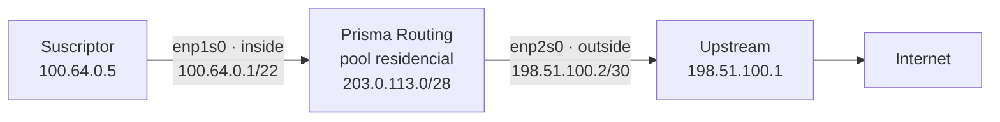
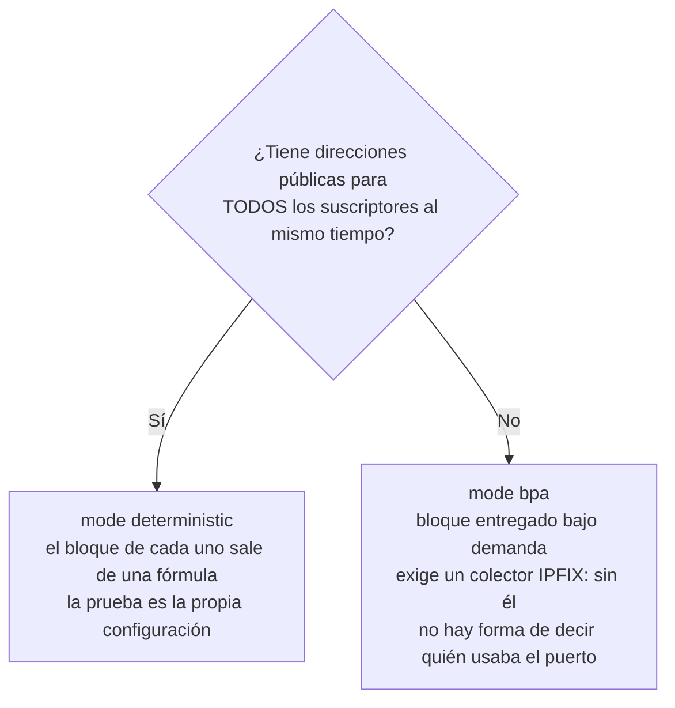

# Configurar el CGNAT paso a paso

Desde el equipo instalado hasta el primer suscriptor navegando traducido, en un orden que se puede seguir en la consola. Cada paso trae qué escribir, qué responde el equipo y cómo saber que salió bien antes de pasar al siguiente. Las pantallas de esta página se tomaron de un equipo que ejecuta esta versión, con un suscriptor real detrás.

El ejemplo usa una topología pequeña, que usted reemplaza por sus propios números:



| Qué | En el ejemplo | En su caso |
|-----|---------------|------------|
| Red de los suscriptores (detrás del equipo) | `100.64.0.0/22` | lo que entrega su BNG/OLT; `100.64.0.0/10` es el espacio reservado para eso |
| Direcciones públicas del pool | `203.0.113.0/28` | un prefijo suyo, que **no** está configurado en ninguna interfaz |
| Puerto de los suscriptores | `enp1s0`      | la placa orientada hacia el BNG |
| Puerto de salida | `enp2s0`, con `198.51.100.2/30` | la placa orientada hacia el upstream |

# Antes de empezar: tres decisiones

**1. Determinístico o dinámico.** Es la decisión que cambia lo que usted le deberá a la justicia después.



**2. Cuántos puertos recibe cada suscriptor** (`block-size`, potencia de dos). 512 es un buen comienzo para residencial. Con menos que eso, el bloque se llena con una consola de videojuegos y un televisor encendidos. Con más que eso, se gastan direcciones públicas.

**3. Cuántas direcciones públicas necesita.** En el determinístico, cada dirección pública atiende `puertos ÷ block-size` suscriptores. Con `ports 1024 65535` son 64.512 puertos: bloques de 512 dan **126 suscriptores por dirección pública**. El `/28` del ejemplo tiene 16 direcciones, así que admite 2.016 suscriptores, y la red interna de `/22` tiene 1.024. Sobra.

| Suscriptores | block-size | Direcciones públicas | Prefijo |
|--------------|------------|----------------------|---------|
| 1\.000       | 512        | 8                    | `/29`   |
| 10\.000      | 512        | 80                   | `/25`   |
| 200\.000     | 512        | 1\.588               | `/21`   |


:::warning
**La interfaz de gestión nunca entra en el CGNAT**, ni como `inside` ni como `outside`. Si administra el equipo por la red, anote ahora por qué placa, y no la use en ningún paso de esta página.

:::

# 1. Vea las placas que tiene el dataplane

```
prisma> show interface terse
```

```
  Interface                  Admin  Link   Proto  Local
  enp1s0                     down   up     -      -
  enp2s0                     down   up     -      -

  2 interface(s) on the dataplane can forward
```

`Link up` es el cable conectado. `Admin down` es solo porque nadie configuró el puerto todavía. El siguiente paso lo resuelve.

# 2. Asigne direcciones a los dos puertos y la ruta de salida

```
prisma> configure
prisma# [edit] interface enp1s0
prisma# [edit interface enp1s0] description assinantes
prisma# [edit interface enp1s0] ipv4 address 100.64.0.1/22
prisma# [edit interface enp1s0] no shutdown
prisma# [edit interface enp1s0] exit
prisma# [edit] interface enp2s0
prisma# [edit interface enp2s0] description upstream
prisma# [edit interface enp2s0] ipv4 address 198.51.100.2/30
prisma# [edit interface enp2s0] no shutdown
prisma# [edit interface enp2s0] exit
prisma# [edit] router static
prisma# [edit router static] 0.0.0.0/0 next-hop 198.51.100.1 description upstream
prisma# [edit router static] exit
prisma# [edit] commit
```

| Línea | Para qué |
|-------|----------|
| `ipv4 address 100.64.0.1/22` en `enp1s0` | es el gateway que usan los suscriptores |
| `ipv4 address 198.51.100.2/30` en `enp2s0` | el enlace con el upstream |
| `0.0.0.0/0 next-hop 198.51.100.1` | la ruta default: por donde sale el tráfico traducido |

Si los suscriptores **no** están en una red directamente conectada, sino detrás de un BNG que habla con el equipo por un enlace, agregue también la ruta de vuelta hacia ellos, en el mismo bloque: `100.64.0.0/10 next-hop <dirección-del-BNG>`.

**Verifique antes de seguir:**

```
prisma# [edit] exit
prisma> show interface terse
```

```
  Interface                  Admin  Link   Proto  Local
  enp1s0                     up     up     inet   100.64.0.1/22
  enp2s0                     up     up     inet   198.51.100.2/30

  2 interface(s) on the dataplane can forward
```

Y el upstream responde:

```
prisma> ping 198.51.100.1 count 2
```

```
2 packets transmitted, 2 received, 0% packet loss, time 1001ms
```

Si el ping no vuelve, deténgase aquí: el CGNAT no puede funcionar sobre un enlace que no funciona.

# 3. Cree el pool

Toda la configuración de CGNAT queda dentro de `nat` y, dentro de él, de `cgnat`. Entre en los dos niveles y cree el pool:

```
prisma> configure
prisma# [edit] nat
prisma# [edit nat] cgnat
prisma# [edit nat / cgnat] pool residencial
prisma# [edit nat / cgnat / pool residencial] prefix-inside 100.64.0.0/22
prisma# [edit nat / cgnat / pool residencial] prefix-outside 203.0.113.0/28
prisma# [edit nat / cgnat / pool residencial] block-size 512
prisma# [edit nat / cgnat / pool residencial] ports 1024 65535
prisma# [edit nat / cgnat / pool residencial] policy interleaved
prisma# [edit nat / cgnat / pool residencial] mode deterministic
prisma# [edit nat / cgnat / pool residencial] tcp-mss auto
prisma# [edit nat / cgnat / pool residencial] exit
```

El `exit` del pool vuelve a `cgnat`, que es donde continúa el siguiente paso. El prompt siempre muestra en qué nivel está, `top` vuelve directo a `[edit]`, y `commit` también funciona desde dentro del pool, si quiere aplicar antes de salir de él.

| Línea | Qué decide |
|-------|------------|
| `prefix-inside` | quién se traduce: las direcciones de los suscriptores |
| `prefix-outside` | con qué direcciones públicas salen |
| `block-size 512` | cuántos puertos recibe cada suscriptor |
| `ports 1024 65535` | el rango utilizable de cada dirección pública; por debajo de 1024 quedan los puertos de servicio |
| `policy interleaved` | los suscriptores vecinos salen por direcciones públicas **diferentes**, lo que diluye un bloqueo por reputación en una sola IP |
| `mode deterministic` | el bloque de cada uno sale de una fórmula, sin registro de asignación |
| `tcp-mss auto` | evita conexiones que se abren y se cuelgan sin ningún error cuando hay un túnel o PPPoE en el camino |

¿No recuerda qué sigue? **TAB** completa y `?` lista lo que es válido en ese punto, con descripción.

# 4. Indique qué puerto es el interno y cuál el externo

El lado del CGNAT es una propiedad de la interfaz, y se escribe en su bloque:

```
prisma# [edit nat / cgnat] top
prisma# [edit] interface enp1s0
prisma# [edit interface enp1s0] cgnat inside
prisma# [edit interface enp1s0] exit
prisma# [edit] interface enp2s0
prisma# [edit interface enp2s0] cgnat outside
prisma# [edit interface enp2s0] exit
```

`inside` es el puerto por donde llegan los suscriptores. `outside` es el puerto por donde sale el tráfico traducido.

# 5. Revise lo que va a cambiar, antes de cambiarlo

```
prisma# [edit] show configuration compare
```

```
+nat
+ cgnat
+  pool residencial
+   prefix-inside 100.64.0.0/22
+   prefix-outside 203.0.113.0/28
+   block-size 512
+   ports 1024 65535
+   policy interleaved
+   mode deterministic
+   tcp-mss auto
+   exit
+  exit
+ exit
 interface enp1s0
  ipv4 address 100.64.0.1/22
+ cgnat inside
  exit
```

Y, más abajo, la misma línea `+ cgnat outside` en el bloque de `enp2s0`.

Todo lo que tiene `+` es lo que entra. Después pida al equipo que lo valide, sin aplicar nada:

```
prisma# [edit] commit check
```

```
configuration check succeeds for CGNAT and the box's own configuration
  routing statements are checked for structure only; FRR validates them at
  commit, and can still refuse one
```

La segunda línea aparece porque la ruta por defecto del paso 2 es configuración de enrutamiento: la VTY verifica su forma, y quien la valida de hecho es el enrutamiento, en el `commit`.

El `commit check` rechaza aquí lo que no funcionaría, y dice por qué. El rechazo que más aparece en un pool nuevo es el de una dirección pública que también está en una interfaz del equipo:

```
error: pool 'errado': public address 198.51.100.2 is configured on enp2s0
    interface enp2s0 / ipv4 address 198.51.100.2/30
    nat / cgnat / pool errado / prefix-outside 198.51.100.0/30
    cgnat would translate the box's own control-plane traffic on that address:
    bpa-out2in runs before the box decides a packet is for itself, so the BGP
    session or OSPF adjacency on it drops for no apparent reason
    take the address off the interface, or narrow the pool's public range so
    that it does not contain it
```

Existe porque el CGNAT mira el paquete antes de que el equipo decida si es para sí mismo: una dirección de enlace dentro del pool hace que la sesión BGP de ese enlace se caiga sin motivo aparente. Corrija el `prefix-outside` a un prefijo que no esté en ninguna interfaz.

# 6. Aplique

```
prisma# [edit] commit comment "pool residencial inicial"
```

```
commit complete
```

El comentario queda en el trail de configuración, junto con la definición del pool, y es lo que usted va a leer dentro de un año, cuando alguien pregunte desde cuándo el mapeo es ese.


:::info
**¿Trabaja a distancia?** `commit confirmed 5` aplica ahora y se deshace solo en cinco minutos si no vuelve a escribir `commit`. Si el cambio corta su acceso, el equipo vuelve a como estaba.

:::

# 7. Haga que internet sepa volver al pool

El tráfico sale con origen `203.0.113.x`. Para que la respuesta vuelva, internet necesita saber que `203.0.113.0/28` se alcanza por este equipo. Hay dos formas:

| Forma | Cuándo usarla |
|-------|---------------|
| El upstream apunta una ruta estática hacia el pool, con próximo salto `198.51.100.2` | enlace con un solo proveedor, que acepta configurar la ruta |
| El propio equipo anuncia el prefijo en BGP | la forma normal en un ISP con AS propio |

Para anunciarlo desde aquí, el prefijo debe existir en la tabla de rutas (la ruta `blackhole` lo hace) y estar declarado en el BGP:

```
configure
 router static
  203.0.113.0/28 next-hop blackhole description pool residencial
  exit
 router bgp 65000
  bgp router-id 198.51.100.2
  neighbor 198.51.100.1 remote-as 64500
  neighbor 198.51.100.1 maximum-prefix 10000
  address-family ipv4 unicast
   network 203.0.113.0/28
  exit-address-family
  exit
 commit
```

De `router bgp` hacia adentro la sintaxis es la del enrutamiento (FRR), y la VTY le entrega esas líneas tal como se escribieron.

La ruta `blackhole` no retiene ningún tráfico de suscriptor: el CGNAT trata el paquete antes de la consulta de ruta. Solo le da al BGP algo que anunciar.

Si olvida esta parte y el equipo tiene BGP, el `commit check` lo advierte, y la advertencia ya trae las dos líneas que lo resuelven:

```
warning: pool 'dinamico': nothing here announces 203.0.113.16/28
    subscribers behind it would be translated to an address the internet cannot route back to
    announce it from another box, or originate it here with
    'ip route 203.0.113.16/28 blackhole' and 'network 203.0.113.16/28' under the BGP address family
```

La línea `ip route ... blackhole` que sugiere la advertencia también se acepta, escrita fuera de cualquier bloque: se convierte en la misma ruta de `router static`. Esta advertencia no rechaza el commit, porque anunciar el pool desde otro equipo es un diseño válido.

Sin el `maximum-prefix`, el `commit` también lo advierte, y con razón: un vecino que filtre la tabla completa llena la memoria del equipo.

```
warning: this eBGP session has no 'maximum-prefix': a peer that leaks a full
    table fills this box and nothing here stops it. 'neighbor 198.51.100.1
    maximum-prefix 10000' tears the session down instead of the box
    neighbor 198.51.100.1 remote-as 64500
```

# 8. Guarde

```
prisma# [edit] exit
prisma> save
```

```
configuration saved to /etc/prisma-routing/prisma-routing.conf
```

`commit` hace que tenga efecto ahora. `save` lo graba en disco. Sin el `save`, todo lo de esta página desaparece en el próximo arranque.

# 9. Solo en modo dinámico: el colector IPFIX

En el modo dinámico el equipo decide en el momento qué bloque recibe cada suscriptor, y la única prueba de quién tenía qué puerto es el registro exportado. **Sin colector, una orden judicial queda sin respuesta.** Configúrelo antes de poner suscriptores en el pool:

```
prisma> configure
prisma# [edit] nat
prisma# [edit nat] cgnat
prisma# [edit nat / cgnat] logging udp <ip-del-colector> src 198.51.100.2
prisma# [edit nat / cgnat] logging enable
prisma# [edit nat / cgnat] commit
```

`src` es obligatorio, y `enable` sin destino se rechaza. Para no perder registros cuando el colector se cae, también existe el transporte TCP (`logging tcp <ip-del-colector>`, también dentro de `cgnat`), y para un colector que solo entiende syslog, `logging syslog <ip-del-colector> enterprise <n>`. [Logging IPFIX y trail de auditoría](/s/wiki-es/doc/logging-ipfix-y-trail-de-auditoria-LHGHuvEHJy) explica la diferencia entre los tres.

Si lo olvida, el `commit` **no** lo advierte: un pool `bpa` sin exportación se acepta en silencio, porque un pool armado antes de que exista el colector es una configuración válida. Quien dice si el equipo está exportando es `show cgnat logging` y el autotest de arranque, que advierte cuando un pool corre en modo `bpa` y no se está exportando nada.

En el modo determinístico este paso es opcional: la fórmula responde por sí sola, como muestra el último paso. La excepción es un pool determinístico con `reserve`, porque los bloques de la reserva quedan fuera de la fórmula y también necesitan el colector.

# 10. Verifique con un suscriptor real

**El pool:**

```
prisma> show cgnat pool
```

```
pool residencial [deterministic / interleaved]
  inside       100.64.0.0+1024 (1024 addresses, 1 range(s))
  outside      203.0.113.0+16 (16 addresses, 1 range(s))
  ports        1024-65535 (64512 per IP)
  block        512 ports -> 126 blocks per public IP
  sharing      126:1
  per sub      512 ports (one block)
  capacity     2016 subscribers (usable 1024)
```

`capacity` es cuántos suscriptores admiten las direcciones públicas, y `usable` es cuántos tiene el `prefix-inside`. Si `usable` es mayor que `capacity`, faltan direcciones públicas.

**Un suscriptor, antes de que navegue.** En el determinístico el equipo ya conoce su dirección y sus puertos:

```
prisma> show cgnat subscriber 100.64.0.5
```

```
subscriber 100.64.0.5   pool residencial, index 5, worker thread 0
  the formula gives it 203.0.113.5 ports 1024-1535
  no live state: this subscriber holds no block and has no sessions on this box
```

**El mismo suscriptor, después de abrir una página:**

```
subscriber 100.64.0.5   pool residencial, index 5, worker thread 0
  the formula gives it 203.0.113.5 ports 1024-1535
  block 0  203.0.113.5  ports 1024-1535   3 of 512 in use (0%), 509 free
  sessions 3   refusals: ports 0, session cap 0, rate cap 0
```

`3 of 512 in use` son sus conexiones en ese momento. `refusals` en cero quiere decir que no se le rechazó nada por falta de puertos.

El tráfico del suscriptor hacia el **propio equipo** —el `ping` al gateway `100.64.0.1`, un `ssh` o una consulta DNS a él— no se traduce ni abre sesión: llega al equipo con la dirección del suscriptor, y `show cgnat drops` lo cuenta en `everything else it counted`, en la línea `packets to this box itself, left untranslated`: no es pérdida.

**Quién está más cerca de llenar el bloque**, y **lo que no pasó**:

```
prisma> show cgnat top
```

```
subscriber       pool               ports  full  blocks  refusals
100.64.0.5       residencial      3/512      0%       1         0
1 subscriber(s) holding blocks
```

```
prisma> show cgnat drops
```

```
bpa-in2out
  nothing dropped
  everything else it counted
            14  packets translated
             3  sessions created
```

**La pregunta de una orden judicial o de una denuncia de abuso**: quién estaba detrás de una dirección pública y un puerto:

```
prisma> show cgnat translation 203.0.113.5 1029
```

```
203.0.113.5:1029  ->  100.64.0.5
  pool residencial, block 5, DETERMINISTIC
  from the FORMULA. It holds for any instant, past or present, as long as this pool's addresses and block size have not changed since. No allocation record is involved.
```

En el determinístico esa respuesta vale para cualquier momento, pasado o presente, mientras las direcciones y el `block-size` del pool no cambien. Por eso cambiar el mapeo de un pool en uso no es trivial.


:::warning
**Cambiar** `**prefix-inside**`**,** `**prefix-outside**`**,** `**block-size**`**,** `**ports**`**,** `**policy**` **o** `**mode**` **en un pool en uso cambia la dirección y los puertos de casi todos, y tira todas las sesiones del pool.** El equipo no deja que esto ocurra por error: el `commit` lo rechaza, dice cuántos suscriptores cambian y pide que usted lo confirme por el nombre.

```
error: this change re-maps subscribers that already have mappings
    1008 of 1024 subscribers change public address or port block; 0 hold live
    state right now
```

Para crecer sin tirar a nadie, el camino es un **segundo pool**. Vea [Ampliar la capacidad sin tirar suscriptores](/s/wiki-es/doc/ampliar-la-capacidad-sin-tirar-suscriptores-eHEJEg47aX).

:::

# Cómo verificarlo

Antes de dar el CGNAT por listo:

- [ ] `show interface terse` muestra los dos puertos `up up`, con las direcciones correctas
- [ ] el upstream responde al `ping`
- [ ] `commit check` pasa sin errores, y sin la advertencia de prefijo no anunciado (o usted sabe quién lo anuncia)
- [ ] el puerto de gestión **no** aparece como `interface` dentro de `nat` > `cgnat`
- [ ] `show cgnat pool` muestra `usable` menor o igual a `capacity`
- [ ] `show cgnat subscriber <ip-de-prueba>` muestra bloque y sesiones después de que el suscriptor navega
- [ ] `show cgnat translation <ip-pública> <puerto>` devuelve el suscriptor
- [ ] en modo dinámico: `show cgnat logging` dice `state enabled` y el colector está recibiendo
- [ ] se ejecutó `save`


:::success
Con todos los ítems marcados, el suscriptor sale a internet con la dirección pública del pool, y cualquier puerto que use se puede rastrear hasta él.

:::

# Vea también

* [Configuración de pool](/s/wiki-es/doc/configuracion-de-pool-Y3cACG9QHA) — cada campo del pool, uno por uno
* [Configuración de CGNAT](/s/wiki-es/doc/configuracion-de-cgnat-WTgNXqphc5) — interfaces, timeouts globales y logging
* [Recetas del día a día](/s/wiki-es/doc/recetas-del-dia-a-dia-maiZboGbqY) — abrir un puerto, limitar a un suscriptor, ampliar el pool
* [Operación y diagnóstico](/s/wiki-es/doc/operacion-y-diagnostico-iHMcBJQ91I) — cuando algo no funcione
