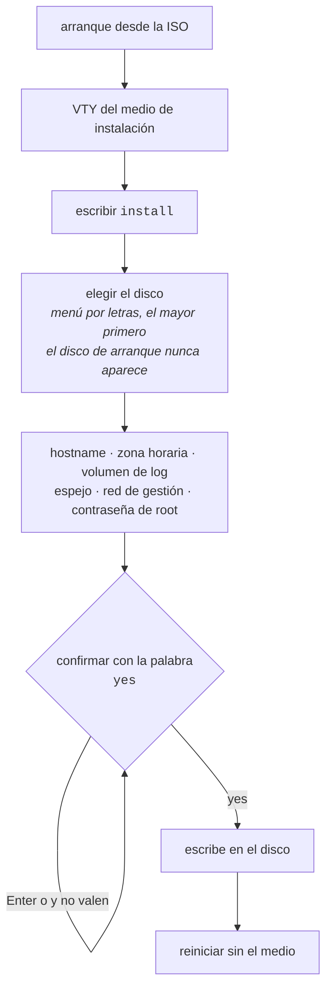

# Instalación del appliance

La ISO es un **medio de instalación**, no un appliance para uso directo. Arranca sin ninguna credencial, ejecuta el producto para inspección y ofrece un comando que la convierte en una máquina con dueño.

La ISO está en <https://prismarouting.com.br/releases/>, en la carpeta de la versión, con el `sha256` al lado. No todas las versiones traen ISO: las que solo traen el paquete de actualización son correcciones que se aplican sobre un equipo ya instalado. Por eso la carpeta <https://prismarouting.com.br/releases/latest/> ofrece **dos** cosas, cada una con su `sha256`: la **ISO más reciente** (`prisma-routing-<versión>.iso`), que es la que se graba para una máquina nueva, y el **paquete de actualización más reciente** (`prisma-routing-<versión>-upgrade.tar.gz`), que es el que se aplica después. Después de una versión solo de corrección, las dos tienen números diferentes, y eso es lo esperado: la ISO es de la última versión completa y el paquete es de la corrección más reciente.

Para una máquina nueva, descargue la ISO de `latest/` y verifíquela antes de grabarla: `sha256sum -c prisma-routing-<versión>.iso.sha256` tiene que responder `OK`. Una vez instalado, lleve el equipo a la versión más reciente desde la propia VTY:

```
prisma> system upgrade
prisma> system upgrade <versión>
```

Sin versión, solo dice qué versión ejecuta el equipo y cuál es la más reciente publicada. Con versión, descarga el paquete del directorio público, rechaza el paquete si no coincide con el `sha256` y lo aplica. El resto, incluido el `save` antes del próximo reinicio, está en [Llevar el equipo a una versión nueva](/s/wiki-es/doc/llevar-el-equipo-a-una-version-nueva-m1PIajBXEF).




:::info
No se escribe ningún byte antes de que **todas** las respuestas estén recopiladas y sean válidas.

:::

## Cómo instalar

Arranque desde la ISO. La consola cae directo en la VTY, justo debajo del nombre del producto:

```
Prisma Routing VTY <versión>
'?' for help, TAB to complete, 'configure' to edit, 'exit' to leave.

This is the installation medium: nothing here survives a reboot.
Type 'install' to install Prisma Routing onto a disk.

prisma> install
```

**Consola serial o monitor, da lo mismo.** El menú de GRUB aparece en el video y en el puerto serial (ttyS0, 115200 8N1), y toda entrada arranca con `console=tty0 console=ttyS0,115200`, las mismas palabras que recibe el equipo instalado. El informe del self-test y una instalación desatendida salen por la serial; el monitor sigue mostrando los mensajes del kernel y la VTY en tty1. Hasta la 0.152.x el medio no tenía ningún `console=`, y una máquina a la que se accedía solo por serial quedaba muda hasta que alguien editara la línea de GRUB a mano.

**En una máquina virtual, el agente del hipervisor ya viene instalado.** Desde la 0.156.0 el medio instala `qemu-guest-agent`, porque la mayoría de los equipos corre como VM en un Proxmox u otro KVM: con el canal del agente habilitado en la VM (`agent: 1` en Proxmox), el hipervisor puede apagar el equipo a través de él, congelar el disco para un backup y mostrar sus direcciones. El agente solo arranca cuando ese canal existe, así que en un servidor físico nada cambia. Un equipo instalado con un medio anterior y llevado a la versión nueva con `system upgrade` **no** lo recibe, porque el paquete de actualización no trae paquetes del sistema: instálelo con `apt-get install qemu-guest-agent` desde una shell de administrador (`start shell`).

El comando `install` existe en la VTY **solo cuando la máquina se está ejecutando desde el medio**. En un appliance ya instalado no está en el árbol de comandos y el instalador se niega a ejecutarse: un comando que sobrescribe el disco no debe quedar a un TAB de distancia de `interface` en un router en producción.

## Elección del disco

Los discos aparecen en una lista con letras, **el mayor primero**, con tamaño y modelo. El predeterminado (Enter) es el mayor, porque es el disco que alguien colocó en la máquina para alojar el sistema; el pendrive de 32 GB usado en el arranque no lo es.

```
Disks on this machine:
  a) /dev/sdb         932G  WD Black 1TB   <- default, the largest
  b) /dev/sda          32G  KINGSTON SA400

Install onto which disk (letter, or a device path) [a]:
```

Dos garantías:

* **El medio desde el que arrancó el sistema nunca aparece en la lista.** Es justamente el disco que alguien apurado elige, y sobrescribirlo falla a mitad de camino dejando los dos sistemas inutilizables.
* **Una ruta de dispositivo se sigue aceptando.** Los scripts tienen rutas y las personas tienen hábitos.

La confirmación repite el disco con tamaño y modelo, y se responde con la palabra `yes`:

```
  About to ERASE /dev/sdb  932G WD Black 1TB
  Everything on it is lost. This cannot be undone.
  Type 'yes' to install:
```

Un Enter vacío no es una respuesta. `y` tampoco. **Un disco no se puede destruir manteniendo presionada la tecla Enter.**

## Red de gestión

**Un appliance que no se puede alcanzar después de reiniciar no es un appliance.** El instalador pregunta, junto con las demás preguntas y antes de cualquier escritura, **en qué placa** se gestiona el equipo y **cómo se le asigna la dirección**:

```
  A NEW BOX IS CONFIGURED AT ITS CONSOLE, and that is the default
  here: every card this machine has goes to the dataplane, and none
  of them is kept back to be managed on. Answer with a card only if
  this box is reached over the network after it reboots; that card
  is then the one card the dataplane will not claim.

Network cards on this machine:
  a) enp1s0     up     virtio_net   192.0.2.10/24   <- this medium is reaching the network on this one
  b) enp2s0     down   virtio_net   none
  none) no management network   (this box is reached at its console)   <- default

Which card is this box managed on (letter, or a name) [none]:
```

La lista usa el nombre que Linux le da a la placa (`enp1s0`, `enp2s0`), que también es el nombre con el que aparece después en la VTY: el equipo instalado mantiene el nombre de Linux para cada placa, incluidas las que reclama el dataplane. La lista muestra **qué es cada placa** - si está activa, qué driver la maneja, qué dirección tiene en este momento - porque `enp1s0` y `enp2s0` no le dicen a nadie qué cable está en cuál. La placa por la que el propio medio está alcanzando la red ahora aparece señalada en la lista, porque es la que el operador quiere cuando quiere una: ya no es la predeterminada.


:::info
**El valor predeterminado es** `**none**`**.** Desde la 0.76.0 el equipo reclama por sí solo todas las placas que tiene, y un equipo nuevo se configura en su consola. Responder una placa es una decisión: esa placa pasa a ser la única que el dataplane **no** va a reclamar. Quien presiona Enter recibe el equipo que este producto describe, en vez de una placa apartada sin que nadie lo haya decidido.

Antes de esta versión el valor predeterminado era la placa del propio medio, y una instalación desatendida tomaba esa placa sin que nadie dijera nada, sin nadie mirando, que es justamente cuando la decisión no debería tomarse sola.

:::

Al responder una placa, el instalador pregunta a continuación cómo se le asigna la dirección:

```
Address: 'dhcp', or one like 10.0.0.2/24 [dhcp]:
```


:::info
**El valor predeterminado de la dirección es** `**dhcp**`**.** Una máquina virtual en una red de laboratorio tiene servidor DHCP y ninguna dirección reservada; un appliance en el rack tiene una dirección reservada y muchas veces ningún DHCP. Solo uno de los dos puede ser el predeterminado, y es el primero: quien presiona Enter necesita recibir un equipo que funcione. Quien está armando el rack ya tiene la dirección anotada delante y la escribe: es una respuesta en ambos casos.

El precio está dicho: un equipo que responde `dhcp` donde nadie responde espera a que el cliente desista antes de terminar el arranque, y después **dice en la consola** que está sin dirección.

:::

Con dirección estática, el instalador además pregunta el gateway y los servidores DNS. **Un gateway fuera de la subred de la dirección se rechaza en el acto**, por aritmética: `ifup` rechaza esa ruta cuando la interfaz se levanta y sigue adelante, así que el equipo arrancaría con dirección, sin ruta predeterminada, alcanzable desde su propia subred y desde ningún otro lugar. A distancia, eso es indistinguible de un equipo que no arrancó.

`none` también es una respuesta, y se **graba**. Sin el archivo, un equipo cuyo operador eligió no tener red de gestión y un equipo instalado por un medio que nunca preguntó son el mismo equipo en el disco, y uno de los dos tiene que ser señalado a gritos en cada arranque mientras que el otro no.


:::warning
**Responder** `**none**` **también decide quién se queda con las placas.** La reserva que impide que el dataplane tome una placa **es** esta respuesta: sin ella, no hay nada reservado para Linux, y una placa que nada reserva es una placa que el dataplane reclama en el próximo arranque: todas, incluida la que usted está usando para administrar el equipo.

El equipo no se pierde: la dirección pasa al par que el dataplane mantiene para esa placa, y pasa a alcanzarse **a través** del dataplane en vez de al lado de él. Pero es un cambio de camino que nadie pidió, y el autotest lo advierte en cada arranque mientras eso sea así:

```
no management network was asked for, and this box is on one anyway
```

Para reservar una placa para Linux después, escriba la estrofa que habría escrito el instalador —en un shell de administrador (`start shell`)— y reinicie el equipo:

```
F=/etc/network/interfaces.d/prisma-routing
echo "auto enp2s0" >> $F
echo "iface enp2s0 inet dhcp" >> $F
```

Una dirección estática lleva `inet static` y una línea `address`. El otro camino, sin shell, es nombrar en la VTY la placa de los suscriptores en `system` > `dataplane` > `interface <placa>`: el dataplane pasa a reclamar solo esa, y las demás quedan para Linux. Vea [Primeros pasos](/s/wiki-es/doc/primeros-pasos-1atRsTUyKZ).

:::

### Lo que dice el equipo después

El autotest de arranque vuelve a leer **el mismo archivo** en cada arranque e informa qué pasó con él:

| Línea en el autotest | Significado |
|----------------------|-------------|
| `[ ok ] managed on enp1s0 (dhcp)` | con la dirección y la ruta impresas debajo |
| `[warn] enp1s0 is up with no default route` | tiene dirección, no tiene ruta predeterminada, y no se pidió ningún gateway |
| `[FAIL] ... has an address and no default route` | **el gateway respondido no tuvo efecto.** La línea nombra el gateway que no entró |
| `[FAIL] ... has no address` | DHCP sin respuesta, o `ifup` falló |
| `[FAIL] management network: this box has no card called enp1s0` | la placa de la instalación ya no está en el equipo. Lista las que están |
| `[FAIL] no management network: nothing was ever written for one` | medio hasta la 0.72.0. La línea trae los comandos que lo resuelven desde esa consola |
| `[info] no management network was asked for at install time` | respondió `none`, y el equipo está realmente solo en la consola |
| `[warn] no management network was asked for, and this box is on one anyway` | respondió `none`, pero Linux tiene una placa con dirección, y es una placa que el dataplane reclama en el próximo arranque |


:::success
**La dirección se imprime en cada arranque**, y es la mitad del motivo por el que DHCP puede ser el predeterminado: un equipo cuya dirección nadie eligió igual le dice, a quien está de pie frente a la consola serial, adónde hacer `ssh`.

:::

## Un medio antiguo trae claves SSH, y la instalación lo advierte

Los medios antiguos de este producto venían con las claves de host SSH ya generadas dentro de la imagen. Todo equipo instalado desde uno de esos medios respondía con la misma clave, y su mitad privada está en el propio medio.

Esas claves no van al disco: la instalación borra lo que vino en el medio y genera un par nuevo, propio de este equipo. Cuando el medio lleva claves, lo dice en la consola:

```
==>   this medium carries ssh host keys; they are not going on the disk:
==>     ssh_host_ecdsa_key ssh_host_ed25519_key ssh_host_rsa_key
==>   every box installed from this medium answers with them
```


:::warning
**El equipo recién instalado está limpio; la advertencia es sobre el medio.** Los otros equipos que se instalaron desde ese mismo medio siguen respondiendo con esa clave hasta que alguien genere claves nuevas en cada uno. El procedimiento, y lo que le cuesta a quien administra, están en [Operación y diagnóstico](/s/wiki-es/doc/operacion-y-diagnostico-iHMcBJQ91I), en la sección sobre el autotest que dice que las claves SSH no se generaron en el equipo.

:::

Un medio nuevo no lleva ninguna clave, y en ese caso la instalación no dice nada de esto.

## Todo se pregunta antes de cualquier escritura

| Pregunta | Se rechaza cuando |
|----------|-------------------|
| Disco de destino | no es un dispositivo de bloques, o es el medio desde el que arrancó el sistema |
| Hostname | contiene caracteres que un hostname no puede tener |
| Zona horaria | esa zona no existe en `/usr/share/zoneinfo` |
| Gigabytes del volumen de log | no es un número entero, es menor que 1 GB, o dejaría al sistema con menos de 8 GB |
| Disco del espejo | es el disco de destino, el medio de arranque, una partición, o es demasiado pequeño para el volumen de log |
| Placa de gestión | esta máquina no tiene una placa con ese nombre |
| Dirección de gestión | no es `dhcp`, no es `none` y no es una dirección con prefijo entre 1 y 32 |
| Gateway  | no es una dirección, no está en la subred de la dirección, o vino junto con `dhcp` |
| Contraseña de root | está vacía, o las dos entradas no coinciden |

No se escribe ningún byte en el disco antes de que todas las respuestas estén recopiladas y sean válidas.

## Dónde quedan los registros de conexión

El disco se divide en **tres** particiones, no dos:

| Partición | Contenido |
|-----------|-----------|
| ESP       | 512 MB    |
| raíz      | el resto, menos los registros |
| `/var/log/prisma-routing` | lo que pidió el operador |

**Este equipo no guarda registros de conexión.** Los **exporta** —IPFIX por UDP o TCP, o syslog— y no se queda con ninguno: quien los guarda durante el año que exige el Marco Civil (Ley 12.965/2014 de Brasil; los requisitos de retención varían según el país) es el colector. Lo que queda en este volumen es el **trail de configuración**, que es pequeño y es la prueba fechada de lo que el equipo fue configurado para hacer, y el **spill** que el exportador escribe mientras el colector es inalcanzable.

En el sistema de archivos raíz, cualquiera de los dos comparte espacio con todo lo que el equipo necesita para funcionar: un colector inalcanzable durante una semana impide que el equipo escriba su propia configuración. Con un sistema de archivos propio, un volumen de log lleno es un volumen de log lleno.

El valor predeterminado es un cálculo, no una suposición:

```
  The configuration trail and the export spill go on their own
  filesystem, so that a full log cannot stop the box working. This box
  does not keep connection records: it exports them, and whoever keeps
  them for the year the law asks for is the collector. What this size
  buys is how long the box can spill while a collector is unreachable.
  The arithmetic is in
  /usr/share/doc/prisma-routing/logging.md once this box is installed.
  This disk is 240 GB; at most 231 GB can go to this volume.
Gigabytes for the trail and the export spill [30]:
```

30 GB dan más de un año de *spill* a \~80 MB/día, que es la tasa de 200 mil suscriptores en modo dinámico, mucho más que cualquier indisponibilidad que alguien planifique. **El modo determinístico exporta casi nada** y necesita casi nada de esto; por eso es una pregunta y no una constante. La raíz nunca queda con menos de 8 GB, y un tamaño que la dejaría así se rechaza con el cálculo, en vez de aceptarse y descubrirse después.


:::info
El volumen se monta con `nofail`. Un equipo que no arranca porque ese volumen desapareció es un equipo en el que nadie puede entrar para averiguar por qué: arranca y se queja. Por eso el autotest de arranque **informa dónde está el volumen**: sin eso, un equipo cuyo volumen no se montó vuelve a escribir en la raíz en silencio.

:::

## Espejo del volumen de log en dos discos

Con un solo disco, una única falla de hardware pierde **lo que está en ese volumen**, y eso no es lo mismo que quedar fuera de servicio: la indisponibilidad termina con una reinstalación, y esa pérdida no. El trail de configuración es la prueba fechada de lo que el equipo fue configurado para hacer —en modo determinístico, la mitad de la respuesta a una orden judicial, siendo el algoritmo la otra mitad— y el spill son registros que el colector **todavía no recibió**, así que un disco que se los lleva abre un hueco en el año de retención de otra persona que nada en este equipo recompone.

Por eso, cuando la máquina tiene un segundo disco, el instalador pregunta:

```
  This machine has another disk. The log volume - the configuration
  trail, and the records the collector has not received yet - can be
  kept on BOTH, so that one disk failing does not take it with it,
  which is a loss no reinstall undoes.
  The system is NOT mirrored: a dead system disk is a reinstall, and
  what is on the survivor can still be read on another machine.
  EVERYTHING ON THE DISK YOU CHOOSE IS DESTROYED.
  a) /dev/sdc         932G  WD Black 1TB
  none) one disk, no mirror   <- default

Mirror the log volume onto which disk [none]:
```


:::info
**El valor predeterminado es** `**none**`**, y un Enter vacío acepta el predeterminado.** Un segundo disco dentro de la máquina no es una autorización para destruir lo que hay en él. La confirmación final repite **los dos** discos, porque ambos se borran con el mismo `yes`.

:::

**Se espeja ese volumen, y no el sistema.** La asimetría es la razón de ser del espejo, y sus dos lados se midieron en un equipo instalado y luego encendido con ese disco retirado:

| Muere el disco | Lo que se observó |
|----------------|-------------------|
| del espejo     | el equipo arranca normalmente, el volumen sigue montado en el arreglo funcionando con una sola pata, lo que se grabó antes de la falla sigue ahí, y el autotest dice `[FAIL] the records mirror is DEGRADED: 1 of 2 disks` sin nadie conectado |
| del sistema    | la máquina no llega a cargar nada: se queda en el firmware. Es una reinstalación. **El contenido del disco sobreviviente se leyó en otra máquina**, con ese equipo apagado |

A un equipo con **un solo disco** no se le pregunta, no recibe ningún arreglo y su autotest no menciona el espejo. Nada cambia para quien tiene un disco.

El segundo disco se rechaza cuando es el disco de destino, cuando es el medio de arranque, cuando es una partición en lugar de un disco entero, o cuando es menor que el tamaño pedido para el volumen de log - un espejo tiene el tamaño de su disco más pequeño.

### Lo que dice el equipo después

El autotest de arranque informa el estado del espejo en **cada** arranque. Un espejo que nadie supervisa se convierte, en silencio, en un solo disco, y después en ninguno.

| Línea en el autotest | Significado |
|----------------------|-------------|
| `[ ok ] records mirrored on 2 disks (...)` | los dos discos, al día |
| `[ ok ] ... synchronising 20.0%` | los dos discos, todavía copiando. Ya está protegido |
| `[warn] the records mirror is REBUILDING` | disco reemplazado, copia en curso |
| `[FAIL] the records mirror is DEGRADED` | **murió un disco.** La próxima falla pierde el año |
| `[FAIL] ... installed with a records mirror and is not using it` | el equipo se instaló con espejo y no está usando ninguno |

Justo después de la instalación el espejo todavía se está sincronizando, en segundo plano. El equipo ya se puede usar: la escritura va a los dos discos desde el primer instante.

## Instalación desatendida

Para laboratorio, pruebas de arranque y PXE, las respuestas vienen de la línea de comandos del kernel:

| Parámetro | Efecto |
|-----------|--------|
| `prisma-routing.install` | pregunta todo en la consola |
| `prisma-routing.install=/dev/vda` | usa ese disco, y sigue preguntando el resto |
| `prisma-routing.hostname=<nombre>` | responde la pregunta del hostname |
| `prisma-routing.timezone=<zona>` | responde la pregunta de la zona horaria |
| `prisma-routing.password=<contraseña>` | responde la pregunta de la contraseña de root |
| `prisma-routing.log-gb=<n>` | gigabytes para los registros de conexión |
| `prisma-routing.mirror=<disco>` | espeja los registros en ese segundo disco |
| `prisma-routing.mgmt-interface=<placa>` | placa por la que se gestiona el equipo |
| `prisma-routing.mgmt-address=<a>` | `dhcp`, `a.b.c.d/nn`, o `none` |
| `prisma-routing.mgmt-gateway=<ip>` | solo con dirección estática |
| `prisma-routing.mgmt-dns=<ip>[,<ip>]` | solo con dirección estática |
| `prisma-routing.answers[=<archivo>]` | lee las respuestas de un archivo (sección siguiente) |
| `prisma-routing.yes` | omite las confirmaciones y después **apaga la máquina** |


:::warning
**Atención con** `prisma-routing.password`**:** la línea de comandos del kernel queda legible para todos en `/proc/cmdline` durante toda la vida del sistema que arrancó. No sobrevive en la máquina instalada, pero cualquiera conectado al medio durante la instalación puede leerla. Para una instalación presencial, déjela fuera y responda en el prompt. Para una instalación desatendida, use el archivo de respuestas.

:::

Con `prisma-routing.yes`, la red de gestión es `none` y el instalador lo dice: una instalación desatendida que quiere red de gestión pasa `prisma-routing.mgmt-address=`, y entonces el instalador usa la placa por la que el medio está alcanzando la red, o `prisma-routing.mgmt-interface=` para elegir otra.

Con `prisma-routing.yes` y sin `prisma-routing.log-gb`, el instalador toma el valor predeterminado **y dice que lo tomó**. Una instalación desatendida no tiene una consola desde la cual responder, y una pregunta que nadie puede responder es una instalación colgada.

El apagado al final no es una comodidad: sin él la máquina queda en un prompt de login hasta que alguien la apague, y el mensaje de finalización sale truncado.

### Respuestas en un archivo

Es el camino recomendado para una instalación desatendida: las mismas respuestas, la contraseña entre ellas, leídas de un archivo en lugar de publicadas para todo proceso del medio.

```
disk     = /dev/sda
hostname = cgnat01
timezone = America/Sao_Paulo
log-gb   = 30
password = <la contraseña de root de este equipo>
yes      = yes
```

`prisma-routing.answers` sin valor lee `prisma-routing.answers` en la raíz del medio; con valor, la ruta indicada. Las claves son `disk`, `hostname`, `timezone`, `log-gb`, `mirror`, `password`, `mgmt-interface`, `mgmt-address`, `mgmt-gateway`, `mgmt-dns` y `yes`, con el mismo significado que los parámetros anteriores.

| Regla | Por qué |
|-------|---------|
| Una clave desconocida se **rechaza**, no se ignora | un `password` mal escrito sería una instalación detenida en una pregunta sin consola para responder |
| Un archivo que no existe se rechaza | caer en las preguntas es el mismo bloqueo por otro camino |
| Una respuesta dada en la línea de comandos **gana** sobre el archivo | la línea se escribe para este arranque; el archivo viaja con el medio a toda instalación |
| `#` solo inicia un comentario al **principio** de la línea | una contraseña puede contener `#`, y cortarla ahí instalaría un equipo con un pedazo de la contraseña |
| La contraseña nunca se imprime, ni siquiera en un error | una línea que no se entendió se cita por su número, no por su contenido |


:::warning
**El archivo es una credencial.** Saca la contraseña de `/proc/cmdline` y la pone en el medio: quien lee el medio lee la contraseña, y la instalación lo dice en la consola. Ninguna ISO publicada trae un archivo de respuestas; escriba el suyo en el medio que usa y guarde ese medio como guardaría la contraseña. El archivo no se copia al equipo instalado.

:::

# Cómo verificarlo

Después del primer arranque sin el medio:

* la consola muestra el informe del self-test, **sin ninguna línea** `**[FAIL]**`;
* entre ellas, `binary API registered, so pools can be configured`: sin ella el equipo enruta y responde, pero no se puede crear ningún pool;
* si respondió una placa de gestión, una línea `managed on <placa>` con la dirección debajo - es por ahí que usted llega al equipo sin volver a la consola; si respondió `none`, la línea `[info] no management network was asked for at install time`;
* `the dataplane runs in a container on this box` y `backplane: 128.0.0.0/8 in VRF prisma-bp, out of the main table`: el equipo instalado ejecuta en contenedores el dataplane, el enrutamiento, el plano de gestión (donde está la VTY) y el exportador de registros del CGNAT; el plano de gestión habla con el sistema por una red interna en `128.0.0.0/8` que queda en una tabla de rutas propia: las direcciones reales en `128.x` siguen siendo alcanzables, por el equipo y por los suscriptores;
* `show version` responde con la versión de Prisma Routing, del dataplane y del enrutamiento;
* usted puede entrar con la contraseña definida durante la instalación.

El medio de cada versión se instala en disco y se arranca sin el medio antes de publicarse: arrancar la imagen live prueba que arranca, no que produce un appliance que funciona.


:::success
Self-test **sin** `**[FAIL]**` y `show version` respondiendo: la instalación es válida. "Listo" por sí solo no basta: es la línea de la API binaria la que dice que se puede crear un pool. El siguiente paso es [Primeros pasos](/s/wiki-es/doc/primeros-pasos-1atRsTUyKZ).

:::

# Vea también

* [Acceso, login y roles](/s/wiki-es/doc/acceso-login-y-roles-ZiA9s69LH4) — dónde cae usted al entrar, y quién puede qué
* [Dimensionamiento y requisitos](/s/wiki-es/doc/dimensionamiento-y-requisitos-FuEOaBC4vd) — la máquina y el disco antes de instalar
* [Llevar el equipo a una versión nueva](/s/wiki-es/doc/llevar-el-equipo-a-una-version-nueva-m1PIajBXEF) — después de instalarlo
