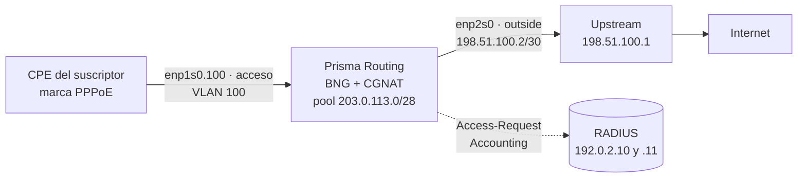

# Poner suscriptores PPPoE en el aire, paso a paso

Desde el puerto de acceso hasta el primer suscriptor marcando, autenticado en su RADIUS, con plan de ancho de banda y saliendo por el CGNAT, con Prisma Routing haciendo de BNG. Es para quien va a poner el equipo en lugar del concentrador PPPoE y quiere un orden que se pueda seguir en la consola. Cada declaración tiene su línea en [Configuración de PPPoE](/s/wiki-es/doc/configuracion-de-pppoe-vICaYDQz0M); aquí está solo el camino, en el orden en que se hace.

El ejemplo usa una topología pequeña, que usted reemplaza por sus propios números:



| Qué | En el ejemplo | En su caso |
|-----|---------------|------------|
| Puerto de acceso | `enp1s0`, VLAN 100 (`enp1s0.100`) | la placa hacia la OLT o el switch de acceso |
| Puerto de salida | `enp2s0`, con `198.51.100.2/30` | la placa hacia el upstream |
| Dirección del equipo en cada sesión | `100.64.0.1` | una dirección del rango de los suscriptores |
| Direcciones de las sesiones | `100.64.0.10` a `100.64.3.250` | lo que el RADIUS no entregue sale de aquí |
| Pool del CGNAT | `100.64.0.0/22` hacia `203.0.113.0/28` | un `prefix-inside` que cubra las direcciones de las sesiones |
| Servidores RADIUS | `192.0.2.10` y `192.0.2.11` | los suyos |
| IPv6 (opcional) | WAN de `2001:db8:100::/40`, delegado de `2001:db8:200::/36` | prefijos suyos |

# Antes de empezar

**Quién puede.** Los bloques `pppoe` y `aaa` son configuración del equipo entero, no solo de CGNAT: solo una cuenta `prisma-admin` (o `root`) los modifica. Vea [Acceso, login y roles](/s/wiki-es/doc/acceso-login-y-roles-ZiA9s69LH4).

**Qué necesita tener el RADIUS.** El equipo dado de alta como cliente (NAS), con el secreto compartido que usted va a escribir en el paso 3, y los usuarios con sus contraseñas. La dirección de cada suscriptor puede venir del RADIUS (`Framed-IP-Address`) o del pool del equipo; las dos conviven.

**Una limitación de diseño.** Todas las interfaces de acceso están en la misma placa física: tantas VLANs de ella como quiera, una etiqueta cada una. QinQ (dos etiquetas) y alta disponibilidad de las sesiones no existen en esta versión.


:::warning
**Todo cambio en el bloque** `**pppoe**` **tira todas las sesiones PPPoE**: el plano de control se reinicia y los CPEs marcan de nuevo. En un equipo ya en producción, haga los cambios del bloque `pppoe` en una ventana de mantenimiento. Los cambios solo en `aaa` > `radius` (un servidor más, otro modo, otro tiempo) no tiran a nadie, salvo el primer servidor configurado y el `dynamic-authorization`, que también reinician.

:::

# 1. Prepare el puerto de acceso y la VLAN

El puerto de acceso no necesita dirección IP: los suscriptores le hablan PPPoE, no IP. Solo necesita estar encendido y, si los suscriptores llegan etiquetados, tener la subinterfaz con la etiqueta:

```
prisma> configure
prisma# [edit] interface enp1s0
prisma# [edit interface enp1s0] description acesso-olt
prisma# [edit interface enp1s0] no shutdown
prisma# [edit interface enp1s0] exit
prisma# [edit] interface enp1s0.100
prisma# [edit interface enp1s0.100] vlan 100
prisma# [edit interface enp1s0.100] exit
```

| Línea | Para qué |
|-------|----------|
| `no shutdown` en `enp1s0` | enciende la placa; la subinterfaz sube junto con ella |
| `interface enp1s0.100` | escribir un nombre nuevo con la forma `<padre>.<etiqueta>` crea la subinterfaz |
| `vlan 100` | la etiqueta que envían los CPEs; una sola por subinterfaz |

Si los suscriptores llegan sin etiqueta, use la propia `enp1s0` como interfaz de acceso en el paso 4 y omita la subinterfaz. Las dos formas pueden convivir en la misma placa. La subinterfaz, campo por campo, está en [Configuración de interfaz](/s/wiki-es/doc/configuracion-de-interfaz-5s5Ar68nsg).

# 2. La salida y el pool del CGNAT que va a traducir las sesiones

Cada sesión PPPoE se vuelve una interfaz en el dataplane, y el equipo la conecta al CGNAT por sí solo en cuanto la sesión recibe dirección: la dirección de la sesión la traduce el pool cuyo `prefix-inside` la contiene, exactamente como a un suscriptor detrás de un puerto `cgnat inside`. Por eso el puerto de acceso **no** lleva `cgnat inside`. Lo que hace falta es el puerto de salida y un pool que cubra las direcciones que van a recibir las sesiones:

```
prisma# [edit] interface enp2s0
prisma# [edit interface enp2s0] description upstream
prisma# [edit interface enp2s0] ipv4 address 198.51.100.2/30
prisma# [edit interface enp2s0] cgnat outside
prisma# [edit interface enp2s0] no shutdown
prisma# [edit interface enp2s0] exit
prisma# [edit] router static
prisma# [edit router static] 0.0.0.0/0 next-hop 198.51.100.1 description upstream
prisma# [edit router static] exit
prisma# [edit] nat
prisma# [edit nat] cgnat
prisma# [edit nat / cgnat] pool assinantes-pppoe
prisma# [edit nat / cgnat / pool assinantes-pppoe] prefix-inside 100.64.0.0/22
prisma# [edit nat / cgnat / pool assinantes-pppoe] prefix-outside 203.0.113.0/28
prisma# [edit nat / cgnat / pool assinantes-pppoe] block-size 512
prisma# [edit nat / cgnat / pool assinantes-pppoe] ports 1024 65535
prisma# [edit nat / cgnat / pool assinantes-pppoe] mode deterministic
prisma# [edit nat / cgnat / pool assinantes-pppoe] top
```

El pool es un pool de CGNAT como cualquier otro: la elección entre determinístico y dinámico, el tamaño del bloque, el anuncio del prefijo público en BGP y el colector IPFIX son los de [Configurar el CGNAT paso a paso](/s/wiki-es/doc/configurar-el-cgnat-paso-a-paso-v0ecpO8lbt), y valen igual aquí.


:::info
**Una dirección de sesión fuera de todo** `**prefix-inside**` **no se traduce.** Nada en el `commit` compara el `address-pool` del PPPoE (ni los `Framed-IP-Address` de su RADIUS) con los pools del CGNAT: compruebe usted que todo rango que una sesión pueda recibir esté dentro de un `prefix-inside`.

:::

# 3. Los servidores RADIUS

El RADIUS está en un bloque propio, `aaa` > `radius`, y no dentro de `pppoe`:

```
prisma# [edit] aaa
prisma# [edit aaa] radius
prisma# [edit aaa / radius] server 192.0.2.10 secret <secreto> priority 1
prisma# [edit aaa / radius] server 192.0.2.11 secret <secreto> priority 2
prisma# [edit aaa / radius] mode failover
prisma# [edit aaa / radius] nas-identifier bng-centro
prisma# [edit aaa / radius] exit
prisma# [edit aaa] exit
```

Cada servidor autentica y recibe contabilidad (puertos 1812 y 1813) si usted no indica otra cosa. Para separar los papeles, `role auth` o `role acct` al final de la línea del servidor; para otros puertos, `auth-port` y `acct-port`. Hasta ocho servidores.

**Failover o round-robin:**

| `mode` | Qué pasa | Cuándo elegirlo |
|--------|----------|-----------------|
| `failover` (el predeterminado) | toda solicitud va al servidor de menor `priority`; si no responde, la solicitud pasa al siguiente y el que calló queda fuera por `dead-time` segundos | un servidor principal y uno de respaldo |
| `round-robin` | cada solicitud va al siguiente servidor activo, por turno | servidores equivalentes, para repartir la carga |

En los dos modos, la contabilidad de una sesión nunca se divide: el Interim y el Stop van al servidor que recibió su Start, mientras responda. Y una sesión nunca cae porque la contabilidad quedó sin respuesta.

Los tiempos (`timeout` 3 s, `retries` 1, `dead-time` 30 s) ya son los que hacen que un servidor caído le cueste segundos a **un** suscriptor y nada a los demás. Cámbielos solo si tiene un motivo.

El secreto nunca aparece en una pantalla: `show running-config` y `show configuration compare` muestran `<set, not shown>` en su lugar.

# 4. El bloque `pppoe`

```
prisma# [edit] pppoe
prisma# [edit pppoe] interface enp1s0.100
prisma# [edit pppoe] gateway 100.64.0.1
prisma# [edit pppoe] address-pool 100.64.0.10-100.64.3.250
prisma# [edit pppoe] dns 192.0.2.53
prisma# [edit pppoe] dns 192.0.2.54
prisma# [edit pppoe] tcp-mss 1452
```

| Línea | Qué decide |
|-------|------------|
| `interface enp1s0.100` | dónde atiende PPPoE el equipo. Puede haber varias, todas de la misma placa. En cualquier otra interfaz (el uplink, un puerto `inside`) un PADI se descarta y nadie responde |
| `gateway 100.64.0.1` | la dirección del equipo en cada sesión. Obligatorio |
| `address-pool ...` | direcciones para quien el RADIUS no envía `Framed-IP-Address`; prefijo o rango, hasta 16. Puede faltar si el RADIUS siempre envía la dirección |
| `dns ...` | los resolvedores entregados al CPE, hasta 2 |
| `tcp-mss 1452` | limita el MSS de TCP en cada sesión: 1492 de MTU de PPPoE menos 40 de cabeceras. Evita conexiones que abren y se cuelgan |

Lo que queda fuera toma el valor predeterminado: `mtu` 1492, los tres métodos de autenticación (PAP, CHAP, MS-CHAPv2), `session-limit` 16.000 sesiones y `ac-name` `prisma-routing`. Si el equipo va a tener más de 16.000 suscriptores, ajuste `session-limit` ahora y lea su línea en la referencia: el techo que acepta el equipo depende de su RAM y solo crece de verdad después de guardar y reiniciar.

# 5. IPv6 en las sesiones (opcional)

Sin ninguna línea `ipv6`, la sesión es solo IPv4. Con ellas, cada sesión recibe un /64 de WAN por RA (el CPE arma su dirección por SLAAC) y, si el CPE lo pide, un prefijo delegado por DHCPv6 para la LAN del cliente:

```
prisma# [edit pppoe] ipv6 prefix-pool 2001:db8:100::/40
prisma# [edit pppoe] ipv6 delegated-pool 2001:db8:200::/36 length 56
prisma# [edit pppoe] ipv6 dns 2001:db8::53
```

| Línea | Qué entrega |
|-------|-------------|
| `ipv6 prefix-pool` | el /64 de WAN de cada sesión, cuando el RADIUS no envía `Framed-IPv6-Prefix` |
| `ipv6 delegated-pool ... length 56` | un /56 para la LAN de cada cliente, cuando el RADIUS no envía `Delegated-IPv6-Prefix` |
| `ipv6 dns` | resolvedores IPv6, en el RA y en DHCPv6 |

Si su RADIUS entrega los prefijos de todos, `ipv6 enable` enciende el IPv6 sin ningún pool. El IPv6 del suscriptor es **enrutado**, no pasa por el CGNAT: los prefijos de los dos pools tienen que ser alcanzables desde internet, anunciados por este equipo o por otro, como cualquier red suya.

# 6. El plan de ancho de banda

El plan de cada suscriptor viene del RADIUS, en el Access-Accept. Los atributos propios de Prisma (fabricante 67033) son los más simples:

| Atributo | Qué es |
|----------|--------|
| `Prisma-Rate-Limit-Down` | descarga, en kbit/s (`100000` es 100 Mbit/s) |
| `Prisma-Rate-Limit-Up` | subida, en kbit/s |

Si su RADIUS ya envía `Cisco-AVPair` (`rate-limit` o `sub-qos-policy`), también se lee; los formatos aceptados están en la referencia. El `Mikrotik-Rate-Limit` no se lee.

El diccionario para instalar en el servidor RADIUS sale del propio equipo:

```
prisma> show aaa radius dictionary
```

Para quien el RADIUS no envía ningún plan, un plan predeterminado en el bloque `pppoe`; sin él, esa sesión queda sin límite:

```
prisma# [edit pppoe] rate-limit default 20M/10M
```

**Cómo se aplica el límite.** El predeterminado es lo que sirve a la mayoría: la descarga pasa por una cola por sesión (shaper), que retiene el exceso y lo entrega al ritmo del plan, y la subida por descarte (policer). Con el shaper, una prueba de velocidad TCP llega al plan con pocas retransmisiones y el tráfico repartido por igual entre las conexiones del suscriptor. Para volver al descarte en la descarga, `rate-limit download policer`; la comparación medida de los dos está en [Configuración de PPPoE](/s/wiki-es/doc/configuracion-de-pppoe-vICaYDQz0M). El límite vale para IPv4 e IPv6 sumados.

# 7. Disconnect y CoA (opcional)

Para que su RADIUS (o el sistema de gestión detrás de él) tire una sesión o le cambie el plan sin que el suscriptor marque de nuevo, indique en qué dirección del equipo llegan las solicitudes y quién puede enviarlas:

```
prisma# [edit pppoe] top
prisma# [edit] aaa
prisma# [edit aaa] radius
prisma# [edit aaa / radius] dynamic-authorization listen 198.51.100.2
prisma# [edit aaa / radius] dynamic-authorization client 192.0.2.10 secret <secreto>
prisma# [edit aaa / radius] top
```

El puerto es el 3799 si usted no indica otro (`port <n>` al final del `listen`). Una solicitud de una dirección que no es `client`, o con el secreto equivocado, no recibe respuesta. Con eso:

| Solicitud | Efecto |
|-----------|--------|
| Disconnect-Request con `User-Name` o `Acct-Session-Id` | la sesión cae; el Stop sale con `Acct-Terminate-Cause = Admin-Reset` |
| CoA-Request con `Prisma-Rate-Limit-Down` y/o `-Up` | el plan cambia en el acto, en la sesión activa |
| CoA-Request con `Session-Timeout` | la sesión cae cuando vence el plazo |

Un CoA con algo que el equipo no aplica se rechaza entero (CoA-NAK) y nada cambia.

# 8. Aplique y guarde

Revise lo que va a entrar, aplique y guarde:

```
prisma# [edit] show configuration compare
prisma# [edit] commit comment "BNG: PPPoE na VLAN 100"
prisma# [edit] exit
prisma> save
```

En el `compare`, todo lo que tiene `+` es lo que entra, con los secretos en blanco. El `commit` revisa el bloque antes de aplicarlo y rechaza, diciendo por qué, lo que no funcionaría: sin `interface` o sin `gateway`, nadie contra quien autenticar, nadie que dé direcciones, interfaces de acceso en dos placas, una subinterfaz sin `vlan`, una interfaz que el dataplane no tiene. Aceptado, imprime una línea `pppoe:` que dice qué hizo el plano de control PPPoE; un cambio que solo releyó el RADIUS termina en `no session dropped`.

`commit` lo hace valer ahora; `save` lo graba en disco. Sin el `save`, todo desaparece en el próximo arranque.

# 9. La primera sesión

Conecte un CPE en la VLAN 100 con un usuario que su RADIUS conozca y compruebe, en este orden.

**El plano de control y la configuración:**

```
prisma> show pppoe summary
```

| Línea | Qué debe decir |
|-------|----------------|
| `control plane` | `running`. `configured, NOT running` es un plano de control que no arrancó: vea `show log kind exit` |
| `sessions` | cuántas sesiones están activas, empezando y terminando |
| `session trail` | cuántas líneas lleva grabadas el historial de sesiones; `NOT written` es una sesión por la que el equipo no puede responder |
| `access interfaces` | `enp1s0.100` |
| `radius` y una línea por servidor | el modo, los tiempos y cada servidor con su papel; `failed` al lado de un servidor que no está respondiendo |
| `rate limit` | de dónde viene el plan y el predeterminado, y debajo qué aplica cada sentido (shaper o policer) |

**Las sesiones:**

```
prisma> show pppoe sessions
```

Una línea por sesión: el id (el mismo `Acct-Session-Id` que recibió el RADIUS), el usuario, la dirección que recibió, el plan en descarga/subida (`-` sin límite) y cuánto tiempo lleva activa. Una sesión que todavía se está autenticando muestra `start` en lugar del tiempo. Con IPv6, debajo vienen las líneas `ipv6` (la WAN) y `delegated` (el prefijo de la LAN).

**Una sesión entera**, por el id de la primera columna:

```
prisma> show pppoe session <id>
```

Muestra la MAC del CPE, los prefijos IPv6, el tráfico y, para cada sentido limitado, cuánto pasó, cuánto esperó en la cola y cuánto se descartó. Es la pantalla para cuando el suscriptor dice que el plan no llega.

**Su tráfico en el CGNAT**, por la dirección que recibió la sesión:

```
prisma> show cgnat subscriber 100.64.0.10
```

Cuando el suscriptor navega, aparecen su bloque de puertos y sus sesiones, como para cualquier suscriptor del pool.

**En su RADIUS**, cada sesión deja un Accounting-Start, las actualizaciones intermedias cada 300 s (`interim-interval`) con sus bytes y, al caer, un Accounting-Stop.

Para tirar una sesión de prueba, `clear pppoe session <id>` (o `user <nombre>`, `address <A.B.C.D>`, `all`): el CPE recibe PADT, el RADIUS recibe el Stop, y el CPE marca de nuevo.

# 10. Quién tenía la dirección: el historial de sesiones

Con PPPoE, la dirección interna se entrega al marcar, por orden de llegada. El CGNAT dice qué dirección interna estaba detrás de una IP pública y de un puerto; quién tenía esa dirección interna en ese instante lo dice el historial de sesiones del equipo, grabado al inicio y al final de cada sesión, responda o no el RADIUS:

```
prisma> show pppoe history address 100.64.0.10 at 2026-10-13T02:51:00Z
prisma> show pppoe history user <nombre>
prisma> show pppoe history verify
```

El `verify` comprueba la cadena de hashes del historial y, cuando cuadra, dice `chain intact` y la cabeza de la cadena. En un pool determinístico las dos etapas salen de una vez:

```
prisma> show cgnat translation 203.0.113.5 1029 at 2026-10-13T02:51:00Z
```


:::warning
**Sin un colector de syslog, la prueba del historial queda solo dentro del equipo.** El equipo envía la cabeza de la cadena hacia fuera como evento `trail`, pero solo sale si hay un colector configurado en `system` > `logging`. Configúrelo antes de poner suscriptores reales, junto con el colector IPFIX si el pool es dinámico. Vea [Logging IPFIX y trail de auditoría](/s/wiki-es/doc/logging-ipfix-y-trail-de-auditoria-LHGHuvEHJy).

:::

# Cómo comprobar

Antes de dar el BNG por listo:

- [ ] `show pppoe summary` dice `control plane` `running` y lista la interfaz de acceso correcta
- [ ] cada servidor RADIUS aparece en el resumen, ninguno `failed`
- [ ] un CPE de prueba aparece en `show pppoe sessions` con dirección y plan, y no se queda en `start`
- [ ] `show pppoe session <id>` muestra tráfico en los dos sentidos
- [ ] `show cgnat subscriber <dirección-de-la-sesión>` muestra bloque y sesiones cuando el CPE navega
- [ ] el RADIUS recibió el Accounting-Start de la sesión de prueba
- [ ] con IPv6: la sesión tiene las líneas `ipv6` y `delegated`, y el CPE navega por IPv6
- [ ] `show pppoe history verify` dice `chain intact`
- [ ] se ejecutó `save`


:::success
Con todos los puntos marcados, el suscriptor marca, se autentica en su RADIUS, recibe el plan, sale a internet con la dirección pública del pool, y cualquier puerto que haya usado se puede rastrear hasta el usuario PPPoE.

:::
