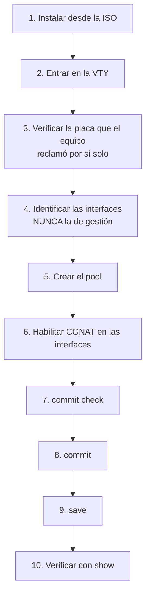
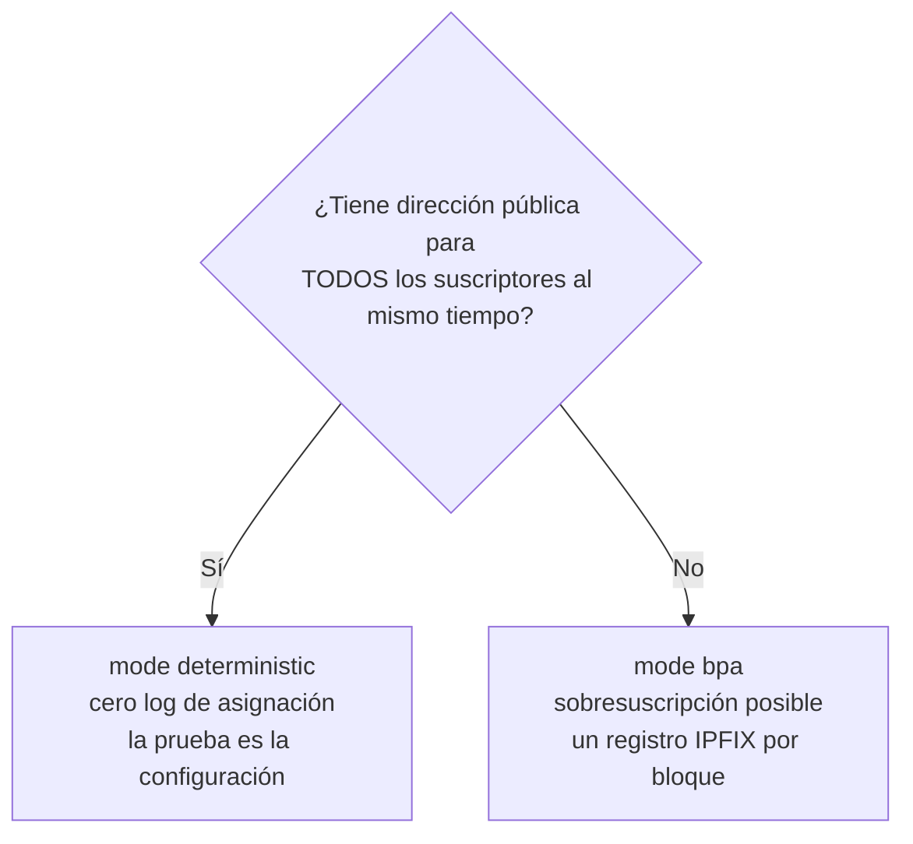

# Primeros pasos

Del disco vacío hasta suscriptores navegando. Cada paso dice **qué escribir** y **cómo saber que salió bien**.



## Antes de empezar, decida dos cosas

**1. Si alguna placa debe quedarse con Linux.** En un equipo con varias placas, el dataplane se queda con todas menos la que se grabó como red de gestión en la instalación. Si usted quiere reservar otra — VLAN de gestión, camino de respaldo, storage —, es `interface <placa-de-los-suscriptores>` en `system` > `dataplane`, que hace que el equipo reclame esa y solo esa. En un equipo de una sola placa no hay nada que decidir: va al dataplane y la dirección va con ella.

**2. Determinístico o dinámico.**



Cálculo rápido para el determinístico: `suscriptores × block-size ÷ 64512` = cuántas direcciones públicas necesita. 200 mil suscriptores con bloques de 512 dan cerca de 1.588 direcciones — un `/21`.

## 1. Instalar

Arranque desde la ISO y escriba `install`. Pregunta disco, hostname, zona horaria, tamaño del volumen de log, red de gestión y contraseña de root **antes** de escribir cualquier byte, y el disco de arranque nunca aparece en la lista de destinos. Los detalles, y la instalación desatendida, están en [Instalación del appliance](/s/wiki-es/doc/instalacion-del-appliance-MgWUcARKzM).

## 2. Entrar

La consola o SSH entran directo en la VTY:

```
prisma>
```

El prompt lleva el nombre del equipo: `prisma>` es el de un equipo que quedó con el nombre por defecto de la instalación, `prisma-routing`. Un equipo instalado con otro hostname, o renombrado con `hostname <nombre>`, muestra `<nombre>>` y, en modo de configuración, `<nombre># [edit ...]`. Las pantallas de esta wiki usan `prisma>`.

Tres cosas que valen desde el primer comando:

| Qué | Cómo funciona |
|-----|---------------|
| Salida larga | todo `show` más grande que la pantalla se detiene en `--More--`: espacio muestra la siguiente pantalla, Enter la siguiente línea, `q` o Ctrl-C detienen la salida y no la sesión. `\| no-more` al final del comando muestra todo de una vez |
| Ctrl-C | borra la línea que se está escribiendo, o interrumpe el comando en curso, y vuelve al prompt. No cierra la sesión. Durante `commit`, `rollback` y la carga de una configuración se ignora |
| Shell | `start shell` abre un shell en el sistema, y `exit` vuelve a la VTY. Solo para `root` y cuentas `prisma-admin` — ver [Acceso, login y roles](/s/wiki-es/doc/acceso-login-y-roles-ZiA9s69LH4) |

La VTY se ejecuta en un contenedor propio, el plano de gestión, con su cuenta y su rol. Esto no cambia nada de lo que usted escribe; está explicado en la página de acceso.


:::info
**En el primer arranque la consola queda en silencio por un tiempo, y eso es a propósito.** El equipo solo ofrece el prompt de login después de que el dataplane levantó. Si VPP tarda, el prompt tarda junto con él — el equipo no se colgó, está esperando.

El motivo es práctico: una VTY abierta antes de que el dataplane responda no logra leer la configuración del equipo, y el `configure` escrito ahí armaría una candidata incompleta. Mientras tanto, el autotest escribe el informe de arranque en la misma consola; el prompt aparece después, completo.

Si aun así usted entra en un momento en que el dataplane todavía no respondió, el `configure` lo rechaza y lo dice, en lugar de dejarlo trabajar sobre una lectura vacía.

:::

## 3. La placa del dataplane, que el equipo elige solo

**Un equipo recién instalado ya reenvía.** Usted no necesita decirle qué placa usar: el dataplane reclama las placas por sí solo, según una regla que cabe en una frase y que se puede prever sin consultar nada.


:::info
**El dataplane reclama todas las placas PCI que tiene este equipo, excepto una reservada para Linux, y nunca la última.**

:::

La reserva **no es un ajuste nuevo**. Es la red de gestión que el instalador ya preguntó, leída de vuelta del archivo que él mismo escribió. Quien de verdad quiere una placa reservada para Linux lo dice en la instalación, y en ningún otro lugar después.

El "nunca la última" es la parte que decide el caso más común que existe — la máquina virtual de una sola placa. Ahí la reserva se ignora y el dataplane se queda con la placa; de lo contrario el equipo quedaría instalado, correcto y sin reenviar nada, que es justamente el estado que esta regla existe para eliminar.

Una placa cuya dirección, MAC y gateway el equipo **no logre leer completos** no se reclama. Una dirección que no sabe leer es una dirección que no sabría devolver, y entregar la placa en ese estado sería una entrega sin retorno.

### Verificando qué eligió, y por qué

```
show hardware
```

Además de listar las placas, la pantalla explica la decisión. En un equipo de una sola placa, instalado con esa placa como red de gestión:

```
The dataplane claims it. It is the only card this box has, and a reserve
never takes the last card.
```

En un equipo instalado sin red de gestión (`none`, el valor por defecto), la frase dice que el dataplane se queda con todas y que ninguna placa está reservada para Linux, así que al equipo se lo alcanza por la consola.

En un equipo con varias y una reservada en la instalación, la pantalla cuenta las placas (`The dataplane claims 2 of this box's 3 cards`), lista las que reclamó el dataplane bajo `Claimed by the dataplane:` y la reservada bajo

```
Reserved for Linux:
```

seguida del nombre de la placa y de la frase que dice que es la red de gestión con la que se instaló el equipo. El nombre es siempre el que Linux le dio a la placa (`enp4s0`, `enp2s0`): el equipo mantiene ese nombre para las placas que reclama el dataplane, y es con él que aparecen en `show interface` y en el prompt `[edit interface enp4s0]`. El autotest de arranque dice lo mismo en la consola, para quien está mirando la pantalla y todavía no escribió nada.

Un equipo que se tragara una placa en silencio sería peor que uno que pregunta; y uno que reservara una en silencio dejaría al operador sin explicación para una placa ausente. Por eso se dicen las dos mitades.

### Cuando usted quiere elegir: `system` > `dataplane`

El comando sigue existiendo, y cambió de rol: era un paso obligatorio, ahora es un **override**. Es **exclusivo** — nombrar una placa hace que el equipo reclame esa y **ninguna otra**:

```
prisma> configure
prisma# [edit] system
prisma# [edit system] dataplane
prisma# [edit system / dataplane] interface enp2s0
prisma# [edit system / dataplane] commit
```

Así se reserva una placa para Linux en un equipo con varias: nombre la que lleva a los suscriptores, y todas las demás quedan. `no interface`, en el mismo nivel, le devuelve la elección al equipo.

El nombre es el que **Linux** le da a la placa. **TAB** y `?` listan las que tiene el equipo y marcan cuál lleva la ruta default:

```
prisma# [edit system / dataplane] interface ?

  enp1s0  carries the default route: its address moves with it
  enp2s0  card
  <nic>
```

Solo entran en la lista las placas que **tienen dirección PCI** — las únicas que el dataplane puede recibir. `lo`, un bridge, un *bond* y un *veth* no aparecen: ofrecer un nombre que el equipo rechazaría enseguida es lo contrario de lo que esta lista debe hacer.

### Un rechazo en el momento en que usted escribe, y una advertencia en el commit

**En un equipo que tiene otra placa, la que lleva la ruta default se acepta**, si es esa la que usted nombra. Antes se rechazaba, y el rechazo decía cuál era la otra placa. Se eliminó porque un equipo nuevo se configura en la consola, y un rechazo que protege la placa por la cual se alcanza el equipo protege un paso que nadie da por la red. En el momento en que usted escribe, no se dice nada. Lo que cambia es el `commit`: el párrafo sobre su sesión deja de decir que está a salvo y pasa a decir lo que dice el equipo de una sola placa, que se cae junto:

```
    restarting it hands the card over and ends every session on this box,
    including this one, so it is not done for you
```

**Un nombre que el equipo no tiene también se rechaza, y dice cuáles tiene:**

```
prisma# [edit system / dataplane] interface eth9
error: dataplane interface eth9: this box has no such interface
    the cards it has: enp1s0, enp2s0
    this is the name LINUX gives the card, which is what the dataplane is
    handed; 'show interface' lists what the dataplane already has, and on a box
    with no card that is nothing
```

En ambos casos nada entra en la candidata: el rechazo es en el prompt, no después del `commit`.

### El `commit` guarda y recalcula; quien mueve la placa es el reinicio

Cambiar el override no mueve ninguna placa en el momento. La entrega le quita la placa a Linux y tira todo lo que llega al equipo por ella, así que el `commit` se detiene exactamente antes de eso y dice dónde está el límite:

```
prisma# [edit] commit
dataplane interface: enp2s0
    stored, and the boot tuning was recomputed for it
    NOT IN EFFECT YET: the dataplane claims its card when it starts, and this
    commit does not restart it
    restarting it hands the card over and ends whatever is reaching this box
    through enp2s0. The path this box is routed out of is 'enp1s0', which Linux
    keeps, so this session is not what it costs
    it is not done for you all the same: nothing here has measured what
    stopping the dataplane costs a box carrying traffic
    reboot the box in a window you have chosen, and it comes up forwarding on
    that card
commit complete
```

**El párrafo del medio es sobre su equipo, y cambia con él.** En este la gestión está en `enp1s0`, que Linux sigue teniendo, así que tirar el dataplane no tira su sesión. En un equipo de una sola placa la misma pantalla dice que la sesión se cae junto:

```
    restarting it hands the card over and ends every session on this box,
    including this one, so it is not done for you
```

Son cuatro respuestas para cuatro equipos, y el equipo elige la suya leyendo por dónde se lo alcanza. Vale notar hacia qué lado se equivoca cuando no logra leer: **advierte**. Un equipo que advierte sobre una sesión que nunca iba a caer gasta una ventana de mantenimiento que no necesitaba; un equipo al que se le dijo que la sesión estaba a salvo, y no lo estaba, es un equipo que nadie alcanza.

## 3b. El equipo de una sola placa

En una máquina virtual con una placa virtual — que es como la mayoría de las personas conoce este producto — no existe una segunda placa. La regla ya lo resuelve: **la placa va al dataplane y la dirección de gestión va junto con ella**, sin que usted escriba nada.

Cómo funciona: el dataplane se queda con el puerto y mantiene, del lado de Linux, una interfaz emparejada con él. La dirección de gestión pasa a vivir en esa interfaz. El equipo deja de alcanzarse *al lado* del dataplane y pasa a alcanzarse *a través* de él. La placa mantiene la misma MAC en el traspaso, así que nada del otro lado del cable necesita volver a aprender nada.

El camino de vuelta — dirección, MAC y gateway — se **calcula en el arranque**, leído de la placa en la ventana en que todavía es legible, y no sobrevive al arranque que lo calculó. Un registro escrito en un `commit` describiría el equipo del día en que se escribió; este no tiene cómo estar desactualizado. La ruta default se repone en Linux junto con la dirección, que es lo que mantiene el equipo alcanzable fuera de su propia subred.


:::warning
Si el equipo arranca con la placa entregada y **nada** del otro lado se quedó con ella, lo advierte en la consola en lugar de arrancar en silencio:

```
error: the card this box is reached on was handed over and nothing took it
    Linux no longer has enp3s0 and no interface the dataplane holds has
    52:54:00:12:34:56, so there is no pair for 192.0.2.10/24 to go on
    this box has no address and cannot be reached over the network until that
    is repaired from here
    'show hardware' says what the dataplane holds; 'no interface' under
    'system' > 'dataplane' gives the card back at the next start
    the card is named in this file:
    /etc/prisma-routing/tune.env
```

:::

## 4. Identificar las interfaces

```
show interface
show interface terse
```

Anote cuál es la de suscriptores (*inside*) y cuál es la de upstream (*outside*). Confirme que la de gestión no está entre ellas.

`show interface terse` da una línea por interfaz con dos columnas de estado — `Admin`, que es lo que está configurado, y `Link`, que es lo que está haciendo el cable. Antes de configurar cualquier cosa, es la forma más rápida de ver si los dos puertos que va a usar están realmente conectados.

## 5. Crear el pool

Este paso y los tres siguientes están, con cada pantalla que muestra el equipo y la parte de enrutamiento que falta aquí, en [Configurar el CGNAT paso a paso](/s/wiki-es/doc/configurar-el-cgnat-paso-a-paso-v0ecpO8lbt).

```
configure
 nat
  cgnat
   pool residencial
    prefix-inside 100.64.0.0/10
    prefix-outside 203.0.113.0/24
    block-size 512
    ports 1024 65535
    policy interleaved
    mode deterministic
    tcp-mss auto
    exit
   exit
  exit
```

Lo que decide cada línea:

| Línea | Decisión |
|-------|----------|
| `prefix-inside` | de quién es el tráfico a traducir |
| `prefix-outside` | con qué direcciones públicas sale |
| `block-size` | cuántos puertos obtiene cada suscriptor (potencia de dos) |
| `ports` | rango de puertos utilizable de la dirección pública |
| `policy interleaved` | vecinos en IP públicas diferentes, lo que diluye el bloqueo por reputación |
| `mode deterministic` | bloque por fórmula, sin log de asignación |
| `tcp-mss auto` | evita conexiones que se traban sin mensaje de error |

¿No sabe qué escribir? **TAB** completa y `**?**` lista las opciones válidas con descripción, en cualquier punto de la línea.

## 6. Habilitar en las interfaces

El lado del CGNAT se escribe en el bloque de cada interfaz:

```
interface enp3s0
 cgnat inside
 exit
interface enp4s0
 cgnat outside
 exit
```

## 7. Ver lo que va a pasar, antes de que pase

```
show configuration compare
commit check
```

`commit check` valida sin aplicar y sin tocar el equipo. En un pool nuevo es todo lo que hay que verificar. En un pool que ya existe dice más: si el cambio remapea suscriptores, el cálculo sale aquí, antes de aplicar.

En un pool que **ya existe**, la pregunta que importa es otra — cuánta gente se va a caer —, y quien la responde es el `commit` común: rechaza el cambio de mapeo e imprime el conteo exacto antes de pedir `commit remap`.

## 8. Aplicar

```
commit comment "pool residencial inicial"
```

¿Trabajando a distancia? Use la red de seguridad:

```
commit confirmed 5
```

Aplica ahora y se deshace solo en 5 minutos si usted no confirma. Si el cambio corta su propio acceso, la máquina se recupera.

## 9. Guardar

```
exit
save
```

`**commit**` **lo hace valer ahora;** `**save**` **lo graba en disco.** Sin el `save`, la configuración desaparece en el próximo arranque. Son dos decisiones distintas, por eso son dos comandos.

## 10. Verificar

```
show cgnat pool
show cgnat subscriber 100.64.0.5
```

El `show cgnat subscriber` responde con la **dirección pública**, el **rango de puertos** de ese suscriptor y cuántas sesiones tiene abiertas (`sessions N`).

Si la dirección no pertenece a ningún pool, dice `not inside any configured pool`. Eso es una respuesta, no un error: significa que ningún `inside` cubre esa dirección.

Con tráfico pasando:

```
show cgnat top       quién está más cerca de llenar el bloque
show cgnat drops     lo que no pasó, y por qué
```

## ¿Y el enrutamiento?

Se configura en la misma VTY, en la misma sesión y con el mismo `commit`: rutas estáticas en `router static`, BGP en `router bgp`, y política de enrutamiento en `policy-options`. El mínimo para que el CGNAT funcione — la ruta default y el anuncio del pool — está en [Configurar el CGNAT paso a paso](/s/wiki-es/doc/configurar-el-cgnat-paso-a-paso-v0ecpO8lbt); el BGP completo, en [Configuración de BGP](/s/wiki-es/doc/configuracion-de-bgp-s4fDtTXgPx).


:::warning
**Cuidado con la MTU.** Una interfaz sin `mtu`, y su par en Linux, empiezan en 1500, el predeterminado del equipo desde la 0.152.1 (en una placa que no llega a 1500, en el máximo de la placa). Un vecino con otra MTU deja la adyacencia OSPF trabada en Exchange, sin mensaje de error. Ajústela con `mtu` dentro del bloque `interface`. En un equipo instalado antes de la 0.152.1 las interfaces siguen en 9000: la actualización escribió `mtu 9000` en ellas.

:::

# Cómo verificar

Antes de considerar la máquina lista:

- [ ] `show hardware` muestra las placas que reclamó el dataplane, y la de gestión no está entre ellas (o, en un equipo de una sola placa, el equipo sigue alcanzable después del reinicio)
- [ ] La interfaz de gestión **no** está en el CGNAT
- [ ] `show cgnat pool` lista el pool
- [ ] `show cgnat subscriber <ip-de-prueba>` devuelve la dirección pública y el rango de puertos
- [ ] El tráfico de prueba sale y vuelve
- [ ] Se ejecutó `save`
- [ ] Si es modo dinámico: colector IPFIX configurado y `show cgnat logging` lo confirma

# Ver también

* [Recetas del día a día](/s/wiki-es/doc/recetas-del-dia-a-dia-maiZboGbqY) — las tareas que vienen después de estar en el aire
* [Configuración de pool](/s/wiki-es/doc/configuracion-de-pool-Y3cACG9QHA) — cada campo del pool, campo por campo
* [Operación y diagnóstico](/s/wiki-es/doc/operacion-y-diagnostico-iHMcBJQ91I) — cuando algo no funcione
