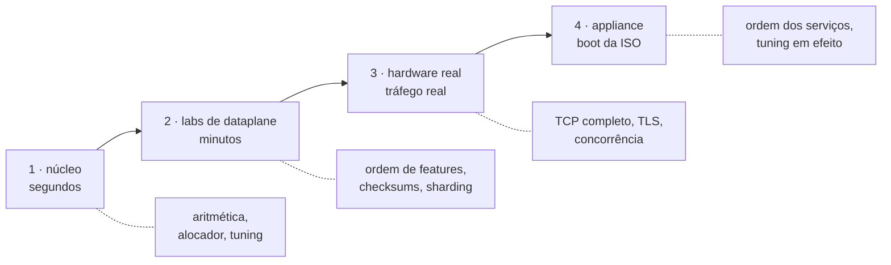

# Build, testes e laboratórios

Como compilar o plugin, gerar a ISO e rodar os testes. Para quem vai mexer no código ou precisa reproduzir um resultado.

# Construindo

```sh
sh tools/build.sh image     # constrói o container de build, VPP fixado em 26.06
sh tools/build.sh plugin    # compila o plugin bpa
make iso                    # gera a mídia de instalação
```

O build roda dentro de um container (`hexarouting-dev:26.06`) para que a versão do VPP seja a mesma em qualquer máquina. Se o socket do Docker negar acesso, os scripts se re-executam através de `sg docker` sozinhos.

# Os quatro níveis de teste



Do mais barato para o mais caro. Cada um pega uma classe de defeito que os outros estruturalmente não pegam.

```sh
make test                 # 3 s    — núcleo, sem root, sem VPP
sh tools/lab.sh <nome>    # min    — laboratórios de dataplane com pacotes injetados
sh tools/lab.sh hw-lab    # min    — duas VMs, tráfego real da Internet
sh tools/lab.sh boot-iso  # s/min  — a appliance dando boot de verdade
```

## Nível 1 — núcleo

```sh
make test     # aritmética BPA, alocador de portas, clamp de MSS, deslocamento
              # de sequência do FTP, tuning de boot, VTY, modelo da candidata,
              # respostas do instalador
make model    # valida o próprio modelo de referência
```

Roda em segundos, numa conta comum de desenvolvedor. Não precisa de root, VPP nem rede.

**Duas especificações do mapeamento, que precisam concordar:** `src/plugins/bpa/bpa_pool.h` é a implementação; `ref/bpa_model.py` é a **especificação executável** — calcula o mesmo mapeamento a partir da especificação, não da implementação. O `make test` confere 30.000+ vetores contra ele. Qualquer divergência quebra o build.

É por isso que um teste pedindo ao dataplane para confirmar a própria aritmética não vale nada aqui: o oráculo existe justamente para que ele não precise.

## Nível 2 — laboratórios de dataplane

```sh
sh tools/lab.sh              # lista todos os laboratórios
sh tools/lab.sh datapath     # tradução no nível do pacote
sh tools/lab.sh ftp-alg off  # roda o laboratório com o recurso DESLIGADO
```

Qualquer coisa depois do nome do laboratório chega a ele como argumento. É o que permite rodar um laboratório com o recurso que ele testa desligado — **a única forma de saber se o laboratório consegue falhar**.

## Nível 3 — hardware real

```sh
make hw-up      # cria o container hexa-vpp (segura ~4 GB)
make hw-lab     # configura endereços e rotas nas DUAS máquinas
make hw-vpp     # inicia o VPP do laboratório
make hw-down    # quando terminar — não esqueça
sh tools/vty.sh # abre a VTY dentro do container
```

## Nível 4 — a appliance

```sh
make test-iso       # dá boot na ISO e exige que o self-test diga "ready"
make test-install   # instala em disco vazio e dá boot nesse disco sem a ISO
make test-appliance # arquivos de startup e tuning, dentro do container
```

# Uma regra que explica muita coisa: **um contador não é evidência**

A classe de defeito recorrente neste projeto é o artefato que reporta sucesso sem verificar efeito:

* `vppctl` sai com 0 em caso de falha;
* um ALG incrementa o contador dele tendo a reescrita saído certa ou não;
* um bypass implementado *depois* da alocação passa no "saiu sem tradução" e falha no "não alocou nada".

Por isso os laboratórios verificam o **pacote capturado** ou a **trilha**, nunca contadores. E todo laboratório de recurso **precisa** poder rodar com o recurso desligado, e **precisa** falhar quando rodado assim. Uma asserção que nunca falhou não foi demonstrada testar coisa alguma.

# Os laboratórios

## Tradução e caminho do pacote

| Laboratório | O que prova |
|-------------|-------------|
| `datapath`  | injeta pacotes e confere a tradução contra o modelo de referência |
| `smoke`     | sobe o VPP com o plugin e exercita a CLI de pool; não precisa de NIC |
| `handoff`   | as duas direções do mesmo assinante caem no mesmo worker |
| `frag`      | fragmento não-inicial não carrega porta; sem reassembly virtual raso ele se perde |
| `hairpin`   | um assinante alcançando outro pelo endereço público (RFC 4787 REQ-9) |
| `icmp-tcp`  | erros ICMP (PMTUD) e estado TCP (RST/FIN) |
| `nat-behaviour` | mapeamento e filtragem da RFC 4787, asseverados em vez de raciocinados |
| `two-pools` | dois pools, e um assinante no mesmo índice em cada |
| `vrf`       | dois clientes, uma mesma faixa privada, dois pools |

## Modos e alocação

| Laboratório | O que prova |
|-------------|-------------|
| `dynamic`   | modo dinâmico: bloco alocado sob demanda, devolvido após hold-down |
| `dynamic-workers` | modo dinâmico com 2 workers: particionamento do espaço de blocos |
| `extblocks` | assinante que enche o bloco recebe outro |
| `utilisation` | ver um pool enchendo, antes de ter enchido |
| `limits`    | limites por assinante: sessões simultâneas e taxa de sessões novas |

## Recursos

| Laboratório | O que prova |
|-------------|-------------|
| `bypass`    | prefixos que saem sem tradução, e sem alocar nada |
| `forward`   | porta de entrada fixada no socket de um assinante |
| `mss`       | clamp de MSS no handshake |
| `urpf`      | origem forjada numa interface interna não é traduzida |
| `ftp-alg`   | o endereço que o FTP carrega no payload, e os números de sequência |
| `rtsp`      | o cabeçalho Transport carrega as portas de mídia |
| `pptp`      | PPTP através do CGNAT |

## Plano de controle e operação

| Laboratório | O que prova |
|-------------|-------------|
| `lcp`       | a cola entre VPP e Linux |
| `routing`   | BGP, OSPF e IS-IS sobre o TAP do `linux_cp` |
| `vty`       | a VTY: uma CLI para roteamento e CGNAT |
| `vty-pool`  | ajustes por pool pela VTY, até o dataplane |
| `vty-ssh`   | o daemon SSH e as contas que podem logar |
| `commit`    | commit e rollback no estilo Juniper |
| `in-place`  | mudar um ajuste de pool não recria o pool |
| `troubleshoot` | os `show` com que um operador chega, pela VTY |
| `api`       | API binária: um código de retorno de verdade, em vez de casar texto |
| `audit`     | a trilha datada de configuração |
| `ipfix` / `ipfix-tcp` | exportação IPFIX, e o que acontece quando o coletor morre |
| `snmp`      | o agente SNMP, consultado como um NMS consulta |
| `throughput` | quanto o CGNAT custa por pacote, em ciclos de CPU |

## Appliance e hardware

| Laboratório | O que prova |
|-------------|-------------|
| `boot-iso`  | dá boot na ISO no QEMU e mostra o self-test do console |
| `install-iso` | instala a ISO num disco vazio e dá boot nesse disco sem a ISO |
| `hw-lab`    | laboratório em hardware real: duas VMs, tráfego real |
| `hw-vpp`    | inicia o VPP do laboratório em hardware real |

# Abrindo a VTY em laboratório

```sh
sh tools/vty.sh                   # sessão interativa
sh tools/vty.sh -c "show cgnat pool"   # um comando e sai
```

Precisa do container `hexa-vpp` rodando (`make hw-up`, depois `make hw-vpp`).

# Ver também

* [Dataplane — comandos vppctl e API](/doc/dataplane-comandos-vppctl-e-api-NGEar02P0x) — o que os laboratórios exercitam
