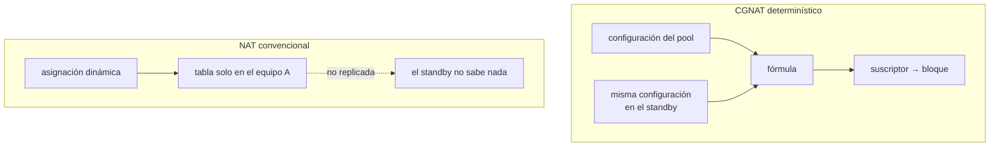

# Alta disponibilidad

Qué sucede cuando este equipo se cae, cómo montar el par activo/standby, qué preserva la conmutación y qué tira. Para quien está diseñando redundancia.


:::info
**Activo/standby está implementado.** Dos equipos sostienen una dirección de servicio entre ellos con VRRP (RFC 5798) **en la interfaz del dataplane**, y la verificación de aceptación (dos instancias, tres formas de perder la activa) pasa por completo.

**Lo que sigue sin existir es la sincronización de sesiones.** Las conexiones en curso se caen en el failover, como se caen en cualquier NAT. Lo que no cambia es la dirección pública y el bloque de puertos del suscriptor.

:::

# Lo que el modo determinístico da gratis

En un CGNAT convencional el mapeo suscriptor → (IP pública, puerto) es resultado de una asignación dinámica: existe **solo** en la tabla del equipo que lo creó. Un standby no sabe nada, y un failover cambia la dirección pública de todo el mundo.



| Después del failover | NAT convencional | CGNAT determinístico |
|----------------------|------------------|----------------------|
| IP pública del suscriptor | cambia           | **no cambia**        |
| Bloque de puertos    | cambia           | **no cambia**        |
| Conexiones en curso  | se caen          | se caen              |
| Conexiones nuevas    | necesitan una asignación nueva | funcionan de inmediato |
| Estado a sincronizar para lo anterior | la tabla completa | **ninguno**          |

La fila que importa: las conexiones en curso se caen en ambos casos, pero en el determinístico se restablecen **en la misma dirección pública**. Para el suscriptor, la diferencia entre "se cayó y volvió" y "se cayó, volvió y ahora mi IP es otra" es grande: la segunda rompe todo lo que dependía de la dirección.

Esto no es HA. Es el piso desde donde parte la HA, y ya es más alto que lo habitual.

**Esto vale para pools determinísticos.** Un pool BPA (`mode bpa`) asigna bloques bajo demanda, y el equipo que asume no sabe lo que asignó el otro: en él, la conmutación se comporta como la columna del NAT convencional; el suscriptor vuelve con otro bloque, y posiblemente otra dirección pública.

# Lo que todavía falta

Preservar las conexiones en curso exige sincronizar la tabla de sesiones, porque el camino de vuelta necesita el **puerto privado**, y ninguna fórmula lo produce.

| Diseño | Costo | Qué preserva |
|--------|-------|--------------|
| Activo/standby sin sincronización | \~cero | dirección pública y bloque; las conexiones se caen |
| Sincronización de sesiones por multicast | alto: cada creación y eliminación de sesión se convierte en un mensaje | conexiones en curso |
| Activo/activo con particionamiento de suscriptores | medio | la mitad del tráfico no se ve afectada por una falla |

La sincronización de sesiones es la única que preserva conexiones y la más cara: en un equipo de 200 mil suscriptores con cientos de sesiones cada uno, replicar cada creación y eliminación es un flujo de plano de control comparable al propio log.

El **modo dinámico (BPA)** agrega un requisito: la asignación de bloques tendría que coordinarse, o los dos equipos asignarían bloques diferentes al mismo suscriptor. Nada de esto existe hoy.

# Cómo montar el par

Activo/standby con VRRP en los dos lados (público e interno), **sin** sincronización de sesiones. Es honesto sobre lo que entrega: no preserva conexiones, preserva direcciones.

En cada equipo, un router virtual por lado, con el mismo `vrid` en ambos equipos y prioridad diferente:

```
interface enp1s0
 ipv4 address 100.64.3.252/22
 cgnat inside
 vrrp 1 address 100.64.3.254
 vrrp 1 priority 200
 vrrp 1 track enp2s0 decrement 150
 exit
interface enp2s0
 ipv4 address 200.150.0.11/24
 cgnat outside
 vrrp 2 address 200.150.0.254
 vrrp 2 priority 200
 vrrp 2 track enp1s0 decrement 150
 exit
```

En el otro equipo, sus propias direcciones y una prioridad menor (100, por ejemplo). Los suscriptores apuntan a `100.64.3.254` y el tránsito envía el pool a `200.150.0.254`, direcciones que **ninguno de los dos** tiene como dirección propia.

**Dónde se ejecuta el router virtual, y por qué esa es toda la decisión.** FRR trae VRRP y `keepalived` era la otra alternativa; los dos se ejecutan en Linux, que en este equipo es el par `linux_cp`. El par no es por donde pasan los paquetes: la interfaz del dataplane sí lo es. Un par montado así movería una dirección en Linux y dejaría la FIB y el CGNAT en el equipo que murió. El dataplane ya traía la respuesta: el plugin VRRP del propio VPP, cargado en todo equipo, sin ningún router virtual porque nada lo pedía.

**La MAC virtual es lo que hace que el CPE no necesite saber nada.** Quien asume la dirección asume también la MAC `00:00:5e:00:01:<vrid>` y envía un ARP gratuito; el CPE sigue enviando a la misma MAC y la trama pasa a llegar al otro equipo.

**IPv6, y un pool NAT64 en el par.** Una dirección IPv6 bajo el mismo `vrrp <vrid>` — primero una link-local, después la global — crea el router virtual IPv6 de ese id junto al IPv4, con la misma prioridad, el mismo `track` y la misma preempción. Eso es lo que hace que un pool NAT64 cambie de equipo: el gateway de los suscriptores IPv6 sigue al equipo que retiene las direcciones públicas. La MAC virtual del IPv6 es `00:00:5e:00:02:<vrid>`. `commit check` rechaza un router IPv6 sin link-local, y advierte cuando un par tiene un pool NAT64 y ningún router IPv6.

`**track**` **es la falla que el resto no cubre.** Un equipo con el uplink desconectado sigue vivo y sigue anunciando: retiene la dirección del gateway y no alcanza nada. Con `track`, la prioridad baja según el decremento y el peer asume. Elija el decremento de forma que la caída lleve la prioridad **por debajo** de la del otro. Un router solo ve como activa una interfaz rastreada que tenga dirección de su familia: para el router IPv6 el equipo habilita IPv6 por sí solo en la interfaz rastreada; para el IPv4, la interfaz rastreada necesita dirección IPv4, y `commit check` advierte cuando falta.

**La dirección virtual no responde ping.** Quien no es dueño de la dirección no responde ICMP por ella: es el comportamiento estándar de la RFC 5798 (sección 6.4.3). El monitoreo debe hacer ping a la dirección **propia** de cada equipo, que es lo que indica si ese equipo está vivo; la dirección virtual solo indica cuál de los dos la tiene. Reenviar **a través** de ella funciona normalmente.

El intervalo de anuncio no es configurable: es el valor estándar de un segundo de la RFC, lo que pone una conmutación en torno a tres segundos y medio. Tiene que ser igual en los dos equipos, y un ajuste por equipo es una forma por equipo de equivocarse.

**La prioridad de la configuración decide, y la preempción está activada.** Un equipo que vuelve retoma el servicio: el par termina donde dice la configuración, no donde lo dejó la última falla.

**Cambiar un router virtual es una conmutación, no un ajuste.** Un router virtual no se edita sin reconstruir: cualquier campo modificado en un router que ya existe hace que el equipo deje de anunciar mientras se rehace, el peer asume la dirección y la preempción la devuelve: dos elecciones, a pocos segundos una de otra, y las conexiones en curso se caen en ambas. El `commit` lo indica antes de aplicar. Crear un router nuevo no cuesta nada, porque no hay dirección que perder.

**El** `**commit check**` **rechaza lo que el** `**commit**` **no podría aplicar**: un router virtual sin dirección, y un `track` o un `vrrp` en una interfaz que el dataplane no tiene.

# Qué mide la verificación de aceptación

La verificación de aceptación se escribió **antes** de la implementación, para que esta fuera juzgada contra el requisito y no al revés. Pasan sus 22 verificaciones:

| Qué se midió | Resultado |
|--------------|-----------|
| El tráfico traducido del suscriptor a través de la dirección de servicio, antes de cualquier falla | Funciona, y el lado de afuera ve la dirección y el bloque que da la fórmula |
| **Uplink desconectado**, con el equipo vivo y reteniendo la dirección del suscriptor | Sobrevive: el `track` baja la prioridad y el peer asume, en la misma dirección pública y en un puerto del mismo bloque |
| **Dataplane detenido** de la forma en que lo detiene el propio servicio | Sobrevive, en torno a cuatro segundos |
| **Dataplane muerto** con SIGKILL | Sobrevive, en torno a tres segundos |
| Una conexión TCP en curso durante la conmutación | **Se cae**, y una nueva del mismo suscriptor toma la misma dirección y el mismo bloque |

Con un pool NAT64 y un suscriptor solo IPv6, se midieron las mismas tres fallas: el servicio vuelve en unos 3 a 4 segundos, en la misma dirección pública y el mismo bloque, y las conexiones en curso se caen igual.

La última fila de la tabla es la promesa de esta página dicha al revés: nadie debe leer una ejecución en verde como "las conexiones sobrevivieron".

Lo que **no** se midió aquí: si la placa de red real avisa que se desconectó el cable. La interfaz de laboratorio no avisa, así que el laboratorio baja el puerto también en el dataplane, que es el estado que reporta en hardware una placa con el cable desconectado.


:::warning
La igualdad de configuración no se puede omitir. En el modo determinístico, dos equipos con configuración diferente fallan **en silencio**: el failover empieza a mapear suscriptores a bloques equivocados sin error visible, y los logs de los dos equipos parecen perfectamente sanos. La igualdad de configuración es un requisito, no una conveniencia.

:::

# Verificar si los dos equipos concuerdan

La pregunta es una sola: ¿una conmutación de equipo dejaría a cada suscriptor en la misma dirección pública y en el mismo bloque de puertos? `show cgnat ha` responde eso y nada más.

Para que el equipo pueda comparar, necesita tener la configuración del otro. **VRRP no transporta ninguna configuración** (la RFC anuncia una prioridad y una dirección, y nada más), así que la configuración del peer llega como archivo: ejecute `save` en el otro equipo y copie el archivo que graba, `/etc/prisma-routing/prisma-routing.conf`, a `/etc/prisma-routing/peer.conf` de este.

**En un equipo que forma par, el** `**commit**` **rechaza un cambio que divergiría.** Con `vrrp` en alguna interfaz y un `peer.conf` legible, una candidata que mapearía suscriptores de forma diferente al peer se rechaza por el nombre del pool, y `commit diverge` es la palabra de quien sabe lo que está haciendo, porque dos equipos no se commitean en el mismo instante, y toda ampliación correcta hace divergir el par entre el primer commit y el segundo. La página *commit, rollback y save* describe el rechazo completo.

**La pantalla lee los routers virtuales de los dos equipos, y no solo el mapeo.** El archivo del peer es la configuración que guardó, así que también contiene sus `vrrp`, y dos equipos que mapean igual a todo suscriptor todavía pueden ser un par que nunca conmuta:

```
  the pair
    every virtual router this box carries has one on the peer with the same id,
    the same address and a different priority
```

Dos hallazgos, y los dos son errores de configuración sin síntoma hasta el día en que importa:

* **la misma prioridad en los dos equipos.** La RFC 5798 desempata por la dirección de origen mayor, así que el par funciona y quién se queda con el servicio lo decide algo que nadie escribió. El primer failover cae donde lo ponga el direccionamiento.
* **un** `**vrid**` **que solo uno de los equipos sostiene.** No existe standby para esa dirección: el equipo que la tiene está solo. Una dirección virtual diferente bajo el mismo `vrid` es este mismo hallazgo dos veces, una por cada equipo.

La comparación es por el `**vrid**` **y por la dirección**, nunca por el nombre de la interfaz: los dos equipos sostienen una dirección bajo un `vrid`, y cómo se llama el puerto en cada lado es asunto de cada uno: `enp1s0` aquí puede ser `enp2s0` allá y el par está correcto.

Cuando los dos divergen:

```
prisma> show cgnat ha
  this box
    mapping fingerprint  50e2b92f23c2707c
    pools                residencial

  role
    enp1s0 vrrp 1   master, holding the address
      address(es)        100.64.3.254
      virtual mac        00:00:5e:00:01:01
      priority           200

  peer, from /etc/prisma-routing/peer.conf
    mapping fingerprint  9e7394fc505d2eff
    pools                residencial
    copied               2026-09-12 09:14:31

  the pair
    every virtual router this box carries has one on the peer with the same id,
    the same address and a different priority

warning: pool 'residencial' does not map subscribers the same way on the two
    boxes, so a failover moves them to other public addresses and port
    blocks, and neither box logs anything
    this box: block-size 2048
    the peer: block-size 1024
```

El equipo indica **qué pool** difiere y **qué líneas** difieren, no solo si los números coinciden o no. Cuando concuerdan, la última parte se convierte en una sola frase:

```
  the two boxes map every subscriber to the same public address and the same
  port block
```

La misma comparación se ejecuta en `commit check` y en `commit`: una modificación que aleja el par aparece en el momento en que se hace, y no en el momento en que se necesita el otro equipo.


:::info
**En un equipo que no forma par, esto es una advertencia y nunca un rechazo**, y es a propósito: sin `vrrp` en ninguna interfaz, un `peer.conf` allí es material de comparación, y un archivo en `/etc` no crea una relación que la configuración no declara.

**En un equipo que forma par, es un rechazo, con una palabra que lo anula.** Los dos equipos no se pueden modificar en el mismo instante: toda ampliación de capacidad legítima aleja el par entre el primer commit y el segundo. Un rechazo sin salida se dispararía en todo procedimiento correcto, y la forma de escapar de él terminaría siendo dejar de copiar la configuración del peer, lo que elimina la verificación, no la divergencia. Por eso existe `commit diverge`.

:::

## Qué campos deben ser iguales

Los que cambian el **mapeo**. En el modo determinístico la dirección pública y el bloque de puertos del suscriptor son función de la definición del pool, así que lo que debe coincidir es exactamente lo que cambia esa cuenta, y es la misma lista de campos que, al modificarse, tira las sesiones del pool.

| Deben ser iguales en los dos equipos | Pueden diferir |
|--------------------------------------|----------------|
| `prefix-inside`, `prefix-outside`, o lo que resuelven `prefix-list-inside` y `prefix-list-outside` | `timeout ...`  |
| `block-size`, `ports`                | `alg` de cada protocolo, `tcp-mss` |
| `policy`, `mode`                     | `bypass source`, `bypass destination` |
| `reserve`                            | `max-sessions`, `max-session-rate` |
| `vrf`, `outside-vrf`                 | `forward ...`, `block-stride`, `max-blocks`, `utilisation-alarm` |
| `subscriber-length`, `nat64-prefix` (pool NAT64) | `initial-allocation`, `filter` |

La columna de la derecha la modifica el dataplane en un pool que está pasando tráfico, y ninguno de esos ajustes mueve a ningún suscriptor. Dos equipos que difieren solo allí están correctos, y advertir sobre ellos sería enseñarle al operador a ignorar la advertencia que importa.

## Lo que la verificación nunca hace

Puede decir "difieren", puede decir "concuerdan" y puede decir "no sé", y la tercera respuesta nunca se convierte en la segunda.

| Situación | Qué dice el equipo |
|-----------|--------------------|
| No hay archivo del peer | Que no lo hay, y que eso no es una concordancia |
| El archivo está vacío, truncado o sin ningún pool | El motivo, nunca "iguales" |
| El archivo tiene una línea que esta VTY no sabe leer | Qué línea, porque el pool comparado no sería el que tiene el peer |
| El dataplane no responde | Que se detuvo ahí: sin él este equipo no sabe lo que él mismo mapea |


:::warning
El archivo del peer es una **copia**, y una copia tiene antigüedad. Por eso el informe muestra la fecha junto a la huella digital: una huella digital que coincide con una configuración que el otro equipo dejó de usar la semana pasada es la misma falsa concordancia que la verificación existe para eliminar. Vuelva a copiar cada vez que modifique el peer.

:::

# Operar el par

* Mantenga la configuración de los dos equipos idéntica y versionada, y **vuelva a copiar el** `**peer.conf**` **cada vez que modifique el peer**: el rechazo del `commit` solo ve lo que dice el archivo, y el archivo tiene antigüedad.
* Verifique con `show cgnat ha` después de cada modificación: indica el rol de cada router virtual, la MAC virtual, la prioridad que el equipo está **anunciando** (que no es la configurada cuando algo monitoreado con track está caído) y si los dos mapean igual. Un equipo que anuncia menos de lo configurado tiene un cable desconectado, no un problema de VRRP.
* Mirando un solo puerto, `show interface <nombre>` indica si ese puerto está reteniendo la dirección de servicio o esperando.
* En el arranque, el self-test de la consola indica si los routers virtuales del archivo guardado están efectivamente en el dataplane, y cuántos retienen dirección y cuántos están en reserva. Un `vrrp` que el dataplane rechazó no aparece en `show running-config`, y sin esa línea el peer quedaría solo sin que nadie lo supiera.
* Para sacar a mantenimiento el equipo que tiene el servicio, siga la receta *Hacer mantenimiento en un equipo que forma par*: bajar la prioridad, verificar en los dos equipos, trabajar, restaurar.
* Trate una conmutación como una ventana: los suscriptores vuelven en las mismas direcciones, pero las conexiones en curso se caen.
* Monitoree la dirección **propia** de cada equipo, no la virtual.
* Si opera BPA (modo dinámico), recuerde que el bloque **no** es reproducible por fórmula: allí el failover efectivamente cambia el bloque del suscriptor.

# Vea también

* [Montar un par activo/standby](/s/wiki-es/doc/montar-un-par-activostandby-RHAskyjrZc): los pasos, en orden, con lo que hay que verificar en cada uno
* [Determinístico y BPA — conceptos y mapeo](/s/wiki-es/doc/deterministico-y-bpa-conceptos-y-mapeo-LgBbN0YDcl): por qué la fórmula hace innecesaria la sincronización
* [Ampliar la capacidad sin tirar suscriptores](/s/wiki-es/doc/ampliar-la-capacidad-sin-tirar-suscriptores-eHEJEg47aX): el otro lugar donde importa la configuración idéntica
* [Recetas del día a día](/s/wiki-es/doc/recetas-del-dia-a-dia-maiZboGbqY): *Hacer mantenimiento en un equipo que forma par*
* [commit, rollback y save](/s/wiki-es/doc/commit-rollback-y-save-6sAWJkXNO3): el rechazo `commit diverge` completo
* [Prisma Routing — visión general](/s/wiki-es/doc/prisma-routing-vision-general-ehYILTAs3q): el estado de cada componente
