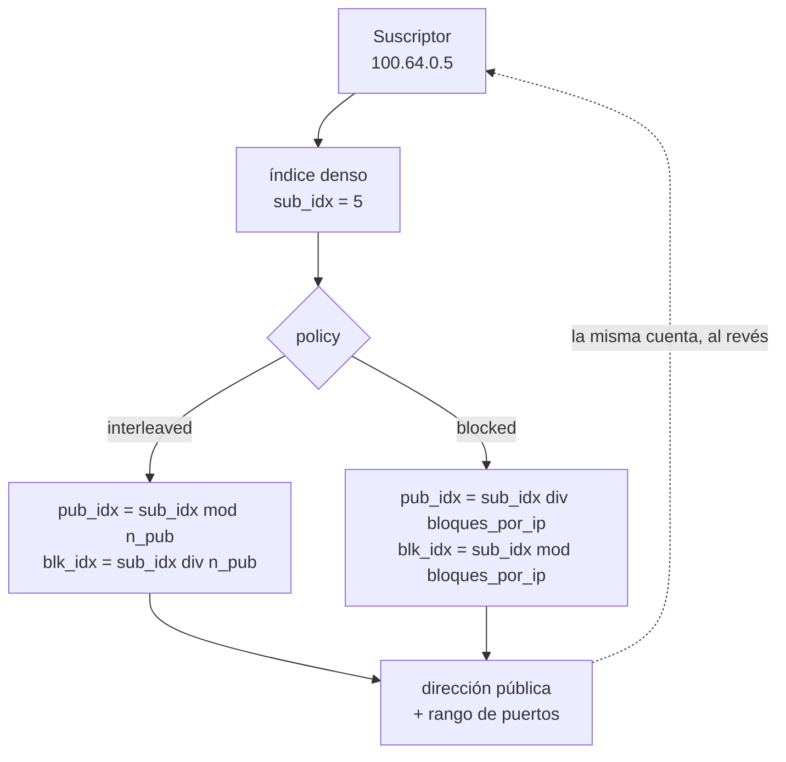

# Determinístico y BPA — conceptos y mapeo

Cómo se decide el bloque de puertos de un suscriptor en cada uno de los dos modos de pool, y las consecuencias prácticas de ello. Léalo antes de elegir el modo de un pool o de modificar cualquier campo de mapeo.

# Determinístico y BPA: dos formas de CGNAT por bloque

Los dos le dan a cada suscriptor un **bloque contiguo de puertos**, en lugar de un registro por flujo. Lo que cambia es cómo se asigna el bloque, y con ello lo que hay que registrar:

* **Determinístico** — el bloque sale de una **fórmula** sobre la configuración del pool. Para encontrar quién usaba una IP y un puerto basta con la cuenta, sin ningún log de asignación. Es el `mode deterministic`.
* **BPA** — *Bulk Port Allocation* — los bloques se **asignan dinámicamente**, bajo demanda: el suscriptor recibe una primera asignación y gana más bloques en escalones, a medida que llena los que tiene. Cada asignación y cada liberación se convierte en un registro, y son esos registros los que responden quién usaba el puerto. Es el `mode bpa`, con `block-size` como escalón, `max-blocks` como techo y, si quiere una primera asignación mayor que el escalón, `initial-allocation`.

BPA es **solo** el modo dinámico. Determinístico no es un tipo de BPA: el paraguas de los dos es *CGNAT por bloque de puertos*, y la elección es entre determinístico y BPA.

El módulo del dataplane que hace las dos cosas se llama `bpa`, y ese nombre aparece en contadores e identificadores internos para los dos modos. Sigue así para no romper scripts ni equipos instalados, pero no significa que un pool determinístico sea BPA. En la VTY, los comandos son `show cgnat ...`, y `show nat64 ...` para mirar solo los pools NAT64.

|     | Determinístico (`mode deterministic`) | BPA (`mode bpa`) |
|-----|-------------------------------------|----------------|
| Cómo se asigna el bloque | por fórmula                         | bajo demanda   |
| Log de asignación | **ninguno** — excepto los bloques de la `reserve`, registrados uno por uno | un registro IPFIX por bloque asignado y por bloque liberado |
| Direcciones públicas necesarias | todos los suscriptores tienen que caber | sobresuscripción posible |
| Prueba para la autoridad | algoritmo + configuración vigente (trail), más los registros de los bloques de la reserva | los registros IPFIX |
| Bloque extra para quien llena el suyo | solo con `reserve` configurada      | sí, hasta `max-blocks` |

200 mil suscriptores en determinístico con bloques de 512 puertos requieren un `/21` público. En BPA con sobresuscripción, bastante menos.

:::info
**Un pool BPA sin exportación es un pool sobre el que nadie puede responder.** En BPA el registro exportado es la única prueba de quién estaba detrás de un puerto público. `commit` no rechaza ni advierte sobre un pool sin colector — un pool armado antes de que exista el colector es una configuración correcta —, así que la verificación es suya: `show cgnat logging` dice si la exportación está encendida y hacia dónde va, y el autotest de arranque señala una exportación que la configuración guardada enciende y el dataplane no tiene. Vale lo mismo para un pool determinístico con `reserve`.

:::

# Cómo funciona el mapeo determinístico

Un pool define dos **conjuntos de direcciones** y un tamaño de bloque. Cada conjunto es una lista de prefijos, posiblemente no contiguos, presentados como un espacio de índices denso `[0, cantidad)`. En el modo determinístico, el bloque del suscriptor es esta cuenta:

En BPA no existe esa cuenta para el suscriptor: el bloque viene de una lista de bloques libres, y solo el registro exportado vincula el bloque con quien lo recibió.

## Reglas que impone el mapeo

* **Los prefijos dentro de un conjunto no pueden superponerse.** La superposición rompe la biyección dirección↔índice, y una biyección rota significa **un suscriptor registrado como otro** — una falla de cumplimiento legal, no solo un bug. Los prefijos superpuestos se rechazan en la configuración.
* Un prefijo `/0` se rechaza: "todas las direcciones" no es un pool.
* `block-size` **tiene que ser potencia de dos.**
* La capacidad de un pool no supera 2^28 suscriptores.

## Por qué `interleaved` es el valor predeterminado

Con `interleaved`, suscriptores consecutivos caen en direcciones públicas **diferentes**. Si una dirección pública entra en una blacklist, el daño se reparte en lugar de tumbar un barrio entero detrás de una OLT.

Con `blocked`, los vecinos quedan en la misma dirección pública — útil cuando se quiere concentrar, pero concentra también el riesgo de reputación.

## La reserva: la única excepción del determinístico

En el determinístico, la fórmula entrega **todos** los bloques a algún suscriptor, así que no sobra ningún bloque para quien llena el suyo: sin nada más, el paquete se descarta. `reserve <n>` separa **n bloques de cada dirección pública** de la fórmula y los entrega a los suscriptores que llenaron su propio bloque.

Esos bloques son exactamente los que el algoritmo **no** produce, así que la configuración no responde por ellos: cada uno se exporta como una asignación, igual que un bloque de BPA. Y la `reserve` forma parte de la definición del pool — cambiarla remapea a los suscriptores, porque le quita capacidad a la fórmula.

# La consecuencia que más tumba redes

:::warning
**El mapeo determinístico es aritmético, no una tabla.** No existe un registro de asignación para consultar — y eso significa que **cambiar la definición del pool cambia la función**.

:::

No tener tabla es el punto central del modo determinístico: es lo que evita el log de asignación y, junto con eso, lo que permite que las dos direcciones del tráfico se repartan entre workers sin ningún lock.

Agregar un prefijo público mueve a **todos** los suscriptores en ese instante y cierra todas las sesiones del pool. Nada se corrompe, las respuestas pasadas siguen siendo resolubles, pero:

* todos los clientes se caen al mismo tiempo;
* la máquina no reporta nada anormal, porque no ocurrió nada anormal.

Por eso `commit` rechaza cambios así hasta que se pidan por su nombre, con `commit remap`. Y por eso la cuenta — cuántos suscriptores se mueven, y adónde van algunos de ellos — aparece en `commit check`, antes de que ocurra nada, y otra vez en el rechazo de `commit`.

# Sharding: por qué existe el handoff

El estado de sesión y el mapa de puertos por suscriptor son **por worker y sin lock**. Eso solo es seguro si **las dos direcciones de un suscriptor llegan al mismo worker** — y el RSS de la placa no da esa garantía: la salida hace hash sobre la dirección privada, la entrada sobre la pública.

El equipo lo resuelve reenviando el paquete al worker dueño del suscriptor, antes de traducir — y eso se verifica sobre paquetes reales, no sobre contadores. El dueño se calcula **a partir del propio paquete, por aritmética**: en el retorno, a partir de la dirección pública y del puerto. Es eso lo que evita una tabla compartida entre workers.

Con `cgnat-workers <n>`, en `system` > `cpu`, solo los últimos `n` workers son dueños de suscriptores y traducen; los demás solo reciben paquetes de la placa y se los entregan al dueño. Sin ese ajuste, todo worker hace las dos cosas. La página [Dimensionamiento y requisitos](/s/wiki-es/doc/dimensionamiento-y-requisitos-FuEOaBC4vd) explica cómo elegir.

## En BPA, el pool se reparte por worker

Asignar bloques sería un estado compartido entre workers. En lugar de eso, los bloques de un pool dinámico se **dividen entre los workers**, y cada worker solo le entrega a un suscriptor bloques de su propia porción. El worker de un suscriptor queda fijado por su dirección, no por un contador — así que nada equilibra las porciones.

La consecuencia práctica: **la sobresuscripción se mide por worker, no en el pool entero.** Una porción puede agotarse mientras otra todavía tiene bloques libres, y un suscriptor puede ser rechazado con bloques sobrando al lado.

Por eso `show cgnat pool` muestra, debajo de la capacidad, el número que el pool **garantiza** para cualquier conjunto de suscriptores, cuando ese número es menor que la capacidad. **Es contra ese piso que se dimensiona un pool BPA.** La pérdida es nula cuando las direcciones internas se entregan en secuencia desde el inicio del rango — un pool DHCP llenándose de abajo hacia arriba — y es grande en pools pequeños con muchos workers.

:::info
Existe un mecanismo que presta un bloque libre de un worker a otro, en el ciclo de un segundo en el que el equipo ya expira los bloques ociosos. Funciona, pero **viene desactivado**, y no se activa desde la VTY. Medido con suscriptores que reintentan por su cuenta, casi elimina los rechazos de la porción que se agotó, a costa de algunos rechazos iniciales en los workers que prestan; con carga uniforme todavía no se midió. Dimensione según el piso.

:::

En el determinístico no hay porción que perder: el bloque es la cuenta, y el piso es igual a la capacidad.

# Tráfico que no se traduce

`bypass` hace que un prefijo salga sin traducción — y, lo que importa igual, **sin asignar nada**.

La segunda mitad es la que suele faltar en otros equipos: un bypass aplicado *después* de la asignación sale sin traducción, pero ya consumió un puerto del bloque de un suscriptor que nunca lo necesitó. Aquí las dos propiedades se verifican sobre el paquete.

El tráfico de un suscriptor destinado **al propio equipo** — el gateway, la dirección del uplink, su SSH o su DNS — también pasa sin traducción y sin sesión.

# Qué cambia sin reconstruir el pool

Vea la página de configuración de pool. La regla: **cambia el mapeo → se reconstruye; no cambia → se aplica sin reconstruir**. El mapeo es prefijo (`prefix-inside` y `prefix-outside`, o lo que resuelven las listas de `prefix-list-inside` y `prefix-list-outside`), `block-size`, `ports`, `policy`, `mode`, `vrf`, `outside-vrf` y `reserve` — y, en un pool NAT64, `subscriber-length` y `nat64-prefix`. Cambiar una prefix-list que un pool usa reconstruye ese pool, igual que cambiar el prefijo escrito. El resto — timeouts, ALGs, límites, MSS, bypass, reenvíos, `max-blocks`, `initial-allocation` — se aplica en un pool con tráfico.

Esto no es una optimización, es corrección. Tirar la base entera de suscriptores para desactivar un ALG, limitar una máquina infectada o darle un puerto de entrada a un cliente no es un cambio que alguien pediría.

# Ver también

* [Configuración de pool](/s/wiki-es/doc/configuracion-de-pool-Y3cACG9QHA) — donde la teoría se vuelve un campo configurable
* [Logging IPFIX y trail de auditoría](/s/wiki-es/doc/logging-ipfix-y-trail-de-auditoria-LHGHuvEHJy) — la consecuencia legal del modo elegido
* [Cuando se llena el bloque de un suscriptor](/s/wiki-es/doc/cuando-se-llena-el-bloque-de-un-suscriptor-LJuUIMODBQ) — `max-blocks`, `reserve` y lo que ve el operador
* [Alta disponibilidad](/s/wiki-es/doc/alta-disponibilidad-bjNhRjSh49) — por qué la fórmula evita la sincronización, y por qué BPA no tiene esa garantía
